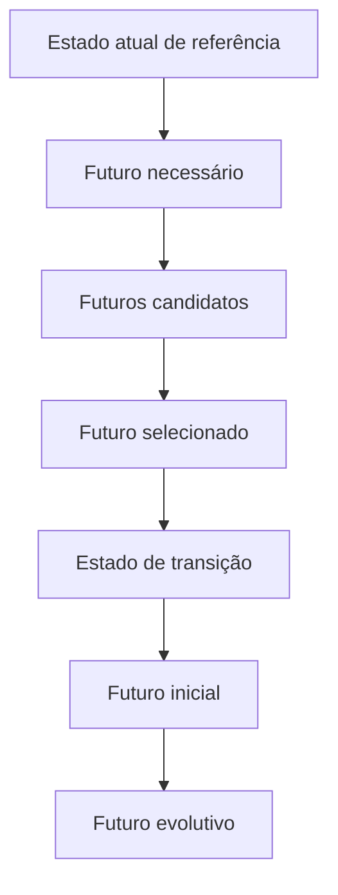

# Estado Atual e Estado Futuro — Ficha Operacional

**Sistema Operacional do Estúdio LICHTARA**  
**Módulo:** 3 — Arquitetura Organizacional  
**Ferramenta:** 01 — Estado Atual e Estado Futuro  
**Tipo:** Ficha metodológica, operacional e preenchível  
**Versão:** 0.1  
**Status:** Em desenvolvimento e validação pela prática  
**Data de criação:** 02/08/2026

**Documentos relacionados:**

- `README.md` deste diretório;
- `../README.md`;
- `../fundamentos-da-arquitetura.md`;
- `../protocolo-de-arquitetura.md`;
- `../matriz-de-rastreabilidade.md`;
- `../templates/plano-de-arquitetura.md`;
- `../templates/03-catalogo-de-requisitos.md`;
- `../templates/04-matriz-de-rastreabilidade.md`;
- `../templates/05-arquitetura-integrada.md`;
- `../templates/06-registro-de-validacao.md`;
- `../templates/08-transicao-para-implantacao.md`.

---

## 1. Finalidade

Esta ferramenta transforma a compreensão validada do funcionamento atual em uma referência suficiente para formular, comparar, integrar e validar condições organizacionais futuras.

Ela ajuda o Estúdio LICHTARA a:

- delimitar o que realmente existe no presente;
- preservar capacidades, relações e práticas valiosas;
- distinguir funcionamento formal, informal e excepcional;
- tornar rupturas, riscos e dependências visíveis;
- traduzir requisitos em capacidades futuras;
- formular o futuro necessário sem predeterminar solução;
- representar futuros candidatos materialmente distintos;
- identificar o futuro selecionado e sua primeira configuração operável;
- separar arquitetura mínima de evolução posterior;
- definir o estado de transição;
- compreender o que será criado, alterado, preservado ou encerrado;
- preparar comparações, decisões, validações e implantação.

## 2. Pergunta central

> Que condição atual precisa ser compreendida e preservada para que possamos desenhar uma condição futura capaz de atender aos requisitos, produzir as capacidades necessárias e ser alcançada sem ruptura incompatível?

Perguntas derivadas:

- O que a organização consegue realizar hoje?
- Como consegue realizar?
- O que funciona apesar da arquitetura formal?
- O que depende de memória, esforço extraordinário ou solução informal?
- Que valor seria perdido por uma mudança mal desenhada?
- Que capacidade precisa existir no futuro?
- Como reconheceremos que essa capacidade existe?
- Que configurações futuras podem produzi-la?
- Qual delas é proporcional à maturidade e aos recursos?
- Que estado temporário permitirá a passagem?
- O que precisa poder ser interrompido, revertido ou encerrado?

## 3. O que é

Estado Atual e Estado Futuro é uma ferramenta de referência, contraste, formulação e transição.

Ela organiza cinco objetos temporais:

1. **estado atual de referência** — condição validada em data e escopo definidos;
2. **estado futuro necessário** — capacidades e condições derivadas de requisitos, ainda neutras quanto à solução;
3. **estados futuros candidatos** — configurações alternativas capazes de realizar o futuro necessário;
4. **estado futuro inicial selecionado** — primeira configuração aprovada que deverá operar;
5. **estado futuro evolutivo** — desenvolvimento posterior condicionado por evidência, volume, maturidade ou necessidade.

Entre o estado atual e o futuro inicial, a ferramenta define as necessidades do **estado de transição**.

## 4. Função no protocolo

| Etapa | Função da ferramenta |
| --- | --- |
| Aceite da transição | Verificar se existe compreensão suficiente do funcionamento atual |
| Planejamento | Definir escopo, fontes, profundidade e participantes |
| Requisitos | Relacionar problemas atuais a condições futuras verificáveis |
| Estado atual de referência | Selecionar do diagnóstico o contexto necessário ao desenho |
| Capacidades futuras | Formular aquilo que a organização precisa conseguir realizar |
| Alternativas | Representar configurações futuras materialmente distintas |
| Integração | Conectar capacidades, componentes, relações e temporalidade |
| Avaliação | Comparar diferenças, impactos, esforço, risco e manutenção |
| Validação | Confrontar atual, futuro e transição com pessoas e cenários |
| Aprovação | Consolidar o futuro selecionado e a linha de base |
| Implantação | Transferir mudanças, dependências, prioridades e retorno |

O estado atual de referência é aprofundado na Etapa 10 do protocolo. As capacidades futuras são formuladas na Etapa 11. Os futuros candidatos alimentam as etapas de alternativas, integração e avaliação.

## 5. Saídas principais

| Saída | Função | Destino |
| --- | --- | --- |
| Delimitação temporal | Registrar data, período e validade da referência | Plano e registro do projeto |
| Mapa do estado atual | Sintetizar capacidades, componentes, relações e resultados | Arquitetura Integrada |
| Mapa de capacidades | Relacionar capacidades atuais, futuras, dependências e horizontes | Alternativas e integração |
| Registro de preservações | Proteger o que não pode ser perdido | Requisitos e decisão |
| Registro de mudanças | Classificar criação, alteração, continuidade e encerramento | Arquitetura e implantação |
| Futuros candidatos | Representar configurações comparáveis | Avaliação de Alternativas |
| Futuro selecionado | Consolidar configuração autorizada | Linha de base |
| Estado de transição | Definir condições temporárias necessárias | Módulo 4 |
| Matriz atual–futuro | Tornar diferenças e impactos visíveis | Decisão, validação e relatório |
| Questões abertas | Registrar lacunas e hipóteses | Diagnóstico, especialistas ou validação |

## 6. O que a ferramenta não é

Não é:

- repetição integral do diagnóstico;
- fotografia neutra e atemporal da organização;
- descrição de todos os detalhes existentes;
- lista de problemas;
- visão inspiracional de futuro;
- promessa de resultado operacional;
- plano detalhado de implantação;
- cronograma;
- catálogo de sistemas;
- mapa de processo completo;
- organograma futuro;
- escolha de ferramenta;
- prova de que a arquitetura funcionará;
- justificativa retroativa para uma solução já preferida.

## 7. Modelo temporal



### 7.1 Regra

O futuro necessário precede os futuros candidatos. O futuro selecionado somente existe depois de avaliação e decisão. O estado de transição precede o futuro inicial na realidade, embora seja desenhado a partir dele.

### 7.2 Temporalidade não linear

Podem existir:

- ciclos de teste;
- operação paralela;
- capacidades introduzidas em ondas;
- componentes temporários;
- retorno parcial;
- futuros diferentes por unidade ou público;
- evolução condicionada;
- encerramento sem substituição.

Essas variações precisam ser representadas, não comprimidas em uma seta genérica.

## 8. Níveis de existência da arquitetura

| Nível | Significado | Relação com a ferramenta |
| --- | --- | --- |
| Pretendida | Condição desejada ou requerida | Origina o futuro necessário |
| Representada | Condição descrita em mapas e modelos | É o que a ferramenta produz |
| Aprovada | Configuração autorizada | Constitui o futuro selecionado em linha de base |
| Implantada | Componentes disponibilizados | Será observada pelo Módulo 4 |
| Praticada | O que as pessoas realmente fazem | Será confrontada pelo Módulo 5 |
| Sustentada | O que permanece funcional no tempo | Será avaliada por operação e aprendizagem |

A ferramenta não deve declarar futura arquitetura como praticada ou sustentada antes de evidência operacional.

## 9. Princípios

1. **Referência datada** — o estado atual existe em período definido.
2. **Evidência antes da síntese** — representação atual precisa de fontes.
3. **Respeito pela arquitetura existente** — informal não significa inútil.
4. **Preservação explícita** — valor existente não pode depender de memória.
5. **Neutralidade provisória** — o futuro necessário não fixa solução.
6. **Alternativas reais** — futuros candidatos precisam diferir materialmente.
7. **Relações antes de listas** — funcionamento depende de interfaces.
8. **Temporalidade completa** — transição e evolução integram o desenho.
9. **Proporcionalidade** — representar apenas o necessário à decisão.
10. **Realismo organizacional** — futuro respeita maturidade, recursos e hábitos.
11. **Exceções visíveis** — desvios e falhas também constituem o atual.
12. **Responsabilidade humana** — pessoas interpretam, validam e decidem.
13. **Reversibilidade** — a passagem precisa de interrupção e retorno.
14. **Validação futura limitada** — representação não prova operação.

## 10. Quando utilizar

- no início de toda arquitetura formal, em profundidade proporcional;
- quando o diagnóstico é amplo e o desenho precisa de referência focal;
- quando capacidades a preservar não estão explícitas;
- quando diferentes pessoas descrevem realidades incompatíveis;
- quando problemas atuais estão sendo confundidos com soluções;
- quando o futuro aparece como intenção vaga;
- quando alternativas precisam ser comparadas;
- quando a transição pode criar ruptura;
- quando tecnologia ou IA ameaça predeterminar o desenho;
- quando mudanças afetam pessoas, poder, conhecimento ou continuidade;
- quando existe arquitetura anterior que será substituída;
- quando o projeto foi reaberto por mudança de contexto.

## 11. Quando não utilizar ou reduzir

Reduzir ou não aprofundar quando:

- a questão focal já possui referência atual validada e suficiente;
- a mudança não altera capacidade, relação ou responsabilidade material;
- a saída não apoiará alternativa, decisão, integração ou implantação;
- o detalhe pertence exclusivamente ao Módulo 4;
- repetir o diagnóstico criaria carga sem reduzir incerteza;
- a organização não possui acesso legítimo às fontes necessárias;
- outra representação oficial já responde à pergunta.

Não utilizar para adiar decisão por busca de completude absoluta.

## 12. Proporcionalidade

| Escopo | Estado atual | Futuro | Transição | Validação |
| --- | --- | --- | --- | --- |
| Focal | Capacidade, fluxo ou interface delimitada | Uma ou poucas configurações | Mudanças e retorno essenciais | Pessoas diretamente envolvidas e caso crítico |
| Funcional | Área ou capacidade ampla com interfaces | Alternativas integradas por dimensão | Ondas, dependências e papéis temporários | Usuários, responsáveis, decisores e especialistas pertinentes |
| Sistêmico | Múltiplas capacidades e relações cruzadas | Configurações sistêmicas e horizontes | Portfólio de transições coordenadas | Validação transversal e cenários de estresse |

### 12.1 Fatores de aprofundamento

- impacto humano;
- risco de continuidade;
- sensibilidade de dados;
- quantidade de interfaces;
- novidade da capacidade;
- dependência de fornecedor;
- automação ou IA;
- irreversibilidade;
- conflito entre públicos;
- custo do erro;
- duração da transição;
- diferença entre maturidade atual e futura.

## 13. Papéis participantes

| Papel | Contribuição |
| --- | --- |
| Responsável pela arquitetura | Delimita pergunta, integra estados e responde pela coerência |
| Responsável pelo diagnóstico | Esclarece evidências, limites e mudanças desde a coleta |
| Pessoa que realiza o trabalho | Explica funcionamento, exceções, carga e soluções informais |
| Responsável pela capacidade | Avalia resultado, manutenção e continuidade |
| Pessoa afetada | Torna impactos, barreiras e valor visíveis |
| Decisor | Confirma direção, critérios, preservações e escolha futura |
| Responsável pela implantação | Avalia alcançabilidade, sequência e retorno |
| Especialista | Examina matéria técnica, jurídica, humana ou de segurança |
| Custodiante | Preserva fontes, versões, acessos e registros |
| IA | Apoia organização, contraste, modelagem e revisão sem autoridade |

### 13.1 Ausências relevantes

| Público ausente | Perspectiva perdida | Efeito | Compensação |
| --- | --- | --- | --- |
| [Papel/grupo] | [Preencher] | [Preencher] | [Entrevista, fonte, validação futura ou limitação] |

## 14. Autoridade

| Ato | Prepara | Consulta | Decide | Registra |
| --- | --- | --- | --- | --- |
| Delimitar referência atual | Arquitetura/diagnóstico | Pessoas conhecedoras | Responsável pela arquitetura | Custodiante |
| Confirmar fato atual | Autor da análise | Fonte/pessoas | Responsável competente | Custodiante |
| Formular capacidade futura | Arquitetura | Afetados e responsáveis | Decisor conforme escopo | Arquitetura |
| Definir preservação obrigatória | Arquitetura | Detentores/afetados | Decisor | Registro de decisão |
| Selecionar futuro | Arquitetura | Participantes e especialistas | Autoridade definida | Registro de decisão |
| Aceitar risco de transição | Arquitetura/implantação | Especialistas | Autoridade de risco | Registro de decisão |
| Aprovar linha de base | Responsável pela arquitetura | Validadores | Aprovador | Custodiante |

Nenhum mapa decide sozinho o que deverá ser preservado, substituído ou encerrado.

## 15. Entradas necessárias

| Entrada | Função | Fonte possível |
| --- | --- | --- |
| Síntese diagnóstica | Contexto e problemas prioritários | Módulo 2 |
| Matriz de evidências | Sustentar o estado atual | Módulo 2 |
| Capacidades a preservar | Proteger valor existente | Transição diagnóstica |
| Catálogo de requisitos | Definir condições futuras | Template 03 |
| Riscos e restrições | Delimitar alternativas | Diagnóstico e projeto |
| Maturidade | Ajustar complexidade futura | Avaliações do Módulo 2 |
| Processos e mapas existentes | Representar trabalho atual | Fontes oficiais |
| Documentos e sistemas | Verificar memória e suporte | Organização |
| Indicadores atuais | Compreender resultados e limites | Fontes operacionais |
| Decisões relacionadas | Preservar contexto e autoridade | Registros de decisão |
| Mudanças desde o diagnóstico | Atualizar validade temporal | Participantes/fontes |
| Estratégia e horizonte | Delimitar futuro | Liderança/termo de abertura |

## 16. Qualidade das evidências

### 16.1 Classificação

| Natureza | Significado | Uso permitido |
| --- | --- | --- |
| Fato validado | Sustentado por fonte ou confirmação competente | Descrever estado atual |
| Evidência parcial | Fonte limitada, incompleta ou local | Formular conclusão condicionada |
| Percepção | Experiência de pessoa ou público | Tornar impacto e funcionamento percebido visíveis |
| Interpretação | Explicação derivada de fatos e percepções | Apoiar hipótese, com raciocínio explícito |
| Premissa | Condição assumida para continuar | Desenho provisório e verificável |
| Projeção | Estimativa sobre futuro | Cenário, nunca resultado comprovado |
| Preferência | Escolha ou valor de interessado | Critério quando explicitado e autorizado |

### 16.2 Registro

| Afirmação | Natureza | Fonte | Data/versão | Confiança | Limitação |
| --- | --- | --- | --- | --- | --- |
| [Preencher] | [Classe] | [Referência] | [Preencher] | [Alta, média ou baixa] | [Preencher] |

### 16.3 Regra

Uma prática repetida em entrevistas pode ser relevante sem constituir fato universal. Uma métrica pode ser factual e ainda possuir definição inadequada. A ferramenta deve preservar natureza, qualidade e limite da evidência.

## 17. Preparação

- [ ] problema e decisão apoiada estão claros;
- [ ] escopo e não objetivos estão definidos;
- [ ] data de referência foi escolhida;
- [ ] fontes oficiais foram identificadas;
- [ ] mudanças desde o diagnóstico foram verificadas;
- [ ] requisitos possuem versão conhecida;
- [ ] participantes foram selecionados por conhecimento e impacto;
- [ ] dimensões materiais foram classificadas;
- [ ] profundidade foi definida;
- [ ] dados e acessos foram autorizados;
- [ ] saída e destino estão planejados;
- [ ] validação atual e futura foi prevista;
- [ ] responsável pela implantação foi incluído no momento adequado.

## 18. Plano da aplicação

| Campo | Registro |
| --- | --- |
| ID da aplicação | FER-ARQ-NNN |
| Projeto | ARQ-AAAA-NNN |
| Pergunta | [Preencher] |
| Escopo | [Focal, funcional ou sistêmico] |
| Período atual de referência | [Datas] |
| Horizonte futuro | [Data, marco ou condição] |
| Requisitos | [IDs] |
| Capacidades iniciais | [IDs] |
| Responsável | [Nome/papel] |
| Participantes | [Nomes/papéis] |
| Fontes | [IDs/referências] |
| Profundidade | [Reduzida, padrão ou ampliada] |
| Saída | EAF-ARQ-AAAA-NNN |
| Validação | [Forma e responsáveis] |
| Sensibilidade | [Classificação] |

### 18.1 Atividades

| Etapa | Atividade | Responsável | Entrada | Saída | Critério |
| --- | --- | --- | --- | --- | --- |
| Referenciar | Selecionar contexto atual | [Nome] | Diagnóstico/fontes | Estado atual | Suficiente para comparar |
| Preservar | Identificar valor existente | [Nome] | Estado atual | Preservações | Validadas por detentores/afetados |
| Formular | Definir futuro necessário | [Nome] | Requisitos/capacidades | Condições futuras | Neutras quanto à solução |
| Alternar | Criar futuros candidatos | [Nome] | Critérios/condições | Alternativas | Materialmente distintas |
| Comparar | Tornar diferenças visíveis | [Nome] | Estados | Matriz | Impactos e transição claros |
| Validar | Confrontar representações | [Nome] | Mapas/cenários | Registro de validação | Resultado formal |

## 19. Data, versão e validade da referência

O estado atual muda enquanto o projeto acontece. Toda representação deve indicar:

| Campo | Registro |
| --- | --- |
| Data ou período observado | [Preencher] |
| Data de consolidação | [Preencher] |
| Fontes vigentes | [Referências] |
| Evento posterior relevante | [Preencher/nenhum] |
| Validade estimada | [Data, marco ou condição] |
| Responsável pela atualização | [Papel] |
| Gatilho de revisão | [Mudança material] |

### 19.1 Delta durante o projeto

| Mudança desde a referência | Data | Evidência | Efeito no desenho | Nova versão? |
| --- | --- | --- | --- | --- |
| [Preencher] | [Data] | [Referência] | [Preencher] | [Sim/não] |

## 20. Delimitação do estado atual

| Fronteira | Inclusão | Exclusão | Relação externa |
| --- | --- | --- | --- |
| Capacidade | [Preencher] | [Preencher] | [IDs] |
| Processo/jornada | [Início e fim] | [Preencher] | [Preencher] |
| Pessoas/papéis | [Preencher] | [Preencher] | [Preencher] |
| Áreas/unidades | [Preencher] | [Preencher] | [Preencher] |
| Sistemas/canais | [Preencher] | [Preencher] | [Preencher] |
| Localidades | [Preencher] | [Preencher] | [Preencher] |
| Período | [Preencher] | [Preencher] | [Preencher] |

### 20.1 Regra de foco

Incluir apenas o que ajuda a:

- reconhecer capacidade atual;
- explicar requisito;
- comparar alternativas;
- avaliar impacto;
- localizar dependência;
- preparar transição;
- evitar perda de valor.

## 21. Mapa de fontes do estado atual

| Dimensão | Fonte | Versão/data | Cobertura | Limitação | Validador |
| --- | --- | --- | --- | --- | --- |
| Capacidades | [Referência] | [Preencher] | [Preencher] | [Preencher] | [Papel] |
| Processos/fluxos | [Referência] | [Preencher] | [Preencher] | [Preencher] | [Papel] |
| Papéis/autoridades | [Referência] | [Preencher] | [Preencher] | [Preencher] | [Papel] |
| Informação/conhecimento | [Referência] | [Preencher] | [Preencher] | [Preencher] | [Papel] |
| Comunicação/documentos | [Referência] | [Preencher] | [Preencher] | [Preencher] | [Papel] |
| Tecnologia/IA | [Referência] | [Preencher] | [Preencher] | [Preencher] | [Papel] |
| Indicadores/resultados | [Referência] | [Preencher] | [Preencher] | [Preencher] | [Papel] |
| Riscos/exceções | [Referência] | [Preencher] | [Preencher] | [Preencher] | [Papel] |

## 22. Capacidades atuais

| ID | Capacidade | Resultado produzido | Consistência | Escala | Limites | Evidência |
| --- | --- | --- | --- | --- | --- | --- |
| CAP-ATU-NNN | [Verbo + resultado] | [Preencher] | [Confiável, variável, frágil ou desconhecida] | [Preencher] | [Preencher] | [Referência] |

### 22.1 Teste da capacidade atual

- O resultado ocorre de forma reconhecível?
- Depende de quem?
- Com que frequência e volume?
- Sob quais condições?
- O que acontece quando a pessoa-chave não está disponível?
- Que parte é sustentada por prática informal?
- Que custo humano ou técnico permanece oculto?
- Que evidência demonstra funcionamento?

### 22.2 Capacidade aparente

| Capacidade declarada | Dependência extraordinária | Fragilidade | Classificação correta |
| --- | --- | --- | --- |
| [Preencher] | [Pessoa, esforço, improviso ou ferramenta] | [Preencher] | [Sustentada, contingente, parcial ou inexistente] |

## 23. Componentes atuais

| ID | Componente | Tipo | Função real | Estado | Responsável | Fonte |
| --- | --- | --- | --- | --- | --- | --- |
| CMP-ATU-NNN | [Nome] | [Processo, papel, regra, documento, sistema, IA, indicador ou outro] | [Preencher] | [Formal, informal, temporário, legado ou desconhecido] | [Papel] | [Referência] |

### 23.1 Componentes sem função atual

| Componente | Função original | Uso real | Carga | Risco de encerrar | Questão futura |
| --- | --- | --- | --- | --- | --- |
| [ID] | [Preencher] | [Preencher] | [Preencher] | [Preencher] | [Manter, adaptar ou encerrar] |

## 24. Relações e interfaces atuais

| Origem | Relação/interface | Destino | Objeto transferido | Confirmação | Fragilidade | Evidência |
| --- | --- | --- | --- | --- | --- | --- |
| [ID] | INT-ATU-NNN | [ID] | [Trabalho, informação, decisão ou responsabilidade] | [Preencher] | [Preencher] | [Referência] |

### 24.1 Relação invisível

| Relação | Por que permanece invisível | Quem a sustenta | Risco | Tratamento no futuro |
| --- | --- | --- | --- | --- |
| [Preencher] | [Informalidade, ferramenta, memória ou hábito] | [Papel/pessoa] | [Preencher] | [Preservar, formalizar, substituir ou encerrar] |

## 25. Arquitetura formal e arquitetura praticada

| Objeto | Forma oficial | Prática real | Diferença | Motivo | Efeito |
| --- | --- | --- | --- | --- | --- |
| [Processo, papel, documento ou sistema] | [Preencher] | [Preencher] | [Preencher] | [Preencher] | [Preencher] |

### 25.1 Interpretação

Diferença entre o formal e o praticado pode indicar:

- inadequação do desenho;
- falta de compreensão;
- resistência legítima;
- adaptação útil;
- ausência de recurso;
- exceção frequente;
- ferramenta incompatível;
- documentação desatualizada;
- incentivo conflitante;
- falta de autoridade.

Ela não deve ser tratada automaticamente como falha individual.

## 26. Resultados atuais e experiência

| Resultado | Público | Evidência | Qualidade | Variabilidade | Custo oculto |
| --- | --- | --- | --- | --- | --- |
| [Preencher] | [Cliente, equipe, liderança ou outro] | [Referência] | [Preencher] | [Preencher] | [Preencher] |

### 26.1 Indicadores atuais

| Indicador | Definição | Fonte | Resultado | Limitação | Decisão apoiada |
| --- | --- | --- | --- | --- | --- |
| IND-ATU-NNN | [Preencher] | [Referência] | [Valor/período] | [Preencher] | [Preencher/nenhuma] |

## 27. Capacidades e valores a preservar

| ID | Elemento a preservar | Valor produzido | Evidência | Risco de perda | Condição futura |
| --- | --- | --- | --- | --- | --- |
| PRS-NNN | [Capacidade, prática, relação, conhecimento, autonomia ou identidade] | [Preencher] | [Referência] | [Preencher] | [Requisito/critério] |

### 27.1 Perguntas

- Que função esse elemento cumpre?
- Por que surgiu?
- Quem depende dele?
- Que valor produz?
- Que problema também produz?
- Pode ser preservado em outra forma?
- Sua perda seria reversível?
- Quem valida a necessidade de preservação?

### 27.2 Preservação não significa imutabilidade

Preservar pode significar:

- manter integralmente;
- manter a função em nova forma;
- proteger durante a transição;
- transferir conhecimento;
- garantir resultado equivalente;
- conservar apenas dentro de limite definido.

## 28. Rupturas e problemas atuais

| ID | Ruptura | Capacidade afetada | Causa conhecida/hipótese | Efeito | Evidência | Prioridade |
| --- | --- | --- | --- | --- | --- | --- |
| RPT-NNN | [Preencher] | CAP-ATU-NNN | [Preencher] | [Preencher] | [Referência] | [Escala] |

### 28.1 Separação entre problema e solução

| Problema atual | Capacidade necessária | Solução mencionada | Tratamento |
| --- | --- | --- | --- |
| [Preencher] | [Preencher] | [Preencher] | [Manter como alternativa, não como requisito] |

## 29. Exceções, contornos e trabalho invisível

| ID | Situação | Contorno atual | Quem realiza | Valor | Carga/risco | Frequência |
| --- | --- | --- | --- | --- | --- | --- |
| EXC-ATU-NNN | [Preencher] | [Preencher] | [Papel] | [Preencher] | [Preencher] | [Preencher] |

### 29.1 Classificação do contorno

| Classe | Significado | Tratamento possível |
| --- | --- | --- |
| Adaptação útil | Resolve inadequação real com valor | Preservar função e avaliar formalização |
| Compensação frágil | Mantém resultado por esforço extraordinário | Redesenhar condição estrutural |
| Exceção legítima | Caso fora do padrão exige decisão própria | Criar tratamento explícito |
| Atalho de risco | Evita controle ou expõe dano | Interromper ou proteger |
| Legado necessário | Sustenta dependência ainda ativa | Planejar transição e encerramento |

## 30. Riscos, restrições e dependências atuais

### 30.1 Riscos

| Risco | Causa | Efeito | Controle atual | Fragilidade | Futuro precisa |
| --- | --- | --- | --- | --- | --- |
| RSC-NNN | [Preencher] | [Preencher] | [Preencher] | [Preencher] | [Condição] |

### 30.2 Restrições

| Restrição | Natureza | Duração | Flexibilidade | Efeito no futuro |
| --- | --- | --- | --- | --- |
| RES-NNN | [Humana, financeira, técnica, jurídica, temporal ou outra] | [Preencher] | [Fixa, negociável ou incerta] | [Preencher] |

### 30.3 Dependências

| Dependência | Objeto dependente | Responsável | Grau de controle | Falha produz | Proteção |
| --- | --- | --- | --- | --- | --- |
| DEP-NNN | [ID] | [Papel/externo] | [Alto, médio ou baixo] | [Preencher] | [Preencher] |

## 31. Critério de suficiência do estado atual

O estado atual está suficientemente delimitado quando permite:

- [ ] reconhecer capacidades existentes;
- [ ] distinguir capacidades sustentadas de capacidades aparentes;
- [ ] localizar componentes materiais;
- [ ] compreender relações e interfaces críticas;
- [ ] diferenciar formal e praticado;
- [ ] identificar valores a preservar;
- [ ] explicar rupturas prioritárias;
- [ ] tornar exceções e trabalho invisível visíveis;
- [ ] localizar riscos, restrições e dependências;
- [ ] comparar impactos de alternativas;
- [ ] formular capacidades futuras sem suposição impeditiva;
- [ ] planejar transição no grau arquitetural.

### 31.1 Completude suficiente

Não é necessário representar toda a organização. É necessário representar tudo o que pode alterar a decisão, a integração, a validação ou a passagem para implantação dentro do escopo.

## 32. Questões que retornam ao diagnóstico

| ID | Questão | Por que é diagnóstica | Impacto | Encaminhamento | Limite |
| --- | --- | --- | --- | --- | --- |
| QDI-NNN | [Preencher] | [Falta de evidência, causalidade ou compreensão atual] | [Preencher] | [Complementar, devolver ou investigar] | [Data/condição] |

### 32.1 Gatilhos de retorno

- achado sem evidência suficiente;
- contradição material;
- mudança de contexto;
- capacidade atual desconhecida;
- risco crítico não investigado;
- público indispensável não consultado;
- relação causal tratada como fato sem suporte;
- escopo futuro superior ao diagnóstico.

### 32.2 Prosseguimento condicionado

| Questão | Premissa provisória | Risco | Limite de uso | Verificação | Autoridade |
| --- | --- | --- | --- | --- | --- |
| QDI-NNN | PRE-NNN | [Preencher] | [Preencher] | [Forma/marco] | [Papel] |

## 33. Formulação do estado futuro

O futuro deve ser formulado em camadas.

| Camada | Pergunta | Conteúdo |
| --- | --- | --- |
| Necessária | O que precisa ser possível? | Capacidades, resultados, limites e preservações |
| Candidata | Como isso pode ser organizado? | Alternativas de componentes e relações |
| Selecionada | Que configuração será adotada? | Alternativa decidida e compensações |
| Inicial | O que operará no primeiro ciclo? | Arquitetura mínima aprovada |
| Evolutiva | O que poderá entrar depois? | Componentes condicionados a evidência |

### 33.1 Proteção

Não começar o futuro por:

- ferramenta;
- organograma;
- automação;
- agente de IA;
- documento;
- modelo conhecido;
- preferência estética;
- promessa de eficiência.

Começar por capacidades, requisitos, resultados, limites e relações.

## 34. Estado futuro necessário

O futuro necessário descreve condições que qualquer alternativa admissível deverá produzir ou respeitar.

| ID | Condição necessária | Origem | Prioridade | Critério | Solução neutra? |
| --- | --- | --- | --- | --- | --- |
| CFN-NNN | [Preencher] | [REQ/CAP/PRS/RSC] | [Obrigatória, alta, média, baixa] | [Verificação] | [Sim/não] |

### 34.1 Exemplo

**Frágil:** Utilizar um CRM para acompanhar clientes.  
**Necessário:** Toda oportunidade ativa possui responsável, estado, próxima ação e histórico localizáveis por pessoas autorizadas.

### 34.2 Condições impeditivas

| Condição | Alternativa excluída quando | Autoridade | Evidência |
| --- | --- | --- | --- |
| [Preencher] | [Critério observável] | [Papel] | [Referência] |

## 35. Capacidades futuras

| ID | Capacidade | Finalidade | Resultado | Requisitos | Pessoas afetadas | Horizonte |
| --- | --- | --- | --- | --- | --- | --- |
| CAP-FUT-NNN | [Verbo + resultado] | [Preencher] | [Preencher] | [IDs] | [Papéis/grupos] | [Inicial/evolutivo] |

### 35.1 Estrutura de formulação

> A organização deverá conseguir **[realizar algo]**, para **[produzir resultado]**, com **[consistência/escala]**, preservando **[valor]** e respeitando **[limites]**.

### 35.2 Campos complementares

| Campo | Registro |
| --- | --- |
| Entradas necessárias | [Preencher] |
| Saídas | [Preencher] |
| Dependências | [IDs] |
| Condições | [Preencher] |
| Riscos | [IDs] |
| Manifestação observável | [Preencher] |
| Responsável futuro | [Papel] |
| Validador | [Papel] |

## 36. Qualidade das capacidades futuras

### 36.1 Testes

- [ ] expressa resultado organizacional;
- [ ] não é atividade isolada;
- [ ] não é recurso;
- [ ] não é ferramenta;
- [ ] possui finalidade;
- [ ] possui requisitos relacionados;
- [ ] pode ser reconhecida por manifestação observável;
- [ ] declara consistência ou escala quando material;
- [ ] preserva limites;
- [ ] possui dependências visíveis;
- [ ] é compatível com a maturidade;
- [ ] pode ser sustentada.

### 36.2 Formulações frágeis

| Formulação | Problema | Reformulação possível |
| --- | --- | --- |
| Implantar plataforma | Ferramenta como capacidade | Acompanhar trabalho compartilhado com estado e responsável |
| Fazer reuniões | Atividade | Coordenar decisões e transferências com contexto suficiente |
| Usar IA | Recurso genérico | Produzir rascunhos verificáveis sob responsabilidade editorial humana |
| Criar documentos | Componente | Preservar decisões e instruções vigentes de forma recuperável |
| Melhorar comunicação | Vaga | Confirmar mudanças críticas aos públicos afetados dentro da janela necessária |

## 37. Mapa de capacidades

### 37.1 Registro mestre

| Capacidade atual | Tratamento | Capacidade futura | Dependência | Horizonte | Evidência/justificativa |
| --- | --- | --- | --- | --- | --- |
| CAP-ATU-NNN | [Preservar, fortalecer, transformar, integrar ou encerrar] | CAP-FUT-NNN | [IDs] | [Inicial/evolutivo] | [Referência] |

### 37.2 Tipos de relação

| Relação | Significado |
| --- | --- |
| preserva | Função atual continua necessária |
| fortalece | Capacidade existe e precisa de maior consistência ou escala |
| transforma | Função permanece, mas sua organização muda materialmente |
| integra | Capacidades antes separadas passam a operar em conjunto |
| cria | Capacidade não existe no grau necessário |
| substitui | Nova capacidade assume função anterior |
| encerra | Capacidade deixa de ser necessária ou admissível |
| condiciona | Capacidade futura depende de evento ou evidência |

### 37.3 Hierarquia

| Capacidade principal | Subcapacidade | Necessidade da decomposição | Risco de fragmentação |
| --- | --- | --- | --- |
| CAP-FUT-NNN | CAP-FUT-NNN | [Preencher] | [Preencher] |

Decompor apenas quando a subcapacidade possui resultado, responsável, dependência ou horizonte próprio.

## 38. Dependências entre capacidades

| Origem | Relação | Destino | Condição | Criticidade | Tratamento |
| --- | --- | --- | --- | --- | --- |
| CAP-FUT-NNN | `depende_de` | CAP-FUT-NNN | [Preencher] | [Baixa, média, alta ou crítica] | [Preencher] |

### 38.1 Dependência circular

| Ciclo | Efeito | Capacidade inicial possível | Experimento/transição |
| --- | --- | --- | --- |
| [IDs] | [Preencher] | [ID] | [Preencher] |

### 38.2 Capacidade habilitadora

| Capacidade | Capacidades habilitadas | Precisa entrar antes? | Evidência de prontidão |
| --- | --- | --- | --- |
| CAP-FUT-NNN | [IDs] | [Sim, não ou parcialmente] | [Preencher] |

## 39. Manifestação observável

| Capacidade | Manifestação | Fonte futura | Frequência | Limite de interpretação | Validador |
| --- | --- | --- | --- | --- | --- |
| CAP-FUT-NNN | [O que veremos quando existir] | [Processo, registro, indicador ou observação] | [Preencher] | [Preencher] | [Papel] |

### 39.1 Manifestação não é meta arbitrária

Ela pode ser:

- resultado localizável;
- decisão tomada dentro de limite;
- informação disponível no momento necessário;
- exceção encaminhada;
- transferência confirmada;
- operação mantida durante ausência;
- histórico reconstruível;
- qualidade verificada;
- risco detectado e tratado.

## 40. Consistência, escala e limites

| Capacidade | Consistência necessária | Escala | Variação aceitável | Limites | Consequência do excesso |
| --- | --- | --- | --- | --- | --- |
| CAP-FUT-NNN | [Preencher] | [Volume/público/unidade] | [Preencher] | [Preencher] | [Preencher] |

### 40.1 Adequação à maturidade

| Condição futura | Competência necessária | Competência atual | Lacuna | Tratamento |
| --- | --- | --- | --- | --- |
| [Preencher] | [Preencher] | [Preencher] | [Preencher] | [Simplificar, treinar, apoiar ou adiar] |

## 41. Estados futuros candidatos

| Alternativa | Hipótese de funcionamento | Capacidades | Componentes principais | Complexidade | Manutenção | Incerteza |
| --- | --- | --- | --- | --- | --- | --- |
| ALT-NNN | [Preencher] | [IDs] | [IDs/descrição] | [Preencher] | [Preencher] | [Preencher] |

### 41.1 Variações materiais

Podem diferir em:

- distribuição de responsabilidade;
- centralização;
- padronização;
- intensidade de tecnologia;
- uso de IA;
- automação;
- quantidade de documentos;
- forma de comunicação;
- ritmo de implantação;
- dependência de fornecedor;
- complexidade e manutenção.

### 41.2 Regras

- incluir configuração simples quando pertinente;
- considerar não intervenção consciente;
- não criar diferenças artificiais;
- não ocultar alternativa manual;
- registrar exclusões;
- aplicar os mesmos critérios às alternativas.

## 42. Estado futuro selecionado

| Campo | Registro |
| --- | --- |
| Alternativa | ALT-NNN |
| Decisão | DEC-NNN |
| Capacidades | [IDs] |
| Componentes | [IDs] |
| Preservações | [IDs] |
| Mudanças | [IDs] |
| Compensações | [IDs] |
| Riscos aceitos | [IDs] |
| Condições | [IDs] |
| Linha de base candidata | [ID/versão] |

### 42.1 Combinação de alternativas

| Elemento incorporado | Alternativa de origem | Justificativa | Efeito sobre coerência | Reavaliação |
| --- | --- | --- | --- | --- |
| [Preencher] | ALT-NNN | [Preencher] | [Preencher] | [Necessária/realizada] |

## 43. Estado futuro inicial

É a primeira configuração aprovada que deverá operar depois da implantação e estabilização inicial.

| Elemento | Conteúdo |
| --- | --- |
| Capacidades ativas | [IDs] |
| Componentes indispensáveis | [IDs] |
| Papéis e autoridades | [IDs] |
| Fluxo essencial | [IDs] |
| Informação necessária | [IDs] |
| Registros mínimos | [IDs] |
| Tecnologia indispensável | [IDs] |
| IA autorizada | [IDs/nenhuma] |
| Indicadores/controles | [IDs] |
| Exceções críticas | [IDs] |
| Manutenção | [Responsáveis] |
| Critério de estabilização | [Preencher] |

### 43.1 Resultado esperado versus resultado comprovado

| Resultado esperado | Critério futuro | Responsável por verificar | Módulo |
| --- | --- | --- | --- |
| [Preencher] | [Indicador/observação] | [Papel] | [4/5] |

Não registrar expectativa como ganho realizado.

## 44. Estado futuro evolutivo

| Elemento futuro | Capacidade | Motivo do adiamento | Gatilho de entrada | Evidência | Risco | Decisor |
| --- | --- | --- | --- | --- | --- | --- |
| [CMP/CAP] | [ID] | [Maturidade, volume, custo, dependência ou incerteza] | [Evento/limite] | [Fonte futura] | [Preencher] | [Papel] |

### 44.1 Proteções

- não transformar possibilidade em compromisso implícito;
- não implantar antes da necessidade;
- não adiar requisito obrigatório;
- definir quem observará o gatilho;
- reavaliar contexto antes da entrada;
- preservar direito de não evoluir naquela direção.

## 45. Alternativa de não intervenção

| Pergunta | Registro |
| --- | --- |
| O que ocorre se o atual for mantido? | [Preencher] |
| Que capacidades permanecem? | [IDs] |
| Que problemas e riscos continuam? | [IDs] |
| Que custo de mudança é evitado? | [Preencher] |
| Que oportunidade é perdida? | [Preencher] |
| Por quanto tempo é aceitável? | [Preencher] |
| Que indicador exige revisão? | [ID] |

Não intervenção pode ser decisão legítima quando riscos, custos e prioridades foram avaliados. Não deve ser confundida com ausência de decisão.

## 46. Preservar, criar, alterar, substituir ou encerrar

| ID | Objeto atual | Tratamento | Objeto futuro | Justificativa | Validação | Decisão |
| --- | --- | --- | --- | --- | --- | --- |
| MUD-NNN | [ID] | [Preservar, criar, alterar, integrar, substituir ou encerrar] | [ID/N/A] | [REQ/CAP/PRS] | [VAL] | [DEC] |

### 46.1 Critérios

| Tratamento | Condição |
| --- | --- |
| Preservar | Produz valor necessário e permanece adequado |
| Criar | Capacidade exige elemento inexistente |
| Alterar | Função permanece, configuração precisa mudar |
| Integrar | Elementos separados precisam operar em conjunto |
| Substituir | Nova forma atende melhor com transição governada |
| Encerrar | Elemento perdeu função, tornou-se incompatível ou cria risco |

### 46.2 Encerramento seguro

| Objeto | Dependências | Conhecimento/dados | Condição | Responsável | Evidência |
| --- | --- | --- | --- | --- | --- |
| [ID] | [IDs] | [Migração, retenção ou descarte] | [Quando pode cessar] | [Papel] | [Registro] |

## 47. Estado de transição

O estado de transição é a configuração temporária necessária para chegar ao futuro inicial com risco aceitável.

Pode incluir:

- operação paralela;
- migração;
- responsabilidades temporárias;
- treinamento;
- suporte ampliado;
- versões provisórias;
- controles adicionais;
- experimentos;
- limitação de escopo;
- retorno ao processo anterior;
- desativação gradual.

### 47.1 Registro mestre

| ID | Condição temporária | Origem atual | Destino futuro | Início | Encerramento | Responsável |
| --- | --- | --- | --- | --- | --- | --- |
| EST-TRA-NNN | [Preencher] | [IDs] | [IDs] | [Evento] | [Critério] | [Papel] |

## 48. Necessidades arquiteturais da transição

| Dimensão | Necessidade | Motivo | Risco | Entrega ao M4 |
| --- | --- | --- | --- | --- |
| Pessoas | [Preencher] | [Preencher] | [Preencher] | [Treinamento/apoio] |
| Processos | [Preencher] | [Preencher] | [Preencher] | [Sequência] |
| Informação/dados | [Preencher] | [Preencher] | [Preencher] | [Migração/qualidade] |
| Comunicação | [Preencher] | [Preencher] | [Preencher] | [Plano] |
| Documentos | [Preencher] | [Preencher] | [Preencher] | [Criar/adaptar/encerrar] |
| Tecnologia | [Preencher] | [Preencher] | [Preencher] | [Configuração/teste] |
| IA | [Preencher] | [Preencher] | [Preencher] | [Avaliação/supervisão] |
| Indicadores | [Preencher] | [Preencher] | [Preencher] | [Linha de referência/aceite] |

O Módulo 3 define necessidades, limites e critérios. O Módulo 4 transforma isso em cronograma, projetos, tarefas, treinamento, comunicação e gestão da mudança.

## 49. Operação paralela

| Elemento | Atual | Futuro | Período | Comparação | Decisor | Encerramento |
| --- | --- | --- | --- | --- | --- | --- |
| [Processo/sistema] | [ID] | [ID] | [Condição] | [Critérios] | [Papel] | [Critério] |

### 49.1 Utilizar quando

- a continuidade não permite corte imediato;
- migração precisa de verificação;
- novo processo exige aprendizagem;
- risco pode ser limitado por comparação;
- retorno precisa permanecer disponível.

### 49.2 Riscos

- trabalho duplicado;
- divergência entre fontes;
- ambiguidade de responsabilidade;
- transição sem fim;
- sobrecarga;
- dado atualizado em apenas um ambiente.

## 50. Migração de informação, dados e conhecimento

| Objeto | Origem | Destino | Seleção | Transformação | Verificação | Retorno |
| --- | --- | --- | --- | --- | --- | --- |
| [INF/DOC/CON] | [Fonte] | [Destino] | [O que migra/não migra] | [Preencher] | [Critério] | [Possível/regra] |

### 50.1 Condições

- fonte e versão identificadas;
- qualidade mínima definida;
- dado desnecessário excluído;
- autoria e contexto preservados;
- acesso futuro autorizado;
- amostra ou reconciliação prevista;
- retenção e descarte governados;
- responsabilidade atribuída.

## 51. Responsabilidades temporárias

| Responsabilidade | Papel atual | Papel temporário | Papel futuro | Início | Transferência concluída quando |
| --- | --- | --- | --- | --- | --- |
| [Preencher] | [Papel] | [Papel] | [Papel] | [Evento] | [Critério] |

### 51.1 Proteções

- autoridade acompanha responsabilidade;
- carga temporária é conhecida;
- substituição está prevista;
- decisão urgente possui escalonamento;
- responsabilidade temporária não se torna permanente sem decisão.

## 52. Desativação do estado anterior

| Elemento | Última dependência | Condição de desativação | Dados/conhecimento | Comunicação | Evidência |
| --- | --- | --- | --- | --- | --- |
| [ID] | [ID/nenhuma] | [Preencher] | [Migrado, retido ou descartado] | [Públicos] | [Registro] |

### 52.1 Proibições

- desativar antes de confirmar o futuro mínimo;
- apagar histórico necessário;
- encerrar acesso sem alternativa;
- retirar processo sem comunicar exceções;
- interromper ferramenta sem exportação quando necessária;
- presumir que ausência de uso significa ausência de dependência.

## 53. Reversibilidade e retorno

| Mudança | Ponto de não retorno | Condição de interrupção | Estado para retorno | Tempo | Decisor |
| --- | --- | --- | --- | --- | --- |
| MUD-NNN | [Preencher] | [Preencher] | [Atual, paralelo ou contingência] | [Preencher] | [Papel] |

### 53.1 Tipos de retorno

- retorno integral ao estado anterior;
- retorno a processo manual;
- suspensão de componente novo;
- redução de escopo;
- desativação de automação ou IA;
- restauração de dados;
- reatribuição temporária de responsabilidade;
- abertura de nova arquitetura.

### 53.2 Limite

Reversibilidade pode diminuir ao longo da transição. O desenho deve explicitar quando e por quê.

## 54. Matriz atual–futuro

| Dimensão | Atual | Futuro necessário | Futuro selecionado | Mudança | Preservação | Transição |
| --- | --- | --- | --- | --- | --- | --- |
| Capacidades | [IDs] | [IDs] | [IDs] | [Preencher] | [IDs] | [IDs] |
| Processos/fluxos | [Síntese] | [Condição] | [IDs] | [Preencher] | [Preencher] | [Preencher] |
| Papéis/autoridades | [Síntese] | [Condição] | [IDs] | [Preencher] | [Preencher] | [Preencher] |
| Informação/conhecimento | [Síntese] | [Condição] | [IDs] | [Preencher] | [Preencher] | [Preencher] |
| Comunicação/documentos | [Síntese] | [Condição] | [IDs] | [Preencher] | [Preencher] | [Preencher] |
| Tecnologia/integrações | [Síntese] | [Condição] | [IDs] | [Preencher] | [Preencher] | [Preencher] |
| IA | [Síntese] | [Condição] | [IDs] | [Preencher] | [Preencher] | [Preencher] |
| Indicadores/controles | [Síntese] | [Condição] | [IDs] | [Preencher] | [Preencher] | [Preencher] |

### 54.1 Mudança sem alteração aparente

Mesmo quando um componente permanece, podem mudar:

- escala;
- responsável;
- autoridade;
- informação;
- integração;
- frequência;
- risco;
- manutenção;
- uso por IA;
- critério de qualidade.

## 55. Registro de lacunas

| ID | Lacuna entre atual e necessário | Capacidade/requisito | Tipo | Impacto | Tratamento |
| --- | --- | --- | --- | --- | --- |
| LAC-EAF-NNN | [Preencher] | [IDs] | [Capacidade, processo, pessoa, informação, técnica ou outra] | [Preencher] | [Componente, treinamento, investigação ou aceitação] |

### 55.1 Lacuna de capacidade versus lacuna de componente

Uma capacidade pode estar ausente mesmo quando ferramentas e documentos existem. Um componente pode estar ausente sem exigir nova capacidade. Trate o nível correto antes de propor solução.

## 56. Impactos da mudança

| Mudança | Pessoas | Trabalho | Informação | Tecnologia | Risco | Manutenção |
| --- | --- | --- | --- | --- | --- | --- |
| MUD-NNN | [Preencher] | [Preencher] | [Preencher] | [Preencher] | [Preencher] | [Preencher] |

### 56.1 Intensidade

| Dimensão | Baixa | Média | Alta | Justificativa |
| --- | --- | --- | --- | --- |
| Alcance | [ ] | [ ] | [ ] | [Preencher] |
| Ruptura de hábito | [ ] | [ ] | [ ] | [Preencher] |
| Redistribuição de poder | [ ] | [ ] | [ ] | [Preencher] |
| Exigência de aprendizagem | [ ] | [ ] | [ ] | [Preencher] |
| Dependência técnica | [ ] | [ ] | [ ] | [Preencher] |
| Irreversibilidade | [ ] | [ ] | [ ] | [Preencher] |

## 57. Compensações

| Mudança/alternativa | Benefício | Custo/perda | Pessoas afetadas | Reversibilidade | Condição de aceitação |
| --- | --- | --- | --- | --- | --- |
| [ID] | [Preencher] | [Preencher] | [Públicos] | [Alta, média ou baixa] | [Preencher] |

### 57.1 Compensações frequentes

- padronização versus autonomia;
- velocidade versus verificação;
- centralização versus proximidade;
- documentação versus carga;
- automação versus flexibilidade;
- personalização versus manutenção;
- integração versus dependência;
- visibilidade versus privacidade;
- controle versus confiança;
- capacidade ampliada versus complexidade.

Compensação não é defeito ocultável. É parte da decisão.

## 58. Premissas e incertezas

| ID | Premissa/hipótese | Origem | Evidência | Confiança | Impacto se falsa | Verificação |
| --- | --- | --- | --- | --- | --- | --- |
| PRE-NNN | [Preencher] | [Fonte] | [Referência] | [Alta, média ou baixa] | [Preencher] | [Método/marco] |

### 58.1 Tipos de incerteza

| Tipo | Exemplo | Tratamento |
| --- | --- | --- |
| Factual | Funcionamento atual incompleto | Retorno ao diagnóstico |
| Comportamental | Adoção futura | Protótipo, participação e piloto |
| Técnica | Integração ou desempenho | Prova de conceito e especialista |
| De demanda | Volume futuro | Cenários e arquitetura evolutiva |
| Regulatória | Interpretação ou mudança | Especialista e condição |
| Econômica | Custo ou retorno | Faixas e decisão posterior |
| Organizacional | Disponibilidade e competência | Simplificação, treinamento e fases |

## 59. Cenários

### 59.1 Cenário normal

| Campo | Atual | Futuro |
| --- | --- | --- |
| Gatilho | [Preencher] | [Preencher] |
| Participantes | [Preencher] | [Preencher] |
| Sequência | [Referência] | [Referência] |
| Resultado | [Preencher] | [Preencher] |
| Evidência | [Preencher] | [Preencher] |

### 59.2 Exceções e falhas

| Cenário | Atual | Futuro | Decisão | Responsável | Retorno |
| --- | --- | --- | --- | --- | --- |
| Dado ausente | [Preencher] | [Preencher] | [Preencher] | [Papel] | [Preencher] |
| Pessoa indisponível | [Preencher] | [Preencher] | [Preencher] | [Papel] | [Preencher] |
| Ferramenta indisponível | [Preencher] | [Preencher] | [Preencher] | [Papel] | [Preencher] |
| Urgência/conflito | [Preencher] | [Preencher] | [Preencher] | [Papel] | [Preencher] |
| Saída de IA inadequada | [N/A/preencher] | [Preencher] | [Preencher] | [Papel] | [Preencher] |
| Incidente | [Preencher] | [Preencher] | [Preencher] | [Papel] | [Preencher] |

## 60. Pessoas, autonomia e poder

| Público/papel | Atual | Futuro | Ganho | Perda/risco | Participação na decisão |
| --- | --- | --- | --- | --- | --- |
| [Preencher] | [Responsabilidade, autoridade, acesso e carga] | [Preencher] | [Preencher] | [Preencher] | [Preencher] |

### 60.1 Perguntas de controle

- Quem passa a decidir?
- Quem deixa de decidir?
- Quem recebe nova carga?
- Quem perde acesso ou visibilidade?
- Quem realiza trabalho invisível?
- Quem pode contestar e corrigir?
- Quem pode interromper automação ou IA?
- Que conhecimento muda de detentor?
- Que autonomia precisa ser preservada?
- Que público não participou do desenho?

## 61. Informação e conhecimento

| Objeto | Atual | Futuro | Mudança | Proteção | Transição |
| --- | --- | --- | --- | --- | --- |
| Informação crítica | [Fonte/qualidade] | [Fonte/qualidade] | [Preencher] | [Acesso/retensão] | [Migração] |
| Conhecimento essencial | [Detentor/forma] | [Curador/forma] | [Preencher] | [Transferência] | [Treinamento] |
| Fonte de verdade | [Preencher] | [Preencher] | [Preencher] | [Governança] | [Convivência] |

### 61.1 Conhecimento que não pode ser formalizado integralmente

| Conhecimento/julgamento | Detentor | Por que permanece humano | Como preservar continuidade |
| --- | --- | --- | --- |
| [Preencher] | [Papel] | [Preencher] | [Prática, mentoria, casos ou revisão] |

## 62. Comunicação e documentação

| Elemento | Atual | Futuro | Motivo | Responsável | Encerramento/migração |
| --- | --- | --- | --- | --- | --- |
| Evento de comunicação | [Preencher] | [Preencher] | [Preencher] | [Papel] | [Preencher] |
| Documento/registro | [Preencher] | [Preencher] | [Preencher] | [Papel] | [Preencher] |

### 62.1 Sinais de solução documental indevida

- documento criado para compensar decisão ambígua;
- procedimento sem responsável;
- duplicação de fonte;
- conteúdo sem atualização;
- registro inacessível a quem precisa;
- reunião recorrente para corrigir fluxo mal definido.

## 63. Tecnologia e integrações

| Componente | Atual | Futuro necessário | Futuro selecionado | Dependência | Continuidade |
| --- | --- | --- | --- | --- | --- |
| Sistema/ferramenta | [Preencher] | [Capacidade técnica] | [Preencher] | [Fornecedor/dado] | [Alternativa/retorno] |
| Integração | [Preencher] | [Condição] | [Preencher] | [API/formato] | [Falha/recuperação] |

### 63.1 Neutralidade tecnológica provisória

O futuro necessário deve descrever:

- capacidade técnica;
- dados;
- acessos;
- integrações;
- segurança;
- disponibilidade;
- portabilidade;
- manutenção;
- custo admissível.

Produtos e fornecedores permanecem alternativas até avaliação.

## 64. Inteligência artificial

| Função | Atual | Futuro necessário | Futuro candidato/selecionado | Responsável humano | Limite |
| --- | --- | --- | --- | --- | --- |
| [Pesquisa, análise, redação, documentação, gestão, revisão ou outra] | [Uso atual/nenhum] | [Capacidade ampliável] | [Configuração] | [Papel] | [Preencher] |

### 64.1 Verificações

- tarefa está delimitada;
- entrada permitida está definida;
- saída possui critério de qualidade;
- revisão humana está atribuída;
- erro e exceção possuem tratamento;
- decisão e autoridade permanecem humanas;
- registro e contestação são possíveis;
- funcionamento sem IA foi considerado;
- interrupção e encerramento são possíveis.

### 64.2 Não confundir

Estado futuro com IA não é lista de agentes. É configuração de funções, dados, relações, responsabilidades, controles e continuidade.

## 65. Indicadores e critérios de funcionamento

| Capacidade/resultado | Atual | Futuro esperado | Fonte futura | Limite | Resposta |
| --- | --- | --- | --- | --- | --- |
| [ID] | [Linha de referência/N/A] | [Manifestação/critério] | [Preencher] | [Preencher] | [Decisão/ação] |

### 65.1 Tipos

- critério de atendimento do requisito;
- manifestação de capacidade;
- critério de aceite da implantação;
- indicador operacional;
- indicador de risco;
- controle preventivo, detectivo ou corretivo;
- gatilho de evolução;
- condição de encerramento.

### 65.2 Limite

Um futuro não deve ser declarado melhor apenas porque possui mais indicadores. Cada indicador cria coleta, interpretação e resposta.

## 66. Manutenção e continuidade

| Elemento futuro | Trabalho recorrente | Frequência | Competência | Custo/carga | Substituição | Encerramento |
| --- | --- | --- | --- | --- | --- | --- |
| [ID] | [Preencher] | [Preencher] | [Preencher] | [Preencher] | [Preencher] | [Preencher] |

### 66.1 Teste de sustentabilidade

- [ ] responsáveis possuem tempo;
- [ ] competências existem ou serão desenvolvidas;
- [ ] documentação pode ser mantida;
- [ ] indicadores possuem fonte;
- [ ] tecnologia possui administração;
- [ ] IA possui avaliação periódica;
- [ ] pessoa-chave pode ser substituída;
- [ ] falha possui funcionamento degradado;
- [ ] fornecedor pode ser substituído;
- [ ] encerramento é possível.

## 67. Arquitetura mínima

| Elemento | Conteúdo mínimo | Requisito/capacidade | Risco se ausente |
| --- | --- | --- | --- |
| Finalidade | [Preencher] | [IDs] | [Preencher] |
| Capacidade | [IDs] | [IDs] | [Preencher] |
| Responsabilidade | [Papéis] | [IDs] | [Preencher] |
| Fluxo essencial | [ID] | [IDs] | [Preencher] |
| Informação | [IDs] | [IDs] | [Preencher] |
| Registro | [IDs] | [IDs] | [Preencher] |
| Tecnologia | [IDs/nenhuma] | [IDs] | [Preencher] |
| Limite | [Preencher] | [IDs] | [Preencher] |
| Exceção crítica | [ID] | [IDs] | [Preencher] |
| Verificação | [ID] | [IDs] | [Preencher] |
| Manutenção | [Papel] | [IDs] | [Preencher] |

Arquitetura mínima é deliberadamente suficiente, não acidentalmente incompleta.

## 68. Integração com as demais ferramentas

| Ferramenta | Entrada recebida desta ficha | Retorno esperado |
| --- | --- | --- |
| Processos e fluxos | Capacidades, diferenças e cenários | Processos futuros e exceções |
| Papéis e alçadas | Mudanças de responsabilidade e poder | Papéis, autoridade e substituição |
| Informação e conhecimento | Objetos e conhecimentos atuais/futuros | Fontes, fluxos, curadoria e proteção |
| Comunicação | Eventos de mudança e coordenação | Públicos, canais e confirmação |
| Documental | Registros preservados, criados ou encerrados | Ciclo de vida e fonte oficial |
| Indicadores | Manifestações e critérios | Definições, fontes, limites e respostas |
| Tecnologia e integrações | Capacidades técnicas e migração | Componentes, interfaces e continuidade |
| IA | Funções ampliáveis e responsabilidades | Arquitetura de IA e controles |
| Avaliação de alternativas | Futuros candidatos e impactos | Comparação e recomendação |

### 68.1 Retorno de integração

| Ferramenta | Descoberta | Estado afetado | Ajuste | Nova versão |
| --- | --- | --- | --- | --- |
| [Nome] | [Preencher] | [Atual, necessário, candidato, selecionado ou transição] | [Preencher] | [Sim/não] |

## 69. Rastreabilidade

### 69.1 Vínculos mínimos

| Origem | Relação | Destino |
| --- | --- | --- |
| ACH/PRB/RSC | `evidencia` | CAP-ATU/RPT |
| REQ | `exige` | CFN/CAP-FUT |
| CAP-ATU | `evolui_para`, `preserva` ou `encerra` | CAP-FUT/N/A |
| CAP-FUT | `realizada_por` | CMP-FUT |
| PRS | `restringe` | ALT/MUD |
| ALT | `propõe` | Estado futuro candidato |
| DEC | `seleciona` | ALT/estado futuro |
| VAL | `verifica` | Estado/CAP/CMP |
| EST-TRA | `viabiliza` | Estado futuro inicial |

### 69.2 Registro

| ID do vínculo | Origem | Relação | Destino | Estado | Evidência |
| --- | --- | --- | --- | --- | --- |
| VNC-NNN | [ID] | [Relação] | [ID] | [Proposto, confirmado, condicionado ou invalidado] | [Referência] |

### 69.3 Fonte oficial

A Matriz de Rastreabilidade é a fonte dos vínculos. Esta ficha apresenta as relações necessárias para construir e compreender os estados.

## 70. Validação do estado atual

| Objeto | Método | Participantes | Evidência | Resultado | Limitação |
| --- | --- | --- | --- | --- | --- |
| Capacidades | [Walkthrough, documentos, indicador ou observação] | [Papéis] | [Referência] | [Validado, parcial ou divergente] | [Preencher] |
| Componentes/relações | [Método] | [Papéis] | [Referência] | [Resultado] | [Preencher] |
| Exceções | [Casos] | [Papéis] | [Referência] | [Resultado] | [Preencher] |
| Preservações | [Revisão] | [Papéis] | [Referência] | [Resultado] | [Preencher] |

### 70.1 Divergência factual

| Tema | Versão A | Versão B | Fontes | Tratamento | Uso provisório |
| --- | --- | --- | --- | --- | --- |
| [Preencher] | [Preencher] | [Preencher] | [Referências] | [Investigar, preservar ou decidir] | [Limite] |

## 71. Validação do estado futuro

| Pergunta | Método | Participantes | Critério | Resultado |
| --- | --- | --- | --- | --- |
| Atende aos requisitos? | Revisão de cobertura | Validadores | [Preencher] | [Resultado] |
| Produz capacidades? | Cenários/protótipo | Responsáveis/usuários | [Preencher] | [Resultado] |
| Preserva valor? | Comparação | Detentores/afetados | [Preencher] | [Resultado] |
| É compreensível? | Walkthrough | Públicos | [Preencher] | [Resultado] |
| É viável? | Revisão técnica/organizacional | Especialistas | [Preencher] | [Resultado] |
| É sustentável? | Análise de manutenção | Responsáveis futuros | [Preencher] | [Resultado] |
| É implantável? | Revisão de transição | Módulo 4 | [Preencher] | [Resultado] |
| É reversível? | Simulação | Responsáveis/decisores | [Preencher] | [Resultado] |

### 71.1 Resultados

- [ ] validado;
- [ ] validado com condições;
- [ ] validado parcialmente;
- [ ] devolvido para ajuste;
- [ ] exige nova alternativa;
- [ ] exige diagnóstico complementar;
- [ ] exige especialista;
- [ ] rejeitado;
- [ ] suspenso.

## 72. Protótipo e simulação

| ID | Estado/alternativa | Hipótese | Cenário | Limite | Evidência | Efeito |
| --- | --- | --- | --- | --- | --- | --- |
| PRT/SIM-NNN | [ID] | [Preencher] | [Normal, exceção, falha ou retorno] | [Preencher] | [Referência] | [Confirmar, ajustar ou rejeitar] |

### 72.1 Objetos possíveis

- fluxo em pequena escala;
- estrutura documental;
- painel;
- formulário;
- configuração técnica;
- função de IA;
- ritual de comunicação;
- transferência entre papéis;
- migração de amostra;
- operação paralela.

### 72.2 Limite

O teste demonstra comportamento nas condições representadas. Não comprova adoção, escala, continuidade ou resultado futuro fora delas.

## 73. Apoio da inteligência artificial na aplicação

| Etapa | Apoio possível | Verificação humana |
| --- | --- | --- |
| Fontes | Organizar evidências e versões | Confirmar origem, validade e ausência |
| Estado atual | Agrupar componentes e relações | Verificar correspondência com a prática |
| Capacidades | Sugerir formulações | Confirmar necessidade, resultado e limite |
| Alternativas | Gerar configurações | Avaliar admissibilidade e diferença material |
| Comparação | Identificar diferenças | Julgar impacto e compensação |
| Cenários | Sugerir exceções e falhas | Selecionar plausibilidade e consequência |
| Rastreabilidade | Apontar vínculos ausentes | Confirmar relações |
| Documentação | Redigir síntese | Aprovar sentido e sensibilidade |

### 73.1 Proibições

A IA não deve:

- declarar o estado atual como fato sem fonte;
- inferir intenção de pessoas;
- decidir o que preservar;
- definir autoridade;
- transformar preferência em requisito;
- escolher alternativa;
- aceitar risco;
- declarar futuro validado;
- prometer resultado operacional;
- autorizar implantação.

### 73.2 Registro

| Uso | Função de IA | Dados | Saída | Correção | Responsável |
| --- | --- | --- | --- | --- | --- |
| [ID] | [Pesquisa, análise, modelagem, redação ou revisão] | [Categorias] | [Referência] | [Preencher] | [Nome/papel] |

## 74. Responsabilidades humanas

Permanecem humanas:

- definir a pergunta;
- selecionar fontes;
- interpretar contexto;
- confirmar fatos;
- ouvir pessoas afetadas;
- reconhecer valor informal;
- formular requisitos;
- atribuir responsabilidade e autoridade;
- avaliar impactos e poder;
- decidir preservações;
- criar critérios;
- selecionar alternativa;
- aceitar compensações e riscos;
- validar o futuro;
- aprovar linha de base;
- autorizar passagem ao Módulo 4.

## 75. Dados, confidencialidade e acesso

| Conteúdo | Classificação | Acesso | Uso em IA | Retenção | Proteção |
| --- | --- | --- | --- | --- | --- |
| Estado atual detalhado | [Classificação] | [Públicos] | [Permitido/vedado/limitado] | [Regra] | [Preencher] |
| Riscos e vulnerabilidades | [Classificação] | [Públicos] | [Preencher] | [Regra] | [Preencher] |
| Papéis e impactos | [Classificação] | [Públicos] | [Preencher] | [Regra] | [Preencher] |
| Futuros candidatos | [Classificação] | [Públicos] | [Preencher] | [Regra] | [Preencher] |
| Decisões e linha de base | [Classificação] | [Públicos] | [Preencher] | [Regra] | [Preencher] |

### 75.1 Cuidados

- minimizar dados pessoais;
- diferenciar papel de nome individual;
- proteger vulnerabilidades técnicas;
- segregar anexos sensíveis;
- não expor trabalho informal de forma punitiva;
- preservar autoria e conhecimento;
- limitar circulação de alternativas estratégicas;
- definir descarte de rascunhos quando necessário.

## 76. Artefato de saída e versionamento

### 76.1 Identificação

| Campo | Registro |
| --- | --- |
| ID | EAF-ARQ-AAAA-NNN |
| Projeto | ARQ-AAAA-NNN |
| Versão | [Número] |
| Estado | [Rascunho, em validação, validado, aprovado ou substituído] |
| Data de referência atual | [Data] |
| Horizonte futuro | [Data/condição] |
| Alternativa selecionada | [ID/N/A] |
| Linha de base | [ID/N/A] |
| Responsável | [Nome/papel] |
| Custodiante | [Nome/papel] |
| Sensibilidade | [Classificação] |

### 76.2 Histórico

| Versão | Data | Mudança | Motivo | Objetos afetados | Validação | Autor |
| --- | --- | --- | --- | --- | --- | --- |
| 0.1 | [Data] | Criação inicial | [Preencher] | [IDs] | [Estado] | [Nome] |

### 76.3 Mudança de referência

Se o estado atual mudar materialmente durante o projeto, preservar a versão anterior e registrar o delta. Não reescrever a referência histórica como se a condição nova sempre tivesse existido.

## 77. Versão reduzida para arquitetura focal

### 77.1 Identificação

| Campo | Registro |
| --- | --- |
| Capacidade/fluxo | [ID/nome] |
| Data atual | [Data] |
| Horizonte futuro | [Preencher] |
| Requisitos | [IDs] |
| Responsável | [Nome/papel] |

### 77.2 Comparação

| Objeto | Atual | Futuro | Preservar | Mudar | Transição |
| --- | --- | --- | --- | --- | --- |
| Capacidade | [Preencher] | [Preencher] | [Preencher] | [Preencher] | [Preencher] |
| Fluxo | [Preencher] | [Preencher] | [Preencher] | [Preencher] | [Preencher] |
| Papel/decisão | [Preencher] | [Preencher] | [Preencher] | [Preencher] | [Preencher] |
| Informação/registro | [Preencher] | [Preencher] | [Preencher] | [Preencher] | [Preencher] |
| Ferramenta/IA | [Preencher] | [Preencher] | [Preencher] | [Preencher] | [Preencher] |
| Critério | [Preencher] | [Preencher] | [Preencher] | [Preencher] | [Preencher] |

### 77.3 Validação

- [ ] atual confirmado;
- [ ] capacidade futura verificável;
- [ ] alternativa simples considerada;
- [ ] exceção crítica tratada;
- [ ] impacto humano considerado;
- [ ] transição e retorno possíveis;
- [ ] responsável futuro consultado.

## 78. Estrutura ampliada para arquitetura sistêmica

```text
estado-atual-e-futuro/
|-- README.md
|-- 01-escopo-temporal-e-fontes.md
|-- 02-estado-atual/
|   |-- capacidades.md
|   |-- componentes-e-relacoes.md
|   |-- formal-e-praticado.md
|   |-- preservacoes.md
|   +-- rupturas-riscos-e-excecoes.md
|-- 03-futuro-necessario/
|   |-- condicoes.md
|   +-- capacidades.md
|-- 04-futuros-candidatos/
|-- 05-futuro-selecionado/
|   |-- inicial.md
|   +-- evolutivo.md
|-- 06-transicao/
|   |-- estados-temporarios.md
|   |-- migracao-e-operacao-paralela.md
|   +-- retorno-e-desativacao.md
|-- 07-comparacao-e-impactos.md
|-- 08-validacao.md
|-- 09-rastreabilidade.md
+-- anexos-protegidos/
```

### 78.1 Regras

- cada estado indica tempo e versão;
- fontes atuais permanecem localizáveis;
- futuros candidatos não se misturam ao selecionado;
- preservações e encerramentos possuem decisão;
- transição possui começo e fim;
- anexos sensíveis ficam segregados;
- integração e rastreabilidade permanecem oficiais.

## 79. Checklists

### 79.1 Preparação

- [ ] problema, decisão e escopo definidos;
- [ ] período atual e horizonte futuro definidos;
- [ ] fontes e versões disponíveis;
- [ ] mudanças recentes verificadas;
- [ ] participantes pertinentes convocados;
- [ ] requisitos e preservações identificados;
- [ ] profundidade proporcional;
- [ ] dados e acessos tratados;
- [ ] validação planejada.

### 79.2 Estado atual

- [ ] capacidades sustentadas e aparentes diferenciadas;
- [ ] componentes e relações materiais visíveis;
- [ ] formal e praticado comparados;
- [ ] resultados e custos ocultos considerados;
- [ ] preservações validadas;
- [ ] rupturas e exceções registradas;
- [ ] riscos, restrições e dependências tratados;
- [ ] lacunas diagnósticas encaminhadas.

### 79.3 Estado futuro

- [ ] futuro necessário é neutro quanto à solução;
- [ ] capacidades são verificáveis;
- [ ] consistência, escala e limites estão definidos;
- [ ] futuros candidatos são materialmente distintos;
- [ ] critérios precedem seleção;
- [ ] futuro inicial é suficiente;
- [ ] evolução possui gatilhos;
- [ ] não intervenção foi considerada quando pertinente;
- [ ] resultados esperados não foram tratados como realizados.

### 79.4 Transição

- [ ] diferenças estão explícitas;
- [ ] operação paralela foi avaliada;
- [ ] migração possui critérios;
- [ ] responsabilidades temporárias têm fim;
- [ ] desativação protege dependências e histórico;
- [ ] retorno é possível no grau necessário;
- [ ] condições são transferíveis ao Módulo 4.

### 79.5 Conclusão

- [ ] saídas foram integradas;
- [ ] rastreabilidade foi atualizada;
- [ ] atual e futuro foram validados por públicos pertinentes;
- [ ] divergências permanecem registradas;
- [ ] linha de base aponta para versão aprovada;
- [ ] manutenção e continuidade foram examinadas;
- [ ] aprendizado de uso foi preservado.

## 80. Exemplo resumido

### 80.1 Situação atual

Uma profissional recebe ideias e demandas de conteúdo por mensagens, notas e conversas. Consegue publicar, mas depende de memória, reorganização manual e esforço concentrado. A relação direta com as ideias e a qualidade autoral são capacidades valiosas.

### 80.2 Futuro necessário

- toda ideia ativa possui entrada localizável;
- cada conteúdo possui estado, responsável e próxima ação;
- contexto autoral acompanha o trabalho;
- aprovação permanece humana;
- arquivos podem ser recuperados;
- o fluxo pode funcionar sem depender de memória individual.

### 80.3 Futuros candidatos

| Alternativa | Configuração |
| --- | --- |
| A | Pasta e planilha mínima com ritual semanal |
| B | Base visual compartilhada com estados e automações simples |
| C | Sistema ampliado com IA para classificação e rascunho sob revisão |

### 80.4 Futuro inicial selecionado

Base visual simples, pasta por conteúdo, estados editoriais, responsável, próxima ação, dois momentos mensais de gravação e revisão humana. IA pode organizar ideias e produzir primeiro rascunho, sem aprovar ou publicar.

### 80.5 Transição

- migrar apenas ideias ativas;
- preservar arquivo histórico;
- testar com quatro conteúdos;
- operar notas antigas e base nova por período limitado;
- encerrar entrada dispersa depois da confirmação;
- retornar ao registro manual se a base impedir o fluxo.

### 80.6 Validação

Quatro conteúdos percorrem o fluxo com estado, responsável, arquivos, decisão e próxima ação localizáveis. A qualidade autoral permanece sob revisão da profissional.

## 81. Indicadores de qualidade da aplicação

### 81.1 Cobertura do estado atual

$$
\text{Cobertura atual} = \frac{\text{dimensões materiais com fonte e validação suficientes}}{\text{dimensões materiais aplicáveis}} \times 100
$$

### 81.2 Rastreabilidade das capacidades futuras

$$
\text{Rastreabilidade futura} = \frac{\text{capacidades futuras com requisito, manifestação e responsável}}{\text{capacidades futuras registradas}} \times 100
$$

### 81.3 Tratamento das mudanças

$$
\text{Tratamento} = \frac{\text{mudanças com impacto, transição e decisão}}{\text{mudanças materiais}} \times 100
$$

### 81.4 Registro

| Indicador | Resultado | Fonte | Limitação | Uso |
| --- | --- | --- | --- | --- |
| Cobertura atual | [%] | Mapa de fontes | Não mede verdade absoluta | PC-2/desenho |
| Rastreabilidade futura | [%] | Capacidades/matriz | Não mede qualidade da formulação | Integração |
| Tratamento das mudanças | [%] | Registro de mudanças | Não supera risco impeditivo | Transição |
| Questões diagnósticas abertas | [N] | QDIs | Exige materialidade | Decisão de prosseguir |
| Preservações sem validação | [N] | PRSs | Pode incluir divergência legítima | Revisão |
| Premissas críticas abertas | [N] | PREs | Importância varia | Validação |

### 81.5 Limite

Percentual alto não transforma projeção em realidade. A qualidade depende de evidências, relações, julgamento e validação.

## 82. Antipadrões

### 82.1 Repetição do diagnóstico

Copiar todas as descobertas sem selecionar o contexto necessário à arquitetura.

### 82.2 Futuro idealizado

Desenhar para recursos, maturidade, tempo ou disciplina inexistentes.

### 82.3 Atual como defeito

Representar apenas problemas e apagar as capacidades que mantêm a organização funcionando.

### 82.4 Informal como erro

Eliminar prática útil porque não está documentada.

### 82.5 Solução disfarçada de futuro

Definir produto, automação ou IA antes das capacidades.

### 82.6 Futuro único prematuro

Desenhar uma configuração e chamá-la de inevitável antes das alternativas.

### 82.7 Seta mágica

Conectar atual e futuro sem estado de transição.

### 82.8 Arquitetura sem encerramento

Criar o novo sem desativar, migrar ou governar o antigo.

### 82.9 Evolução como promessa

Incluir componentes futuros sem gatilho, evidência ou decisão.

### 82.10 Resultado futuro como fato

Apresentar ganho esperado como benefício já comprovado.

### 82.11 Comparação por volume

Tratar futuro com mais componentes como mais maduro.

### 82.12 IA como atalho

Usar IA para preencher lacunas factuais ou decidir preservações.

## 83. Aprendizagem e evolução da ferramenta

Registrar na retrospectiva:

- fontes mais úteis;
- dimensões excessivas ou omitidas;
- capacidade difícil de formular;
- preservação descoberta tarde;
- futuro candidato que ampliou compreensão;
- premissa contrariada;
- transição subestimada;
- impacto humano revelado;
- uso de IA que ajudou;
- saída de IA que exigiu correção;
- tabela ou etapa que pode ser simplificada;
- padrão reutilizável;
- alteração proposta à ficha.

### 83.1 Histórico da ficha

| Versão | Data | Alteração | Evidência | Responsável | Aprovação |
| --- | --- | --- | --- | --- | --- |
| 0.1 | 02/08/2026 | Criação inicial | Fundamentos, protocolo e guia de ferramentas | [Nome] | [Registro] |

## 84. Critérios de conclusão

A aplicação pode ser concluída quando:

- [ ] referência atual possui data, fontes e escopo;
- [ ] capacidades atuais estão reconhecidas;
- [ ] formal, informal e praticado foram diferenciados;
- [ ] preservações possuem evidência e validação;
- [ ] rupturas, exceções e riscos estão visíveis;
- [ ] lacunas diagnósticas foram tratadas;
- [ ] futuro necessário é solução-neutro;
- [ ] capacidades futuras são compreensíveis e verificáveis;
- [ ] dependências, escala e limites estão definidos;
- [ ] futuros candidatos foram considerados quando existe escolha;
- [ ] futuro selecionado possui decisão;
- [ ] futuro inicial é proporcional e sustentável;
- [ ] evolução possui condições;
- [ ] preservações, mudanças e encerramentos estão registrados;
- [ ] estado de transição é possível;
- [ ] migração, desativação e retorno foram examinados;
- [ ] impactos e compensações estão visíveis;
- [ ] premissas e incertezas estão registradas;
- [ ] cenários relevantes foram testados;
- [ ] dimensões materiais foram integradas;
- [ ] rastreabilidade foi atualizada;
- [ ] validação atual e futura foi formalizada;
- [ ] linha de base aponta para versão autorizada;
- [ ] condições podem ser transferidas ao Módulo 4.

## 85. Princípio de encerramento

Estado atual não é aquilo que a organização deveria ser. É a condição que pode ser sustentada por evidências dentro de um tempo e de um escopo.

Estado futuro não é uma imagem desejável. É uma configuração representada que precisa atender requisitos, produzir capacidades, preservar valor, distribuir responsabilidades, permanecer dentro de limites e poder ser implantada e mantida.

A ferramenta cumpre sua função quando torna possível responder:

1. de onde a organização parte;
2. o que já consegue realizar;
3. o que precisa preservar;
4. o que precisa conseguir realizar;
5. que futuros são possíveis;
6. que futuro foi escolhido e por quê;
7. que primeira configuração é suficiente;
8. que evolução depende de evidência;
9. que transição permite chegar lá;
10. como interromper, retornar ou encerrar.

---

## Registro final

**Ferramenta:** `01-estado-atual-e-estado-futuro.md`  
**Versão:** 0.1  
**Status:** Em desenvolvimento e validação pela prática  
**Artefato de aplicação:** EAF-ARQ-AAAA-NNN  
**Integrações principais:** capacidades, alternativas, Arquitetura Integrada, validação e transição  
**Próxima ficha prevista:** `02-arquitetura-de-processos-e-fluxos.md`  
**Observações:** [Preencher]
