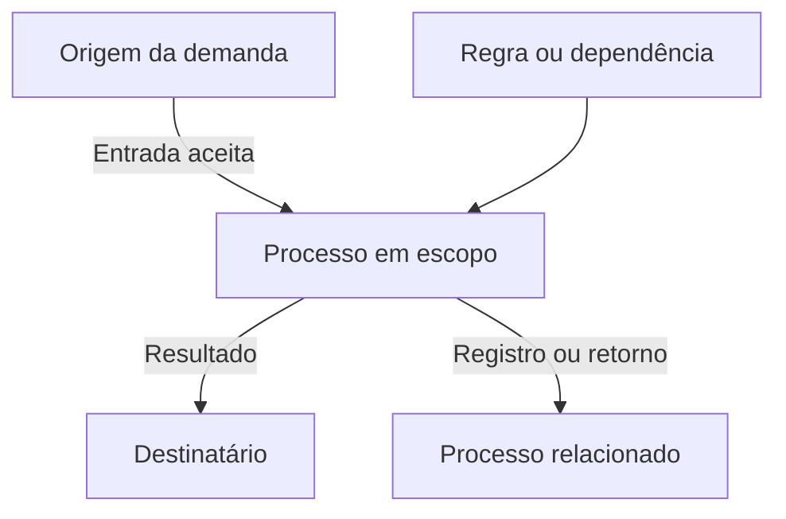
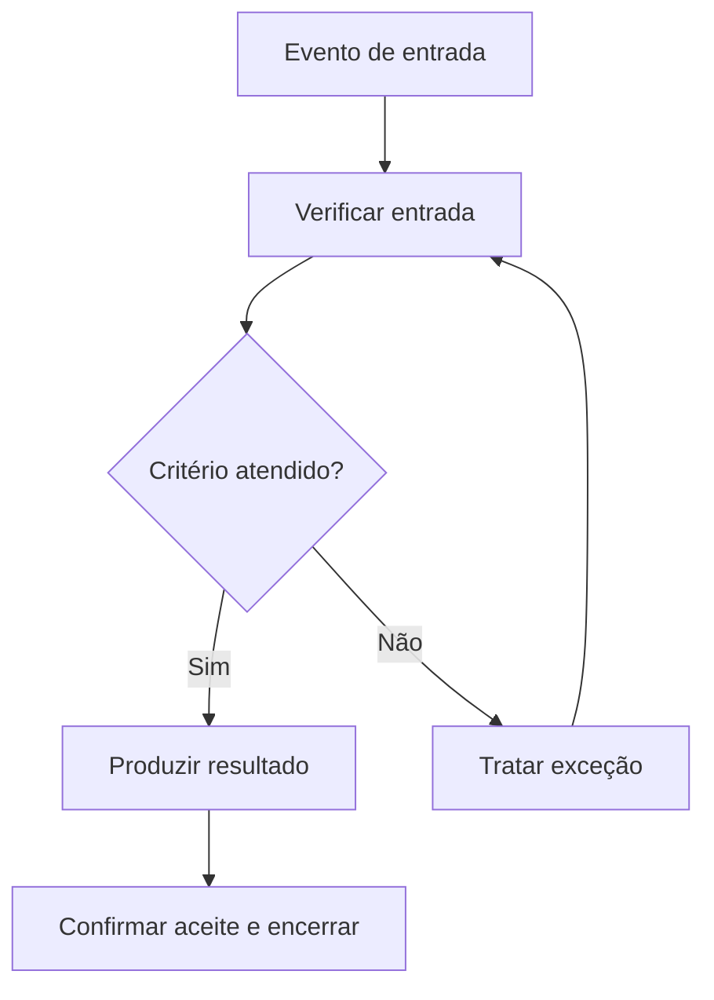

# Arquitetura de Processos e Fluxos — Ficha Operacional

**Sistema Operacional do Estúdio LICHTARA**  
**Módulo:** 3 — Arquitetura Organizacional  
**Ferramenta:** 02 — Arquitetura de Processos e Fluxos  
**Tipo:** Ficha metodológica, arquitetural e preenchível  
**Versão:** 0.1  
**Status:** Em desenvolvimento e validação pela prática  
**Data de criação:** 02/08/2026

**Documentos relacionados:**

- `README.md` deste diretório;
- `01-estado-atual-e-estado-futuro.md`;
- `../README.md`;
- `../fundamentos-da-arquitetura.md`;
- `../protocolo-de-arquitetura.md`;
- `../matriz-de-rastreabilidade.md`;
- `../templates/plano-de-arquitetura.md`;
- `../templates/03-catalogo-de-requisitos.md`;
- `../templates/04-matriz-de-rastreabilidade.md`;
- `../templates/05-arquitetura-integrada.md`;
- `../templates/06-registro-de-validacao.md`;
- `../templates/08-transicao-para-implantacao.md`.

---

## 1. Finalidade

Esta ferramenta orienta o desenho de processos e fluxos futuros capazes de sustentar capacidades organizacionais de forma compreensível, verificável e implantável.

Ela ajuda o Estúdio LICHTARA a:

- transformar capacidades e requisitos em funcionamento recorrente;
- definir resultados, fronteiras, eventos de início e condições de término;
- representar como trabalho, valor, informação, decisão, responsabilidade, dados e documentos se movimentam;
- tornar decisões, transferências, esperas, retornos e exceções visíveis;
- relacionar atividades a papéis, informação, regras, sistemas e controles;
- preservar capacidades atuais que continuam necessárias;
- retirar etapas, duplicações e controles sem função reconhecível;
- distinguir desenho arquitetural de instrução operacional;
- formular alternativas de processo;
- preparar simulações, validações e implantação;
- produzir uma fonte rastreável para a Arquitetura Integrada.

## 2. Pergunta central

> Como o trabalho deverá acontecer, de ponta a ponta, para produzir o resultado necessário, preservar contexto entre as transferências, tratar variações e permanecer operável quando algo sair do fluxo esperado?

Perguntas derivadas:

- Que evento inicia o processo?
- Que resultado encerra o processo?
- Quem recebe valor ou utiliza a saída?
- Que objeto percorre o fluxo?
- Que etapas são necessárias?
- Onde ocorrem decisões?
- Que informação precisa existir em cada momento?
- Onde muda a responsabilidade?
- Como o recebimento é confirmado?
- Que espera é necessária e que espera representa falha?
- Que exceções são previsíveis?
- Como o processo continua diante de ausência, erro ou indisponibilidade?
- O que pode ser automatizado com segurança?
- Onde julgamento humano permanece indispensável?
- Que evidência permitirá verificar o funcionamento?

## 3. O que é

Arquitetura de Processos e Fluxos é uma ferramenta de desenho do funcionamento futuro.

Ela relaciona:

1. **capacidade** — aquilo que a organização precisa conseguir realizar;
2. **resultado** — condição observável produzida pelo processo;
3. **processo** — conjunto relacionado de atividades que transforma entradas em resultados;
4. **fluxo** — movimento de objetos através do processo e de suas interfaces;
5. **decisão** — escolha autorizada que altera direção, prioridade, estado ou tratamento;
6. **interface** — ponto de contato entre etapas, papéis, processos ou sistemas;
7. **exceção** — situação que exige tratamento diferente do percurso esperado;
8. **controle** — mecanismo que previne, detecta, corrige ou limita desvios;
9. **evidência** — registro que permite verificar execução, decisão, qualidade ou resultado.

O produto da ferramenta é uma especificação arquitetural suficiente para que participantes compreendam o funcionamento esperado e para que a implantação consiga transformá-lo em rotina, configuração, treinamento e documentação operacional.

## 4. Distinções essenciais

### 4.1 Processo

Processo é uma arquitetura recorrente de produção de resultado. Ele possui finalidade, fronteira, entrada, saída, relações, responsáveis, regras, exceções e condição de verificação.

### 4.2 Fluxo

Fluxo é o movimento de um objeto através da arquitetura. O mesmo processo pode conter fluxos diferentes e parcialmente independentes.

### 4.3 Procedimento

Procedimento descreve como uma atividade será executada em nível operacional. Pode incluir passos de tela, instruções, modelos, comandos e cuidados específicos.

### 4.4 Atividade e tarefa

Atividade é uma unidade de trabalho com finalidade e saída reconhecíveis. Tarefa é o menor passo operacional necessário à execução de uma atividade.

### 4.5 Jornada

Jornada representa a experiência de uma pessoa ao longo de interações e momentos. Pode atravessar vários processos e incluir períodos em que nenhum trabalho interno é visível para ela.

### 4.6 Projeto

Projeto é um esforço temporário orientado a uma entrega ou mudança. Processo é uma configuração recorrente. Um projeto pode criar, alterar ou implantar um processo.

### 4.7 Quadro comparativo

| Objeto | Pergunta principal | Unidade observada | Recorrência | Produto típico |
| --- | --- | --- | --- | --- |
| Capacidade | O que a organização precisa conseguir realizar? | Condição organizacional | Contínua ou recorrente | Mapa de capacidades |
| Processo | Como o resultado será produzido de forma recorrente? | Transformação de entrada em saída | Recorrente | Especificação de processo |
| Fluxo | O que se movimenta, por onde e sob quais condições? | Trabalho, valor, informação, decisão ou responsabilidade | Durante o processo | Mapa de fluxo |
| Procedimento | Como executar determinada atividade? | Passos operacionais | Conforme execução | Instrução de trabalho |
| Jornada | Como uma pessoa atravessa a experiência? | Momentos e percepções | Conforme relação | Mapa de jornada |
| Projeto | Como produzir uma mudança ou entrega temporária? | Entregas, marcos e recursos | Temporária | Plano de projeto |

## 5. Função no protocolo

| Etapa do protocolo | Função da ferramenta |
| --- | --- |
| Aceite da transição | Confirmar que existem evidências suficientes sobre o funcionamento atual |
| Planejamento | Delimitar processos, fluxos, casos, participantes e profundidade |
| Consolidação de requisitos | Identificar requisitos que precisam se manifestar no funcionamento |
| Formulação de capacidades | Traduzir capacidades em resultados e condições recorrentes |
| Geração de alternativas | Criar configurações de processo materialmente distintas |
| Desenho de componentes | Definir etapas, atividades, decisões, regras, exceções e controles |
| Integração | Relacionar processos a papéis, informação, documentos, tecnologia, IA e indicadores |
| Validação | Simular casos normais, variações, falhas e volumes |
| Aprovação | Constituir a linha de base do funcionamento futuro |
| Transição para implantação | Informar configuração, treinamento, migração, testes e entrada em operação |

## 6. Saídas principais

A aplicação pode produzir:

- catálogo de processos;
- mapa de contexto e fronteiras;
- arquitetura de processos em níveis;
- especificação preenchida de cada processo;
- mapa do fluxo principal;
- mapas de fluxos complementares;
- registro de eventos e estados;
- matriz de decisões e regras;
- registro de interfaces e transferências;
- catálogo de exceções;
- matriz de riscos e controles;
- requisitos de informação, documentação e comunicação;
- requisitos para tecnologia, automação e IA;
- cenários de teste;
- comparação entre alternativas;
- matriz atual–futuro;
- condições de transição;
- bloco consolidado para a Arquitetura Integrada.

### 6.1 Seleção proporcional das saídas

| Condição | Conjunto mínimo recomendado |
| --- | --- |
| Processo focal, baixo risco e poucas interfaces | Ficha do processo, fluxo principal, exceções e critérios de aceite |
| Processo com múltiplos papéis | Ficha, fluxo, interfaces, decisões, papéis requeridos e testes |
| Processo com automação ou IA | Ficha, fluxos humano e técnico, exceções, supervisão, retorno e controles |
| Processo regulado ou sensível | Ficha completa, decisões, informação, rastreabilidade, controles e continuidade |
| Arquitetura sistêmica | Catálogo, níveis, relações entre processos, fluxos críticos, capacidades e governança |

## 7. O que a ferramenta não é

Esta ferramenta não deve ser usada como:

- inventário indiscriminado de todas as tarefas;
- reprodução automática do funcionamento atual;
- fluxograma decorativo sem fonte e sem decisão;
- procedimento detalhado de cada tela;
- justificativa posterior para uma ferramenta já escolhida;
- mecanismo de vigilância individual;
- promessa de eliminar toda variação;
- tentativa de resolver conflito de autoridade apenas com setas;
- substituição da validação com pessoas que executarão ou receberão o resultado;
- autorização para automatizar uma atividade sem compreender sua finalidade.

## 8. Princípios

1. O resultado orienta o processo.
2. A capacidade precede a sequência.
3. A fronteira deve ser explícita.
4. Todo início e todo término precisam ser reconhecíveis.
5. O objeto em fluxo deve ser nomeado.
6. Transferência inclui entrega, recebimento e confirmação.
7. Decisão exige autoridade e informação.
8. Exceção relevante pertence ao desenho.
9. Espera precisa possuir significado, limite e responsável.
10. Controle deve tratar risco real.
11. Automação preserva finalidade, supervisão e possibilidade de retorno.
12. O desenho deve permanecer compreensível para quem participa.
13. O nível de detalhe corresponde à decisão apoiada.
14. O processo futuro precisa ser mantido com os recursos disponíveis.
15. A aprendizagem retorna ao funcionamento.

## 9. Quando utilizar

Utilize a ferramenta quando:

- uma capacidade depende de sequência recorrente;
- o trabalho atravessa pessoas, áreas, sistemas ou organizações;
- existem decisões, filas, esperas ou transferências;
- o resultado atual é inconsistente;
- responsabilidades mudam ao longo do trabalho;
- informação se perde entre etapas;
- exceções geram improvisação recorrente;
- um processo será criado, redesenhado, integrado ou encerrado;
- tecnologia, automação ou IA será considerada;
- o volume exige padronização proporcional;
- a organização precisa explicar como o futuro funcionará;
- a implantação depende de uma referência operacional validada.

## 10. Quando não utilizar ou reduzir

Reduza ou dispense a aplicação completa quando:

- a atividade é única e será governada como projeto;
- o trabalho é simples, reversível e executado por uma pessoa sem interfaces materiais;
- a capacidade pode ser representada por uma regra ou checklist curto;
- a questão ainda pertence ao diagnóstico;
- a decisão arquitetural não depende de sequência;
- o custo do detalhamento supera sua utilidade.

### 10.1 Registro da redução

| Campo | Preenchimento |
| --- | --- |
| Objeto avaliado | [Nome/ID] |
| Motivo da redução | [Preencher] |
| Representação substituta | [Regra, checklist, narrativa ou N/A] |
| Risco aceito | [Preencher] |
| Autoridade | [Nome/papel] |
| Condição para aprofundar | [Evento, volume, risco ou evidência] |

## 11. Proporcionalidade

Avalie a profundidade necessária.

| Fator | Baixo | Médio | Alto | Evidência |
| --- | --- | --- | --- | --- |
| Impacto do resultado | [ ] | [ ] | [ ] | [Preencher] |
| Volume e frequência | [ ] | [ ] | [ ] | [Preencher] |
| Variabilidade dos casos | [ ] | [ ] | [ ] | [Preencher] |
| Quantidade de interfaces | [ ] | [ ] | [ ] | [Preencher] |
| Custo de erro | [ ] | [ ] | [ ] | [Preencher] |
| Sensibilidade dos dados | [ ] | [ ] | [ ] | [Preencher] |
| Dependência tecnológica | [ ] | [ ] | [ ] | [Preencher] |
| Participação de IA | [ ] | [ ] | [ ] | [Preencher] |
| Exigência regulatória | [ ] | [ ] | [ ] | [Preencher] |
| Irreversibilidade | [ ] | [ ] | [ ] | [Preencher] |

### 11.1 Níveis de profundidade

| Nível | Aplicação | Representações mínimas |
| --- | --- | --- |
| Essencial | Processo focal e baixo risco | Ficha, fluxo principal, exceções críticas e aceite |
| Intermediário | Múltiplos papéis, decisões ou sistemas | Essencial + interfaces, informação, controles e testes |
| Ampliado | Alto impacto, regulação, escala ou IA | Intermediário + alternativas, cenários, continuidade e rastreabilidade completa |
| Sistêmico | Portfólio de processos interdependentes | Catálogo, níveis, relações, governança e fluxos transversais |

## 12. Escalas e níveis

### 12.1 Escala organizacional

| Escala | Foco |
| --- | --- |
| Pessoa ou papel | Trabalho recorrente e interfaces imediatas |
| Equipe | Coordenação, distribuição, filas e decisões |
| Área | Processos, serviços internos e relação com outras áreas |
| Organização | Cadeia de capacidades e processos ponta a ponta |
| Ecossistema | Relações entre cliente, parceiro, fornecedor, plataforma e regulação |

### 12.2 Nível de decomposição

| Nível | Objeto | Pergunta | Exemplo genérico |
| --- | --- | --- | --- |
| L0 | Contexto | Com que ambiente o sistema troca valor e informação? | Organização, clientes e parceiros |
| L1 | Cadeia ou portfólio | Que grandes processos sustentam as capacidades? | Atrair, contratar, entregar, acompanhar |
| L2 | Processo | Como determinado resultado é produzido? | Atender uma demanda |
| L3 | Subprocesso ou etapa | Que transformação intermediária ocorre? | Qualificar a demanda |
| L4 | Atividade | Que unidade de trabalho produz uma saída? | Verificar informações |
| L5 | Tarefa ou procedimento | Como executar a atividade? | Passos de preenchimento |

O Módulo 3 normalmente encerra o detalhamento entre L2 e L4. O nível L5 é desenvolvido na implantação quando sua ausência não impede a validação da arquitetura.

## 13. Tipos de processo

Classifique o processo para escolher uma representação adequada.

| Tipo | Característica | Representação útil | Risco de modelagem inadequada |
| --- | --- | --- | --- |
| Sequencial recorrente | Etapas relativamente estáveis | Fluxo de atividades | Rigidez excessiva |
| Orientado a evento | Acontece quando um evento ocorre | Eventos, estados e respostas | Ignorar eventos concorrentes |
| Orientado a caso | Percurso varia conforme situação | Estados, regras e decisões | Forçar uma sequência artificial |
| Criativo ou de conhecimento | Depende de julgamento e iteração | Marcos, critérios e ciclos | Transformar pensamento em checklist |
| Contínuo | Não possui encerramento por caso | Ciclo, cadência e condições | Inventar início e fim falsos |
| Projeto recorrente | Estrutura se repete, conteúdo varia | Fases, gates e entregas | Confundir projeto com processo linear |
| Resposta a incidente | Prioriza contenção e recuperação | Gatilhos, escalonamento e retorno | Representar apenas o cenário normal |

### 13.1 Decisão sobre o tipo

| Campo | Preenchimento |
| --- | --- |
| Processo | PRC-ARQ-___ |
| Tipo predominante | [Selecionar] |
| Tipos complementares | [Selecionar] |
| Motivo | [Preencher] |
| Representação escolhida | [Fluxo, estados, decisão, ciclo ou combinação] |
| Limitação da representação | [Preencher] |

## 14. Tipos de fluxo

Os fluxos devem ser separados quando sua sobreposição prejudicar a compreensão.

| Fluxo | Objeto em movimento | Pergunta |
| --- | --- | --- |
| Trabalho | Caso, solicitação, item ou entrega | Que trabalho passa por quais estados? |
| Valor | Benefício ou resultado | Onde valor é criado, preservado, atrasado ou perdido? |
| Informação | Contexto necessário à ação | Que informação chega, muda e segue adiante? |
| Dados | Registro estruturado | Que dado é criado, consultado, transferido ou eliminado? |
| Documento | Registro persistente | Que documento nasce, é aprovado, publicado ou arquivado? |
| Decisão | Questão e autorização | Onde uma escolha é necessária e para onde segue? |
| Responsabilidade | Compromisso pelo próximo movimento | Quando e como muda a pessoa responsável? |
| Comunicação | Mensagem e confirmação | Quem precisa saber, responder ou alinhar? |
| Conhecimento | Critério, experiência ou aprendizagem | Como o saber entra, é usado e retorna ao sistema? |
| Financeiro | Cobrança, pagamento ou autorização | Que evento produz obrigação, conferência e registro? |

### 14.1 Registro dos fluxos incluídos

| ID | Tipo | Objeto | Início | Fim | Processo | Motivo | Representação |
| --- | --- | --- | --- | --- | --- | --- | --- |
| FLX-ARQ-001 | [Tipo] | [Objeto] | EVT-ARQ-___ | EVT-ARQ-___ | PRC-ARQ-___ | [Preencher] | [Artefato] |

## 15. Papéis participantes

| Participante | Contribuição necessária | Momento | Autoridade ou conhecimento | Risco de ausência |
| --- | --- | --- | --- | --- |
| Responsável pela arquitetura | Integridade metodológica e integração | Toda a aplicação | Aprovar método e artefato | Fragmentação |
| Responsável pelo processo futuro | Finalidade, funcionamento e manutenção | Desenho e validação | Responder pelo resultado | Processo sem custódia |
| Pessoas executoras | Realidade do trabalho e viabilidade | Modelagem e simulação | Conhecimento prático | Fluxo inexequível |
| Pessoas destinatárias | Qualidade e valor da saída | Resultado e validação | Experiência de uso | Resultado sem utilidade |
| Responsáveis por decisões | Regras e alçadas | Pontos decisórios | Decidir e escalar | Decisões fictícias |
| Responsáveis por informação e sistemas | Disponibilidade e limites técnicos | Integração | Acesso e manutenção | Dependência invisível |
| Responsável pela implantação | Convertibilidade em mudança | Revisão final | Coordenar implantação | Desenho não implantável |
| Especialistas | Regulação, segurança ou conhecimento específico | Conforme risco | Parecer especializado | Controle inadequado |

### 15.1 Participantes reais

| Nome ou papel | Relação com o processo | Participação | Disponibilidade | Sensibilidade | Confirmação |
| --- | --- | --- | --- | --- | --- |
| [Preencher] | [Executa, decide, recebe, mantém ou é afetado] | [Oficina, entrevista, revisão ou teste] | [Preencher] | [Preencher] | [Data] |

## 16. Autoridade e limites

A ferramenta pode propor requisitos para papéis e autoridades. A consolidação das alçadas ocorre em `03-papeis-responsabilidades-e-alcadas.md`.

| Decisão sobre a aplicação | Autoridade |
| --- | --- |
| Definir escopo e profundidade | Responsável pela arquitetura |
| Confirmar finalidade do processo | Responsável pelo processo e autoridade do cliente |
| Validar regra operacional | Papel competente |
| Aceitar risco residual | Autoridade formalmente definida |
| Aprovar automação ou IA | Autoridade técnica, operacional e responsável pelo risco |
| Aprovar processo futuro | Autoridade prevista no projeto |
| Autorizar implantação | Patrocinador ou autoridade competente |

### 16.1 Limites do grupo de desenho

| Tema | Pode propor? | Pode validar? | Pode decidir? | Autoridade real |
| --- | --- | --- | --- | --- |
| Finalidade e resultado | [Sim/não] | [Sim/não] | [Sim/não] | [Papel] |
| Sequência e interfaces | [Sim/não] | [Sim/não] | [Sim/não] | [Papel] |
| Regras e exceções | [Sim/não] | [Sim/não] | [Sim/não] | [Papel] |
| Tecnologia e automação | [Sim/não] | [Sim/não] | [Sim/não] | [Papel] |
| Risco e controle | [Sim/não] | [Sim/não] | [Sim/não] | [Papel] |

## 17. Entradas necessárias

| Entrada | Fonte | Versão/data | Qualidade | Lacuna | Tratamento |
| --- | --- | --- | --- | --- | --- |
| Problema de arquitetura | Termo de Abertura | [Preencher] | [Suficiente/parcial] | [Preencher] | [Ação] |
| Capacidades futuras | Ferramenta 01 | [Preencher] | [Estado] | [Preencher] | [Ação] |
| Requisitos aprovados | Catálogo de Requisitos | [Preencher] | [Estado] | [Preencher] | [Ação] |
| Estado atual de referência | Diagnóstico/Ferramenta 01 | [Preencher] | [Estado] | [Preencher] | [Ação] |
| Eventos e casos reais | Evidências diagnósticas | [Preencher] | [Estado] | [Preencher] | [Ação] |
| Riscos e restrições | Matriz/Termo | [Preencher] | [Estado] | [Preencher] | [Ação] |
| Papéis e autoridades atuais | Diagnóstico | [Preencher] | [Estado] | [Preencher] | [Ação] |
| Informação e sistemas atuais | Diagnóstico | [Preencher] | [Estado] | [Preencher] | [Ação] |
| Volumes e tempos disponíveis | Registros/estimativas | [Preencher] | [Estado] | [Preencher] | [Ação] |
| Decisões já aprovadas | Registro de Decisão | [Preencher] | [Estado] | [Preencher] | [Ação] |

## 18. Qualidade das evidências

O processo futuro depende de afirmações sobre demanda, variação, capacidade e comportamento. Registre a força das fontes.

| Afirmação usada no desenho | Fonte | Natureza | Período | Confiança | Consequência se incorreta | Verificação |
| --- | --- | --- | --- | --- | --- | --- |
| [Preencher] | [ID/documento] | [Observada, registrada, relatada, estimada ou assumida] | [Data] | [Alta/média/baixa] | [Preencher] | [Forma] |

### 18.1 Proteções

- fatos, interpretações e premissas permanecem distinguíveis;
- um caso marcante não representa automaticamente o volume normal;
- ausência de registro não é tratada como ausência do evento;
- tempos estimados são identificados;
- exceções relatadas por quem executa são examinadas;
- limitações de acesso são registradas;
- dados sensíveis são minimizados.

## 19. Preparação

Antes da oficina ou modelagem:

- confirme a pergunta e a decisão apoiada;
- selecione os processos e fluxos em escopo;
- reúna capacidades, requisitos e casos;
- identifique pessoas que executam, decidem, recebem e mantêm;
- defina a notação mais simples que preserve o significado;
- prepare uma lista inicial de eventos, saídas e exceções;
- declare premissas;
- defina como divergências serão registradas;
- separe fatos atuais de propostas futuras;
- escolha cenários para simulação;
- proteja informações sensíveis;
- reserve tempo para validação posterior.

### 19.1 Checklist de prontidão

| Verificação | Estado | Evidência ou ação |
| --- | --- | --- |
| Capacidade futura está clara | [ ] | [Preencher] |
| Resultado esperado está formulado | [ ] | [Preencher] |
| Fronteira preliminar existe | [ ] | [Preencher] |
| Requisitos aplicáveis estão identificados | [ ] | [Preencher] |
| Casos normais e difíceis estão disponíveis | [ ] | [Preencher] |
| Participantes necessários foram confirmados | [ ] | [Preencher] |
| Autoridade de validação é conhecida | [ ] | [Preencher] |
| Sensibilidade das informações foi tratada | [ ] | [Preencher] |

## 20. Plano da aplicação

| Campo | Preenchimento |
| --- | --- |
| ID da aplicação | APF-ARQ-AAAA-NNN |
| Projeto de arquitetura | ARQ-AAAA-NNN |
| Pergunta | [Preencher] |
| Decisão apoiada | DEC-ARQ-___ |
| Processos em escopo | [IDs] |
| Capacidades relacionadas | [IDs] |
| Requisitos relacionados | [IDs] |
| Nível de profundidade | [Essencial, intermediário, ampliado ou sistêmico] |
| Participantes | [Nomes/papéis] |
| Técnicas | [Oficina, modelagem, simulação, análise ou protótipo] |
| Saídas | [Artefatos] |
| Validação | [Pessoas, casos e forma] |
| Responsável | [Nome] |
| Prazo | [Data] |

### 20.1 Atividades

| ID | Atividade | Entrada | Participantes | Saída | Critério de conclusão | Data |
| --- | --- | --- | --- | --- | --- | --- |
| ATV-ARQ-___ | [Preencher] | [ID/fonte] | [Nomes/papéis] | [Artefato] | [Preencher] | [Data] |

## 21. Identificação, versão e validade

```yaml
id_artefato: APF-ARQ-AAAA-NNN
id_arquitetura: ARQ-AAAA-NNN
titulo: "[Nome do conjunto de processos ou fluxo]"
escopo:
processos:
estado_temporal: futuro_inicial
responsavel:
responsavel_pelo_processo:
data_de_referencia:
data_de_criacao:
data_da_ultima_validacao:
validade_ate:
estado: em_elaboracao
nivel_sensibilidade: interna
versao: 0.1
```

### 21.1 Estados do artefato

| Estado | Significado |
| --- | --- |
| Em elaboração | Estrutura ainda está sendo construída |
| Em revisão | Conteúdo está sendo verificado |
| Em simulação | Casos estão sendo executados contra o desenho |
| Validado com ressalvas | Funcionamento aceito sob condições registradas |
| Validado | Conteúdo suficiente para decisão |
| Aprovado | Linha de base autorizada |
| Em implantação | Desenho está sendo convertido em realidade |
| Implantado | Processo entrou em operação |
| Em revisão operacional | Evidências reais exigem avaliação |
| Substituído | Nova versão ou arquitetura assumiu sua função |
| Encerrado | Processo deixou de cumprir função |

## 22. Contexto e fronteiras

Desenhe primeiro o contexto do processo.

| Elemento externo | Relação | Entrada recebida | Saída entregue | Interface | Responsável |
| --- | --- | --- | --- | --- | --- |
| [Cliente, processo, área, fornecedor, sistema ou norma] | [Preencher] | [Objeto] | [Objeto] | INT-ARQ-___ | [Papel] |

### 22.1 Fronteira

| Campo | Preenchimento |
| --- | --- |
| Evento inicial | EVT-ARQ-___ — [Descrição] |
| Entrada aceita | [Objeto e critério] |
| Evento final | EVT-ARQ-___ — [Descrição] |
| Resultado entregue | [Objeto e critério] |
| Destinatário | [Pessoa, papel, processo ou sistema] |
| Elementos internos | [Preencher] |
| Elementos externos | [Preencher] |
| Não objetivos | [Preencher] |
| Dependências externas | [IDs] |

### 22.2 Diagrama de contexto opcional



O registro tabular permanece a fonte verificável. O diagrama apoia compreensão e comunicação.

## 23. Resultado, valor e destinatário

Comece pelo que deverá existir ao final.

| Processo | Resultado | Destinatário | Valor produzido | Critério de aceite | Evidência |
| --- | --- | --- | --- | --- | --- |
| PRC-ARQ-___ | [Condição ou entrega] | [Quem usa/recebe] | [Benefício necessário] | [Critério] | [Registro] |

### 23.1 Teste de resultado

- [ ] descreve uma condição observável;
- [ ] possui destinatário;
- [ ] corresponde a capacidade e requisito;
- [ ] pode ser aceito ou recusado por critério;
- [ ] não se limita a “atividade concluída”;
- [ ] distingue saída imediata de efeito posterior;
- [ ] reconhece resultados indesejados possíveis.

### 23.2 Resultados complementares

| Tipo | Resultado | Destinatário | Relação com o resultado principal |
| --- | --- | --- | --- |
| Operacional | [Preencher] | [Preencher] | [Preencher] |
| Informacional | [Preencher] | [Preencher] | [Preencher] |
| Decisório | [Preencher] | [Preencher] | [Preencher] |
| Experiencial | [Preencher] | [Preencher] | [Preencher] |
| Aprendizagem | [Preencher] | [Preencher] | [Preencher] |

## 24. Eventos de início e término

Evento é algo que acontece e exige reconhecimento. Atividade é trabalho realizado em resposta.

| ID | Evento | Origem | Condição reconhecível | Resposta esperada | Registro | Prazo de resposta |
| --- | --- | --- | --- | --- | --- | --- |
| EVT-ARQ-001 | [Descrição no passado ou presente] | [Origem] | [Critério] | [Atividade/processo] | [Registro] | [Tempo] |

### 24.1 Qualidade do início

| Pergunta | Resposta |
| --- | --- |
| Que condição autoriza iniciar? | [Preencher] |
| O que precisa estar completo? | [Preencher] |
| Quem reconhece a entrada? | [Papel] |
| Entradas incompletas podem entrar? | [Regra] |
| Como duplicidades são detectadas? | [Controle] |
| Como urgências são classificadas? | [Regra] |

### 24.2 Qualidade do término

| Pergunta | Resposta |
| --- | --- |
| Que condição demonstra conclusão? | [Preencher] |
| Quem aceita o resultado? | [Papel/destinatário] |
| Que registro encerra o caso? | [Documento/dado] |
| Que pendência impede encerramento? | [Preencher] |
| O que segue para outro processo? | [Objeto/interface] |
| Quando o caso é encerrado sem sucesso? | [Regra] |

## 25. Demanda, unidade de fluxo e casos

A unidade de fluxo é o objeto acompanhado ao longo do processo: demanda, cliente, pedido, documento, incidente, decisão, projeto ou outro caso.

| Campo | Preenchimento |
| --- | --- |
| Unidade de fluxo | [Nome] |
| Identificador | [Formato] |
| Origem da demanda | [Fontes] |
| Frequência | [Estimativa/fonte] |
| Volume normal | [Faixa/período] |
| Picos | [Faixa/condição] |
| Variabilidade | [Baixa/média/alta e motivo] |
| Vida útil do caso | [Tempo/condição] |
| Estados rastreados | [Lista] |
| Registro oficial | [Sistema/documento] |

### 25.1 Classes de caso

| Classe | Critério de entrada | Percurso esperado | Prioridade | Regra específica | Volume |
| --- | --- | --- | --- | --- | --- |
| CAS-ARQ-001 | [Preencher] | [Principal, abreviado, ampliado ou especial] | [Nível] | [ID] | [Estimativa] |

### 25.2 Casos que não pertencem ao processo

| Caso | Motivo da exclusão | Destino correto | Comunicação | Registro |
| --- | --- | --- | --- | --- |
| [Preencher] | [Fora do escopo, duplicado, inválido ou outro] | [Processo/papel] | [Forma] | [Evidência] |

## 26. Catálogo de processos futuros

| ID | Processo | Tipo | Finalidade | Capacidade | Início | Resultado | Responsável requerido | Estado futuro |
| --- | --- | --- | --- | --- | --- | --- | --- | --- |
| PRC-ARQ-001 | [Nome: verbo + objeto] | [Tipo] | [Preencher] | CAP-ARQ-___ | EVT-ARQ-___ | [Resultado] | [Papel a consolidar] | [Preservado, adaptado, novo ou encerrado] |

### 26.1 Regras de nomeação

- use verbo e objeto reconhecíveis;
- descreva a transformação realizada;
- evite nomear o processo pela ferramenta;
- evite nomes departamentais quando o processo atravessa áreas;
- mantenha estabilidade do ID quando o nome mudar;
- registre processos temporários como temporários.

### 26.2 Processos por função

| Função | Processos | Relação com valor |
| --- | --- | --- |
| Finalísticos | [IDs] | Produzem valor diretamente ao destinatário externo |
| Habilitadores | [IDs] | Criam condições para processos finalísticos |
| Governança | [IDs] | Orientam decisão, proteção e continuidade |
| Aprendizagem | [IDs] | Transformam experiência em melhoria |
| Transição | [IDs] | Permitem passagem temporária para o futuro |

## 27. Arquitetura em níveis

| Nível superior | Elemento | Elementos contidos | Resultado | Relação |
| --- | --- | --- | --- | --- |
| Cadeia/portfólio | [Nome/ID] | [Processos] | [Resultado agregado] | [Sequência, dependência ou rede] |
| Processo | PRC-ARQ-___ | [Etapas/subprocessos] | [Resultado] | [Preencher] |
| Etapa | ETA-ARQ-___ | [Atividades] | [Resultado intermediário] | [Preencher] |

### 27.1 Teste de decomposição

- [ ] cada nível possui resultado próprio;
- [ ] elementos agrupados contribuem para o resultado superior;
- [ ] uma etapa não foi criada apenas porque muda a pessoa;
- [ ] atividades não foram elevadas artificialmente a processos;
- [ ] processos distintos não foram fundidos apenas porque usam a mesma ferramenta;
- [ ] o detalhamento termina onde a decisão arquitetural termina.

## 28. Referência atual e mudança

Use o estado atual validado sem refazer o diagnóstico.

| Elemento atual | Evidência | Função preservada | Limitação | Decisão futura | Justificativa |
| --- | --- | --- | --- | --- | --- |
| [Processo, etapa, prática, regra ou contorno] | [ID/fonte] | [Preencher] | [Preencher] | [Preservar, alterar, substituir, criar ou encerrar] | [REQ/DEC] |

### 28.1 Trabalho invisível

| Trabalho invisível atual | Quem realiza | Por que existe | Valor ou proteção | Custo/risco | Tratamento futuro |
| --- | --- | --- | --- | --- | --- |
| [Memória, conferência, cobrança, conciliação ou contorno] | [Papel] | [Causa] | [Preencher] | [Preencher] | [Tornar visível, eliminar, apoiar ou manter] |

## 29. Ficha mestra do processo

| Campo | Preenchimento |
| --- | --- |
| ID | PRC-ARQ-___ |
| Nome | [Verbo + objeto] |
| Finalidade | [Por que existe] |
| Capacidade sustentada | CAP-ARQ-___ |
| Requisitos atendidos | [REQs] |
| Destinatário | [Pessoa, papel, processo ou sistema] |
| Evento inicial | EVT-ARQ-___ |
| Entrada | [Objeto e critério] |
| Resultado | [Condição/entrega] |
| Evento final | EVT-ARQ-___ |
| Responsável requerido | [Papel] |
| Participantes | [Papéis/sistemas] |
| Tipo de processo | [Classificação] |
| Frequência/volume | [Preencher] |
| Regras principais | [IDs] |
| Exceções críticas | [IDs] |
| Interfaces críticas | [IDs] |
| Riscos e controles | [IDs] |
| Evidência de execução | [Registro] |
| Evidência de resultado | [Registro] |
| Condição de revisão | [Evento/indicador] |
| Condição de encerramento | [Evento/decisão] |

## 30. Entradas e critérios de aceitação

| Entrada | Origem | Formato | Critério de aceitação | Verificação | Entrada incompleta | Responsável |
| --- | --- | --- | --- | --- | --- | --- |
| ENT-ARQ-___ | [Origem] | [Formato] | [Critério] | [Como verificar] | [Recusar, devolver, completar ou aceitar com condição] | [Papel] |

### 30.1 Entrada válida

Uma entrada válida:

- pertence ao escopo;
- possui origem reconhecível;
- contém o mínimo necessário;
- respeita autorização e sensibilidade;
- pode ser identificada sem duplicidade;
- informa prioridade quando aplicável;
- permite iniciar sem criar risco desproporcional.

## 31. Saídas e critérios de aceite

| Saída | Destinatário | Formato | Critério de aceite | Autoridade de aceite | Evidência | Rejeição ou correção |
| --- | --- | --- | --- | --- | --- | --- |
| SAI-ARQ-___ | [Destino] | [Formato] | [Critério] | [Papel] | [Registro] | [Tratamento] |

### 31.1 Aceite interno e externo

| Tipo | Pergunta | Critério |
| --- | --- | --- |
| Aceite técnico | A saída está íntegra e conforme? | [Preencher] |
| Aceite operacional | Pode seguir sem retrabalho evitável? | [Preencher] |
| Aceite do destinatário | Serve à finalidade para a qual foi solicitada? | [Preencher] |
| Aceite de risco | O risco residual é autorizado? | [Preencher] |
| Aceite documental | Existe registro suficiente? | [Preencher] |

## 32. Etapas e resultados intermediários

Etapa agrupa atividades que produzem uma mudança de estado ou resultado intermediário.

| ID | Etapa | Condição de entrada | Resultado intermediário | Condição de saída | Responsável requerido | Dependências |
| --- | --- | --- | --- | --- | --- | --- |
| ETA-ARQ-001 | [Nome] | [Condição] | [Resultado] | [Condição] | [Papel] | [IDs] |

### 32.1 Qualidade das etapas

- [ ] cada etapa possui transformação;
- [ ] o resultado intermediário é necessário ao resultado final;
- [ ] a fronteira entre etapas possui sentido;
- [ ] mudanças de responsabilidade aparecem como interfaces;
- [ ] etapas de aprovação possuem decisão real;
- [ ] agrupamentos não ocultam esperas ou retrabalho.

## 33. Atividades

| ID | Atividade | Finalidade | Entrada | Saída | Papel requerido | Informação | Sistema | Regra |
| --- | --- | --- | --- | --- | --- | --- | --- | --- |
| ATI-ARQ-001 | [Verbo + objeto] | [Preencher] | [Objeto] | [Objeto] | [Papel] | INF-ARQ-___ | [Sistema/N/A] | REG-ARQ-___ |

### 33.1 Teste de necessidade

| Atividade | Produz transformação? | Atende requisito? | Trata risco? | Pode ser removida? | Decisão |
| --- | --- | --- | --- | --- | --- |
| ATI-ARQ-___ | [Sim/não] | [ID/N/A] | [ID/N/A] | [Efeito] | [Manter, simplificar, combinar, automatizar ou remover] |

### 33.2 Limite de detalhamento

Detalhe uma atividade quando a informação for necessária para:

- decidir a configuração;
- identificar responsabilidade;
- compreender interface;
- avaliar capacidade ou tempo;
- tratar risco;
- especificar informação ou sistema;
- comparar alternativas;
- simular o funcionamento.

Passos de tela, instruções minuciosas e treinamento pertencem à implantação, salvo quando determinam viabilidade ou risco arquitetural.

## 34. Estados do caso

Estados representam condições reconhecíveis da unidade de fluxo.

| Estado | Critério de entrada | Movimentos permitidos | Permanência esperada | Responsável | Saída do estado |
| --- | --- | --- | --- | --- | --- |
| EST-ARQ-001 | [Condição] | [Próximos estados] | [Tempo/condição] | [Papel] | [Evento/decisão] |

### 34.1 Regras dos estados

- cada caso possui um estado vigente;
- estados possuem significado operacional;
- “em andamento” deve ser decomposto quando ocultar condições diferentes;
- estado de espera informa motivo e responsável pelo próximo evento;
- estados finais distinguem concluído, cancelado, recusado e encerrado sem sucesso;
- mudanças de estado geram registro proporcional.

## 35. Fluxo principal

O fluxo principal representa o percurso esperado para a classe de caso predominante sob condições normais.

| Ordem | Origem | Atividade ou decisão | Objeto | Destino | Condição | Registro |
| --- | --- | --- | --- | --- | --- | --- |
| 1 | EVT-ARQ-___ | ATI/DEC-ARQ-___ | [Objeto] | [Etapa/papel] | [Regra] | [Evidência] |

### 35.1 Diagrama base



Substitua os rótulos, acrescente apenas elementos materiais e preserve IDs no diagrama ou na legenda.

## 36. Paralelismo e sincronização

Atividades paralelas reduzem tempo quando podem acontecer de forma independente. Também podem produzir inconsistência quando suas saídas precisam convergir.

| Grupo paralelo | Ramos | Condição de abertura | Dependências | Ponto de sincronização | Regra se um ramo falhar |
| --- | --- | --- | --- | --- | --- |
| PAR-ARQ-001 | [Atividades/fluxos] | [Evento] | [Preencher] | [Evento/atividade] | [Aguardar, seguir com condição, repetir ou interromper] |

### 36.1 Perguntas de controle

- As atividades são realmente independentes?
- Compartilham informação que pode mudar?
- Qual versão do objeto cada ramo utiliza?
- Todos os ramos precisam terminar?
- Quem resolve resultados conflitantes?
- Existe limite de espera?
- O cancelamento de um ramo afeta os demais?

## 37. Pontos de decisão

Decisão é uma escolha autorizada entre caminhos possíveis. Uma verificação automática de condição pode direcionar fluxo sem constituir decisão humana.

| ID | Questão | Momento | Opções | Critérios | Informação necessária | Autoridade | Registro | Caminhos |
| --- | --- | --- | --- | --- | --- | --- | --- | --- |
| DEC-ARQ-001 | [Pergunta decisória] | [Evento/estado] | [Opções reais] | [Critérios] | [IDs] | [Papel] | [Registro] | [Destinos] |

### 37.1 Decisão, regra e validação

| Situação | Natureza | Exemplo genérico | Requisito |
| --- | --- | --- | --- |
| Condição produz sempre o mesmo resultado | Regra | Se faltar campo obrigatório, devolver | Regra aprovada |
| Existem opções e autoridade para escolher | Decisão | Priorizar atendimento A ou B | Critérios, informação e autoridade |
| Resultado precisa ser confrontado com critério | Verificação | Conferir integridade da entrega | Critério e evidência |
| Pessoa manifesta aceite sobre algo que a afeta | Validação | Confirmar que o fluxo é compreensível | Participação e registro |

### 37.2 Decisões ausentes ou fictícias

| Ponto | Problema | Consequência | Tratamento |
| --- | --- | --- | --- |
| [Preencher] | [Ninguém decide, decisão automática indevida, alçada indefinida ou aprovação simbólica] | [Preencher] | [Definir, retirar, automatizar com regra ou escalar] |

## 38. Regras do processo

| ID | Regra | Finalidade | Origem | Aplicação | Exceção | Autoridade de alteração | Evidência |
| --- | --- | --- | --- | --- | --- | --- | --- |
| REG-ARQ-001 | [Declaração verificável] | [Preencher] | [REQ, norma ou decisão] | [Atividade/estado] | EXC-ARQ-___ | [Papel] | [Registro] |

### 38.1 Qualidade da regra

- possui condição e efeito compreensíveis;
- atende requisito ou trata risco;
- não depende de interpretação oculta;
- informa quem pode alterá-la;
- considera situações em que não se aplica;
- pode ser executada com os dados disponíveis;
- permanece acessível a quem precisa utilizá-la.

### 38.2 Conflitos entre regras

| Regras | Conflito | Precedência atual | Autoridade | Decisão necessária |
| --- | --- | --- | --- | --- |
| REG-ARQ-___ / REG-ARQ-___ | [Preencher] | [Preencher/N/A] | [Papel] | DEC-ARQ-___ |

## 39. Papéis requeridos pelo processo

Esta seção identifica necessidades de participação. A ferramenta 03 consolidará papéis, responsabilidades e alçadas no conjunto da arquitetura.

| Atividade, decisão ou resultado | Papel requerido | Responsabilidade | Autoridade necessária | Informação | Competência | Substituição |
| --- | --- | --- | --- | --- | --- | --- |
| [ID] | [Papel proposto] | [Preencher] | [Preencher] | [IDs] | [Preencher] | [Regra] |

### 39.1 Congruência preliminar

| Papel | Responsabilidade | Autoridade compatível? | Capacidade disponível? | Lacuna | Destino |
| --- | --- | --- | --- | --- | --- |
| [Papel] | [Preencher] | [Sim, parcial ou não] | [Sim, parcial ou não] | [Preencher] | Ferramenta 03 / implantação |

## 40. Interfaces e transferências

Transferência ocorre quando um objeto, uma responsabilidade ou uma condição passa entre participantes, etapas, processos ou sistemas.

| ID | Origem | Destino | Objeto transferido | Critério de envio | Critério de recebimento | Momento | Risco |
| --- | --- | --- | --- | --- | --- | --- | --- |
| INT-ARQ-001 | [Papel/processo/sistema] | [Papel/processo/sistema] | [Objeto + contexto] | [Critério] | [Critério] | [Evento] | RSC-___ |

### 40.1 Componentes de uma transferência completa

1. objeto identificável;
2. origem autorizada;
3. destino responsável;
4. contexto suficiente;
5. formato utilizável;
6. momento ou gatilho;
7. critério de completude;
8. confirmação de recebimento;
9. tratamento de incompletude;
10. registro proporcional.

### 40.2 Transferências críticas

| Interface | Por que é crítica | Falha possível | Detecção | Recuperação | Responsável pela interface |
| --- | --- | --- | --- | --- | --- |
| INT-ARQ-___ | [Impacto, frequência, sensibilidade ou irreversibilidade] | [Preencher] | [Controle] | [Ação] | [Papel] |

## 41. Confirmação e aceite da transferência

Enviar não equivale a transferir responsabilidade. A transferência se completa conforme a regra de recebimento definida.

| Interface | Confirmação exigida | Quem confirma | Prazo | Ausência de confirmação | Evidência |
| --- | --- | --- | --- | --- | --- |
| INT-ARQ-___ | [Automática, humana, por estado ou dispensada] | [Papel/sistema] | [Tempo] | [Reenvio, alerta, retorno ou escalonamento] | [Registro] |

### 41.1 Estados da transferência

| Estado | Significado | Responsável vigente |
| --- | --- | --- |
| Preparada | Objeto ainda pertence à origem | Origem |
| Enviada | Objeto saiu, recebimento ainda não confirmado | [Regra explícita] |
| Recebida | Destino confirmou posse e integridade inicial | Destino |
| Recusada | Critério de recebimento não foi atendido | [Regra] |
| Aceita | Destino assumiu o próximo movimento | Destino |
| Expirada | Prazo passou sem conclusão | [Papel de escalonamento] |

## 42. Informação e dados no ponto de uso

| ID | Atividade ou decisão | Informação necessária | Fonte oficial | Momento | Qualidade | Acesso | Falta de informação |
| --- | --- | --- | --- | --- | --- | --- | --- |
| INF-ARQ-001 | [ID] | [Conteúdo] | [Fonte] | [Evento] | [Critério] | [Papéis] | [Tratamento] |

### 42.1 Transformações da informação

| Informação | Estado inicial | Transformação | Estado resultante | Responsável | Registro |
| --- | --- | --- | --- | --- | --- |
| INF-ARQ-___ | [Preencher] | [Criar, verificar, enriquecer, classificar, decidir, restringir ou eliminar] | [Preencher] | [Papel] | [Fonte] |

### 42.2 Qualidade no fluxo

| Dimensão | Critério |
| --- | --- |
| Completude | [O mínimo necessário está presente] |
| Atualidade | [Corresponde ao período correto] |
| Exatidão | [Pode ser confrontada com fonte] |
| Consistência | [Não contradiz registros sem tratamento] |
| Compreensibilidade | [Pode ser interpretada pelo destinatário] |
| Autorização | [Uso e acesso são legítimos] |
| Rastreabilidade | [Origem e mudanças são localizáveis] |

## 43. Documentos e registros

| Documento ou registro | Função no processo | Criado em | Atualizado em | Aprovado por | Fonte oficial | Retenção | Destino |
| --- | --- | --- | --- | --- | --- | --- | --- |
| DOC-ARQ-001 | [Operacional, decisória, probatória, informacional ou aprendizagem] | [Atividade] | [Atividade/evento] | [Papel/N/A] | [Repositório] | [Regra] | [Processo/pessoa] |

### 43.1 Registro mínimo por caso

| Elemento | Obrigatório? | Fonte | Momento |
| --- | --- | --- | --- |
| Identificador | [Sim/não] | [Fonte] | Entrada |
| Estado vigente | [Sim/não] | [Fonte] | Cada mudança material |
| Responsável atual | [Sim/não] | [Fonte] | Transferência |
| Próxima ação ou evento | [Sim/não] | [Fonte] | Conforme classe |
| Decisões materiais | [Sim/não] | [Fonte] | Decisão |
| Exceções | [Sim/não] | [Fonte] | Ocorrência |
| Resultado e aceite | [Sim/não] | [Fonte] | Encerramento |

## 44. Conhecimento necessário e produzido

| Conhecimento | Uso no processo | Quem precisa | Onde está | Dependência pessoal | Tratamento futuro |
| --- | --- | --- | --- | --- | --- |
| CON-ARQ-001 | [Atividade/decisão] | [Papel] | [Pessoa, base, documento ou prática] | [Baixa/média/alta] | [Documentar, treinar, apoiar, preservar ou compartilhar] |

### 44.1 Aprendizagem do processo

| Fonte de aprendizagem | Captura | Interpretação | Decisão apoiada | Incorporação | Responsável |
| --- | --- | --- | --- | --- | --- |
| [Exceção, resultado, feedback, falha, indicador ou revisão] | [Registro] | [Ritual/análise] | [Tipo] | [Regra, processo, treinamento ou arquitetura] | [Papel] |

## 45. Comunicação e coordenação

| Evento de comunicação | Gatilho | Emissor | Público | Conteúdo | Canal | Confirmação | Registro |
| --- | --- | --- | --- | --- | --- | --- | --- |
| COM-ARQ-001 | [Evento] | [Papel] | [Papéis/pessoas] | [Contexto mínimo] | [Canal] | [Regra] | [Registro] |

### 45.1 Comunicação material

Inclua comunicação quando ela:

- transfere responsabilidade;
- informa mudança de estado;
- solicita decisão;
- comunica exceção ou atraso;
- preserva contexto;
- confirma aceite;
- coordena atividades paralelas;
- protege pessoas afetadas;
- inicia recuperação;
- devolve aprendizagem.

## 46. Tecnologia e sistemas

| Atividade ou fluxo | Capacidade técnica necessária | Sistema atual | Sistema futuro candidato | Integração | Operação alternativa | Responsável técnico |
| --- | --- | --- | --- | --- | --- | --- |
| [ID] | [Registrar, localizar, transferir, alertar, integrar ou proteger] | [Sistema/N/A] | [Sistema/N/A] | INT-ARQ-___ | [Modo manual/contingência] | [Papel] |

### 46.1 Requisitos técnicos derivados

| ID | Requisito | Origem no processo | Critério de atendimento | Verificação | Destino |
| --- | --- | --- | --- | --- | --- |
| REQ-ARQ-___ | [Declaração neutra quanto ao fornecedor] | [Atividade/interface/risco] | [Critério] | [Teste] | Ferramenta 08 |

### 46.2 Regra de desenho

O processo especifica a capacidade técnica necessária. A escolha de ferramenta, sistema, integração e fornecedor pertence à arquitetura tecnológica e à avaliação de alternativas.

## 47. Automação

| Candidato | Atividade | Motivo | Condição estável? | Dados disponíveis? | Exceções | Supervisão | Retorno manual |
| --- | --- | --- | --- | --- | --- | --- | --- |
| AUT-ARQ-001 | ATI-ARQ-___ | [Volume, consistência, tempo ou risco] | [Sim/parcial/não] | [Estado] | [IDs] | [Papel/controle] | [Forma] |

### 47.1 Teste de adequação

- a finalidade da atividade está compreendida;
- entradas e saídas possuem critérios;
- regras são suficientemente estáveis;
- exceções podem ser reconhecidas;
- dados possuem qualidade e autorização;
- falha pode ser detectada;
- existe responsável pelo resultado;
- existe operação alternativa;
- custo de manutenção foi considerado;
- ganho esperado pode ser verificado.

### 47.2 Automação indevida

| Sinal | Risco |
| --- | --- |
| Processo ainda não possui regra estável | Escalar inconsistência |
| Exceções dependem de julgamento contextual | Produzir decisões inadequadas |
| Dados de entrada são frágeis | Automatizar erro |
| Ninguém responde pela saída | Criar irresponsabilidade |
| Não existe retorno manual | Interromper continuidade |
| Ganho depende apenas de redução de pessoas | Deslocar custo e risco |

## 48. Participação da inteligência artificial

IA pode apoiar geração, classificação, síntese, pesquisa, comparação, detecção e recomendação. Sua participação precisa ser desenhada como função limitada dentro do processo.

| ID | Função de IA | Atividade | Entrada permitida | Saída | Limite | Verificação humana | Falha/retorno |
| --- | --- | --- | --- | --- | --- | --- | --- |
| IA-ARQ-001 | [Classificar, sintetizar, redigir, pesquisar, detectar ou recomendar] | ATI-ARQ-___ | [Dados] | [Objeto] | [O que não pode fazer] | [Papel e critério] | [Tratamento] |

### 48.1 Classificação da participação

| Nível | Função | Autoridade |
| --- | --- | --- |
| Assistência | Sugere ou prepara material | Nenhuma decisão |
| Execução controlada | Realiza ação reversível por regra | Limitada por controle |
| Recomendação | Produz análise para decisão humana | Decisão permanece humana |
| Automação condicionada | Executa sob critérios e monitoramento | Autorização prévia e exceção |
| Proibida | Risco, dado ou decisão incompatível | Nenhuma |

### 48.2 Condições mínimas

- finalidade reconhecível;
- dados autorizados e minimizados;
- versão e configuração registradas quando materiais;
- saída distinguível de fonte;
- critério de verificação;
- pessoa responsável;
- tratamento de erro e indisponibilidade;
- possibilidade de interrupção;
- mecanismo de contestação;
- aprendizagem sem exposição indevida.

## 49. Supervisão e responsabilidade humana

| Ponto | Saída técnica ou de IA | Verificação humana | Critério | Autoridade para interromper | Registro |
| --- | --- | --- | --- | --- | --- |
| [ID] | [Objeto] | [Papel] | [Critério] | [Papel] | [Evidência] |

### 49.1 Verificação proporcional

| Risco da saída | Estratégia |
| --- | --- |
| Baixo e reversível | Amostragem ou conferência posterior |
| Moderado | Revisão antes do uso externo |
| Alto | Revisão integral por pessoa competente |
| Crítico ou incompatível | Uso proibido ou apenas ambiente controlado |

## 50. Exceções

Exceção é uma situação que não consegue seguir o fluxo esperado. Ela pode ser legítima, rara, emergente, recorrente ou sinal de desenho inadequado.

| ID | Gatilho | Situação | Frequência | Impacto | Decisão | Tratamento | Retorno ao fluxo | Responsável |
| --- | --- | --- | --- | --- | --- | --- | --- | --- |
| EXC-ARQ-001 | [Evento] | [Descrição] | [Faixa] | [Nível] | DEC-ARQ-___ | [Ação] | [Ponto/condição] | [Papel] |

### 50.1 Classes de exceção

| Classe | Exemplo genérico | Tratamento arquitetural |
| --- | --- | --- |
| Entrada inválida | Informação obrigatória ausente | Devolver, completar ou recusar |
| Caso fora do escopo | Solicitação pertence a outro processo | Redirecionar com contexto |
| Urgência | Prazo ou risco excepcional | Classificar e autorizar percurso |
| Falha operacional | Atividade não produz saída | Corrigir, repetir ou escalar |
| Falha técnica | Sistema indisponível | Acionar contingência |
| Conflito de decisão | Autoridades divergem | Escalonar por regra |
| Incidente de segurança | Exposição ou acesso indevido | Conter, comunicar e recuperar |
| Resultado contestado | Destinatário recusa saída | Revisar critério e decisão |
| Volume extraordinário | Demanda supera capacidade | Priorizar, limitar ou ampliar |

### 50.2 Exceção recorrente

| Exceção | Recorrência observada/estimada | Continua excepcional? | Mudança necessária |
| --- | --- | --- | --- |
| EXC-ARQ-___ | [Frequência] | [Sim/não/incerto] | [Alterar processo, criar classe, remover causa ou manter] |

## 51. Retorno e retrabalho

Retorno acontece quando o caso volta a um ponto anterior por informação, correção, decisão ou qualidade. Ele deve possuir causa e condição de saída.

| ID | Origem | Retorno para | Causa | Quem solicita | Limite | Evidência | Prevenção |
| --- | --- | --- | --- | --- | --- | --- | --- |
| RET-ARQ-001 | [Etapa] | [Etapa] | [Motivo] | [Papel/regra] | [Quantidade/tempo] | [Registro] | [Controle/mudança] |

### 51.1 Retrabalho necessário e evitável

| Retorno | Natureza | Justificativa | Medida |
| --- | --- | --- | --- |
| [ID] | [Necessário, aprendizagem, controle, falha ou evitável] | [Preencher] | [Preservar, reduzir, investigar ou eliminar] |

## 52. Falhas, detecção e recuperação

| Falha | Ponto | Sinal de detecção | Impacto | Contenção | Recuperação | Autoridade | Aprendizagem |
| --- | --- | --- | --- | --- | --- | --- | --- |
| FAL-ARQ-001 | [Atividade/interface] | [Evento/indicador] | [Preencher] | [Ação imediata] | [Restaurar, repetir, corrigir ou retornar] | [Papel] | [Registro] |

### 52.1 Falha silenciosa

| Ponto | Como a falha poderia permanecer invisível | Controle de detecção | Prazo máximo |
| --- | --- | --- | --- |
| [Preencher] | [Preencher] | CTL-ARQ-___ | [Tempo] |

## 53. Escalonamento

Escalonamento desloca uma questão para autoridade ou competência diferente. Deve ocorrer por gatilho, preservando contexto.

| ID | Gatilho | Origem | Destino | Objeto | Contexto obrigatório | Prazo | Ausência de resposta |
| --- | --- | --- | --- | --- | --- | --- | --- |
| ESC-ARQ-001 | [Evento/limite] | [Papel] | [Papel] | [Decisão, risco ou exceção] | [Conteúdo] | [Tempo] | [Próximo nível/regra] |

### 53.1 Escalonamento saudável

- trata autoridade, risco ou competência real;
- não substitui responsabilidade ordinária;
- possui prazo;
- informa o que já foi tentado;
- preserva o histórico;
- devolve decisão e orientação ao fluxo;
- produz aprendizagem quando recorrente.

## 54. Suspensão, cancelamento e encerramento sem sucesso

| Evento | Critério | Autoridade | Estado resultante | Comunicação | Destino dos objetos | Reabertura |
| --- | --- | --- | --- | --- | --- | --- |
| Suspender | [Condição temporária] | [Papel] | Suspenso | [Públicos] | [Guarda/segurança] | [Condição] |
| Cancelar | [Decisão de não prosseguir] | [Papel] | Cancelado | [Públicos] | [Arquivar/devolver/eliminar] | [Regra] |
| Recusar | [Entrada ou resultado incompatível] | [Papel] | Recusado | [Públicos] | [Retorno/destino] | [Regra] |
| Encerrar sem sucesso | [Tentativas ou condição esgotada] | [Papel] | Encerrado sem sucesso | [Públicos] | [Registro] | [Novo caso/decisão] |

## 55. Continuidade e modo alternativo

| Dependência crítica | Indisponibilidade | Modo alternativo | Tempo suportado | Limitação | Retorno ao modo normal | Responsável |
| --- | --- | --- | --- | --- | --- | --- |
| [Pessoa, sistema, dado, fornecedor ou infraestrutura] | [Cenário] | [Procedimento de contingência em alto nível] | [Tempo] | [Preencher] | [Reconciliação] | [Papel] |

### 55.1 Retorno e reconciliação

| Objeto produzido na contingência | Como será incorporado | Duplicidade | Verificação | Evidência |
| --- | --- | --- | --- | --- |
| [Registro, decisão, documento ou dado] | [Migração/lançamento] | [Tratamento] | [Papel/controle] | [Registro] |

## 56. Riscos e controles

| Risco | Ponto afetado | Causa | Consequência | Exposição | Controle | Responsável | Risco residual |
| --- | --- | --- | --- | --- | --- | --- | --- |
| RSC-ARQ-001 | [ID] | [Preencher] | [Preencher] | [Escala] | CTL-ARQ-___ | [Papel] | [Escala] |

### 56.1 Controles

| ID | Tipo | Risco | Ação | Momento | Evidência | Falha do controle | Carga criada |
| --- | --- | --- | --- | --- | --- | --- | --- |
| CTL-ARQ-001 | [Preventivo, detectivo ou corretivo; humano, técnico ou híbrido] | RSC-ARQ-___ | [Preencher] | [Evento] | [Registro] | [Tratamento] | [Tempo/esforço] |

### 56.2 Proporcionalidade do controle

| Controle | Proteção | Autonomia afetada | Tempo/custo | Alternativa | Decisão |
| --- | --- | --- | --- | --- | --- |
| CTL-ARQ-___ | [Valor protetivo] | [Preencher] | [Preencher] | [Controle mais simples] | [Manter, ajustar, testar ou retirar] |

## 57. Qualidade e aceite durante o fluxo

Qualidade pode ser construída, verificada e aceita em pontos diferentes.

| Ponto | Objeto | Critério | Tipo de verificação | Responsável | Evidência | Falha |
| --- | --- | --- | --- | --- | --- | --- |
| QLD-ARQ-001 | [Entrada, intermediário ou saída] | [Critério] | [Autoverificação, revisão, amostragem, teste ou aceite] | [Papel] | [Registro] | [Tratamento] |

### 57.1 Qualidade na origem

Quando possível:

- o critério é conhecido antes da execução;
- quem produz consegue verificar;
- erro é tratado perto da origem;
- revisão independente é reservada ao risco que a justifica;
- o destinatário consegue contestar;
- resultados da verificação melhoram o processo.

## 58. Capacidade, demanda e volume

| Item | Unidade | Normal | Pico | Fonte | Capacidade disponível | Lacuna | Tratamento |
| --- | --- | --- | --- | --- | --- | --- | --- |
| Demanda de entrada | [Casos/período] | [Faixa] | [Faixa] | [Fonte/estimativa] | [Faixa] | [Preencher] | [Preencher] |
| Trabalho por caso | [Horas/unidade] | [Faixa] | [Faixa] | [Fonte] | [Faixa] | [Preencher] | [Preencher] |
| Capacidade do papel | [Casos/período] | [Faixa] | [Faixa] | [Fonte] | [Faixa] | [Preencher] | [Preencher] |
| Capacidade técnica | [Operações/período] | [Faixa] | [Faixa] | [Fonte] | [Faixa] | [Preencher] | [Preencher] |

### 58.1 Premissas de capacidade

| Premissa | Base | Confiança | Impacto se incorreta | Teste | Revisão |
| --- | --- | --- | --- | --- | --- |
| PRE-ARQ-___ | [Fonte] | [Alta/média/baixa] | [Preencher] | [Forma] | [Data/gatilho] |

## 59. Tempo, compromisso e nível de serviço

| Objeto | Marco inicial | Marco final | Tempo-alvo | Limite | Quem assume | Exceção | Comunicação |
| --- | --- | --- | --- | --- | --- | --- | --- |
| [Caso/etapa/interface] | [Evento] | [Evento] | [Faixa] | [Máximo/mínimo] | [Papel] | [Regra] | [Evento] |

### 59.1 Tipos de tempo

| Tipo | Definição | Uso |
| --- | --- | --- |
| Tempo de trabalho | Período de atividade efetiva | Capacidade e esforço |
| Tempo de espera | Período aguardando evento ou recurso | Experiência e fila |
| Tempo de atravessamento | Do início ao encerramento | Compromisso ponta a ponta |
| Tempo de resposta | Até o primeiro movimento reconhecível | Comunicação e confiança |
| Tempo de recuperação | Da falha ao restabelecimento | Continuidade |

### 59.2 Compromisso responsável

Um nível de serviço precisa considerar demanda, capacidade, prioridade, dependências e variação. Tempos sem base devem ser registrados como hipótese a testar.

## 60. Filas, espera e trabalho em curso

| Fila ou espera | Objeto | Motivo | Entrada | Prioridade | Limite | Visibilidade | Ação ao exceder |
| --- | --- | --- | --- | --- | --- | --- | --- |
| FIL-ARQ-001 | [Unidade] | [Aguardar recurso, decisão, evento ou janela] | [Evento] | [Regra] | [Quantidade/tempo] | [Registro] | [Escalar, redistribuir, limitar ou comunicar] |

### 60.1 Espera necessária e evitável

| Espera | Natureza | Valor ou proteção | Causa evitável | Tratamento |
| --- | --- | --- | --- | --- |
| [ID] | [Necessária, externa, regulatória, capacidade, falha ou sem finalidade] | [Preencher] | [Preencher] | [Manter, limitar, eliminar, automatizar aviso ou redesenhar] |

### 60.2 Trabalho em curso

| Etapa | Limite de itens simultâneos | Motivo | Exceção | Autoridade |
| --- | --- | --- | --- | --- |
| [Etapa] | [Número/faixa] | [Capacidade, foco, segurança ou qualidade] | [Condição] | [Papel] |

## 61. Restrições e gargalos

| Restrição | Tipo | Evidência/premissa | Efeito no fluxo | Alternativas | Decisão |
| --- | --- | --- | --- | --- | --- |
| RES-ARQ-001 | [Pessoa, competência, decisão, sistema, janela, recurso ou norma] | [Fonte] | [Fila, atraso, risco ou limite] | [Preencher] | [ID] |

### 61.1 Proteções

- não confundir alta utilização com bom fluxo;
- não aumentar entrada quando a restrição já está saturada;
- não automatizar etapas anteriores apenas para ampliar a fila;
- distinguir restrição estrutural de problema temporário;
- considerar o impacto humano de capacidade permanentemente excedida.

## 62. Padronização e variação

| Elemento | Deve ser estável | Pode variar | Quem adapta | Limites | Evidência |
| --- | --- | --- | --- | --- | --- |
| [Entrada, atividade, comunicação, prazo, decisão ou saída] | [Critério mínimo] | [Dimensão adaptável] | [Papel] | [Regra] | [Registro] |

### 62.1 Núcleo e adaptação

O processo pode possuir:

- núcleo obrigatório;
- caminhos por classe de caso;
- opções autorizadas;
- adaptações registradas;
- exceções;
- experimentos controlados.

Padronização protege aquilo que precisa ser consistente. Variação preserva adequação ao contexto quando possui finalidade e limite.

## 63. Acessibilidade e experiência humana

| Momento | Pessoa afetada | Experiência esperada | Barreira possível | Adaptação | Canal de ajuda | Validação |
| --- | --- | --- | --- | --- | --- | --- |
| [Entrada, espera, decisão, entrega ou contestação] | [Pessoa/grupo] | [Clareza, autonomia, previsibilidade ou acolhimento] | [Cognitiva, sensorial, tecnológica, temporal, linguística ou econômica] | [Preencher] | [Forma] | [Pessoa/evidência] |

### 63.1 Carga sobre quem executa

| Papel | Carga cognitiva | Interrupções | Alternância de contexto | Carga emocional | Risco | Tratamento |
| --- | --- | --- | --- | --- | --- | --- |
| [Papel] | [Baixa/média/alta] | [Preencher] | [Preencher] | [Preencher] | [Preencher] | [Simplificar, apoiar, distribuir, treinar ou proteger] |

## 64. Autonomia, poder e segregação

| Ponto | Quem executa | Quem decide | Quem verifica | Quem pode interromper | Concentração | Tratamento |
| --- | --- | --- | --- | --- | --- | --- |
| [Atividade/decisão/controle] | [Papel] | [Papel] | [Papel] | [Papel] | [Baixa/média/alta] | [Preencher] |

### 64.1 Perguntas

- A pessoa possui autoridade compatível com a responsabilidade?
- O processo cria dependência desnecessária de aprovação?
- A segregação trata risco real?
- Algum papel controla entrada, decisão, execução e verificação sozinho?
- Pessoas afetadas conseguem contestar ou pedir revisão?
- A visibilidade do fluxo respeita privacidade e dignidade?

## 65. Privacidade, segurança e sensibilidade

| Dado ou objeto | Finalidade | Sensibilidade | Acesso | Transferência | Retenção | Proteção | Incidente |
| --- | --- | --- | --- | --- | --- | --- | --- |
| [ID] | [Uso necessário] | [Pública, interna, confidencial ou sensível] | [Papéis] | [Destinos] | [Regra] | [Controle] | [Tratamento] |

### 65.1 Minimização por processo

- cada dado possui finalidade;
- acesso corresponde a responsabilidade;
- transferências preservam autorização;
- registros sensíveis são separados quando necessário;
- documentos temporários possuem descarte;
- IA recebe somente os dados permitidos;
- logs não se transformam em vigilância desproporcional;
- a pessoa competente consegue explicar por que o dado percorre o fluxo.

## 66. Recursos e custo de sustentação

| Elemento | Recurso inicial | Recurso recorrente | Tempo humano | Custo | Variação por volume | Responsável |
| --- | --- | --- | --- | --- | --- | --- |
| [Atividade, controle, sistema, revisão ou interface] | [Preencher] | [Preencher] | [Faixa] | [Faixa] | [Preencher] | [Papel] |

### 66.1 Custo deslocado

| Mudança | Economia aparente | Custo deslocado para | Natureza do custo | Decisão |
| --- | --- | --- | --- | --- |
| [Preencher] | [Preencher] | [Cliente, equipe, fornecedor ou futuro] | [Tempo, risco, carga, manutenção ou perda de valor] | [Preencher] |

## 67. Processos e serviços externos

| Dependência externa | Fornecedor ou parte | Entrada | Saída | Compromisso | Falha | Alternativa | Responsável interno |
| --- | --- | --- | --- | --- | --- | --- | --- |
| DEP-ARQ-001 | [Pessoa/organização/plataforma] | [Objeto] | [Objeto] | [Prazo/qualidade] | [Tratamento] | [Opção] | [Papel] |

### 67.1 Fronteira de responsabilidade

Terceirização transfere execução sob determinadas condições. A organização continua precisando definir:

- resultado esperado;
- critérios de aceite;
- informação permitida;
- autoridade;
- monitoramento;
- tratamento de falha;
- continuidade;
- encerramento e devolução de ativos.

## 68. Dependências entre processos

| Processo dependente | Processo provedor | Objeto | Interface | Condição | Tempo | Falha | Responsável |
| --- | --- | --- | --- | --- | --- | --- | --- |
| PRC-ARQ-___ | PRC-ARQ-___ | [Entrada/decisão/dado] | INT-ARQ-___ | [Critério] | [Compromisso] | [Tratamento] | [Papel] |

### 68.1 Dependência circular

| Processos | Circularidade | Risco | Regra de ruptura | Autoridade |
| --- | --- | --- | --- | --- |
| [IDs] | [A aguarda B, B aguarda A] | [Paralisia, retrabalho ou conflito] | [Preencher] | [Papel] |

## 69. Mapa de relações entre processos

| Origem | Relação | Destino | Objeto | Direção | Criticidade | Evidência |
| --- | --- | --- | --- | --- | --- | --- |
| PRC-ARQ-___ | [Fornece, solicita, autoriza, informa, controla, inicia ou encerra] | PRC-ARQ-___ | [Objeto] | [Uni ou bidirecional] | [Baixa/média/alta] | [ID] |

### 69.1 Leitura sistêmica

Examine:

- processos sem entrada reconhecível;
- processos sem destinatário;
- saídas que nenhum processo utiliza;
- múltiplos processos produzindo o mesmo objeto;
- dependências concentradas;
- ciclos sem regra de término;
- processos de controle sem risco relacionado;
- processos temporários sem condição de encerramento;
- ausência de processo de aprendizagem ou manutenção.

## 70. Fluxos ponta a ponta

Um fluxo ponta a ponta pode atravessar vários processos. Seu recorte acompanha o resultado percebido pelo destinatário.

| Fluxo ponta a ponta | Evento inicial | Processos atravessados | Resultado final | Destinatário | Responsável pela integração |
| --- | --- | --- | --- | --- | --- |
| FLX-ARQ-___ | EVT-ARQ-___ | [IDs em ordem/rede] | [Resultado] | [Pessoa/papel] | [Papel] |

### 70.1 Passagens

| Ordem | Processo de origem | Saída | Processo de destino | Entrada | Interface | Perda de contexto possível |
| --- | --- | --- | --- | --- | --- | --- |
| 1 | PRC-ARQ-___ | [Objeto] | PRC-ARQ-___ | [Objeto] | INT-ARQ-___ | [Preencher] |

### 70.2 Responsabilidade ponta a ponta

Responsáveis locais preservam atividades e resultados intermediários. A arquitetura também precisa indicar quem observa o resultado completo e trata falhas produzidas entre processos.

## 71. Representações e fonte de verdade

Diagramas apoiam percepção de sequência e relações. Tabelas e registros sustentam precisão, rastreabilidade e manutenção.

| Representação | Utilizar para | Evitar quando | Fonte verificável |
| --- | --- | --- | --- |
| Narrativa operacional | Explicar o funcionamento completo | O texto ocultar decisões e ramos | IDs e tabelas |
| Diagrama de contexto | Mostrar fronteira e ambiente | Houver muitos detalhes internos | Registro de interfaces |
| Fluxograma | Mostrar sequência, decisão e retorno | O processo for orientado a caso complexo | Ficha e tabela de fluxo |
| Diagrama de estados | Mostrar ciclo de vida do caso | Estados não forem reconhecíveis | Registro de estados |
| Matriz de decisão | Mostrar critérios e opções | A escolha depender de julgamento aberto | Registro de decisão |
| Mapa de relações | Mostrar rede de processos | A ordem detalhada for central | Registro de dependências |
| Service blueprint | Relacionar experiência e operação | O escopo não envolver serviço | Jornada + processo |
| Simulação | Testar cenários e volumes | Premissas não estiverem registradas | Cenários e resultados |

### 71.1 Regras de representação

- atribua versão e data;
- use nomes e IDs estáveis;
- mantenha uma legenda;
- diferencie estado atual, transição e futuro;
- identifique ação humana, sistema, automação e IA;
- preserve alternativas e exceções relevantes;
- registre o que foi omitido;
- escolha uma fonte oficial quando houver múltiplas vistas.

## 72. Notação mínima

A notação deve ser compreensível para os participantes. Adote símbolos somente quando acrescentarem significado.

| Elemento | Forma recomendada | Conteúdo |
| --- | --- | --- |
| Evento | Rótulo no passado/presente | “Demanda recebida” |
| Atividade | Verbo + objeto | “Verificar requisitos” |
| Decisão | Pergunta | “Critérios atendidos?” |
| Caminho | Condição | “Sim”, “Não”, “Com ressalva” |
| Estado | Condição do caso | “Aguardando decisão” |
| Interface | Origem → destino | Objeto, critério e confirmação |
| Exceção | ID e gatilho | Tratamento e retorno |
| Controle | ID próximo ao ponto | Risco e evidência |

### 72.1 Legenda local

| Código ou símbolo | Significado | Aplicação |
| --- | --- | --- |
| [Preencher] | [Preencher] | [Preencher] |

## 73. Narrativa do funcionamento futuro

Descreva o processo em prosa contínua:

1. evento que inicia;
2. reconhecimento e aceite da entrada;
3. primeira responsabilidade;
4. transformações principais;
5. decisões;
6. transferências;
7. informação, documentos e sistemas;
8. exceções e retornos;
9. produção do resultado;
10. aceite e encerramento;
11. registro e aprendizagem;
12. manutenção do processo.

### 73.1 Narrativa

[Preencher]

### 73.2 Teste da narrativa

- [ ] uma pessoa autorizada consegue reconstruir o fluxo;
- [ ] termos vagos como “encaminhar” e “tratar” foram especificados;
- [ ] decisões e autoridades aparecem;
- [ ] transferências informam objeto e destino;
- [ ] exceções possuem tratamento;
- [ ] tecnologia, automação e IA estão distinguíveis;
- [ ] a narrativa corresponde às tabelas e aos diagramas;
- [ ] o resultado e o destinatário permanecem visíveis.

## 74. Matriz estado atual–processo futuro

| Elemento | Estado atual | Futuro necessário | Futuro selecionado | Mudança | Requisito/decisão | Impacto de transição |
| --- | --- | --- | --- | --- | --- | --- |
| [Processo, etapa, interface, regra ou controle] | [Preencher] | [Condição] | [Configuração] | [Preservar, criar, alterar, substituir ou encerrar] | [IDs] | [Preencher] |

### 74.1 Capacidades preservadas

| Capacidade ou valor atual | Onde existe | Como será preservado | Risco da mudança | Validação |
| --- | --- | --- | --- | --- |
| [Preencher] | [Processo/prática/pessoa] | [Componente futuro] | [Preencher] | [Forma/pessoa] |

## 75. Alternativas de processo

Crie alternativas quando sequência, centralização, tecnologia, grau de padronização, responsabilidade ou modelo de atendimento puderem variar materialmente.

| Dimensão | Alternativa A | Alternativa B | Alternativa C |
| --- | --- | --- | --- |
| Hipótese de funcionamento | [Preencher] | [Preencher] | [Preencher] |
| Fronteira | [Preencher] | [Preencher] | [Preencher] |
| Sequência/rede | [Preencher] | [Preencher] | [Preencher] |
| Responsabilidade | [Preencher] | [Preencher] | [Preencher] |
| Padronização | [Preencher] | [Preencher] | [Preencher] |
| Tecnologia/IA | [Preencher] | [Preencher] | [Preencher] |
| Exceções | [Preencher] | [Preencher] | [Preencher] |
| Benefícios | [Preencher] | [Preencher] | [Preencher] |
| Limitações | [Preencher] | [Preencher] | [Preencher] |
| Riscos | [Preencher] | [Preencher] | [Preencher] |
| Manutenção | [Preencher] | [Preencher] | [Preencher] |
| Reversibilidade | [Preencher] | [Preencher] | [Preencher] |

### 75.1 Alternativa simples

Sempre examine se o resultado pode ser produzido com menos etapas, transferências, aprovações, sistemas ou dados.

### 75.2 Alternativa de não redesenhar

| Efeito de manter o processo atual | Horizonte | Risco | Custo | Capacidade não atendida | Decisão |
| --- | --- | --- | --- | --- | --- |
| [Preencher] | [Período] | [Preencher] | [Preencher] | [ID] | [Preencher] |

## 76. Compensações

| Escolha | Ganho | Perda ou custo | Quem recebe o ganho | Quem assume o custo | Proteção | Decisão |
| --- | --- | --- | --- | --- | --- | --- |
| [Centralizar, automatizar, padronizar, revisar, acelerar ou integrar] | [Preencher] | [Preencher] | [Pessoa/grupo] | [Pessoa/grupo] | [Controle/adaptação] | DEC-ARQ-___ |

### 76.1 Compensações frequentes

- velocidade e revisão;
- autonomia e controle;
- personalização e consistência;
- capacidade ociosa e resiliência;
- integração e dependência técnica;
- registro e carga operacional;
- centralização e continuidade;
- conveniência e privacidade;
- automação e explicabilidade.

## 77. Premissas, incertezas e cenários

| Premissa | Origem | Confiança | Elementos dependentes | Impacto se incorreta | Verificação | Responsável |
| --- | --- | --- | --- | --- | --- | --- |
| PRE-ARQ-___ | [Fonte] | [Alta/média/baixa] | [IDs] | [Preencher] | [Teste/dado] | [Papel] |

### 77.1 Cenários

| Cenário | Variação | Demanda | Recursos | Falhas | Resultado esperado | Adaptação |
| --- | --- | --- | --- | --- | --- | --- |
| Normal | [Descrição] | [Faixa] | [Disponíveis] | [Nenhuma material] | [Resultado] | [N/A] |
| Pico | [Descrição] | [Faixa] | [Condição] | [Preencher] | [Resultado mínimo] | [Regra] |
| Capacidade reduzida | [Descrição] | [Faixa] | [Ausência/limite] | [Preencher] | [Resultado mínimo] | [Regra] |
| Falha técnica | [Descrição] | [Faixa] | [Sistema indisponível] | [Tipo] | [Continuidade] | [Modo alternativo] |
| Caso sensível | [Descrição] | [Faixa] | [Especialista/autoridade] | [Risco] | [Proteção] | [Percurso] |
| Crescimento | [Descrição] | [Faixa futura] | [Preencher] | [Preencher] | [Resultado] | [Gatilho evolutivo] |

## 78. Estados temporais do processo

| Estado temporal | Configuração | Vigência | Processos/componentes | Critério de entrada | Critério de saída |
| --- | --- | --- | --- | --- | --- |
| Atual de referência | [Como funciona] | [Data] | [IDs/práticas] | [N/A] | [Autorização da transição] |
| Transição | [Convivência/migração] | [Período] | [Temporários] | [Condição] | [Estabilização] |
| Futuro inicial | [Primeiro processo operável] | [Condição] | [IDs] | [Aceite] | [Gatilho evolutivo] |
| Futuro evolutivo | [Ampliação] | [Horizonte] | [IDs] | [Volume/maturidade/evidência] | [Nova revisão] |
| Encerramento | [Desativação] | [Condição] | [IDs] | [Decisão] | [Arquivamento/retenção] |

### 78.1 Processo temporário

| Processo/componente | Função na transição | Início | Encerramento | Responsável | Risco de permanência |
| --- | --- | --- | --- | --- | --- |
| [ID] | [Migração, conferência, operação paralela, treinamento ou suporte] | [Evento] | [Evento] | [Papel] | [Preencher] |

## 79. Implantabilidade

| Elemento do desenho | Mudança necessária | Configuração | Migração | Treinamento | Comunicação | Teste | Responsável |
| --- | --- | --- | --- | --- | --- | --- | --- |
| [Processo, etapa, papel, regra, sistema ou documento] | [Preencher] | [Preencher] | [Preencher] | [Preencher] | [Preencher] | [ID] | [Papel] |

### 79.1 Condições antes de implantar

- processo futuro aprovado;
- papéis e autoridades definidos;
- informação disponível;
- documentos e sistemas preparados;
- exceções críticas tratadas;
- controles testáveis;
- modo alternativo definido;
- volumes e premissas conhecidos;
- pessoas afetadas informadas e preparadas;
- métricas de estabilização definidas;
- autoridade para interromper conhecida;
- retorno ao estado anterior possível quando necessário.

## 80. Protótipo, simulação e piloto

| Método | Objeto | Pergunta | Participantes | Ambiente | Evidência | Limite |
| --- | --- | --- | --- | --- | --- | --- |
| Walkthrough | [Fluxo] | O percurso é compreensível? | [Papéis] | [Oficina] | [Registro] | Não mede operação real |
| Simulação por casos | [Processo] | Como reage a variações? | [Papéis] | [Controlado] | [Resultados] | Usa premissas |
| Protótipo de interface | [Transferência/sistema] | A interação suporta o fluxo? | [Usuários] | [Protótipo] | [Teste] | Não valida todo o processo |
| Piloto | [Futuro inicial] | Funciona em escala limitada? | [Participantes] | [Real controlado] | [Indicadores] | Escopo reduzido |
| Operação paralela | [Processo crítico] | O novo produz resultado equivalente? | [Papéis] | [Real] | [Comparação] | Duplica carga |

### 80.1 Plano de teste

| ID | Cenário | Entrada | Percurso esperado | Resultado | Critério | Observador | Registro |
| --- | --- | --- | --- | --- | --- | --- | --- |
| TST-ARQ-001 | [Normal, exceção, falha, pico ou limite] | [Objeto] | [IDs] | [Condição] | [Critério] | [Papel] | [Evidência] |

### 80.2 Resultado do teste

| Teste | Resultado observado | Diferença | Causa provável | Severidade | Ajuste | Reteste |
| --- | --- | --- | --- | --- | --- | --- |
| TST-ARQ-___ | [Preencher] | [Preencher] | [Fato/hipótese] | [Nível] | [Ação] | [Data] |

## 81. Validação

Valide o desenho com quem:

- fornece entradas;
- executa atividades;
- toma decisões;
- recebe transferências;
- utiliza o resultado;
- mantém sistemas e registros;
- trata exceções;
- responde por risco;
- coordenará a implantação.

### 81.1 Registro por dimensão

| Dimensão | Pergunta | Validador | Método | Resultado | Evidência | Condição |
| --- | --- | --- | --- | --- | --- | --- |
| Finalidade | O processo produz o resultado necessário? | [Papel] | [Revisão/simulação] | [Resultado] | VAL-ARQ-___ | [Preencher] |
| Viabilidade | Pode ser executado com recursos reais? | [Papel] | [Teste] | [Resultado] | [ID] | [Preencher] |
| Compreensão | Participantes entendem seu funcionamento? | [Papel] | [Walkthrough] | [Resultado] | [ID] | [Preencher] |
| Integração | Transferências preservam contexto? | [Papel] | [Simulação] | [Resultado] | [ID] | [Preencher] |
| Exceção | Situações difíceis possuem tratamento? | [Papel] | [Casos] | [Resultado] | [ID] | [Preencher] |
| Experiência | Pessoas afetadas conseguem atravessar o fluxo? | [Pessoa/grupo] | [Teste] | [Resultado] | [ID] | [Preencher] |
| Continuidade | Falhas e ausências possuem resposta? | [Papel] | [Simulação] | [Resultado] | [ID] | [Preencher] |

### 81.2 Divergências

| Tema | Perspectiva A | Perspectiva B | Evidência | Impacto | Decisão/experimento |
| --- | --- | --- | --- | --- | --- |
| [Preencher] | [Preencher] | [Preencher] | [IDs] | [Preencher] | [ID] |

## 82. Rastreabilidade

Todo elemento material deve responder:

- de onde veio;
- que requisito ou capacidade atende;
- que decisão o autorizou;
- como foi validado;
- onde aparece na arquitetura;
- quem o mantém.

### 82.1 Matriz

| Elemento do processo | Origem | Capacidade | Requisito | Decisão | Risco/controle | Validação | Destino |
| --- | --- | --- | --- | --- | --- | --- | --- |
| PRC/FLX/ATI/INT/REG/EXC-ARQ-___ | [ACH/EVD/Fonte] | CAP-ARQ-___ | REQ-ARQ-___ | DEC-ARQ-___ | [IDs] | VAL/TST-ARQ-___ | Arquitetura Integrada |

### 82.2 Requisito sem manifestação

| Requisito | Manifestação esperada | Lacuna no processo | Tratamento | Bloqueia aprovação? |
| --- | --- | --- | --- | --- |
| REQ-ARQ-___ | [Atividade, regra, interface, controle ou resultado] | [Preencher] | [Ajuste, decisão ou justificativa] | [Sim/não/condiciona] |

### 82.3 Elemento sem justificativa

| Elemento | Finalidade declarada | Fonte ausente | Ação |
| --- | --- | --- | --- |
| [ID] | [Preencher] | [Requisito, risco, capacidade ou decisão] | [Justificar, testar, retirar ou suspender] |

## 83. Integração com as demais ferramentas

| Ferramenta | A arquitetura de processos recebe | A arquitetura de processos entrega |
| --- | --- | --- |
| 01 — Estado Atual e Estado Futuro | Capacidades, diferenças, preservações e estados temporais | Manifestação operacional das capacidades |
| 03 — Papéis, Responsabilidades e Alçadas | Papéis e autoridades consolidados | Necessidades de execução, decisão, verificação e manutenção |
| 04 — Informação e Conhecimento | Objetos, fontes e governança | Informação no ponto de uso e conhecimento requerido |
| 05 — Comunicação | Eventos, públicos e canais | Necessidades de coordenação, transferência e confirmação |
| 06 — Documentação | Arquitetura documental | Registros e documentos exigidos pelo fluxo |
| 07 — Indicadores | Sistema de indicadores | Eventos, resultados, tempos, filas, falhas e decisões observáveis |
| 08 — Tecnologia e Integrações | Componentes e soluções técnicas | Capacidades técnicas, interfaces e contingências |
| 09 — Inteligência Artificial | Funções, controles e governança de IA | Pontos candidatos, entradas, saídas e supervisão |
| 10 — Avaliação de Alternativas | Critérios e escolha | Alternativas de configuração, compensações e evidências |

### 83.1 Verificações cruzadas

| Pergunta | Resultado | Evidência | Lacuna | Ação |
| --- | --- | --- | --- | --- |
| Todo processo possui capacidade e requisito? | [Resultado] | [IDs] | [Preencher] | [Ação] |
| Toda atividade crítica possui papel requerido? | [Resultado] | [IDs] | [Preencher] | [Ação] |
| Toda decisão possui autoridade e informação? | [Resultado] | [IDs] | [Preencher] | [Ação] |
| Toda interface crítica possui confirmação? | [Resultado] | [IDs] | [Preencher] | [Ação] |
| Toda automação possui exceção e retorno? | [Resultado] | [IDs] | [Preencher] | [Ação] |
| Toda função de IA possui verificação humana? | [Resultado] | [IDs] | [Preencher] | [Ação] |
| Todo indicador futuro pode ser produzido pelo fluxo? | [Resultado] | [IDs] | [Preencher] | [Ação] |

## 84. Passagem para a Arquitetura Integrada

Transfira:

| Seção da Arquitetura Integrada | Conteúdo |
| --- | --- |
| Narrativa integrada | Funcionamento ponta a ponta |
| Contexto e fronteira | Elementos externos e interfaces |
| Processos e fluxos | Catálogo, ficha, fluxo e mudanças |
| Decisões e escalonamento | Pontos, critérios e autoridades requeridas |
| Cenários de exceção | Gatilhos, tratamentos e retornos |
| Riscos e controles | Pontos de risco e mecanismos |
| Matriz de integração | Relações com dimensões |
| Estados temporais | Atual, transição, futuro e encerramento |
| Validação | Casos, participantes, resultados e ressalvas |

### 84.1 Pacote de consolidação

| Artefato | ID/versão | Estado | Fonte oficial | Responsável |
| --- | --- | --- | --- | --- |
| Catálogo de processos | [ID] | [Estado] | [Caminho] | [Nome] |
| Especificações | [IDs] | [Estado] | [Caminho] | [Nome] |
| Fluxos | [IDs] | [Estado] | [Caminho] | [Nome] |
| Interfaces | [IDs] | [Estado] | [Caminho] | [Nome] |
| Exceções e controles | [IDs] | [Estado] | [Caminho] | [Nome] |
| Testes e validações | [IDs] | [Estado] | [Caminho] | [Nome] |

## 85. Passagem para implantação

A arquitetura informa o que precisa funcionar. A implantação definirá cronograma detalhado, configuração, produção de procedimentos, treinamento, gestão da mudança e entrada em operação.

| Necessidade de implantação | Origem | Condição de pronto | Dependência | Risco | Responsável sugerido |
| --- | --- | --- | --- | --- | --- |
| Configurar ferramenta | [ID] | [Critério] | [Preencher] | [Preencher] | [Papel] |
| Criar procedimento | [Atividade] | [Teste e aprovação] | [Preencher] | [Preencher] | [Papel] |
| Migrar dados | [Fluxo] | [Reconciliação] | [Preencher] | [Preencher] | [Papel] |
| Treinar papéis | [Processo] | [Competência demonstrada] | [Preencher] | [Preencher] | [Papel] |
| Executar piloto | [Cenários] | [Critérios atendidos] | [Preencher] | [Preencher] | [Papel] |
| Desativar processo anterior | [Mudança] | [Condição] | [Preencher] | [Preencher] | [Papel] |

## 86. Apoio da inteligência artificial na aplicação

IA pode apoiar a própria atividade de arquitetura em:

- extrair eventos, atividades e decisões de fontes autorizadas;
- comparar versões de fluxos;
- identificar termos vagos;
- detectar etapas sem saída;
- localizar interfaces sem confirmação;
- gerar cenários preliminares;
- verificar consistência entre tabelas;
- propor perguntas de validação;
- organizar registros de oficinas;
- simular casos hipotéticos sob premissas explícitas.

### 86.1 Registro de uso

| Uso | Entrada | Ferramenta/modelo | Saída | Verificação humana | Alterações | Registro |
| --- | --- | --- | --- | --- | --- | --- |
| [Preencher] | [Fonte autorizada] | [Identificação] | [Artefato] | [Nome/critério] | [Preencher] | [ID] |

### 86.2 Proibições

IA não deve:

- inventar funcionamento atual;
- transformar relato isolado em regra;
- definir autoridade;
- aceitar risco;
- aprovar processo;
- decidir dispensa de participação;
- utilizar dados incompatíveis com autorização;
- produzir aparência de precisão com tempos ou volumes sem fonte;
- substituir validação humana.

## 87. Responsabilidades humanas na aplicação

Pessoas permanecem responsáveis por:

- formular finalidade e resultado;
- escolher o recorte;
- avaliar evidências;
- reconhecer capacidades a preservar;
- decidir alternativas;
- definir autoridades;
- aceitar riscos;
- validar efeitos sobre pessoas;
- julgar proporcionalidade;
- aprovar o desenho;
- autorizar implantação;
- revisar o funcionamento real.

### 87.1 Registro

| Responsabilidade | Pessoa/papel | Evidência | Data |
| --- | --- | --- | --- |
| Integridade metodológica | [Nome] | [Revisão] | [Data] |
| Validação operacional | [Nome/papel] | [Registro] | [Data] |
| Validação do destinatário | [Nome/papel] | [Registro] | [Data] |
| Aceitação de risco | [Autoridade] | [Decisão] | [Data] |
| Aprovação da arquitetura | [Autoridade] | [Registro] | [Data] |

## 88. Dados, confidencialidade e acesso ao artefato

| Objeto | Sensibilidade | Acesso | Edição | Compartilhamento | Retenção | Descarte |
| --- | --- | --- | --- | --- | --- | --- |
| [Mapa, caso, dado, gravação, decisão ou teste] | [Nível] | [Papéis] | [Papéis] | [Regra] | [Prazo] | [Forma] |

### 88.1 Proteções na modelagem

- use casos anonimizados quando a identidade não for necessária;
- evite expor desempenho individual em mapas coletivos;
- separe falha de processo de atribuição de culpa;
- limite gravações e transcrições ao necessário;
- registre fontes sem ampliar acesso indevido;
- proteja segredos comerciais e dados pessoais;
- revise artefatos antes do compartilhamento externo.

## 89. Artefato de saída e versionamento

### 89.1 Estrutura recomendada

```text
APF-ARQ-AAAA-NNN/
|-- README.md
|-- catalogo-de-processos.md
|-- processos/
|   +-- PRC-ARQ-NNN.md
|-- fluxos/
|   +-- FLX-ARQ-NNN.md
|-- interfaces.md
|-- decisoes-e-regras.md
|-- excecoes-e-controles.md
|-- testes-e-validacoes.md
|-- diagramas/
|-- fontes/
+-- historico-de-versoes.md
```

### 89.2 Histórico

| Versão | Data | Alteração | Motivo | Impacto | Responsável | Aprovação |
| --- | --- | --- | --- | --- | --- | --- |
| 0.1 | [Data] | Criação | [Projeto] | [Preencher] | [Nome] | [Estado] |

### 89.3 Regra de versão

- correções editoriais podem gerar versão de correção;
- mudança de atividade, regra ou interface material gera nova versão;
- alteração de finalidade, fronteira ou resultado exige revisão arquitetural;
- versões aprovadas permanecem preservadas;
- diagramas e tabelas indicam a mesma linha de base;
- implantação registra desvios autorizados.

## 90. Versão reduzida para arquitetura focal

Use quando existe um processo delimitado, baixo ou médio risco e poucas interfaces.

### 90.1 Ficha focal

| Campo | Preenchimento |
| --- | --- |
| Processo | PRC-ARQ-___ — [Nome] |
| Finalidade | [Preencher] |
| Capacidade/requisitos | [IDs] |
| Início | [Evento/critério] |
| Resultado e destinatário | [Preencher] |
| Etapas | [Lista] |
| Decisões | [IDs] |
| Transferências | [IDs] |
| Exceções | [IDs] |
| Informação e registros | [IDs] |
| Responsável requerido | [Papel] |
| Riscos e controles | [IDs] |
| Critério de aceite | [Preencher] |
| Cenários testados | [IDs] |
| Validação | [Pessoas/registro] |
| Transição | [Condição] |

### 90.2 Condição de suficiência

A versão focal é suficiente quando o resultado, o percurso, as responsabilidades, as interfaces e as exceções materiais podem ser compreendidos e testados.

## 91. Estrutura ampliada para arquitetura sistêmica

Acrescente:

- catálogo completo de processos;
- arquitetura em L0–L3;
- relações entre processos;
- fluxos ponta a ponta;
- capacidade agregada e restrições;
- processos de governança e aprendizagem;
- interfaces externas;
- cenários de crescimento;
- dependências compartilhadas;
- arquitetura de continuidade;
- governança de versões;
- responsáveis dimensionais;
- validação progressiva.

### 91.1 Portfólio

| Processo | Função | Criticidade | Maturidade atual | Mudança | Onda | Dependências | Responsável |
| --- | --- | --- | --- | --- | --- | --- | --- |
| PRC-ARQ-___ | [Finalístico, habilitador, governança, aprendizagem ou transição] | [Nível] | [Nível] | [Tipo] | [Horizonte] | [IDs] | [Papel] |

### 91.2 Governança do portfólio

| Evento | Instância | Decisão | Informação | Frequência/gatilho | Registro |
| --- | --- | --- | --- | --- | --- |
| [Revisão, conflito, mudança regulatória, crescimento ou incidente] | [Grupo/papel] | [Autoridade] | [Indicadores/artefatos] | [Preencher] | [ID] |

## 92. Checklists

### 92.1 Desenho

- [ ] capacidade e requisitos estão identificados;
- [ ] resultado e destinatário estão claros;
- [ ] evento inicial e condição final são reconhecíveis;
- [ ] unidade de fluxo está definida;
- [ ] fronteiras e não objetivos estão registrados;
- [ ] etapas possuem resultados intermediários;
- [ ] atividades materiais possuem entrada e saída;
- [ ] decisões possuem opções, critérios e autoridade;
- [ ] regras possuem origem;
- [ ] transferências possuem confirmação;
- [ ] esperas possuem limite;
- [ ] exceções possuem tratamento e retorno;
- [ ] falhas possuem detecção e recuperação;
- [ ] automações possuem supervisão e modo alternativo;

### 92.2 Integração

- [ ] papéis requeridos foram enviados à ferramenta 03;
- [ ] informação no ponto de uso foi identificada;
- [ ] documentos e registros possuem função;
- [ ] comunicação material foi desenhada;
- [ ] requisitos técnicos permanecem neutros quanto à solução;
- [ ] funções de IA possuem limites;
- [ ] indicadores podem ser produzidos pelo fluxo;
- [ ] riscos e controles estão conectados;
- [ ] processos relacionados foram examinados;
- [ ] estados temporais estão separados.

### 92.3 Validação

- [ ] fluxo normal foi simulado;
- [ ] entrada incompleta foi testada;
- [ ] exceção relevante foi testada;
- [ ] ausência de responsável foi testada;
- [ ] falha técnica foi testada;
- [ ] aumento de volume foi examinado;
- [ ] destinatário validou o resultado;
- [ ] pessoas executoras validaram a viabilidade;
- [ ] responsável pela implantação revisou;
- [ ] ressalvas possuem responsável e prazo.

### 92.4 Conclusão

- [ ] não existem elementos materiais sem justificativa;
- [ ] não existem interfaces críticas sem confirmação;
- [ ] não existem decisões sem autoridade;
- [ ] riscos residuais estão autorizados;
- [ ] a linha de base foi versionada;
- [ ] a Arquitetura Integrada foi atualizada;
- [ ] a Matriz de Rastreabilidade foi atualizada;
- [ ] necessidades de implantação foram transferidas;
- [ ] próxima revisão possui gatilho.

## 93. Exemplo resumido

### 93.1 Contexto

Uma pequena organização recebe demandas de clientes por diferentes canais. Parte das solicitações fica sem responsável e o prazo prometido varia conforme quem responde.

### 93.2 Capacidade e requisito

**Capacidade:** receber, qualificar e assumir cada demanda válida com contexto e prazo proporcionais.  
**Requisito:** toda demanda aceita deverá possuir identificador, classe, responsável, estado e próxima ação localizáveis.

### 93.3 Ficha resumida

| Campo | Exemplo |
| --- | --- |
| Processo | PRC-ARQ-001 — Tratar demanda recebida |
| Evento inicial | Mensagem ou formulário recebido |
| Entrada válida | Identificação, contato, necessidade e consentimento aplicável |
| Unidade de fluxo | Demanda |
| Resultado | Demanda recusada com orientação ou aceita com responsável e próximo movimento |
| Destinatário | Pessoa solicitante e processo de atendimento |
| Responsável requerido | Papel de triagem |
| Registro | Fonte única de demandas |

### 93.4 Fluxo

| Ordem | Movimento | Regra |
| --- | --- | --- |
| 1 | Registrar a demanda | Gerar identificador e preservar origem |
| 2 | Verificar completude e escopo | Informação mínima e serviço compatível |
| 3 | Classificar | Classe, prioridade e sensibilidade |
| 4 | Decidir aceite | Critérios e capacidade |
| 5A | Se recusada, comunicar orientação | Registrar motivo e encerrar |
| 5B | Se aceita, atribuir responsável | Confirmar recebimento |
| 6 | Definir próxima ação e prazo | Registrar e comunicar |
| 7 | Transferir ao processo correspondente | Preservar contexto |

### 93.5 Exceções

| Exceção | Tratamento |
| --- | --- |
| Informação incompleta | Solicitar complemento e manter estado “aguardando origem” por prazo definido |
| Urgência declarada | Aplicar critérios de urgência e escalar quando necessário |
| Capacidade indisponível | Comunicar prazo alternativo, lista de espera ou encaminhamento |
| Duplicidade | Unificar registros preservando histórico |
| Canal indisponível | Usar canal alternativo e reconciliar depois |

### 93.6 Testes

| Cenário | Critério |
| --- | --- |
| Demanda completa e aderente | Responsável e próxima ação definidos |
| Demanda incompleta | Complemento solicitado sem perda de origem |
| Demanda fora do escopo | Recusa clara e registrada |
| Pico de volume | Prioridade aplicada e atraso comunicado |
| Ausência do responsável | Substituição acionada |

### 93.7 Aprendizagem

Exceções recorrentes, motivos de recusa, tempo até assunção e dúvidas frequentes retornam à revisão dos critérios, da comunicação de entrada e da capacidade disponível.

## 94. Indicadores de qualidade da aplicação

Estes indicadores avaliam a qualidade do desenho, não o desempenho operacional definitivo do processo.

| Indicador | Definição | Fonte | Critério inicial | Decisão |
| --- | --- | --- | --- | --- |
| Cobertura de requisitos | Requisitos aplicáveis com manifestação no processo | Rastreabilidade | [Meta] | Revisar desenho |
| Cobertura de interfaces | Interfaces críticas com critérios e confirmação | Registro de interfaces | [Meta] | Completar integração |
| Cobertura de exceções | Exceções materiais com tratamento | Catálogo | [Meta] | Aprofundar cenários |
| Decisões governadas | Decisões com autoridade e informação | Registro de decisões | [Meta] | Consolidar ferramenta 03 |
| Casos validados | Cenários executados com resultado registrado | Testes | [Meta] | Aprovar ou ajustar |
| Compreensão | Participantes que conseguem explicar o fluxo | Validação | [Critério] | Simplificar/treinar |
| Implantabilidade | Condições de implantação identificadas | Transição | [Critério] | Preparar Módulo 4 |
| Elementos órfãos | Elementos sem requisito, risco, capacidade ou decisão | Matriz | Zero material | Justificar ou retirar |

## 95. Antipadrões

### 95.1 Começar pela ferramenta

Desenhar o processo ao redor de funcionalidades de uma plataforma antes de formular capacidade, resultado e requisitos.

### 95.2 Fluxograma sem objeto

Setas indicam sequência, porém ninguém consegue dizer o que se movimenta.

### 95.3 Processo departamental para resultado ponta a ponta

Cada área otimiza sua etapa e nenhuma pessoa responde pelo resultado completo.

### 95.4 Aprovação ornamental

Uma etapa de aprovação existe sem opções reais, critério ou autoridade.

### 95.5 Transferência por envio

O objeto é enviado, porém recebimento, completude e assunção de responsabilidade permanecem indefinidos.

### 95.6 Exceção como nota lateral

O diagrama mostra apenas o percurso ideal e transfere a complexidade para improvisação.

### 95.7 Espera invisível

Atividades parecem rápidas porque filas e dependências foram omitidas.

### 95.8 Padronização total

Variações legítimas são tratadas como erro, ampliando contornos e sofrimento operacional.

### 95.9 Automação de processo instável

Regras frágeis e dados inconsistentes são executados em maior velocidade.

### 95.10 Responsabilidade do sistema

Expressões como “o sistema decide” ocultam regra, autoria, supervisão e prestação de contas.

### 95.11 Controle sem risco

Conferências e aprovações acumulam carga sem proteção demonstrável.

### 95.12 Procedimento prematuro

O projeto detalha cliques e instruções antes de decidir o funcionamento.

### 95.13 Processo sem manutenção

O desenho entra em operação sem responsável por versão, indicadores, exceções e aprendizagem.

## 96. Aprendizagem e evolução da ferramenta

Ao final da aplicação, registre:

| Pergunta | Resposta |
| --- | --- |
| Que representação ajudou mais? | [Preencher] |
| Que parte gerou confusão? | [Preencher] |
| Que exceção revelou fragilidade? | [Preencher] |
| Que premissa foi refutada? | [Preencher] |
| Que informação estava ausente? | [Preencher] |
| Que atividade de modelagem não produziu valor? | [Preencher] |
| Que validação mudou o desenho? | [Preencher] |
| Que padrão pode melhorar a próxima aplicação? | [Preencher] |

### 96.1 Registro de aprendizagem

| ID | Aprendizado | Evidência | Aplicação afetada | Mudança proposta | Responsável | Estado |
| --- | --- | --- | --- | --- | --- | --- |
| APR-ARQ-001 | [Preencher] | [Fonte] | [Ferramenta, template ou protocolo] | [Preencher] | [Nome] | [Proposto, aprovado, incorporado ou rejeitado] |

## 97. Critérios de conclusão

A aplicação pode ser concluída quando:

- capacidade, requisitos, resultado e destinatário estão relacionados;
- fronteiras, início e término são reconhecíveis;
- unidade de fluxo e classes relevantes estão definidas;
- etapas e atividades materiais possuem finalidade;
- decisões possuem critérios, informação e autoridade requerida;
- interfaces críticas possuem objeto, confirmação e tratamento de falha;
- exceções, retornos e falhas materiais possuem resposta;
- informação, documentos, tecnologia e IA foram integrados;
- capacidade, espera e continuidade foram consideradas;
- cenários foram testados no grau proporcional;
- pessoas necessárias validaram o desenho;
- divergências e ressalvas estão registradas;
- riscos residuais possuem autoridade;
- rastreabilidade pode reconstruir o raciocínio;
- a Arquitetura Integrada recebeu o conteúdo;
- a implantação consegue identificar o próximo movimento.

### 97.1 Termo de conclusão

| Campo | Preenchimento |
| --- | --- |
| Resultado | [Concluída, concluída com condições, suspensa ou devolvida] |
| Escopo concluído | [Processos/fluxos] |
| Versão | [Número] |
| Validações | [IDs] |
| Condições pendentes | [IDs/responsáveis/prazos] |
| Riscos aceitos | [IDs/autoridades] |
| Decisão | [ID] |
| Próximo movimento | [Integração, aprofundamento, implantação ou retorno] |
| Responsável | [Nome] |
| Data | [DD/MM/AAAA] |

## 98. Princípio de encerramento

Um processo bem desenhado torna visível como uma capacidade se transforma em resultado por meio de relações sustentáveis.

Seu valor não está na quantidade de etapas registradas. Está na clareza com que permite compreender:

- o que entra;
- o que se transforma;
- o que se movimenta;
- quem responde;
- onde se decide;
- como se transfere;
- o que acontece quando algo falha;
- como o resultado é aceito;
- que evidência permanece;
- como o funcionamento aprende.

O desenho está suficientemente completo quando a organização consegue reconhecer o futuro proposto, testar seus pontos críticos e preparar sua implantação sem depender de suposições invisíveis.

---

## Registro final

**Ferramenta:** `02-arquitetura-de-processos-e-fluxos.md`  
**Versão:** 0.1  
**Data:** 02/08/2026  
**Responsável pela custódia:** Estúdio LICHTARA  
**Estado:** Em desenvolvimento e validação pela prática  
**Próxima ficha prevista:** `03-papeis-responsabilidades-e-alcadas.md`  
