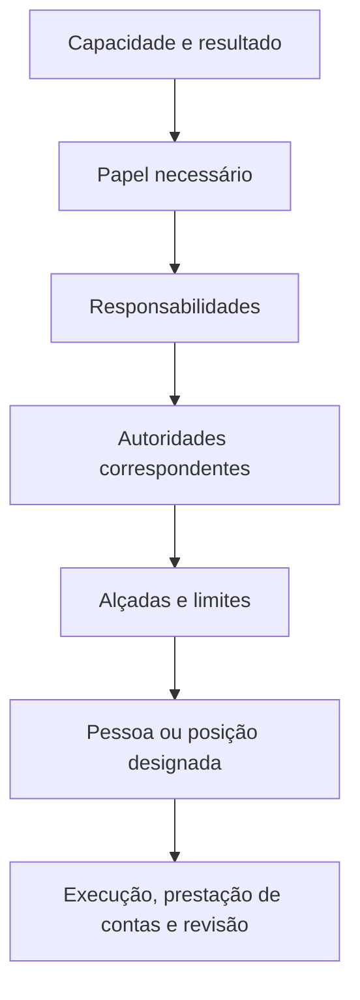

# Papéis, Responsabilidades e Alçadas — Ficha Operacional

**Sistema Operacional do Estúdio LICHTARA**  
**Módulo:** 3 — Arquitetura Organizacional  
**Ferramenta:** 03 — Papéis, Responsabilidades e Alçadas  
**Tipo:** Ficha metodológica, arquitetural e preenchível  
**Versão:** 0.1  
**Status:** Em desenvolvimento e validação pela prática  
**Data de criação:** 02/08/2026

**Documentos relacionados:**

- `README.md` deste diretório;
- `01-estado-atual-e-estado-futuro.md`;
- `02-arquitetura-de-processos-e-fluxos.md`;
- `../README.md`;
- `../fundamentos-da-arquitetura.md`;
- `../protocolo-de-arquitetura.md`;
- `../matriz-de-rastreabilidade.md`;
- `../templates/plano-de-arquitetura.md`;
- `../templates/03-catalogo-de-requisitos.md`;
- `../templates/04-matriz-de-rastreabilidade.md`;
- `../templates/05-arquitetura-integrada.md`;
- `../templates/06-registro-de-validacao.md`;
- `../templates/08-transicao-para-implantacao.md`.

---

## 1. Finalidade

Esta ferramenta orienta o desenho de papéis, responsabilidades e alçadas capazes de sustentar a arquitetura futura com clareza, autoridade, continuidade e prestação de contas.

Ela ajuda o Estúdio LICHTARA a:

- separar pessoas, cargos, papéis e instâncias;
- definir por que cada papel existe;
- relacionar papéis a capacidades, processos, decisões e componentes;
- distinguir execução, contribuição, decisão, aprovação, verificação e manutenção;
- atribuir responsabilidade final por resultados delimitados;
- definir autoridade e seus limites;
- tornar alçadas verificáveis;
- tratar delegação, substituição, escalonamento e impasse;
- identificar concentração, conflito de interesse e pontos únicos de falha;
- dimensionar competência, informação, tempo e recursos;
- preservar autonomia com limites compreensíveis;
- desenhar continuidade para organizações de uma pessoa ou equipes maiores;
- manter responsabilidade humana em funções apoiadas por tecnologia e IA;
- preparar implantação, treinamento, comunicação e governança.

## 2. Pergunta central

> Quem precisa contribuir, executar, responder, decidir, aprovar, verificar, manter, interromper e aprender para que a arquitetura funcione — com que autoridade, dentro de quais limites e sob quais condições de continuidade?

Perguntas derivadas:

- Que função organizacional precisa existir?
- Que resultado justifica cada papel?
- Que responsabilidades pertencem ao papel?
- Quem responde pelo resultado completo?
- Que autoridade permite cumprir a responsabilidade?
- Onde termina a alçada?
- Que informação, competência, tempo e recurso são necessários?
- Quem pode decidir, aprovar, alterar, interromper ou representar?
- Que decisões podem permanecer locais?
- Quando ocorre escalonamento?
- Como se resolve um impasse?
- Quem assume durante ausência?
- Que funções precisam ser segregadas?
- Que trabalho invisível deve ser reconhecido?
- Como uma pessoa pode exercer vários papéis sem ocultar riscos?
- Onde tecnologia ou IA participam e quem continua responsável?

## 3. O que é

Papéis, Responsabilidades e Alçadas é uma ferramenta de arquitetura da participação, da autoridade e da prestação de contas.

Ela organiza:

1. **funções necessárias** ao funcionamento futuro;
2. **responsabilidades** por atividade, resultado, decisão, verificação, manutenção, interface, exceção e aprendizagem;
3. **direitos decisórios** e outras formas de autoridade;
4. **limites de alçada**;
5. **relações de consulta, informação, apoio e supervisão**;
6. **delegações e substituições**;
7. **escalonamentos, impasses e exceções**;
8. **segregações e controles de poder**;
9. **condições reais de exercício**;
10. **governança e revisão**.

O produto é uma arquitetura de papéis compreensível e implantável, vinculada ao trabalho real e independente da permanência de uma pessoa específica.

## 4. Distinções essenciais

### 4.1 Pessoa

Pessoa é o indivíduo concreto que pode exercer um ou mais papéis durante determinado período.

### 4.2 Cargo ou posição

Cargo é uma posição relativamente estável na estrutura formal. Pode reunir vários papéis e possuir vínculo contratual, remuneração, nível ou requisitos próprios.

### 4.3 Papel

Papel é uma função reconhecível dentro do funcionamento. Existe porque determinada contribuição, resultado, decisão ou manutenção precisa ocorrer.

### 4.4 Responsabilidade

Responsabilidade é o compromisso de responder por uma atividade, decisão, resultado, verificação, manutenção, interface, exceção ou aprendizagem.

### 4.5 Responsabilidade final pelo resultado

É o compromisso de prestar contas pelo resultado delimitado, inclusive quando diferentes pessoas executam partes do trabalho. Requer autoridade suficiente para coordenar, decidir, escalar e solicitar correção.

### 4.6 Autoridade

Autoridade é a permissão legítima para agir, decidir, aprovar, comprometer recursos, acessar, alterar, interromper, conceder exceção, aceitar risco, delegar ou representar.

### 4.7 Alçada

Alçada é o limite verificável dentro do qual uma autoridade pode ser exercida sem nova autorização.

### 4.8 Participação

Participação é a forma pela qual uma pessoa ou papel contribui para trabalho, decisão, validação ou comunicação. Participar não concede automaticamente autoridade decisória.

### 4.9 Delegação

Delegação autoriza outro papel ou pessoa a exercer determinada autoridade dentro de limites, prazo e condições.

### 4.10 Substituição

Substituição é a assunção temporária de responsabilidades e autoridades para preservar continuidade durante ausência ou vacância.

### 4.11 Instância de governança

Instância é uma configuração formal de papéis que delibera, coordena, valida, recomenda ou acompanha determinado objeto.

### 4.12 Quadro comparativo

| Objeto | Pergunta | Estabilidade | Exemplo genérico |
| --- | --- | --- | --- |
| Pessoa | Quem exerce agora? | Variável | Maria |
| Cargo | Qual posição formal ocupa? | Relativamente estável | Coordenação de Operações |
| Papel | Que função exerce no funcionamento? | Estável enquanto necessária | Responsável pelo processo |
| Responsabilidade | Pelo que deve responder? | Vinculada ao objeto | Resultado do atendimento |
| Autoridade | O que pode fazer legitimamente? | Concedida e limitada | Interromper uma entrega inadequada |
| Alçada | Até onde pode exercer a autoridade? | Definida por critérios | Até determinado risco e valor |
| Participação | Como contribui? | Conforme atividade/decisão | Consultada antes da mudança |
| Delegação | Quem exerce temporariamente a autoridade? | Temporária e revogável | Aprovação delegada por 30 dias |
| Instância | Que grupo exerce função coletiva? | Conforme mandato | Comitê de revisão |

## 5. Relação entre os objetos



A pessoa ocupa o papel. O papel recebe responsabilidades. As responsabilidades exigem autoridades. As autoridades operam dentro de alçadas. A prestação de contas torna o exercício verificável.

## 6. Função no protocolo

| Etapa do protocolo | Função da ferramenta |
| --- | --- |
| Aceite da transição | Confirmar responsabilidades, autoridades e dependências atuais relevantes |
| Planejamento | Delimitar objetos, decisões, participantes e profundidade |
| Requisitos | Identificar condições humanas, decisórias e de governança |
| Capacidades futuras | Formular funções necessárias para sustentar capacidades |
| Processos e fluxos | Consolidar necessidades de execução, decisão, verificação e manutenção |
| Geração de alternativas | Comparar configurações centralizadas, distribuídas, compartilhadas ou externas |
| Desenho de componentes | Especificar papéis, responsabilidades, alçadas e relações |
| Integração | Relacionar papéis a informação, conhecimento, comunicação, tecnologia, IA e indicadores |
| Validação | Testar compreensão, viabilidade, carga, autoridade e continuidade |
| Aprovação | Constituir linha de base da arquitetura de papéis |
| Transição | Informar designações, treinamento, comunicação, delegações e entrada em exercício |

## 7. Saídas principais

A aplicação pode produzir:

- catálogo de papéis futuros;
- fichas completas de papel;
- inventário de responsabilidades;
- matriz de participação;
- matriz de papéis por capacidade, processo e componente;
- catálogo de decisões;
- matriz de direitos decisórios;
- registro de alçadas;
- plano de delegação;
- mapa de substituições;
- regras de escalonamento e impasse;
- matriz de segregação;
- avaliação de concentração e conflito de interesse;
- mapa de competências e condições de exercício;
- avaliação de carga e disponibilidade;
- desenho de instâncias de governança;
- plano de transição e comunicação;
- cenários de teste e validação;
- bloco consolidado para a Arquitetura Integrada.

### 7.1 Seleção proporcional

| Condição | Saídas mínimas |
| --- | --- |
| Organização de uma pessoa | Papéis separados, alçadas, checkpoints, apoio externo e continuidade |
| Equipe pequena, baixo risco | Catálogo, fichas, participação, decisões e substituição |
| Múltiplos processos ou áreas | Matrizes por processo, interfaces, escalonamentos e governança |
| Alto risco ou regulação | Alçadas detalhadas, segregação, controles, evidência e continuidade |
| Arquitetura sistêmica | Portfólio de papéis, decisões, instâncias, cargas, sucessão e revisão |

## 8. O que a ferramenta não é

Esta ferramenta não deve ser usada como:

- organograma sem relação com capacidades e trabalho;
- lista de nomes;
- descrição genérica de cargos;
- matriz de letras sem definições;
- mecanismo de distribuir culpa;
- justificativa para centralizar todas as decisões;
- forma de atribuir responsabilidade sem autoridade;
- substituta de negociação, comunicação ou contratação;
- autorização para expor desempenho individual;
- promessa de eliminar conflito e julgamento;
- representação de IA como responsável institucional;
- documento estático desconectado de mudanças reais.

## 9. Princípios

1. A capacidade justifica o papel.
2. O resultado delimita a responsabilidade.
3. Toda responsabilidade exige autoridade correspondente.
4. Autoridade possui limite explícito.
5. Execução e responsabilidade final são distinguíveis.
6. Participação não equivale a veto.
7. Aprovação, decisão, validação e verificação possuem funções diferentes.
8. Delegação é delimitada, registrada e revogável.
9. Substituição preserva continuidade e contexto.
10. Segregação responde a risco real.
11. Trabalho invisível deve se tornar reconhecível.
12. A pessoa precisa de competência, informação, tempo e recursos.
13. Uma pessoa pode exercer vários papéis; os papéis continuam separados.
14. IA amplia capacidade sob responsabilidade humana.
15. Papéis possuem condição de revisão e encerramento.

## 10. Invariantes

- nenhuma responsabilidade material permanece sem papel identificável;
- nenhuma decisão material permanece atribuída genericamente à organização ou ao sistema;
- nenhuma autoridade ampla existe sem objeto, limite e revisão;
- nenhum papel responde por resultado que não consegue observar ou influenciar;
- nenhuma delegação transfere silenciosamente a responsabilidade final;
- nenhuma substituição ocorre sem acesso, informação e autoridade necessários;
- nenhum controle de segregação é criado sem risco relacionado;
- nenhum papel permanente é criado apenas para sustentar uma solução temporária;
- nenhum agente de IA recebe responsabilidade institucional;
- nenhuma matriz substitui a validação com as pessoas afetadas.

## 11. Quando utilizar

Utilize a ferramenta quando:

- responsabilidades estiverem ambíguas ou concentradas;
- decisões sofrerem atraso, conflito ou repetição;
- processos futuros criarem novas participações;
- houver aprovação, delegação, supervisão ou manutenção;
- uma pessoa exercer múltiplas funções;
- autoridade não acompanhar responsabilidade;
- trabalho invisível sustentar a operação;
- existirem dependências pessoais;
- tecnologia ou IA alterar distribuição de trabalho;
- indicadores precisarem de autoridade de resposta;
- um fornecedor ou parceiro assumir execução;
- a continuidade depender de substituição;
- a implantação exigir designação e desenvolvimento de competências.

## 12. Quando não utilizar ou reduzir

Reduza a aplicação quando:

- existe apenas uma atividade simples, reversível e sem decisão material;
- o papel já está definido, validado e não será alterado;
- a questão pertence a vínculo trabalhista, remuneração ou descrição legal especializada;
- o problema ainda exige diagnóstico;
- a decisão arquitetural não depende da distribuição de participação;
- um registro curto de responsável e substituto é suficiente.

### 12.1 Registro da redução

| Campo | Preenchimento |
| --- | --- |
| Objeto | [Atividade, decisão ou componente] |
| Motivo | [Preencher] |
| Representação mínima | [Responsável, autoridade e substituto] |
| Risco aceito | [Preencher] |
| Autoridade | [Papel] |
| Gatilho para aprofundar | [Volume, impacto, conflito ou mudança] |

## 13. Proporcionalidade

| Fator | Baixo | Médio | Alto | Evidência |
| --- | --- | --- | --- | --- |
| Impacto do resultado | [ ] | [ ] | [ ] | [Preencher] |
| Quantidade de papéis | [ ] | [ ] | [ ] | [Preencher] |
| Decisões materiais | [ ] | [ ] | [ ] | [Preencher] |
| Concentração de autoridade | [ ] | [ ] | [ ] | [Preencher] |
| Custo de erro ou abuso | [ ] | [ ] | [ ] | [Preencher] |
| Sensibilidade de dados | [ ] | [ ] | [ ] | [Preencher] |
| Dependência de pessoa | [ ] | [ ] | [ ] | [Preencher] |
| Uso de tecnologia ou IA | [ ] | [ ] | [ ] | [Preencher] |
| Exigência regulatória | [ ] | [ ] | [ ] | [Preencher] |
| Dificuldade de reversão | [ ] | [ ] | [ ] | [Preencher] |

### 13.1 Níveis

| Nível | Aplicação | Representações |
| --- | --- | --- |
| Essencial | Poucos papéis e baixo risco | Fichas, participação, decisão e substituição |
| Intermediário | Múltiplos processos e interfaces | Essencial + alçadas, escalonamento, carga e competências |
| Ampliado | Alto impacto, regulação ou IA | Intermediário + segregação, controles, governança e continuidade |
| Sistêmico | Organização ou ecossistema | Portfólio, instâncias, sucessão, relações e revisão |

## 14. Escalas

| Escala | Objeto |
| --- | --- |
| Pessoa | Conjunto de papéis exercidos e condições reais |
| Papel | Função, responsabilidades, autoridades e relações |
| Processo | Participações e decisões ao longo do fluxo |
| Equipe | Distribuição, carga, coordenação e substituição |
| Área | Autoridades e interfaces com outras áreas |
| Organização | Portfólio de papéis, instâncias e alçadas |
| Ecossistema | Fronteiras entre organização, cliente, parceiro, fornecedor e plataforma |

### 14.1 Mudança de escala

Ao crescer, examine:

- número de interfaces;
- necessidade de especialização;
- aumento de formalização;
- risco de centralização;
- novos níveis decisórios;
- substituição e sucessão;
- controles de acesso;
- comunicação;
- tempo de coordenação;
- manutenção da identidade.

## 15. Participantes da aplicação

| Participante | Contribuição | Momento | Autoridade ou conhecimento | Risco de ausência |
| --- | --- | --- | --- | --- |
| Responsável pela arquitetura | Integridade metodológica e integração | Toda a aplicação | Aprovar o artefato | Fragmentação |
| Patrocinador/autoridade do cliente | Limites, prioridades e aprovação | Escopo e decisão | Autoridade institucional | Arquitetura sem legitimidade |
| Responsáveis por processos | Resultados e funcionamento | Desenho e validação | Prestação de contas | Papéis desconectados do trabalho |
| Pessoas executoras | Viabilidade, carga e prática | Modelagem e simulação | Conhecimento situado | Responsabilidade inexequível |
| Pessoas afetadas | Impacto, acesso e possibilidade de manifestação | Validação | Experiência e contexto | Poder sem contraponto |
| Responsáveis por risco e controle | Segregação e alçadas críticas | Análise | Competência específica | Exposição indevida |
| Responsável pela implantação | Designação, treinamento e transição | Revisão final | Coordenação da mudança | Desenho não implantável |
| Especialistas | Limites jurídicos, técnicos ou regulatórios | Conforme necessidade | Parecer especializado | Decisão fora de competência |

### 15.1 Participantes reais

| Nome ou papel | Relação | Forma de participação | Disponibilidade | Sensibilidade | Confirmação |
| --- | --- | --- | --- | --- | --- |
| [Preencher] | [Executa, decide, recebe efeito, mantém ou controla] | [Oficina, entrevista, revisão ou teste] | [Preencher] | [Preencher] | [Data] |

## 16. Autoridade da aplicação

| Decisão | Autoridade |
| --- | --- |
| Definir escopo e profundidade | Responsável pela arquitetura |
| Propor papel e responsabilidade | Grupo de desenho |
| Validar viabilidade | Pessoas executoras e responsáveis pelo processo |
| Definir autoridade institucional | Autoridade competente |
| Aceitar risco de concentração | Autoridade pelo risco |
| Aprovar segregação | Autoridade competente com parecer necessário |
| Designar pessoa | Autoridade organizacional competente |
| Aprovar arquitetura de papéis | Patrocinador ou instância definida |
| Autorizar implantação | Autoridade prevista no projeto |

### 16.1 Limites

O grupo de desenho não deve:

- criar autoridade que a organização não pode conceder;
- definir vínculo, remuneração ou obrigação legal fora de sua competência;
- assumir consentimento;
- designar pessoas sem autoridade;
- aceitar risco em nome de terceiros;
- usar matriz para resolver silenciosamente conflito político;
- divulgar informação pessoal além do necessário.

## 17. Entradas necessárias

| Entrada | Fonte | Versão/data | Qualidade | Lacuna | Tratamento |
| --- | --- | --- | --- | --- | --- |
| Capacidades futuras | Ferramenta 01 | [Preencher] | [Estado] | [Preencher] | [Ação] |
| Processos e fluxos | Ferramenta 02 | [Preencher] | [Estado] | [Preencher] | [Ação] |
| Decisões previstas | Processo/Protocolo | [Preencher] | [Estado] | [Preencher] | [Ação] |
| Requisitos | Catálogo | [Preencher] | [Estado] | [Preencher] | [Ação] |
| Papéis e autoridades atuais | Diagnóstico | [Preencher] | [Estado] | [Preencher] | [Ação] |
| Trabalho invisível | Evidências | [Preencher] | [Estado] | [Preencher] | [Ação] |
| Carga e disponibilidade | Registros/estimativas | [Preencher] | [Estado] | [Preencher] | [Ação] |
| Competências e conhecimentos | Diagnóstico | [Preencher] | [Estado] | [Preencher] | [Ação] |
| Riscos e controles | Matriz/Arquitetura | [Preencher] | [Estado] | [Preencher] | [Ação] |
| Restrições institucionais | Termo/Normas | [Preencher] | [Estado] | [Preencher] | [Ação] |

## 18. Qualidade das evidências

| Afirmação | Fonte | Natureza | Período | Confiança | Impacto se incorreta | Verificação |
| --- | --- | --- | --- | --- | --- | --- |
| [Pessoa decide, atividade consome tempo, papel possui autoridade ou outro] | [ID/fonte] | [Observada, registrada, relatada, estimada ou assumida] | [Data] | [Alta/média/baixa] | [Preencher] | [Forma] |

### 18.1 Proteções

- descrição formal e prática real permanecem distinguíveis;
- desempenho de uma pessoa não define sozinho o papel;
- disponibilidade percebida não substitui medição ou confirmação;
- conflito relatado é registrado com perspectiva e evidência;
- ausência de contestação não equivale automaticamente a concordância;
- trabalho informal é reconhecido sem exposição indevida;
- premissas sobre competência e autoridade são verificadas.

## 19. Preparação

Antes da aplicação:

- confirme capacidade, processos e decisões em escopo;
- liste necessidades de execução, decisão, verificação e manutenção;
- identifique trabalho atual visível e invisível;
- reúna alçadas formais existentes;
- selecione pessoas que exercem, recebem efeitos e coordenam;
- defina códigos de participação;
- declare premissas sobre carga e competência;
- proteja dados pessoais;
- separe papel futuro de designação nominal;
- prepare cenários de ausência, conflito e urgência;
- defina autoridade de aprovação.

### 19.1 Checklist de prontidão

| Verificação | Estado | Evidência/ação |
| --- | --- | --- |
| Capacidades e processos estão definidos | [ ] | [Preencher] |
| Decisões materiais estão identificadas | [ ] | [Preencher] |
| Pessoas executoras participarão | [ ] | [Preencher] |
| Autoridade aprovadora é conhecida | [ ] | [Preencher] |
| Dados pessoais serão protegidos | [ ] | [Preencher] |
| Carga e disponibilidade possuem fonte | [ ] | [Preencher] |
| Conflitos atuais podem ser registrados | [ ] | [Preencher] |
| Implantação participará da revisão | [ ] | [Preencher] |

## 20. Plano da aplicação

| Campo | Preenchimento |
| --- | --- |
| ID | PRA-ARQ-AAAA-NNN |
| Projeto | ARQ-AAAA-NNN |
| Pergunta | [Preencher] |
| Decisão apoiada | DEC-ARQ-___ |
| Capacidades | [IDs] |
| Processos/componentes | [IDs] |
| Decisões | [IDs] |
| Nível | [Essencial, intermediário, ampliado ou sistêmico] |
| Participantes | [Nomes/papéis] |
| Saídas | [Artefatos] |
| Validação | [Pessoas, cenários e forma] |
| Responsável | [Nome] |
| Prazo | [Data] |

### 20.1 Atividades

| ID | Atividade | Entrada | Participantes | Saída | Critério de conclusão | Data |
| --- | --- | --- | --- | --- | --- | --- |
| ATV-ARQ-___ | [Preencher] | [Fonte] | [Nomes/papéis] | [Artefato] | [Critério] | [Data] |

## 21. Identificação, versão e validade

```yaml
id_artefato: PRA-ARQ-AAAA-NNN
id_arquitetura: ARQ-AAAA-NNN
titulo: "[Nome do escopo de papéis e alçadas]"
escopo:
papeis:
decisoes:
responsavel:
autoridade_aprovadora:
data_de_referencia:
data_de_criacao:
data_da_ultima_validacao:
validade_ate:
estado: em_elaboracao
nivel_sensibilidade: confidencial
versao: 0.1
```

### 21.1 Estados

| Estado | Significado |
| --- | --- |
| Em elaboração | Papéis e relações estão sendo desenhados |
| Em negociação | Distribuição exige manifestação e ajuste |
| Em revisão | Autoridades e condições estão sendo verificadas |
| Em simulação | Cenários testam funcionamento |
| Validado com ressalvas | Conteúdo aceito sob condições |
| Validado | Conteúdo suficiente para decisão |
| Aprovado | Linha de base autorizada |
| Em implantação | Designações e condições estão sendo preparadas |
| Implantado | Papéis entraram em exercício |
| Em revisão operacional | Evidências reais exigem análise |
| Substituído | Nova versão assumiu função |
| Encerrado | Arquitetura deixou de vigorar |

## 22. Referência atual

Use o diagnóstico e as ferramentas anteriores como fonte. Registre apenas o contexto atual necessário ao desenho.

| Função atual | Pessoa/cargo | Responsabilidades formais | Trabalho praticado | Autoridade real | Fonte |
| --- | --- | --- | --- | --- | --- |
| [Preencher] | [Preencher] | [Preencher] | [Preencher] | [Preencher] | [ID/evidência] |

### 22.1 Formal e praticado

| Objeto | Formal | Praticado | Diferença | Consequência | Tratamento |
| --- | --- | --- | --- | --- | --- |
| [Responsabilidade, decisão, aprovação ou acesso] | [Preencher] | [Preencher] | [Preencher] | [Preencher] | [Preservar, regularizar, alterar ou encerrar] |

## 23. Mapa pessoa–cargo–papel

| Pessoa | Cargo/posição | Papéis exercidos | Desde quando | Formalização | Observação |
| --- | --- | --- | --- | --- | --- |
| [Nome/código protegido] | [Cargo/N/A] | [PAP IDs] | [Data/período] | [Formal, informal, temporária ou desconhecida] | [Preencher] |

### 23.1 Proteção

O mapa serve à compreensão arquitetural. Ele não deve se transformar em exposição de desempenho, diagnóstico psicológico ou registro pessoal incompatível com a finalidade.

## 24. Funções e capacidades a preservar

| Função atual | Capacidade/valor sustentado | Evidência | Dependência | Forma futura | Validação |
| --- | --- | --- | --- | --- | --- |
| [Preencher] | CAP-ARQ-___ | [Fonte] | [Pessoa, relação ou conhecimento] | [Papel/componente] | [Pessoa/forma] |

## 25. Trabalho invisível

| Trabalho | Quem realiza | Quando | Por que existe | Valor | Carga/risco | Tratamento futuro |
| --- | --- | --- | --- | --- | --- | --- |
| [Conferir, lembrar, conciliar, cobrar, acolher, traduzir ou reparar] | [Pessoa/papel] | [Evento] | [Causa] | [Preencher] | [Preencher] | [Reconhecer, distribuir, apoiar, eliminar ou formalizar] |

### 25.1 Perguntas

- Que trabalho permite que outra função pareça simples?
- Quem preserva contexto entre etapas?
- Quem resolve exceções sem registro?
- Quem absorve carga emocional?
- Quem mantém documentos, ferramentas e relações?
- Que responsabilidade existe sem reconhecimento ou recurso?

## 26. Concentração e dependência atuais

| Pessoa/papel | Funções concentradas | Autoridades | Conhecimento | Impacto da ausência | Risco | Tratamento |
| --- | --- | --- | --- | --- | --- | --- |
| [Preencher] | [Executa, decide, verifica, mantém, representa] | [Preencher] | [Preencher] | [Preencher] | [Nível] | [Preencher] |

### 26.1 Ponto único de falha

| Dependência | Objeto afetado | Evidência | Tempo suportado | Proteção atual | Lacuna |
| --- | --- | --- | --- | --- | --- |
| [Pessoa/competência/acesso/relação] | [Processo/decisão/componente] | [Fonte] | [Tempo] | [Substituto/documentação/N/A] | [Preencher] |

## 27. Conflitos e lacunas atuais

| ID | Situação | Papéis/pessoas | Tipo | Consequência | Evidência | Necessidade futura |
| --- | --- | --- | --- | --- | --- | --- |
| LAC-ARQ-___ | [Preencher] | [Preencher] | [Ambiguidade, sobreposição, vazio, conflito, autoridade insuficiente ou concentração] | [Preencher] | [Fonte] | [Preencher] |

### 27.1 Questões que retornam ao diagnóstico

Retorne quando:

- não se sabe quem realiza trabalho material;
- autoridade formal e real não podem ser verificadas;
- conflito depende de fatos ainda não investigados;
- carga e volume são desconhecidos;
- a competência necessária ainda não foi compreendida;
- risco humano ou jurídico exige especialista;
- o próprio problema de arquitetura está incorreto.

## 28. Princípio de desenho futuro

Desenhe o papel a partir de:

1. capacidade sustentada;
2. resultado esperado;
3. trabalho e decisões necessárias;
4. responsabilidade final;
5. autoridade correspondente;
6. relações e interfaces;
7. informação e competência;
8. carga e disponibilidade;
9. substituição e continuidade;
10. condição de revisão.

Evite começar pelo nome da pessoa disponível. A designação ocorre depois que a função necessária está compreendida.

## 29. Catálogo de papéis futuros

| ID | Papel | Finalidade | Capacidade | Resultado | Responsabilidade final | Estado futuro |
| --- | --- | --- | --- | --- | --- | --- |
| PAP-ARQ-001 | [Nome da função] | [Por que existe] | CAP-ARQ-___ | [Resultado] | [Objeto delimitado] | [Preservado, adaptado, novo, temporário ou encerrado] |

### 29.1 Regras de nomeação

- nomeie a função;
- evite usar nome de pessoa;
- evite confundir papel com ferramenta;
- use linguagem reconhecível;
- diferencie papéis com resultados distintos;
- mantenha IDs estáveis;
- identifique papéis temporários.

## 30. Ficha mestra do papel

| Campo | Preenchimento |
| --- | --- |
| ID | PAP-ARQ-___ |
| Nome | [Função] |
| Finalidade | [Por que existe] |
| Capacidades | [IDs] |
| Resultados | [Objetos] |
| Responsabilidades | [RSP IDs] |
| Responsabilidade final | [Objeto] |
| Autoridades | [ATD IDs] |
| Alçadas | [ALC IDs] |
| Processos | [PRC IDs] |
| Decisões | [DEC IDs] |
| Interfaces | [INT IDs] |
| Informação e acessos | [INF/ACS IDs] |
| Competências | [CPT IDs] |
| Recursos | [Preencher] |
| Carga estimada | [Faixa] |
| Indicadores | [IND IDs] |
| Substituição | [SUB ID] |
| Escalonamento | [ESC IDs] |
| Segregações | [SEG IDs] |
| Condição de entrada | [Preencher] |
| Condição de revisão | [Preencher] |
| Condição de encerramento | [Preencher] |

## 31. Finalidade e resultado do papel

| Papel | Necessidade que justifica | Resultado pelo qual responde | Destinatário | Critério | Evidência |
| --- | --- | --- | --- | --- | --- |
| PAP-ARQ-___ | [Capacidade/requisito/risco] | [Condição observável] | [Pessoa/processo/instância] | [Critério] | [Registro] |

### 31.1 Teste

- [ ] o papel existe por uma função reconhecível;
- [ ] o resultado pode ser delimitado;
- [ ] a contribuição não duplica outro papel;
- [ ] a permanência não depende de uma solução específica;
- [ ] a responsabilidade pode ser exercida;
- [ ] existe destinatário ou sistema beneficiado;
- [ ] a necessidade pode ser rastreada.

## 32. Escopo e fronteiras do papel

| Campo | Incluído | Excluído | Interface |
| --- | --- | --- | --- |
| Processos | [IDs] | [IDs/objetos] | [Papéis] |
| Decisões | [IDs/tipos] | [IDs/tipos] | [Autoridades] |
| Recursos | [Tipos/limites] | [Tipos] | [Aprovador] |
| Informação | [Acessos] | [Restrições] | [Responsável semântico] |
| Representação | [Contextos] | [Contextos] | [Autoridade] |
| Exceções | [Tipos] | [Tipos] | [Escalonamento] |

### 32.1 Fronteira saudável

O papel precisa saber:

- o que inicia sua responsabilidade;
- que objeto recebe;
- qual resultado entrega;
- quando transfere;
- o que pode decidir;
- o que precisa escalar;
- quando pode interromper;
- quando sua responsabilidade termina.

## 33. Tipos de responsabilidade

| Tipo | Objeto | Pergunta |
| --- | --- | --- |
| Execução | Atividade ou entrega | Quem realiza? |
| Contribuição | Parte do trabalho | Quem fornece insumo especializado? |
| Resultado | Condição final | Quem presta contas pelo resultado? |
| Decisão | Escolha | Quem escolhe dentro da alçada? |
| Aprovação | Autorização | Quem autoriza produzir efeito? |
| Verificação | Conformidade/qualidade | Quem confronta com critério? |
| Manutenção | Continuidade | Quem mantém o componente válido? |
| Interface | Transferência | Quem preserva a passagem? |
| Exceção | Desvio | Quem trata e restaura o fluxo? |
| Aprendizagem | Melhoria | Quem transforma evidência em revisão? |

## 34. Inventário de responsabilidades

| ID | Responsabilidade | Tipo | Objeto | Papel | Critério | Autoridade necessária | Evidência |
| --- | --- | --- | --- | --- | --- | --- | --- |
| RSP-ARQ-001 | [Verbo + objeto + condição] | [Tipo] | [ID] | PAP-ARQ-___ | [Critério] | ATD-ARQ-___ | [Registro] |

### 34.1 Formulação

Uma responsabilidade clara informa:

- ação ou compromisso;
- objeto;
- resultado ou condição;
- limite;
- momento;
- relação com outros papéis;
- evidência de cumprimento.

Evite expressões abertas como “ajudar em tudo”, “dar suporte geral” ou “garantir que dê certo”.

## 35. Responsabilidade final pelo resultado

| Resultado | Papel responsável | Autoridade disponível | Participantes | Critério de prestação de contas | Revisão |
| --- | --- | --- | --- | --- | --- |
| [ID/resultado] | PAP-ARQ-___ | [ATD/ALC IDs] | [Papéis] | [Evidência, decisão e resposta a desvio] | [Instância/gatilho] |

### 35.1 Regras

- o resultado deve ser delimitado;
- uma única referência final é preferida para o mesmo objeto e período;
- responsabilidade final compartilhada exige regra explícita de decisão e impasse;
- responder pelo resultado não significa executar todas as atividades;
- o papel precisa observar o resultado;
- o papel precisa influenciar causas materiais;
- falhas de autoridade ou recurso devem poder ser escaladas;
- prestação de contas inclui explicar, corrigir e aprender.

## 36. Responsabilidade pela execução

| Atividade/entrega | Executor principal | Coexecutores | Condição de início | Saída | Critério | Ausência |
| --- | --- | --- | --- | --- | --- | --- |
| ATI/CMP-ARQ-___ | PAP-ARQ-___ | [Papéis/N/A] | [Evento/entrada] | [Objeto] | [Critério] | [Substituição/redistribuição] |

### 36.1 Execução compartilhada

Quando mais de um papel executa:

- divida objetos ou etapas;
- identifique quem coordena;
- defina integração das partes;
- preserve critério comum;
- determine quem resolve sobreposição;
- mantenha responsabilidade final reconhecível.

## 37. Responsabilidade por decisão

| Decisão | Papel decisor | Opções | Critérios | Informação | Alçada | Registro | Revisão |
| --- | --- | --- | --- | --- | --- | --- | --- |
| DEC-ARQ-___ | PAP-ARQ-___ | [Opções reais] | [Critérios] | [INF IDs] | ALC-ARQ-___ | [Documento/sistema] | [Gatilho] |

### 37.1 Decisor e aprovador

| Função | Pergunta | Efeito |
| --- | --- | --- |
| Proponente | Que opção deve ser considerada? | Inicia avaliação |
| Recomendante | Que opção parece preferível e por quê? | Apoia escolha |
| Decisor | Qual opção será escolhida? | Define direção |
| Aprovador/autorizador | A decisão pode produzir efeito? | Concede validade ou recurso |
| Verificador | Os critérios e controles foram atendidos? | Confirma conformidade |
| Validador | O desenho ou resultado é adequado ao uso e contexto? | Produz evidência para decisão |

Uma mesma pessoa pode exercer funções diferentes em decisões de baixo risco. O registro deve manter as funções distinguíveis.

## 38. Responsabilidade por aprovação

| Objeto | Aprovador | O que a aprovação autoriza | Critérios | Limite | Recusa | Evidência |
| --- | --- | --- | --- | --- | --- | --- |
| [Decisão, despesa, documento, acesso, risco ou mudança] | PAP-ARQ-___ | [Efeito] | [Critérios] | ALC-ARQ-___ | [Tratamento] | [Registro] |

### 38.1 Aprovação necessária

Inclua aprovação quando houver:

- compromisso de recurso;
- risco acima da alçada local;
- obrigação jurídica ou regulatória;
- mudança estrutural;
- acesso sensível;
- representação externa;
- exceção material;
- impacto sobre pessoas;
- irreversibilidade relevante.

Retire aprovações que apenas repetem decisão já autorizada ou criam espera sem proteção.

## 39. Responsabilidade por verificação e controle

| Objeto | Verificador | Critério | Independência necessária | Momento | Evidência | Falha |
| --- | --- | --- | --- | --- | --- | --- |
| [Atividade, decisão, saída ou controle] | PAP-ARQ-___ | [Critério] | [Nenhuma, revisão por par ou segregação] | [Evento] | [Registro] | [Escalonamento/correção] |

### 39.1 Independência proporcional

| Risco | Configuração possível |
| --- | --- |
| Baixo e reversível | Autoverificação |
| Moderado | Revisão por par ou amostragem |
| Alto | Verificação independente antes do efeito |
| Crítico | Segregação formal e autoridade de interrupção |

## 40. Responsabilidade por manutenção e custódia

| Componente | Mantenedor | O que mantém | Frequência/gatilho | Autoridade de alteração | Evidência | Substituto |
| --- | --- | --- | --- | --- | --- | --- |
| [Processo, documento, regra, sistema, indicador ou papel] | PAP-ARQ-___ | [Validade, configuração, acesso ou conteúdo] | [Preencher] | ATD-ARQ-___ | [Registro] | PAP-ARQ-___ |

### 40.1 Custódia

Custódia inclui:

- preservar fonte oficial;
- controlar versão;
- revisar validade;
- comunicar mudança;
- proteger acesso;
- arquivar ou encerrar;
- manter rastreabilidade;
- iniciar revisão quando necessário.

## 41. Responsabilidade por interfaces

| Interface | Origem | Destino | Papel responsável | Objeto | Confirmação | Falha |
| --- | --- | --- | --- | --- | --- | --- |
| INT-ARQ-___ | [Papel/processo] | [Papel/processo] | PAP-ARQ-___ | [Objeto/contexto] | [Regra] | [Tratamento] |

### 41.1 Perguntas

- Quem prepara a transferência?
- Quem confirma recebimento?
- Quando a responsabilidade muda?
- Quem trata incompletude?
- Quem resolve divergência entre origem e destino?
- Quem mantém a regra da interface?

## 42. Responsabilidade por exceção, incidente e recuperação

| Cenário | Papel de primeira resposta | Autoridade | Escalonamento | Papel de recuperação | Comunicação | Aprendizagem |
| --- | --- | --- | --- | --- | --- | --- |
| [Exceção, falha ou incidente] | PAP-ARQ-___ | ATD/ALC-ARQ-___ | ESC-ARQ-___ | PAP-ARQ-___ | [Papel/canal] | [Responsável/registro] |

### 42.1 Autoridade de interrupção

| Gatilho | Quem pode interromper | Objeto | Duração | Comunicação | Retomada |
| --- | --- | --- | --- | --- | --- |
| [Risco, não conformidade, incidente ou limite] | PAP-ARQ-___ | [Processo, sistema, publicação ou decisão] | [Até condição] | [Públicos] | [Autoridade e critério] |

## 43. Responsabilidade por aprendizagem

| Fonte | Papel observador | Papel intérprete | Autoridade de mudança | Incorporação | Evidência |
| --- | --- | --- | --- | --- | --- |
| [Indicador, exceção, projeto, feedback ou revisão] | PAP-ARQ-___ | PAP-ARQ-___ | PAP/INS-ARQ-___ | [Processo, regra, treinamento ou arquitetura] | [Registro] |

### 43.1 Ciclo

Aprender exige:

1. observar;
2. registrar;
3. interpretar;
4. decidir;
5. alterar;
6. verificar o efeito;
7. preservar o histórico.

## 44. Códigos de participação

Use apenas os códigos necessários e defina-os no projeto.

| Código | Função | Pergunta |
| --- | --- | --- |
| P | Propõe | Quem formula opção ou mudança? |
| E | Executa/elabora | Quem realiza o trabalho? |
| R | Recomenda | Quem produz recomendação fundamentada? |
| V | Verifica/valida | Quem confronta com critério ou uso? |
| D | Decide | Quem escolhe? |
| A | Aprova/autoriza | Quem permite produzir efeito? |
| C | É consultado | Quem fornece contexto antes da decisão? |
| I | É informado | Quem precisa compreender o resultado? |
| M | Mantém | Quem preserva validade e continuidade? |
| S | Apoia | Quem fornece suporte sem assumir execução principal? |

### 44.1 Regras

- cada código possui definição local;
- `C` não concede veto;
- `I` exige comunicação adequada;
- `D` não deve ser multiplicado sem regra de decisão conjunta;
- `A` é usado somente quando autorização distinta é necessária;
- `V` informa objeto e critério;
- `E` pode ser múltiplo com coordenação;
- `M` permanece após a implantação;
- células vazias significam ausência de participação.

## 45. Matriz de participação

| Objeto | Papel 1 | Papel 2 | Papel 3 | Papel 4 | Regra |
| --- | --- | --- | --- | --- | --- |
| [Processo, atividade, decisão, documento ou componente] | [Código] | [Código] | [Código] | [Código] | [Conflito, ordem ou condição] |

### 45.1 Registro complementar

| Objeto | Código | Papel | Momento | Entrega/manifestação | Prazo | Ausência |
| --- | --- | --- | --- | --- | --- | --- |
| [ID] | [P/E/R/V/D/A/C/I/M/S] | PAP-ARQ-___ | [Evento] | [O que deve produzir] | [Tempo] | [Tratamento] |

## 46. Teste de consistência da matriz

| Pergunta | Resultado | Lacuna | Ação |
| --- | --- | --- | --- |
| Existe execução para todo trabalho material? | [Sim/parcial/não] | [Preencher] | [Ação] |
| Existe responsabilidade final por resultado? | [Resultado] | [Preencher] | [Ação] |
| Toda decisão possui decisor? | [Resultado] | [Preencher] | [Ação] |
| Aprovações possuem efeito distinto? | [Resultado] | [Preencher] | [Ação] |
| Verificações possuem critério? | [Resultado] | [Preencher] | [Ação] |
| Consultas ocorrem antes da decisão? | [Resultado] | [Preencher] | [Ação] |
| Informações possuem emissor e momento? | [Resultado] | [Preencher] | [Ação] |
| Componentes possuem manutenção? | [Resultado] | [Preencher] | [Ação] |
| Códigos múltiplos criam conflito? | [Resultado] | [Preencher] | [Ação] |

## 47. Papéis por capacidade

| Capacidade | Papel responsável | Papéis contribuintes | Autoridade | Critério | Continuidade |
| --- | --- | --- | --- | --- | --- |
| CAP-ARQ-___ | PAP-ARQ-___ | [PAP IDs] | [ATD/ALC IDs] | [Condição] | [Substituição/instância] |

### 47.1 Capacidade sem papel

| Capacidade | Manifestação necessária | Lacuna | Tratamento | Bloqueia arquitetura? |
| --- | --- | --- | --- | --- |
| CAP-ARQ-___ | [Preencher] | [Preencher] | [Criar papel, distribuir, contratar, automatizar parte ou adiar] | [Sim/não/condiciona] |

## 48. Papéis por processo e fluxo

| Processo/fluxo | Resultado | Responsável final | Executores | Decisores | Verificadores | Mantenedor |
| --- | --- | --- | --- | --- | --- | --- |
| PRC/FLX-ARQ-___ | [Resultado] | PAP-ARQ-___ | [Papéis] | [Papéis] | [Papéis] | PAP-ARQ-___ |

### 48.1 Transferência de responsabilidade

| Interface | Responsável antes | Evento de transferência | Responsável depois | Confirmação | Exceção |
| --- | --- | --- | --- | --- | --- |
| INT-ARQ-___ | PAP-ARQ-___ | [Evento] | PAP-ARQ-___ | [Registro] | [Regra] |

## 49. Papéis por componente

| Componente | Criador | Operador | Decisor | Verificador | Mantenedor | Autoridade de encerramento |
| --- | --- | --- | --- | --- | --- | --- |
| CMP/DOC/INF/SIS/IND/IA-ARQ-___ | PAP-ARQ-___ | PAP-ARQ-___ | PAP-ARQ-___ | PAP-ARQ-___ | PAP-ARQ-___ | PAP/INS-ARQ-___ |

## 50. Arquitetura das decisões

Uma decisão possui questão, opções, critérios, informação, decisor, alçada, registro, efeito e condição de revisão.

| ID | Questão | Tipo | Gatilho | Efeito | Frequência | Risco | Estado |
| --- | --- | --- | --- | --- | --- | --- | --- |
| DEC-ARQ-001 | [Pergunta] | [Operacional, tática, estrutural, técnica, humana, financeira, risco ou exceção] | [Evento] | [O que muda/autoriza] | [Faixa] | [Nível] | [Estado] |

### 50.1 Unidade decisória

| Campo | Preenchimento |
| --- | --- |
| Decisão | DEC-ARQ-___ |
| Opções | [Alternativas reais] |
| Critérios | [IDs/declarações] |
| Informação | [INF IDs] |
| Proponente | PAP-ARQ-___ |
| Recomendante | PAP-ARQ-___ |
| Consultados | [PAP IDs] |
| Decisor | PAP/INS-ARQ-___ |
| Aprovador | PAP/INS-ARQ-___ ou N/A |
| Alçada | ALC-ARQ-___ |
| Registro | [Documento/sistema] |
| Comunicação | COM-ARQ-___ |
| Revisão | [Gatilho/data] |

## 51. Direitos decisórios

| Decisão | Propor | Recomendar | Consultar | Decidir | Aprovar | Verificar | Informar |
| --- | --- | --- | --- | --- | --- | --- | --- |
| DEC-ARQ-___ | PAP-ARQ-___ | PAP-ARQ-___ | [Papéis] | PAP/INS-ARQ-___ | [Papel/N/A] | [Papel/N/A] | [Papéis] |

### 51.1 Decisão individual, conjunta ou colegiada

| Forma | Utilizar quando | Regra necessária |
| --- | --- | --- |
| Individual | Alçada clara e efeito delimitado | Critérios e registro |
| Conjunta | Duas autoridades possuem competências inseparáveis | Concordância, divergência e impasse |
| Colegiada | Efeito amplo exige perspectivas e legitimidade | Quórum, voto/consenso, registro e autoridade |
| Recomendada por especialista | Competência técnica orienta autoridade institucional | Peso do parecer e exceção |
| Automatizada por regra | Resultado é determinístico e autorizado | Regra, supervisão, exceção e auditoria |

## 52. Tipos de autoridade

| ID | Tipo | Permissão |
| --- | --- | --- |
| ATD-ARQ-001 | Agir/operar | Executar ações dentro do processo |
| ATD-ARQ-002 | Decidir | Escolher entre opções |
| ATD-ARQ-003 | Aprovar/autorizar | Permitir efeito, uso ou compromisso |
| ATD-ARQ-004 | Comprometer recurso | Utilizar orçamento, tempo ou capacidade |
| ATD-ARQ-005 | Acessar | Consultar, criar, alterar ou excluir informação |
| ATD-ARQ-006 | Alterar arquitetura | Mudar processo, regra, sistema ou papel |
| ATD-ARQ-007 | Interromper | Suspender funcionamento ou efeito |
| ATD-ARQ-008 | Conceder exceção | Autorizar desvio dentro de limite |
| ATD-ARQ-009 | Aceitar risco | Assumir exposição residual |
| ATD-ARQ-010 | Delegar | Autorizar exercício por outro papel |
| ATD-ARQ-011 | Representar | Falar, negociar ou comprometer externamente |

### 52.1 Registro de autoridade

| Autoridade | Papel | Objeto | Origem | Alçada | Condições | Evidência |
| --- | --- | --- | --- | --- | --- | --- |
| ATD-ARQ-___ | PAP-ARQ-___ | [Processo, recurso, dado, risco ou decisão] | [Norma, decisão, contrato ou arquitetura] | ALC-ARQ-___ | [Preencher] | [Registro] |

## 53. Dimensões da alçada

Alçada pode ser delimitada por uma ou várias dimensões.

| Dimensão | Limite possível | Exemplo genérico |
| --- | --- | --- |
| Objeto | Tipo de processo, contrato, documento ou sistema | Somente campanhas aprovadas |
| Ação | Criar, alterar, aprovar, excluir ou interromper | Pode editar, não pode publicar |
| Valor | Montante ou faixa | Até o limite definido |
| Risco | Exposição ou criticidade | Apenas risco baixo |
| Impacto | Número de pessoas, áreas ou clientes | Mudança dentro da própria equipe |
| Tempo | Período ou duração | Delegação por 30 dias |
| Horizonte | Operacional, tático ou estrutural | Ajuste local, sem mudar arquitetura |
| Reversibilidade | Efeito reversível ou irreversível | Experimento reversível |
| Sensibilidade | Nível de informação | Dados internos, sem dados sensíveis |
| Exceção | Tipo e frequência | Uma exceção por caso |
| Representação | Público ou território | Comunicação institucional interna |

## 54. Registro de alçadas

| ID | Papel/instância | Autoridade | Objeto | Limite | Condições | Acima da alçada | Revisão |
| --- | --- | --- | --- | --- | --- | --- | --- |
| ALC-ARQ-001 | PAP/INS-ARQ-___ | ATD-ARQ-___ | [Objeto] | [Dimensões e valores] | [Critérios] | ESC-ARQ-___ | [Gatilho/data] |

### 54.1 Teste de clareza

- o objeto é identificável;
- a ação permitida está clara;
- o limite pode ser verificado;
- exceções possuem regra;
- a autoridade acima da alçada é conhecida;
- a vigência está definida;
- existe registro de uso quando material;
- a revisão possui gatilho.

## 55. Alçadas financeiras e de recursos

| Tipo de compromisso | Papel | Limite | Orçamento/fonte | Acúmulo considerado? | Aprovação acima | Evidência |
| --- | --- | --- | --- | --- | --- | --- |
| [Compra, contratação, desconto, reembolso, hora externa ou outro] | PAP-ARQ-___ | [Valor/faixa] | [Fonte] | [Período/regra] | PAP/INS-ARQ-___ | [Registro] |

### 55.1 Fracionamento

O desenho deve impedir que compromissos sejam artificialmente divididos para permanecer abaixo da alçada.

## 56. Alçadas de risco e exceção

| Risco/exceção | Papel | Exposição permitida | Duração | Controle | Comunicação | Escalonamento |
| --- | --- | --- | --- | --- | --- | --- |
| RSC/EXC-ARQ-___ | PAP-ARQ-___ | [Nível/condição] | [Tempo] | CTL-ARQ-___ | [Públicos] | ESC-ARQ-___ |

### 56.1 Aceitação de risco

Aceitar risco exige:

- descrição da exposição;
- benefício ou necessidade;
- alternativas consideradas;
- controle existente;
- impacto residual;
- autoridade legítima;
- limite temporal;
- condição de revisão;
- registro.

## 57. Alçadas de informação, acesso e privacidade

| Papel | Informação | Ação permitida | Sensibilidade | Finalidade | Limite | Aprovação | Registro |
| --- | --- | --- | --- | --- | --- | --- | --- |
| PAP-ARQ-___ | INF-ARQ-___ | [Consultar, criar, corrigir, compartilhar ou eliminar] | [Nível] | [Uso] | [Escopo/tempo] | [Papel/N/A] | [Evidência] |

### 57.1 Privilégio mínimo

Acesso deve corresponder à responsabilidade vigente. Mudança de papel, ausência prolongada, encerramento ou incidente exigem revisão.

## 58. Alçadas tecnológicas, de automação e IA

| Objeto | Ação | Papel autorizado | Limite | Teste/revisão | Interrupção | Registro |
| --- | --- | --- | --- | --- | --- | --- |
| [Sistema, integração, automação, modelo ou agente] | [Configurar, liberar, alterar, pausar ou excluir] | PAP-ARQ-___ | [Ambiente, dados, função, custo ou risco] | [Critério] | PAP-ARQ-___ | [Log/decisão] |

### 58.1 Separações

- quem desenvolve pode não autorizar produção;
- quem opera pode não alterar controles;
- quem aprova dados pode não aprovar a decisão apoiada;
- quem revisa saída de IA precisa de competência e autoridade para rejeitar;
- quem responde pelo resultado permanece humano.

## 59. Alçadas sobre pessoas e representação

| Objeto | Autoridade | Papel | Limite | Consulta/parecer | Registro |
| --- | --- | --- | --- | --- | --- |
| Designação de papel | [Atribuir/encerrar] | [Papel competente] | [Escopo] | [Pessoas afetadas] | [Registro] |
| Distribuição de carga | [Priorizar/redistribuir] | [Papel] | [Limite] | [Pessoas afetadas] | [Registro] |
| Comunicação externa | [Representar/publicar] | [Papel] | [Público/tema] | [Revisão] | [Registro] |
| Compromisso contratual | [Negociar/assinar] | [Papel] | [Objeto/valor] | [Especialista quando necessário] | [Registro] |
| Medida que afeta direitos | [Decidir/recomendar] | [Autoridade competente] | [Limites legais e éticos] | [Especialista/manifestação] | [Registro] |

### 59.1 Limite de competência

Questões trabalhistas, societárias, regulatórias, jurídicas ou de segurança especializadas exigem profissional competente. A arquitetura registra a necessidade e a autoridade; não substitui parecer especializado.

## 60. Decisões locais e estruturais

| Característica | Local | Estrutural |
| --- | --- | --- |
| Alcance | Objeto delimitado | Múltiplos componentes/capacidades |
| Reversibilidade | Alta | Média ou baixa |
| Horizonte | Operacional | Tático ou estratégico |
| Requisitos afetados | Nenhum obrigatório ou poucos | Obrigatórios ou múltiplos |
| Participação | Papéis próximos | Pessoas e instâncias ampliadas |
| Registro | Proporcional | Decisão formal |
| Autoridade | Papel dentro da alçada | Instância/autoridade definida |

### 60.1 Teste de mudança de classe

Uma decisão inicialmente local torna-se estrutural quando:

- altera responsabilidade final;
- muda alçada;
- afeta requisito obrigatório;
- cria impacto entre processos;
- aumenta risco;
- compromete recurso material;
- reduz reversibilidade;
- estabelece precedente amplo.

## 61. Delegação

| ID | Delegante | Delegado | Autoridade delegada | Objeto | Limite | Vigência | Supervisão | Revogação |
| --- | --- | --- | --- | --- | --- | --- | --- | --- |
| DEL-ARQ-001 | PAP-ARQ-___ | [Papel ou pessoa] | ATD-ARQ-___ | [Objeto] | ALC-ARQ-___ | [Período] | [Forma] | [Gatilho/autoridade] |

### 61.1 Condições

- o delegante possui autoridade para delegar;
- o delegado possui competência e acesso;
- objeto e limite estão claros;
- vigência é conhecida;
- decisões materiais são registradas;
- supervisão corresponde ao risco;
- pessoas afetadas sabem quem exerce a autoridade;
- revogação e retorno estão definidos;
- responsabilidade final remanescente está explícita.

### 61.2 Delegação proibida ou condicionada

| Autoridade | Pode delegar? | Condição | Motivo |
| --- | --- | --- | --- |
| [Preencher] | [Sim, não ou condicionada] | [Preencher] | [Risco, norma, competência ou responsabilidade] |

## 62. Substituição

| ID | Papel titular | Substituto | Gatilho | Autoridades assumidas | Limites | Acesso | Retorno |
| --- | --- | --- | --- | --- | --- | --- | --- |
| SUB-ARQ-001 | PAP-ARQ-___ | PAP/pessoa-ARQ-___ | [Ausência, vacância ou indisponibilidade] | [IDs] | [Alçada específica] | [Como ativar] | [Reconciliação] |

### 62.1 Prontidão do substituto

| Condição | Estado | Evidência/ação |
| --- | --- | --- |
| Conhece a finalidade do papel | [ ] | [Preencher] |
| Possui competência mínima | [ ] | [Preencher] |
| Possui informação e acesso | [ ] | [Preencher] |
| Conhece decisões em curso | [ ] | [Preencher] |
| Pode exercer autoridade | [ ] | [Preencher] |
| Sabe o que deve escalar | [ ] | [Preencher] |
| Consegue devolver contexto ao titular | [ ] | [Preencher] |

## 63. Escalonamento

| ID | Gatilho | Primeiro papel | Limite excedido | Destino | Contexto mínimo | Prazo | Continuidade |
| --- | --- | --- | --- | --- | --- | --- | --- |
| ESC-ARQ-001 | [Evento] | PAP-ARQ-___ | [Alçada, risco, conflito, capacidade ou competência] | PAP/INS-ARQ-___ | [Informação] | [Tempo] | [Regra enquanto aguarda] |

### 63.1 Escalonamento saudável

- possui gatilho;
- preserva contexto;
- chega a autoridade competente;
- possui prazo;
- define operação provisória;
- devolve orientação ao fluxo;
- não se torna substituto de decisão local;
- gera revisão quando recorrente.

## 64. Impasse e divergência

| Tipo | Papéis/instâncias | Questão | Regra de tentativa | Autoridade final | Operação provisória | Registro |
| --- | --- | --- | --- | --- | --- | --- |
| IMP-ARQ-001 | [Papéis] | [Preencher] | [Negociação, evidência, parecer ou mediação] | PAP/INS-ARQ-___ | [Regra segura] | [Decisão/divergência] |

### 64.1 Impasse colegiado

Defina:

- quórum;
- regra de consenso ou voto;
- tratamento de abstenção;
- conflito de interesse;
- voto de desempate, se existir;
- prazo;
- autoridade externa;
- preservação da divergência.

## 65. Consulta, manifestação e veto

| Forma | Direito | Limite | Efeito da ausência |
| --- | --- | --- | --- |
| Consulta | Fornecer contexto antes da decisão | Não decide por si | Decisão pode seguir conforme regra |
| Manifestação | Registrar impacto, concordância ou ressalva | Não substitui autoridade | Deve ser considerada e registrada |
| Consentimento | Autorizar efeito sobre objeto sob direito da pessoa | Exigido quando aplicável | Efeito não deve ocorrer |
| Parecer | Produzir avaliação especializada | Peso definido pela norma/decisão | Exige tratamento explícito |
| Veto | Impedir decisão dentro de objeto e condição definidos | Excepcional e delimitado | Decisão fica bloqueada ou escalada |

### 65.1 Registro

| Objeto | Forma | Papel/pessoa | Momento | Prazo | Como será considerada | Evidência |
| --- | --- | --- | --- | --- | --- | --- |
| [Decisão/mudança] | [Consulta, manifestação, consentimento, parecer ou veto] | [Preencher] | [Evento] | [Tempo] | [Regra] | [Registro] |

## 66. Segregação de funções

Segregação separa funções incompatíveis quando sua concentração cria risco material.

| ID | Objeto | Funções incompatíveis | Risco | Separação | Controle compensatório | Exceção |
| --- | --- | --- | --- | --- | --- | --- |
| SEG-ARQ-001 | [Processo/recurso/dado] | [Propor, executar, aprovar, verificar, pagar, alterar ou excluir] | RSC-ARQ-___ | [Papéis distintos] | CTL-ARQ-___ | [Regra] |

### 66.1 Teste de necessidade

| Pergunta | Resposta |
| --- | --- |
| Que risco a separação trata? | [Preencher] |
| Qual é o custo da concentração? | [Preencher] |
| Qual é o custo da separação? | [Preencher] |
| Uma revisão posterior seria suficiente? | [Preencher] |
| Uma organização pequena consegue cumprir? | [Preencher] |
| Que controle compensatório é proporcional? | [Preencher] |

## 67. Concentração e conflito de interesse

| Papel/pessoa | Funções concentradas | Interesse possível | Decisão/objeto | Risco | Declaração | Tratamento |
| --- | --- | --- | --- | --- | --- | --- |
| [Preencher] | [Executa, decide, aprova, verifica, mantém] | [Pessoal, financeiro, relacional ou institucional] | [ID] | [Nível] | [Registro] | [Abstenção, revisão, segregação ou transparência] |

### 67.1 Concentração justificável

Em organizações pequenas, a mesma pessoa pode exercer funções incompatíveis em momentos diferentes. Proteções possíveis:

- checkpoints separados;
- revisão por par ou especialista;
- registro reforçado;
- limites menores;
- amostragem;
- aprovação posterior;
- operação reversível;
- transparência com pessoas afetadas.

## 68. Distribuição de poder e ética

| Autoridade | Benefício | Pessoas afetadas | Risco de abuso/omissão | Contestação | Controle | Revisão |
| --- | --- | --- | --- | --- | --- | --- |
| [Acesso, decisão, supervisão, interrupção ou representação] | [Preencher] | [Grupos] | [Preencher] | [Canal/instância] | [Mecanismo] | [Gatilho] |

### 68.1 Perguntas

- Quem decide?
- Quem suporta as consequências?
- Quem possui informação?
- Quem pode questionar?
- Quem pode corrigir?
- Quem aparece no registro?
- Quem recebe crédito?
- Quem realiza trabalho invisível?
- Quem pode interromper?
- Quem permanece sem voz?

## 69. Autonomia

Autonomia é a capacidade legítima de agir e decidir dentro de finalidade, informação, competência, autoridade e limites compreendidos.

| Papel | Finalidade | Decisões locais | Limites | Informação | Apoio | Revisão |
| --- | --- | --- | --- | --- | --- | --- |
| PAP-ARQ-___ | [Preencher] | [DEC/tipos] | [ALC IDs] | [INF IDs] | [Papéis/recursos] | [Gatilho] |

### 69.1 Autonomia inviável

| Lacuna | Efeito | Tratamento |
| --- | --- | --- |
| Sem finalidade | Ação dispersa | Clarificar resultado |
| Sem informação | Dependência ou erro | Garantir fonte e acesso |
| Sem competência | Risco e insegurança | Desenvolver ou apoiar |
| Sem autoridade | Paralisia | Conceder ou redistribuir |
| Sem limite | Exposição | Definir alçada |
| Sem recurso | Sobrecarga | Redimensionar |
| Sem revisão | Isolamento | Criar acompanhamento |

## 70. Condições de exercício

| Responsabilidade | Papel | Autoridade | Informação | Competência | Tempo | Recurso | Apoio | Estado |
| --- | --- | --- | --- | --- | --- | --- | --- | --- |
| RSP-ARQ-___ | PAP-ARQ-___ | ATD/ALC-ARQ-___ | [INF IDs] | [CPT IDs] | [Faixa] | [Preencher] | [Papéis] | [Suficiente, parcial ou ausente] |

### 70.1 Congruência

Responsabilidade é considerada implantável quando as condições necessárias existem ou possuem plano realista de criação.

## 71. Competências

| ID | Competência | Aplicação | Nível necessário | Papel | Evidência esperada | Desenvolvimento | Validade |
| --- | --- | --- | --- | --- | --- | --- | --- |
| CPT-ARQ-001 | [Conhecimento, habilidade ou julgamento] | [Responsabilidade/decisão] | [Inicial, operacional, autônomo ou especialista] | PAP-ARQ-___ | [Demonstração/experiência] | [Treinamento, prática, mentoria ou contratação] | [Revisão] |

### 71.1 Competência e autorização

Possuir conhecimento não concede automaticamente autoridade institucional. Receber autoridade não demonstra automaticamente competência. As duas condições precisam ser verificadas.

## 72. Informação e acesso necessários

| Papel | Responsabilidade/decisão | Informação | Momento | Fonte | Acesso | Qualidade | Falha |
| --- | --- | --- | --- | --- | --- | --- | --- |
| PAP-ARQ-___ | [ID] | INF-ARQ-___ | [Evento] | [Fonte oficial] | ACS-ARQ-___ | [Critério] | [Escalonamento/contingência] |

### 72.1 Acesso excessivo ou insuficiente

| Papel | Objeto | Estado | Risco | Tratamento |
| --- | --- | --- | --- | --- |
| PAP-ARQ-___ | [Informação/sistema] | [Excessivo, insuficiente ou adequado] | [Preencher] | [Conceder, restringir, segmentar ou revisar] |

## 73. Carga e capacidade

| Papel | Responsabilidades | Demanda | Tempo por unidade | Carga recorrente | Picos | Capacidade | Lacuna |
| --- | --- | --- | --- | --- | --- | --- | --- |
| PAP-ARQ-___ | [IDs] | [Volume/período] | [Faixa] | [Faixa] | [Condição] | [Faixa] | [Preencher] |

### 73.1 Carga total

Considere:

- execução;
- decisão;
- consulta;
- comunicação;
- verificação;
- manutenção;
- aprendizagem;
- reuniões;
- exceções;
- alternância de contexto;
- carga emocional;
- disponibilidade para substituição.

## 74. Disponibilidade e cadência

| Papel | Disponibilidade necessária | Janela crítica | Frequência | Tempo de resposta | Ausência | Cobertura |
| --- | --- | --- | --- | --- | --- | --- |
| PAP-ARQ-___ | [Horas/período ou condição] | [Evento/janela] | [Cadência] | [Tempo] | [Tolerância] | SUB-ARQ-___ |

### 74.1 Papel sob demanda

| Papel | Gatilho de ativação | Prazo | Forma de contratação/acionamento | Continuidade |
| --- | --- | --- | --- | --- |
| [Especialista, revisor ou apoio] | [Evento] | [Tempo] | [Mecanismo] | [Alternativa] |

## 75. Acúmulo de papéis

| Pessoa/posição | Papéis | Compatibilidade | Conflito | Carga | Proteção | Horizonte |
| --- | --- | --- | --- | --- | --- | --- |
| [Nome/código/cargo] | [PAP IDs] | [Alta/média/baixa] | [SEG/risco] | [Faixa] | [Checkpoints, revisão, limites ou substituição] | [Temporário/permanente] |

### 75.1 Organização de uma pessoa

Separe os papéis mesmo quando uma única fundadora os exerce. A separação permite:

- mudar conscientemente de função;
- aplicar critérios diferentes;
- registrar decisões materiais;
- identificar limites de competência;
- buscar revisão externa;
- perceber carga;
- preparar delegação futura;
- preservar continuidade.

## 76. Papéis compartilhados

| Papel compartilhado | Pessoas/posições | Distribuição | Coordenação | Decisão | Cobertura | Conflito |
| --- | --- | --- | --- | --- | --- | --- |
| PAP-ARQ-___ | [Preencher] | [Objeto, turno, carteira, território ou especialidade] | [Papel/regra] | [Regra] | [Como garantir] | [Tratamento] |

### 76.1 Regras

- a unidade de distribuição é conhecida;
- cada caso possui referência vigente;
- sobreposição possui coordenação;
- ausência não cria vazio;
- divergência possui regra;
- responsabilidade final permanece clara;
- destinatários sabem com quem interagir.

## 77. Papéis externos

| Papel externo | Organização/pessoa | Função | Autoridade | Limite | Responsável interno | Informação | Encerramento |
| --- | --- | --- | --- | --- | --- | --- | --- |
| PAP-EXT-___ | [Fornecedor, parceiro ou especialista] | [Preencher] | [ATD/ALC] | [Preencher] | PAP-ARQ-___ | [Acesso] | [Devolução, revogação e transição] |

### 77.1 Fronteira

Contratar execução externa não elimina a necessidade de:

- definir resultado;
- aceitar entrega;
- proteger informação;
- monitorar risco;
- preservar conhecimento;
- manter autoridade institucional;
- preparar substituição;
- encerrar acessos e devolver ativos.

## 78. Papéis temporários

| Papel | Finalidade temporária | Início | Encerramento | Responsabilidades | Autoridades | Destino posterior |
| --- | --- | --- | --- | --- | --- | --- |
| PAP-TMP-___ | [Implantação, migração, crise, piloto ou transição] | [Evento] | [Evento] | [IDs] | [IDs] | [Transferir, incorporar ou encerrar] |

### 78.1 Risco de permanência

| Papel temporário | O que acontece se permanecer | Gatilho de revisão | Autoridade |
| --- | --- | --- | --- |
| PAP-TMP-___ | [Duplicação, controle excessivo, custo ou ambiguidade] | [Data/evento] | [Papel] |

## 79. Ciclo de vida do papel

| Estado | Condição |
| --- | --- |
| Proposto | Função identificada, ainda sem aprovação |
| Em desenho | Responsabilidades e autoridades em elaboração |
| Validado | Função e condições verificadas |
| Aprovado | Papel integra a arquitetura futura |
| Em preparação | Pessoa, acesso e competência estão sendo preparados |
| Ativo | Papel está em exercício |
| Temporariamente substituído | Outro papel exerce função por regra |
| Em revisão | Evidências indicam necessidade de ajuste |
| Suspenso | Exercício temporariamente interrompido |
| Encerrado | Função deixou de existir |
| Substituído | Outro papel assumiu a função |

### 79.1 Transições

| De | Para | Gatilho | Autoridade | Ações | Evidência |
| --- | --- | --- | --- | --- | --- |
| [Estado] | [Estado] | [Evento] | [Papel/instância] | [Comunicar, transferir, conceder/revogar acesso, treinar ou arquivar] | [Registro] |

## 80. Entrada em exercício

| Condição | Critério | Responsável por preparar | Responsável por verificar | Evidência |
| --- | --- | --- | --- | --- |
| Finalidade compreendida | [Critério] | [Papel] | [Papel] | [Registro] |
| Responsabilidades aceitas | [Critério] | [Papel] | [Papel] | [Registro] |
| Autoridades concedidas | [Critério] | [Papel] | [Papel] | [Registro] |
| Alçadas compreendidas | [Critério] | [Papel] | [Papel] | [Teste] |
| Competência demonstrada | [Critério] | [Papel] | [Papel] | [Evidência] |
| Acessos disponíveis | [Critério] | [Papel] | [Papel] | [Teste] |
| Relações comunicadas | [Critério] | [Papel] | [Papel] | [Confirmação] |
| Substituição preparada | [Critério] | [Papel] | [Papel] | [Registro] |

## 81. Saída, transferência e encerramento

| Objeto | Ação | Destino | Prazo | Responsável | Verificação |
| --- | --- | --- | --- | --- | --- |
| Trabalho em curso | [Transferir/concluir] | [Papel] | [Tempo] | [Papel] | [Registro] |
| Decisões pendentes | [Transferir/escalar] | [Papel] | [Tempo] | [Papel] | [Registro] |
| Informação e documentos | [Devolver/arquivar] | [Fonte] | [Tempo] | [Papel] | [Controle] |
| Acessos | [Revogar/alterar] | [Sistema] | [Tempo] | [Papel] | [Log] |
| Autoridades delegadas | [Encerrar] | [Delegante] | [Tempo] | [Papel] | [Registro] |
| Conhecimento | [Transferir] | [Papel/base] | [Tempo] | [Papel] | [Validação] |
| Representação externa | [Comunicar] | [Públicos] | [Tempo] | [Papel] | [Confirmação] |

## 82. Continuidade e sucessão

| Papel crítico | Impacto da ausência | Tempo suportado | Substituto | Sucessão | Conhecimento | Teste |
| --- | --- | --- | --- | --- | --- | --- |
| PAP-ARQ-___ | [Preencher] | [Tempo] | SUB-ARQ-___ | [Candidato/regra] | [CON/DOC IDs] | [Data/resultado] |

### 82.1 Sucessão

Sucessão prepara exercício futuro e exige:

- competências;
- exposição gradual;
- acesso proporcional;
- acompanhamento;
- transferência de contexto;
- validação;
- decisão de designação.

## 83. Controle de acesso por papel

| Papel | Sistema/repositório | Perfil | Ações | Finalidade | Concessão | Revisão | Revogação |
| --- | --- | --- | --- | --- | --- | --- | --- |
| PAP-ARQ-___ | [Objeto] | [Perfil] | [Consultar, criar, editar, aprovar, excluir ou administrar] | [Responsabilidade] | [Papel/evento] | [Frequência] | [Evento/papel] |

### 83.1 Acesso emergencial

| Cenário | Papel | Acesso excepcional | Duração | Autorização | Monitoramento | Encerramento |
| --- | --- | --- | --- | --- | --- | --- |
| [Incidente/continuidade] | PAP-ARQ-___ | [Objeto/ação] | [Tempo] | [Papel] | [Log/revisão] | [Revogação e reconciliação] |

## 84. Representação, autoria e assinatura

| Contexto | Papel autorizado | Pode afirmar/comprometer | Limites | Revisão | Evidência |
| --- | --- | --- | --- | --- | --- |
| Comunicação institucional | PAP-ARQ-___ | [Temas] | [Público/canal] | [Papel] | [Registro] |
| Negociação | PAP-ARQ-___ | [Condições] | [Alçada] | [Papel] | [Registro] |
| Contrato/documento | PAP-ARQ-___ | [Assinatura/aprovação] | [Alçada] | [Parecer quando necessário] | [Documento] |
| Produção intelectual | PAP-ARQ-___ | [Autoria/revisão] | [Licença/uso] | [Papel] | [Crédito/versão] |
| Saída apoiada por IA | PAP-ARQ-___ | [Publicar/utilizar] | [Critério] | [Revisor] | [Registro] |

## 85. Comunicação das responsabilidades

| Evento | Público | Conteúdo | Emissor | Canal | Confirmação | Registro |
| --- | --- | --- | --- | --- | --- | --- |
| Ativação de papel | [Papéis/pessoas] | [Finalidade, responsabilidades, autoridade, limites e interfaces] | [Papel] | [Canal] | [Forma] | [Registro] |
| Mudança de alçada | [Papéis] | [O que mudou e quando] | [Papel] | [Canal] | [Forma] | [Registro] |
| Delegação/substituição | [Papéis afetados] | [Vigência e referência] | [Papel] | [Canal] | [Forma] | [Registro] |
| Encerramento | [Papéis/públicos] | [Novo destino] | [Papel] | [Canal] | [Forma] | [Registro] |

### 85.1 Teste de compreensão

Uma pessoa afetada deve conseguir responder:

- quem realiza;
- quem decide;
- quem aprova;
- quem verifica;
- quem pode interromper;
- a quem recorrer;
- quem substitui;
- quando a responsabilidade muda.

## 86. Documentação de papéis e decisões

| Documento/registro | Função | Autor | Aprovador | Mantenedor | Fonte oficial | Revisão |
| --- | --- | --- | --- | --- | --- | --- |
| Catálogo de papéis | [Referência] | [Papel] | [Papel] | [Papel] | [Local] | [Gatilho] |
| Registro de alçadas | [Autoridade] | [Papel] | [Papel] | [Papel] | [Local] | [Gatilho] |
| Delegações | [Vigência] | [Delegante] | [Quando exigido] | [Papel] | [Local] | [Término] |
| Decisões | [Rastreabilidade] | [Papel] | [Conforme regra] | [Papel] | [Local] | [Condição] |
| Substituições | [Continuidade] | [Papel] | [Papel] | [Papel] | [Local] | [Teste] |

## 87. Instâncias de governança

| ID | Instância | Finalidade | Objeto | Participantes | Autoridade | Cadência/gatilho | Registro |
| --- | --- | --- | --- | --- | --- | --- | --- |
| INS-ARQ-001 | [Nome] | [Decidir, recomendar, validar, coordenar ou acompanhar] | [Escopo] | [Papéis] | [ATD/ALC IDs] | [Preencher] | [Fonte] |

### 87.1 Ficha da instância

| Campo | Preenchimento |
| --- | --- |
| Mandato | [Função e prazo] |
| Questões decididas | [DEC/tipos] |
| Questões excluídas | [Objetos] |
| Convocação | [Quem e como] |
| Participantes permanentes | [Papéis] |
| Participantes condicionais | [Papéis/gatilhos] |
| Quórum | [Regra] |
| Deliberação | [Consenso, voto ou autoridade] |
| Impasse | [Regra] |
| Conflito de interesse | [Regra] |
| Registro | [Documento/fonte] |
| Comunicação | [Públicos] |
| Revisão | [Gatilho] |

## 88. Rituais e reuniões

Reunião é uma forma de coordenação. Sua existência precisa corresponder a decisão, integração, aprendizagem ou obrigação reconhecível.

| Ritual | Finalidade | Decisões | Participantes | Entrada | Saída | Duração/cadência | Mantenedor |
| --- | --- | --- | --- | --- | --- | --- | --- |
| [Nome] | [Preencher] | [IDs/tipos] | [Papéis] | [Informação] | [Decisão/plano/registro] | [Preencher] | PAP-ARQ-___ |

### 88.1 Teste de necessidade

| Pergunta | Resposta |
| --- | --- |
| Que resultado produz? | [Preencher] |
| Que decisão ou integração exige presença síncrona? | [Preencher] |
| Poderia ser assíncrona? | [Preencher] |
| Quem realmente precisa participar? | [Preencher] |
| Que preparação reduz carga? | [Preencher] |
| Quando deve ser encerrada? | [Preencher] |

## 89. Responsabilidade humana em tecnologia e IA

| Função técnica/IA | Executada por | Responsável humano | Autoridade humana | Verificação | Contestação | Interrupção |
| --- | --- | --- | --- | --- | --- | --- |
| [Classificar, gerar, recomendar, integrar ou automatizar] | [Sistema/IA] | PAP-ARQ-___ | [ATD/ALC IDs] | [Papel/critério] | [Canal/papel] | PAP-ARQ-___ |

### 89.1 Princípios

- sistema pode executar ação;
- IA pode produzir saída;
- regra pode direcionar fluxo;
- responsabilidade institucional permanece atribuída a papel humano ou instância legítima;
- decisões automatizadas possuem autoria da regra, supervisão, exceção e revisão;
- pessoas afetadas possuem mecanismo proporcional de contestação.

## 90. Indicadores, autoridade de resposta e manutenção

| Indicador | Responsável pela definição | Mantenedor | Intérprete | Decisor | Autoridade de resposta | Ausência/desvio |
| --- | --- | --- | --- | --- | --- | --- |
| IND-ARQ-___ | PAP-ARQ-___ | PAP-ARQ-___ | PAP-ARQ-___ | PAP/INS-ARQ-___ | ATD/ALC-ARQ-___ | [Regra] |

### 90.1 Indicador sem autoridade

| Indicador | Sinal | Ação necessária | Papel atual | Lacuna de autoridade | Tratamento |
| --- | --- | --- | --- | --- | --- |
| IND-ARQ-___ | [Condição] | [Ação/decisão] | [Papel] | [Preencher] | [Conceder, escalar ou retirar indicador] |

## 91. Prestação de contas

Prestação de contas significa tornar visível:

- responsabilidade assumida;
- autoridade exercida;
- decisão tomada;
- evidência utilizada;
- resultado produzido;
- desvio encontrado;
- correção realizada;
- aprendizagem incorporada.

### 91.1 Registro

| Papel/instância | Objeto | Frequência/gatilho | Destinatário | Conteúdo | Evidência | Resposta possível |
| --- | --- | --- | --- | --- | --- | --- |
| PAP/INS-ARQ-___ | [Resultado, risco, recurso ou decisão] | [Preencher] | [Papel/público] | [Preencher] | [Registro] | [Aprovar, ajustar, escalar ou revisar] |

### 91.2 Prestação de contas saudável

- possui finalidade;
- não se reduz a vigilância;
- considera autoridade e condições;
- distingue erro, risco, negligência e falha sistêmica;
- permite explicação e contestação;
- orienta correção e aprendizagem;
- protege dados pessoais.

## 92. Falha de papel e resposta

| Falha | Sinal | Impacto | Primeira resposta | Substituição | Escalonamento | Aprendizagem |
| --- | --- | --- | --- | --- | --- | --- |
| [Responsabilidade não cumprida, decisão atrasada, abuso de alçada, acesso indevido ou ausência] | [Evento/indicador] | [Preencher] | [Ação] | SUB-ARQ-___ | ESC-ARQ-___ | [Registro/revisão] |

### 92.1 Causas possíveis

| Causa | Pergunta |
| --- | --- |
| Finalidade obscura | A pessoa compreendia o resultado? |
| Responsabilidade ambígua | O objeto estava atribuído? |
| Autoridade insuficiente | Podia agir ou decidir? |
| Informação ausente | Possuía contexto no momento necessário? |
| Competência insuficiente | Havia preparo ou apoio? |
| Carga incompatível | Existia tempo e capacidade? |
| Conflito de alçada | Autoridades se sobrepunham? |
| Falha intencional ou abuso | Existe necessidade de resposta especializada? |
| Desenho inadequado | O papel era viável? |

## 93. Matriz estado atual–futuro

| Elemento | Estado atual | Futuro necessário | Futuro selecionado | Mudança | Requisito/decisão | Impacto |
| --- | --- | --- | --- | --- | --- | --- |
| [Papel, responsabilidade, autoridade, alçada, instância ou relação] | [Preencher] | [Condição] | [Configuração] | [Preservar, criar, alterar, distribuir, concentrar ou encerrar] | [IDs] | [Preencher] |

### 93.1 Pessoas e designação

| Papel futuro | Pessoa/posição candidata | Condição | Lacuna | Decisão de designação | Alternativa |
| --- | --- | --- | --- | --- | --- |
| PAP-ARQ-___ | [Nome/cargo/a definir] | [Competência, disponibilidade, vínculo e interesse] | [Preencher] | [Autoridade/data] | [Contratar, desenvolver, compartilhar, externalizar ou adiar] |

## 94. Alternativas de configuração

| Dimensão | Alternativa A | Alternativa B | Alternativa C |
| --- | --- | --- | --- |
| Distribuição | [Centralizada] | [Distribuída] | [Compartilhada] |
| Decisões | [Preencher] | [Preencher] | [Preencher] |
| Alçadas | [Preencher] | [Preencher] | [Preencher] |
| Competências | [Preencher] | [Preencher] | [Preencher] |
| Carga | [Preencher] | [Preencher] | [Preencher] |
| Segregação | [Preencher] | [Preencher] | [Preencher] |
| Continuidade | [Preencher] | [Preencher] | [Preencher] |
| Custo | [Preencher] | [Preencher] | [Preencher] |
| Benefício | [Preencher] | [Preencher] | [Preencher] |
| Risco | [Preencher] | [Preencher] | [Preencher] |
| Evolução | [Preencher] | [Preencher] | [Preencher] |

### 94.1 Configurações possíveis

- papel interno dedicado;
- papel acumulado por pessoa existente;
- papel compartilhado;
- papel rotativo;
- execução externa com responsabilidade interna;
- instância colegiada;
- apoio técnico ou de IA com autoridade humana;
- papel temporário até determinado gatilho;
- adiamento com controle compensatório.

## 95. Compensações

| Escolha | Ganho | Custo/limitação | Quem recebe o ganho | Quem assume o custo | Proteção | Decisão |
| --- | --- | --- | --- | --- | --- | --- |
| [Centralizar, distribuir, segregar, delegar, contratar ou automatizar] | [Preencher] | [Preencher] | [Pessoas/grupos] | [Pessoas/grupos] | [Preencher] | DEC-ARQ-___ |

## 96. Estados temporais e transição

| Estado | Papéis | Responsabilidades | Autoridades | Vigência | Critério de saída |
| --- | --- | --- | --- | --- | --- |
| Atual de referência | [IDs/funções] | [Preencher] | [Preencher] | [Data] | [Autorização] |
| Transição | [Papéis permanentes e temporários] | [Duplicações/transferências] | [Delegações] | [Período] | [Estabilização] |
| Futuro inicial | [IDs] | [Configuração] | [ALC IDs] | [Condição] | [Gatilho evolutivo] |
| Futuro evolutivo | [Novos/especializados] | [Configuração] | [ALC IDs] | [Horizonte] | [Nova revisão] |
| Encerramento | [Papéis extintos] | [Transferidas] | [Revogadas] | [Condição] | [Arquivamento] |

### 96.1 Transferência progressiva

| Responsabilidade/autoridade | Origem | Destino | Preparação | Data/condição | Supervisão | Conclusão |
| --- | --- | --- | --- | --- | --- | --- |
| [ID] | PAP-ARQ-___ | PAP-ARQ-___ | [Treinamento, acesso, prática e comunicação] | [Preencher] | [Papel] | [Critério] |

## 97. Simulação e cenários

| Cenário | Papéis ativados | Decisões | Alçadas testadas | Substituição/escalada | Resultado esperado | Evidência |
| --- | --- | --- | --- | --- | --- | --- |
| Operação normal | [IDs] | [IDs] | [IDs] | [N/A] | [Resultado] | [Registro] |
| Ausência do responsável | [IDs] | [IDs] | [IDs] | SUB-ARQ-___ | [Continuidade] | [Registro] |
| Urgência | [IDs] | [IDs] | [IDs] | ESC-ARQ-___ | [Resposta] | [Registro] |
| Conflito de interesse | [IDs] | [IDs] | [IDs] | [Abstenção/substituição] | [Integridade] | [Registro] |
| Impasse | [IDs] | [IDs] | [IDs] | IMP-ARQ-___ | [Decisão/segurança] | [Registro] |
| Falha técnica/IA | [IDs] | [IDs] | [IDs] | [Retorno humano] | [Continuidade] | [Registro] |
| Pico de carga | [IDs] | [IDs] | [IDs] | [Redistribuição] | [Resultado mínimo] | [Registro] |

### 97.1 Plano de teste

| ID | Cenário | Pergunta | Participantes | Critério | Observador | Resultado |
| --- | --- | --- | --- | --- | --- | --- |
| TST-ARQ-___ | [Cenário] | [Preencher] | [Papéis/pessoas] | [Critério] | [Papel] | [Preencher] |

## 98. Validação

Valide com:

- pessoas que exercerão os papéis;
- responsáveis pelos processos;
- pessoas afetadas por decisões;
- autoridades que concederão alçadas;
- responsáveis por risco e informação;
- responsáveis pela implantação;
- especialistas quando necessário.

### 98.1 Registro

| Dimensão | Pergunta | Validador | Método | Resultado | Evidência | Condição |
| --- | --- | --- | --- | --- | --- | --- |
| Clareza | O papel é compreensível? | [Papel/pessoa] | [Revisão] | [Resultado] | VAL-ARQ-___ | [Preencher] |
| Viabilidade | Existem tempo, competência e recurso? | [Pessoa/papel] | [Simulação] | [Resultado] | [ID] | [Preencher] |
| Autoridade | A responsabilidade pode ser exercida? | [Autoridade] | [Revisão] | [Resultado] | [ID] | [Preencher] |
| Alçada | Limites são verificáveis? | [Papel] | [Cenários] | [Resultado] | [ID] | [Preencher] |
| Ética | Poder e impacto estão protegidos? | [Pessoas/risco] | [Revisão] | [Resultado] | [ID] | [Preencher] |
| Continuidade | Ausência possui resposta? | [Papel] | [Teste] | [Resultado] | [ID] | [Preencher] |
| Integração | Papéis correspondem aos processos? | [Responsável] | [Matriz] | [Resultado] | [ID] | [Preencher] |

### 98.2 Ausência de manifestação

Ausência de resposta:

- não constitui automaticamente concordância;
- pode permitir continuidade em consulta comum conforme regra;
- bloqueia quando consentimento, autoridade ou competência são indispensáveis;
- deve ser registrada com tentativas e impacto.

## 99. Rastreabilidade

| Elemento | Origem | Capacidade | Processo/componente | Requisito | Decisão | Validação | Destino |
| --- | --- | --- | --- | --- | --- | --- | --- |
| PAP/RSP/ATD/ALC/DEL/SUB/SEG-ARQ-___ | [Fonte/achado] | CAP-ARQ-___ | [IDs] | REQ-ARQ-___ | DEC-ARQ-___ | VAL/TST-ARQ-___ | Arquitetura Integrada |

### 99.1 Responsabilidade sem origem

| Responsabilidade | Papel | Fonte ausente | Ação |
| --- | --- | --- | --- |
| RSP-ARQ-___ | PAP-ARQ-___ | [Capacidade, processo, requisito, risco ou decisão] | [Justificar, testar, retirar ou suspender] |

### 99.2 Requisito sem responsável

| Requisito | Manifestação | Papel necessário | Lacuna | Tratamento |
| --- | --- | --- | --- | --- |
| REQ-ARQ-___ | [Resultado, controle ou decisão] | [Papel] | [Preencher] | [Criar, distribuir ou decidir] |

## 100. Integração com as demais ferramentas

| Ferramenta | Esta ferramenta recebe | Esta ferramenta entrega |
| --- | --- | --- |
| 01 — Estado Atual e Estado Futuro | Capacidades, mudanças e estados temporais | Funções que sustentarão capacidades |
| 02 — Processos e Fluxos | Necessidades de execução, decisão, verificação e manutenção | Papéis, autoridades e substituições consolidados |
| 04 — Informação e Conhecimento | Objetos, fontes e competências | Responsáveis semânticos, acessos e conhecimentos requeridos |
| 05 — Comunicação | Eventos, públicos e canais | Emissores, destinatários e confirmações |
| 06 — Documentação | Documentos e ciclo de vida | Autores, aprovadores, mantenedores e acessos |
| 07 — Indicadores | Métricas e decisões | Donos, intérpretes e autoridade de resposta |
| 08 — Tecnologia e Integrações | Componentes e operações | Autoridades técnicas, acessos e continuidade |
| 09 — Inteligência Artificial | Funções e controles de IA | Responsabilidade humana, verificação, contestação e interrupção |
| 10 — Avaliação de Alternativas | Critérios e comparação | Alternativas de distribuição, carga e governança |

### 100.1 Verificações cruzadas

| Pergunta | Resultado | Evidência | Lacuna | Ação |
| --- | --- | --- | --- | --- |
| Todo processo possui responsabilidade final? | [Resultado] | [IDs] | [Preencher] | [Ação] |
| Toda decisão possui autoridade? | [Resultado] | [IDs] | [Preencher] | [Ação] |
| Toda responsabilidade possui condições de exercício? | [Resultado] | [IDs] | [Preencher] | [Ação] |
| Todo componente possui mantenedor? | [Resultado] | [IDs] | [Preencher] | [Ação] |
| Toda função de IA possui responsável humano? | [Resultado] | [IDs] | [Preencher] | [Ação] |
| Todo papel crítico possui substituição? | [Resultado] | [IDs] | [Preencher] | [Ação] |
| Toda concentração material possui tratamento? | [Resultado] | [IDs] | [Preencher] | [Ação] |

## 101. Passagem para a Arquitetura Integrada

| Seção | Conteúdo |
| --- | --- |
| Papéis e autoridades | Catálogo e fichas de papel |
| Matriz de responsabilidade | Participações por objeto |
| Congruência | Responsabilidade, autoridade e condições |
| Concentração | Riscos, segregações e continuidade |
| Decisão e escalonamento | Direitos decisórios, alçadas, impasses |
| Informação e dados | Acessos e responsáveis |
| Conhecimento | Competências e dependências |
| Tecnologia e IA | Responsabilidades humanas e autoridades |
| Indicadores | Mantenedores e autoridade de resposta |
| Estados temporais | Designações, transferências e encerramentos |

### 101.1 Pacote

| Artefato | ID/versão | Estado | Fonte oficial | Responsável |
| --- | --- | --- | --- | --- |
| Catálogo de papéis | [ID] | [Estado] | [Caminho] | [Nome] |
| Matriz de participação | [ID] | [Estado] | [Caminho] | [Nome] |
| Catálogo de decisões e alçadas | [ID] | [Estado] | [Caminho] | [Nome] |
| Delegações e substituições | [ID] | [Estado] | [Caminho] | [Nome] |
| Segregações e riscos | [ID] | [Estado] | [Caminho] | [Nome] |
| Validações | [IDs] | [Estado] | [Caminho] | [Nome] |

## 102. Passagem para implantação

| Necessidade | Origem | Ação de implantação | Critério de pronto | Responsável sugerido |
| --- | --- | --- | --- | --- |
| Designar pessoas | [PAP IDs] | [Ato/contratação/atribuição] | [Aceite e registro] | [Papel] |
| Desenvolver competência | [CPT IDs] | [Treinamento/prática/mentoria] | [Demonstração] | [Papel] |
| Conceder acessos | [ACS IDs] | [Configuração] | [Teste] | [Papel] |
| Comunicar relações | [COM IDs] | [Plano de comunicação] | [Compreensão] | [Papel] |
| Ativar delegações | [DEL IDs] | [Registro e vigência] | [Confirmação] | [Papel] |
| Testar substituição | [SUB IDs] | [Simulação] | [Continuidade] | [Papel] |
| Implantar instâncias | [INS IDs] | [Mandato/cadência] | [Primeira deliberação] | [Papel] |
| Revogar arquitetura anterior | [Mudanças] | [Encerramento] | [Acessos e responsabilidades transferidos] | [Papel] |

## 103. Apoio da inteligência artificial na aplicação

IA pode apoiar:

- extrair responsabilidades de fontes autorizadas;
- comparar descrição formal e matrizes;
- localizar objetos sem responsável;
- detectar múltiplos decisores;
- apontar responsabilidades sem autoridade;
- simular cenários de ausência;
- estimar carga sob premissas explícitas;
- comparar alternativas;
- verificar consistência entre tabelas;
- preparar perguntas de validação;
- registrar divergências.

### 103.1 Registro de uso

| Uso | Entrada | Ferramenta/modelo | Saída | Verificação humana | Alterações | Registro |
| --- | --- | --- | --- | --- | --- | --- |
| [Preencher] | [Fonte autorizada] | [Identificação] | [Artefato] | [Nome/critério] | [Preencher] | [ID] |

### 103.2 Proibições

IA não deve:

- designar pessoas;
- definir autoridade legítima;
- avaliar caráter ou intenção;
- inferir competência sem evidência;
- aceitar risco;
- decidir conflito de interesse;
- conceder acesso;
- criar obrigação legal;
- aprovar arquitetura;
- substituir manifestação humana.

## 104. Responsabilidades humanas na aplicação

| Responsabilidade | Pessoa/papel | Evidência | Data |
| --- | --- | --- | --- |
| Integridade metodológica | [Nome] | [Revisão] | [Data] |
| Validação dos processos | [Papel] | [Registro] | [Data] |
| Validação de autoridade | [Autoridade] | [Registro] | [Data] |
| Validação de carga | [Pessoas/papéis] | [Registro] | [Data] |
| Validação ética e de risco | [Papel/especialista] | [Registro] | [Data] |
| Aprovação | [Autoridade] | [Decisão] | [Data] |

## 105. Dados, confidencialidade e acesso

| Objeto | Sensibilidade | Acesso | Edição | Compartilhamento | Retenção | Descarte |
| --- | --- | --- | --- | --- | --- | --- |
| [Mapa de pessoas, carga, conflito, competência, alçada ou decisão] | [Nível] | [Papéis] | [Papéis] | [Regra] | [Prazo] | [Forma] |

### 105.1 Proteções

- use papel sempre que o nome não for necessário;
- separe arquitetura de avaliação individual;
- evite registrar dados pessoais irrelevantes;
- limite acesso a conflitos e competências;
- preserve direito de manifestação;
- registre decisões sem expor informação sensível;
- revise artefatos antes do compartilhamento;
- trate obrigações legais com competência apropriada.

## 106. Artefato e versionamento

### 106.1 Estrutura recomendada

```text
PRA-ARQ-AAAA-NNN/
|-- README.md
|-- catalogo-de-papeis.md
|-- papeis/
|   +-- PAP-ARQ-NNN.md
|-- matriz-de-participacao.md
|-- decisoes-e-alcadas.md
|-- delegacoes-e-substituicoes.md
|-- segregacoes-e-riscos.md
|-- competencias-e-carga.md
|-- instancias-de-governanca.md
|-- testes-e-validacoes.md
+-- historico-de-versoes.md
```

### 106.2 Histórico

| Versão | Data | Alteração | Motivo | Impacto | Responsável | Aprovação |
| --- | --- | --- | --- | --- | --- | --- |
| 0.1 | [Data] | Criação | [Projeto] | [Preencher] | [Nome] | [Estado] |

### 106.3 Mudança material

Exige nova versão quando altera:

- finalidade de papel;
- responsabilidade final;
- decisor ou aprovador;
- autoridade ou alçada;
- segregação;
- substituição crítica;
- instância de governança;
- acesso sensível;
- condição de continuidade.

## 107. Versão focal e versão sistêmica

### 107.1 Ficha focal

| Campo | Preenchimento |
| --- | --- |
| Papéis | [IDs] |
| Processos/decisões | [IDs] |
| Responsabilidades | [IDs] |
| Responsabilidade final | [Papel/resultado] |
| Autoridades e alçadas | [IDs] |
| Participação | [Matriz] |
| Substituição | [IDs] |
| Concentração | [Risco/proteção] |
| Condições de exercício | [Estado] |
| Validação | [IDs] |

### 107.2 Estrutura sistêmica

Acrescente:

- portfólio de papéis;
- arquitetura de decisões;
- instâncias de governança;
- mapa de poder e interfaces;
- segregações;
- capacidade e carga agregadas;
- sucessão;
- papéis externos;
- alçadas por domínio;
- governança de acesso;
- revisão periódica.

## 108. Checklists

### 108.1 Desenho

- [ ] papéis derivam de capacidades e processos;
- [ ] cada papel possui finalidade e resultado;
- [ ] responsabilidades estão delimitadas;
- [ ] responsabilidade final está clara;
- [ ] autoridades correspondem às responsabilidades;
- [ ] alçadas são verificáveis;
- [ ] decisões distinguem propor, recomendar, decidir, aprovar e verificar;
- [ ] trabalho invisível foi tratado;
- [ ] concentração e conflitos foram examinados;
- [ ] substituições existem para papéis críticos.

### 108.2 Condições

- [ ] informação está disponível;
- [ ] acessos são proporcionais;
- [ ] competências foram definidas;
- [ ] carga é compatível;
- [ ] recursos e apoio existem;
- [ ] pessoas candidatas puderam se manifestar;
- [ ] especialistas foram consultados quando necessário;
- [ ] delegações possuem vigência;
- [ ] instâncias possuem mandato.

### 108.3 Validação e conclusão

- [ ] cenários de ausência foram testados;
- [ ] impasses foram testados;
- [ ] pessoas afetadas validaram compreensão;
- [ ] autoridades validaram alçadas;
- [ ] riscos residuais foram aceitos;
- [ ] matriz de rastreabilidade foi atualizada;
- [ ] Arquitetura Integrada foi atualizada;
- [ ] implantação recebeu designações e lacunas;
- [ ] versão e revisão foram definidas.

## 109. Exemplo resumido

### 109.1 Contexto

Uma fundadora conduz diagnóstico, proposta, execução, revisão, cobrança e comunicação. O funcionamento depende de sua memória e todas as decisões chegam a ela.

### 109.2 Separação de papéis

| Papel | Finalidade | Exercício inicial |
| --- | --- | --- |
| Responsável pelo relacionamento | Preservar contexto e compromisso com o cliente | Fundadora |
| Responsável pela arquitetura | Responder pela integridade metodológica | Fundadora |
| Responsável pela execução | Produzir entregas aprovadas | Fundadora/apoio |
| Revisor | Confrontar entrega com critérios | Fundadora em checkpoint separado ou par externo |
| Responsável financeiro | Emitir, acompanhar e conciliar cobranças | Fundadora/serviço externo |
| Custodiante documental | Manter fonte oficial e versões | Fundadora |

### 109.3 Alçadas

| Decisão | Papel | Alçada | Acima da alçada |
| --- | --- | --- | --- |
| Ajustar sequência de atividade | Responsável pela execução | Reversível, sem alterar escopo | Responsável pela arquitetura |
| Alterar entrega contratada | Responsável pelo relacionamento | Nenhuma sem aceite | Cliente + responsável pela arquitetura |
| Publicar material | Revisor/autoridade | Critérios atendidos | Suspender e revisar |
| Assumir despesa | Responsável financeiro | Limite definido | Fundadora como autoridade institucional |
| Utilizar IA | Responsável pela execução | Dados permitidos e saída revisada | Responsável pela arquitetura |

### 109.4 Proteções

- separar temporalmente criação e revisão;
- registrar decisões que mudam escopo;
- usar checklist para publicação;
- definir limite financeiro;
- manter cópia e fonte oficial;
- preparar apoio externo para ausência;
- documentar critérios antes de delegar;
- revisar carga mensal.

### 109.5 Evolução

O primeiro gatilho de crescimento não cria automaticamente um cargo amplo. Ele pode ativar apoio de execução com responsabilidade final ainda na fundadora. Novos volumes e riscos indicarão quando revisão, relacionamento ou operação exigem papéis dedicados.

## 110. Indicadores de qualidade da aplicação

| Indicador | Definição | Fonte | Critério inicial | Decisão |
| --- | --- | --- | --- | --- |
| Cobertura de responsabilidades | Objetos materiais com papel | Matriz | [Meta] | Completar desenho |
| Congruência | Responsabilidades com autoridade e condições | Registro | [Meta] | Redesenhar/conceder |
| Decisões governadas | Decisões com decisor e alçada | Catálogo | [Meta] | Definir autoridade |
| Papéis críticos cobertos | Papéis com substituição testada | Continuidade | [Meta] | Preparar cobertura |
| Concentrações tratadas | Concentrações com justificativa/proteção | Riscos | [Meta] | Segregar/controlar |
| Compreensão | Pessoas que explicam relações corretamente | Validação | [Critério] | Comunicar/simplificar |
| Implantabilidade | Papéis com competência, acesso, tempo e recurso | Condições | [Meta] | Preparar implantação |
| Elementos órfãos | Papéis ou autoridades sem origem | Rastreabilidade | Zero material | Justificar/retirar |

## 111. Antipadrões e aprendizagem

### 111.1 Antipadrões

| Antipadrão | Efeito |
| --- | --- |
| Nome no lugar de papel | Arquitetura depende da permanência individual |
| Cargo genérico | Funções e resultados permanecem ocultos |
| Todos responsáveis | Ninguém presta contas |
| Responsabilidade sem autoridade | Paralisia e escalonamento excessivo |
| Autoridade sem limite | Abuso, conflito e exposição |
| Consulta tratada como veto | Decisões ficam ambíguas |
| Aprovação ornamental | Espera sem proteção |
| Delegação informal | Autoridade e responsabilidade se confundem |
| Substituto nominal sem acesso | Continuidade fictícia |
| Segregação excessiva | Carga e burocracia desproporcionais |
| IA como responsável | Prestação de contas desaparece |
| Matriz sem comunicação | Relações permanecem desconhecidas |
| Papel sem manutenção | Arquitetura envelhece |

### 111.2 Aprendizagem

| Pergunta | Resposta |
| --- | --- |
| Que ambiguidade apareceu na simulação? | [Preencher] |
| Que responsabilidade exigiu mais autoridade? | [Preencher] |
| Que alçada foi difícil de compreender? | [Preencher] |
| Que concentração precisa de proteção? | [Preencher] |
| Que carga estava invisível? | [Preencher] |
| Que pessoa ou grupo não participou o suficiente? | [Preencher] |
| Que representação ajudou mais? | [Preencher] |
| O que deve mudar na ferramenta? | [Preencher] |

### 111.3 Registro

| ID | Aprendizado | Evidência | Mudança proposta | Responsável | Estado |
| --- | --- | --- | --- | --- | --- |
| APR-ARQ-___ | [Preencher] | [Fonte] | [Ferramenta, template, processo ou arquitetura] | [Nome] | [Proposto, aprovado, incorporado ou rejeitado] |

## 112. Critérios de conclusão e princípio de encerramento

A aplicação pode ser concluída quando:

- papéis derivam de capacidades, processos, decisões ou riscos;
- finalidade e resultado de cada papel estão claros;
- responsabilidades materiais possuem referência;
- responsabilidade final está delimitada;
- autoridades e alçadas correspondem às responsabilidades;
- condições de exercício são suficientes ou possuem plano;
- decisões, aprovações, verificações e consultas estão distinguidas;
- delegações, substituições e escalonamentos estão definidos;
- concentração, conflito e segregação foram examinados;
- papéis críticos possuem continuidade;
- responsabilidade humana por tecnologia e IA está explícita;
- pessoas e autoridades necessárias validaram;
- ressalvas e riscos residuais estão registrados;
- rastreabilidade reconstrói o desenho;
- Arquitetura Integrada e implantação receberam as saídas.

### 112.1 Termo de conclusão

| Campo | Preenchimento |
| --- | --- |
| Resultado | [Concluída, concluída com condições, suspensa ou devolvida] |
| Escopo | [Papéis/decisões] |
| Versão | [Número] |
| Validações | [IDs] |
| Condições pendentes | [IDs/responsáveis/prazos] |
| Riscos aceitos | [IDs/autoridades] |
| Decisão | [ID] |
| Próximo movimento | [Integração, aprofundamento, implantação ou retorno] |
| Responsável | [Nome] |
| Data | [DD/MM/AAAA] |

### 112.2 Princípio de encerramento

Uma arquitetura de papéis é sólida quando cada função necessária possui propósito, responsabilidade, autoridade, limite e condição real de exercício.

Seu valor aparece quando a organização consegue compreender:

- quem faz;
- quem responde;
- quem decide;
- quem autoriza;
- quem verifica;
- quem mantém;
- quem pode interromper;
- quem substitui;
- quem resolve o impasse;
- como o poder é limitado;
- como a aprendizagem retorna ao funcionamento.

O desenho está suficientemente completo quando a responsabilidade deixa de depender de suposição, a autoridade deixa de depender de proximidade pessoal e a continuidade deixa de depender de uma única presença.

---

## Registro final

**Ferramenta:** `03-papeis-responsabilidades-e-alcadas.md`  
**Versão:** 0.1  
**Data:** 02/08/2026  
**Responsável pela custódia:** Estúdio LICHTARA  
**Estado:** Em desenvolvimento e validação pela prática  
**Próxima ficha prevista:** `04-arquitetura-de-informacao-e-conhecimento.md`  
