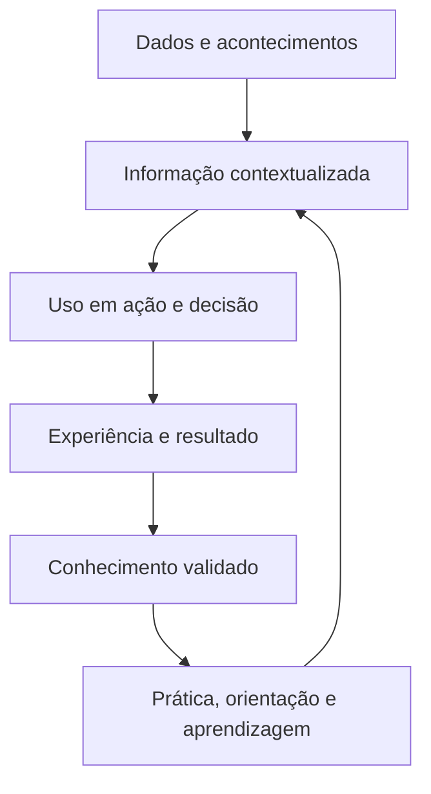

# Arquitetura de Informação e Conhecimento — Ficha Operacional

**Sistema Operacional do Estúdio LICHTARA**  
**Módulo:** 3 — Arquitetura Organizacional  
**Ferramenta:** 04 — Arquitetura de Informação e Conhecimento  
**Tipo:** Ficha metodológica, arquitetural e preenchível  
**Versão:** 0.1  
**Status:** Em desenvolvimento e validação pela prática  
**Data de criação:** 02/08/2026

**Documentos relacionados:**

- `README.md` deste diretório;
- `01-estado-atual-e-estado-futuro.md`;
- `02-arquitetura-de-processos-e-fluxos.md`;
- `03-papeis-responsabilidades-e-alcadas.md`;
- `../README.md`;
- `../fundamentos-da-arquitetura.md`;
- `../protocolo-de-arquitetura.md`;
- `../matriz-de-rastreabilidade.md`;
- `../templates/plano-de-arquitetura.md`;
- `../templates/03-catalogo-de-requisitos.md`;
- `../templates/04-matriz-de-rastreabilidade.md`;
- `../templates/05-arquitetura-integrada.md`;
- `../templates/06-registro-de-validacao.md`;
- `../templates/08-transicao-para-implantacao.md`.

---

## 1. Finalidade

Esta ferramenta orienta o desenho das condições necessárias para que informação e conhecimento sejam produzidos, encontrados, compreendidos, utilizados, protegidos, atualizados e transformados em aprendizagem.

Ela ajuda o Estúdio LICHTARA a:

- distinguir dados, informação, documento, registro, metadado e conhecimento;
- identificar objetos informacionais necessários ao funcionamento;
- definir significado, finalidade, usuário e contexto de uso;
- estabelecer fontes oficiais sem presumir infalibilidade;
- representar origem, transformação, fluxo e destino;
- especificar critérios de qualidade;
- definir acessos, restrições, retenção e descarte;
- tratar versões, divergências, duplicidades e obsolescência;
- tornar conhecimento crítico e dependências pessoais visíveis;
- preservar julgamento, experiência, relações e critérios que não cabem integralmente em documentos;
- criar ciclos de aprendizagem;
- preparar informação para tecnologia, indicadores e IA;
- proteger privacidade, autoria, propriedade intelectual e continuidade;
- produzir uma fonte rastreável para a Arquitetura Integrada e a implantação.

## 2. Pergunta central

> Que informação e conhecimento precisam existir, em qual contexto, com que significado, qualidade, origem, acesso e responsabilidade, para que pessoas e sistemas consigam agir, decidir, aprender e manter continuidade?

Perguntas derivadas:

- Que objeto informacional é necessário?
- Para qual atividade ou decisão?
- Quem o produz?
- Quem o utiliza?
- Em que momento?
- Qual significado precisa permanecer estável?
- Que fonte é oficial?
- Como divergências são resolvidas?
- Que transformação ocorre?
- Que qualidade é suficiente?
- Quem pode acessar, alterar, compartilhar ou eliminar?
- Que evidência precisa permanecer?
- Quanto tempo deve ser retido?
- Que conhecimento está concentrado em pessoas?
- O que pode ser documentado?
- O que exige prática, relação ou julgamento?
- Que conhecimento deve permanecer humano?
- Como experiência retorna à arquitetura?
- Como IA pode utilizar informação sem perder origem, permissão e contexto?

## 3. O que é

Arquitetura de Informação e Conhecimento é uma ferramenta de desenho semântico, operacional e humano.

Ela organiza:

1. **objetos informacionais** necessários a processos, decisões, interfaces e controles;
2. **significados e definições**;
3. **origens, fontes oficiais e linhagem**;
4. **fluxos e transformações**;
5. **qualidade, versões e temporalidade**;
6. **acessos, compartilhamentos e proteções**;
7. **ciclo de vida**;
8. **conhecimentos críticos e suas formas de preservação**;
9. **aprendizagem organizacional**;
10. **condições para uso por tecnologia e IA**.

O produto é uma arquitetura suficientemente clara para que a organização saiba que informação utilizar, em que versão confiar, quem responde por seu significado e como o conhecimento necessário permanece vivo.

## 4. Distinções essenciais

### 4.1 Dado

Dado é uma representação registrada de valor, acontecimento, atributo, medição, escolha ou observação.

### 4.2 Informação

Informação é conteúdo organizado e contextualizado que apoia ação, decisão, coordenação ou compreensão.

### 4.3 Conhecimento

Conhecimento é a capacidade de compreender e utilizar informação em determinado contexto. Pode envolver experiência, julgamento, prática, relação, linguagem, memória e critérios.

### 4.4 Documento

Documento é um artefato persistente e delimitado que reúne informação para cumprir função operacional, decisória, informacional, jurídica, histórica ou de aprendizagem.

### 4.5 Registro

Registro é evidência persistente de que um evento, ação, decisão, estado, autorização ou resultado ocorreu.

### 4.6 Metadado

Metadado é informação que descreve, identifica, classifica, localiza, relaciona ou governa outro objeto.

### 4.7 Fonte oficial

Fonte oficial é o local ou objeto designado como referência vigente para determinado uso. Sua designação define autoridade operacional; sua qualidade continua sujeita a verificação e correção.

### 4.8 Repositório

Repositório é um ambiente organizado para armazenar e localizar objetos. Possuir um repositório não demonstra que o conteúdo é atual, compreensível ou utilizado.

### 4.9 Glossário

Glossário registra o significado acordado de termos importantes ao contexto.

### 4.10 Taxonomia

Taxonomia organiza objetos por categorias e relações classificatórias.

### 4.11 Quadro comparativo

| Objeto | Pergunta | Exemplo genérico | Limite |
| --- | --- | --- | --- |
| Dado | Que valor ou ocorrência foi registrado? | Data de recebimento | Pode carecer de contexto |
| Informação | O que esse conteúdo permite compreender ou fazer? | Demanda recebida em determinada data | Depende de significado e uso |
| Documento | Em que artefato persistente a informação está reunida? | Proposta aprovada | Pode estar desatualizado |
| Registro | Que evidência demonstra ocorrência? | Aceite registrado | Não explica sozinho o contexto |
| Metadado | Como o objeto é identificado e governado? | Autor, versão, sensibilidade | Não substitui o conteúdo |
| Conhecimento | Quem consegue interpretar e aplicar? | Julgar se a demanda exige exceção | Nem sempre é integralmente codificável |

## 5. Relação entre informação e conhecimento



A transformação não é automática. Contexto, interpretação, competência, responsabilidade e validação participam de cada passagem.

## 6. Função no protocolo

| Etapa do protocolo | Função da ferramenta |
| --- | --- |
| Aceite da transição | Confirmar fontes, objetos e conhecimentos atuais relevantes |
| Planejamento | Delimitar domínios, decisões, processos, pessoas e profundidade |
| Requisitos | Consolidar condições informacionais, humanas, de proteção e continuidade |
| Capacidades futuras | Definir informação e conhecimento necessários |
| Processos e fluxos | Especificar informação no ponto de uso e nas transferências |
| Papéis e alçadas | Consolidar responsáveis semânticos, acessos e competências |
| Alternativas | Comparar centralização, distribuição, formalização e suporte |
| Integração | Relacionar comunicação, documentos, tecnologia, IA e indicadores |
| Validação | Testar localização, significado, qualidade, uso, proteção e aprendizagem |
| Aprovação | Constituir linha de base semântica e de conhecimento |
| Transição | Informar migração, curadoria, treinamento, acessos e desativação |

## 7. Saídas principais

A aplicação pode produzir:

- catálogo de objetos informacionais;
- catálogo de dados;
- fichas de informação;
- mapa de domínios;
- glossário;
- taxonomia;
- dicionário de dados;
- esquema de metadados;
- registro de fontes oficiais;
- mapa de linhagem e proveniência;
- fluxos informacionais;
- regras de qualidade;
- matriz de acessos;
- ciclo de vida, retenção e descarte;
- registro de conhecimentos críticos;
- mapa de dependências de conhecimento;
- arquitetura de aprendizagem;
- requisitos para documentação, tecnologia, indicadores e IA;
- plano de migração e desativação;
- cenários de teste;
- bloco consolidado para a Arquitetura Integrada.

### 7.1 Seleção proporcional

| Condição | Saídas mínimas |
| --- | --- |
| Processo focal, baixo risco | Objetos, fonte, usuário, qualidade, acesso e conhecimento crítico |
| Múltiplas fontes divergentes | Catálogo, fonte oficial, definições, linhagem e regra de divergência |
| Conhecimento concentrado | Mapa de conhecimento, prática, transferência e continuidade |
| Dados sensíveis ou regulados | Classificação, finalidade, acesso, retenção, controle e especialista |
| Uso por IA | Corpus autorizado, metadados, proveniência, versão, verificação e limites |
| Arquitetura sistêmica | Domínios, modelos, governança, fluxos, curadoria e aprendizagem |

## 8. O que a ferramenta não é

Esta ferramenta não deve ser usada como:

- inventário indiscriminado de todos os arquivos;
- projeto técnico de banco de dados;
- plano completo de comunicação;
- arquitetura documental detalhada;
- coleta de dados sem finalidade;
- tentativa de transformar todo conhecimento em texto;
- justificativa para ampliar vigilância;
- repositório criado antes da definição de uso;
- substituta de competência, prática ou relacionamento;
- autorização para utilizar dados em IA;
- promessa de eliminar divergência ou interpretação;
- arquivo estático sem responsabilidade de curadoria.

## 9. Fronteiras com outras dimensões

| Dimensão | Esta ferramenta define | Outra ferramenta aprofunda |
| --- | --- | --- |
| Processos | Informação necessária, produzida e transferida | Sequência e funcionamento do processo |
| Papéis | Responsáveis semânticos, usuários, acessos e conhecimentos | Responsabilidades, autoridades e alçadas |
| Comunicação | Conteúdo e contexto necessários | Eventos, públicos, canais e confirmações |
| Documentação | Necessidade e função informacional do documento | Estrutura, autoria, aprovação, versão e ciclo documental |
| Tecnologia | Requisitos semânticos, lógicos e de acesso | Sistemas, integrações e implementação técnica |
| IA | Corpus, origem, permissão, qualidade e contexto | Funções, limites, supervisão e governança de IA |
| Indicadores | Definições, fontes e dados | Cálculo, leitura, decisão e resposta |

## 10. Princípios

1. Finalidade precede coleta.
2. Significado precede estrutura técnica.
3. Informação existe para uso reconhecível.
4. Fonte oficial possui responsável e regra de correção.
5. Qualidade é proporcional ao uso e ao risco.
6. Acesso corresponde à responsabilidade.
7. Compartilhamento preserva contexto, autorização e origem.
8. Cópias e derivações permanecem distinguíveis.
9. Conhecimento depende de pessoas e prática.
10. Documentar é uma forma de preservação, entre outras.
11. Experiência precisa retornar ao funcionamento.
12. Obsolescência deve ser visível.
13. Retenção e descarte pertencem ao desenho.
14. IA recebe somente informação permitida e verificável.
15. Autoria, privacidade e continuidade são preservadas.

## 11. Invariantes

- nenhum dado material é coletado sem finalidade;
- nenhuma informação crítica permanece sem definição;
- nenhuma fonte oficial permanece sem responsável;
- nenhuma decisão material depende de informação sem origem conhecida;
- nenhum acesso sensível existe sem justificativa;
- nenhuma cópia é apresentada como vigente quando perdeu sincronização;
- nenhum conhecimento crítico depende de uma única pessoa sem decisão e proteção;
- nenhuma saída de IA é incorporada como conhecimento validado sem verificação;
- nenhum conteúdo autoral perde origem por conveniência operacional;
- nenhum objeto permanente existe sem revisão ou encerramento.

## 12. Quando utilizar

Utilize a ferramenta quando:

- trabalho depender de informação correta e oportuna;
- fontes disputarem autoridade;
- decisões perderem contexto;
- conceitos forem usados com significados diferentes;
- conhecimento estiver concentrado ou implícito;
- pessoas não encontrarem a versão vigente;
- dados forem duplicados, transformados ou integrados;
- tecnologia ou IA depender de conteúdo estruturado;
- indicadores dependerem de definições confiáveis;
- continuidade exigir transferência;
- migração ou desativação estiver prevista;
- privacidade, autoria ou retenção forem materiais.

## 13. Quando não utilizar ou reduzir

Reduza a aplicação quando:

- existe um único objeto simples, local e de baixo risco;
- a informação já possui fonte, definição, responsável e ciclo de vida validados;
- a questão pertence somente à comunicação de uma mensagem;
- o detalhamento técnico ainda não é necessário;
- o problema permanece diagnóstico;
- um registro focal atende a decisão arquitetural.

### 13.1 Registro da redução

| Campo | Preenchimento |
| --- | --- |
| Objeto | [Informação/conhecimento] |
| Motivo | [Preencher] |
| Representação mínima | [Ficha, glossário ou mapa focal] |
| Risco aceito | [Preencher] |
| Autoridade | [Papel] |
| Gatilho para aprofundar | [Volume, integração, risco, IA ou divergência] |

## 14. Proporcionalidade

| Fator | Baixo | Médio | Alto | Evidência |
| --- | --- | --- | --- | --- |
| Impacto da informação | [ ] | [ ] | [ ] | [Preencher] |
| Quantidade de usuários | [ ] | [ ] | [ ] | [Preencher] |
| Número de fontes | [ ] | [ ] | [ ] | [Preencher] |
| Transformações | [ ] | [ ] | [ ] | [Preencher] |
| Sensibilidade | [ ] | [ ] | [ ] | [Preencher] |
| Exigência regulatória | [ ] | [ ] | [ ] | [Preencher] |
| Custo de erro | [ ] | [ ] | [ ] | [Preencher] |
| Dependência pessoal | [ ] | [ ] | [ ] | [Preencher] |
| Uso por automação ou IA | [ ] | [ ] | [ ] | [Preencher] |
| Dificuldade de recuperação | [ ] | [ ] | [ ] | [Preencher] |

### 14.1 Níveis

| Nível | Aplicação | Representações |
| --- | --- | --- |
| Essencial | Poucos objetos e baixo risco | Catálogo, fonte, qualidade, acesso e conhecimento |
| Intermediário | Múltiplos processos e fontes | Essencial + glossário, fluxo, linhagem e ciclo de vida |
| Ampliado | Sensibilidade, IA ou alto impacto | Intermediário + governança, controles, migração e continuidade |
| Sistêmico | Organização ou ecossistema | Domínios, modelos, taxonomias, curadoria e aprendizagem |

## 15. Escalas e camadas

### 15.1 Escalas

| Escala | Foco |
| --- | --- |
| Atividade | Informação no ponto de uso |
| Processo | Entradas, saídas, transformações e registros |
| Papel | Informação, competência e acesso necessários |
| Área | Domínio informacional e relações |
| Organização | Modelo comum, fontes, governança e conhecimento |
| Ecossistema | Compartilhamento entre clientes, parceiros, fornecedores e plataformas |

### 15.2 Camadas

| Camada | Pergunta |
| --- | --- |
| Finalidade | Para que a informação existe? |
| Semântica | O que significa? |
| Lógica | Que objetos, atributos e relações existem? |
| Operacional | Onde é criada, usada e transformada? |
| Governança | Quem responde, acessa, altera e decide? |
| Proteção | Que riscos, limites e controles se aplicam? |
| Conhecimento | Quem compreende e sabe utilizar? |
| Técnica | Que capacidade tecnológica deverá suportar? |

## 16. Participantes da aplicação

| Participante | Contribuição | Momento | Autoridade/conhecimento | Risco de ausência |
| --- | --- | --- | --- | --- |
| Responsável pela arquitetura | Integração e método | Toda a aplicação | Aprovar artefato | Fragmentação |
| Responsável semântico | Definição e significado | Modelagem e validação | Responder pelo conceito | Ambiguidade |
| Produtor da informação | Origem e criação | Fluxo e qualidade | Conhecimento operacional | Requisito inexequível |
| Usuário da informação | Uso real e contexto | Desenho e teste | Experiência de decisão/ação | Objeto sem utilidade |
| Detentor de conhecimento | Julgamento e prática | Conhecimento e continuidade | Experiência situada | Perda de nuance |
| Responsável por dados/tecnologia | Fonte, integração e limites | Viabilidade | Competência técnica | Arquitetura não implantável |
| Responsável por privacidade/risco | Proteção e autoridade | Classificação e acesso | Competência específica | Exposição indevida |
| Responsável pela implantação | Migração, curadoria e adoção | Revisão final | Coordenação | Transição inviável |

### 16.1 Participantes reais

| Nome ou papel | Relação | Participação | Disponibilidade | Sensibilidade | Confirmação |
| --- | --- | --- | --- | --- | --- |
| [Preencher] | [Produz, usa, define, mantém, protege ou conhece] | [Oficina, entrevista, revisão ou teste] | [Preencher] | [Preencher] | [Data] |

## 17. Autoridade e limites

| Decisão | Autoridade |
| --- | --- |
| Definir escopo e profundidade | Responsável pela arquitetura |
| Propor definição | Participantes competentes |
| Aprovar significado institucional | Responsável semântico/autoridade definida |
| Designar fonte oficial | Autoridade do domínio |
| Conceder acesso | Papel com alçada |
| Aceitar risco de qualidade | Autoridade pelo resultado/risco |
| Definir retenção e descarte | Autoridade competente com parecer necessário |
| Autorizar uso em IA | Autoridades de dado, risco, finalidade e função |
| Aprovar arquitetura | Patrocinador/instância definida |

### 17.1 Limites

O grupo de desenho não deve:

- criar base legal;
- ampliar finalidade de uso silenciosamente;
- autorizar acesso sem alçada;
- declarar conteúdo verdadeiro apenas porque está em fonte oficial;
- substituir especialista jurídico, regulatório ou de segurança;
- apropriar conhecimento ou autoria;
- exigir documentação integral de julgamento humano;
- aprovar uso de IA em nome de pessoas afetadas.

## 18. Entradas necessárias

| Entrada | Fonte | Versão/data | Qualidade | Lacuna | Tratamento |
| --- | --- | --- | --- | --- | --- |
| Capacidades futuras | Ferramenta 01 | [Preencher] | [Estado] | [Preencher] | [Ação] |
| Processos e fluxos | Ferramenta 02 | [Preencher] | [Estado] | [Preencher] | [Ação] |
| Papéis, acessos e competências | Ferramenta 03 | [Preencher] | [Estado] | [Preencher] | [Ação] |
| Requisitos | Catálogo | [Preencher] | [Estado] | [Preencher] | [Ação] |
| Fontes e acervos atuais | Diagnóstico | [Preencher] | [Estado] | [Preencher] | [Ação] |
| Decisões e indicadores | Arquitetura | [Preencher] | [Estado] | [Preencher] | [Ação] |
| Dados sensíveis e restrições | Termo/matriz | [Preencher] | [Estado] | [Preencher] | [Ação] |
| Conhecimentos e dependências | Diagnóstico | [Preencher] | [Estado] | [Preencher] | [Ação] |
| Sistemas e integrações atuais | Diagnóstico | [Preencher] | [Estado] | [Preencher] | [Ação] |
| Obrigações de retenção/uso | Fonte competente | [Preencher] | [Estado] | [Preencher] | [Ação] |

## 19. Qualidade das evidências

| Afirmação | Fonte | Natureza | Período | Confiança | Impacto se incorreta | Verificação |
| --- | --- | --- | --- | --- | --- | --- |
| [Fonte é oficial, dado é usado, conhecimento está concentrado ou outro] | [ID] | [Observada, registrada, relatada, estimada ou assumida] | [Data] | [Alta/média/baixa] | [Preencher] | [Forma] |

### 19.1 Proteções

- existência de arquivo não demonstra uso;
- volume não demonstra qualidade;
- relato de detentor não representa todo o conhecimento;
- ausência de registro não demonstra ausência do acontecimento;
- definição vigente e uso praticado permanecem distinguíveis;
- estimativas de qualidade são identificadas;
- acesso limitado é registrado;
- dados pessoais são minimizados.

## 20. Preparação

Antes da aplicação:

- confirme processos, decisões e capacidades;
- selecione domínios e objetos em escopo;
- reúna fontes e exemplos reais;
- identifique produtores, usuários, responsáveis e detentores;
- registre termos ambíguos;
- selecione informações críticas e sensíveis;
- prepare cenários de divergência, indisponibilidade e erro;
- defina proteção de dados pessoais;
- diferencie necessidade arquitetural de escolha técnica;
- escolha validações de localização, compreensão e uso;
- confirme autoridade de aprovação.

### 20.1 Prontidão

| Verificação | Estado | Evidência/ação |
| --- | --- | --- |
| Finalidade e escopo estão claros | [ ] | [Preencher] |
| Processos e decisões estão identificados | [ ] | [Preencher] |
| Fontes atuais foram localizadas | [ ] | [Preencher] |
| Usuários participarão | [ ] | [Preencher] |
| Responsáveis semânticos podem ser definidos | [ ] | [Preencher] |
| Sensibilidade foi considerada | [ ] | [Preencher] |
| Conhecimentos críticos possuem detentores | [ ] | [Preencher] |
| Implantação revisará a viabilidade | [ ] | [Preencher] |

## 21. Plano da aplicação

| Campo | Preenchimento |
| --- | --- |
| ID | AIC-ARQ-AAAA-NNN |
| Projeto | ARQ-AAAA-NNN |
| Pergunta | [Preencher] |
| Decisão apoiada | DEC-ARQ-___ |
| Domínios | [Preencher] |
| Processos/decisões | [IDs] |
| Objetos prioritários | [IDs/classes] |
| Conhecimentos críticos | [IDs/classes] |
| Nível | [Essencial, intermediário, ampliado ou sistêmico] |
| Participantes | [Nomes/papéis] |
| Saídas | [Artefatos] |
| Validação | [Pessoas/cenários] |
| Responsável | [Nome] |
| Prazo | [Data] |

### 21.1 Atividades

| ID | Atividade | Entrada | Participantes | Saída | Critério | Data |
| --- | --- | --- | --- | --- | --- | --- |
| ATV-ARQ-___ | [Preencher] | [Fonte] | [Papéis] | [Artefato] | [Critério] | [Data] |

## 22. Identificação, versão e validade

```yaml
id_artefato: AIC-ARQ-AAAA-NNN
id_arquitetura: ARQ-AAAA-NNN
titulo: "[Nome do domínio ou escopo]"
dominios:
objetos_informacionais:
conhecimentos:
responsavel:
autoridade_aprovadora:
data_de_referencia:
data_de_criacao:
data_da_ultima_validacao:
validade_ate:
estado: em_elaboracao
nivel_sensibilidade: confidencial
versao: 0.1
```

### 22.1 Estados

| Estado | Significado |
| --- | --- |
| Em inventário | Objetos e fontes estão sendo identificados |
| Em definição | Significados e relações estão sendo construídos |
| Em revisão | Qualidade, acesso e conhecimento estão sendo verificados |
| Em teste | Cenários avaliam localização, uso e proteção |
| Validado com ressalvas | Conteúdo aceito sob condições |
| Validado | Conteúdo suficiente para decisão |
| Aprovado | Linha de base autorizada |
| Em migração | Fontes, dados e conhecimentos estão em transição |
| Implantado | Arquitetura entrou em funcionamento |
| Em curadoria | Conteúdo está sob manutenção regular |
| Substituído | Nova versão assumiu função |
| Encerrado | Arquitetura deixou de vigorar |

## 23. Referência atual

| Objeto atual | Tipo | Fonte/local | Uso real | Responsável | Qualidade | Sensibilidade | Evidência |
| --- | --- | --- | --- | --- | --- | --- | --- |
| [Preencher] | [Dado, informação, documento, registro ou conhecimento] | [Fonte] | [Atividade/decisão] | [Papel/pessoa] | [Estado] | [Nível] | [ID] |

### 23.1 Formal e praticado

| Objeto | Definição formal | Significado praticado | Fonte formal | Fonte utilizada | Diferença | Consequência |
| --- | --- | --- | --- | --- | --- | --- |
| [Preencher] | [Preencher] | [Preencher] | [Fonte] | [Fonte] | [Preencher] | [Erro, retrabalho, conflito ou adaptação] |

## 24. Inventário de fontes atuais

| ID | Fonte | Tipo | Conteúdo | Responsável | Usuários | Atualização | Confiabilidade | Destino futuro |
| --- | --- | --- | --- | --- | --- | --- | --- | --- |
| FON-ARQ-001 | [Pessoa, documento, sistema, planilha, mensagem ou base] | [Tipo] | [Descrição] | [Papel] | [Papéis] | [Regra/ausente] | [Estado] | [Preservar, integrar, migrar, arquivar ou encerrar] |

### 24.1 Fontes informais

| Fonte informal | Função | Por que é usada | Valor | Risco | Tratamento |
| --- | --- | --- | --- | --- | --- |
| [Memória, conversa, caderno, mensagem ou arquivo pessoal] | [Preencher] | [Acesso, velocidade, confiança ou ausência de opção] | [Preencher] | [Perda, acesso, versão ou dependência] | [Preservar, apoiar, integrar, substituir ou aceitar] |

## 25. Problemas informacionais atuais

| ID | Situação | Objeto | Usuários afetados | Causa | Consequência | Evidência | Necessidade |
| --- | --- | --- | --- | --- | --- | --- | --- |
| LAC-ARQ-___ | [Ausência, duplicidade, divergência, atraso, incompreensão, acesso ou excesso] | [ID] | [Papéis] | [Preencher] | [Preencher] | [Fonte] | [Condição futura] |

## 26. Conhecimento atual e trabalho cognitivo invisível

| Conhecimento/trabalho | Detentor | Aplicação | Como foi adquirido | Visibilidade | Risco | Tratamento |
| --- | --- | --- | --- | --- | --- | --- |
| [Critério, relação, histórico, exceção, síntese ou tradução] | [Pessoa/papel] | [Atividade/decisão] | [Prática/experiência/formação] | [Explícito, parcial ou implícito] | [Preencher] | [Preservar, praticar, compartilhar, documentar parte ou aceitar] |

### 26.1 Perguntas

- Quem sabe encontrar o que os outros não encontram?
- Quem reconhece uma exceção?
- Quem entende por que a regra existe?
- Quem traduz linguagem entre áreas?
- Quem preserva histórico de decisões?
- Quem conhece relações e expectativas?
- Que julgamento permanece invisível em uma tarefa aparentemente simples?

## 27. Dependências críticas atuais

| Dependência | Objeto afetado | Pessoa/fonte | Impacto da ausência | Tempo suportado | Proteção atual | Lacuna |
| --- | --- | --- | --- | --- | --- | --- |
| DEP-ARQ-___ | [Processo/decisão/capacidade] | [Preencher] | [Preencher] | [Tempo] | [Cópia, substituto, documentação, prática ou N/A] | [Preencher] |

## 28. Questões que retornam ao diagnóstico

Retorne quando:

- fontes materiais não foram localizadas;
- uso real permanece desconhecido;
- termos centrais possuem conflito não investigado;
- qualidade não pode ser avaliada;
- não se sabe quem decide ou utiliza;
- conhecimento crítico ainda não foi identificado;
- finalidade de coleta é incerta;
- risco jurídico, regulatório ou de segurança exige especialista;
- o problema arquitetural parece incorreto.

## 29. Princípio de desenho futuro

Desenhe cada objeto a partir de:

1. finalidade;
2. usuário e contexto;
3. significado;
4. origem;
5. qualidade suficiente;
6. fluxo e transformação;
7. acesso e proteção;
8. ciclo de vida;
9. responsabilidade;
10. conhecimento necessário para uso;
11. revisão e encerramento.

## 30. Domínios de informação

Domínio é um conjunto coerente de objetos, significados, regras e responsabilidades relacionados a uma finalidade organizacional.

| ID | Domínio | Finalidade | Objetos | Processos | Responsável semântico | Fronteiras |
| --- | --- | --- | --- | --- | --- | --- |
| DOM-ARQ-001 | [Cliente, projeto, financeiro, conteúdo, pessoas ou outro] | [Preencher] | [INF/DAD/DOC IDs] | [PRC IDs] | PAP-ARQ-___ | [Incluído/excluído] |

### 30.1 Relações entre domínios

| Origem | Relação | Destino | Objeto compartilhado | Regra | Interface |
| --- | --- | --- | --- | --- | --- |
| DOM-ARQ-___ | [Fornece, referencia, deriva ou controla] | DOM-ARQ-___ | [ID] | [Preencher] | INT-ARQ-___ |

## 31. Catálogo de objetos informacionais

| ID | Nome | Tipo | Finalidade | Usuário | Processo/decisão | Fonte oficial | Responsável semântico | Estado futuro |
| --- | --- | --- | --- | --- | --- | --- | --- | --- |
| INF-ARQ-001 | [Nome] | [Informação, conjunto de dados, documento ou registro] | [Preencher] | [Papéis/sistemas] | [IDs] | FON-ARQ-___ | PAP-ARQ-___ | [Preservado, adaptado, novo, migrado ou encerrado] |

### 31.1 Regras de nomeação

- use termos reconhecíveis;
- não nomeie pelo sistema quando o conceito é independente;
- evite siglas não definidas;
- diferencie objeto e atributo;
- preserve ID quando nome ou fonte mudar;
- identifique objeto temporário ou derivado.

## 32. Ficha mestra da informação

| Campo | Preenchimento |
| --- | --- |
| ID | INF-ARQ-___ |
| Nome | [Termo principal] |
| Definição | [Significado] |
| Finalidade | [Uso] |
| Domínio | DOM-ARQ-___ |
| Usuários | [Papéis/sistemas] |
| Processos/decisões | [IDs] |
| Origem | FON-ARQ-___ |
| Fonte oficial | [Fonte] |
| Atributos/dados | [DAD IDs] |
| Qualidade | [QID IDs] |
| Sensibilidade | [Classe] |
| Acessos | [ACS IDs] |
| Fluxos/interfaces | [FLX/INT IDs] |
| Transformações | [IDs] |
| Documentos/registros | [DOC/RGT IDs] |
| Conhecimento necessário | [CON IDs] |
| Responsável semântico | PAP-ARQ-___ |
| Mantenedor técnico/operacional | PAP-ARQ-___ |
| Retenção | [Regra] |
| Revisão | [Gatilho] |
| Encerramento | [Condição] |

## 33. Catálogo de dados e atributos

| ID | Dado/atributo | Objeto | Definição | Tipo lógico | Obrigatório | Origem | Regra | Sensibilidade |
| --- | --- | --- | --- | --- | --- | --- | --- | --- |
| DAD-ARQ-001 | [Nome] | INF-ARQ-___ | [Significado] | [Texto, número, data, categoria, relação ou outro] | [Sim/não/condicional] | [Fonte] | [Validação] | [Classe] |

### 33.1 Valor permitido

| Dado | Valores/faixa | Significado | Unidade/formato | Nulo/ausente | Valor desconhecido | Regra |
| --- | --- | --- | --- | --- | --- | --- |
| DAD-ARQ-___ | [Lista/faixa] | [Preencher] | [Preencher] | [Permitido?] | [Representação] | [ID] |

## 34. Documentos e registros relacionados

Esta ferramenta identifica a necessidade e a função informacional. A ferramenta 06 aprofundará arquitetura documental.

| ID | Tipo | Função informacional | Informação contida | Evento | Usuários | Fonte oficial |
| --- | --- | --- | --- | --- | --- | --- |
| DOC-ARQ-___ | Documento | [Operacional, decisória, jurídica, histórica ou aprendizagem] | [INF IDs] | [Criação/uso] | [Papéis] | [Fonte] |
| RGT-ARQ-___ | Registro | [Evidenciar evento, ação, estado, autorização ou resultado] | [INF/DAD IDs] | [Evento] | [Papéis] | [Fonte] |

### 34.1 Documento não equivale a conhecimento

Um documento pode preservar informação e apoiar aprendizagem. Conhecimento aparece quando pessoas conseguem compreender, situar e utilizar o conteúdo com competência.

## 35. Finalidade e contexto de uso

| Informação | Usuário | Atividade/decisão | Pergunta respondida | Momento | Consequência da ausência | Uso secundário |
| --- | --- | --- | --- | --- | --- | --- |
| INF-ARQ-___ | PAP/TEC/IA-ARQ-___ | [ID] | [Pergunta] | [Evento] | [Preencher] | [Permitido, proibido ou condicionado] |

### 35.1 Teste de necessidade

- [ ] existe usuário reconhecível;
- [ ] existe atividade, decisão, obrigação ou aprendizagem;
- [ ] o conteúdo mínimo pode ser delimitado;
- [ ] a qualidade necessária é conhecida;
- [ ] a coleta é proporcional;
- [ ] uso secundário possui finalidade e autoridade;
- [ ] ausência ou erro possui consequência definida.

## 36. Definições semânticas

| Termo | Definição | Inclui | Exclui | Exemplo | Contraexemplo | Responsável | Vigência |
| --- | --- | --- | --- | --- | --- | --- | --- |
| [Termo] | [Declaração] | [Preencher] | [Preencher] | [Preencher] | [Preencher] | PAP-ARQ-___ | [Data/versão] |

### 36.1 Definição operacional

Uma definição operacional precisa permitir que pessoas competentes classifiquem ou utilizem o objeto de maneira suficientemente consistente.

## 37. Glossário

| ID | Termo preferido | Sinônimos | Termos evitados | Definição | Domínio | Fonte | Responsável |
| --- | --- | --- | --- | --- | --- | --- | --- |
| GLO-ARQ-001 | [Termo] | [Lista] | [Lista] | [Definição] | DOM-ARQ-___ | [Fonte] | PAP-ARQ-___ |

### 37.1 Divergência de linguagem

| Termo | Significado A | Significado B | Contextos | Risco | Decisão |
| --- | --- | --- | --- | --- | --- |
| [Preencher] | [Definição] | [Definição] | [Áreas/processos] | [Preencher] | [Padronizar, manter contextos ou criar termos distintos] |

## 38. Taxonomia e classificação

| ID | Categoria | Definição | Categoria superior | Critério de inclusão | Exemplos | Responsável |
| --- | --- | --- | --- | --- | --- | --- |
| TAX-ARQ-001 | [Nome] | [Definição] | TAX-ARQ-___/raiz | [Critério] | [Objetos] | PAP-ARQ-___ |

### 38.1 Regras

- categorias respondem a uso real;
- classes são mutuamente compreensíveis no grau necessário;
- objetos podem possuir múltiplas classificações quando justificado;
- categorias sensíveis não expõem pessoas indevidamente;
- mudanças preservam histórico e migração;
- taxonomia possui responsável e revisão.

## 39. Metadados

| ID | Metadado | Objeto aplicável | Finalidade | Obrigatório | Origem | Regra | Usuário |
| --- | --- | --- | --- | --- | --- | --- | --- |
| MET-ARQ-001 | [Título, autor, versão, estado, data, sensibilidade ou outro] | [Classes] | [Localizar, governar, proteger ou relacionar] | [Sim/não/condicional] | [Humana/automática] | [Critério] | [Papéis/sistemas] |

### 39.1 Conjunto mínimo

| Objeto | Metadados mínimos |
| --- | --- |
| Informação crítica | ID, nome, definição, fonte, responsável, vigência e sensibilidade |
| Documento | ID, título, autor, versão, estado, aprovação, fonte e revisão |
| Registro | ID, evento, data, autor/origem, objeto e integridade |
| Conhecimento | ID, aplicação, detentor/curador, forma, validade e risco |
| Conteúdo para IA | Origem, permissão, versão, data, escopo, sensibilidade e verificação |

## 40. Identificadores e relações

| Objeto | Esquema de ID | Regra de estabilidade | Relações obrigatórias |
| --- | --- | --- | --- |
| Informação | INF-ARQ-NNN | Persiste quando fonte muda | Domínio, fonte, usuário, responsável |
| Dado | DAD-ARQ-NNN | Persiste quando formato muda | Informação, definição, regra |
| Fonte | FON-ARQ-NNN | Identifica origem/referência | Objetos e responsável |
| Conhecimento | CON-ARQ-NNN | Persiste enquanto função existe | Aplicação, papel, preservação |
| Registro | RGT-ARQ-NNN | Único por evidência | Evento, objeto, origem |
| Metadado | MET-ARQ-NNN | Persiste enquanto significado existe | Classes aplicáveis |

### 40.1 Relações conceituais

| Origem | Relação | Destino | Cardinalidade/regra | Significado |
| --- | --- | --- | --- | --- |
| [ID/classe] | [É parte de, deriva de, referencia, substitui, comprova, descreve ou utiliza] | [ID/classe] | [Um/muitos/condição] | [Preencher] |

## 41. Fontes oficiais

| Informação | Fonte oficial | Escopo de autoridade | Responsável | Atualização | Regra de correção | Indisponibilidade |
| --- | --- | --- | --- | --- | --- | --- |
| INF-ARQ-___ | FON-ARQ-___ | [Que valores, período e uso governa] | PAP-ARQ-___ | [Evento/frequência] | [Como contestar e corrigir] | [Fonte alternativa/contingência] |

### 41.1 Princípios

- uma fonte pode ser oficial para determinado uso e não para outro;
- a designação não elimina erro;
- correções preservam histórico quando material;
- derivados informam origem e tempo de sincronização;
- indisponibilidade possui resposta;
- a autoridade de mudança é conhecida.

## 42. Fonte mestre, visão derivada e cópia

| Objeto | Natureza | Origem | Pode ser alterado? | Sincronização | Uso permitido | Risco |
| --- | --- | --- | --- | --- | --- | --- |
| [ID/fonte] | [Mestre, derivado, cache, exportação, cópia de trabalho ou arquivo] | FON-ARQ-___ | [Sim/não e por quem] | [Tempo/gatilho] | [Contexto] | [Desatualização, divergência ou exposição] |

### 42.1 Cópia controlada

Uma cópia precisa informar:

- origem;
- data de extração;
- finalidade;
- versão;
- responsável;
- possibilidade de alteração;
- regra de atualização;
- descarte.

## 43. Proveniência e linhagem

Proveniência identifica a origem e as condições de produção. Linhagem mostra o percurso e as transformações até o uso atual.

| ID | Objeto resultante | Origem | Transformação | Regra/método | Responsável | Momento | Evidência |
| --- | --- | --- | --- | --- | --- | --- | --- |
| LIN-ARQ-001 | INF/DAD-ARQ-___ | [Fonte/objetos] | [Agregação, cálculo, classificação, síntese, tradução ou enriquecimento] | [Referência] | PAP/TEC/IA-ARQ-___ | [Evento] | [Log/registro] |

### 43.1 Linhagem mínima

| Uso | Linhagem necessária |
| --- | --- |
| Operação simples | Fonte e última atualização |
| Decisão material | Fonte, definição, transformação, versão e responsável |
| Indicador | Dados, filtros, cálculo, período e revisões |
| Saída de IA | Corpus, instrução material, modelo/configuração e verificação |
| Evidência regulatória | Cadeia de custódia e integridade conforme exigência competente |

## 44. Origem, autoria e autoridade

| Objeto | Criador/origem | Autor | Responsável semântico | Aprovador | Titularidade/uso | Crédito |
| --- | --- | --- | --- | --- | --- | --- |
| [Informação, documento, método, conteúdo, análise ou saída de IA] | [Pessoa/sistema/fonte] | [Pessoa/papel/N/A] | PAP-ARQ-___ | [Papel/N/A] | [Condição/licença] | [Forma] |

### 44.1 Distinções

- origem indica de onde veio;
- autoria reconhece contribuição criativa ou intelectual;
- responsabilidade semântica governa significado;
- aprovação autoriza uso;
- titularidade e licença definem direitos;
- custódia preserva o objeto;
- uso de IA não apaga fontes humanas.

## 45. Ciclo de vida da informação

| Estado/etapa | Condição | Responsável | Controles | Próximo movimento |
| --- | --- | --- | --- | --- |
| Planejada | Finalidade aprovada | [Papel] | [Requisito] | Criar/coletar |
| Criada/coletada | Objeto existe | [Papel/sistema] | [Validação inicial] | Classificar |
| Em validação | Qualidade em verificação | [Papel] | [QID IDs] | Aprovar/corrigir |
| Vigente | Autorizada para uso | [Papel] | [Acesso/versão] | Utilizar/atualizar |
| Em revisão | Validade questionada | [Papel] | [Restrição] | Confirmar/substituir |
| Substituída | Nova versão é vigente | [Papel] | [Relação] | Arquivar/eliminar |
| Arquivada | Preservada sem uso operacional | [Papel] | [Acesso/retenção] | Revisar/eliminar |
| Eliminada | Conteúdo descartado por regra | [Papel] | [Evidência] | N/A |

### 45.1 Ciclo por objeto

| Objeto | Criação | Validação | Vigência | Atualização | Retenção | Arquivamento | Eliminação |
| --- | --- | --- | --- | --- | --- | --- | --- |
| INF/DAD/DOC/RGT-ARQ-___ | [Evento] | [Papel/critério] | [Condição] | [Gatilho] | [Regra] | [Regra] | [Regra] |

## 46. Criação e coleta

| Objeto | Finalidade | Origem | Método | Momento | Responsável | Consentimento/base/autoridade | Minimização |
| --- | --- | --- | --- | --- | --- | --- | --- |
| INF/DAD-ARQ-___ | [Uso] | [Pessoa, evento, sistema ou documento] | [Entrada, observação, integração, cálculo ou outro] | [Evento] | PAP/TEC-ARQ-___ | [Referência] | [Dados estritamente necessários] |

### 46.1 Coleta legítima e proporcional

- finalidade compreensível;
- dado necessário;
- origem reconhecível;
- pessoa competente ou mecanismo autorizado;
- qualidade mínima;
- transparência pertinente;
- proteção desde a entrada;
- tratamento de recusa ou ausência;
- retenção prevista.

## 47. Validação inicial

| Objeto | Critério | Validador | Método | Momento | Resultado inválido | Evidência |
| --- | --- | --- | --- | --- | --- | --- |
| INF/DAD-ARQ-___ | [Completude, formato, plausibilidade, origem ou autorização] | PAP/TEC-ARQ-___ | [Regra, revisão ou amostra] | [Entrada] | [Recusar, corrigir, marcar ou escalar] | [Registro] |

### 47.1 Validade e verdade

Passar por validação demonstra atendimento aos critérios definidos. A organização continua aberta à correção por nova evidência, mudança de contexto ou contestação legítima.

## 48. Classificação

| Objeto | Classes aplicáveis | Classificador | Regra | Confiança | Revisão humana | Efeito |
| --- | --- | --- | --- | --- | --- | --- |
| [ID] | [TAX IDs/sensibilidade/estado] | [Papel, sistema ou IA] | [Critério] | [Nível/N/A] | [Condição] | [Fluxo, acesso, prioridade ou retenção] |

### 48.1 Classificação por IA

Quando IA classifica, registre:

- corpus e instrução;
- classes possíveis;
- confiança ou sinal equivalente;
- critérios de revisão;
- consequências do erro;
- responsável humano;
- possibilidade de contestação;
- revalidação após mudança material.

## 49. Transformações

| ID | Entrada | Transformação | Saída | Regra/método | Responsável | Reversível? | Qualidade |
| --- | --- | --- | --- | --- | --- | --- | --- |
| TRF-ARQ-001 | [INF/DAD IDs] | [Limpar, agregar, calcular, resumir, traduzir, classificar, anonimizar ou combinar] | [ID] | [Referência] | PAP/TEC/IA-ARQ-___ | [Sim/não/parcial] | [QID IDs] |

### 49.1 Transformação com perda

| Transformação | Informação perdida | Motivo | Uso permitido | Proteção |
| --- | --- | --- | --- | --- |
| TRF-ARQ-___ | [Detalhe, identidade, contexto, precisão ou histórico] | [Preencher] | [Contexto] | [Preservar origem, limitar interpretação ou manter original] |

## 50. Armazenamento lógico e localização

Esta seção define onde o objeto precisa ser localizável e sob quais condições. A implementação técnica pertence à ferramenta 08.

| Objeto | Local lógico oficial | Organização | Responsável | Disponibilidade | Busca | Continuidade |
| --- | --- | --- | --- | --- | --- | --- |
| [ID] | [Base, repositório, coleção ou domínio] | [Taxonomia/estrutura] | PAP-ARQ-___ | [Janela] | [Metadados/campos] | [Requisito] |

### 50.1 Regra de localização

Uma pessoa autorizada que conheça a finalidade e o contexto deve conseguir encontrar a informação sem depender exclusivamente da memória de outra pessoa.

## 51. Encontrabilidade

| Necessidade | Usuário | Estratégia de busca | Metadados | Tempo esperado | Ausência de resultado |
| --- | --- | --- | --- | --- | --- |
| [Pergunta/objeto] | PAP-ARQ-___ | [Navegação, termo, filtro, relação ou busca semântica] | [MET IDs] | [Faixa] | [Alternativa/escalonamento] |

### 51.1 Teste de busca

| Cenário | Pessoa | Termos/contexto | Resultado esperado | Resultado observado | Ajuste |
| --- | --- | --- | --- | --- | --- |
| [Localizar versão, decisão, caso, critério ou conhecimento] | [Papel] | [Preencher] | [Objeto] | [Preencher] | [Taxonomia, metadado, interface ou treinamento] |

## 52. Acessibilidade e compreensão

| Objeto | Público autorizado | Barreira | Adaptação | Linguagem | Formato alternativo | Validação |
| --- | --- | --- | --- | --- | --- | --- |
| [ID] | [Papéis/pessoas] | [Cognitiva, sensorial, linguística, tecnológica ou cultural] | [Preencher] | [Nível/termos] | [Preencher] | [Pessoa/evidência] |

### 52.1 Direito ao contexto

Informação que afeta uma pessoa precisa ser apresentada, no grau pertinente, com contexto, significado, origem, consequência e possibilidade de manifestação.

## 53. Informação no ponto de uso

| Atividade/decisão | Papel | Informação | Momento | Fonte | Forma | Qualidade | Ausência |
| --- | --- | --- | --- | --- | --- | --- | --- |
| ATI/DEC-ARQ-___ | PAP-ARQ-___ | INF-ARQ-___ | [Evento/estado] | FON-ARQ-___ | [Visualização, documento, alerta ou acesso] | [QID IDs] | [Contingência/escalada] |

### 53.1 Excesso no ponto de uso

| Contexto | Informação apresentada | Necessária | Ruído | Simplificação |
| --- | --- | --- | --- | --- |
| [Atividade/decisão] | [Objetos] | [Objetos mínimos] | [Conteúdo sem função] | [Priorizar, agrupar, ocultar ou retirar] |

## 54. Pacotes de informação para decisão

| Decisão | Informação mínima | Contexto | Alternativas | Riscos | Fonte/versão | Prazo | Responsável |
| --- | --- | --- | --- | --- | --- | --- | --- |
| DEC-ARQ-___ | [INF IDs] | [Histórico/impacto] | [IDs] | [IDs] | [FON/versões] | [Tempo] | PAP-ARQ-___ |

### 54.1 Decisão sob incerteza

| Informação ausente/incerta | Confiança | Efeito | Pode decidir? | Proteção | Revisão |
| --- | --- | --- | --- | --- | --- |
| [Preencher] | [Alta/média/baixa] | [Preencher] | [Sim, não ou condicionada] | [Experimento, limite ou consulta] | [Gatilho] |

## 55. Fluxos informacionais

| ID | Origem | Informação | Destino | Momento | Transformação | Responsável | Confirmação |
| --- | --- | --- | --- | --- | --- | --- | --- |
| FLX-ARQ-___ | [Papel/processo/sistema] | INF-ARQ-___ | [Papel/processo/sistema] | [Evento] | TRF-ARQ-___/nenhuma | PAP-ARQ-___ | [Regra] |

### 55.1 Fluxo completo

Um fluxo material informa:

- origem;
- objeto;
- formato;
- versão;
- contexto;
- destino;
- autorização;
- momento;
- transformação;
- confirmação;
- falha;
- registro.

## 56. Interfaces informacionais

| Interface | Origem | Destino | Objeto | Critério de envio | Critério de recebimento | Incompletude | Responsável |
| --- | --- | --- | --- | --- | --- | --- | --- |
| INT-ARQ-___ | [ID] | [ID] | INF-ARQ-___ | [Critério] | [Critério] | [Devolver, completar, marcar ou escalar] | PAP-ARQ-___ |

### 56.1 Perda de contexto

| Interface | Contexto que pode se perder | Consequência | Proteção |
| --- | --- | --- | --- |
| INT-ARQ-___ | [Histórico, hipótese, sensibilidade, decisão ou exceção] | [Preencher] | [Metadado, narrativa, registro ou conversa] |

## 57. Compartilhamento e comunicação

Esta ferramenta define o conteúdo, a autorização e o contexto. A ferramenta 05 aprofundará evento, público, canal, confirmação e escalonamento.

| Informação | Finalidade de compartilhar | Origem | Destinatário | Contexto mínimo | Autorização | Restrição |
| --- | --- | --- | --- | --- | --- | --- |
| INF-ARQ-___ | [Coordenação, decisão, obrigação, aprendizagem ou serviço] | [Papel] | [Pessoa/papel/sistema] | [Preencher] | [Base/alçada] | [Preencher] |

## 58. Relação com documentação

| Informação/conhecimento | Precisa de documento? | Função documental | Forma possível | Motivo | Destino |
| --- | --- | --- | --- | --- | --- |
| INF/CON-ARQ-___ | [Sim, não ou parcial] | [Memória, instrução, prova, decisão, comunicação ou aprendizagem] | [DOC tipo] | [Preencher] | Ferramenta 06 |

### 58.1 Critério

Documente quando o registro:

- preserva contexto;
- orienta execução;
- sustenta decisão;
- comprova ocorrência;
- permite continuidade;
- atende obrigação;
- reduz dependência;
- apoia aprendizagem.

## 59. Relação com tecnologia

| Necessidade informacional | Capacidade técnica requerida | Critério | Restrições | Operação alternativa | Destino |
| --- | --- | --- | --- | --- | --- |
| [Armazenar, localizar, versionar, integrar, proteger, exportar ou eliminar] | [Descrição neutra] | [Verificação] | [Acesso, custo, formato ou continuidade] | [Forma] | Ferramenta 08 |

### 59.1 Neutralidade de solução

Especifique significado, uso, qualidade, acesso, integração e continuidade antes de escolher sistema, estrutura de banco, plataforma ou fornecedor.

## 60. Integrações e intercâmbio

| Interface técnica | Origem | Destino | Objetos | Formato lógico | Frequência | Regra de erro | Reconciliação |
| --- | --- | --- | --- | --- | --- | --- | --- |
| INT-ARQ-___ | [Sistema/domínio] | [Sistema/domínio] | [INF/DAD IDs] | [Estrutura/unidade] | [Evento/lote] | [Rejeitar, repetir, marcar ou alertar] | [Responsável/método] |

### 60.1 Compatibilidade semântica

| Conceito | Origem | Destino | Diferença | Conversão | Perda | Decisão |
| --- | --- | --- | --- | --- | --- | --- |
| [Termo/dado] | [Definição] | [Definição] | [Preencher] | [Regra] | [Preencher] | [Padronizar, mapear ou manter distinção] |

## 61. Dimensões de qualidade

| Dimensão | Pergunta |
| --- | --- |
| Exatidão | O conteúdo corresponde à fonte ou realidade verificável? |
| Completude | Possui o mínimo necessário ao uso? |
| Atualidade | Corresponde ao momento correto? |
| Consistência | Mantém coerência entre campos, regras e fontes? |
| Validade | Atende formato, regra e domínio permitidos? |
| Unicidade | Duplicidades estão controladas? |
| Integridade | Relações e histórico permanecem preservados? |
| Compreensibilidade | Usuários interpretam de maneira adequada? |
| Proveniência | Origem e transformação podem ser reconstruídas? |
| Disponibilidade | Está acessível no momento necessário? |
| Autorização | Uso e acesso são legítimos? |

## 62. Regras de qualidade

| ID | Objeto | Dimensão | Regra | Limite | Verificação | Responsável | Falha |
| --- | --- | --- | --- | --- | --- | --- | --- |
| QID-ARQ-001 | INF/DAD-ARQ-___ | [Dimensão] | [Critério verificável] | [Faixa/tolerância] | [Método/frequência] | PAP/TEC-ARQ-___ | [Corrigir, marcar, bloquear ou escalar] |

### 62.1 Qualidade proporcional

| Uso | Exigência | Justificativa |
| --- | --- | --- |
| Exploração reversível | [Nível] | [Baixo impacto] |
| Operação recorrente | [Nível] | [Consistência] |
| Decisão material | [Nível] | [Custo de erro] |
| Informação pública | [Nível] | [Reputação e responsabilidade] |
| Segurança/regulação | [Nível] | [Proteção/obrigação] |
| IA automatizada | [Nível] | [Escala e propagação] |

## 63. Monitoramento de qualidade

| Objeto/regra | Sinal | Frequência | Responsável | Limite | Ação | Evidência |
| --- | --- | --- | --- | --- | --- | --- |
| INF/QID-ARQ-___ | [Erro, ausência, atraso, divergência ou reclamação] | [Cadência/evento] | PAP-ARQ-___ | [Critério] | [Corrigir, investigar, suspender ou revisar] | [Registro] |

## 64. Divergências entre fontes

| Informação | Fonte A | Fonte B | Diferença | Possível causa | Autoridade | Regra provisória | Decisão |
| --- | --- | --- | --- | --- | --- | --- | --- |
| INF-ARQ-___ | [Valor/versão] | [Valor/versão] | [Preencher] | [Tempo, definição, erro ou escopo] | PAP-ARQ-___ | [Uso seguro] | DEC-ARQ-___ |

### 64.1 Tratamento

1. preservar valores e fontes;
2. verificar definição e período;
3. examinar transformação;
4. consultar responsável;
5. corrigir ou decidir;
6. comunicar efeito;
7. revisar controles;
8. registrar aprendizado.

## 65. Duplicidade

| Objetos/fontes | Natureza | Causa | Risco | Referência escolhida | Tratamento das cópias | Prevenção |
| --- | --- | --- | --- | --- | --- | --- |
| [IDs] | [Duplicata exata, variação, versão, visão derivada ou conflito] | [Preencher] | [Preencher] | [FON/objeto] | [Unificar, relacionar, arquivar ou eliminar] | [Regra] |

## 66. Atualidade e validade temporal

| Objeto | Data de referência | Atualização | Validade | Sinal de obsolescência | Uso após validade | Responsável |
| --- | --- | --- | --- | --- | --- | --- |
| INF-ARQ-___ | [Data/período] | [Evento/cadência] | [Data/condição] | [Mudança, tempo ou fonte] | [Proibido, permitido com alerta ou condicionado] | PAP-ARQ-___ |

### 66.1 Informação histórica

Informação substituída pode permanecer necessária para auditoria, aprendizagem, comparação ou reconstrução. Ela precisa ser claramente distinguida da versão operacional vigente.

## 67. Completude e ausência

| Objeto/uso | Conteúdo mínimo | Ausência permitida? | Representação da ausência | Consequência | Tratamento |
| --- | --- | --- | --- | --- | --- |
| INF-ARQ-___ | [Campos/objetos] | [Sim/não/condicional] | [Nulo, desconhecido, não aplicável ou não coletado] | [Preencher] | [Completar, limitar uso, recusar ou escalar] |

### 67.1 Ausência não é zero

Valores como zero, nenhum, desconhecido, não aplicável e não coletado possuem significados distintos e devem ser representados conforme o uso.

## 68. Versionamento e temporalidade

| Objeto | Versão | Vigência inicial | Vigência final | Substitui | Motivo | Responsável | Uso histórico |
| --- | --- | --- | --- | --- | --- | --- | --- |
| [ID] | [Número/data] | [Data/evento] | [Data/evento] | [Versão] | [Mudança] | PAP-ARQ-___ | [Permitido/condição] |

### 68.1 Mudança semântica

Mudança de significado exige:

- nova definição;
- análise de impacto;
- decisão;
- migração ou mapeamento;
- comunicação;
- atualização de processos, indicadores e IA;
- preservação do histórico.

## 69. Classificação de sensibilidade

| Classe | Definição | Exemplos | Acesso | Compartilhamento | Proteção | Revisão |
| --- | --- | --- | --- | --- | --- | --- |
| Pública | Pode ser divulgada conforme autoridade | [Preencher] | [Regra] | [Regra] | [Controle] | [Gatilho] |
| Interna | Uso organizacional | [Preencher] | [Papéis] | [Limite] | [Controle] | [Gatilho] |
| Confidencial | Exposição cria dano material | [Preencher] | [Papéis restritos] | [Autorização] | [Controle] | [Gatilho] |
| Sensível | Exige proteção elevada por natureza ou obrigação | [Preencher] | [Mínimo necessário] | [Condição] | [Controle] | [Gatilho] |

### 69.1 Classificação contextual

O mesmo dado pode assumir sensibilidade diferente quando combinado, agregado, desagregado, vinculado a pessoa ou utilizado em novo contexto.

## 70. Matriz de acesso

| Papel/sistema | Objeto | Consultar | Criar | Corrigir | Compartilhar | Eliminar | Administrar | Alçada |
| --- | --- | --- | --- | --- | --- | --- | --- | --- |
| PAP/TEC/IA-ARQ-___ | [ID/classe] | [Sim/condição] | [Sim/condição] | [Sim/condição] | [Sim/condição] | [Sim/condição] | [Sim/condição] | ACS/ALC-ARQ-___ |

### 70.1 Concessão e revisão

| Acesso | Gatilho de concessão | Aprovador | Prazo | Revisão | Revogação | Evidência |
| --- | --- | --- | --- | --- | --- | --- |
| ACS-ARQ-___ | [Entrada em papel/necessidade] | PAP-ARQ-___ | [Vigência] | [Cadência/gatilho] | [Saída, mudança, incidente] | [Registro] |

## 71. Privacidade e minimização

| Dado | Finalidade | Pessoa/grupo relacionado | Necessidade | Base/autoridade | Minimização | Direito/manifestação | Responsável |
| --- | --- | --- | --- | --- | --- | --- | --- |
| DAD-ARQ-___ | [Uso] | [Categoria] | [Por que é necessário] | [Referência] | [Reduzir, anonimizar, agregar ou não coletar] | [Conforme contexto] | PAP-ARQ-___ |

### 71.1 Mudança de finalidade

Novo uso exige análise de compatibilidade, autoridade, transparência, risco, acesso, retenção e impacto antes de ser incorporado.

## 72. Retenção e arquivamento

| Objeto/classe | Motivo de retenção | Período/condição | Fonte da regra | Arquivamento | Acesso | Responsável |
| --- | --- | --- | --- | --- | --- | --- |
| [IDs/classe] | [Operação, decisão, obrigação, prova, história ou aprendizagem] | [Prazo] | [Norma/decisão] | [Local/forma] | [Papéis] | PAP-ARQ-___ |

### 72.1 Retenção excessiva

| Objeto | Valor de manter | Risco/custo | Alternativa | Decisão |
| --- | --- | --- | --- | --- |
| [ID] | [Preencher] | [Privacidade, ruído, custo, acesso ou desatualização] | [Reduzir, anonimizar, agregar ou eliminar] | DEC-ARQ-___ |

## 73. Eliminação e descarte

| Objeto | Gatilho | Autoridade | Método | Derivados/cópias | Evidência | Exceção |
| --- | --- | --- | --- | --- | --- | --- |
| [ID/classe] | [Prazo, encerramento, solicitação ou decisão] | PAP-ARQ-___ | [Eliminar, anonimizar ou destruir] | [Como tratar] | [Registro] | [Preservação autorizada] |

### 73.1 Suspensão de descarte

| Situação | Objetos | Autoridade | Vigência | Proteção | Retomada |
| --- | --- | --- | --- | --- | --- |
| [Litígio, investigação, incidente, auditoria ou decisão] | [IDs/classes] | [Papel competente] | [Condição] | [Controle] | [Evento/autoridade] |

## 74. Registro de acesso e alteração

| Objeto/ação | Log necessário | Campos mínimos | Retenção | Monitoramento | Responsável | Uso permitido |
| --- | --- | --- | --- | --- | --- | --- |
| [Classe/ação] | [Sim/não/condicional] | [Quem, o quê, quando, origem e resultado] | [Regra] | [Evento/amostra] | PAP/TEC-ARQ-___ | [Segurança, auditoria ou suporte] |

### 74.1 Limite

Logs precisam de finalidade, acesso, retenção e proteção. Monitoramento desproporcional pode criar vigilância, reduzir autonomia e ampliar risco.

## 75. Incidente informacional

| Incidente | Detecção | Contenção | Avaliação | Autoridade | Comunicação | Recuperação | Aprendizagem |
| --- | --- | --- | --- | --- | --- | --- | --- |
| [Perda, acesso indevido, corrupção, envio incorreto, vazamento ou destruição] | [Sinal] | [Ação] | [Impacto] | PAP-ARQ-___ | [Públicos/regra] | [Forma] | [Registro] |

## 76. Continuidade, cópia e recuperação

| Objeto crítico | Indisponibilidade tolerável | Perda tolerável | Cópia/proteção | Teste | Recuperação | Responsável |
| --- | --- | --- | --- | --- | --- | --- |
| [ID/classe] | [Tempo] | [Período/zero] | [Requisito] | [Cadência] | [Prioridade/método] | PAP/TEC-ARQ-___ |

### 76.1 Continuidade humana

| Informação/conhecimento | Dependência | Substituto | Forma de transferência | Teste |
| --- | --- | --- | --- | --- |
| [ID] | [Pessoa/papel] | [Papel] | [Prática, documentação, pareamento ou mentoria] | [Cenário] |

## 77. Migração

| Objeto | Origem | Destino | Seleção | Transformação | Qualidade | Reconciliação | Responsável |
| --- | --- | --- | --- | --- | --- | --- | --- |
| MIG-ARQ-001 | [Fonte] | [Destino lógico] | [Escopo] | [Mapeamento/limpeza] | [Critérios] | [Método] | PAP/TEC-ARQ-___ |

### 77.1 Decisões de migração

| Classe | Migrar | Arquivar | Eliminar | Motivo | Autoridade |
| --- | --- | --- | --- | --- | --- |
| [Objetos] | [Sim/parcial] | [Sim/não] | [Sim/não] | [Valor, obrigação, qualidade ou custo] | PAP-ARQ-___ |

### 77.2 Testes

| Teste | Amostra/escopo | Critério | Resultado | Diferença | Tratamento |
| --- | --- | --- | --- | --- | --- |
| [Completude, exatidão, relação, acesso, desempenho ou reconciliação] | [Preencher] | [Critério] | [Preencher] | [Preencher] | [Ação] |

## 78. Desativação de fonte

| Fonte | Condição de desativação | Dependências resolvidas | Redirecionamento | Acesso histórico | Eliminação | Responsável |
| --- | --- | --- | --- | --- | --- | --- |
| FON-ARQ-___ | [Evento/critério] | [IDs] | [Nova fonte] | [Regra] | [Regra] | PAP-ARQ-___ |

### 78.1 Proteções

- usuários foram comunicados;
- integrações foram redirecionadas;
- links e referências foram tratados;
- conteúdo necessário foi migrado ou arquivado;
- acessos foram revogados;
- retenção foi respeitada;
- retorno possui janela quando necessário.

## 79. Arquitetura do conhecimento

Conhecimento é uma capacidade situada. Ele se manifesta quando uma pessoa ou grupo consegue interpretar informação, reconhecer contexto, agir, decidir, explicar, adaptar e aprender.

Arquitetar conhecimento significa criar condições para:

- identificar o que precisa ser sabido;
- reconhecer onde esse saber existe;
- preservar sua origem;
- compartilhar no grau possível;
- desenvolver competência;
- manter espaços de prática e revisão;
- reduzir dependências frágeis;
- respeitar conhecimentos que exigem presença humana.

## 80. Tipos de conhecimento

| Tipo | Pergunta | Forma de preservação possível |
| --- | --- | --- |
| Declarativo | O que é? | Glossário, conceito, referência |
| Procedimental | Como realizar? | Procedimento, demonstração, prática |
| Causal | Por que acontece? | Modelo, análise, caso |
| Decisório | Como escolher? | Critérios, exemplos, mentoria |
| Experiencial | O que a prática ensina? | Reflexão, caso, conversa, supervisão |
| Relacional | Como interagir neste contexto? | Participação, observação, acompanhamento |
| Excepcional | Como reconhecer e tratar o incomum? | Casos, simulação, julgamento |
| Histórico | Como chegamos até aqui? | Decisões, narrativas, versões |
| Identitário | O que precisa permanecer coerente? | Fundamentos, exemplos, prática |
| Regulatório/especializado | Que limite técnico se aplica? | Fonte competente, formação, parecer |

## 81. Catálogo de conhecimentos

| ID | Conhecimento | Tipo | Aplicação | Papéis | Detentor atual | Criticidade | Estado futuro |
| --- | --- | --- | --- | --- | --- | --- | --- |
| CON-ARQ-001 | [Nome] | [Tipo] | [Atividade, decisão ou capacidade] | [PAP IDs] | [Pessoa/papel/fonte] | [Baixa/média/alta] | [Preservar, desenvolver, compartilhar, externalizar parte ou encerrar] |

### 81.1 Criticidade

Considere:

- impacto da ausência;
- tempo para desenvolver;
- número de detentores;
- dificuldade de explicitar;
- frequência de uso;
- risco de erro;
- mudança prevista;
- disponibilidade de fonte externa;
- relevância para identidade e continuidade.

## 82. Ficha mestra do conhecimento

| Campo | Preenchimento |
| --- | --- |
| ID | CON-ARQ-___ |
| Nome | [Descrição] |
| Tipo | [Classificação] |
| Finalidade | [Por que é necessário] |
| Aplicação | [Processos/atividades/decisões] |
| Capacidades | [CAP IDs] |
| Papéis usuários | [PAP IDs] |
| Detentores atuais | [Pessoas/papéis/fontes] |
| Forma atual | [Implícita, explícita, incorporada ou distribuída] |
| Informação relacionada | [INF/DOC IDs] |
| Competências | [CPT IDs] |
| Validação | [Quem/como] |
| Forma de preservação | [Preencher] |
| Forma de desenvolvimento | [Preencher] |
| Atualização | [Gatilho] |
| Risco de perda | [Descrição/nível] |
| Substituição/continuidade | [Preencher] |
| Limites de IA | [Preencher] |
| Autoria/uso | [Preencher] |
| Condição de revisão | [Gatilho] |

## 83. Conhecimento implícito, tácito e situado

O conhecimento tácito permanece ligado à experiência, ao contexto e ao julgamento de quem o pratica. A arquitetura deve torná-lo transmissível na medida útil e possível, sem fingir que toda competência pode ser reduzida a conteúdo.

| Conhecimento | Onde se manifesta | Sinais | Por que não está explícito | Parte externalizável | Parte que exige prática |
| --- | --- | --- | --- | --- | --- |
| CON-ARQ-___ | [Atividade, relação, decisão ou exceção] | [Comportamentos/resultados] | [Tempo, linguagem, sensibilidade ou natureza] | [Critério, exemplo, caso] | [Julgamento, presença, negociação ou habilidade] |

### 83.1 Proteção contra formalização excessiva

Nem todo conhecimento precisa se transformar em manual. A arquitetura pode preservar por:

- pareamento;
- prática supervisionada;
- mentoria;
- comunidade;
- demonstração;
- simulação;
- repertório de casos;
- revisão por especialista;
- participação progressiva.

## 84. Conhecimento explícito

| Conhecimento | Forma | Fonte | Curador | Usuários | Validade | Aplicação prática | Lacuna |
| --- | --- | --- | --- | --- | --- | --- | --- |
| CON-ARQ-___ | [Documento, modelo, base, curso, caso ou glossário] | [Origem] | PAP-ARQ-___ | [Papéis] | [Data/condição] | [Atividade/decisão] | [Preencher] |

### 84.1 Conhecimento explícito utilizável

- é encontrável;
- possui contexto;
- informa origem;
- usa linguagem compreensível;
- está vinculado à prática;
- possui responsável;
- pode ser contestado e atualizado;
- distingue versão vigente e histórica.

## 85. Conhecimento decisório

| Decisão | Conhecimento necessário | Critérios | Exemplos/casos | Papel competente | Apoio | Limite |
| --- | --- | --- | --- | --- | --- | --- |
| DEC-ARQ-___ | CON-ARQ-___ | [Critérios] | [Casos] | PAP-ARQ-___ | [Documento, especialista ou IA] | [O que exige julgamento humano] |

### 85.1 Critério e julgamento

Critérios reduzem arbitrariedade. Julgamento permanece necessário quando condições relevantes não podem ser integralmente antecipadas ou mensuradas.

## 86. Conhecimento de exceção

| Exceção | Sinais de reconhecimento | Conhecimento | Primeiro papel | Decisão | Escalonamento | Aprendizagem |
| --- | --- | --- | --- | --- | --- | --- |
| EXC-ARQ-___ | [Preencher] | CON-ARQ-___ | PAP-ARQ-___ | [DEC/regra] | ESC-ARQ-___ | [Registro/incorporação] |

### 86.1 Caso raro

Casos raros de alto impacto podem exigir:

- especialista sob demanda;
- critérios de interrupção;
- fonte externa competente;
- simulação;
- preservação de relato;
- revisão posterior.

## 87. Conhecimento relacional e contextual

| Contexto/relação | Conhecimento necessário | Detentor | Risco de explicitação | Forma de transferência | Proteção |
| --- | --- | --- | --- | --- | --- |
| [Cliente, comunidade, parceiro, equipe ou território] | [Linguagem, histórico, confiança, limite ou expectativa] | [Pessoa/papel] | [Privacidade, simplificação ou perda] | [Acompanhamento, narrativa autorizada, participação] | [Acesso/consentimento] |

## 88. Conhecimento identitário e institucional

| Elemento | Significado | Prática que o manifesta | Fonte | Curador | Risco de perda | Proteção |
| --- | --- | --- | --- | --- | --- | --- |
| [Propósito, princípio, linguagem, método ou limite] | [Preencher] | [Decisão/comportamento] | [Fundamento/caso] | PAP-ARQ-___ | [Preencher] | [Formação, revisão, exemplos e governança] |

### 88.1 Identidade praticada

Conhecimento identitário permanece vivo quando orienta decisões reais. Repetição textual sem manifestação na prática não garante continuidade.

## 89. Conhecimento que deve permanecer humano

| Conhecimento/julgamento | Motivo | Papel humano | Apoio possível | Limite da automação/IA | Verificação |
| --- | --- | --- | --- | --- | --- |
| CON-ARQ-___ | [Contexto, ética, relação, autoria, negociação, exceção ou responsabilidade] | PAP-ARQ-___ | [Pesquisa, síntese, simulação ou organização] | [O que não será delegado] | [Forma] |

### 89.1 Critérios

Preserve participação humana quando o conhecimento envolve:

- responsabilidade institucional;
- decisão ética;
- impacto relevante sobre pessoas;
- contexto relacional;
- ambiguidade material;
- criação autoral;
- negociação;
- exceção não codificada;
- competência profissional regulada;
- contestação e cuidado.

## 90. Dependência e risco de perda

| Conhecimento | Detentores | Substituição | Tempo para desenvolver | Impacto da perda | Exposição | Tratamento |
| --- | --- | --- | --- | --- | --- | --- |
| CON-ARQ-___ | [Pessoas/papéis] | [Cobertura] | [Faixa] | [Preencher] | [Nível] | [Prática, pareamento, documentação parcial, contratação ou aceitação] |

### 90.1 Concentração justificável

Conhecimento especializado pode permanecer concentrado. A decisão precisa considerar:

- acesso sob demanda;
- tempo de resposta;
- continuidade;
- documentação mínima;
- limites de competência;
- custo de duplicação;
- risco de dependência.

## 91. Aquisição e desenvolvimento

| Conhecimento | Estado atual | Nível necessário | Estratégia | Responsável | Evidência | Prazo |
| --- | --- | --- | --- | --- | --- | --- |
| CON-ARQ-___ | [Ausente, inicial, operacional, autônomo ou especialista] | [Nível] | [Estudo, prática, mentoria, contratação, parceria ou experiência] | PAP-ARQ-___ | [Demonstração] | [Data] |

### 91.1 Conhecer e poder

Conhecimento e competência não concedem automaticamente autoridade. Autoridade também não substitui conhecimento. A ferramenta 03 governa essa relação.

## 92. Transferência por prática

| Conhecimento | Aprendiz | Referência/mentor | Atividade prática | Supervisão | Critério de autonomia | Registro |
| --- | --- | --- | --- | --- | --- | --- |
| CON-ARQ-___ | PAP/pessoa | PAP/pessoa | [Caso, projeto, simulação ou execução] | [Forma] | [Demonstração] | [Evidência] |

### 92.1 Etapas

1. observar;
2. compreender critérios;
3. executar com apoio;
4. explicar escolhas;
5. tratar variações;
6. receber feedback;
7. demonstrar autonomia;
8. continuar revisando.

## 93. Mentoria, pares e comunidades

| Estrutura | Finalidade | Participantes | Conhecimento | Cadência/gatilho | Saída | Mantenedor |
| --- | --- | --- | --- | --- | --- | --- |
| [Mentoria, revisão por pares, comunidade de prática ou supervisão] | [Desenvolver, validar, atualizar ou preservar] | [Papéis] | [CON IDs] | [Preencher] | [Caso, orientação, decisão ou aprendizagem] | PAP-ARQ-___ |

### 93.1 Evitar ritual vazio

Uma estrutura de aprendizagem precisa produzir aplicação, feedback, decisão, repertório ou atualização reconhecível.

## 94. Curadoria

| Objeto/conjunto | Curador | Critérios | Frequência/gatilho | Ações | Evidência |
| --- | --- | --- | --- | --- | --- |
| [INF/DOC/CON/TAX/GLO IDs] | PAP-ARQ-___ | [Relevância, validade, qualidade, uso e proteção] | [Preencher] | [Atualizar, relacionar, consolidar, arquivar ou eliminar] | [Registro] |

### 94.1 Curadoria sem autoria indevida

Curadoria organiza, verifica e contextualiza. Alterações materiais preservam origem, autoria, decisão e versão.

## 95. Base de conhecimento

Uma base de conhecimento é um suporte. Seu valor depende de conteúdo, contexto, curadoria, acesso, prática e responsabilidade.

| Requisito | Condição |
| --- | --- |
| Finalidade | [Que capacidades e usuários atende] |
| Escopo | [Domínios e exclusões] |
| Estrutura | [Taxonomia, relações e metadados] |
| Conteúdo | [Tipos e critérios] |
| Fonte | [Proveniência e autoridade] |
| Busca | [Como localizar] |
| Acesso | [Papéis e sensibilidade] |
| Curadoria | [Responsável e cadência] |
| Feedback | [Como corrigir e sugerir] |
| Arquivamento | [Como retirar conteúdo] |
| Continuidade | [Exportação, cópia e alternativa] |

## 96. Aprendizagem a partir da operação

| Evento | Informação gerada | Conhecimento possível | Interpretação | Decisão | Incorporação | Responsável |
| --- | --- | --- | --- | --- | --- | --- |
| [Resultado, erro, exceção, feedback, indicador ou mudança] | [INF/RGT IDs] | [Hipótese/CON ID] | [Papel/ritual] | DEC-ARQ-___ | [Processo, regra, treinamento ou arquitetura] | PAP-ARQ-___ |

### 96.1 Informação nova não é aprendizado automático

Aprendizagem exige interpretação, confronto com contexto, decisão e mudança verificável.

## 97. Memória de decisões

| Decisão | Questão | Contexto | Informação | Alternativas | Critérios | Motivo | Efeito | Revisão |
| --- | --- | --- | --- | --- | --- | --- | --- | --- |
| DEC-ARQ-___ | [Preencher] | [Preencher] | [INF IDs/versões] | [IDs] | [Critérios] | [Síntese] | [Objetos afetados] | [Gatilho] |

### 97.1 Preservação do raciocínio

Registrar somente a escolha final reduz capacidade de revisão. Decisões materiais precisam preservar contexto, alternativas, critérios e incertezas proporcionais.

## 98. Memória de projetos

| Projeto | Conhecimento produzido | Evidência | Aplicação futura | Validador | Incorporação | Acesso |
| --- | --- | --- | --- | --- | --- | --- |
| [ID] | [CON/descrição] | [Relatório, retrospectiva, decisão ou caso] | [Projeto/processo/ferramenta] | [Papel] | [Onde] | [Papéis] |

### 98.1 Encerramento cognitivo

Antes de encerrar um projeto, pergunte:

- o que funcionou;
- o que falhou;
- que premissa mudou;
- que exceção apareceu;
- que decisão deve ser revisitada;
- que conhecimento merece preservação;
- quem precisa recebê-lo;
- onde retornará ao sistema.

## 99. Conteúdo e informação para IA

| Conjunto/corpus | Finalidade de IA | Objetos | Origem | Permissão | Sensibilidade | Curador | Atualização |
| --- | --- | --- | --- | --- | --- | --- | --- |
| COR-ARQ-001 | [Pesquisa, classificação, síntese, geração ou recuperação] | [INF/DOC/CON IDs] | [Fontes] | [Condição] | [Classe] | PAP-ARQ-___ | [Cadência/gatilho] |

### 99.1 Condições mínimas

- finalidade definida;
- corpus delimitado;
- fontes rastreáveis;
- acesso compatível;
- autoria e licença conhecidas;
- dados pessoais minimizados;
- versões identificadas;
- conteúdo obsoleto tratado;
- instruções e limites registrados;
- saída verificada;
- exclusões explícitas.

## 100. Recuperação de informação por IA

| Pergunta/função | Fontes permitidas | Metadados/filtros | Contexto necessário | Saída | Citação/origem | Verificação |
| --- | --- | --- | --- | --- | --- | --- |
| [Preencher] | [Corpus/fontes] | [Domínio, data, versão, acesso] | [Papel/processo] | [Resposta, trecho, síntese ou relação] | [Forma] | PAP-ARQ-___ |

### 100.1 Falhas possíveis

| Falha | Sinal | Consequência | Proteção |
| --- | --- | --- | --- |
| Recuperação de fonte errada | Origem incompatível | Decisão inadequada | Filtros e citação |
| Conteúdo obsoleto | Versão antiga | Ação desatualizada | Vigência e curadoria |
| Acesso indevido | Fonte fora da permissão | Exposição | Controle por identidade e escopo |
| Síntese sem nuance | Exceções omitidas | Generalização | Fonte completa e revisão |
| Ausência tratada como certeza | Sem resultados | Invenção | Resposta explícita de insuficiência |

## 101. Saídas geradas por IA

Saída de IA é conteúdo produzido por sistema. Ela não se torna automaticamente informação oficial, documento aprovado ou conhecimento validado. A validação humana deve ser realizada por papel competente, com critério, evidência e responsabilidade proporcionais ao uso e ao impacto.

| Saída | Função | Estado inicial | Verificador | Critério | Destino após validação | Registro |
| --- | --- | --- | --- | --- | --- | --- |
| [Objeto] | [Redigir, analisar, classificar ou sintetizar] | [Rascunho, sugestão, classificação provisória] | PAP-ARQ-___ | [Critério] | [INF/DOC/CON ID ou descarte] | [Uso da IA] |

### 101.1 Incorporação

| Resultado | Condição |
| --- | --- |
| Rejeitado | Saída não atende critério |
| Corrigido | Pessoa competente altera e assume autoria/responsabilidade conforme contexto |
| Aprovado para uso | Autoridade permite utilização delimitada |
| Incorporado à fonte | Curadoria, versão e origem registradas |
| Mantido como hipótese | Incerteza permanece visível |

## 102. Limites humano–IA

| Conhecimento/atividade | IA pode apoiar | Humano precisa realizar | Motivo | Controle |
| --- | --- | --- | --- | --- |
| [ID] | [Pesquisar, organizar, comparar, simular ou redigir] | [Interpretar, decidir, validar, relacionar, criar ou responder] | [Contexto, ética, autoria, especialidade ou impacto] | [Revisão, acesso, interrupção] |

### 102.1 Perda de competência

| Função apoiada | Competência humana em risco | Sinal | Prática preservada | Responsável |
| --- | --- | --- | --- | --- |
| [Preencher] | [Conhecimento/julgamento] | [Dependência, incapacidade de revisar ou explicar] | [Execução periódica, treinamento, amostra ou simulação] | PAP-ARQ-___ |

## 103. Autoria, propriedade intelectual e licença

| Objeto | Autor/origem | Titularidade | Licença/condição | Transformações permitidas | Crédito | Uso por IA |
| --- | --- | --- | --- | --- | --- | --- |
| [Método, texto, imagem, dado, modelo, caso ou base] | [Pessoa/fonte] | [Pessoa/organização/indefinida] | [Referência] | [Limites] | [Forma] | [Permitido, proibido ou condicionado] |

### 103.1 Proteções

- preserve origem;
- diferencie autoria, titularidade e custódia;
- registre contribuições humanas e técnicas;
- verifique licenças;
- limite reutilização;
- proteja segredo e material confidencial;
- não incorpore conteúdo externo sem autoridade;
- consulte especialista quando necessário.

## 104. Matriz estado atual–futuro

| Elemento | Atual | Futuro necessário | Futuro selecionado | Mudança | Requisito/decisão | Transição |
| --- | --- | --- | --- | --- | --- | --- |
| [Informação, fonte, definição, fluxo, acesso, conhecimento ou curadoria] | [Preencher] | [Condição] | [Configuração] | [Preservar, criar, alterar, integrar, migrar, arquivar ou eliminar] | [IDs] | [Impacto] |

### 104.1 Preservações

| Informação/conhecimento atual | Valor | Como será preservado | Risco da mudança | Validação |
| --- | --- | --- | --- | --- |
| [ID/descrição] | [Preencher] | [Objeto, prática, relação ou fonte futura] | [Preencher] | [Pessoa/forma] |

## 105. Alternativas e compensações

| Dimensão | Alternativa A | Alternativa B | Alternativa C |
| --- | --- | --- | --- |
| Fonte | [Central] | [Distribuída] | [Federada] |
| Formalização | [Alta] | [Proporcional] | [Prática orientada] |
| Curadoria | [Dedicada] | [Por domínio] | [Compartilhada] |
| Acesso | [Restrito] | [Por papel] | [Aberto por padrão no escopo] |
| Tecnologia | [Preencher] | [Preencher] | [Preencher] |
| Continuidade | [Preencher] | [Preencher] | [Preencher] |
| Custo | [Preencher] | [Preencher] | [Preencher] |
| Risco | [Preencher] | [Preencher] | [Preencher] |
| Evolução | [Preencher] | [Preencher] | [Preencher] |

### 105.1 Compensações

| Escolha | Ganho | Custo/limitação | Quem recebe o ganho | Quem assume o custo | Proteção | Decisão |
| --- | --- | --- | --- | --- | --- | --- |
| [Centralizar, documentar, coletar, compartilhar, automatizar ou reter] | [Preencher] | [Preencher] | [Papéis/grupos] | [Papéis/grupos] | [Preencher] | DEC-ARQ-___ |

## 106. Estados temporais e transição

| Estado | Fontes | Definições | Acessos | Conhecimento | Vigência | Saída |
| --- | --- | --- | --- | --- | --- | --- |
| Atual de referência | [Fontes] | [Estado] | [Estado] | [Detentores] | [Data] | [Autorização] |
| Transição | [Antigas + novas] | [Mapeamento] | [Temporários] | [Transferência] | [Período] | [Reconciliação] |
| Futuro inicial | [Fontes oficiais] | [Versão] | [Matriz] | [Configuração] | [Condição] | [Estabilização] |
| Futuro evolutivo | [Ampliação] | [Evolução] | [Revisão] | [Novos ciclos] | [Gatilho] | [Nova arquitetura] |
| Encerramento | [Desativadas] | [Histórico] | [Revogados] | [Preservado/encerrado] | [Condição] | [Arquivo/descarte] |

## 107. Protótipo, teste e piloto

| Método | Objeto | Pergunta | Participantes | Evidência | Limite |
| --- | --- | --- | --- | --- | --- |
| Teste de busca | [Informação] | É encontrável? | [Usuários] | [Tempo/resultado] | Não valida uso |
| Teste de compreensão | [Definição/conteúdo] | É interpretado adequadamente? | [Usuários] | [Respostas] | Escopo amostral |
| Walkthrough de decisão | [Pacote] | Sustenta a escolha? | [Decisores] | [Registro] | Cenário controlado |
| Simulação de divergência | [Fontes] | Conflito é resolvido? | [Papéis] | [Resultado] | Hipótese |
| Simulação de ausência | [Conhecimento] | Continuidade existe? | [Papéis] | [Resultado] | Período limitado |
| Piloto de curadoria | [Base/domínio] | Manutenção é sustentável? | [Curadores] | [Carga/qualidade] | Escopo reduzido |
| Teste com IA | [Corpus/função] | Origem, acesso e qualidade são preservados? | [Usuários/revisores] | [Resultados] | Ambiente controlado |

### 107.1 Plano

| ID | Cenário | Entrada | Resultado esperado | Critério | Observador | Registro |
| --- | --- | --- | --- | --- | --- | --- |
| TST-ARQ-___ | [Normal, divergência, erro, ausência, acesso ou IA] | [Objetos] | [Condição] | [Critério] | [Papel] | [Evidência] |

## 108. Validação

Valide com quem:

- produz a informação;
- utiliza em ação ou decisão;
- responde pelo significado;
- mantém a fonte;
- protege acesso e privacidade;
- detém conhecimento crítico;
- aprenderá ou substituirá;
- implantará tecnologia;
- revisará saídas de IA;
- é afetado pelo uso.

### 108.1 Registro

| Dimensão | Pergunta | Validador | Método | Resultado | Evidência | Condição |
| --- | --- | --- | --- | --- | --- | --- |
| Finalidade | A informação possui uso legítimo? | [Papel/pessoa] | [Revisão] | [Resultado] | VAL-ARQ-___ | [Preencher] |
| Significado | Definições são compreendidas? | [Usuários] | [Teste] | [Resultado] | [ID] | [Preencher] |
| Qualidade | Critérios são suficientes? | [Responsáveis] | [Casos] | [Resultado] | [ID] | [Preencher] |
| Encontrabilidade | Usuários localizam a versão vigente? | [Usuários] | [Teste] | [Resultado] | [ID] | [Preencher] |
| Proteção | Acesso e ciclo são proporcionais? | [Risco/pessoas] | [Revisão] | [Resultado] | [ID] | [Preencher] |
| Conhecimento | Pessoas conseguem aplicar? | [Papéis] | [Prática] | [Resultado] | [ID] | [Preencher] |
| IA | Origem, permissão e verificação funcionam? | [Responsáveis] | [Teste] | [Resultado] | [ID] | [Preencher] |
| Continuidade | Ausência e falha possuem resposta? | [Papéis] | [Simulação] | [Resultado] | [ID] | [Preencher] |

## 109. Rastreabilidade

| Elemento | Origem | Capacidade | Processo/decisão | Requisito | Responsável | Validação | Destino |
| --- | --- | --- | --- | --- | --- | --- | --- |
| DOM/INF/DAD/FON/QID/CON/ACS-ARQ-___ | [Fonte/achado] | CAP-ARQ-___ | [IDs] | REQ-ARQ-___ | PAP-ARQ-___ | VAL/TST-ARQ-___ | Arquitetura Integrada |

### 109.1 Informação sem finalidade

| Objeto | Fonte | Usuário/uso ausente | Ação |
| --- | --- | --- | --- |
| INF/DAD-ARQ-___ | FON-ARQ-___ | [Preencher] | [Justificar, restringir, arquivar ou eliminar] |

### 109.2 Decisão sem informação

| Decisão | Informação necessária | Lacuna | Tratamento | Bloqueia? |
| --- | --- | --- | --- | --- |
| DEC-ARQ-___ | [INF/CON IDs] | [Preencher] | [Produzir, obter, decidir sob incerteza ou suspender] | [Sim/não/condiciona] |

## 110. Integração com as demais ferramentas

| Ferramenta | Esta ferramenta recebe | Esta ferramenta entrega |
| --- | --- | --- |
| 01 — Estado Atual e Estado Futuro | Capacidades, preservações e estados | Informação e conhecimento necessários às capacidades |
| 02 — Processos e Fluxos | Pontos de criação, uso, decisão e transferência | Objetos, fontes, qualidade e conhecimento no fluxo |
| 03 — Papéis e Alçadas | Responsáveis, acessos e competências | Responsáveis semânticos, usuários e dependências |
| 05 — Comunicação | Eventos, públicos e confirmações | Conteúdo, contexto, sensibilidade e autorização |
| 06 — Documentação | Estrutura e governança documental | Necessidades documentais e informacionais |
| 07 — Indicadores | Métricas, decisões e respostas | Definições, fontes, linhagem e qualidade |
| 08 — Tecnologia e Integrações | Componentes e soluções | Requisitos lógicos, acesso, migração e continuidade |
| 09 — Inteligência Artificial | Funções e controles | Corpus, permissões, contexto, origem e conhecimento humano |
| 10 — Avaliação de Alternativas | Critérios e comparação | Alternativas de fonte, formalização, curadoria e acesso |

### 110.1 Verificações cruzadas

| Pergunta | Resultado | Evidência | Lacuna | Ação |
| --- | --- | --- | --- | --- |
| Toda decisão possui informação suficiente? | [Resultado] | [IDs] | [Preencher] | [Ação] |
| Toda informação possui definição e responsável? | [Resultado] | [IDs] | [Preencher] | [Ação] |
| Toda fonte oficial possui correção e continuidade? | [Resultado] | [IDs] | [Preencher] | [Ação] |
| Todo acesso corresponde a responsabilidade? | [Resultado] | [IDs] | [Preencher] | [Ação] |
| Todo conhecimento crítico possui proteção? | [Resultado] | [IDs] | [Preencher] | [Ação] |
| Todo conteúdo para IA possui origem e permissão? | [Resultado] | [IDs] | [Preencher] | [Ação] |
| Todo objeto possui revisão ou encerramento? | [Resultado] | [IDs] | [Preencher] | [Ação] |

## 111. Passagem para a Arquitetura Integrada

| Seção | Conteúdo |
| --- | --- |
| Informação e dados | Objetos, definições, fontes, qualidade, fluxo, acesso e ciclo |
| Conhecimento | Catálogo, detentores, prática, preservação e aprendizagem |
| Processos | Informação no ponto de uso e interfaces |
| Papéis | Responsáveis semânticos, usuários, curadores e competências |
| Comunicação | Conteúdo, contexto e sensibilidade |
| Documentação | Necessidades de registro e memória |
| Tecnologia | Requisitos lógicos, integrações, migração e continuidade |
| IA | Corpus, proveniência, limites e conhecimento humano |
| Indicadores | Definições, dados e linhagem |
| Estados temporais | Fontes atuais, transição, futuro e desativação |

### 111.1 Pacote

| Artefato | ID/versão | Estado | Fonte oficial | Responsável |
| --- | --- | --- | --- | --- |
| Catálogo informacional | [ID] | [Estado] | [Caminho] | [Nome] |
| Glossário/taxonomia | [IDs] | [Estado] | [Caminho] | [Nome] |
| Fontes e linhagem | [IDs] | [Estado] | [Caminho] | [Nome] |
| Qualidade e acessos | [IDs] | [Estado] | [Caminho] | [Nome] |
| Conhecimentos críticos | [IDs] | [Estado] | [Caminho] | [Nome] |
| Testes e validações | [IDs] | [Estado] | [Caminho] | [Nome] |

## 112. Passagem para implantação

| Necessidade | Origem | Ação | Critério de pronto | Responsável sugerido |
| --- | --- | --- | --- | --- |
| Configurar estrutura e metadados | [TAX/MET IDs] | [Configuração] | [Teste de uso] | [Papel] |
| Migrar dados | [MIG IDs] | [Execução/reconciliação] | [Critérios atendidos] | [Papel] |
| Conceder acessos | [ACS IDs] | [Configuração] | [Teste/revisão] | [Papel] |
| Criar documentos | [Necessidades] | [Ferramenta 06/produção] | [Aprovação] | [Papel] |
| Desenvolver conhecimento | [CON IDs] | [Prática/formação] | [Demonstração] | [Papel] |
| Implantar curadoria | [Objetos] | [Cadência/ritual] | [Primeiro ciclo] | [Papel] |
| Preparar corpus de IA | [COR IDs] | [Seleção/proteção] | [Teste controlado] | [Papel] |
| Desativar fontes | [FON IDs] | [Redirecionar/arquivar] | [Dependências encerradas] | [Papel] |

## 113. Apoio da inteligência artificial na aplicação

IA pode apoiar:

- inventariar objetos em fontes autorizadas;
- sugerir agrupamentos e termos;
- comparar definições;
- detectar duplicidades;
- identificar metadados ausentes;
- reconstruir linhagem preliminar;
- testar busca;
- localizar conteúdo possivelmente obsoleto;
- gerar perguntas de validação;
- organizar casos e aprendizados;
- verificar consistência entre tabelas.

### 113.1 Registro de uso

| Uso | Entrada | Ferramenta/modelo | Saída | Verificação humana | Alterações | Registro |
| --- | --- | --- | --- | --- | --- | --- |
| [Preencher] | [Fonte autorizada] | [Identificação] | [Artefato] | [Nome/critério] | [Preencher] | [ID] |

### 113.2 Proibições

IA não deve:

- inventar fontes;
- definir significado institucional;
- autorizar acesso;
- criar finalidade para dado já coletado;
- declarar conhecimento validado;
- inferir titularidade;
- decidir retenção;
- eliminar conteúdo;
- aprovar arquitetura;
- substituir detentor ou especialista.

## 114. Responsabilidades humanas na aplicação

| Responsabilidade | Pessoa/papel | Evidência | Data |
| --- | --- | --- | --- |
| Integridade metodológica | [Nome] | [Revisão] | [Data] |
| Validação semântica | [Papel] | [Registro] | [Data] |
| Validação de qualidade | [Papel] | [Registro] | [Data] |
| Validação de acesso e proteção | [Autoridade] | [Registro] | [Data] |
| Validação de conhecimento | [Detentores/usuários] | [Prática] | [Data] |
| Aprovação | [Autoridade] | [Decisão] | [Data] |

## 115. Dados, confidencialidade e acesso ao artefato

| Objeto | Sensibilidade | Acesso | Edição | Compartilhamento | Retenção | Descarte |
| --- | --- | --- | --- | --- | --- | --- |
| [Inventário, fonte, dado, acesso, conhecimento, incidente ou migração] | [Nível] | [Papéis] | [Papéis] | [Regra] | [Prazo] | [Forma] |

### 115.1 Proteções

- use amostras minimizadas;
- anonimize quando identidade não for necessária;
- separe arquitetura de conteúdo sensível;
- proteja credenciais e segredos;
- limite mapas de acesso;
- preserve autoria e licença;
- registre restrições sem reproduzir dados;
- revise artefatos antes do compartilhamento.

## 116. Artefato e versionamento

### 116.1 Estrutura recomendada

```text
AIC-ARQ-AAAA-NNN/
|-- README.md
|-- dominios-e-objetos.md
|-- glossario-e-taxonomia.md
|-- dicionario-de-dados.md
|-- fontes-e-linhagem.md
|-- qualidade-e-ciclo-de-vida.md
|-- acessos-e-protecao.md
|-- conhecimentos/
|   +-- CON-ARQ-NNN.md
|-- migracao-e-desativacao.md
|-- testes-e-validacoes.md
+-- historico-de-versoes.md
```

### 116.2 Histórico

| Versão | Data | Alteração | Motivo | Impacto | Responsável | Aprovação |
| --- | --- | --- | --- | --- | --- | --- |
| 0.1 | [Data] | Criação | [Projeto] | [Preencher] | [Nome] | [Estado] |

### 116.3 Mudança material

Exige nova versão quando altera:

- definição;
- fonte oficial;
- regra de qualidade;
- classificação de sensibilidade;
- finalidade ou acesso;
- transformação;
- retenção ou eliminação;
- conhecimento crítico;
- corpus de IA;
- arquitetura de aprendizagem.

## 117. Versão focal e versão sistêmica

### 117.1 Ficha focal

| Campo | Preenchimento |
| --- | --- |
| Objetos | [INF/DAD IDs] |
| Finalidade/usuários | [Preencher] |
| Definições | [Referência] |
| Fontes | [FON IDs] |
| Qualidade | [QID IDs] |
| Fluxos | [FLX/INT IDs] |
| Acessos | [ACS IDs] |
| Ciclo de vida | [Regras] |
| Conhecimentos | [CON IDs] |
| Validação | [IDs] |

### 117.2 Estrutura sistêmica

Acrescente:

- domínios;
- modelo conceitual;
- glossário e taxonomia organizacionais;
- governança semântica;
- linhagem ampla;
- curadoria distribuída;
- portfólio de conhecimentos;
- comunidades de prática;
- continuidade e sucessão;
- arquitetura de dados para IA;
- revisão periódica.

## 118. Checklists

### 118.1 Informação

- [ ] finalidade e usuários estão claros;
- [ ] definições foram acordadas;
- [ ] fontes oficiais possuem responsáveis;
- [ ] linhagem pode ser reconstruída;
- [ ] qualidade corresponde ao uso;
- [ ] divergências possuem regra;
- [ ] cópias e derivados são distinguíveis;
- [ ] acessos correspondem à responsabilidade;
- [ ] retenção e descarte estão definidos;
- [ ] continuidade foi testada.

### 118.2 Conhecimento e IA

- [ ] conhecimentos críticos estão identificados;
- [ ] dependências pessoais foram avaliadas;
- [ ] preservação corresponde à natureza do conhecimento;
- [ ] prática e competência estão previstas;
- [ ] conhecimento humano indispensável está protegido;
- [ ] aprendizagem retorna ao funcionamento;
- [ ] corpus de IA possui origem e permissão;
- [ ] saídas de IA possuem estado e verificação;
- [ ] autoria e licença estão preservadas.

### 118.3 Conclusão

- [ ] usuários validaram localização e compreensão;
- [ ] detentores validaram representação do conhecimento;
- [ ] responsáveis validaram qualidade e acesso;
- [ ] riscos residuais foram aceitos;
- [ ] matriz de rastreabilidade foi atualizada;
- [ ] Arquitetura Integrada foi atualizada;
- [ ] implantação recebeu migração, curadoria e desenvolvimento;
- [ ] versão e revisão estão definidas.

## 119. Exemplo resumido

### 119.1 Contexto

Um pequeno estúdio mantém informações de clientes, projetos, conteúdos, decisões e ativos em mensagens, pastas pessoais, documentos e memória da fundadora. A mesma informação aparece em versões diferentes.

### 119.2 Domínios

| Domínio | Objetos principais | Fonte futura |
| --- | --- | --- |
| Clientes | Identificação, contexto, consentimentos e histórico | Registro oficial de relacionamento |
| Projetos | Escopo, requisitos, decisões, entregas e estado | Espaço oficial do projeto |
| Conteúdo | Ideias, pautas, roteiros, ativos e publicações | Acervo editorial governado |
| Conhecimento | Métodos, critérios, casos e aprendizados | Base curada + prática |
| Financeiro | Proposta, contrato, cobrança e conciliação | Fonte financeira definida |

### 119.3 Regras

| Situação | Regra |
| --- | --- |
| Nova decisão de projeto | Registrar questão, escolha, motivo, efeito e revisão |
| Arquivo recebido por mensagem | Transferir para fonte oficial e preservar origem |
| Nova versão | Marcar vigência e relação com versão anterior |
| Conteúdo sensível | Restringir por papel e finalidade |
| Saída gerada por IA | Manter como rascunho até revisão |
| Projeto encerrado | Curar aprendizados, arquivar e aplicar retenção |

### 119.4 Conhecimentos críticos

| Conhecimento | Preservação |
| --- | --- |
| Critérios do método | Fundamentos, exemplos e prática supervisionada |
| Contexto do cliente | Registro autorizado + relação conduzida por papel responsável |
| Direção criativa | Referências, decisões, repertório e revisão humana |
| Tratamento de exceções | Casos, simulações e escalonamento |
| Uso responsável de IA | Limites, testes, revisão e aprendizagem |

### 119.5 Futuro inicial

O futuro inicial utiliza poucas fontes oficiais, nomes estáveis, versões visíveis, curadoria mensal e registro de decisões. A evolução para integrações e busca semântica ocorre somente quando volume, recorrência e maturidade justificarem.

## 120. Indicadores, antipadrões e aprendizagem

### 120.1 Indicadores de qualidade da aplicação

| Indicador | Definição | Fonte | Critério inicial | Decisão |
| --- | --- | --- | --- | --- |
| Cobertura semântica | Objetos críticos com definição | Catálogo | [Meta] | Completar |
| Cobertura de fonte | Objetos com fonte oficial | Registro | [Meta] | Designar |
| Cobertura de qualidade | Usos críticos com regras | Matriz | [Meta] | Definir |
| Encontrabilidade | Cenários com localização bem-sucedida | Testes | [Meta] | Reorganizar |
| Proteção | Objetos sensíveis com acesso e ciclo | Matriz | [Meta] | Restringir |
| Continuidade | Objetos/conhecimentos críticos cobertos | Testes | [Meta] | Preparar |
| Prontidão para IA | Corpus com origem, permissão e versão | Registro | [Meta] | Limitar uso |
| Elementos órfãos | Objetos sem finalidade/responsável | Rastreabilidade | Zero material | Justificar/retirar |

### 120.2 Antipadrões

| Antipadrão | Efeito |
| --- | --- |
| Repositório antes da finalidade | Acervo sem uso |
| “Fonte de verdade” sem correção | Erro adquire autoridade |
| Tudo em um único lugar | Acesso, contexto e ciclo se confundem |
| Pasta pessoal como memória institucional | Dependência e perda |
| Documento como conhecimento | Prática e julgamento desaparecem |
| Mais dados como solução | Carga e risco aumentam |
| Taxonomia excessiva | Manutenção supera valor |
| Acesso amplo por conveniência | Exposição e perda de controle |
| Retenção indefinida | Risco, custo e ruído |
| IA sobre acervo não governado | Erro e exposição ganham escala |
| Saída de IA como fonte | Origem e responsabilidade desaparecem |
| Curadoria sem tempo | Arquitetura envelhece |

### 120.3 Aprendizagem

| Pergunta | Resposta |
| --- | --- |
| Que informação foi difícil de definir? | [Preencher] |
| Que fonte gerou divergência? | [Preencher] |
| Que conteúdo ninguém utilizava? | [Preencher] |
| Que conhecimento não deveria virar documento? | [Preencher] |
| Que teste revelou perda de contexto? | [Preencher] |
| Que acesso estava excessivo? | [Preencher] |
| Que premissa sobre IA mudou? | [Preencher] |
| O que melhorará a próxima aplicação? | [Preencher] |

## 121. Critérios de conclusão e princípio de encerramento

A aplicação pode ser concluída quando:

- objetos críticos possuem finalidade, definição e usuários;
- fontes oficiais e regras de correção estão definidas;
- origem e transformações materiais podem ser reconstruídas;
- qualidade corresponde ao uso;
- informação chega ao ponto de decisão;
- acessos, sensibilidade, retenção e descarte estão governados;
- migração, desativação e continuidade foram consideradas;
- conhecimentos críticos e dependências estão visíveis;
- formas de preservação correspondem à natureza do conhecimento;
- conhecimento humano indispensável está protegido;
- conteúdo e saídas de IA possuem origem, permissão, estado e verificação;
- usuários, responsáveis e detentores validaram;
- rastreabilidade reconstrói o desenho;
- Arquitetura Integrada e implantação receberam as saídas.

### 121.1 Termo de conclusão

| Campo | Preenchimento |
| --- | --- |
| Resultado | [Concluída, concluída com condições, suspensa ou devolvida] |
| Escopo | [Domínios/objetos/conhecimentos] |
| Versão | [Número] |
| Validações | [IDs] |
| Condições pendentes | [IDs/responsáveis/prazos] |
| Riscos aceitos | [IDs/autoridades] |
| Decisão | [ID] |
| Próximo movimento | [Integração, aprofundamento, implantação ou retorno] |
| Responsável | [Nome] |
| Data | [DD/MM/AAAA] |

### 121.2 Princípio de encerramento

Uma arquitetura de informação e conhecimento é sólida quando a organização consegue reconhecer:

- que informação existe;
- o que significa;
- de onde veio;
- qual versão vale;
- quem pode utilizar;
- que qualidade possui;
- como circula;
- quanto tempo permanece;
- como é corrigida;
- quem sabe aplicá-la;
- o que precisa permanecer humano;
- como experiência se transforma em aprendizagem.

O desenho está suficientemente completo quando informação deixa de depender de procura improvisada, conhecimento deixa de depender de memória isolada e aprendizagem passa a retornar de forma verificável ao funcionamento.

---

## Registro final

**Ferramenta:** `04-arquitetura-de-informacao-e-conhecimento.md`  
**Versão:** 0.1  
**Data:** 02/08/2026  
**Responsável pela custódia:** Estúdio LICHTARA  
**Estado:** Em desenvolvimento e validação pela prática  
**Próxima ficha prevista:** `05-arquitetura-da-comunicacao.md`  
