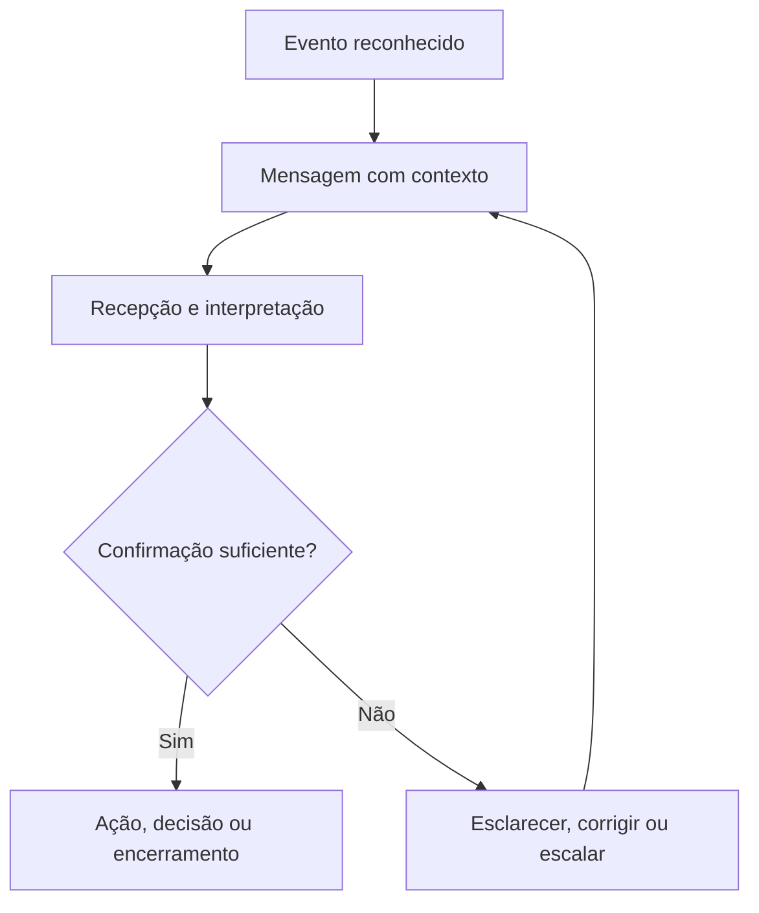

# Arquitetura da Comunicação — Ficha Operacional

**Sistema Operacional do Estúdio LICHTARA**  
**Módulo:** 3 — Arquitetura Organizacional  
**Ferramenta:** 05 — Arquitetura da Comunicação  
**Tipo:** Ficha metodológica, arquitetural e preenchível  
**Versão:** 0.1  
**Status:** Em desenvolvimento e validação pela prática  
**Data de criação:** 02/08/2026

**Documentos relacionados:**

- `README.md` deste diretório;
- `01-estado-atual-e-estado-futuro.md`;
- `02-arquitetura-de-processos-e-fluxos.md`;
- `03-papeis-responsabilidades-e-alcadas.md`;
- `04-arquitetura-de-informacao-e-conhecimento.md`;
- `../README.md`;
- `../fundamentos-da-arquitetura.md`;
- `../protocolo-de-arquitetura.md`;
- `../matriz-de-rastreabilidade.md`;
- `../templates/plano-de-arquitetura.md`;
- `../templates/03-catalogo-de-requisitos.md`;
- `../templates/04-matriz-de-rastreabilidade.md`;
- `../templates/05-arquitetura-integrada.md`;
- `../templates/06-registro-de-validacao.md`;
- `../templates/08-transicao-para-implantacao.md`.

---

## 1. Finalidade

Esta ferramenta orienta o desenho das comunicações necessárias para que pessoas, papéis, processos e sistemas consigam coordenar trabalho, compreender decisões, responder a mudanças, tratar exceções e preservar continuidade.

Ela ajuda o Estúdio LICHTARA a:

- relacionar comunicação a eventos, decisões, responsabilidades e riscos reais;
- distinguir transmissão, recepção, compreensão, concordância e compromisso;
- identificar públicos afetados e necessidades diferentes de contexto;
- definir emissor, autoridade de representação e limites;
- estabelecer conteúdo mínimo e linguagem adequada;
- selecionar canais por finalidade, urgência, sensibilidade e acesso;
- desenhar retorno, confirmação, resposta e escalonamento;
- reduzir reuniões, mensagens e interrupções sem função verificável;
- proteger privacidade, segurança psicológica e informação sensível;
- estruturar comunicação de rotina, mudança, exceção, incidente e crise;
- integrar comunicação síncrona, assíncrona, formal e informal;
- preparar rituais, reuniões e passagens de contexto;
- tornar falhas comunicacionais observáveis e corrigíveis;
- delimitar apoio de tecnologia e inteligência artificial;
- gerar requisitos claros para documentação, indicadores e implantação;
- produzir um bloco rastreável para a Arquitetura Integrada.

## 2. Pergunta central

> Que comunicação precisa ocorrer, a partir de qual evento, entre quais públicos, com que contexto, autoridade, canal, tempo, confirmação e possibilidade de resposta, para que coordenação, decisão e mudança aconteçam de forma compreensível e verificável?

Perguntas derivadas:

- O que torna esta comunicação necessária?
- Que resultado ela precisa produzir?
- Quem é afetado, decide, executa, consulta ou precisa saber?
- Quem pode falar em nome de qual papel ou instância?
- Que informação e contexto mínimos precisam acompanhar a mensagem?
- Qual canal corresponde à urgência, sensibilidade e acessibilidade?
- Quando a comunicação precisa acontecer?
- O destinatário precisa apenas receber, compreender, responder, decidir ou agir?
- Como a compreensão será verificada?
- Como dúvida, discordância ou impossibilidade serão devolvidas?
- Quando a ausência de resposta exige novo contato ou escalonamento?
- Que parte precisa permanecer registrada?
- Que comunicação pode ser eliminada, consolidada ou automatizada?
- Que interpretação e responsabilidade devem permanecer humanas?

## 3. O que é

Arquitetura da Comunicação é uma ferramenta de desenho da coordenação organizacional por meio de eventos, públicos, mensagens, canais, retornos e registros.

Ela organiza:

1. **eventos que exigem comunicação**;
2. **finalidades e resultados esperados**;
3. **públicos, destinatários e pessoas afetadas**;
4. **emissores e autoridades de representação**;
5. **conteúdo e contexto mínimos**;
6. **canais e condições de uso**;
7. **tempo, urgência e cadência**;
8. **confirmações, respostas e ações**;
9. **escalonamentos e contingências**;
10. **registros, aprendizagem e revisão**.

Seu produto é um sistema de comunicação proporcional: suficientemente claro para sustentar o trabalho e suficientemente leve para não transformar coordenação em sobrecarga.

## 4. Distinções essenciais

### 4.1 Comunicação

Comunicação é um processo relacional no qual conteúdo e contexto são produzidos, transmitidos, recebidos, interpretados e respondidos entre participantes situados.

### 4.2 Transmissão

Transmissão é o envio técnico ou humano de conteúdo. O envio concluído não comprova recepção, compreensão ou efeito.

### 4.3 Mensagem

Mensagem é a unidade comunicada, composta por conteúdo, intenção, contexto, origem, estado e expectativa de resposta.

### 4.4 Informação

Informação é o objeto contextualizado que apoia ação ou compreensão. A ferramenta 04 define significado, fonte, qualidade e acesso; esta ferramenta define a situação comunicacional em que a informação precisa circular.

### 4.5 Conversa

Conversa é uma interação em que participantes podem construir sentido, esclarecer, contestar e ajustar compreensão em tempo próximo ou diferido.

### 4.6 Coordenação

Coordenação é o alinhamento de ações, dependências, tempos e decisões entre participantes. Comunicação é uma de suas condições, não seu único mecanismo.

### 4.7 Documentação

Documentação é a preservação estruturada de conteúdo em artefato persistente. Uma conversa pode gerar documento; um documento pode comunicar; nenhuma dessas relações torna os objetos equivalentes.

### 4.8 Publicação

Publicação é a disponibilização deliberada de conteúdo a público definido ou amplo, sob autoridade e condições de uso.

### 4.9 Feedback

Feedback é informação devolvida sobre efeito, resultado, comportamento, interpretação ou experiência, com finalidade explícita de ajuste, aprendizagem, reconhecimento ou decisão.

### 4.10 Confirmação

Confirmação é evidência de um estado comunicacional específico. Ela deve declarar o que confirma: entrega, leitura, compreensão, concordância, decisão, compromisso ou execução.

### 4.11 Quadro comparativo

| Objeto | Pergunta | Evidência possível | Não comprova automaticamente |
| --- | --- | --- | --- |
| Transmissão | O conteúdo foi enviado? | Log, envio ou protocolo | Recepção |
| Recepção | O conteúdo chegou ao destino? | Entrega ou acesso | Leitura |
| Leitura | O conteúdo foi aberto ou percebido? | Registro ou declaração | Compreensão |
| Compreensão | O sentido necessário foi entendido? | Reformulação, teste ou resposta | Concordância |
| Concordância | A pessoa aceita a proposição? | Manifestação explícita | Compromisso |
| Compromisso | A pessoa assumiu ação ou decisão? | Aceite com objeto, prazo e condição | Execução |
| Execução | A ação ocorreu? | Resultado ou registro operacional | Qualidade do resultado |

## 5. Comunicação como arquitetura organizacional

Comunicação torna-se matéria arquitetural quando sua ocorrência, ausência ou qualidade altera capacidade de operar, decidir, proteger, aprender ou manter relações.

| Pergunta arquitetural | Consequência de desenho |
| --- | --- |
| Que evento exige comunicação? | Gatilho |
| Para que ela existe? | Finalidade e resultado |
| Quem precisa participar? | Públicos e papéis |
| O que precisa circular? | Mensagem e contexto |
| Quem pode representar? | Emissor e autoridade |
| Como chega? | Canal e formato |
| Quando chega? | Tempo e cadência |
| Como retorna? | Confirmação e resposta |
| O que acontece se falhar? | Contingência e escalonamento |
| O que precisa permanecer? | Registro e aprendizagem |

### 5.1 Unidade mínima de desenho

Uma comunicação arquiteturalmente completa conecta:

`evento → finalidade → público → conteúdo → emissor → canal → tempo → confirmação → resposta → registro`.

## 6. Função no protocolo de arquitetura

| Etapa do protocolo | Contribuição da ferramenta |
| --- | --- |
| Delimitação | Identificar comunicações materiais ao problema e ao escopo |
| Diagnóstico | Reconhecer dispersão, silêncio, ruído, atraso, excesso e assimetria |
| Requisitos | Traduzir necessidades de coordenação em condições comunicacionais |
| Desenho | Especificar eventos, públicos, mensagens, canais e ciclos de retorno |
| Integração | Relacionar comunicação a processos, papéis, informação, documentos e controles |
| Validação | Testar compreensão, acessibilidade, tempo, autoridade e resposta |
| Aprovação | Constituir a linha de base da arquitetura da comunicação |
| Transição | Informar plano de comunicação, treinamento e gestão da mudança |

## 7. Saídas principais

A aplicação pode produzir:

- mapa do sistema comunicacional atual;
- catálogo de públicos;
- catálogo de eventos de comunicação;
- fichas mestras de comunicação;
- arquitetura de canais;
- matriz evento–público–mensagem;
- matriz canal–finalidade–sensibilidade;
- protocolos de confirmação e retorno;
- desenho de reuniões e rituais;
- regras de alerta, interrupção e escalonamento;
- comunicação de decisões, mudanças e responsabilidades;
- protocolo de incidentes e crise;
- critérios de acessibilidade, linguagem e inclusão;
- regras de comunicação apoiada por IA;
- matriz atual–futuro;
- cenários de teste e validação;
- plano de transição;
- bloco consolidado para a Arquitetura Integrada.

### 7.1 Seleção proporcional

| Contexto | Saída mínima recomendada |
| --- | --- |
| Organização de uma pessoa | Eventos críticos, públicos externos, canais, registros e contingência |
| Equipe pequena | Catálogo de eventos, ficha mestra, canais, confirmações e rituais |
| Múltiplos processos | Matrizes de interfaces, decisões, mudanças e escalonamentos |
| Alto risco ou regulação | Protocolos, autoridade, confirmação forte, registros e testes |
| Ecossistema | Domínios, públicos, múltiplos canais, governança e interoperabilidade |

## 8. O que a ferramenta não é

Esta ferramenta não é:

- plano editorial ou calendário de conteúdo de marketing;
- manual de redação isolado;
- lista de aplicativos;
- agenda de reuniões;
- mecanismo para comunicar tudo a todos;
- substituta de processo claro, autoridade ou decisão;
- justificativa para vigilância permanente;
- garantia de consenso;
- forma de converter relações humanas em automação integral;
- solução para conflito que precisa ser reconhecido e tratado;
- arquitetura documental completa;
- plano de gestão da mudança do Módulo 4.

## 9. Fronteiras com outras dimensões

| Dimensão | Esta ferramenta define | Outra ferramenta aprofunda |
| --- | --- | --- |
| Processos | Comunicação necessária entre eventos e transferências | Sequência, trabalho e fluxo na ferramenta 02 |
| Papéis | Emissor, destinatário e representação | Responsabilidade, alçada e escalonamento na ferramenta 03 |
| Informação | Conteúdo e contexto comunicados | Semântica, fonte, qualidade e acesso na ferramenta 04 |
| Documentos | Quando a comunicação precisa gerar ou referenciar registro | Forma e ciclo documental na ferramenta 06 |
| Indicadores | Sinal que aciona comunicação e efeito a observar | Definição e governança do indicador na ferramenta 07 |
| Tecnologia | Requisito de canal, entrega e integração | Solução técnica na ferramenta 08 |
| IA | Função comunicacional permitida e supervisão necessária | Papel de IA e controles na ferramenta 09 |
| Implantação | Condições e públicos da transição | Cronograma e gestão da mudança no Módulo 4 |

## 10. Princípios

1. Toda comunicação material possui finalidade.
2. Envio não equivale a comunicação concluída.
3. O contexto necessário acompanha o conteúdo.
4. O canal segue a função, não a preferência isolada.
5. Urgência é definida por consequência e tempo de resposta.
6. Confirmação declara o estado confirmado.
7. Destinatários possuem meios legítimos de responder e contestar.
8. Comunicação sensível exige proporcionalidade e proteção.
9. Reuniões existem para interação que não pode ser obtida com menor carga.
10. A formalidade corresponde ao impacto, à obrigação e à necessidade de memória.
11. Informação acessível a poucos pode produzir assimetria de poder.
12. Silêncio possui significados possíveis e não deve ser interpretado automaticamente.
13. Comunicação é revisada quando o sistema, os públicos ou os riscos mudam.
14. IA apoia produção e organização sem assumir autoridade humana inexistente.

## 11. Invariantes

Independentemente do porte, a arquitetura deve preservar:

- identificação do evento;
- finalidade legítima;
- público correto;
- emissor reconhecível;
- conteúdo compreensível;
- contexto suficiente;
- canal acessível;
- tempo compatível;
- possibilidade de resposta;
- confirmação proporcional;
- proteção de conteúdo sensível;
- continuidade em caso de falha;
- responsabilidade humana por comunicações materiais.

## 12. Quando utilizar

Utilize quando:

- coordenação depender de eventos recorrentes;
- decisões não alcançarem pessoas afetadas;
- passagens de trabalho perderem contexto;
- mudanças exigirem compreensão, participação ou confirmação;
- canais múltiplos produzirem dispersão;
- reuniões consumirem tempo sem resultado claro;
- urgência e prioridade forem confundidas;
- exceções ou incidentes exigirem resposta coordenada;
- responsabilidade de comunicar estiver ambígua;
- públicos receberem versões diferentes;
- conhecimento permanecer em conversas inacessíveis;
- relações externas dependerem de continuidade;
- IA participar da geração, mediação ou distribuição de mensagens.

## 13. Quando não utilizar ou reduzir

Reduza a aplicação quando:

- a comunicação for simples, local, reversível e de baixo impacto;
- o evento ocorrer uma única vez e não justificar arquitetura reutilizável;
- o conteúdo já estiver disponível no ponto de uso e dispensar notificação;
- um ajuste direto de processo eliminar a necessidade comunicacional;
- a resposta puder ser definida em uma ficha focal pequena.

Não utilize para:

- adicionar comunicação a um trabalho sem finalidade;
- compensar decisão não tomada;
- criar reunião porque ninguém definiu autoridade;
- registrar conversas pessoais sem base legítima;
- impor disponibilidade contínua;
- ampliar coleta e monitoramento sem necessidade.

### 13.1 Registro da redução

| Campo | Preenchimento |
| --- | --- |
| Objeto avaliado | [Processo, decisão, mudança ou relação] |
| Motivo da redução | [Baixo risco, baixa recorrência ou simplicidade] |
| Representação mínima | [Descrever] |
| Risco residual | [Descrever] |
| Responsável pela decisão | PAP-ARQ-___ |
| Gatilho de aprofundamento | [Evento] |

## 14. Proporcionalidade

| Fator | Pergunta | Efeito possível |
| --- | --- | --- |
| Impacto | O que acontece se não houver compreensão? | Confirmação mais forte |
| Urgência | Quanto tempo existe para responder? | Canal e escalonamento |
| Sensibilidade | Que dano decorre de exposição? | Restrição e proteção |
| Complexidade | Quanto contexto é necessário? | Formato e interação |
| Recorrência | Com que frequência ocorre? | Padronização e automação |
| Diversidade | Públicos possuem necessidades distintas? | Segmentação e acessibilidade |
| Reversibilidade | O efeito pode ser corrigido? | Registro e validação |
| Obrigação | Há dever legal, contratual ou ético? | Formalidade e evidência |
| Distribuição | Quantos lugares, fusos ou organizações participam? | Assincronia e redundância controlada |

### 14.1 Níveis

| Nível | Aplicação | Representações |
| --- | --- | --- |
| Essencial | Poucos eventos e baixo risco | Evento, público, mensagem, canal e retorno |
| Intermediário | Múltiplas interfaces | Essencial + confirmações, reuniões, mudanças e escalonamentos |
| Ampliado | Alto impacto ou sensibilidade | Intermediário + autoridade, crise, registro, acessibilidade e testes |
| Sistêmico | Organização ou ecossistema | Portfólio de comunicações, domínios, governança e aprendizagem |

## 15. Escalas e camadas

### 15.1 Escalas

| Escala | Objeto |
| --- | --- |
| Interação | Uma mensagem, conversa ou confirmação |
| Atividade | Comunicação necessária a uma tarefa |
| Processo | Eventos recorrentes e interfaces |
| Projeto | Coordenação temporal e decisões |
| Organização | Regras, canais e públicos compartilhados |
| Ecossistema | Relações entre organizações e comunidades |

### 15.2 Camadas

| Camada | Questão |
| --- | --- |
| Finalística | Que resultado comunicacional é necessário? |
| Semântica | Que sentido e contexto precisam permanecer? |
| Relacional | Quem fala, escuta, responde e é afetado? |
| Operacional | Que evento, canal, tempo e ação se conectam? |
| Governança | Quem autoriza, protege, corrige e revisa? |
| Técnica | Que capacidade de entrega, acesso e registro é requerida? |
| Temporal | Como comunicação muda durante transição e operação? |

## 16. Participantes da aplicação

| Participante | Contribuição | Risco se ausente |
| --- | --- | --- |
| Responsável pelo processo | Eventos e dependências | Comunicação sem vínculo com trabalho |
| Papel emissor | Intenção, autoridade e prática | Desenho inexequível |
| Destinatário real | Acesso, compreensão e retorno | Suposição de recepção |
| Pessoa afetada | Impacto e contestação | Omissão de consequência |
| Responsável semântico | Conteúdo e fonte | Mensagem ambígua |
| Responsável documental | Necessidade de registro | Memória inadequada |
| Responsável técnico | Capacidade e limites de canal | Solução impossível |
| Especialista em risco, jurídico ou privacidade | Restrições e obrigações | Exposição indevida |
| Facilitador | Método e participação | Dominação ou dispersão |
| Validador | Critérios e evidência | Aprovação presumida |

### 16.1 Participantes reais

| Papel no desenho | Pessoa/papel | Participação | Disponibilidade | Necessidade de acessibilidade | Conflito de interesse |
| --- | --- | --- | --- | --- | --- |
| [Preencher] | [Nome/PAP ID] | [Oficina, entrevista, teste ou validação] | [Condição] | [Preencher] | [Sim/não/tratamento] |

## 17. Autoridade e limites

| Decisão | Autoridade | Consulta | Limite | Registro |
| --- | --- | --- | --- | --- |
| Definir evento obrigatório | PAP/INS-ARQ-___ | [Papéis] | [Escopo] | [Artefato] |
| Aprovar conteúdo institucional | PAP/INS-ARQ-___ | [Papéis] | ALC-ARQ-___ | [Registro] |
| Classificar sensibilidade | PAP-ARQ-___ | [Especialista] | [Regra] | [Fonte] |
| Escolher canal | PAP-ARQ-___ | [Usuários/técnico] | [Critérios] | [Artefato] |
| Autorizar publicação | PAP/INS-ARQ-___ | [Revisores] | ALC-ARQ-___ | [Aprovação] |
| Interromper distribuição | PAP-ARQ-___ | [Papéis] | [Gatilho] | [Incidente] |
| Corrigir comunicação | PAP-ARQ-___ | [Origem] | [Tempo/escopo] | [Correção] |
| Alterar a arquitetura | PAP/INS-ARQ-___ | [Públicos afetados] | [Governança] | [Versão] |

### 17.1 Limites

A autoridade para comunicar não concede automaticamente autoridade para:

- decidir o conteúdo material;
- assumir compromisso contratual;
- divulgar informação restrita;
- representar opinião pessoal como posição institucional;
- alterar registro oficial;
- falar em nome de pessoa afetada;
- delegar representação sem alçada;
- utilizar IA para personificar alguém sem autorização.

## 18. Entradas necessárias

| Entrada | Identificador/fonte | Qualidade mínima | Responsável | Lacuna |
| --- | --- | --- | --- | --- |
| Escopo e problema | [Plano/termo] | Aprovado | [Papel] | [Preencher] |
| Processos e eventos | PRC/EVT-ARQ-___ | Estado e interfaces | [Papel] | [Preencher] |
| Papéis e alçadas | PAP/ALC/ESC-ARQ-___ | Vigentes | [Papel] | [Preencher] |
| Informação e fontes | INF/FON-ARQ-___ | Definição e acesso | [Papel] | [Preencher] |
| Decisões | DEC-ARQ-___ | Objeto e autoridade | [Papel] | [Preencher] |
| Públicos atuais | [Fonte] | Necessidades conhecidas | [Papel] | [Preencher] |
| Canais atuais | [Inventário] | Uso real | [Papel] | [Preencher] |
| Documentos e registros | DOC/RGT-ARQ-___ | Localização e validade | [Papel] | [Preencher] |
| Riscos e obrigações | RSC/REQ-ARQ-___ | Fonte e impacto | [Papel] | [Preencher] |
| Evidências de falha | [Entrevistas, incidentes, retrabalho] | Contextualizadas | [Papel] | [Preencher] |

## 19. Qualidade das evidências

| Evidência | Força | Limite | Uso |
| --- | --- | --- | --- |
| Observação de interação | Alta para prática real | Recorte temporal | Mapear comportamento |
| Mensagens e registros autorizados | Alta para conteúdo e tempo | Privacidade e viés de seleção | Reconstruir fluxo |
| Entrevista | Alta para experiência | Memória e interpretação | Identificar perda de contexto |
| Métrica de canal | Média | Abertura não prova compreensão | Reconhecer volume e entrega |
| Incidente ou retrabalho | Alta para consequência | Pode ser caso raro | Priorizar risco |
| Norma ou contrato | Alta para obrigação | Não comprova prática | Definir requisito |
| Percepção isolada | Exploratória | Não generalizável | Formular hipótese |

### 19.1 Proteções

- colete somente o necessário;
- preserve confidencialidade;
- evite expor mensagens pessoais fora do escopo;
- diferencie fato, interpretação e hipótese;
- não use a arquitetura para avaliar pessoas sem critério legítimo;
- permita contestação de inferências;
- registre lacunas de evidência.

## 20. Preparação

| Ação | Resultado | Responsável | Estado |
| --- | --- | --- | --- |
| Confirmar escopo | Fronteira de análise | [Papel] | [ ] |
| Selecionar eventos críticos | Lista inicial | [Papel] | [ ] |
| Identificar participantes | Mapa de participação | [Papel] | [ ] |
| Definir acesso às evidências | Condições legítimas | [Papel] | [ ] |
| Reunir artefatos atuais | Amostra | [Papel] | [ ] |
| Preparar linguagem comum | Glossário mínimo | [Papel] | [ ] |
| Definir critérios de validação | Plano | [Papel] | [ ] |
| Proteger conteúdo sensível | Regra de tratamento | [Papel] | [ ] |

### 20.1 Prontidão

| Critério | Sim | Evidência/ação |
| --- | --- | --- |
| Escopo compreendido | [ ] | [Preencher] |
| Eventos materiais identificáveis | [ ] | [Preencher] |
| Públicos reais acessíveis | [ ] | [Preencher] |
| Papéis e alçadas disponíveis | [ ] | [Preencher] |
| Fontes informacionais conhecidas | [ ] | [Preencher] |
| Evidências podem ser usadas legitimamente | [ ] | [Preencher] |
| Validação possui responsáveis | [ ] | [Preencher] |

## 21. Plano da aplicação

| Campo | Preenchimento |
| --- | --- |
| ID do plano | PLN-ARQ-___ |
| Escopo | [Processos, projetos, públicos ou organização] |
| Finalidade | [Preencher] |
| Eventos prioritários | [IDs] |
| Participantes | [Papéis/pessoas] |
| Métodos | [Entrevista, oficina, observação, teste ou simulação] |
| Evidências | [Fontes] |
| Entregas | [Artefatos] |
| Validações | [Critérios/papéis] |
| Restrições | [Tempo, acesso, privacidade ou linguagem] |
| Prazo | [Data/condição] |
| Responsável | PAP-ARQ-___ |

### 21.1 Atividades

| Atividade | Entrada | Participantes | Saída | Critério | Data |
| --- | --- | --- | --- | --- | --- |
| ATV-ARQ-___ | [Fonte] | [Papéis] | [Artefato] | [Critério] | [Data] |

## 22. Identificação, versão e validade

**Identificador do artefato:** `ACM-ARQ-AAAA-NNN`

| Elemento | Preenchimento |
| --- | --- |
| ID | ACM-ARQ-____-___ |
| Título | [Preencher] |
| Escopo | [Preencher] |
| Estado | [Rascunho, em validação, aprovado, vigente, em revisão ou encerrado] |
| Versão | [Número] |
| Vigência | [Data/condição] |
| Responsável | PAP-ARQ-___ |
| Aprovador | PAP/INS-ARQ-___ |
| Público do artefato | [Papéis] |
| Sensibilidade | [Classe] |
| Documento substituído | [ID/N/A] |
| Próxima revisão | [Data/gatilho] |

### 22.1 Estados

| Estado | Condição de entrada | Condição de saída |
| --- | --- | --- |
| Rascunho | Objeto iniciado | Revisão mínima concluída |
| Em validação | Cenários e públicos definidos | Critérios atendidos ou devolução |
| Aprovado | Autoridade decidiu | Data ou condição de vigência |
| Vigente | Comunicações operacionais ativadas | Revisão ou encerramento |
| Em revisão | Gatilho ocorreu | Nova versão ou manutenção |
| Encerrado | Função cessou ou foi substituída | Arquivamento e comunicação |

## 23. Referência atual

| Campo | Preenchimento |
| --- | --- |
| Data de referência | [DD/MM/AAAA] |
| Período observado | [Preencher] |
| Processos incluídos | [IDs] |
| Públicos incluídos | [Descrição/IDs] |
| Canais incluídos | [Descrição/IDs] |
| Situações excepcionais | [Preencher] |
| Fontes | [IDs/referências] |
| Limitações | [Preencher] |

### 23.1 Comunicação formal e praticada

Registre a comunicação que deveria ocorrer e a que efetivamente acontece. A diferença entre ambas é evidência arquitetural.

## 24. Inventário da comunicação atual

| Evento/situação | Finalidade percebida | Emissor real | Destinatários | Canal | Retorno | Registro | Evidência |
| --- | --- | --- | --- | --- | --- | --- | --- |
| [Preencher] | [Preencher] | [Pessoa/papel] | [Públicos] | [Canal] | [Forma/ausente] | [Local/ausente] | [Fonte] |

### 24.1 Comunicação informal

| Comunicação | Por que surgiu | Valor preservado | Risco | Decisão futura |
| --- | --- | --- | --- | --- |
| [Conversa, grupo, mensagem direta ou sinal] | [Lacuna/necessidade] | [Agilidade, confiança ou contexto] | [Exclusão, perda, exposição ou dependência] | [Preservar, integrar, restringir ou encerrar] |

## 25. Problemas comunicacionais atuais

| ID | Tipo | Evento/objeto | Públicos | Consequência | Frequência | Evidência | Condição futura |
| --- | --- | --- | --- | --- | --- | --- | --- |
| LAC-ARQ-___ | [Ausência, atraso, excesso, ambiguidade, dispersão, silêncio, ruído ou exposição] | [ID] | [Públicos] | [Preencher] | [Faixa] | [Fonte] | [Preencher] |

### 25.1 Diagnóstico do problema

| Sinal | Pergunta de investigação |
| --- | --- |
| Ninguém viu | O canal era acessível e esperado? |
| Viram, mas não entenderam | Faltou contexto, clareza ou interação? |
| Entenderam, mas não agiram | Havia autoridade, recurso e compromisso? |
| Versões divergem | Qual fonte ou mensagem possui vigência? |
| Tudo vira urgente | Há critérios de prioridade e tempo? |
| Reuniões proliferam | Que decisão, trabalho ou relação justificam cada uma? |
| Mensagens diretas concentram contexto | Que informação deveria alcançar o sistema? |
| Pessoas permanecem em silêncio | Existe segurança e canal legítimo de contestação? |

## 26. Trabalho comunicacional invisível

| Trabalho invisível | Quem realiza | Frequência | Tempo/carga | Valor | Risco se cessar | Tratamento futuro |
| --- | --- | --- | --- | --- | --- | --- |
| [Traduzir, lembrar, cobrar, conectar, acalmar, resumir ou reconstruir contexto] | [Pessoa/papel] | [Preencher] | [Faixa] | [Preencher] | [Preencher] | [Reconhecer, distribuir, apoiar, eliminar ou formalizar] |

### 26.1 Mediação relacional

Nem todo trabalho comunicacional aparece em mensagens. Escuta, tradução entre linguagens, preparação emocional, proteção de relação e reconstrução de confiança podem sustentar o sistema e precisam ser reconhecidas sem serem instrumentalizadas.

## 27. Carga de canais, reuniões e interrupções

| Objeto | Volume | Tempo | Público | Utilidade | Redundância | Interrupção | Decisão |
| --- | --- | --- | --- | --- | --- | --- | --- |
| [Canal/reunião/ritual] | [Faixa] | [Faixa] | [Públicos] | [Alta/média/baixa] | [Com o quê] | [Impacto] | [Preservar, ajustar, consolidar ou encerrar] |

### 27.1 Dívida comunicacional

Dívida comunicacional é o custo acumulado de mensagens sem contexto, decisões não devolvidas, canais sem regra, promessas não reconciliadas e relações que dependem de interpretação informal.

| Dívida | Origem | Custo atual | Risco | Primeira correção |
| --- | --- | --- | --- | --- |
| [Preencher] | [Evento/padrão] | [Tempo, erro ou confiança] | [Preencher] | [Ação] |

## 28. Questões que retornam ao diagnóstico

Retorne ao Módulo 2 quando a aplicação revelar:

- conflito não compreendido;
- medo de manifestação;
- concentração informal de poder;
- canais paralelos que sustentam o trabalho real;
- dependência de uma pessoa para traduzir tudo;
- diferença relevante entre cultura declarada e praticada;
- exclusão recorrente de públicos;
- retrabalho cuja causa ainda não está demonstrada;
- comunicação usada para ocultar ausência de decisão;
- incidente que exige apuração própria.

| Achado | Motivo do retorno | Evidência | Pergunta diagnóstica | Responsável |
| --- | --- | --- | --- | --- |
| [Preencher] | [Preencher] | [Fonte] | [Pergunta] | PAP-ARQ-___ |

## 29. Princípio de desenho futuro

O estado futuro deve conter a menor arquitetura de comunicação capaz de assegurar contexto, coordenação, resposta e continuidade.

| Condição atual | Princípio futuro |
| --- | --- |
| Tudo comunicado a todos | Segmentação legítima por necessidade |
| Mensagens sem retorno | Ciclo fechado proporcional |
| Canais escolhidos por hábito | Canais escolhidos por função |
| Reuniões como padrão | Interação síncrona quando agrega valor |
| Urgência declarada subjetivamente | Urgência vinculada a consequência e tempo |
| Decisão restrita a quem participou | Devolução a públicos afetados |
| Contexto em pessoas | Contexto no ponto de coordenação |
| Silêncio interpretado | Confirmação definida |
| IA publica diretamente | Saída provisória sob autoridade humana |

## 30. Domínios de comunicação

| ID | Domínio | Finalidade | Eventos | Públicos | Responsável | Fronteira |
| --- | --- | --- | --- | --- | --- | --- |
| DCM-ARQ-001 | [Operação, projeto, cliente, governança, pessoas, crise ou outro] | [Preencher] | [EVT IDs] | [PUB IDs] | PAP-ARQ-___ | [Incluído/excluído] |

### 30.1 Relações entre domínios

| Domínio de origem | Relação | Domínio de destino | Objeto | Condição | Interface |
| --- | --- | --- | --- | --- | --- |
| DCM-ARQ-___ | [Informa, solicita, consulta, alerta ou devolve] | DCM-ARQ-___ | [INF/DEC/COM ID] | [Gatilho] | INT-ARQ-___ |

## 31. Públicos e participantes

Público é um conjunto de destinatários definido por relação material com o conteúdo ou efeito. Ele não deve ser confundido com lista indiscriminada de contatos.

| ID | Público | Relação com o objeto | Necessidade | Pode responder? | Acessibilidade | Sensibilidade | Representante |
| --- | --- | --- | --- | --- | --- | --- | --- |
| PUB-ARQ-001 | [Pessoas, papéis, clientes, parceiros ou comunidade] | [Executa, decide, é afetado, consulta ou precisa saber] | [Preencher] | [Sim/forma] | [Condição] | [Classe] | [PAP ID/N/A] |

### 31.1 Segmentação legítima

| Critério | Uso legítimo | Risco |
| --- | --- | --- |
| Responsabilidade | Contexto necessário ao trabalho | Ocultar efeito de decisão |
| Impacto | Informar pessoas afetadas | Definir impacto sem ouvi-las |
| Sensibilidade | Restringir exposição | Concentrar poder informacional |
| Momento | Comunicar por fase | Criar versões incompatíveis |
| Linguagem | Tornar conteúdo compreensível | Alterar sentido material |
| Consentimento | Respeitar preferências legítimas | Transferir dever institucional ao indivíduo |

## 32. Necessidades dos públicos

| Público | O que precisa saber | Por quê | Quando | Formato | O que precisa poder fazer | Risco de exclusão |
| --- | --- | --- | --- | --- | --- | --- |
| PUB-ARQ-___ | [Conteúdo] | [Finalidade] | [Evento/tempo] | [Formato] | [Perguntar, decidir, agir, contestar ou optar] | [Preencher] |

### 32.1 Público não é homogêneo

Registre diferenças de acesso, idioma, repertório, autoridade, tempo, tecnologia, deficiência, contexto cultural e exposição ao risco.

## 33. Catálogo de eventos de comunicação

| ID | Evento | Tipo | Origem | Finalidade | Públicos | Criticidade | Estado |
| --- | --- | --- | --- | --- | --- | --- | --- |
| COM-ARQ-001 | [Nome] | [Rotina, decisão, mudança, exceção, incidente, aprendizagem ou relação] | EVT/DEC/IND-ARQ-___ | [Preencher] | [PUB IDs] | [Baixa/média/alta/crítica] | [Estado] |

### 33.1 Regras de nomeação

- utilize substantivo do evento ou verbo no infinitivo com objeto;
- diferencie comunicação recorrente de mensagem específica;
- preserve o identificador quando o nome mudar sem alterar a função;
- crie novo ID quando finalidade, público ou efeito mudarem materialmente;
- encerre comunicações sem função.

## 34. Ficha mestra da comunicação

| Campo | Preenchimento |
| --- | --- |
| ID | COM-ARQ-___ |
| Nome | [Preencher] |
| Domínio | DCM-ARQ-___ |
| Evento disparador | EVT/DEC/IND/EXC-ARQ-___ |
| Finalidade | [Coordenar, decidir, informar, consultar, alertar, aprender ou relacionar] |
| Resultado esperado | [Estado observável] |
| Emissor responsável | PAP-ARQ-___ |
| Autoridade de representação | ATD/ALC-ARQ-___ |
| Públicos | [PUB IDs] |
| Informação | [INF/DEC IDs] |
| Mensagem mínima | MNS-ARQ-___ |
| Canal principal | CAN-ARQ-___ |
| Canal de contingência | CAN-ARQ-___/N/A |
| Momento | [Evento, prazo ou cadência] |
| Urgência | [Classe] |
| Confirmação | CNF-ARQ-___/N/A |
| Resposta/ação | [Preencher] |
| Escalonamento | ESC-ARQ-___/N/A |
| Registro | DOC/RGT-ARQ-___/N/A |
| Sensibilidade | [Classe] |
| Acessibilidade | [Requisitos] |
| Indicador | IND-ARQ-___/N/A |
| Validade | [Data/condição] |
| Revisão | [Gatilho] |

## 35. Finalidade e resultado esperado

| Finalidade | Resultado observável | Pergunta de teste |
| --- | --- | --- |
| Informar | Público possui referência necessária | Consegue localizar e explicar? |
| Coordenar | Dependências e próximos movimentos estão alinhados | Cada parte sabe o que ocorre a seguir? |
| Consultar | Contribuição entra antes da decisão | A manifestação pode alterar a decisão? |
| Decidir | Autoridade recebe contexto e devolve decisão | Há escolha, motivo e efeito? |
| Solicitar | Destinatário compreende objeto e condição | Pode aceitar, negociar ou recusar? |
| Alertar | Risco recebe atenção dentro do tempo | A resposta adequada foi acionada? |
| Aprender | Experiência produz interpretação e mudança | Algo foi incorporado? |
| Relacionar | Confiança, presença ou vínculo são sustentados | A interação corresponde à relação? |

### 35.1 Comunicação sem resultado

Se nenhum estado observável puder ser definido, investigue se a comunicação é necessária, se sua finalidade está mal formulada ou se o problema pertence a outra dimensão.

## 36. Gatilho e evento comunicacional

| Comunicação | Gatilho | Fonte do evento | Observador | Tempo máximo de ativação | Falha do gatilho | Contingência |
| --- | --- | --- | --- | --- | --- | --- |
| COM-ARQ-___ | [Evento, condição, data ou decisão] | [ID/fonte] | PAP/TEC-ARQ-___ | [Tempo] | [Como detectar] | [Ação] |

### 36.1 Tipos de gatilho

| Tipo | Exemplo | Proteção |
| --- | --- | --- |
| Temporal | Início de ciclo | Calendário e responsável |
| Operacional | Conclusão de atividade | Evento do processo |
| Decisório | Aprovação ou rejeição | Registro da decisão |
| Indicador | Limite ultrapassado | Definição e qualidade |
| Humano | Percepção de risco ou necessidade | Canal seguro e critério |
| Externo | Solicitação, norma ou incidente | Monitoramento e autenticação |

## 37. Mensagem mínima

| ID | Comunicação | Conteúdo obrigatório | Contexto | Ação esperada | Prazo | Origem | Restrições |
| --- | --- | --- | --- | --- | --- | --- | --- |
| MNS-ARQ-001 | COM-ARQ-___ | [Preencher] | [Preencher] | [Informar, responder, decidir ou agir] | [Tempo] | [INF/FON IDs] | [Preencher] |

### 37.1 Estrutura funcional

Uma mensagem material deve permitir que o destinatário reconheça, conforme o caso:

- o que aconteceu;
- por que importa;
- qual fonte ou decisão sustenta;
- o que mudou;
- quem é afetado;
- o que precisa fazer;
- até quando;
- que alternativas possui;
- onde perguntar ou contestar;
- qual versão está vigente.

## 38. Pacote de contexto

| Comunicação | Contexto necessário | Forma | Origem | Pode ser resumido? | Risco de perda |
| --- | --- | --- | --- | --- | --- |
| COM-ARQ-___ | [Histórico, decisão, exceção, relação, hipótese ou restrição] | [Na mensagem, anexo, referência ou conversa] | [IDs] | [Sim/condição] | [Preencher] |

### 38.1 Contexto não é volume

Contexto suficiente é aquele que permite interpretação e ação adequadas. Acumular histórico indiscriminadamente pode ocultar o que importa.

## 39. Emissor responsável

| Comunicação | Emissor responsável | Emissor operacional | Substituto | Autoridade | Preparação | Evidência |
| --- | --- | --- | --- | --- | --- | --- |
| COM-ARQ-___ | PAP-ARQ-___ | [Pessoa, papel, sistema ou IA] | SUB-ARQ-___ | ATD/ALC-ARQ-___ | [Conhecimento/roteiro] | [Registro] |

### 39.1 Emissão técnica e responsabilidade

Sistema ou IA pode realizar o envio. A responsabilidade pela finalidade, pelo conteúdo, pela autorização e pelo tratamento de falhas permanece atribuída a papel humano ou instância organizacional.

## 40. Destinatário, receptor e pessoa afetada

| Comunicação | Destinatário direto | Receptor operacional | Pessoa afetada | Precisa responder? | Pode contestar? | Exclusões justificadas |
| --- | --- | --- | --- | --- | --- | --- |
| COM-ARQ-___ | PUB/PAP-ARQ-___ | [Pessoa, papel ou sistema] | [PUB IDs] | [Sim/forma] | [Sim/canal] | [Preencher] |

### 40.1 Destinatário indireto

Uma decisão pode afetar pessoas que não recebem a instrução operacional. A arquitetura deve identificar se elas precisam ser informadas, consultadas, protegidas ou representadas.

## 41. Autoridade de representação e porta-voz

| Contexto | Porta-voz autorizado | Pode afirmar | Não pode comprometer | Revisão | Substituição | Registro |
| --- | --- | --- | --- | --- | --- | --- |
| [Institucional, técnico, comercial, crise ou comunidade] | PAP-ARQ-___ | [Temas/posições] | [Limites] | [Papel] | SUB-ARQ-___ | [Forma] |

### 41.1 Posição institucional

Uma posição institucional deve ser distinguida de:

- opinião pessoal;
- hipótese em análise;
- informação ainda não validada;
- interpretação técnica individual;
- promessa sem alçada;
- conteúdo gerado por IA;
- citação de terceiro.

## 42. Arquitetura de canais

Canal é o meio organizado pelo qual comunicação pode ser enviada, recebida, respondida e, quando necessário, registrada.

| Dimensão | Questão de desenho |
| --- | --- |
| Alcance | Quem consegue acessar? |
| Tempo | É síncrono, assíncrono ou híbrido? |
| Interação | Permite pergunta, resposta e construção? |
| Persistência | O conteúdo permanece localizável? |
| Sensibilidade | Que proteção oferece? |
| Acessibilidade | Que barreiras possui? |
| Confiabilidade | Como falhas são percebidas? |
| Carga | Quanto interrompe ou exige manutenção? |
| Integração | Conecta-se ao ponto de trabalho? |
| Governança | Quem cria, modera, arquiva e encerra? |

## 43. Catálogo de canais

| ID | Canal | Tipo | Finalidade permitida | Públicos | Tempo | Persistência | Sensibilidade | Responsável | Estado |
| --- | --- | --- | --- | --- | --- | --- | --- | --- | --- |
| CAN-ARQ-001 | [Nome] | [Conversa, mensagem, e-mail, reunião, portal, telefone, publicação ou outro] | [Preencher] | [PUB IDs] | [Síncrono/assíncrono] | [Nível] | [Classes permitidas] | PAP-ARQ-___ | [Ativo, restrito ou encerrado] |

### 43.1 Regras do canal

| Canal | Deve ser usado para | Não deve ser usado para | Tempo esperado | Moderação | Contingência |
| --- | --- | --- | --- | --- | --- |
| CAN-ARQ-___ | [Finalidades] | [Finalidades/objetos] | [Faixa] | [Papel/regra] | CAN-ARQ-___ |

## 44. Seleção de canal

| Comunicação | Urgência | Complexidade | Sensibilidade | Interação | Persistência | Acessibilidade | Canal escolhido | Motivo |
| --- | --- | --- | --- | --- | --- | --- | --- | --- |
| COM-ARQ-___ | [Classe] | [Baixa/média/alta] | [Classe] | [Baixa/média/alta] | [Necessária/não] | [Requisitos] | CAN-ARQ-___ | [Preencher] |

### 44.1 Canal inadequado

| Falha | Exemplo | Consequência |
| --- | --- | --- |
| Canal efêmero para decisão material | Decisão em conversa perdida | Ausência de referência |
| Canal amplo para conteúdo restrito | Grupo aberto | Exposição |
| Canal assíncrono para risco imediato | Mensagem não monitorada | Resposta tardia |
| Reunião para simples atualização | Leitura coletiva de status | Carga desnecessária |
| Mensagem direta para tema coletivo | Contexto concentrado | Assimetria |
| Canal inacessível | Formato incompatível | Exclusão |

## 45. Comunicação síncrona e assíncrona

| Modalidade | Utilizar quando | Evitar quando | Proteção |
| --- | --- | --- | --- |
| Síncrona | Construção conjunta, tensão, ambiguidade alta ou urgência real | Conteúdo pode ser compreendido e respondido sem presença simultânea | Agenda, facilitação e síntese |
| Assíncrona | Reflexão, distribuição temporal, registro ou atualização | Risco exige resposta imediata ou nuance não cabe no formato | Prazo, contexto e canal de dúvida |
| Híbrida | Preparação assíncrona e deliberação síncrona | Duplica trabalho sem função distinta | Definir papel de cada etapa |

### 45.1 Direito à assincronia

Assincronia protege concentração, fusos, acessibilidade e autonomia. Ela precisa vir acompanhada de expectativas claras de resposta e de mecanismo para situações realmente urgentes.

## 46. Comunicação por envio e por consulta

| Modelo | Funcionamento | Adequado para | Risco |
| --- | --- | --- | --- |
| Envio ativo | Conteúdo chega ao destinatário | Alerta, decisão, solicitação ou mudança material | Sobrecarga |
| Consulta no ponto de uso | Pessoa acessa quando precisa | Referência estável e recorrente | Não ser encontrada |
| Assinatura | Pessoa escolhe receber atualizações | Temas não obrigatórios | Preferência desatualizada |
| Síntese periódica | Mudanças são consolidadas | Baixa urgência e múltiplas atualizações | Atrasar tema material |

### 46.1 Critério

Não envie repetidamente o que pode permanecer encontrável no ponto de uso; não espere consulta espontânea quando a pessoa precisa agir diante de mudança material.

## 47. Comunicação formal e informal

| Aspecto | Formal | Informal |
| --- | --- | --- |
| Função | Produzir referência, obrigação ou coordenação estruturada | Construir relação, agilidade e sentido situado |
| Forma | Canal e regra definidos | Interação adaptável |
| Registro | Proporcional ao impacto | Geralmente limitado |
| Autoridade | Explícita | Pode ser ambígua |
| Risco | Burocratização | Exclusão, distorção ou dependência |

### 47.1 Integração saudável

O desenho pode preservar a vitalidade da comunicação informal e exigir que decisões, compromissos, mudanças ou riscos materiais retornem à referência adequada.

## 48. Comunicação interna e externa

| Dimensão | Interna | Externa |
| --- | --- | --- |
| Público | Pessoas e papéis da organização | Clientes, parceiros, fornecedores, comunidade ou autoridades |
| Autoridade | Papel organizacional | Representação delimitada |
| Contexto | Pode pressupor linguagem interna identificada | Precisa explicitar referências necessárias |
| Risco | Assimetria e exclusão | Reputação, obrigação e compromisso |
| Registro | Conforme efeito interno | Conforme relação, promessa e obrigação |

### 48.1 Fronteira porosa

Grupos com clientes, comunidades, prestadores e colaboradores podem reunir públicos internos e externos. Classifique o canal pela composição e pelo efeito, não pelo nome.

## 49. Linguagem, tom e inteligibilidade

| Comunicação | Público | Objetivo | Linguagem | Termos críticos | Tom | Complexidade | Teste |
| --- | --- | --- | --- | --- | --- | --- | --- |
| COM-ARQ-___ | PUB-ARQ-___ | [Preencher] | [Idioma/registro] | [GLO IDs] | [Preencher] | [Faixa] | [Forma] |

### 49.1 Clareza sem perda de precisão

Simplificar é reduzir barreiras preservando sentido. A comunicação deve:

- utilizar termos definidos;
- explicar siglas na primeira ocorrência;
- distinguir fato, decisão, hipótese e opinião;
- declarar incerteza;
- apresentar ação e prazo de forma encontrável;
- evitar jargão que apenas sinaliza pertencimento;
- oferecer aprofundamento quando necessário.

## 50. Acessibilidade comunicacional

| Público | Barreira possível | Requisito | Formato alternativo | Responsável | Validação |
| --- | --- | --- | --- | --- | --- |
| PUB-ARQ-___ | [Visual, auditiva, cognitiva, linguística, tecnológica, temporal ou outra] | [Preencher] | [Preencher] | PAP-ARQ-___ | VAL-ARQ-___ |

### 50.1 Acessibilidade desde o desenho

Acessibilidade não é correção posterior. Ela influencia canal, linguagem, contraste, legenda, transcrição, leitura por tecnologia assistiva, duração, ritmo, navegação e forma de resposta.

## 51. Sensibilidade e confidencialidade

| Comunicação | Informação | Classe | Públicos permitidos | Canal permitido | Restrições | Expiração | Incidente |
| --- | --- | --- | --- | --- | --- | --- | --- |
| COM-ARQ-___ | INF-ARQ-___ | [Pública, interna, restrita, confidencial ou crítica] | [PUB/PAP IDs] | [CAN IDs] | [Cópia, gravação, encaminhamento ou armazenamento] | [Data/condição] | [Ação] |

### 51.1 Confidencialidade não é silêncio indevido

Restringir conteúdo pode ser necessário. A restrição deve possuir motivo, escopo, duração e autoridade, sem impedir que pessoas afetadas recebam o que precisam para exercer direitos, agir ou contestar.

## 52. Privacidade, consentimento e preferência

| Tratamento | Pessoa/público | Finalidade | Base/condição | Canal | Preferência | Retirada/oposição | Registro |
| --- | --- | --- | --- | --- | --- | --- | --- |
| [Contato, gravação, publicação, imagem, dado ou monitoramento] | [PUB ID] | [Preencher] | [Referência] | CAN-ARQ-___ | [Preencher] | [Forma] | [RGT ID] |

### 52.1 Consentimento e dever

Nem toda comunicação depende de consentimento, e nem toda preferência individual pode afastar obrigação legítima. A base e os direitos aplicáveis precisam ser avaliados conforme o contexto jurídico, contratual e ético.

## 53. Momento e cadência

| Comunicação | Gatilho | Antecedência | Janela | Cadência | Fuso/horário | Vigência | Responsável |
| --- | --- | --- | --- | --- | --- | --- | --- |
| COM-ARQ-___ | [Evento] | [Tempo] | [Início/fim] | [Única, contínua ou periódica] | [Condição] | [Período] | PAP-ARQ-___ |

### 53.1 Cadência por necessidade

| Situação | Cadência possível |
| --- | --- |
| Estado estável | Consulta ou síntese espaçada |
| Trabalho com dependências | Evento ou ciclo curto |
| Mudança | Marcos e retornos |
| Incidente | Frequência ligada à criticidade |
| Aprendizagem | Após evidência suficiente |
| Relação | Frequência compatível com expectativa e vínculo |

## 54. Urgência e prioridade

| Classe | Consequência do atraso | Tempo de primeira resposta | Canal | Escalonamento |
| --- | --- | --- | --- | --- |
| Crítica | Dano imediato ou continuidade ameaçada | [Tempo] | CAN-ARQ-___ | ESC-ARQ-___ |
| Alta | Impacto material dentro de janela curta | [Tempo] | CAN-ARQ-___ | ESC-ARQ-___ |
| Normal | Trabalho pode seguir dentro da cadência | [Tempo] | CAN-ARQ-___ | [Condição] |
| Baixa | Não condiciona ação atual | [Tempo] | [Consulta/síntese] | N/A |

### 54.1 Uso responsável da urgência

Urgência deve ser atribuída por critério e consequência. Marcadores excessivos degradam confiança e transformam toda comunicação em interrupção.

## 55. Tempo de resposta e acordo de comunicação

| Comunicação/canal | Primeira resposta | Resposta conclusiva | Horário aplicável | Exceção | Contingência |
| --- | --- | --- | --- | --- | --- |
| COM/CAN-ARQ-___ | [Tempo] | [Tempo ou condição] | [Janela] | [Tipos] | [Ação/canal] |

### 55.1 Resposta inicial

Resposta inicial pode reconhecer recebimento e informar quando haverá tratamento. Ela não deve simular solução concluída.

## 56. Confirmação de entrega e recepção

| ID | Comunicação | Estado confirmado | Método | Responsável | Prazo | Falha | Escalonamento |
| --- | --- | --- | --- | --- | --- | --- | --- |
| CNF-ARQ-001 | COM-ARQ-___ | [Enviada, entregue, acessada ou recebida] | [Log, protocolo ou manifestação] | PAP/TEC-ARQ-___ | [Tempo] | [Como detectar] | ESC-ARQ-___/N/A |

### 56.1 Limite técnico

Logs de entrega e abertura demonstram eventos técnicos específicos. Não devem ser apresentados como prova de atenção, compreensão ou concordância.

## 57. Confirmação de compreensão

| Comunicação | Conteúdo que precisa ser compreendido | Método | Amostra/público | Critério | Correção |
| --- | --- | --- | --- | --- | --- |
| COM-ARQ-___ | [Decisão, mudança, risco ou instrução] | [Reformular, demonstrar, responder cenário ou aplicar] | [PUB IDs] | [Condição observável] | [Esclarecer, adaptar ou treinar] |

### 57.1 Pergunta insuficiente

“Entendeu?” favorece resposta social. Prefira pedir que a pessoa explique com suas palavras, aplique a um caso ou identifique o próximo movimento.

## 58. Concordância, decisão e compromisso

| Estado | Manifestação necessária | Objeto | Autoridade | Prazo | Registro |
| --- | --- | --- | --- | --- | --- |
| Concordância | [Aceite, ressalva ou discordância] | [Proposição] | [Pessoa/papel] | [Tempo] | [Forma] |
| Decisão | [Escolha explícita] | DEC-ARQ-___ | PAP/INS-ARQ-___ | [Tempo] | [RGT/DOC ID] |
| Compromisso | [Ação, responsável, condição e prazo] | [Objeto] | PAP-ARQ-___ | [Tempo] | [Plano/sistema] |

### 58.1 Direito de recusa ou negociação

Uma solicitação não deve ser arquitetada como compromisso automático quando o destinatário pode legitimamente recusar, renegociar prazo ou declarar impedimento.

## 59. Retorno e resposta

| ID | Comunicação de origem | Resposta esperada | Quem responde | Canal | Prazo | Destino | Estado |
| --- | --- | --- | --- | --- | --- | --- | --- |
| RTA-ARQ-001 | COM-ARQ-___ | [Dúvida, dado, decisão, aceite, entrega ou contestação] | PAP/PUB-ARQ-___ | CAN-ARQ-___ | [Tempo] | PAP/INS-ARQ-___ | [Aberta, recebida, tratada ou encerrada] |

### 59.1 Resposta útil

Uma resposta útil preserva vínculo com a comunicação de origem, identifica o objeto respondido e permite reconhecer se o ciclo pode ser encerrado.

## 60. Comunicação bidirecional e ciclo fechado



### 60.1 Matriz de fechamento

| Comunicação | Estado final necessário | Evidência | Responsável por acompanhar | Prazo | Reabertura |
| --- | --- | --- | --- | --- | --- |
| COM-ARQ-___ | [Compreendida, respondida, decidida, executada ou registrada] | [Fonte] | PAP-ARQ-___ | [Tempo] | [Gatilho] |

## 61. Silêncio e ausência de resposta

Silêncio pode significar indisponibilidade, não recepção, falta de segurança, discordância, sobrecarga, dúvida, recusa ou ausência de obrigação. O desenho não deve escolher um significado sem base.

| Situação | Silêncio pode equivaler a aceite? | Condição | Ação antes de inferir | Proteção |
| --- | --- | --- | --- | --- |
| [Preencher] | [Não ou excepcionalmente] | [Base/regra] | [Contato, confirmação ou prazo] | [Direito/registro] |

## 62. Passagens e transferências de contexto

| Interface | Origem | Destino | Evento | Contexto mínimo | Confirmação | Continuidade | Registro |
| --- | --- | --- | --- | --- | --- | --- | --- |
| INT-ARQ-___ | PAP/PRC-ARQ-___ | PAP/PRC-ARQ-___ | EVT-ARQ-___ | [INF/DEC/EXC IDs] | CNF-ARQ-___ | [Se falhar] | [Forma] |

### 62.1 Handoff completo

Uma passagem está completa quando o destino:

- reconhece o objeto recebido;
- possui contexto suficiente;
- sabe o resultado esperado;
- conhece prazo e prioridade;
- pode declarar impedimento;
- sabe onde devolver dúvida ou resultado;
- possui acesso e autoridade necessários.

## 63. Coordenação de processos e fluxos

| Processo/fluxo | Evento | Comunicação | Dependência | Papel emissor | Papel receptor | Resultado | Falha |
| --- | --- | --- | --- | --- | --- | --- | --- |
| PRC/FLX-ARQ-___ | EVT-ARQ-___ | COM-ARQ-___ | [Objeto/tempo] | PAP-ARQ-___ | PAP-ARQ-___ | [Estado] | [Contingência] |

### 63.1 Comunicação não substitui fluxo

Se a mesma mensagem precisa lembrar continuamente que uma transferência ocorreu, avalie se o evento, a responsabilidade ou o ponto de trabalho estão mal desenhados.

## 64. Comunicação de decisões

| Decisão | Públicos | Conteúdo mínimo | Emissor | Momento | Confirmação | Registro | Revisão |
| --- | --- | --- | --- | --- | --- | --- | --- |
| DEC-ARQ-___ | [PUB IDs] | [Escolha, motivo, efeito, vigência, responsáveis e possibilidade de contestação] | PAP-ARQ-___ | [Evento] | CNF-ARQ-___ | [DOC/RGT ID] | [Gatilho] |

### 64.1 Públicos da decisão

Distinga:

- quem decide;
- quem participou;
- quem executará;
- quem será afetado;
- quem manterá a referência;
- quem precisa apenas saber;
- quem pode contestar ou recorrer.

## 65. Comunicação de mudanças

| Mudança | Estado anterior | Estado futuro | Públicos | Efeito | Preparação | Canal | Retorno | Vigência |
| --- | --- | --- | --- | --- | --- | --- | --- | --- |
| [ID] | [Preencher] | [Preencher] | [PUB IDs] | [Processo, papel, acesso ou relação] | [Contexto/treinamento] | CAN-ARQ-___ | [Forma] | [Data/condição] |

### 65.1 Conteúdo mínimo da mudança

- o que muda;
- o que permanece;
- por que muda;
- quando entra em vigor;
- quem é afetado;
- que ação é necessária;
- que apoio estará disponível;
- como dúvida e efeito serão devolvidos;
- como a mudança será revista.

## 66. Comunicação de papéis, responsabilidades e alçadas

| Evento | Público | Conteúdo | Emissor | Confirmação | Entrada em exercício | Registro |
| --- | --- | --- | --- | --- | --- | --- |
| [Criação, alteração, delegação, substituição ou encerramento] | [PUB/PAP IDs] | [Finalidade, responsabilidade, autoridade, limites, interfaces e vigência] | PAP/INS-ARQ-___ | [Forma] | [Critério] | [DOC/RGT ID] |

### 66.1 Visibilidade da autoridade

Pessoas afetadas por uma autoridade precisam saber quem a exerce, em que objeto, com que limite e por qual canal podem pedir esclarecimento ou contestar.

## 67. Exceções e desvios

| Exceção | Primeira comunicação | Públicos | Contexto | Autoridade | Ação temporária | Escalonamento | Encerramento |
| --- | --- | --- | --- | --- | --- | --- | --- |
| EXC-ARQ-___ | COM-ARQ-___ | [PUB IDs] | [Condição/impacto] | PAP-ARQ-___ | [Regra] | ESC-ARQ-___ | [Comunicação/registro] |

### 67.1 Exceção sem exposição indevida

Comunique o necessário para proteger trabalho e pessoas sem divulgar detalhes pessoais, hipóteses acusatórias ou informação irrelevante.

## 68. Escalonamento comunicacional

| ID | Gatilho | Origem | Destino | Contexto mínimo | Canal | Prazo | Continuidade | Retorno |
| --- | --- | --- | --- | --- | --- | --- | --- | --- |
| ESC-ARQ-___ | [Ausência, limite, risco, impasse ou falha] | PAP/TEC-ARQ-___ | PAP/INS-ARQ-___ | [IDs/descrição] | CAN-ARQ-___ | [Tempo] | [Regra enquanto aguarda] | RTA-ARQ-___ |

### 68.1 Escalonamento saudável

- possui gatilho claro;
- preserva contexto;
- chega a quem possui autoridade ou capacidade;
- não pune manifestação legítima;
- define continuidade enquanto aguarda;
- devolve decisão ao ponto de origem;
- produz aprendizagem quando recorrente.

## 69. Alertas

| ID | Sinal | Critério | Público | Mensagem | Canal | Confirmação | Ação | Encerramento |
| --- | --- | --- | --- | --- | --- | --- | --- | --- |
| ALR-ARQ-001 | IND/EVT-ARQ-___ | [Limite/condição] | [PUB IDs] | MNS-ARQ-___ | CAN-ARQ-___ | CNF-ARQ-___ | [Resposta] | [Critério] |

### 69.1 Qualidade do alerta

Um alerta deve ser acionável, distinguível e encerrável. Alertas frequentes sem ação possível produzem fadiga e ocultam eventos críticos.

## 70. Interrupção e contato emergencial

| Situação | Quem pode interromper | Quem deve responder | Canal | Janela | Informação mínima | Registro | Uso indevido |
| --- | --- | --- | --- | --- | --- | --- | --- |
| [Risco crítico, indisponibilidade ou incidente] | PAP/TEC-ARQ-___ | PAP-ARQ-___ | CAN-ARQ-___ | [Tempo] | [Preencher] | [Forma] | [Tratamento] |

### 70.1 Limite de disponibilidade

Contato emergencial não cria disponibilidade irrestrita. Defina horários, substituição, criticidade, tempo esperado e formas de proteger descanso e continuidade.

## 71. Comunicação de rotina e estado

| Objeto | Público | Informação | Fonte | Cadência | Forma | Exceção que sai da rotina | Responsável |
| --- | --- | --- | --- | --- | --- | --- | --- |
| [Processo, projeto, serviço ou capacidade] | [PUB IDs] | [Estado, próximos passos, bloqueios ou decisão] | [IDs] | [Cadência] | [Painel, síntese ou ritual] | [Gatilho] | PAP-ARQ-___ |

### 71.1 Atualização útil

Atualização de estado deve destacar mudança, risco, decisão e dependência. Repetir toda a história reduz encontrabilidade do que exige atenção.

## 72. Reuniões

| ID | Finalidade | Resultado | Participantes | Preparação | Duração | Frequência | Registro | Responsável |
| --- | --- | --- | --- | --- | --- | --- | --- | --- |
| REU-ARQ-001 | [Decidir, criar, resolver, aprender ou relacionar] | [Estado observável] | [PAP/PUB IDs] | [Entrada] | [Tempo] | [Cadência] | [Forma] | PAP-ARQ-___ |

### 72.1 Teste de necessidade

Antes de criar reunião, pergunte:

- existe trabalho conjunto real;
- a interação simultânea altera qualidade ou tempo;
- o resultado está definido;
- as pessoas necessárias podem participar;
- a preparação pode ocorrer antes;
- uma alternativa assíncrona seria suficiente;
- o custo total é proporcional ao valor.

## 73. Rituais de comunicação

Ritual é uma interação recorrente com função, participantes, cadência e forma reconhecíveis. Sua repetição só se justifica enquanto produzir valor.

| ID | Ritual | Função | Evento/cadência | Participantes | Estrutura | Saída | Revisão |
| --- | --- | --- | --- | --- | --- | --- | --- |
| RIT-ARQ-001 | [Nome] | [Coordenação, governança, relação ou aprendizagem] | [Preencher] | [PAP/PUB IDs] | [Etapas] | [Resultado/registro] | [Gatilho] |

### 73.1 Ritual vivo

Preserve a função e permita adaptar a forma. Rituais mantidos apenas por hábito se tornam carga e podem ocultar que o sistema mudou.

## 74. Agenda e preparação

| Reunião/ritual | Questão | Resultado esperado | Entrada | Preparação por participante | Decisão possível | Material |
| --- | --- | --- | --- | --- | --- | --- |
| REU/RIT-ARQ-___ | [Preencher] | [Preencher] | [INF/DEC IDs] | [Ação] | [Objeto/alçada] | [Referência] |

### 74.1 Agenda não é lista de temas

Uma agenda funcional conecta cada tema a uma pergunta, a um resultado, a participantes necessários e ao tempo disponível.

## 75. Facilitação e participação

| Interação | Facilitador | Participantes | Regra de voz | Divergência | Decisão | Segurança | Registro |
| --- | --- | --- | --- | --- | --- | --- | --- |
| REU/RIT-ARQ-___ | PAP-ARQ-___ | [PAP/PUB IDs] | [Forma] | [Tratamento] | [Regra] | [Proteção] | [Responsável] |

### 75.1 Poder na interação

Cargo, domínio técnico, proximidade, fluência linguística, tempo de fala e controle da agenda alteram participação. A facilitação deve tornar essas condições observáveis e oferecer formas alternativas de contribuição.

## 76. Síntese, ata e memória da interação

| Interação | O que registrar | O que não registrar | Responsável | Validação | Destino | Retenção |
| --- | --- | --- | --- | --- | --- | --- |
| REU/RIT-ARQ-___ | [Decisões, compromissos, ressalvas, riscos e próximos passos] | [Conteúdo irrelevante ou sensível] | PAP-ARQ-___ | [Forma] | DOC/RGT-ARQ-___ | [Condição] |

### 76.1 Gravação

Gravar uma interação exige finalidade, base legítima, ciência dos participantes, proteção, acesso, retenção e alternativa quando aplicável. Gravação não substitui síntese utilizável.

## 77. Compromissos e ações decorrentes

| Origem | Ação | Responsável | Condição | Prazo | Dependência | Estado | Devolução |
| --- | --- | --- | --- | --- | --- | --- | --- |
| REU/COM/DEC-ARQ-___ | [Verbo + objeto] | PAP-ARQ-___ | [Critério] | [Data] | [ID] | [Aberta/em curso/concluída] | [Canal/registro] |

### 77.1 Encerramento do compromisso

O encerramento precisa ser reconhecível por resultado, não apenas por declaração de esforço.

## 78. Revisão e encerramento de reuniões e rituais

| Objeto | Evidência de valor | Custo | Problema | Decisão | Vigência | Comunicação do encerramento |
| --- | --- | --- | --- | --- | --- | --- |
| REU/RIT-ARQ-___ | [Resultados] | [Tempo/carga] | [Preencher] | [Manter, adaptar, combinar, suspender ou encerrar] | [Data] | COM-ARQ-___ |

### 78.1 Gatilhos de revisão

- ausência repetida de resultado;
- participantes sem função;
- decisões tomadas fora do ritual;
- informação disponível de forma assíncrona;
- mudança de processo;
- excesso de carga;
- duplicidade com outro espaço;
- perda de segurança ou confiança.

## 79. Trabalho remoto, híbrido e distribuído

| Condição | Risco comunicacional | Regra de desenho | Evidência |
| --- | --- | --- | --- |
| Fusos diferentes | Pressão por presença simultânea | Assincronia e janelas comuns limitadas | [Preencher] |
| Trabalho remoto | Contexto invisível | Estado e decisões encontráveis | [Preencher] |
| Trabalho híbrido | Conversas paralelas presenciais | Devolução ao sistema comum | [Preencher] |
| Conectividade variável | Exclusão técnica | Formato leve e contingência | [Preencher] |
| Múltiplas organizações | Regras incompatíveis | Interface e autoridade explícitas | [Preencher] |

### 79.1 Equidade híbrida

Participantes remotos não devem receber apenas o resultado tardio de decisões construídas por quem compartilha o espaço físico.

## 80. Clientes e pessoas atendidas

| Momento da relação | Necessidade do cliente | Comunicação | Emissor | Canal | Confirmação | Direito de resposta | Registro |
| --- | --- | --- | --- | --- | --- | --- | --- |
| [Descoberta, proposta, contratação, execução, entrega, suporte ou encerramento] | [Preencher] | COM-ARQ-___ | PAP-ARQ-___ | CAN-ARQ-___ | CNF-ARQ-___/N/A | [Forma] | [DOC/RGT ID] |

### 80.1 Assimetria de conhecimento

A comunicação deve permitir decisão informada sem transferir ao cliente a obrigação de dominar a linguagem técnica da organização.

## 81. Fornecedores, parceiros e prestadores

| Relação | Objeto | Comunicação | Representantes | Canal | Limites | Escalonamento | Registro |
| --- | --- | --- | --- | --- | --- | --- | --- |
| [Fornecedor, parceiro, prestador ou aliado] | [Entrega, dependência, decisão ou risco] | COM-ARQ-___ | [PAP IDs] | CAN-ARQ-___ | [Autoridade/confidencialidade] | ESC-ARQ-___ | [DOC/RGT ID] |

### 81.1 Interface entre organizações

Defina:

- quem representa cada parte;
- que compromisso pode assumir;
- como mudanças são comunicadas;
- como incidentes são escalados;
- que canal é oficial;
- qual registro prevalece;
- como substituição e ausência são tratadas;
- como a relação é encerrada.

## 82. Comunicação institucional e pública

| Comunicação | Público | Posição | Porta-voz | Fonte | Revisão | Canal | Correção | Arquivo |
| --- | --- | --- | --- | --- | --- | --- | --- | --- |
| COM-ARQ-___ | PUB-ARQ-___ | [Mensagem/posição] | PAP-ARQ-___ | [INF/DEC IDs] | [Papéis] | CAN-ARQ-___ | [Procedimento] | [Destino] |

### 82.1 Publicação responsável

Antes de publicar, verifique:

- autoridade;
- finalidade;
- fonte e atualidade;
- distinção entre fato, interpretação e promessa;
- autoria e direitos;
- dados pessoais e sensíveis;
- acessibilidade;
- efeito sobre pessoas citadas ou afetadas;
- possibilidade de correção;
- preservação da versão.

## 83. Incidentes e crise

| Fase | Objetivo | Públicos | Emissor | Conteúdo mínimo | Canal | Cadência | Autoridade | Registro |
| --- | --- | --- | --- | --- | --- | --- | --- | --- |
| Detecção | Reconhecer e acionar resposta | [PUB IDs] | PAP/TEC-ARQ-___ | [Sinal, impacto possível e ação] | CAN-ARQ-___ | [Evento] | [ID] | [RGT ID] |
| Contenção | Proteger e coordenar | [PUB IDs] | PAP-ARQ-___ | [Estado, limites e instruções] | CAN-ARQ-___ | [Tempo] | [ID] | [RGT ID] |
| Atualização | Reduzir incerteza legítima | [PUB IDs] | PAP-ARQ-___ | [Fatos, incertezas e próximo marco] | CAN-ARQ-___ | [Cadência] | [ID] | [RGT ID] |
| Recuperação | Orientar retomada | [PUB IDs] | PAP-ARQ-___ | [Condição, ação e suporte] | CAN-ARQ-___ | [Evento] | [ID] | [RGT ID] |
| Aprendizagem | Incorporar melhoria | [PUB IDs] | PAP/INS-ARQ-___ | [Achados e decisões] | CAN-ARQ-___ | [Marco] | [ID] | [DOC ID] |

### 83.1 Verdade, incerteza e velocidade

Comunique fatos confirmados, hipóteses identificadas, desconhecimentos relevantes e próximo momento de atualização. Velocidade não autoriza afirmar o que ainda não se sabe.

## 84. Correção, retratação e atualização

| Comunicação original | Falha | Impacto | Correção | Públicos | Canal | Urgência | Responsável | Vínculo entre versões |
| --- | --- | --- | --- | --- | --- | --- | --- | --- |
| COM/MNS-ARQ-___ | [Erro, omissão, ambiguidade ou desatualização] | [Preencher] | [Conteúdo correto] | [PUB IDs] | CAN-ARQ-___ | [Classe] | PAP-ARQ-___ | [Referência] |

### 84.1 Correção visível

A correção deve alcançar, na medida possível, os públicos expostos ao conteúdo incorreto, declarar o que mudou e impedir que a versão anterior continue parecendo vigente.

## 85. Comunicação da mudança organizacional

Esta seção prepara requisitos para o Módulo 4. Ela define arquitetura comunicacional; não substitui o plano de gestão da mudança.

| Grupo afetado | Mudança | Impacto percebido | Necessidade | Participação | Comunicação | Apoio | Retorno |
| --- | --- | --- | --- | --- | --- | --- | --- |
| PUB-ARQ-___ | [Objeto] | [Preencher] | [Entender, participar, aprender, decidir ou adaptar] | [Forma] | COM-ARQ-___ | [Treinamento, liderança ou material] | RTA-ARQ-___ |

### 85.1 Comunicação não produz adesão por decreto

Pessoas podem compreender uma mudança e discordar dela. O desenho deve distinguir incompreensão, objeção, perda real, falta de capacidade, conflito de interesse e resistência baseada em experiência relevante.

## 86. Entrada, integração e treinamento

| Momento | Público | Conteúdo | Experiência necessária | Emissor/facilitador | Confirmação | Registro | Reforço |
| --- | --- | --- | --- | --- | --- | --- | --- |
| [Entrada, mudança de papel, novo processo ou ferramenta] | [PUB/PAP IDs] | [Preencher] | [Ler, observar, praticar ou simular] | PAP-ARQ-___ | [Teste/demonstração] | [DOC/RGT ID] | [Cadência] |

### 86.1 Informação não equivale a capacitação

Quando a pessoa precisa desenvolver competência, a comunicação deve conectar-se a prática, acompanhamento, feedback e critério de entrada em exercício.

## 87. Organização de uma pessoa

Uma organização de uma pessoa também possui arquitetura de comunicação: relaciona-se com clientes, parceiros, fornecedores, autoridades, públicos e consigo mesma ao longo do tempo.

| Necessidade | Risco | Solução proporcional |
| --- | --- | --- |
| Registrar decisão para o futuro | Contexto se perder | Síntese e fonte vinculada |
| Responder durante indisponibilidade | Ruptura de relação | Mensagem, prazo e contingência |
| Separar papéis internos | Comunicação sem perspectiva crítica | Checkpoints e revisão externa |
| Manter clientes informados | Trabalho invisível | Eventos e modelos mínimos |
| Preservar voz autoral | Automação descaracterizar | Critérios, revisão e limites de IA |

## 88. Equipes pequenas

| Risco | Sinal | Proteção |
| --- | --- | --- |
| Tudo depender de conversa | Decisões não localizáveis | Registro proporcional |
| Todos receberem tudo | Sobrecarga | Públicos e eventos |
| Proximidade ocultar autoridade | Compromissos ambíguos | Papéis e alçadas visíveis |
| Canal pessoal virar oficial | Dependência | Canal compartilhado e contingência |
| Conflito ser evitado | Silêncio aparente | Espaço de contestação |

## 89. Ecossistemas, redes e comunidades

| Elemento | Desenho |
| --- | --- |
| Fronteira | [Quem participa e em que condição] |
| Núcleo comum | [Princípios, linguagem e referências] |
| Autonomia local | [O que cada nó adapta] |
| Representação | [Quem pode falar pelo todo ou por uma parte] |
| Circulação | [Eventos, canais e permissões] |
| Conflito | [Mediação e decisão] |
| Aprendizagem | [Como experiência retorna] |
| Saída | [Como encerrar participação e acesso] |

### 89.1 Centro e periferia informacional

Observe quem recebe contexto antes, quem pode interpretar, quem influencia a narrativa e quem apenas conhece decisões prontas. A arquitetura deve justificar assimetrias necessárias e reduzir privilégios informacionais indevidos.

## 90. Idiomas e contextos culturais

| Público | Idioma/contexto | Conteúdo de origem | Adaptação | Validador | Risco | Versão de referência |
| --- | --- | --- | --- | --- | --- | --- |
| PUB-ARQ-___ | [Preencher] | MNS/INF-ARQ-___ | [Tradução, localização ou mediação] | PAP-ARQ-___ | [Perda de sentido] | [ID/idioma] |

### 90.1 Tradução responsável

Tradução deve preservar intenção, termos críticos, obrigações, incerteza e voz. Conteúdo material exige revisão proporcional por pessoa competente.

## 91. Inclusão, poder e segurança psicológica

| Situação | Assimetria | Quem pode ser silenciado | Proteção | Canal alternativo | Responsável |
| --- | --- | --- | --- | --- | --- |
| [Reunião, decisão, feedback, incidente ou mudança] | [Cargo, conhecimento, vínculo, idioma ou dependência] | [PUB IDs] | [Regra/facilitação] | CAN-ARQ-___ | PAP-ARQ-___ |

### 91.1 Manifestação segura

Segurança psicológica não significa ausência de responsabilidade ou desconforto. Significa possibilidade real de trazer dúvida, erro, risco e discordância sem punição arbitrária ou humilhação.

## 92. Conflito e divergência

| Objeto de divergência | Partes | Tipo | Canal | Mediação | Autoridade | Registro | Encerramento |
| --- | --- | --- | --- | --- | --- | --- | --- |
| [Fato, interpretação, valor, interesse, decisão ou relação] | [PAP/PUB IDs] | [Preencher] | CAN-ARQ-___ | PAP/INS-ARQ-___ | [Se aplicável] | [Forma] | [Critério] |

### 92.1 Divergência produtiva

O desenho deve permitir:

- identificar o objeto em disputa;
- separar fato, interpretação, interesse e valor;
- tornar critérios visíveis;
- ouvir partes afetadas;
- reconhecer autoridade decisória;
- preservar ressalvas materiais;
- devolver decisão e motivo;
- reabrir quando premissa mudar.

## 93. Contestação, denúncia e recurso

| Situação | Quem pode manifestar | Canal | Destino | Confidencialidade | Prazo | Proteção | Recurso |
| --- | --- | --- | --- | --- | --- | --- | --- |
| [Erro, abuso, risco, decisão ou violação] | [PUB IDs] | CAN-ARQ-___ | PAP/INS-ARQ-___ | [Condição] | [Tempo] | [Não retaliação/apoio] | [Instância] |

### 93.1 Independência

O canal não deve depender exclusivamente da pessoa ou instância cuja conduta está sendo contestada.

## 94. Escuta organizacional

| Fonte de escuta | Público | Questão | Método | Frequência | Intérprete | Decisão possível | Devolução |
| --- | --- | --- | --- | --- | --- | --- | --- |
| [Conversa, pesquisa, suporte, comunidade, observação ou indicador] | PUB-ARQ-___ | [Preencher] | [Forma] | [Cadência] | PAP-ARQ-___ | [Objeto/alçada] | COM-ARQ-___ |

### 94.1 Escuta com consequência

Coletar manifestações sem capacidade ou intenção de considerar, decidir e devolver pode degradar confiança. Declare escopo, limites e destino da participação.

## 95. Feedback

| ID | Objeto | Finalidade | Fonte | Destinatário | Evidência | Canal | Tempo | Resposta |
| --- | --- | --- | --- | --- | --- | --- | --- | --- |
| FDB-ARQ-001 | [Resultado, comportamento, processo, serviço ou arquitetura] | [Ajustar, reconhecer, aprender ou decidir] | [Pessoa/fonte] | PAP/PUB-ARQ-___ | [Observação] | CAN-ARQ-___ | [Momento] | RTA-ARQ-___ |

### 95.1 Feedback responsável

Feedback deve distinguir observação, interpretação, impacto, necessidade e pedido. Ele precisa corresponder à autoridade e ao contexto, permitir resposta e evitar transformar preferência em regra universal.

## 96. Comunicação e aprendizagem

| Experiência | Público que viveu | Conhecimento possível | Espaço de interpretação | Decisão | Devolução | Incorporação |
| --- | --- | --- | --- | --- | --- | --- |
| [Resultado, erro, exceção ou projeto] | [PUB/PAP IDs] | CON-ARQ-___ | REU/RIT-ARQ-___ | DEC-ARQ-___ | COM-ARQ-___ | [Processo, base ou arquitetura] |

### 96.1 Narrativa de aprendizagem

Comunicar aprendizagem exige apresentar contexto, evidência, limite e consequência. Uma lição sem condições de validade pode virar regra inadequada.

## 97. Relação com documentação

| Comunicação | Precisa de registro? | Função documental | Conteúdo | Forma possível | Destino | Retenção |
| --- | --- | --- | --- | --- | --- | --- |
| COM-ARQ-___ | [Sim, não ou parcial] | [Decisão, obrigação, memória, instrução, prova ou aprendizagem] | [MNS/INF IDs] | [Tipo] | Ferramenta 06 | [Condição] |

### 97.1 Conversa e documento

Nem toda conversa deve ser registrada. Registre o resultado necessário à continuidade, preservando proporcionalidade, privacidade e sentido.

## 98. Relação com indicadores

| Indicador/sinal | Interpretação autorizada | Comunicação acionada | Públicos | Ação | Retorno |
| --- | --- | --- | --- | --- | --- |
| IND-ARQ-___ | [Critério/limite] | COM/ALR-ARQ-___ | [PUB IDs] | [Preencher] | [Registro/indicador] |

### 98.1 Métricas comunicacionais

Volume, alcance, entrega, abertura e participação descrevem eventos. Qualidade comunicacional exige relacioná-los a compreensão, coordenação, decisão, confiança, resposta e efeito.

## 99. Relação com tecnologia

| Requisito comunicacional | Capacidade técnica necessária | Restrições | Contingência | Destino |
| --- | --- | --- | --- | --- |
| [Entrega, segmentação, acesso, resposta, registro, busca, acessibilidade ou integração] | [Preencher] | [Privacidade, tempo ou interoperabilidade] | [Forma] | Ferramenta 08 |

### 99.1 Neutralidade de solução

Esta ferramenta define função e requisito. A escolha de plataforma ocorrerá depois de compreender públicos, eventos, criticidade, comportamento e continuidade.

## 100. Relação com inteligência artificial

| Função comunicacional | IA pode apoiar | Condição | Responsável humano | Proibição/limite |
| --- | --- | --- | --- | --- |
| Pesquisa de contexto | Localizar referências | Fontes permitidas e citadas | PAP-ARQ-___ | Inventar contexto |
| Segmentação | Organizar públicos | Critérios aprovados | PAP-ARQ-___ | Inferir atributo sensível indevido |
| Redação | Produzir rascunho | Mensagem e voz definidas | PAP-ARQ-___ | Publicar sem autoridade |
| Tradução | Gerar versão inicial | Revisão proporcional | PAP-ARQ-___ | Alterar obrigação ou sentido |
| Síntese | Resumir interação | Fonte completa e verificação | PAP-ARQ-___ | Omitir divergência material |
| Distribuição | Acionar envio | Regras e acessos válidos | PAP-ARQ-___ | Ampliar público indevidamente |
| Classificação | Sugerir prioridade | Critério e contestação | PAP-ARQ-___ | Decidir urgência crítica sozinha |
| Monitoramento | Sinalizar falha | Minimização e supervisão | PAP-ARQ-___ | Vigiar comportamento sem base |

## 101. Geração de mensagens por IA

Toda mensagem gerada por IA começa como conteúdo provisório. A validação humana deve verificar fonte, sentido, autoridade, público, tom, direitos e consequências antes de qualquer uso material.

| Comunicação | Instrução | Fontes | Voz | Restrições | Revisor | Critério | Estado inicial |
| --- | --- | --- | --- | --- | --- | --- | --- |
| COM-ARQ-___ | [Finalidade/público] | [INF/DOC IDs] | [Institucional, autoral ou técnica] | [Termos, dados, promessas e limites] | PAP-ARQ-___ | [Precisão, clareza, adequação e autoria] | Rascunho |

### 101.1 Condições mínimas

- finalidade definida;
- público delimitado;
- fontes rastreáveis;
- dados minimizados;
- autoridade humana identificada;
- estado provisório visível;
- revisão proporcional ao impacto;
- registro do uso quando material;
- possibilidade de correção.

## 102. Mediação e atendimento por IA

| Interação | IA realiza | Humano assume quando | Identificação da IA | Acesso | Registro | Contestação |
| --- | --- | --- | --- | --- | --- | --- |
| [Triagem, resposta, orientação ou coleta] | [Função] | [Risco, dúvida, emoção, exceção ou pedido] | [Forma] | [Escopo] | [Condição] | [Canal humano] |

### 102.1 Saída humana acessível

Quando a IA mediar relação material, o público precisa reconhecer sua presença e alcançar pessoa competente quando o contexto, o direito ou o risco exigirem.

## 103. Limites humano–IA na comunicação

| Atividade | IA pode fazer | Humano precisa fazer | Motivo | Controle |
| --- | --- | --- | --- | --- |
| [Preencher] | [Organizar, sugerir, traduzir, resumir ou enviar] | [Interpretar, autorizar, escutar, decidir, reparar ou responder] | [Relação, ética, autoridade, nuance ou impacto] | [Revisão/interrupção] |

### 103.1 Funções irredutivelmente humanas

Preserve responsabilidade humana em:

- assumir compromisso;
- exercer autoridade;
- reconhecer sofrimento ou vulnerabilidade;
- conduzir conflito material;
- avaliar contexto moral e relacional;
- reparar quebra de confiança;
- decidir exceção de alto impacto;
- representar autoria ou presença pessoal;
- responder por consequência institucional.

## 104. Autenticidade, personificação e transparência

| Comunicação | Autor real | Preparada por | Emitida por | Forma de identificação | Risco de confusão | Proteção |
| --- | --- | --- | --- | --- | --- | --- |
| COM/MNS-ARQ-___ | [Pessoa/organização] | [Humano/IA/ambos] | [Pessoa/sistema] | [Assinatura, aviso ou contexto] | [Preencher] | [Regra] |

### 104.1 Personificação indevida

IA não deve simular relação pessoal, emoção, testemunho, aprovação ou presença de alguém de modo capaz de induzir o destinatário a erro.

## 105. Desinformação, manipulação e uso abusivo

| Risco | Sinal | Impacto | Proteção preventiva | Resposta | Responsável |
| --- | --- | --- | --- | --- | --- |
| Conteúdo falso | Fonte inexistente | Decisão inadequada | Verificação e citação | Correção | PAP-ARQ-___ |
| Omissão material | Contexto retirado | Interpretação distorcida | Conteúdo mínimo | Complementação | PAP-ARQ-___ |
| Urgência manipulativa | Pressão sem critério | Ação irrefletida | Classes de urgência | Revisão | PAP-ARQ-___ |
| Segmentação abusiva | Públicos explorados | Dano ou discriminação | Critérios e revisão | Suspensão | PAP-ARQ-___ |
| Personificação | Autoria confusa | Quebra de confiança | Transparência | Retratação | PAP-ARQ-___ |
| Amplificação indevida | Distribuição fora do escopo | Exposição | Controle de acesso | Contenção | PAP-ARQ-___ |

### 105.1 Persuasão e autonomia

Comunicação pode buscar adesão. Ela deve preservar informação material, liberdade de resposta e limites éticos, especialmente quando houver dependência, vulnerabilidade ou assimetria de poder.

## 106. Versionamento, validade e temporalidade da mensagem

| Mensagem | Versão | Vigência | Substitui | Estado | Públicos expostos | Correção/encerramento | Fonte vigente |
| --- | --- | --- | --- | --- | --- | --- | --- |
| MNS-ARQ-___ | [Número] | [Data/condição] | [ID/N/A] | [Rascunho, aprovada, publicada, corrigida ou encerrada] | [PUB IDs] | [Forma] | [INF/DOC ID] |

### 106.1 Mensagem histórica

Conteúdo antigo pode permanecer como memória desde que seu estado histórico seja visível e não concorra com a orientação vigente.

## 107. Registro, rastros e memória comunicacional

| Comunicação | Evento a preservar | Detalhe mínimo | Finalidade | Acesso | Retenção | Descarte | Responsável |
| --- | --- | --- | --- | --- | --- | --- | --- |
| COM-ARQ-___ | [Envio, decisão, aceite, contestação, correção ou encerramento] | [Metadados/conteúdo] | [Operação, prova, aprendizagem ou obrigação] | ACS-ARQ-___ | [Condição] | [Regra] | PAP-ARQ-___ |

### 107.1 Limite de rastreabilidade

Rastreabilidade não autoriza registrar integralmente toda interação. Preserve o necessário à função legítima e proteja intimidade, confiança, liberdade de expressão e minimização.

## 108. Continuidade, substituição e contingência

| Comunicação crítica | Dependência | Substituto | Canal alternativo | Conteúdo de continuidade | Teste | Tempo de recuperação |
| --- | --- | --- | --- | --- | --- | --- |
| COM-ARQ-___ | [Pessoa, canal, sistema ou fonte] | SUB-ARQ-___ | CAN-ARQ-___ | [Referências, públicos e regra] | TST-ARQ-___ | [Tempo] |

### 108.1 Falha de canal

| Falha | Detecção | Primeira resposta | Comunicação aos públicos | Reconciliação posterior |
| --- | --- | --- | --- | --- |
| [Indisponibilidade, perda, atraso, acesso ou integridade] | [Sinal] | [Ação] | [Canal alternativo] | [Como consolidar versões] |

## 109. Matriz estado atual–estado futuro

| Objeto | Estado atual | Evidência | Estado futuro | Preservar | Alterar/criar/encerrar | Transição |
| --- | --- | --- | --- | --- | --- | --- |
| [Evento, público, canal, ritual, regra ou mensagem] | [Preencher] | [Fonte] | [Preencher] | [Valor] | [Ação] | [Condição] |

### 109.1 Preservações

Preserve deliberadamente:

- canais que sustentam acesso e confiança;
- linguagem reconhecida e compreensível;
- espaços informais de relação;
- práticas de escuta;
- redundâncias que protegem criticidade;
- autonomia comunicacional local;
- presença humana em interações sensíveis;
- memória útil.

## 110. Alternativas e compensações

| Necessidade | Alternativa | Benefício | Custo | Risco | Compensação | Recomendação |
| --- | --- | --- | --- | --- | --- | --- |
| [Preencher] | [Canal, ritual, automação, síntese, consulta ou eliminação] | [Preencher] | [Tempo, tecnologia ou carga] | [Preencher] | [Controle] | [Preencher] |

### 110.1 Exemplos de compensação

| Escolha | Perda possível | Compensação |
| --- | --- | --- |
| Assíncrono | Menos nuance imediata | Canal de dúvida e encontro por exceção |
| Canal único | Ponto único de falha | Contingência definida |
| Segmentação | Pessoas relevantes omitidas | Revisão de públicos e impacto |
| Automação | Tom inadequado | Modelos, amostras e supervisão |
| Menos reuniões | Menos convivência | Rituais relacionais intencionais |
| Registro reduzido | Memória limitada | Síntese de decisões materiais |

## 111. Estados temporais e transição

| Objeto | Antes | Durante transição | Depois | Gatilho | Responsável | Risco |
| --- | --- | --- | --- | --- | --- | --- |
| [Canal, evento, mensagem, público ou ritual] | [Estado] | [Regra temporária] | [Estado futuro] | [Evento] | PAP-ARQ-___ | [Preencher] |

### 111.1 Dupla operação

Quando canais antigos e novos coexistirem, defina:

- qual é oficial em cada período;
- que conteúdo deve ser duplicado;
- como divergências serão reconciliadas;
- quem migra públicos e acessos;
- quando o canal antigo será encerrado;
- como o encerramento será confirmado.

## 112. Protótipo e piloto

Prototipe quando houver incerteza relevante sobre compreensão, comportamento, carga, acesso, canal, cadência ou efeito relacional.

| Hipótese | Protótipo | Público | Duração | Critério | Risco controlado | Decisão possível |
| --- | --- | --- | --- | --- | --- | --- |
| [Preencher] | [Mensagem, ritual, fluxo, canal ou simulação] | [PUB IDs] | [Período] | [Observável] | [Preencher] | [Adotar, ajustar, rejeitar ou ampliar] |

### 112.1 Condições do piloto

- escopo delimitado;
- participantes informados;
- risco reversível ou protegido;
- canal anterior preservado quando necessário;
- critérios definidos antes;
- dados minimizados;
- retorno coletado;
- encerramento e decisão registrados.

## 113. Testes e cenários

| ID | Cenário | Comunicação testada | Participantes | Condição | Critério | Evidência | Resultado |
| --- | --- | --- | --- | --- | --- | --- | --- |
| TST-ARQ-___ | [Rotina, ausência, ambiguidade, urgência, conflito, incidente ou IA] | COM-ARQ-___ | [PAP/PUB IDs] | [Preencher] | [Preencher] | [Registro] | [Aprovado, condicionado ou falhou] |

### 113.1 Cenários mínimos

Teste, conforme materialidade:

- mensagem normal;
- público sem acesso;
- destinatário que não responde;
- conteúdo ambíguo;
- fonte divergente;
- emissor ausente;
- canal indisponível;
- informação sensível;
- urgência real;
- falso alerta;
- pessoa que discorda;
- decisão alterada;
- conteúdo gerado por IA;
- correção após publicação.

## 114. Validação

| Dimensão | Pergunta | Validador | Método | Critério | Evidência | Resultado |
| --- | --- | --- | --- | --- | --- | --- |
| Necessidade | A comunicação possui função real? | [Papel/público] | [Revisão] | [Critério] | VAL-ARQ-___ | [Preencher] |
| Clareza | O público compreende o sentido necessário? | [Público real] | [Teste] | [Critério] | VAL-ARQ-___ | [Preencher] |
| Autoridade | O emissor pode representar? | [Papel/instância] | [Revisão] | [Critério] | VAL-ARQ-___ | [Preencher] |
| Acessibilidade | O canal e o formato são utilizáveis? | [Público/especialista] | [Teste] | [Critério] | VAL-ARQ-___ | [Preencher] |
| Tempo | A comunicação chega na janela necessária? | [Papel] | [Simulação] | [Critério] | VAL-ARQ-___ | [Preencher] |
| Retorno | Há resposta e encerramento possíveis? | [Destinatário] | [Cenário] | [Critério] | VAL-ARQ-___ | [Preencher] |
| Proteção | Sensibilidade e direitos estão preservados? | [Especialista/público] | [Revisão] | [Critério] | VAL-ARQ-___ | [Preencher] |
| Viabilidade | Papéis conseguem manter a arquitetura? | [Responsáveis] | [Piloto] | [Critério] | VAL-ARQ-___ | [Preencher] |

### 114.1 Registro de validação

| Validação | Objeto | Versão | Participantes | Evidência | Ressalva | Decisão | Data |
| --- | --- | --- | --- | --- | --- | --- | --- |
| VAL-ARQ-___ | [IDs] | [Número] | [Papéis/pessoas] | [Fonte] | [Preencher] | [Aprovar, condicionar ou devolver] | [Data] |

## 115. Rastreabilidade

| Objeto comunicacional | Origem | Capacidade | Processo/decisão | Requisito | Responsável | Validação | Destino |
| --- | --- | --- | --- | --- | --- | --- | --- |
| DCM/PUB/COM/MNS/CAN/CNF/RTA/REU/RIT-ARQ-___ | [Fonte/achado] | CAP-ARQ-___ | [IDs] | REQ-ARQ-___ | PAP-ARQ-___ | VAL/TST-ARQ-___ | Arquitetura Integrada |

### 115.1 Evento sem comunicação

| Evento material | Público afetado | Comunicação ausente | Risco | Decisão |
| --- | --- | --- | --- | --- |
| EVT/DEC/IND/EXC-ARQ-___ | [PUB IDs] | [Preencher] | [Preencher] | [Criar ou justificar ausência] |

### 115.2 Comunicação sem origem

| Comunicação | Evento/finalidade não demonstrado | Carga | Decisão |
| --- | --- | --- | --- |
| COM-ARQ-___ | [Preencher] | [Tempo/interrupção] | [Corrigir, combinar ou encerrar] |

## 116. Integração com as demais ferramentas

| Ferramenta | Entrada recebida | Saída devolvida | Verificação cruzada |
| --- | --- | --- | --- |
| 01 — Estado atual e futuro | Mudanças e capacidades | Comunicação da transição | Públicos conhecem o que muda? |
| 02 — Processos e fluxos | Eventos e transferências | Comunicação de coordenação | Cada interface preserva contexto? |
| 03 — Papéis e alçadas | Emissores, destinatários e autoridade | Representação e escalonamento | Quem comunica pode fazê-lo? |
| 04 — Informação e conhecimento | Conteúdo, fontes e sensibilidade | Situação de circulação | O sentido e a origem permanecem? |
| 06 — Documentação | [A construir] | Necessidades de memória | Que comunicação precisa de documento? |
| 07 — Indicadores | [A construir] | Alertas e efeitos a observar | Que sinal aciona resposta? |
| 08 — Tecnologia | [A construir] | Requisitos de canais | A capacidade técnica sustenta o desenho? |
| 09 — IA | [A construir] | Funções e limites de comunicação | IA atua dentro da autoridade humana? |
| 10 — Alternativas | [A construir] | Configurações comparáveis | Custos e compensações estão visíveis? |

### 116.1 Verificações cruzadas

- todo evento crítico possui público e resultado;
- todo emissor possui responsabilidade e autoridade;
- toda mensagem material referencia informação válida;
- toda decisão alcança executores e pessoas afetadas na medida necessária;
- toda confirmação declara o estado confirmado;
- todo canal possui finalidade, público e contingência proporcionais;
- todo registro necessário possui destino;
- toda automação possui responsável humano;
- toda transição possui comunicação de encerramento do estado anterior.

## 117. Passagem para a Arquitetura Integrada

| Componente | Conteúdo consolidado | Identificadores | Dependências | Estado | Decisão |
| --- | --- | --- | --- | --- | --- |
| Domínios | Fronteiras de comunicação | DCM IDs | Processos e públicos | [Estado] | [ID] |
| Públicos | Relação, necessidade e direitos | PUB IDs | Papéis e impacto | [Estado] | [ID] |
| Eventos | Gatilho e finalidade | COM IDs | EVT/DEC/IND IDs | [Estado] | [ID] |
| Mensagens | Conteúdo e contexto mínimos | MNS IDs | INF/FON IDs | [Estado] | [ID] |
| Canais | Função, acesso e contingência | CAN IDs | Tecnologia | [Estado] | [ID] |
| Retornos | Confirmação e resposta | CNF/RTA IDs | Papéis e tempo | [Estado] | [ID] |
| Interações | Reuniões e rituais | REU/RIT IDs | Processos e governança | [Estado] | [ID] |
| Proteções | Sensibilidade, contestação e crise | ACS/ESC/ALR IDs | Riscos e alçadas | [Estado] | [ID] |

### 117.1 Pacote de integração

```yaml
arquitetura_da_comunicacao:
  artefato: ACM-ARQ-AAAA-NNN
  versao: 0.1
  dominios: []
  publicos: []
  eventos_de_comunicacao: []
  mensagens: []
  canais: []
  confirmacoes: []
  respostas: []
  reunioes_e_rituais: []
  alertas_e_escalonamentos: []
  requisitos_documentais: []
  requisitos_tecnicos: []
  funcoes_de_ia: []
  validacoes: []
  pendencias: []
```

## 118. Passagem para implantação

| Condição | Estado | Ação de implantação | Responsável | Dependência | Critério de prontidão |
| --- | --- | --- | --- | --- | --- |
| Públicos confirmados | [Estado] | Atualizar grupos e acessos | PAP-ARQ-___ | [ID] | [Critério] |
| Canais preparados | [Estado] | Configurar e testar | PAP/TEC-ARQ-___ | [ID] | [Critério] |
| Mensagens-modelo aprovadas | [Estado] | Publicar referências | PAP-ARQ-___ | [ID] | [Critério] |
| Papéis preparados | [Estado] | Treinar e simular | PAP-ARQ-___ | [ID] | [Critério] |
| Rituais agendados | [Estado] | Ativar cadência | PAP-ARQ-___ | [ID] | [Critério] |
| Contingências testadas | [Estado] | Corrigir falhas | PAP-ARQ-___ | [ID] | [Critério] |
| Canais antigos encerráveis | [Estado] | Migrar e comunicar | PAP-ARQ-___ | [ID] | [Critério] |
| Indicadores definidos | [Estado] | Instrumentar observação | PAP-ARQ-___ | [ID] | [Critério] |

### 118.1 Plano de ativação

| Onda | Objetos | Públicos | Comunicação da ativação | Treinamento | Suporte | Data/condição |
| --- | --- | --- | --- | --- | --- | --- |
| [Número] | [IDs] | [PUB IDs] | COM-ARQ-___ | [Forma] | [Canal/papel] | [Preencher] |

## 119. Responsabilidades humanas na aplicação

| Responsabilidade | Papel | Evidência |
| --- | --- | --- |
| Delimitar finalidade legítima | PAP-ARQ-___ | [Decisão/artefato] |
| Reconhecer pessoas afetadas | PAP-ARQ-___ | [Mapa/validação] |
| Autorizar representação | PAP/INS-ARQ-___ | [Alçada] |
| Preservar sentido e contexto | PAP-ARQ-___ | [Revisão] |
| Proteger sensibilidade e direitos | PAP-ARQ-___ | [Critério] |
| Validar acessibilidade | PAP/PUB-ARQ-___ | [Teste] |
| Conduzir interações sensíveis | PAP-ARQ-___ | [Registro proporcional] |
| Aprovar comunicação material | PAP/INS-ARQ-___ | [Aprovação] |
| Tratar contestação e correção | PAP-ARQ-___ | [Resposta] |
| Supervisionar apoio de IA | PAP-ARQ-___ | [Registro/revisão] |
| Rever efeitos comunicacionais | PAP/INS-ARQ-___ | [Aprendizagem] |

## 120. Dados, confidencialidade e acesso ao artefato

| Parte do artefato | Sensibilidade | Acesso | Finalidade | Retenção | Proteção |
| --- | --- | --- | --- | --- | --- |
| Mapa de públicos | [Classe] | ACS-ARQ-___ | [Desenho] | [Condição] | [Minimização] |
| Evidências atuais | [Classe] | ACS-ARQ-___ | [Diagnóstico] | [Condição] | [Anonimização/restrição] |
| Regras de crise | [Classe] | ACS-ARQ-___ | [Continuidade] | [Condição] | [Controle] |
| Canais de contestação | [Classe] | ACS-ARQ-___ | [Proteção] | [Condição] | [Independência] |
| Prompts e saídas de IA | [Classe] | ACS-ARQ-___ | [Rastreabilidade] | [Condição] | [Revisão] |
| Validações | [Classe] | ACS-ARQ-___ | [Aprovação] | [Condição] | [Integridade] |

### 120.1 Proteções

- reduza nomes pessoais quando papéis forem suficientes;
- limite reprodução de conversas;
- separe evidência de exposição pública;
- controle acesso a canais sensíveis;
- preserve versão aprovada;
- registre compartilhamentos materiais;
- descarte rascunhos e dados sem finalidade;
- proteja pessoas que manifestam risco ou contestação.

## 121. Artefato, versionamento e estrutura de trabalho

### 121.1 Estrutura recomendada

```text
ACM-ARQ-AAAA-NNN/
├── 00-controle-e-escopo
├── 01-estado-atual
├── 02-publicos
├── 03-eventos-e-mensagens
├── 04-canais-e-temporalidade
├── 05-confirmacoes-e-retornos
├── 06-reunioes-e-rituais
├── 07-excecoes-crise-e-correcao
├── 08-ia-protecoes-e-continuidades
├── 09-testes-e-validacoes
└── 10-integracao-e-transicao
```

### 121.2 Histórico

| Versão | Data | Mudança | Motivo | Autor | Validação | Decisão |
| --- | --- | --- | --- | --- | --- | --- |
| 0.1 | [Data] | [Preencher] | [Preencher] | [Papel] | VAL-ARQ-___ | [ID] |

### 121.3 Mudança material

Crie nova versão quando houver alteração relevante em:

- finalidade;
- público;
- emissor ou autoridade;
- conteúdo mínimo;
- canal oficial;
- urgência ou tempo;
- confirmação exigida;
- escalonamento;
- sensibilidade;
- função de IA;
- registro ou retenção;
- condição de vigência.

## 122. Versão focal, sistêmica e checklists

### 122.1 Ficha focal

| Campo | Preenchimento |
| --- | --- |
| Comunicação | COM-ARQ-___ |
| Evento | EVT/DEC/IND/EXC-ARQ-___ |
| Finalidade | [Preencher] |
| Emissor | PAP-ARQ-___ |
| Públicos | [PUB IDs] |
| Mensagem | MNS-ARQ-___ |
| Canal | CAN-ARQ-___ |
| Momento | [Preencher] |
| Confirmação | CNF-ARQ-___/N/A |
| Retorno | RTA-ARQ-___/N/A |
| Escalonamento | ESC-ARQ-___/N/A |
| Registro | [ID/N/A] |
| Validação | VAL-ARQ-___ |

### 122.2 Versão sistêmica

| Visão | Elementos |
| --- | --- |
| Portfólio | Todas as comunicações materiais |
| Públicos | Necessidades, acessos e direitos |
| Canais | Funções, restrições e contingências |
| Tempo | Cadências, urgências e fusos |
| Retorno | Confirmações, respostas e encerramentos |
| Interações | Reuniões, rituais, escuta e feedback |
| Proteção | Sensibilidade, contestação, incidente e crise |
| Evolução | Indicadores, aprendizagem e revisão |

### 122.3 Checklist de cada comunicação

| Verificação | Sim | Evidência/ação |
| --- | --- | --- |
| Possui evento e finalidade | [ ] | [Preencher] |
| Público foi justificado | [ ] | [Preencher] |
| Emissor possui autoridade | [ ] | [Preencher] |
| Mensagem possui contexto suficiente | [ ] | [Preencher] |
| Canal corresponde à função | [ ] | [Preencher] |
| Tempo e urgência estão definidos | [ ] | [Preencher] |
| Acessibilidade foi considerada | [ ] | [Preencher] |
| Sensibilidade está protegida | [ ] | [Preencher] |
| Resposta e contestação são possíveis | [ ] | [Preencher] |
| Confirmação declara o estado correto | [ ] | [Preencher] |
| Falha e contingência foram tratadas | [ ] | [Preencher] |
| Registro é proporcional | [ ] | [Preencher] |
| IA possui limites e supervisão | [ ] | [Preencher] |

### 122.4 Checklist de conclusão

| Verificação | Sim | Evidência/ação |
| --- | --- | --- |
| Eventos críticos estão cobertos | [ ] | [Preencher] |
| Canais sem função foram encerrados | [ ] | [Preencher] |
| Reuniões e rituais possuem resultados | [ ] | [Preencher] |
| Decisões e mudanças alcançam públicos | [ ] | [Preencher] |
| Escalonamentos devolvem resposta | [ ] | [Preencher] |
| Cenários críticos foram testados | [ ] | [Preencher] |
| Públicos reais validaram | [ ] | [Preencher] |
| Rastreabilidade está completa | [ ] | [Preencher] |
| Transição possui responsáveis | [ ] | [Preencher] |

## 123. Exemplo resumido

### 123.1 Contexto

Um estúdio criativo precisa comunicar mudanças de escopo em projetos de clientes. No estado atual, alterações aparecem em mensagens diretas, nem sempre chegam a quem executa e frequentemente não atualizam prazo ou proposta.

### 123.2 Desenho focal

| Campo | Exemplo |
| --- | --- |
| Comunicação | COM-ARQ-001 — Mudança de escopo confirmada |
| Gatilho | DEC-ARQ-014 — Aprovação da alteração pelo cliente e pelo papel autorizado |
| Finalidade | Coordenar efeito sobre entrega, prazo e valor |
| Emissor | PAP-ARQ-003 — Gestão do projeto |
| Públicos | Cliente, execução, financeiro e responsável pela entrega |
| Mensagem | Escopo anterior, mudança, motivo, efeito, decisão, responsáveis e vigência |
| Canal | Registro do projeto com notificação aos públicos |
| Confirmação | Execução e financeiro reformulam o efeito em suas frentes |
| Retorno | Impedimento ou divergência dentro da janela definida |
| Registro | Aditivo ou decisão vinculada conforme materialidade |
| Escalonamento | Ausência de confirmação impede ativação da mudança |

### 123.3 Cenário de falha

| Evento | Proteção |
| --- | --- |
| Cliente pede mudança em conversa informal | Responsável registra solicitação e informa que ainda não está aprovada |
| Execução começa antes da decisão | Estado “em análise” não autoriza trabalho |
| Alteração afeta valor | Alçada financeira e documento correspondente são acionados |
| Uma área não confirma | Gestão verifica acesso, esclarece e escala antes da vigência |
| IA produz síntese incorreta | Responsável compara com fonte, corrige e impede distribuição |

### 123.4 Resultado esperado

A mudança deixa de depender da presença de quem participou da conversa e passa a produzir uma transição rastreável entre solicitação, decisão, comunicação, confirmação e execução.

## 124. Indicadores, antipadrões, aprendizagem e conclusão

### 124.1 Indicadores de qualidade da aplicação

| Indicador | Pergunta | Fonte | Uso | Cuidado |
| --- | --- | --- | --- | --- |
| Eventos críticos cobertos | Comunicações necessárias foram desenhadas? | Catálogo/rastreabilidade | Completude | Não premiar excesso |
| Compreensão validada | Públicos conseguem interpretar e agir? | Testes/retornos | Qualidade | Evitar autodeclaração isolada |
| Ciclos encerrados | Respostas e decisões retornam à origem? | Registros | Coordenação | Fechamento técnico não basta |
| Tempo de resposta | Comunicação chega dentro da janela? | Eventos | Continuidade | Não criar disponibilidade permanente |
| Reuniões com resultado | Interações produzem valor definido? | Sínteses/decisões | Carga | Relação também pode ser resultado legítimo |
| Correções necessárias | Mensagens exigem retratação? | Registros | Aprendizagem | Incentivar correção, não ocultação |
| Canais redundantes | Há dispersão sem proteção? | Inventário | Simplificação | Preservar redundância crítica |
| Públicos excluídos | Pessoas afetadas ficam sem contexto? | Validação/incidentes | Equidade | Proteger sensibilidade |
| Saídas de IA corrigidas | Que falhas humanas precisaram reparar? | Registro de uso | Governança | Não tratar correção como culpa individual |

### 124.2 Antipadrões

- comunicar tudo a todos;
- criar canal sem função e responsável;
- usar reunião para transmitir conteúdo disponível;
- considerar ausência de pergunta como compreensão;
- tratar leitura como concordância;
- transformar solicitação em compromisso unilateral;
- marcar toda demanda como urgente;
- registrar conversas indiscriminadamente;
- restringir informação para preservar poder;
- decidir em canal privado e anunciar apenas a execução;
- consultar depois que a decisão já não pode mudar;
- coletar feedback sem devolver consequência;
- automatizar comunicação sensível sem saída humana;
- usar IA para imitar presença, emoção ou autoria;
- preservar rituais depois que perderam função;
- multiplicar mensagens para compensar processo ou autoridade ambíguos.

### 124.3 Aprendizagem da aplicação

| Pergunta | Registro |
| --- | --- |
| Que comunicação foi eliminada sem perda? | [Preencher] |
| Que público estava invisível? | [Preencher] |
| Que canal funcionava por hábito, não por função? | [Preencher] |
| Que confirmação parecia forte, mas não demonstrava compreensão? | [Preencher] |
| Que reunião foi transformada ou encerrada? | [Preencher] |
| Que comunicação informal preservava valor? | [Preencher] |
| Que conflito revelou assimetria de poder? | [Preencher] |
| Que teste mudou o desenho? | [Preencher] |
| Que saída de IA precisou ser corrigida? | [Preencher] |
| O que melhorará a próxima aplicação? | [Preencher] |

### 124.4 Critérios de conclusão

A aplicação pode ser concluída quando:

- eventos comunicacionais materiais estão identificados;
- públicos e pessoas afetadas estão visíveis;
- finalidades e resultados esperados são verificáveis;
- emissores possuem responsabilidade e autoridade;
- mensagens preservam informação, contexto e vigência;
- canais correspondem à função, ao acesso e à sensibilidade;
- tempo, urgência e cadência estão definidos;
- recebimento, compreensão, concordância e compromisso não são confundidos;
- retorno, contestação e escalonamento são possíveis;
- reuniões e rituais possuem função e revisão;
- incidentes, correções e continuidade estão tratados;
- comunicação apoiada por IA possui transparência e supervisão;
- públicos reais e especialistas necessários validaram;
- rastreabilidade reconstrói origem e destino;
- Arquitetura Integrada e implantação receberam as saídas.

### 124.5 Termo de conclusão

| Campo | Preenchimento |
| --- | --- |
| Resultado | [Concluída, concluída com condições, suspensa ou devolvida] |
| Escopo | [Domínios, eventos e públicos] |
| Versão | [Número] |
| Validações | [IDs] |
| Condições pendentes | [IDs, responsáveis e prazos] |
| Riscos aceitos | [IDs e autoridades] |
| Decisão | DEC-ARQ-___ |
| Próximo movimento | [Integração, implantação, aprofundamento ou retorno] |
| Responsável | [Nome/papel] |
| Data | [DD/MM/AAAA] |

### 124.6 Princípio de encerramento

Uma arquitetura da comunicação é sólida quando a organização consegue reconhecer:

- por que uma comunicação existe;
- que evento a inicia;
- quem precisa participar;
- quem pode representar;
- que sentido precisa chegar;
- que contexto não pode se perder;
- qual canal corresponde à situação;
- quando a resposta é necessária;
- o que uma confirmação realmente comprova;
- como dúvida e discordância retornam;
- o que acontece quando a comunicação falha;
- que parte precisa permanecer registrada;
- onde a presença humana é indispensável.

O desenho está suficientemente completo quando comunicar deixa de significar apenas enviar, coordenação deixa de depender de adivinhação e cada ciclo material possui condições reais de chegar, ser compreendido, produzir resposta e retornar ao sistema.

---

## Registro final

**Ferramenta:** `05-arquitetura-da-comunicacao.md`  
**Versão:** 0.1  
**Data:** 02/08/2026  
**Responsável pela custódia:** Estúdio LICHTARA  
**Estado:** Em desenvolvimento e validação pela prática  
**Próxima ficha prevista:** `06-arquitetura-documental.md`  
