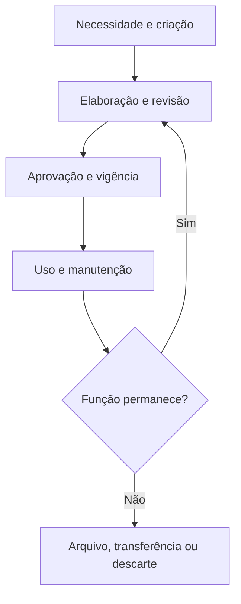

# Arquitetura Documental — Ficha Operacional

**Sistema Operacional do Estúdio LICHTARA**  
**Módulo:** 3 — Arquitetura Organizacional  
**Ferramenta:** 06 — Arquitetura Documental  
**Tipo:** Ficha metodológica, arquitetural e preenchível  
**Versão:** 0.1  
**Status:** Em desenvolvimento e validação pela prática  
**Data de criação:** 02/08/2026

**Documentos relacionados:**

- `README.md` deste diretório;
- `01-estado-atual-e-estado-futuro.md`;
- `02-arquitetura-de-processos-e-fluxos.md`;
- `03-papeis-responsabilidades-e-alcadas.md`;
- `04-arquitetura-de-informacao-e-conhecimento.md`;
- `05-arquitetura-da-comunicacao.md`;
- `../README.md`;
- `../fundamentos-da-arquitetura.md`;
- `../protocolo-de-arquitetura.md`;
- `../matriz-de-rastreabilidade.md`;
- `../templates/plano-de-arquitetura.md`;
- `../templates/03-catalogo-de-requisitos.md`;
- `../templates/04-matriz-de-rastreabilidade.md`;
- `../templates/05-arquitetura-integrada.md`;
- `../templates/06-registro-de-validacao.md`;
- `../templates/08-transicao-para-implantacao.md`.

---

## 1. Finalidade

Esta ferramenta orienta o desenho dos documentos e registros necessários para sustentar operação, decisão, responsabilidade, memória, obrigação, aprendizagem e continuidade.

Ela ajuda o Estúdio LICHTARA a:

- distinguir documento, registro, arquivo, conteúdo, modelo, formulário, cópia e dossiê;
- demonstrar por que cada documento precisa existir;
- relacionar documentos a processos, decisões, comunicações e informações;
- definir autoria, responsabilidade, custódia, revisão e aprovação;
- estruturar tipos, classes, metadados, identificadores e relações;
- estabelecer estados, versões, vigência e mudança controlada;
- diferenciar original, fonte oficial, cópia de trabalho e derivação;
- organizar acesso, sensibilidade, privacidade e integridade;
- tornar documentos localizáveis, compreensíveis e utilizáveis no ponto de necessidade;
- definir retenção, arquivamento, destinação e descarte;
- preparar preservação, continuidade, migração e desativação;
- tratar documentos físicos, digitais e híbridos;
- delimitar produção, classificação e recuperação apoiadas por IA;
- reduzir duplicidade, obsolescência e burocracia documental;
- gerar requisitos para tecnologia, indicadores e implantação;
- produzir um bloco rastreável para a Arquitetura Integrada.

## 2. Pergunta central

> Que documento ou registro precisa existir, para cumprir qual função, com que conteúdo, autoria, autoridade, estrutura, versão, acesso, retenção e destinação, de modo que a organização consiga operar, decidir, comprovar, aprender e manter continuidade?

Perguntas derivadas:

- Que evento ou necessidade justifica o documento?
- Que informação ele reúne e de que fontes?
- Quem precisa utilizá-lo e em qual ponto do trabalho?
- Ele orienta, decide, autoriza, comprova, comunica ou preserva memória?
- O objeto precisa ser documento ou outra forma é suficiente?
- Quem cria, revisa, aprova, publica, mantém e encerra?
- Qual versão é vigente?
- Que cópias ou derivações podem existir?
- Como autenticidade e integridade são demonstradas?
- Quem pode consultar, alterar, compartilhar ou eliminar?
- Quanto tempo precisa permanecer e por qual fundamento?
- O que acontece quando perde a função?
- Como será preservado, migrado ou recuperado?
- Que parte pode ser apoiada por IA?
- Que autoria, julgamento e responsabilidade permanecem humanos?

## 3. O que é

Arquitetura Documental é uma ferramenta de desenho da memória formal e dos artefatos persistentes necessários ao funcionamento organizacional.

Ela organiza:

1. **funções documentais**;
2. **classes, tipos e séries**;
3. **conteúdo, estrutura e metadados**;
4. **autoria, responsabilidade, revisão e aprovação**;
5. **estados, versões e vigência**;
6. **acesso, integridade e autenticidade**;
7. **uso, distribuição e localização**;
8. **retenção, arquivamento e destinação**;
9. **preservação, migração e continuidade**;
10. **governança humana, técnica e de IA**.

Seu produto é um sistema documental proporcional: cada objeto existe por função demonstrável, permanece confiável durante o uso e recebe destinação coerente quando essa função se transforma ou termina.

## 4. Distinções essenciais

### 4.1 Documento

Documento é um artefato persistente e delimitado que reúne informação para cumprir função operacional, decisória, comunicacional, jurídica, histórica ou de aprendizagem.

### 4.2 Registro

Registro é evidência persistente de que evento, ação, decisão, estado, autorização, entrega ou resultado ocorreu. Um registro pode assumir forma documental, integrar sistema ou existir como conjunto de dados governado.

### 4.3 Conteúdo

Conteúdo é a matéria informacional expressa no documento. Pode existir em outras formas e não se confunde com o artefato que o contém.

### 4.4 Arquivo documental

Arquivo documental é uma unidade digital ou física em que conteúdo e metadados são fixados ou representados. Um documento pode possuir mais de um arquivo, formato ou representação.

### 4.5 Original ou exemplar de referência

Original é o exemplar reconhecido como referência autêntica para determinada função. Em ambiente digital, essa condição depende de governança, origem, integridade e autoridade, não apenas de ser o primeiro arquivo criado.

### 4.6 Cópia

Cópia é uma reprodução de documento, vinculada a uma origem e a uma finalidade. Pode ser controlada, informativa, de trabalho, segurança ou preservação.

### 4.7 Versão

Versão é um estado identificável do documento ao longo de sua evolução. Ela registra mudança sem apagar a trajetória relevante.

### 4.8 Modelo

Modelo é uma estrutura reutilizável que orienta a criação de documentos de determinado tipo. Ele não é documento concluído nem prova de ocorrência.

### 4.9 Formulário

Formulário é uma estrutura de coleta ou registro com campos definidos. O formulário vazio é modelo; o formulário preenchido pode tornar-se documento ou registro.

### 4.10 Dossiê

Dossiê é um conjunto organizado de documentos e registros vinculados a caso, pessoa, projeto, contrato, decisão ou evento, com fronteira e critérios de inclusão.

### 4.11 Repositório

Repositório é o ambiente lógico, físico ou técnico em que documentos são armazenados, organizados e recuperados. Possuir repositório não demonstra qualidade, vigência ou uso.

### 4.12 Arquivo permanente

Arquivo permanente é o conjunto de documentos preservados por valor histórico, probatório, institucional, autoral ou cultural após cessar o uso corrente.

### 4.13 Quadro comparativo

| Objeto | Pergunta | Exemplo | Não demonstra automaticamente |
| --- | --- | --- | --- |
| Informação | O que precisa ser compreendido ou utilizado? | Escopo aprovado | Forma documental |
| Documento | Em que artefato a informação foi reunida? | Proposta | Aprovação |
| Registro | Que evidência comprova ocorrência? | Aceite com data | Contexto completo |
| Arquivo | Em que unidade o documento está representado? | PDF assinado | Autenticidade |
| Modelo | Que estrutura orienta novos documentos? | Modelo de proposta | Ocorrência real |
| Formulário | Que dados precisam ser coletados? | Formulário de entrada | Qualidade das respostas |
| Dossiê | Que conjunto pertence ao mesmo caso? | Dossiê de projeto | Completude |
| Repositório | Onde os objetos são mantidos? | Diretório documental | Governança |

## 5. Relações entre informação, documento, registro, conhecimento e comunicação

| Objeto | Relação com o documento | Fronteira |
| --- | --- | --- |
| Informação | Compõe conteúdo e metadados | Pode existir fora de documento |
| Registro | Pode ser incorporado ou representado documentalmente | Sua função central é evidenciar ocorrência |
| Conhecimento | Pode ser apoiado por documentos | Exige compreensão, prática e julgamento |
| Comunicação | Pode gerar, referenciar ou distribuir documento | Comunicação envolve recepção e resposta |
| Processo | Cria, utiliza, altera e encerra documentos | Documento não substitui trabalho |
| Decisão | Pode ser sustentada ou registrada em documento | Documento não concede autoridade sozinho |

### 5.1 Relação não automática

Um documento armazenado pode estar incorreto, obsoleto, inacessível ou sem uso. Sua existência somente possui valor arquitetural quando função, conteúdo, autoridade, estado e uso permanecem reconhecíveis.

## 6. Documento como componente arquitetural

Um documento torna-se componente arquitetural quando sua presença, ausência ou condição altera capacidade de operar, decidir, comprovar, proteger, aprender ou manter continuidade.

| Pergunta arquitetural | Elemento de desenho |
| --- | --- |
| Por que existe? | Função documental |
| O que contém? | Conteúdo e estrutura |
| Quem utiliza? | Usuários e ponto de uso |
| Quem responde? | Autoria, responsabilidade e custódia |
| Qual estado vale? | Versão, aprovação e vigência |
| Quem acessa? | Classificação e permissão |
| Como é encontrado? | Metadados, taxonomia e localização |
| Quanto permanece? | Retenção e destinação |
| Como sobrevive? | Preservação, migração e continuidade |

## 7. Função no protocolo de arquitetura

| Etapa do protocolo | Contribuição da ferramenta |
| --- | --- |
| Delimitação | Identificar documentos e registros materiais ao escopo |
| Diagnóstico | Reconhecer lacunas, duplicidade, obsolescência e dependência |
| Requisitos | Traduzir necessidades em funções e controles documentais |
| Desenho | Especificar classes, tipos, estados, versões e ciclo de vida |
| Integração | Relacionar documentos a processos, papéis, informação e comunicação |
| Validação | Testar necessidade, uso, autenticidade, acesso e continuidade |
| Aprovação | Constituir linha de base da arquitetura documental |
| Transição | Informar criação, migração, treinamento, retenção e descarte |

## 8. Saídas principais

A aplicação pode produzir:

- mapa documental atual;
- catálogo de classes, tipos e séries;
- catálogo de registros;
- fichas mestras documentais;
- matriz função–processo–documento;
- estrutura de conteúdo e metadados;
- modelos e formulários necessários;
- matriz de autoria, revisão, aprovação e custódia;
- estados e fluxo de ciclo de vida;
- convenções de identificação e nomeação;
- política de versões e cópias;
- matriz de acesso e sensibilidade;
- plano de classificação e localização;
- tabela de retenção e destinação;
- regras de preservação, migração e recuperação;
- requisitos de assinatura e autenticidade;
- limites de uso de IA;
- matriz atual–futuro;
- cenários de teste e validação;
- plano de transição;
- bloco consolidado para a Arquitetura Integrada.

### 8.1 Seleção proporcional

| Contexto | Saída mínima recomendada |
| --- | --- |
| Organização de uma pessoa | Tipos críticos, nomeação, versão, localização, retenção e continuidade |
| Equipe pequena | Catálogo, fichas mestras, autoria, aprovação e acesso |
| Múltiplos processos | Classes, séries, interfaces, cópias e ciclo de vida |
| Alto risco ou regulação | Evidência, autenticidade, retenção, auditoria e especialista |
| Acervo autoral | Autoria, direitos, versões, licenças e preservação |
| Arquitetura sistêmica | Plano de classificação, governança, migração e preservação |

## 9. O que a ferramenta não é

Esta ferramenta não é:

- inventário indiscriminado de arquivos;
- política de guardar tudo;
- manual de plataforma;
- projeto técnico de armazenamento;
- substituta de processo claro;
- forma de conferir autoridade a quem não a possui;
- tentativa de converter todo conhecimento em texto;
- exigência de registrar toda conversa;
- promessa de validade jurídica universal;
- justificativa para vigilância;
- arquivo morto sem responsabilidade;
- plano de implantação do Módulo 4.

## 10. Fronteiras com outras dimensões

| Dimensão | Esta ferramenta define | Outra ferramenta aprofunda |
| --- | --- | --- |
| Processos | Documentos criados, usados e encerrados | Sequência e trabalho na ferramenta 02 |
| Papéis | Autores, revisores, aprovadores e custodiantes | Responsabilidade e alçada na ferramenta 03 |
| Informação | Forma, estrutura e persistência documental | Significado, fonte e qualidade na ferramenta 04 |
| Comunicação | Documento como mensagem, referência ou registro | Evento, público, canal e confirmação na ferramenta 05 |
| Indicadores | Registros e documentos que sustentam evidência | Definição, cálculo e resposta na ferramenta 07 |
| Tecnologia | Requisitos de gestão, acesso e preservação | Solução técnica na ferramenta 08 |
| IA | Funções documentais permitidas e supervisão | Papéis de IA e controles na ferramenta 09 |
| Implantação | Objetos a criar, migrar, encerrar ou treinar | Execução da transição no Módulo 4 |

## 11. Princípios

1. Todo documento material possui função demonstrável.
2. Documento não substitui informação correta, processo ou autoridade.
3. O conteúdo nasce de fontes identificáveis.
4. Autoria, responsabilidade e custódia permanecem distinguíveis.
5. A versão vigente é encontrável e reconhecível.
6. Mudanças materiais deixam rastro proporcional.
7. Cópias e derivações preservam relação com a origem.
8. Acesso corresponde à finalidade e à sensibilidade.
9. Retenção possui fundamento e prazo ou condição.
10. Descarte é parte governada do ciclo de vida.
11. Preservação considera legibilidade futura, não apenas armazenamento.
12. Documentação deve reduzir dependência sem eliminar prática e julgamento.
13. Formato e tecnologia seguem a função documental.
14. IA produz conteúdo provisório até validação humana.
15. O acervo evolui com a organização.

## 12. Invariantes

Independentemente do porte, preserve:

- identificador ou referência inequívoca;
- função e contexto de uso;
- conteúdo mínimo definido;
- responsável reconhecível;
- estado e versão;
- origem e data relevantes;
- acesso compatível;
- localização conhecida;
- regra de revisão;
- retenção ou condição de destinação;
- tratamento de substituição;
- capacidade de recuperação;
- responsabilidade humana por aprovação e descarte materiais.

## 13. Quando utilizar

Utilize quando:

- continuidade depender de memória persistente;
- versões causarem conflito;
- decisões, aprovações ou evidências precisarem permanecer;
- processos dependerem de instrução ou formulário;
- informação precisar de forma oficial;
- documentos estiverem dispersos ou duplicados;
- obrigações exigirem retenção ou descarte;
- autoria, licença ou propriedade intelectual forem materiais;
- acervo precisar ser migrado;
- canais ou sistemas forem desativados;
- documentos alimentarem tecnologia, indicadores ou IA;
- clientes, parceiros ou autoridades dependerem de referência;
- modelos forem criados sem governança;
- implantação precisar criar, converter ou encerrar artefatos.

## 14. Quando não utilizar ou reduzir

Reduza quando:

- um registro focal simples atende a necessidade;
- a interação é transitória, de baixo impacto e não exige memória;
- a informação já existe em fonte adequada no ponto de uso;
- o objeto não possui recorrência nem risco relevante;
- a estrutura pode ser definida em outro artefato arquitetural.

Não utilize para:

- documentar por hábito;
- formalizar decisão inexistente;
- criar procedimento para corrigir responsabilidade ambígua;
- duplicar fonte oficial;
- preservar conteúdo sem uso, valor ou obrigação;
- capturar integralmente relações humanas;
- escolher software antes de definir função.

### 14.1 Registro da redução

| Campo | Preenchimento |
| --- | --- |
| Necessidade avaliada | [Preencher] |
| Motivo da redução | [Simplicidade, baixo risco ou baixa recorrência] |
| Representação mínima | [Registro, referência ou N/A] |
| Risco residual | [Preencher] |
| Responsável | PAP-ARQ-___ |
| Gatilho de aprofundamento | [Evento] |

## 15. Proporcionalidade

| Fator | Pergunta | Efeito possível |
| --- | --- | --- |
| Impacto | Que decisão ou direito depende do documento? | Aprovação e evidência mais fortes |
| Recorrência | Quantas vezes será criado ou utilizado? | Modelo e automação |
| Sensibilidade | Que dano decorre de exposição? | Acesso e proteção |
| Obrigação | Há fundamento legal, contratual ou institucional? | Retenção e formalidade |
| Complexidade | Quanto conteúdo e relação são necessários? | Estrutura e metadados |
| Longevidade | Por quanto tempo precisa permanecer legível? | Formato e preservação |
| Mutabilidade | Com que frequência muda? | Versionamento e revisão |
| Distribuição | Quantas cópias ou públicos existem? | Controle e sincronização |
| Reversibilidade | A perda ou alteração pode ser reparada? | Backup e integridade |
| Valor histórico/autoral | O objeto preserva identidade ou criação? | Arquivo permanente |

### 15.1 Níveis

| Nível | Aplicação | Representações |
| --- | --- | --- |
| Essencial | Poucos documentos e baixo risco | Função, responsável, versão, acesso e retenção |
| Intermediário | Múltiplos processos | Essencial + catálogo, estados, cópias e metadados |
| Ampliado | Alto impacto ou obrigação | Intermediário + autenticidade, auditoria, preservação e descarte |
| Sistêmico | Organização ou ecossistema | Plano de classificação, séries, governança e migração |

## 16. Escalas e camadas

### 16.1 Escalas

| Escala | Objeto |
| --- | --- |
| Documento | Um artefato individual |
| Tipo | Documentos com mesma função e estrutura |
| Série | Conjunto recorrente produzido por mesma função ou processo |
| Dossiê | Conjunto relacionado a caso, projeto ou relação |
| Domínio | Família documental de uma área ou capacidade |
| Acervo | Totalidade governada da organização |

### 16.2 Camadas

| Camada | Questão |
| --- | --- |
| Finalística | Por que o documento existe? |
| Semântica | Que informação e significado contém? |
| Estrutural | Que campos, seções e relações possui? |
| Operacional | Como é criado, usado e atualizado? |
| Governança | Quem responde, aprova, protege e destina? |
| Técnica | Como é armazenado, acessado e preservado? |
| Temporal | Como muda ao longo do ciclo de vida? |

## 17. Participantes da aplicação

| Participante | Contribuição | Risco se ausente |
| --- | --- | --- |
| Responsável pelo processo | Eventos e uso real | Documento desconectado do trabalho |
| Autor ou produtor | Conteúdo e prática | Estrutura inexequível |
| Usuário real | Localização e utilidade | Documento formal sem uso |
| Responsável semântico | Definição e fonte | Conteúdo ambíguo |
| Revisor | Critério técnico ou de qualidade | Erro não percebido |
| Aprovador | Autoridade e vigência | Estado indefinido |
| Custodiante documental | Ciclo de vida e localização | Acervo sem manutenção |
| Responsável técnico | Formato, acesso e preservação | Requisito inviável |
| Especialista jurídico, regulatório ou de privacidade | Obrigações e limites | Retenção ou descarte inadequado |
| Detentor de conhecimento | Contexto e julgamento | Formalização empobrecida |
| Validador | Evidência de necessidade e uso | Aprovação presumida |

### 17.1 Participantes reais

| Papel no desenho | Pessoa/papel | Participação | Disponibilidade | Acesso necessário | Conflito de interesse |
| --- | --- | --- | --- | --- | --- |
| [Preencher] | [Nome/PAP ID] | [Oficina, entrevista, teste ou validação] | [Condição] | [Objetos] | [Sim/não/tratamento] |

## 18. Autoridade e limites

| Decisão | Autoridade | Consulta necessária | Limite | Evidência |
| --- | --- | --- | --- | --- |
| Criar tipo documental | PAP/INS-ARQ-___ | [Usuários/custódia] | [Escopo] | [Decisão] |
| Aprovar documento | PAP/INS-ARQ-___ | [Revisores] | ALC-ARQ-___ | APR-ARQ-___ |
| Definir fonte oficial | PAP/INS-ARQ-___ | [Responsável semântico] | [Domínio] | [Registro] |
| Conceder acesso | PAP-ARQ-___ | [Dono do objeto] | ACS-ARQ-___ | [Log/decisão] |
| Alterar modelo | PAP-ARQ-___ | [Usuários] | [Regra] | [Versão] |
| Definir retenção | PAP/INS-ARQ-___ | [Especialista] | [Fundamento] | RTN-ARQ-___ |
| Suspender descarte | PAP/INS-ARQ-___ | [Especialista] | [Caso/período] | SUS-ARQ-___ |
| Autorizar descarte | PAP/INS-ARQ-___ | [Custódia/especialista] | [Série/lote] | DST-ARQ-___ |
| Aprovar arquitetura | PAP/INS-ARQ-___ | [Públicos] | [Governança] | DEC-ARQ-___ |

### 18.1 Limites

A autoridade documental não permite automaticamente:

- declarar verdadeiro conteúdo não verificado;
- alterar decisão de outra instância;
- assinar por pessoa sem delegação;
- ampliar finalidade de dados;
- reter indefinidamente;
- eliminar objeto sob suspensão;
- apropriar autoria ou direito de terceiro;
- conceder acesso fora da alçada;
- substituir parecer especializado;
- tratar saída de IA como documento aprovado.

## 19. Entradas necessárias

| Entrada | Identificador/fonte | Qualidade mínima | Responsável | Lacuna |
| --- | --- | --- | --- | --- |
| Escopo e problema | [Plano/termo] | Aprovado | [Papel] | [Preencher] |
| Processos e eventos | PRC/EVT-ARQ-___ | Estado e interfaces | [Papel] | [Preencher] |
| Papéis e alçadas | PAP/ALC/APR-ARQ-___ | Vigentes | [Papel] | [Preencher] |
| Informação e fontes | INF/FON/MET-ARQ-___ | Definição, qualidade e acesso | [Papel] | [Preencher] |
| Comunicações | COM/MNS-ARQ-___ | Função e públicos | [Papel] | [Preencher] |
| Documentos atuais | [Inventário/amostra] | Uso e estado | [Papel] | [Preencher] |
| Registros obrigatórios | [Fonte] | Evento e finalidade | [Papel] | [Preencher] |
| Obrigações | REQ-ARQ-___ | Fonte competente | [Papel] | [Preencher] |
| Sistemas e repositórios | [Inventário] | Capacidade e limites | [Papel] | [Preencher] |
| Riscos e incidentes | RSC/EXC-ARQ-___ | Evidência | [Papel] | [Preencher] |

## 20. Qualidade das evidências

| Evidência | Força | Limite | Uso |
| --- | --- | --- | --- |
| Documento vigente | Alta para forma oficial | Pode não refletir prática | Identificar referência |
| Amostra de versões | Alta para trajetória | Pode omitir arquivos perdidos | Analisar mudança |
| Registro de uso | Alta para acesso | Acesso não prova utilidade | Observar operação |
| Entrevista com usuário | Alta para experiência | Memória e preferência | Testar necessidade |
| Observação do processo | Alta para ponto de uso | Recorte temporal | Relacionar ao trabalho |
| Incidente documental | Alta para consequência | Pode ser caso raro | Priorizar risco |
| Norma, contrato ou parecer | Alta para obrigação | Exige interpretação competente | Definir requisito |
| Volume de arquivos | Baixa isoladamente | Quantidade não demonstra valor | Formular hipótese |

### 20.1 Proteções

- existência não demonstra vigência;
- nome “final” não comprova aprovação;
- assinatura visual não comprova autenticidade;
- ausência de registro não prova ausência do evento;
- arquivo acessado não prova compreensão;
- cópia idêntica pode ter finalidade diferente;
- obrigação deve ser confirmada por fonte competente;
- evidências sensíveis recebem acesso proporcional.

## 21. Preparação

| Ação | Resultado | Responsável | Estado |
| --- | --- | --- | --- |
| Confirmar escopo | Fronteira documental | [Papel] | [ ] |
| Selecionar processos críticos | Lista inicial | [Papel] | [ ] |
| Reunir amostra autorizada | Acervo de análise | [Papel] | [ ] |
| Identificar públicos e usuários | Mapa | [Papel] | [ ] |
| Levantar obrigações | Referências | [Papel] | [ ] |
| Definir tratamento de sensíveis | Regra | [Papel] | [ ] |
| Preparar convenção provisória | Identificação de trabalho | [Papel] | [ ] |
| Definir critérios de validação | Plano | [Papel] | [ ] |

### 21.1 Prontidão

| Critério | Sim | Evidência/ação |
| --- | --- | --- |
| Escopo está compreendido | [ ] | [Preencher] |
| Processos e decisões estão disponíveis | [ ] | [Preencher] |
| Amostra possui autorização | [ ] | [Preencher] |
| Usuários reais podem participar | [ ] | [Preencher] |
| Obrigações possuem fonte | [ ] | [Preencher] |
| Papéis e alçadas são conhecidos | [ ] | [Preencher] |
| Riscos de acesso foram tratados | [ ] | [Preencher] |
| Validação possui responsáveis | [ ] | [Preencher] |

## 22. Plano da aplicação

| Campo | Preenchimento |
| --- | --- |
| ID do plano | PLN-ARQ-___ |
| Escopo | [Processos, tipos, domínios ou acervo] |
| Finalidade | [Preencher] |
| Documentos prioritários | [IDs/descrições] |
| Participantes | [Papéis/pessoas] |
| Métodos | [Inventário, amostragem, oficina, teste ou simulação] |
| Evidências | [Fontes] |
| Entregas | [Artefatos] |
| Validações | [Critérios/papéis] |
| Restrições | [Tempo, acesso, obrigação, preservação ou tecnologia] |
| Prazo | [Data/condição] |
| Responsável | PAP-ARQ-___ |

### 22.1 Atividades

| Atividade | Entrada | Participantes | Saída | Critério | Data |
| --- | --- | --- | --- | --- | --- |
| ATV-ARQ-___ | [Fonte] | [Papéis] | [Artefato] | [Critério] | [Data] |

## 23. Identificação, versão e validade da arquitetura

**Identificador do artefato:** `ARD-ARQ-AAAA-NNN`

| Campo | Preenchimento |
| --- | --- |
| ID | ARD-ARQ-____-___ |
| Título | [Preencher] |
| Escopo | [Preencher] |
| Estado | [Rascunho, em validação, aprovado, vigente, em revisão ou encerrado] |
| Versão | [Número] |
| Vigência | [Data/condição] |
| Responsável | PAP-ARQ-___ |
| Aprovador | PAP/INS-ARQ-___ |
| Sensibilidade | [Classe] |
| Arquitetura substituída | [ID/N/A] |
| Próxima revisão | [Data/gatilho] |

### 23.1 Estados

| Estado | Condição de entrada | Condição de saída |
| --- | --- | --- |
| Rascunho | Aplicação iniciada | Revisão mínima concluída |
| Em validação | Componentes definidos | Critérios atendidos ou devolução |
| Aprovado | Autoridade decidiu | Data ou condição de vigência |
| Vigente | Regras documentais ativadas | Revisão ou substituição |
| Em revisão | Gatilho ocorreu | Nova versão ou manutenção |
| Encerrado | Função cessou | Arquivamento e comunicação |

## 24. Referência atual

| Campo | Preenchimento |
| --- | --- |
| Data de referência | [DD/MM/AAAA] |
| Período observado | [Preencher] |
| Processos incluídos | [IDs] |
| Domínios incluídos | [Descrição] |
| Repositórios incluídos | [Descrição] |
| Acervos excluídos | [Descrição/motivo] |
| Fontes | [IDs/referências] |
| Limitações | [Preencher] |

### 24.1 Formal e praticado

Registre a arquitetura formal e a prática real. Documentos paralelos, atalhos, cópias pessoais e nomes informais revelam necessidades, valores e falhas que o desenho futuro precisa tratar.

## 25. Inventário documental atual

| Documento/registro | Tipo | Função percebida | Processo | Local | Usuários | Versão/estado | Responsável | Evidência |
| --- | --- | --- | --- | --- | --- | --- | --- | --- |
| [Nome] | [Documento, registro, modelo, formulário ou dossiê] | [Preencher] | [ID] | [Fonte] | [Papéis] | [Preencher] | [Papel/pessoa] | [Fonte] |

### 25.1 Amostragem

Quando o volume for elevado, selecione amostras por:

- criticidade;
- frequência;
- processo;
- período;
- sensibilidade;
- versão;
- incidente;
- usuário;
- formato;
- situação de migração.

## 26. Problemas documentais atuais

| ID | Tipo | Objeto | Consequência | Frequência | Evidência | Condição futura |
| --- | --- | --- | --- | --- | --- | --- |
| LAC-ARQ-___ | [Ausência, duplicidade, obsolescência, conflito, inacessibilidade, excesso, perda ou exposição] | [Documento/processo] | [Preencher] | [Faixa] | [Fonte] | [Preencher] |

### 26.1 Sintomas e causas possíveis

| Sintoma | Causa a investigar |
| --- | --- |
| Ninguém encontra | Classificação, nomeação, acesso ou hábito |
| Há muitas versões | Fonte oficial, cópias ou processo de revisão |
| Documento não é usado | Função, ponto de uso ou complexidade |
| Tudo depende de modelo antigo | Custódia e revisão ausentes |
| Arquivo final muda | Estados e aprovação não definidos |
| Conteúdo diverge do processo | Processo, autoria ou cadência mudaram |
| Informação sensível circula | Acesso, canal ou classificação falharam |
| Acervo cresce sem limite | Retenção e destinação ausentes |

## 27. Documentação paralela e acervo sombra

| Objeto paralelo | Local | Por que existe | Valor | Risco | Relação com fonte | Destino futuro |
| --- | --- | --- | --- | --- | --- | --- |
| [Planilha, caderno, arquivo pessoal, captura ou pasta] | [Preencher] | [Velocidade, confiança, acesso ou lacuna] | [Preencher] | [Perda, versão, exposição ou dependência] | [Cópia, derivação ou nova fonte] | [Integrar, preservar, restringir, substituir ou encerrar] |

### 27.1 Acervo sombra não é apenas desvio

Ele pode revelar necessidade não atendida. Antes de eliminá-lo, compreenda a função real e preserve o valor que sustentava o trabalho.

## 28. Trabalho documental invisível

| Trabalho | Quem realiza | Frequência | Carga | Valor | Risco | Tratamento futuro |
| --- | --- | --- | --- | --- | --- | --- |
| [Nomear, organizar, converter, conferir, copiar, cobrar, reconciliar ou arquivar] | [Pessoa/papel] | [Faixa] | [Tempo] | [Preencher] | [Preencher] | [Reconhecer, distribuir, apoiar, automatizar parte ou eliminar] |

### 28.1 Curadoria invisível

A organização pode parecer ordenada porque alguém corrige nomes, recupera versões, traduz padrões e lembra prazos. Torne essa função visível antes de redistribuí-la ou automatizá-la.

## 29. Carga e dívida documental

Dívida documental é o custo acumulado de objetos sem função clara, versões conflitantes, metadados incompletos, retenção indefinida e dependência de memória para encontrar ou interpretar arquivos.

| Dívida | Origem | Custo atual | Risco | Primeira correção |
| --- | --- | --- | --- | --- |
| [Preencher] | [Decisão, migração, hábito ou ausência de governança] | [Tempo, erro, armazenamento ou confiança] | [Preencher] | [Ação] |

### 29.1 Volume não é maturidade

Mais documentos podem aumentar prova e continuidade ou apenas esconder o que importa. Avalie função, uso, confiabilidade e custo de manutenção.

## 30. Questões que retornam ao diagnóstico

Retorne ao Módulo 2 quando a aplicação revelar:

- processo real diferente do descrito;
- autoridade informal que controla aprovação;
- ocultação deliberada de decisões;
- acervo pessoal indispensável ao trabalho;
- medo de registrar risco ou erro;
- documentação usada como vigilância;
- obrigação ainda não compreendida;
- conflito de autoria ou propriedade;
- incidente que exige investigação;
- perda de conhecimento que documento não resolve sozinho.

| Achado | Motivo do retorno | Evidência | Pergunta diagnóstica | Responsável |
| --- | --- | --- | --- | --- |
| [Preencher] | [Preencher] | [Fonte] | [Pergunta] | PAP-ARQ-___ |

## 31. Princípio de desenho futuro

O estado futuro deve conter o menor sistema documental capaz de preservar função, confiabilidade, uso e continuidade.

| Condição atual | Princípio futuro |
| --- | --- |
| Guardar tudo | Reter por função e fundamento |
| Pastas por hábito pessoal | Classificação compartilhada |
| “Final_v7_agora_vai” | Estados e versões explícitos |
| Cópias sem origem | Relação e finalidade visíveis |
| Aprovação por aparência | Autoridade e evidência |
| Modelo sem responsável | Custódia e revisão |
| Conteúdo em formato fechado | Acesso e preservação proporcionais |
| Descarte improvisado | Destinação governada |
| IA gera documento final | Rascunho sob validação humana |

## 32. Domínios, classes, tipos e séries

| Nível | Definição | Exemplo | Regra |
| --- | --- | --- | --- |
| Domínio | Grande campo funcional | Projetos | Fronteira organizacional |
| Classe | Agrupamento por função | Gestão de projetos | Função comum |
| Tipo | Forma documental recorrente | Plano de projeto | Estrutura comum |
| Série | Conjunto produzido por mesma atividade | Planos de projetos concluídos | Ciclo e retenção comuns |
| Dossiê | Conjunto por caso | Projeto Cliente A | Fronteira por objeto |
| Item | Documento individual | Plano v1.0 | Identidade própria |

### 32.1 Catálogo hierárquico

| ID | Nível | Nome | Pai | Função | Responsável | Estado |
| --- | --- | --- | --- | --- | --- | --- |
| CLD-ARQ-001 | [Domínio, classe, tipo ou série] | [Nome] | [ID/N/A] | [Preencher] | PAP-ARQ-___ | [Estado] |

## 33. Funções documentais

| Função | Pergunta | Exemplo | Evidência de valor |
| --- | --- | --- | --- |
| Operacional | Orienta ou apoia execução? | Procedimento | Uso no processo |
| Decisória | Sustenta ou preserva decisão? | Parecer/registro de decisão | Escolha rastreável |
| Autorizativa | Formaliza permissão ou alçada? | Aprovação | Autoridade demonstrada |
| Probatória | Evidencia ocorrência ou compromisso? | Aceite | Integridade e origem |
| Comunicacional | Distribui referência persistente? | Comunicado oficial | Público alcança versão |
| Contratual | Registra obrigações entre partes? | Contrato | Compromissos reconhecidos |
| Jurídica/regulatória | Atende requisito aplicável? | Registro obrigatório | Fundamento confirmado |
| Histórica | Preserva memória institucional? | Marco do projeto | Valor de longo prazo |
| Autoral | Preserva criação, trajetória e direitos? | Manuscrito versionado | Autoria e proveniência |
| Aprendizagem | Apoia desenvolvimento e reutilização? | Estudo de caso | Aplicação futura |

## 34. Catálogo de tipos documentais

| ID | Tipo | Classe/série | Função | Processo/decisão | Usuários | Responsável | Estado futuro |
| --- | --- | --- | --- | --- | --- | --- | --- |
| TPD-ARQ-001 | [Nome] | CLD-ARQ-___ | [Funções] | [IDs] | [Papéis] | PAP-ARQ-___ | [Preservado, adaptado, novo, migrado ou encerrado] |

### 34.1 Regra de criação

Crie novo tipo quando função, estrutura, autoridade, retenção ou público diferirem materialmente. Variação superficial pode ser tratada por metadado, opção ou modelo.

## 35. Catálogo de registros

| ID | Registro | Evento evidenciado | Informação | Origem | Integridade | Responsável | Retenção |
| --- | --- | --- | --- | --- | --- | --- | --- |
| RGT-ARQ-001 | [Nome] | EVT/DEC/APR-ARQ-___ | [INF/DAD IDs] | [Pessoa/sistema/documento] | [Mecanismo] | PAP-ARQ-___ | RTN-ARQ-___ |

### 35.1 Documento e registro

| Situação | Tratamento |
| --- | --- |
| Documento orienta trabalho | Pode mudar mediante revisão |
| Documento registra decisão | Versão aprovada preserva evidência |
| Formulário é preenchido | Instância preenchida pode virar registro |
| Relatório é emitido | Exemplar emitido registra estado no período |
| Modelo muda | Documentos anteriores permanecem vinculados ao modelo usado |

## 36. Ficha mestra do tipo documental

| Campo | Preenchimento |
| --- | --- |
| ID | TPD-ARQ-___ |
| Nome | [Preencher] |
| Domínio/classe/série | CLD-ARQ-___ |
| Funções | [Operacional, decisória, probatória, autoral ou outra] |
| Evento de criação | EVT-ARQ-___ |
| Processo/decisão | PRC/DEC-ARQ-___ |
| Informação | [INF IDs] |
| Modelo | MDL-ARQ-___/N/A |
| Autor/produtor | PAP-ARQ-___ |
| Responsável | PAP-ARQ-___ |
| Revisores | [PAP IDs] |
| Aprovador | PAP/INS-ARQ-___/N/A |
| Usuários | [PAP/PUB IDs] |
| Fonte oficial | FON-ARQ-___ |
| Estados | [Lista] |
| Versionamento | [Regra] |
| Metadados | [MET IDs] |
| Sensibilidade | [Classe] |
| Acessos | [ACS IDs] |
| Assinatura | ASN-ARQ-___/N/A |
| Retenção | RTN-ARQ-___ |
| Destinação | DST-ARQ-___ |
| Formatos | [Lista] |
| Localização | [Lógica/repositório] |
| Continuidade | [Requisitos] |
| Revisão do tipo | [Gatilho] |

## 37. Ficha mestra do documento

| Campo | Preenchimento |
| --- | --- |
| ID | DOC-ARQ-___ |
| Tipo | TPD-ARQ-___ |
| Título | [Preencher] |
| Objeto/caso | [ID] |
| Autor/produtor | [Pessoa/PAP ID] |
| Responsável | PAP-ARQ-___ |
| Data de criação | [Data/hora] |
| Estado | [Rascunho, em revisão, aprovado, vigente, substituído, arquivado ou eliminado] |
| Versão | [Número] |
| Vigência | [Data/condição] |
| Aprovação | APR-ARQ-___/N/A |
| Assinatura | ASN-ARQ-___/N/A |
| Fonte oficial | FON-ARQ-___ |
| Relações | [DOC/RGT/INF/DEC IDs] |
| Sensibilidade | [Classe] |
| Localização | [Referência] |
| Retenção | RTN-ARQ-___ |
| Integridade | [Mecanismo/evidência] |
| Observações | [Preencher] |

## 38. Teste de necessidade documental

| Pergunta | Resposta | Evidência | Decisão |
| --- | --- | --- | --- |
| Que função precisa ser preservada? | [Preencher] | [Fonte] | [ ] |
| Que evento cria a necessidade? | [Preencher] | [ID] | [ ] |
| Quem utilizará? | [Preencher] | [Validação] | [ ] |
| Que risco existe sem documento? | [Preencher] | [Evidência] | [ ] |
| Informação já existe em fonte adequada? | [Sim/não] | [Fonte] | [ ] |
| Um registro simples seria suficiente? | [Sim/não] | [Análise] | [ ] |
| Precisa de estrutura recorrente? | [Sim/não] | [Frequência] | [ ] |
| Quem manterá? | [Papel] | [Capacidade] | [ ] |
| Quanto tempo precisa permanecer? | [Condição] | [Fundamento] | [ ] |
| O custo é proporcional ao valor? | [Sim/não] | [Análise] | [ ] |

### 38.1 Resultado

| Resultado | Condição |
| --- | --- |
| Criar documento | Função persistente e governança demonstradas |
| Criar registro | Evidência focal é suficiente |
| Referenciar fonte existente | Duplicação não agrega valor |
| Apoiar por conversa ou prática | Persistência não é necessária ou empobrece função |
| Adiar | Requisito ainda não está compreendido |
| Não criar | Custo e risco superam valor |

## 39. Finalidade e contexto de uso

| Documento/tipo | Finalidade | Usuário | Atividade/decisão | Momento | Resultado | Uso proibido |
| --- | --- | --- | --- | --- | --- | --- |
| DOC/TPD-ARQ-___ | [Preencher] | PAP/PUB-ARQ-___ | [IDs] | [Evento] | [Estado observável] | [Preencher] |

### 39.1 Desvio de finalidade

Documento criado para uma função não deve ser reutilizado em outra finalidade material sem avaliar conteúdo, direitos, contexto, validade e autorização.

## 40. Usuário e ponto de uso

| Documento | Usuário | Onde precisa | Quando | Ação | Forma necessária | Barreira | Contingência |
| --- | --- | --- | --- | --- | --- | --- | --- |
| DOC/TPD-ARQ-___ | PAP/PUB-ARQ-___ | [Processo/sistema/local] | [Evento] | [Consultar, preencher, decidir ou comprovar] | [Formato/visão] | [Acesso, linguagem ou tecnologia] | [Forma] |

### 40.1 Documento fora do ponto de uso

Se a pessoa precisa interromper o trabalho, procurar em múltiplos locais ou pedir a alguém para localizar a referência, o problema é arquitetural mesmo que o arquivo exista.

## 41. Conteúdo e informação documental

| Documento/tipo | Informação obrigatória | Informação opcional | Fonte | Regra de qualidade | Contexto | Restrição |
| --- | --- | --- | --- | --- | --- | --- |
| DOC/TPD-ARQ-___ | [INF/DAD IDs] | [INF/DAD IDs] | [FON IDs] | [QID IDs/critério] | [Preencher] | [Preencher] |

### 41.1 Conteúdo mínimo suficiente

O documento deve conter o necessário para cumprir sua função. Campos sem uso aumentam carga, exposição e falsa sensação de completude.

## 42. Estrutura documental

| Seção/campo | Finalidade | Obrigatório | Origem | Regra | Usuário | Pode repetir? |
| --- | --- | --- | --- | --- | --- | --- |
| [Nome] | [Preencher] | [Sim/não/condicional] | [Humana, sistema ou fonte] | [Critério] | [Papel] | [Condição] |

### 42.1 Ordem da estrutura

Organize conforme a função:

- identificação;
- contexto;
- objeto;
- conteúdo principal;
- decisão ou ação;
- responsáveis;
- condições e limites;
- evidências;
- referências;
- controle documental.

## 43. Modelos documentais

| ID | Modelo | Tipo | Finalidade | Campos variáveis | Conteúdo fixo | Responsável | Versão | Validade |
| --- | --- | --- | --- | --- | --- | --- | --- | --- |
| MDL-ARQ-001 | [Nome] | TPD-ARQ-___ | [Preencher] | [Lista] | [Lista] | PAP-ARQ-___ | [Número] | [Condição] |

### 43.1 Modelo não é camisa de força

O modelo preserva estrutura necessária e permite variação legítima. Exceções recorrentes indicam que o tipo, o modelo ou o processo precisam ser revistos.

## 44. Formulários

| ID | Formulário | Evento | Campos | Validações | Quem preenche | Quem utiliza | Registro gerado |
| --- | --- | --- | --- | --- | --- | --- | --- |
| FRM-ARQ-001 | [Nome] | EVT-ARQ-___ | [MET/DAD IDs] | [Regras] | PAP/PUB-ARQ-___ | [Papéis/sistemas] | RGT/DOC-ARQ-___ |

### 44.1 Qualidade da coleta

| Risco | Proteção |
| --- | --- |
| Campo ambíguo | Definição e exemplo |
| Informação desnecessária | Teste de finalidade |
| Opção insuficiente | “Outro” ou revisão de taxonomia |
| Ausência tratada como zero | Estado de ausência explícito |
| Preenchimento repetido | Reutilização legítima de fonte |
| Validação excessiva | Regra proporcional |
| Formulário inacessível | Alternativa e teste com usuário |

## 45. Convenção de títulos e nomes de arquivo

| Elemento | Regra | Exemplo | Obrigatório |
| --- | --- | --- | --- |
| Tipo | Nome reconhecível | proposta | [Sim/não] |
| Objeto | Cliente/projeto/tema | cliente-x | [Sim/não] |
| Data | Padrão ordenável | 2026-08-02 | [Sim/não] |
| Versão | Estado controlado | v1.0 | [Sim/não] |
| Idioma | Quando houver versões | pt-BR | [Condicional] |
| Sensibilidade | Quando necessário | restrito | [Condicional] |

### 45.1 Nome não substitui metadado

Evite títulos excessivamente longos. O nome ajuda pessoas; metadados sustentam classificação, busca, relação e governança.

## 46. Identificadores documentais

| Objeto | Padrão | Persistência | Relações |
| --- | --- | --- | --- |
| Tipo documental | TPD-ARQ-NNN | Persiste enquanto função existe | Classe, modelo e série |
| Documento | DOC-ARQ-NNN | Persiste entre versões | Tipo, objeto e relações |
| Registro | RGT-ARQ-NNN | Único por evidência | Evento, origem e objeto |
| Modelo | MDL-ARQ-NNN | Persiste entre revisões | Tipo documental |
| Formulário | FRM-ARQ-NNN | Persiste entre revisões | Tipo e registro |
| Série documental | SRD-ARQ-NNN | Persiste enquanto atividade existe | Classe, retenção e destino |
| Dossiê | DSS-ARQ-NNN | Único por caso | Documentos e registros |

### 46.1 Identidade e arquivo

Alterar formato, nome de arquivo ou localização não cria necessariamente novo documento. Alterar função, objeto ou conteúdo material pode exigir nova identidade ou versão conforme a regra definida.

## 47. Metadados documentais

| ID | Metadado | Aplicação | Finalidade | Obrigatório | Origem | Validação | Exposição |
| --- | --- | --- | --- | --- | --- | --- | --- |
| MET-ARQ-___ | [Título, autor, versão, estado, data, classe ou outro] | [Tipos] | [Localizar, proteger, relacionar ou governar] | [Sim/não/condicional] | [Humana/automática] | [Regra] | [Públicos] |

### 47.1 Conjunto mínimo por documento

| Categoria | Metadados mínimos |
| --- | --- |
| Identidade | ID, título e tipo |
| Proveniência | Autor/produtor, origem e data |
| Controle | Estado, versão, aprovação e vigência |
| Relação | Processo, objeto, fontes e documentos relacionados |
| Proteção | Sensibilidade, acesso e restrições |
| Ciclo de vida | Retenção, destino e revisão |
| Localização | Repositório e referência |

## 48. Relações documentais

| Documento origem | Relação | Documento destino | Motivo | Direção | Vigência |
| --- | --- | --- | --- | --- | --- |
| DOC-ARQ-___ | [Substitui, deriva, complementa, anexa, responde, aprova, comprova ou referencia] | DOC/RGT-ARQ-___ | [Preencher] | [Unidirecional/bidirecional] | [Condição] |

### 48.1 Relações materiais

Preserve vínculo quando a interpretação depender de:

- documento anterior;
- anexo;
- aprovação;
- decisão;
- fonte;
- resposta;
- correção;
- contrato principal;
- versão traduzida;
- registro de entrega.

## 49. Fonte oficial e exemplar de referência

| Tipo/documento | Fonte oficial | Exemplar vigente | Responsável | Regra de atualização | Cópias permitidas | Contingência |
| --- | --- | --- | --- | --- | --- | --- |
| TPD/DOC-ARQ-___ | FON-ARQ-___ | [ID/versão] | PAP-ARQ-___ | [Evento] | [Tipos] | [Forma] |

### 49.1 Autoridade operacional, não infalibilidade

Designar fonte oficial estabelece referência para uso. Erros permanecem corrigíveis, e a correção precisa preservar origem, decisão e alcance às cópias relevantes.

## 50. Autoria e produção

| Documento/tipo | Autor intelectual | Produtor material | Colaboradores | Responsável institucional | Forma de crédito | Evidência |
| --- | --- | --- | --- | --- | --- | --- |
| DOC/TPD-ARQ-___ | [Pessoa/pessoas] | [Pessoa, papel, sistema ou IA] | [Lista] | PAP-ARQ-___ | [Preencher] | [Histórico/declaração] |

### 50.1 Distinções

- **autoria intelectual:** contribuição criativa ou intelectual;
- **produção:** ação de elaborar ou montar o artefato;
- **responsabilidade institucional:** dever pelo uso e pela vigência;
- **custódia:** manutenção do objeto ao longo do ciclo;
- **titularidade:** direito reconhecido sobre o ativo;
- **aprovação:** autorização para estado ou uso específico.

## 51. Propriedade intelectual, licença e uso

| Documento/conteúdo | Autor | Titular | Licença/condição | Usos permitidos | Restrições | Crédito | Uso por IA |
| --- | --- | --- | --- | --- | --- | --- | --- |
| DOC/INF-ARQ-___ | [Preencher] | [Preencher] | [Referência] | [Copiar, adaptar, publicar ou treinar] | [Preencher] | [Forma] | [Permitido, proibido ou condicionado] |

### 51.1 Acervo autoral

Preserve:

- versões de criação;
- datas e proveniência;
- contribuições;
- contratos e licenças;
- créditos;
- transformações humanas e técnicas;
- condições de publicação;
- uso em sistemas de IA;
- vínculos entre obra, trecho, tradução e adaptação.

## 52. Responsabilidade e custódia

| Objeto | Responsável pela função | Custodiante | Mantenedor técnico | Substituto | Revisão | Encerramento |
| --- | --- | --- | --- | --- | --- | --- |
| TPD/SRD/DOC-ARQ-___ | PAP-ARQ-___ | PAP-ARQ-___ | PAP/TEC-ARQ-___ | SUB-ARQ-___ | [Gatilho] | [Autoridade] |

### 52.1 Custódia não concede autoria

Custodiar significa preservar integridade, acesso, localização, estado e ciclo de vida. Não autoriza alterar conteúdo, apropriar contribuição ou ampliar uso.

## 53. Elaboração e estado de rascunho

| Documento | Evento de início | Autor/produtor | Fontes | Modelo | Prazo | Estado inicial | Acesso |
| --- | --- | --- | --- | --- | --- | --- | --- |
| DOC-ARQ-___ | EVT-ARQ-___ | [Pessoa/PAP ID] | [INF/FON IDs] | MDL-ARQ-___/N/A | [Tempo] | Rascunho | [Papéis] |

### 53.1 Rascunho reconhecível

Rascunho deve ser distinguível de documento aprovado. Sua circulação, citação e uso operacional podem ser limitados conforme o risco.

## 54. Colaboração e coautoria

| Documento | Participante | Contribuição | Autoridade de edição | Período | Crédito | Conflito |
| --- | --- | --- | --- | --- | --- | --- |
| DOC-ARQ-___ | [Pessoa/PAP ID/IA] | [Criar, comentar, revisar, pesquisar ou formatar] | [Escopo] | [Condição] | [Forma] | [Tratamento] |

### 54.1 Edição simultânea

Defina controle de concorrência, comentários, resolução de conflitos, histórico e momento de consolidação quando várias pessoas ou sistemas alterarem o mesmo objeto.

## 55. Revisão

| Documento/tipo | Tipo de revisão | Revisor | Objeto | Critério | Prazo | Evidência | Resultado |
| --- | --- | --- | --- | --- | --- | --- | --- |
| DOC/TPD-ARQ-___ | [Técnica, semântica, jurídica, editorial, acessibilidade, segurança ou outra] | PAP-ARQ-___ | [Conteúdo/forma] | [Critério] | [Tempo] | [Comentário/checklist] | [Aprovado, corrigir ou impedir] |

### 55.1 Revisão não é aprovação

Revisar verifica determinado critério. Aprovar autoriza estado ou uso dentro de alçada. Uma pessoa pode revisar sem possuir autoridade de aprovação.

## 56. Aprovação

| ID | Documento | Aprovador | Alçada | Objeto aprovado | Condições | Data | Validade | Evidência |
| --- | --- | --- | --- | --- | --- | --- | --- | --- |
| APR-ARQ-___ | DOC-ARQ-___ | PAP/INS-ARQ-___ | ALC-ARQ-___ | [Conteúdo, publicação, uso ou versão] | [Ressalvas] | [Data/hora] | [Condição] | [Registro] |

### 56.1 Aprovação condicional

| Condição | Responsável | Prazo | Pode vigorar antes? | Verificação | Encerramento |
| --- | --- | --- | --- | --- | --- |
| [Preencher] | PAP-ARQ-___ | [Data] | [Sim/não/limite] | [Papel/método] | [Registro] |

## 57. Assinatura e manifestação de vontade

| ID | Documento | Signatário | Capacidade/representação | Método | Momento | Validação | Efeito |
| --- | --- | --- | --- | --- | --- | --- | --- |
| ASN-ARQ-001 | DOC-ARQ-___ | [Pessoa/PAP ID] | [Em nome próprio ou representação] | [Física, eletrônica ou digital] | [Data/hora] | [Critério] | [Aceite, autorização, autoria ou ciência] |

### 57.1 Assinatura proporcional

A forma de assinatura deve corresponder ao efeito, ao risco, às partes e aos requisitos aplicáveis. Imagem de assinatura inserida em arquivo não deve ser presumida como evidência suficiente.

### 57.2 Ciência não é concordância

Declare se a assinatura ou confirmação representa recebimento, ciência, concordância, compromisso, autorização ou autoria.

## 58. Estados documentais

| Estado | Significado | Uso permitido | Alteração | Próximo estado |
| --- | --- | --- | --- | --- |
| Rascunho | Em elaboração | Trabalho interno delimitado | Autor/colaboradores | Em revisão |
| Em revisão | Sob verificação | Não vigente | Conforme fluxo | Aprovado ou devolvido |
| Aprovado | Autorizado, ainda não necessariamente vigente | Conforme condição | Nova versão | Vigente |
| Vigente | Referência operacional atual | Uso definido | Mudança controlada | Substituído ou em revisão |
| Substituído | Nova versão assumiu função | Histórico | Preservado | Arquivado/destinado |
| Suspenso | Uso temporariamente interrompido | Conforme regra | Autoridade definida | Vigente ou encerrado |
| Arquivado | Fora do uso corrente, preservado | Consulta autorizada | Restrita | Destinação/reavaliação |
| Eliminado | Destinação concluída | Nenhum | Irreversível conforme processo | N/A |

## 59. Ciclo de vida documental



### 59.1 Ciclo por tipo

| Tipo/série | Criação | Revisão | Aprovação | Uso | Encerramento | Destinação |
| --- | --- | --- | --- | --- | --- | --- |
| TPD/SRD-ARQ-___ | [Evento] | [Fluxo] | [Autoridade] | [Processos] | [Gatilho] | DST-ARQ-___ |

## 60. Versionamento

| Mudança | Versão | Aprovação exigida | Comunicar | Preservar anterior | Motivo |
| --- | --- | --- | --- | --- | --- |
| Correção sem efeito material | [Regra] | [Sim/não] | [Públicos] | [Sim/não] | [Preencher] |
| Alteração de conteúdo material | [Regra] | [Autoridade] | [Públicos] | Sim | [Preencher] |
| Mudança de estrutura | [Regra] | [Autoridade] | [Usuários] | Sim | [Preencher] |
| Mudança de vigência | [Regra] | [Autoridade] | [Afetados] | Sim | [Preencher] |
| Tradução/adaptação | [Regra] | [Validador] | [Públicos] | Vinculada | [Preencher] |

### 60.1 Convenção de versão

| Componente | Uso | Exemplo |
| --- | --- | --- |
| Maior | Mudança incompatível ou material | 2.0 |
| Menor | Adição compatível | 1.2 |
| Correção | Ajuste sem mudança material | 1.2.1 |
| Data/edição | Publicação periódica | 2026-08 |

A convenção pode variar. O essencial é que seu significado seja definido e aplicado consistentemente.

## 61. Revisão periódica e por evento

| Documento/tipo | Cadência | Gatilho por evento | Responsável | Critério | Resultado |
| --- | --- | --- | --- | --- | --- |
| DOC/TPD-ARQ-___ | [Período/N/A] | [Mudança de processo, norma, fonte, risco ou tecnologia] | PAP-ARQ-___ | [Validade e uso] | [Manter, revisar, substituir ou encerrar] |

### 61.1 Revisão sem mudança

Registre que o documento foi avaliado e permanece válido, sem criar nova versão apenas para alterar data quando o conteúdo não mudou, salvo requisito aplicável.

## 62. Controle de mudanças

| Solicitação | Documento | Proponente | Motivo | Impacto | Análise | Autoridade | Decisão |
| --- | --- | --- | --- | --- | --- | --- | --- |
| [ID] | DOC/TPD/MDL-ARQ-___ | [Pessoa/PAP ID] | [Erro, melhoria, obrigação ou mudança] | [Processos, públicos, versões e retenção] | [Responsável] | PAP/INS-ARQ-___ | DEC-ARQ-___ |

### 62.1 Histórico de alteração

| Versão | Data | Mudança | Motivo | Autor | Revisão | Aprovação |
| --- | --- | --- | --- | --- | --- | --- |
| [Número] | [Data] | [Síntese] | [Preencher] | [Pessoa/papel] | [Papel] | APR-ARQ-___ |

## 63. Cópias

| ID | Documento origem | Tipo de cópia | Finalidade | Pode alterar? | Sincronização | Responsável | Expiração |
| --- | --- | --- | --- | --- | --- | --- | --- |
| COP-ARQ-001 | DOC-ARQ-___ | [Controlada, informativa, trabalho, segurança, preservação ou exportação] | [Preencher] | [Sim/não/limite] | [Evento/cadência] | PAP-ARQ-___ | [Condição] |

### 63.1 Cópia controlada

Deve preservar:

- origem;
- versão;
- data de emissão ou extração;
- finalidade;
- responsável;
- condição de atualização;
- restrições de uso;
- aviso de obsolescência quando aplicável.

## 64. Documentos derivados

| Derivação | Origem | Transformação | Conteúdo omitido/adicionado | Validador | Uso | Vínculo |
| --- | --- | --- | --- | --- | --- | --- |
| DOC-ARQ-___ | DOC/INF-ARQ-___ | [Resumo, exportação, adaptação, visualização ou compilação] | [Preencher] | PAP-ARQ-___ | [Finalidade] | [Metadado/referência] |

### 64.1 Derivação com perda

Quando resumo, conversão ou extração remover contexto material, declare limites e ofereça acesso à fonte quando legítimo.

## 65. Traduções e versões linguísticas

| Documento origem | Idioma | Documento traduzido | Tradutor | Revisão | Termos críticos | Referência prevalente | Vigência |
| --- | --- | --- | --- | --- | --- | --- | --- |
| DOC-ARQ-___ | [Idioma] | DOC-ARQ-___ | [Pessoa/IA/ambos] | PAP-ARQ-___ | [GLO IDs] | [ID/idioma] | [Condição] |

### 65.1 Equivalência declarada

Informe se a tradução é oficial, informativa, preliminar ou adaptada e como divergências entre idiomas serão resolvidas.

## 66. Dossiês

| ID | Objeto/caso | Critério de abertura | Conteúdo | Responsável | Acesso | Encerramento | Retenção |
| --- | --- | --- | --- | --- | --- | --- | --- |
| DSS-ARQ-001 | [Projeto, cliente, contrato, incidente ou pessoa] | [Evento] | [TPD/DOC/RGT IDs] | PAP-ARQ-___ | ACS-ARQ-___ | [Gatilho] | RTN-ARQ-___ |

### 66.1 Fronteira do dossiê

Defina o que pertence, o que é apenas referenciado, como duplicidades são evitadas e que relações precisam sobreviver ao encerramento.

## 67. Criação e captura

| Documento/registro | Evento | Origem | Método | Metadados | Verificação | Destino inicial |
| --- | --- | --- | --- | --- | --- | --- |
| DOC/RGT-ARQ-___ | EVT-ARQ-___ | [Pessoa, sistema, canal ou fonte externa] | [Criar, digitalizar, importar ou capturar] | [MET IDs] | [Critério] | [Repositório/classe] |

### 67.1 Captura proporcional

Capturar comunicação, imagem, áudio ou tela exige finalidade, autorização, minimização, proteção e regra de ciclo de vida.

## 68. Publicação e entrada em vigência

| Documento | Aprovação | Data de publicação | Vigência | Públicos | Canal | Substitui | Confirmação |
| --- | --- | --- | --- | --- | --- | --- | --- |
| DOC-ARQ-___ | APR-ARQ-___ | [Data/hora] | [Data/condição] | [PUB/PAP IDs] | CAN-ARQ-___ | DOC-ARQ-___/N/A | CNF-ARQ-___/N/A |

### 68.1 Publicado não significa vigente

Um documento pode ser publicado antes da data de vigência ou permanecer publicado como histórico depois de substituído. Estado e temporalidade precisam ser visíveis.

## 69. Distribuição e comunicação documental

| Documento | Evento | Públicos | Finalidade | Canal | Contexto mínimo | Confirmação | Falha |
| --- | --- | --- | --- | --- | --- | --- | --- |
| DOC-ARQ-___ | EVT/DEC-ARQ-___ | [PUB IDs] | [Informar, orientar, decidir ou comprovar] | CAN-ARQ-___ | [Mudança, vigência e ação] | CNF-ARQ-___ | [Contingência] |

### 69.1 Link e anexo

| Forma | Benefício | Risco | Critério |
| --- | --- | --- | --- |
| Link para fonte | Mantém referência vigente | Acesso ou indisponibilidade | Canal e permissão válidos |
| Anexo | Preserva exemplar enviado | Cópia obsoleta | Versão, data e finalidade visíveis |
| Trecho | Reduz carga | Perda de contexto | Fonte e limite declarados |

## 70. Acesso documental

| Documento/tipo | Consultar | Criar | Editar | Revisar | Aprovar | Compartilhar | Eliminar | Regra |
| --- | --- | --- | --- | --- | --- | --- | --- | --- |
| DOC/TPD-ARQ-___ | [PAP/PUB IDs] | [Papéis] | [Papéis] | [Papéis] | [Papéis] | [Papéis] | [Papéis] | ACS-ARQ-___ |

### 70.1 Menor privilégio e acesso suficiente

Restrinja o necessário para proteger pessoas e ativos, sem impedir trabalho, direito, contestação, continuidade ou transparência legítima.

## 71. Sensibilidade documental

| Classe | Critério | Exemplos | Acesso | Compartilhamento | Proteção | Revisão |
| --- | --- | --- | --- | --- | --- | --- |
| Pública | Divulgação autorizada | Publicação | Amplo | Permitido conforme direitos | Integridade | [Cadência] |
| Interna | Uso organizacional | Orientação interna | Pessoas autorizadas | Controlado | Acesso | [Cadência] |
| Restrita | Dano material possível | Estratégia/contrato | Papéis definidos | Autorização | Controle e log | [Cadência] |
| Confidencial | Alta exposição pessoal ou institucional | Dados sensíveis/segredo | Mínimo necessário | Excepcional | Proteção reforçada | [Cadência] |
| Crítica | Continuidade ou direito severamente afetado | Credencial/evidência crítica | Segregação | Proibido salvo regra | Controles múltiplos | [Cadência] |

### 71.1 Classificação contextual

O mesmo tipo pode receber classes diferentes conforme conteúdo, fase, público e obrigação. Classifique o exemplar quando necessário.

## 72. Privacidade e minimização

| Documento/campo | Dado pessoal | Finalidade | Necessidade | Base/condição | Acesso | Retenção | Alternativa menos invasiva |
| --- | --- | --- | --- | --- | --- | --- | --- |
| DOC/MET-ARQ-___ | [Categoria] | [Preencher] | [Justificativa] | [Referência] | ACS-ARQ-___ | RTN-ARQ-___ | [Preencher] |

### 72.1 Proteções

- colete somente o necessário;
- evite repetir dados em múltiplos documentos;
- separe identificação de conteúdo quando possível;
- limite anexos e exportações;
- revise acessos;
- trate direitos aplicáveis;
- elimine conforme fundamento;
- suspenda destinação quando houver obrigação legítima.

## 73. Segurança e integridade

| Risco | Documento/tipo | Controle preventivo | Detecção | Resposta | Responsável |
| --- | --- | --- | --- | --- | --- |
| Alteração indevida | [ID] | [Permissão/assinatura] | [Histórico/verificação] | [Restaurar/investigar] | PAP/TEC-ARQ-___ |
| Exclusão acidental | [ID] | [Restrição/cópia] | [Log] | [Recuperar] | PAP/TEC-ARQ-___ |
| Exposição | [ID] | [Classificação/acesso] | [Alerta] | [Conter/notificar] | PAP-ARQ-___ |
| Corrupção | [ID] | [Formato/cópia] | [Teste] | [Restaurar/migrar] | PAP/TEC-ARQ-___ |
| Falsificação | [ID] | [Autenticidade] | [Validação] | [Invalidar/corrigir] | PAP/INS-ARQ-___ |

## 74. Autenticidade

Autenticidade é a confiança justificada de que o documento é o que afirma ser, produzido ou mantido pela origem declarada, no contexto e sob as condições indicadas.

| Elemento | Evidência possível | Limite |
| --- | --- | --- |
| Identidade | ID e metadados | Pode ser copiado |
| Origem | Autor, sistema ou cadeia de custódia | Declaração pode ser falsa |
| Integridade | Hash, assinatura, histórico ou controle | Não prova verdade do conteúdo |
| Autoridade | Alçada e aprovação | Pode estar vencida |
| Contexto | Processo, evento e relações | Pode estar incompleto |
| Temporalidade | Data, vigência e carimbo | Relógio/origem exigem confiança |

### 74.1 Autenticidade não equivale a verdade

Documento autêntico pode conter erro. Autenticidade demonstra identidade e proveniência; qualidade e veracidade exigem controles próprios.

## 75. Trilha de auditoria e cadeia de custódia

| Evento | Documento | Ator/origem | Data/hora | Ação | Estado anterior | Estado posterior | Evidência |
| --- | --- | --- | --- | --- | --- | --- | --- |
| [Criação, acesso, edição, aprovação, transferência, exportação ou eliminação] | DOC-ARQ-___ | [Pessoa/sistema] | [Data/hora] | [Preencher] | [Estado] | [Estado] | [Registro] |

### 75.1 Proporcionalidade

Registre eventos necessários à integridade, à responsabilidade e à obrigação. Evite transformar trilha documental em vigilância comportamental indiscriminada.

## 76. Armazenamento lógico e localização

| Domínio/classe | Local lógico | Repositório | Estrutura | Responsável | Cópia autorizada | Contingência |
| --- | --- | --- | --- | --- | --- | --- |
| CLD/SRD-ARQ-___ | [Caminho lógico] | RPD-ARQ-___ | [Hierarquia/relação] | PAP-ARQ-___ | [Regra] | [Forma] |

### 76.1 Repositório documental

| ID | Repositório | Finalidade | Conteúdo permitido | Responsável | Acesso | Continuidade | Estado |
| --- | --- | --- | --- | --- | --- | --- | --- |
| RPD-ARQ-001 | [Nome lógico] | [Corrente, arquivo, preservação ou intercâmbio] | [Classes] | PAP/TEC-ARQ-___ | [Regra] | [Requisitos] | [Ativo, migração ou encerrado] |

## 77. Encontrabilidade

| Necessidade | Usuário | Ponto de partida | Busca/navegação | Metadados | Tempo esperado | Falha |
| --- | --- | --- | --- | --- | --- | --- |
| [Documento/referência] | PAP/PUB-ARQ-___ | [Processo, cliente, tema ou evento] | [Forma] | [MET IDs] | [Tempo] | [Ação] |

### 77.1 Teste de localização

Peça a pessoa real que encontre:

- a versão vigente;
- o documento de um caso;
- a aprovação correspondente;
- o modelo correto;
- o histórico substituído;
- a regra de retenção;
- o contato responsável.

## 78. Acessibilidade e compreensão

| Documento/tipo | Público | Barreira | Requisito | Formato alternativo | Responsável | Validação |
| --- | --- | --- | --- | --- | --- | --- |
| DOC/TPD-ARQ-___ | PUB/PAP-ARQ-___ | [Visual, auditiva, cognitiva, linguística, técnica ou temporal] | [Preencher] | [Preencher] | PAP-ARQ-___ | VAL-ARQ-___ |

### 78.1 Documento acessível

Considere estrutura de títulos, ordem de leitura, texto alternativo, contraste, linguagem, navegação, transcrição, possibilidade de ampliação, formato e compatibilidade com tecnologias assistivas.

## 79. Formatos e representações

| Documento/tipo | Formato de trabalho | Formato de publicação | Formato de preservação | Requisitos | Risco | Conversão |
| --- | --- | --- | --- | --- | --- | --- |
| DOC/TPD-ARQ-___ | [Formato] | [Formato] | [Formato] | [Editável, aberto, assinado, acessível ou outro] | [Obsolescência/perda] | [Regra] |

### 79.1 Formato segue função

Um formato pode servir à edição e outro à distribuição ou preservação. Mantenha vínculo, identidade, versão e equivalência entre representações.

## 80. Documentos físicos e híbridos

| Documento | Suporte | Local físico | Controle | Digitalização | Original | Acesso | Continuidade |
| --- | --- | --- | --- | --- | --- | --- | --- |
| DOC-ARQ-___ | [Papel, mídia ou híbrido] | [Local] | [Custódia/entrada/saída] | [Sim/não/condição] | [Destino] | [Regra] | [Proteção] |

### 80.1 Digitalização

Defina finalidade, qualidade, metadados, conferência, relação com o original, validade da representação e destinação do suporte físico.

## 81. Retenção

Retenção é o período ou condição durante o qual documento ou registro deve permanecer disponível antes da destinação.

| ID | Série/tipo | Início da contagem | Prazo/condição | Fundamento | Local/fase | Autoridade | Revisão |
| --- | --- | --- | --- | --- | --- | --- | --- |
| RTN-ARQ-001 | SRD/TPD-ARQ-___ | [Evento] | [Tempo/condição] | [Operacional, legal, contratual, histórico ou autoral] | [Corrente/intermediário] | PAP/INS-ARQ-___ | [Gatilho] |

### 81.1 Retenção proporcional

Não invente prazos por conveniência. Confirme obrigações com fonte competente e registre hipóteses ou incertezas quando a base ainda depender de análise especializada.

## 82. Tabela de temporalidade e destinação

| Série | Fase corrente | Fase intermediária | Evento inicial | Destino final | Fundamento | Suspensão possível | Responsável |
| --- | --- | --- | --- | --- | --- | --- | --- |
| SRD-ARQ-___ | [Tempo/condição] | [Tempo/condição] | [Evento] | [Eliminar, preservar ou transferir] | [Referência] | [Sim/condição] | PAP-ARQ-___ |

### 82.1 Unidade de aplicação

Defina se o prazo se aplica a item, dossiê, série, contrato, projeto, relação ou evento. Evite calcular retenção individual quando o contexto exige fechamento do conjunto.

## 83. Suspensão de destinação

| ID | Objeto | Motivo | Autoridade | Início | Escopo | Revisão | Condição de liberação |
| --- | --- | --- | --- | --- | --- | --- | --- |
| SUS-ARQ-001 | [DOC/DSS/SRD IDs] | [Litígio, investigação, auditoria, obrigação ou incidente] | PAP/INS-ARQ-___ | [Data] | [Objetos] | [Cadência] | [Decisão] |

### 83.1 Proteções

- comunicar a custodiantes necessários;
- impedir eliminação automática;
- preservar integridade;
- limitar acesso;
- registrar inclusões e liberações;
- rever duração;
- liberar somente por autoridade competente.

## 84. Arquivamento

| Documento/série | Evento | Estado | Local de arquivo | Acesso | Preparação | Retenção | Responsável |
| --- | --- | --- | --- | --- | --- | --- | --- |
| DOC/SRD-ARQ-___ | [Encerramento/substituição] | Arquivado | RPD-ARQ-___ | [Regra] | [Metadados, formato e conferência] | RTN-ARQ-___ | PAP-ARQ-___ |

### 84.1 Arquivo não é abandono

Objeto arquivado continua sob governança: deve permanecer íntegro, encontrável, legível, protegido e sujeito a destinação ou preservação.

## 85. Destinação

| ID | Objeto | Destino | Critério | Autoridade | Verificação | Data/condição | Registro |
| --- | --- | --- | --- | --- | --- | --- | --- |
| DST-ARQ-001 | [DOC/DSS/SRD IDs] | [Eliminar, preservar permanentemente, devolver ou transferir] | [Retenção cumprida e suspensão ausente] | PAP/INS-ARQ-___ | PAP-ARQ-___ | [Preencher] | RGT-ARQ-___ |

### 85.1 Decisão de destinação

A destinação considera função, obrigação, valor histórico, autoria, direitos, risco, custo e possibilidade de reconstrução. Armazenamento barato não elimina a necessidade de decidir.

## 86. Eliminação e destruição

| Lote/objeto | Autorização | Suspensão verificada | Método | Responsável | Testemunha/controle | Evidência | Irreversibilidade |
| --- | --- | --- | --- | --- | --- | --- | --- |
| [DOC/DSS/SRD IDs] | DST-ARQ-___ | [Sim] | [Exclusão segura, fragmentação ou outro] | PAP/TEC-ARQ-___ | [Condição] | RGT-ARQ-___ | [Confirmada] |

### 86.1 Eliminar não é ocultar

Descarte legítimo cumpre regra previamente definida. Não deve ser usado para apagar erro, decisão, autoria, obrigação, conflito ou evidência relevante.

## 87. Preservação permanente

| Documento/série | Valor | Justificativa | Forma | Acesso | Descrição | Curadoria | Revisão |
| --- | --- | --- | --- | --- | --- | --- | --- |
| DOC/SRD-ARQ-___ | [Histórico, autoral, probatório, cultural ou institucional] | [Preencher] | [Original/representações] | [Regra] | [Metadados/contexto] | PAP-ARQ-___ | [Gatilho] |

### 87.1 Seleção consciente

Preservar permanentemente é assumir responsabilidade duradoura por legibilidade, contexto, direitos e acesso. Selecione por valor demonstrável.

## 88. Transferência de custódia

| Objeto | Origem | Destino | Motivo | Estado | Inventário | Integridade | Acesso | Aceite |
| --- | --- | --- | --- | --- | --- | --- | --- | --- |
| [DOC/DSS/SRD IDs] | PAP/RPD-ARQ-___ | PAP/RPD-ARQ-___ | [Mudança, arquivo, contrato ou encerramento] | [Preencher] | [Referência] | [Verificação] | [Regra] | RGT-ARQ-___ |

### 88.1 Cadeia de custódia

Registre quem entregou, quem recebeu, quando, em que condição, com que inventário, restrições e responsabilidade remanescente.

## 89. Continuidade, cópia de segurança e recuperação

| Classe/série | Criticidade | Cópia necessária | Separação | Frequência | Tempo de recuperação | Perda tolerada | Teste |
| --- | --- | --- | --- | --- | --- | --- | --- |
| CLD/SRD-ARQ-___ | [Nível] | [Conteúdo/metadados] | [Lógica/física/organizacional] | [Cadência] | [Tempo] | [Faixa] | TST-ARQ-___ |

### 89.1 Cópia de segurança não é arquivo permanente

Backup protege recuperação operacional. Arquivo permanente preserva valor, contexto e acesso ao longo do tempo. Uma mesma cópia não deve ser presumida como capaz de cumprir ambas as funções.

## 90. Preservação digital

| Risco | Sinal | Estratégia | Objeto | Responsável | Verificação |
| --- | --- | --- | --- | --- | --- |
| Obsolescência de formato | Arquivo não abre | Migração/conversão | [IDs] | PAP/TEC-ARQ-___ | [Teste] |
| Dependência de software | Leitura exige plataforma extinta | Formato aberto/exportação | [IDs] | PAP/TEC-ARQ-___ | [Teste] |
| Perda de contexto | Arquivo sem metadados | Pacote de preservação | [IDs] | PAP-ARQ-___ | [Revisão] |
| Corrupção silenciosa | Conteúdo altera | Verificação de integridade | [IDs] | PAP/TEC-ARQ-___ | [Cadência] |
| Perda de direito | Licença desconhecida | Registro de direitos | [IDs] | PAP-ARQ-___ | [Revisão] |
| Dependência de conta | Acesso ligado a pessoa | Custódia organizacional | [IDs] | PAP/TEC-ARQ-___ | [Teste] |

### 90.1 Pacote de preservação

| Elemento | Conteúdo |
| --- | --- |
| Objeto | Arquivo ou representação |
| Identidade | ID e tipo |
| Proveniência | Origem, autoria e trajetória |
| Integridade | Evidência de verificação |
| Contexto | Processo, relações e função |
| Direitos | Titularidade, licença e acesso |
| Técnica | Formato, software e dependências |
| Destinação | Regra e autoridade |

## 91. Migração documental

| Objeto | Origem | Destino | Escopo | Transformação | Metadados | Risco | Validação | Reversão |
| --- | --- | --- | --- | --- | --- | --- | --- | --- |
| [CLD/SRD/DOC IDs] | RPD-ARQ-___ | RPD-ARQ-___ | [Período/tipos] | [Conversão, reorganização ou importação] | [Preservar/mapear] | [Perda, acesso, relação ou versão] | VAL-ARQ-___ | [Plano] |

### 91.1 Decisões de migração

| Grupo | Decisão | Critério |
| --- | --- | --- |
| Vigente | Migrar prioritariamente | Uso atual |
| Histórico necessário | Migrar ou preservar acessível | Obrigação/valor |
| Duplicado | Consolidar ou eliminar | Fonte e finalidade |
| Obsoleto | Arquivar ou eliminar | Retenção e risco |
| Sem classificação | Triar por amostra/risco | Custo e materialidade |
| Formato ilegível | Recuperar, converter ou registrar perda | Valor e viabilidade |

### 91.2 Testes de migração

- contagem e reconciliação;
- integridade de arquivos;
- identidade e versão;
- metadados;
- relações e dossiês;
- permissões;
- encontrabilidade;
- acessibilidade;
- assinaturas e evidências;
- retenção e suspensões;
- amostras de conteúdo;
- capacidade de reversão.

## 92. Desativação de repositório ou fonte

| Repositório/fonte | Motivo | Conteúdo | Destino | Dependências | Comunicação | Bloqueio de uso | Encerramento |
| --- | --- | --- | --- | --- | --- | --- | --- |
| RPD/FON-ARQ-___ | [Preencher] | [Classes/séries] | [Novo local/destinação] | [Links, integrações ou pessoas] | COM-ARQ-___ | [Data/forma] | [Critério] |

### 92.1 Proteções

- inventariar conteúdo material;
- resolver retenção e suspensão;
- preservar relações;
- migrar acessos;
- atualizar referências;
- impedir novas inclusões;
- manter redirecionamento quando necessário;
- registrar aceite do destino;
- testar recuperação;
- comunicar encerramento.

## 93. Documento perdido, ilegível ou corrompido

| Objeto | Falha | Detecção | Impacto | Recuperação | Reconstrução permitida | Declaração de lacuna | Responsável |
| --- | --- | --- | --- | --- | --- | --- | --- |
| DOC/RGT-ARQ-___ | [Perda, ilegibilidade, corrupção ou ausência] | [Evento] | [Preencher] | [Cópia/migração] | [Sim/não/condição] | [Forma] | PAP-ARQ-___ |

### 93.1 Reconstrução

Documento reconstruído deve declarar fontes, data, responsável, incertezas e diferença em relação ao original. Não simule continuidade documental inexistente.

## 94. Incidente documental

| Incidente | Objeto | Tipo | Primeira resposta | Contenção | Autoridade | Comunicação | Recuperação | Aprendizagem |
| --- | --- | --- | --- | --- | --- | --- | --- | --- |
| [ID] | [DOC/RGT/SRD IDs] | [Exposição, perda, alteração, destruição, falsificação ou indisponibilidade] | [Ação] | [Ação] | PAP/INS-ARQ-___ | COM-ARQ-___ | [Plano] | [Mudança] |

### 94.1 Preservação de evidência

Durante incidente, proteja cópias, logs, metadados e cadeia de custódia sem ampliar acesso ou alterar indevidamente o objeto investigado.

## 95. Documentos externos recebidos

| Documento | Origem externa | Autenticidade | Direitos | Sensibilidade | Uso | Responsável | Destino | Retenção |
| --- | --- | --- | --- | --- | --- | --- | --- | --- |
| DOC-ARQ-___ | [Pessoa/organização/fonte] | [Verificação] | [Licença/contrato] | [Classe] | [Finalidade] | PAP-ARQ-___ | [Classe/dossiê] | RTN-ARQ-___ |

### 95.1 Conteúdo externo não governado pela origem

Ao incorporar documento externo, registre data de recebimento, versão, origem, condições de uso e limites de atualização. A organização pode custodiar a cópia sem controlar a fonte.

## 96. Contratos, termos e evidências de obrigação

| Documento | Partes | Objeto | Representantes | Versão | Assinatura | Vigência | Obrigações relacionadas | Retenção |
| --- | --- | --- | --- | --- | --- | --- | --- | --- |
| DOC-ARQ-___ | [Entidades/pessoas] | [Preencher] | [PAP/pessoas] | [Número] | [ASN IDs] | [Período/condição] | [REQ/DEC IDs] | RTN-ARQ-___ |

### 96.1 Apoio especializado

Documentos com efeito jurídico, regulatório, trabalhista, fiscal ou de direitos exigem interpretação e validação por competência apropriada ao contexto. A ficha não substitui parecer profissional.

## 97. Documentação de projetos e clientes

| Fase | Documento/registro | Função | Responsável | Usuários | Evento | Dossiê | Destinação |
| --- | --- | --- | --- | --- | --- | --- | --- |
| [Entrada, proposta, contratação, execução, entrega, aceite ou encerramento] | TPD/RGT-ARQ-___ | [Preencher] | PAP-ARQ-___ | [Papéis/cliente] | EVT-ARQ-___ | DSS-ARQ-___ | DST-ARQ-___ |

### 97.1 Fronteira com o cliente

Defina qual exemplar é compartilhado, que alterações o cliente pode solicitar, que aceite é necessário, como versões divergentes serão reconciliadas e o que permanece interno.

## 98. Documentação operacional

| Processo/atividade | Documento | Função | Ponto de uso | Responsável | Revisão | Registro produzido |
| --- | --- | --- | --- | --- | --- | --- |
| PRC/ATV-ARQ-___ | TPD/DOC-ARQ-___ | [Orientar, coletar, verificar ou evidenciar] | [Preencher] | PAP-ARQ-___ | [Gatilho] | RGT-ARQ-___/N/A |

### 98.1 Procedimento e julgamento

Procedimento descreve condições recorrentes. Ele deve tornar visíveis limites, exceções e momento de acionar julgamento humano, sem fingir que toda situação é previsível.

## 99. Documentação de governança e decisões

| Instância/decisão | Documento | Conteúdo mínimo | Autor | Aprovador | Públicos | Registro | Revisão |
| --- | --- | --- | --- | --- | --- | --- | --- |
| INS/DEC-ARQ-___ | TPD/DOC-ARQ-___ | [Questão, contexto, alternativas, critérios, decisão, motivo, ressalvas e efeitos] | PAP-ARQ-___ | PAP/INS-ARQ-___ | [PUB IDs] | RGT-ARQ-___ | [Gatilho] |

### 99.1 Memória do raciocínio

Preservar apenas a decisão final pode impedir revisão responsável. Registre contexto e critérios na proporção necessária ao impacto e à incerteza.

## 100. Documentação de conhecimento e aprendizagem

| Conhecimento | Documento possível | Função | Curador | Aplicação | Limite | Complemento humano |
| --- | --- | --- | --- | --- | --- | --- |
| CON-ARQ-___ | TPD/DOC-ARQ-___ | [Caso, referência, instrução, síntese ou memória] | PAP-ARQ-___ | [Processo/decisão] | [O que não captura] | [Prática, mentoria, comunidade ou julgamento] |

### 100.1 Documento não contém a experiência inteira

Externalize critérios, exemplos, exceções e contexto úteis. Preserve por prática aquilo que depende de presença, relação, percepção situada ou habilidade incorporada.

## 101. Relação com a comunicação

| Comunicação | Documento relacionado | Função | Momento | Públicos | Confirmação | Fonte vigente |
| --- | --- | --- | --- | --- | --- | --- |
| COM-ARQ-___ | DOC/TPD-ARQ-___ | [Referência, anexo, registro, decisão ou memória] | [Evento] | [PUB IDs] | CNF-ARQ-___/N/A | FON-ARQ-___ |

### 101.1 Documento não comunica sozinho

Disponibilizar um arquivo não demonstra que o público recebeu, compreendeu ou conseguiu agir. Quando o efeito depender disso, aplique a arquitetura da comunicação.

## 102. Relação com indicadores

| Documento/registro | Indicador apoiado | Dado | Evento de captura | Qualidade | Responsável | Limite |
| --- | --- | --- | --- | --- | --- | --- |
| DOC/RGT-ARQ-___ | IND-ARQ-___ | DAD-ARQ-___ | EVT-ARQ-___ | QID-ARQ-___ | PAP-ARQ-___ | [Preencher] |

### 102.1 Documento como fonte de medição

Estruture registro para uso operacional legítimo. Não adicione campos apenas porque podem gerar métricas sem decisão, finalidade e governança definidas.

## 103. Relação com tecnologia

| Requisito documental | Capacidade técnica necessária | Restrições | Continuidade | Destino |
| --- | --- | --- | --- | --- |
| [Versionar, assinar, buscar, restringir, preservar, migrar, relacionar ou eliminar] | [Preencher] | [Segurança, interoperabilidade, formato ou custo] | [Requisito] | Ferramenta 08 |

### 103.1 Neutralidade de solução

Esta ferramenta define função e requisito. Plataforma, produto e implementação serão avaliados depois, considerando arquitetura integrada e alternativas.

## 104. Relação com inteligência artificial

| Função documental | IA pode apoiar | Condição | Responsável humano | Limite |
| --- | --- | --- | --- | --- |
| Inventário | Sugerir agrupamentos | Acesso autorizado e amostra validada | PAP-ARQ-___ | Não decidir destinação |
| Classificação | Propor classe e metadados | Taxonomia definida | PAP-ARQ-___ | Revisão em objetos materiais |
| Extração | Capturar campos | Fonte preservada | PAP-ARQ-___ | Declarar incerteza |
| Redação | Produzir rascunho | Fontes e modelo aprovados | PAP-ARQ-___ | Não aprovar nem assinar |
| Comparação | Identificar diferenças | Versões confiáveis | PAP-ARQ-___ | Não interpretar efeito jurídico sozinha |
| Resumo | Criar representação derivada | Vínculo e limite | PAP-ARQ-___ | Não substituir fonte |
| Recuperação | Apoiar busca | Permissão e citação | PAP-ARQ-___ | Não expor conteúdo restrito |
| Monitoramento | Sinalizar revisão ou retenção | Regras aprovadas | PAP-ARQ-___ | Não eliminar automaticamente objeto crítico |

## 105. Redação documental apoiada por IA

Toda saída de IA começa como conteúdo provisório. A validação humana deve verificar fontes, autoria, exatidão, contexto, direitos, autoridade, estrutura e consequências antes que se torne documento aprovado ou registro oficial.

| Documento | Instrução | Fontes | Modelo | Restrições | Revisor | Critério | Estado inicial |
| --- | --- | --- | --- | --- | --- | --- | --- |
| DOC-ARQ-___ | [Finalidade/objeto] | [INF/DOC/FON IDs] | MDL-ARQ-___ | [Dados, termos, estilo, licença e promessas] | PAP-ARQ-___ | [Precisão, completude, autoria e adequação] | Rascunho |

### 105.1 Registro de apoio

| Uso de IA | Modelo/sistema | Entradas | Saída | Transformações humanas | Revisor | Decisão |
| --- | --- | --- | --- | --- | --- | --- |
| [Pesquisar, redigir, revisar, traduzir ou classificar] | [Identificação] | [IDs/descrição] | [DOC/objeto] | [Síntese] | PAP-ARQ-___ | [Incorporar, corrigir, rejeitar ou manter hipótese] |

## 106. Classificação e extração por IA

| Objeto | Função | Regra | Confiança | Amostra humana | Exceção | Contestação | Registro |
| --- | --- | --- | --- | --- | --- | --- | --- |
| [DOC/lote] | [Classificar, extrair metadado ou detectar sensibilidade] | [Taxonomia/critério] | [Faixa] | [Percentual/condição] | [Gatilho] | [Canal/papel] | [Forma] |

### 106.1 Ausência e inferência

IA não deve preencher lacunas como fatos. Diferencie conteúdo extraído, inferido, calculado, sugerido e não localizado.

## 107. Limites humano–IA

| Atividade | IA pode realizar | Humano precisa realizar | Motivo | Controle |
| --- | --- | --- | --- | --- |
| Definir necessidade | Apoiar comparação | Decidir função e proporcionalidade | Contexto e responsabilidade | Revisão |
| Interpretar obrigação | Localizar referência | Validar aplicabilidade | Competência e efeito | Especialista |
| Aprovar | Preparar síntese | Exercer autoridade | Alçada | Aprovação humana |
| Assinar | Preparar documento | Manifestar vontade/representação | Identidade e compromisso | Assinatura válida |
| Destinar | Sinalizar prazo | Autorizar preservação ou descarte | Irreversibilidade | Dupla verificação |
| Reparar incidente | Organizar evidência | Responder por pessoas e efeitos | Julgamento | Plano humano |

### 107.1 Competência preservada

Mantenha pessoas capazes de explicar, revisar, corrigir e operar o sistema documental sem dependência cega de IA.

## 108. Documentos gerados por IA, autenticidade e transparência

| Documento | Autor intelectual | Produção por IA | Responsável | Identificação necessária | Verificação | Uso permitido |
| --- | --- | --- | --- | --- | --- | --- |
| DOC-ARQ-___ | [Pessoa/pessoas/indefinido] | [Função/extensão] | PAP-ARQ-___ | [Metadado/declaração] | [Critérios] | [Rascunho, interno, publicação ou outro] |

### 108.1 Proibições

- fabricar fonte ou citação;
- atribuir autoria inexistente;
- simular assinatura ou aprovação;
- alterar documento assinado sem nova evidência;
- ocultar transformação material;
- inserir dados sensíveis sem finalidade;
- publicar diretamente sem autoridade;
- eliminar histórico para parecer original.

## 109. Matriz estado atual–estado futuro

| Objeto | Estado atual | Evidência | Estado futuro | Preservar | Alterar/criar/encerrar | Transição |
| --- | --- | --- | --- | --- | --- | --- |
| [Classe, tipo, documento, modelo, série, repositório ou regra] | [Preencher] | [Fonte] | [Preencher] | [Valor] | [Ação] | [Condição] |

### 109.1 Preservações

Preserve deliberadamente:

- documentos usados e confiáveis;
- referências autorais e históricas;
- convenções compreendidas;
- metadados úteis;
- relações entre decisões e evidências;
- direitos e licenças;
- modelos simples que funcionam;
- memória de versões materiais;
- práticas de custódia que sustentam continuidade.

## 110. Alternativas e compensações

| Necessidade | Alternativa | Benefício | Custo | Risco | Compensação | Recomendação |
| --- | --- | --- | --- | --- | --- | --- |
| [Preencher] | [Documento, registro, campo em sistema, referência, conversa ou prática] | [Preencher] | [Manutenção/tecnologia] | [Preencher] | [Controle] | [Preencher] |

### 110.1 Exemplos

| Escolha | Perda possível | Compensação |
| --- | --- | --- |
| Documento estruturado | Menos flexibilidade | Campo de exceção e revisão |
| Registro em sistema | Menos narrativa | Contexto referenciado |
| Formato aberto | Menos recursos visuais | Representação adicional |
| Fonte única | Ponto único de falha | Cópia de segurança e contingência |
| Menor retenção | Menos histórico | Preservação seletiva |
| IA na classificação | Erro em escala | Amostragem, limiar e contestação |

## 111. Estados temporais e transição

| Objeto | Antes | Durante | Depois | Gatilho | Responsável | Risco |
| --- | --- | --- | --- | --- | --- | --- |
| [Tipo, modelo, repositório, versão ou acesso] | [Estado] | [Regra temporária] | [Estado futuro] | [Evento] | PAP-ARQ-___ | [Preencher] |

### 111.1 Dupla operação

Quando fontes antigas e novas coexistirem, defina:

- qual exemplar é vigente;
- que documentos ainda podem nascer em cada ambiente;
- como alterações serão sincronizadas;
- como links e referências serão atualizados;
- que cópias serão somente leitura;
- quando a origem anterior será bloqueada;
- como a conclusão será validada.

## 112. Protótipo e piloto

| Hipótese | Protótipo | Usuários | Duração | Critério | Risco controlado | Decisão possível |
| --- | --- | --- | --- | --- | --- | --- |
| [Preencher] | [Modelo, classificação, busca, fluxo de aprovação ou migração] | [PAP/PUB IDs] | [Período] | [Observável] | [Preencher] | [Adotar, ajustar, rejeitar ou ampliar] |

### 112.1 Piloto legítimo

- escopo delimitado;
- documentos identificados como piloto;
- fonte anterior preservada quando necessário;
- usuários informados;
- acesso protegido;
- critérios definidos antes;
- reversão possível;
- resultado e decisão registrados.

## 113. Testes e cenários

| ID | Cenário | Objetos | Participantes | Condição | Critério | Evidência | Resultado |
| --- | --- | --- | --- | --- | --- | --- | --- |
| TST-ARQ-___ | [Criação, revisão, busca, ausência, versão, acesso, migração, descarte ou IA] | [IDs] | [Papéis/usuários] | [Preencher] | [Preencher] | [Registro] | [Aprovado, condicionado ou falhou] |

### 113.1 Cenários mínimos

Teste, conforme materialidade:

- criação normal;
- fonte incompleta;
- autor ausente;
- revisão com conflito;
- aprovação condicional;
- versão substituída;
- cópia desatualizada;
- usuário sem acesso;
- busca por pessoa nova;
- documento sensível;
- assinatura contestada;
- retenção cumprida;
- suspensão de descarte;
- recuperação de cópia;
- migração com perda;
- documento gerado por IA;
- repositório indisponível.

## 114. Validação

| Dimensão | Pergunta | Validador | Método | Critério | Evidência | Resultado |
| --- | --- | --- | --- | --- | --- | --- |
| Necessidade | O documento possui função? | [Usuário/responsável] | [Teste] | [Critério] | VAL-ARQ-___ | [Preencher] |
| Conteúdo | A informação é suficiente e correta? | [Responsável semântico] | [Revisão] | [Critério] | VAL-ARQ-___ | [Preencher] |
| Uso | É encontrável e utilizável no ponto necessário? | [Usuário real] | [Cenário] | [Critério] | VAL-ARQ-___ | [Preencher] |
| Autoridade | Autoria, revisão e aprovação estão corretas? | [Papel/instância] | [Revisão] | [Critério] | VAL-ARQ-___ | [Preencher] |
| Proteção | Acesso e sensibilidade estão adequados? | [Especialista/público] | [Teste] | [Critério] | VAL-ARQ-___ | [Preencher] |
| Ciclo de vida | Retenção e destino possuem fundamento? | [Custódia/especialista] | [Revisão] | [Critério] | VAL-ARQ-___ | [Preencher] |
| Continuidade | O objeto pode ser recuperado e preservado? | [Técnico/usuário] | [Teste] | [Critério] | VAL-ARQ-___ | [Preencher] |
| IA | Função e supervisão são proporcionais? | [Responsável/especialista] | [Amostra] | [Critério] | VAL-ARQ-___ | [Preencher] |

### 114.1 Registro

| Validação | Objeto | Versão | Participantes | Evidência | Ressalva | Decisão | Data |
| --- | --- | --- | --- | --- | --- | --- | --- |
| VAL-ARQ-___ | [IDs] | [Número] | [Papéis/pessoas] | [Fonte] | [Preencher] | [Aprovar, condicionar ou devolver] | [Data] |

## 115. Rastreabilidade

| Objeto documental | Origem | Capacidade | Processo/decisão | Requisito | Responsável | Validação | Destino |
| --- | --- | --- | --- | --- | --- | --- | --- |
| CLD/TPD/SRD/DOC/RGT/MDL/FRM/DSS/RTN/DST-ARQ-___ | [Fonte/achado] | CAP-ARQ-___ | [IDs] | REQ-ARQ-___ | PAP-ARQ-___ | VAL/TST-ARQ-___ | Arquitetura Integrada |

### 115.1 Requisito sem documento

| Requisito | Documento ausente | Risco | Alternativa | Decisão |
| --- | --- | --- | --- | --- |
| REQ-ARQ-___ | [Preencher] | [Preencher] | [Registro, sistema ou prática] | [Criar ou justificar] |

### 115.2 Documento sem origem

| Documento | Função não demonstrada | Carga | Risco | Decisão |
| --- | --- | --- | --- | --- |
| DOC/TPD-ARQ-___ | [Preencher] | [Tempo/armazenamento] | [Preencher] | [Corrigir, consolidar, arquivar ou eliminar] |

## 116. Integração com as demais ferramentas

| Ferramenta | Entrada recebida | Saída devolvida | Verificação cruzada |
| --- | --- | --- | --- |
| 01 — Estado atual e futuro | Mudanças e capacidades | Objetos a preservar, criar ou encerrar | O acervo sustenta o futuro? |
| 02 — Processos e fluxos | Eventos, entradas e saídas | Documentos no ponto de uso | Cada documento possui evento e função? |
| 03 — Papéis e alçadas | Autoria, revisão e autoridade | Custódia e aprovação | Quem age possui alçada? |
| 04 — Informação e conhecimento | Conteúdo, fonte, qualidade e retenção | Forma documental | Documento preserva sentido e origem? |
| 05 — Comunicação | Eventos, públicos e confirmações | Referência e registro | Disponibilização produz efeito suficiente? |
| 07 — Indicadores | [A construir] | Registros e evidências | Que medição depende do documento? |
| 08 — Tecnologia | [A construir] | Requisitos técnicos | Solução sustenta ciclo e continuidade? |
| 09 — IA | [A construir] | Funções e limites documentais | IA permanece sob governança humana? |
| 10 — Alternativas | [A construir] | Configurações comparáveis | Custos e compensações estão visíveis? |

### 116.1 Verificações cruzadas

- todo documento material possui função e usuário;
- todo conteúdo material referencia fonte e definição;
- todo produtor, revisor e aprovador possui papel e limite;
- toda versão vigente é distinguível;
- toda cópia possui finalidade;
- todo acesso corresponde à sensibilidade;
- toda retenção possui fundamento;
- toda destinação verifica suspensão;
- todo documento crítico possui continuidade;
- toda IA documental possui responsável humano;
- toda migração preserva identidade, relações e evidência.

## 117. Passagem para a Arquitetura Integrada

| Componente | Conteúdo consolidado | Identificadores | Dependências | Estado | Decisão |
| --- | --- | --- | --- | --- | --- |
| Classificação | Domínios, classes, tipos e séries | CLD/TPD/SRD IDs | Processos e informação | [Estado] | [ID] |
| Objetos | Documentos, registros, modelos e dossiês | DOC/RGT/MDL/FRM/DSS IDs | Eventos e usuários | [Estado] | [ID] |
| Governança | Autoria, revisão, aprovação e custódia | PAP/APR/ASN IDs | Papéis e alçadas | [Estado] | [ID] |
| Controle | Estados, versões, cópias e relações | DOC/COP IDs | Fontes e comunicação | [Estado] | [ID] |
| Proteção | Sensibilidade, acesso e integridade | ACS IDs | Riscos e direitos | [Estado] | [ID] |
| Ciclo de vida | Retenção, arquivo e destinação | RTN/SUS/DST IDs | Obrigações | [Estado] | [ID] |
| Continuidade | Preservação, migração e recuperação | MIG/RPD IDs | Tecnologia | [Estado] | [ID] |
| IA | Funções, limites e validação | [Requisitos] | Informação e papéis | [Estado] | [ID] |

### 117.1 Pacote de integração

```yaml
arquitetura_documental:
  artefato: ARD-ARQ-AAAA-NNN
  versao: 0.1
  dominios_e_classes: []
  tipos_e_series: []
  documentos_e_registros: []
  modelos_e_formularios: []
  autoria_e_governanca: []
  estados_e_versoes: []
  acessos_e_protecoes: []
  retencao_e_destinacao: []
  preservacao_e_migracao: []
  funcoes_de_ia: []
  validacoes: []
  pendencias: []
```

## 118. Passagem para implantação

| Condição | Estado | Ação de implantação | Responsável | Dependência | Critério de prontidão |
| --- | --- | --- | --- | --- | --- |
| Classificação aprovada | [Estado] | Configurar estrutura | PAP/TEC-ARQ-___ | [ID] | [Critério] |
| Tipos e modelos definidos | [Estado] | Produzir/publicar | PAP-ARQ-___ | [ID] | [Critério] |
| Papéis preparados | [Estado] | Designar e treinar | PAP-ARQ-___ | [ID] | [Critério] |
| Acessos aprovados | [Estado] | Conceder/testar | PAP/TEC-ARQ-___ | [ID] | [Critério] |
| Retenção validada | [Estado] | Parametrizar/controlar | PAP-ARQ-___ | [ID] | [Critério] |
| Migração planejada | [Estado] | Executar ondas | PAP/TEC-ARQ-___ | [ID] | [Critério] |
| Preservação preparada | [Estado] | Criar pacotes/cópias | PAP/TEC-ARQ-___ | [ID] | [Critério] |
| Fontes antigas encerráveis | [Estado] | Bloquear e comunicar | PAP/TEC-ARQ-___ | [ID] | [Critério] |
| Cenários testados | [Estado] | Corrigir falhas | PAP-ARQ-___ | [ID] | [Critério] |

### 118.1 Ondas de implantação

| Onda | Classes/séries | Usuários | Migração/criação | Treinamento | Suporte | Data/condição |
| --- | --- | --- | --- | --- | --- | --- |
| [Número] | [IDs] | [PAP/PUB IDs] | [Ação] | [Forma] | [Canal/papel] | [Preencher] |

## 119. Responsabilidades humanas na aplicação

| Responsabilidade | Papel | Evidência |
| --- | --- | --- |
| Demonstrar necessidade documental | PAP-ARQ-___ | [Teste/decisão] |
| Definir função e conteúdo | PAP-ARQ-___ | [Ficha] |
| Preservar autoria e direitos | PAP-ARQ-___ | [Registro] |
| Revisar por competência | PAP-ARQ-___ | [Parecer/checklist] |
| Aprovar dentro de alçada | PAP/INS-ARQ-___ | APR-ARQ-___ |
| Manter custódia | PAP-ARQ-___ | [Estado/localização] |
| Proteger acesso e sensibilidade | PAP-ARQ-___ | [Matriz/log] |
| Validar retenção e destino | PAP/INS-ARQ-___ | [Tabela/decisão] |
| Autorizar eliminação material | PAP/INS-ARQ-___ | DST-ARQ-___ |
| Supervisionar migração | PAP-ARQ-___ | [Validação] |
| Supervisionar uso de IA | PAP-ARQ-___ | [Registro/revisão] |
| Incorporar aprendizagem | PAP/INS-ARQ-___ | [Mudança] |

## 120. Dados, confidencialidade e acesso ao artefato

| Parte do artefato | Sensibilidade | Acesso | Finalidade | Retenção | Proteção |
| --- | --- | --- | --- | --- | --- |
| Inventário atual | [Classe] | ACS-ARQ-___ | [Diagnóstico] | [Condição] | [Minimização] |
| Mapa de acessos | [Classe] | ACS-ARQ-___ | [Governança] | [Condição] | [Restrição] |
| Obrigações | [Classe] | ACS-ARQ-___ | [Retenção] | [Condição] | [Referência] |
| Incidentes | [Classe] | ACS-ARQ-___ | [Resposta/aprendizagem] | [Condição] | [Segregação] |
| Migração | [Classe] | ACS-ARQ-___ | [Transição] | [Condição] | [Integridade] |
| Prompts e saídas de IA | [Classe] | ACS-ARQ-___ | [Rastreabilidade] | [Condição] | [Revisão] |
| Validações | [Classe] | ACS-ARQ-___ | [Aprovação] | [Condição] | [Integridade] |

### 120.1 Proteções

- use amostras quando o conteúdo integral não for necessário;
- reduza dados pessoais;
- preserve privilégio ou sigilo aplicável;
- separe inventário de conteúdo;
- controle exportações;
- registre compartilhamentos materiais;
- restrinja documentos de incidentes;
- descarte cópias de análise conforme finalidade.

## 121. Artefato e versionamento

### 121.1 Estrutura recomendada

```text
ARD-ARQ-AAAA-NNN/
├── 00-controle-e-escopo
├── 01-estado-atual
├── 02-classificacao-e-catalogos
├── 03-tipos-modelos-e-estruturas
├── 04-autoria-revisao-e-aprovacao
├── 05-estados-versoes-e-copias
├── 06-acesso-integridade-e-autenticidade
├── 07-retencao-arquivo-e-destinacao
├── 08-preservacao-migracao-e-incidentes
├── 09-testes-e-validacoes
└── 10-integracao-e-transicao
```

### 121.2 Histórico

| Versão | Data | Mudança | Motivo | Autor | Validação | Decisão |
| --- | --- | --- | --- | --- | --- | --- |
| 0.1 | [Data] | [Preencher] | [Preencher] | [Papel] | VAL-ARQ-___ | DEC-ARQ-___ |

### 121.3 Mudança material

Crie nova versão da arquitetura quando houver alteração relevante em:

- função documental;
- classificação;
- tipo ou estrutura;
- autoria e autoridade;
- estados e versionamento;
- fonte oficial;
- acesso ou sensibilidade;
- retenção e destino;
- repositório;
- preservação ou migração;
- função de IA;
- condição de implantação.

## 122. Versão focal e sistêmica

### 122.1 Ficha focal

| Campo | Preenchimento |
| --- | --- |
| Documento/tipo | DOC/TPD-ARQ-___ |
| Função | [Preencher] |
| Processo/decisão | [IDs] |
| Usuários | [PAP/PUB IDs] |
| Conteúdo/fontes | [INF/FON IDs] |
| Autor/responsável | [PAP/pessoa] |
| Revisão/aprovação | [PAP/APR IDs] |
| Estado/versão | [Preencher] |
| Acesso | ACS-ARQ-___ |
| Retenção/destino | RTN/DST-ARQ-___ |
| Localização | [Referência] |
| Validação | VAL-ARQ-___ |

### 122.2 Visão sistêmica

| Visão | Elementos |
| --- | --- |
| Classificação | Domínios, classes, tipos e séries |
| Produção | Modelos, formulários, autoria e colaboração |
| Autoridade | Revisão, aprovação e assinatura |
| Controle | Estados, versões, cópias e relações |
| Uso | Localização, acesso e acessibilidade |
| Proteção | Sensibilidade, integridade e autenticidade |
| Temporalidade | Retenção, arquivo e destinação |
| Continuidade | Preservação, migração e recuperação |

## 123. Checklists

### 123.1 Documento ou tipo focal

| Verificação | Sim | Evidência/ação |
| --- | --- | --- |
| Função está demonstrada | [ ] | [Preencher] |
| Usuários e ponto de uso são conhecidos | [ ] | [Preencher] |
| Conteúdo e fontes estão definidos | [ ] | [Preencher] |
| Estrutura é proporcional | [ ] | [Preencher] |
| Autor e responsável são reconhecíveis | [ ] | [Preencher] |
| Revisão e aprovação correspondem ao risco | [ ] | [Preencher] |
| Estado e versão são visíveis | [ ] | [Preencher] |
| Cópias possuem regra | [ ] | [Preencher] |
| Acesso e sensibilidade estão corretos | [ ] | [Preencher] |
| É localizável e acessível | [ ] | [Preencher] |
| Retenção possui fundamento | [ ] | [Preencher] |
| Destinação e suspensão estão tratadas | [ ] | [Preencher] |
| Continuidade foi testada | [ ] | [Preencher] |
| IA possui supervisão | [ ] | [Preencher] |

### 123.2 Arquitetura concluída

| Verificação | Sim | Evidência/ação |
| --- | --- | --- |
| Acervo material foi delimitado | [ ] | [Preencher] |
| Classes, tipos e séries estão coerentes | [ ] | [Preencher] |
| Documentos sem função receberam decisão | [ ] | [Preencher] |
| Fontes oficiais foram definidas | [ ] | [Preencher] |
| Papéis e autoridades validaram | [ ] | [Preencher] |
| Tabela de temporalidade foi validada | [ ] | [Preencher] |
| Migração e encerramento possuem plano | [ ] | [Preencher] |
| Cenários críticos foram testados | [ ] | [Preencher] |
| Rastreabilidade está completa | [ ] | [Preencher] |
| Implantação recebeu condições | [ ] | [Preencher] |

## 124. Exemplo resumido

### 124.1 Contexto

Um estúdio cria propostas comerciais a partir de arquivos copiados. Versões circulam por mensagem, alterações de escopo não retornam ao modelo e a proposta “final” nem sempre corresponde ao exemplar aceito pelo cliente.

### 124.2 Desenho focal

| Campo | Exemplo |
| --- | --- |
| Tipo | TPD-ARQ-001 — Proposta comercial |
| Função | Apresentar objeto, condições, investimento e validade |
| Evento de criação | Oportunidade qualificada |
| Modelo | MDL-ARQ-001 — Estrutura de proposta vigente |
| Autor | Papel de desenvolvimento da solução |
| Revisor | Papel técnico e financeiro conforme escopo |
| Aprovador | Papel com alçada comercial |
| Estado | Rascunho → revisão → aprovado → enviado → aceito/substituído |
| Versão | Maior quando objeto ou condição material muda |
| Fonte oficial | Dossiê da oportunidade/projeto |
| Cópia enviada | Exemplar imutável vinculado à versão aprovada |
| Registro | Data, destinatário e aceite |
| Retenção | Conforme relação, obrigação e decisão validada |

### 124.3 Cenários

| Evento | Proteção |
| --- | --- |
| Cliente pede alteração | Nova versão preserva anterior e motivo |
| Arquivo é reenviado | Exemplar identifica versão e data |
| Modelo muda | Propostas anteriores mantêm vínculo ao modelo usado |
| IA redige seção | Fonte e instrução registradas; humano revisa promessa e escopo |
| Cliente aceita | Registro conecta exemplar, manifestação e data |
| Projeto encerra | Dossiê recebe destinação conforme tabela validada |

### 124.4 Resultado esperado

A proposta deixa de ser um arquivo solto e torna-se um componente rastreável entre oportunidade, decisão, comunicação, compromisso e projeto.

## 125. Indicadores, antipadrões e aprendizagem

### 125.1 Indicadores de qualidade da aplicação

| Indicador | Pergunta | Fonte | Uso | Cuidado |
| --- | --- | --- | --- | --- |
| Tipos com função demonstrada | O catálogo preserva necessidade real? | Fichas/testes | Simplificação | Não premiar volume |
| Versão vigente encontrada | Usuários localizam a referência? | Teste de busca | Usabilidade | Acesso não prova compreensão |
| Documentos sem responsável | Há objetos órfãos? | Catálogo | Governança | Responsabilidade nominal não basta |
| Cópias divergentes | Fontes entram em conflito? | Amostra/incidente | Controle | Redundância crítica pode ser legítima |
| Revisões no prazo | Conteúdo permanece válido? | Metadados | Curadoria | Revisão automática pode ser vazia |
| Destinações concluídas | Retenção produz ação? | Registros | Ciclo de vida | Eliminação exige proteção |
| Recuperação testada | Documentos críticos sobrevivem? | Testes | Continuidade | Backup existente não basta |
| Migração reconciliada | Identidade e relações permanecem? | Validação | Transição | Contagem isolada é insuficiente |
| Saídas de IA corrigidas | Que erros humanos precisaram reparar? | Registro de uso | Governança | Não ocultar correção |

### 125.2 Antipadrões

- documentar tudo;
- criar tipo sem usuário;
- chamar arquivo de “final” sem estado aprovado;
- copiar documento sem vínculo;
- guardar múltiplas fontes oficiais;
- substituir conhecimento por manual;
- exigir assinatura sem definir efeito;
- confundir autenticidade com verdade;
- reter indefinidamente;
- eliminar sem verificar suspensão;
- arquivar sem garantir leitura futura;
- migrar apenas arquivos, perdendo metadados e relações;
- controlar acesso de modo que ninguém consiga trabalhar;
- utilizar modelo obsoleto por ausência de custódia;
- classificar por IA sem amostra e contestação;
- tratar saída de IA como documento final;
- escolher plataforma antes de função e ciclo de vida.

### 125.3 Aprendizagem

| Pergunta | Registro |
| --- | --- |
| Que documento foi eliminado sem perda? | [Preencher] |
| Que acervo sombra revelou necessidade real? | [Preencher] |
| Que tipo possuía estrutura excessiva? | [Preencher] |
| Que versão conflitante revelou falha de fonte? | [Preencher] |
| Que regra de retenção precisou de especialista? | [Preencher] |
| Que documento deveria preservar somente parte do conhecimento? | [Preencher] |
| Que teste revelou dificuldade de localização? | [Preencher] |
| Que migração perderia contexto? | [Preencher] |
| Que saída de IA exigiu correção? | [Preencher] |
| O que melhorará a próxima aplicação? | [Preencher] |

## 126. Critérios de conclusão e princípio de encerramento

A aplicação pode ser concluída quando:

- documentos e registros materiais estão delimitados;
- cada tipo possui função, usuário e evento;
- conteúdo, estrutura e fontes são suficientes;
- autoria, responsabilidade e custódia são distinguíveis;
- revisão, aprovação e assinatura correspondem ao efeito;
- estados, versões, cópias e relações estão governados;
- fonte oficial e exemplar vigente são reconhecíveis;
- acesso, sensibilidade, privacidade e integridade estão protegidos;
- localização, acessibilidade e formatos sustentam uso;
- retenção possui fundamento e unidade de aplicação;
- suspensão, arquivamento, destinação e eliminação estão definidos;
- preservação, recuperação e migração foram consideradas;
- documentos externos e acervos autorais possuem direitos visíveis;
- IA opera como apoio sob validação humana;
- usuários, responsáveis e especialistas necessários validaram;
- rastreabilidade reconstrói origem, uso e destino;
- Arquitetura Integrada e implantação receberam as saídas.

### 126.1 Termo de conclusão

| Campo | Preenchimento |
| --- | --- |
| Resultado | [Concluída, concluída com condições, suspensa ou devolvida] |
| Escopo | [Domínios, classes, séries e repositórios] |
| Versão | [Número] |
| Validações | [IDs] |
| Condições pendentes | [IDs, responsáveis e prazos] |
| Riscos aceitos | [IDs e autoridades] |
| Decisão | DEC-ARQ-___ |
| Próximo movimento | [Integração, implantação, aprofundamento ou retorno] |
| Responsável | [Nome/papel] |
| Data | [DD/MM/AAAA] |

### 126.2 Princípio de encerramento

Uma arquitetura documental é sólida quando a organização consegue reconhecer:

- por que cada documento existe;
- que informação e evento o sustentam;
- quem produz, revisa, aprova e mantém;
- qual exemplar e versão valem;
- quem pode utilizar e alterar;
- que relações precisam permanecer;
- quanto tempo deve ser retido;
- quando precisa ser arquivado ou eliminado;
- como autenticidade e integridade são verificadas;
- como sobreviverá a falhas, migrações e mudanças técnicas;
- o que documento consegue preservar;
- o que continua dependente de conhecimento e julgamento humanos.

O desenho está suficientemente completo quando o acervo deixa de ser uma coleção de arquivos e passa a operar como memória governada: útil durante o trabalho, confiável quando consultada, protegida ao longo do tempo e capaz de encerrar o que já não precisa permanecer.

---

## Registro final

**Ferramenta:** `06-arquitetura-documental.md`  
**Versão:** 0.1  
**Data:** 02/08/2026  
**Responsável pela custódia:** Estúdio LICHTARA  
**Estado:** Em desenvolvimento e validação pela prática  
**Próxima ficha prevista:** `07-arquitetura-de-indicadores.md`  
