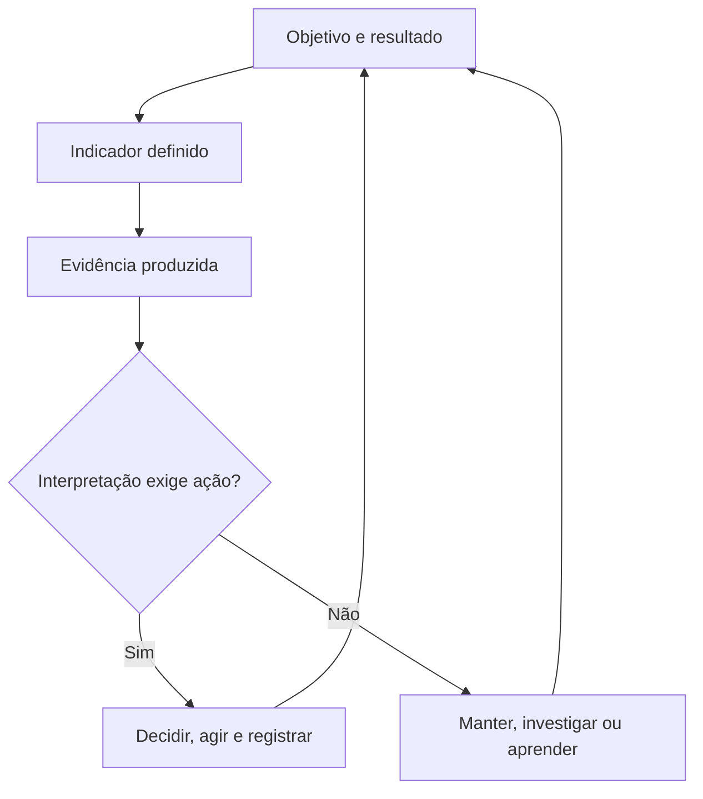

# Arquitetura de Indicadores — Ficha Operacional

**Sistema Operacional do Estúdio LICHTARA**  
**Módulo:** 3 — Arquitetura Organizacional  
**Ferramenta:** 07 — Arquitetura de Indicadores  
**Tipo:** Ficha metodológica, arquitetural e preenchível  
**Versão:** 0.1  
**Status:** Em desenvolvimento e validação pela prática  
**Data de criação:** 02/08/2026

**Documentos relacionados:**

- `README.md` deste diretório;
- `01-estado-atual-e-estado-futuro.md`;
- `02-arquitetura-de-processos-e-fluxos.md`;
- `03-papeis-responsabilidades-e-alcadas.md`;
- `04-arquitetura-de-informacao-e-conhecimento.md`;
- `05-arquitetura-da-comunicacao.md`;
- `06-arquitetura-documental.md`;
- `../README.md`;
- `../fundamentos-da-arquitetura.md`;
- `../protocolo-de-arquitetura.md`;
- `../matriz-de-rastreabilidade.md`;
- `../templates/plano-de-arquitetura.md`;
- `../templates/03-catalogo-de-requisitos.md`;
- `../templates/04-matriz-de-rastreabilidade.md`;
- `../templates/05-arquitetura-integrada.md`;
- `../templates/06-registro-de-validacao.md`;
- `../templates/08-transicao-para-implantacao.md`.

---

## 1. Finalidade

Esta ferramenta orienta o desenho de indicadores capazes de tornar resultados, funcionamento, riscos, qualidade e aprendizagem observáveis para decisões reais.

Ela ajuda o Estúdio LICHTARA a:

- começar pela decisão e pelo resultado, não pelo dado disponível;
- distinguir observação, medida, métrica, indicador, KPI, meta, limite e alerta;
- relacionar indicadores a capacidades, processos, decisões, riscos e controles;
- selecionar poucos indicadores primários, drivers e guardrails úteis;
- definir fórmulas, unidades, populações, granularidades, janelas e segmentos;
- estabelecer fontes, linhagem, qualidade e atualização;
- separar associação, atribuição e causalidade;
- tornar incerteza, ausência, revisão e limitações visíveis;
- definir linha de referência, metas e limites por método explícito;
- atribuir responsáveis pela definição, produção, interpretação e resposta;
- criar protocolos de revisão, alerta, investigação e ação;
- proteger privacidade, equidade e autonomia das pessoas medidas;
- evitar métricas de vaidade, metas manipuláveis e vigilância;
- delimitar apoio de tecnologia e inteligência artificial;
- preparar implantação, operação e aprendizagem contínua;
- produzir um bloco rastreável para a Arquitetura Integrada.

## 2. Pergunta central

> O que precisa ser observado, com que definição, fonte, frequência, referência, limite e responsabilidade, para que a organização consiga reconhecer estado, decidir, agir, proteger e aprender sem confundir números com a realidade inteira?

Perguntas derivadas:

- Que decisão ou ação o indicador precisa apoiar?
- Que resultado, capacidade, risco ou condição representa?
- Qual relação plausível existe entre a medida e o fenômeno?
- O indicador é primário, driver, diagnóstico ou guardrail?
- Como é calculado?
- Quem e o que estão incluídos ou excluídos?
- Qual período, granularidade e segmento são válidos?
- Que fonte e linhagem sustentam o valor?
- Que qualidade é suficiente ao uso?
- Qual linha de referência existe?
- Uma meta é necessária e por qual método será definida?
- Que limite aciona atenção, investigação ou resposta?
- Quem interpreta e quem possui autoridade para agir?
- Que dano pode surgir se o indicador for otimizado isoladamente?
- Como pessoas afetadas podem compreender ou contestar?
- Quando o indicador precisa ser alterado ou encerrado?

## 3. O que é

Arquitetura de Indicadores é uma ferramenta de desenho do sistema organizacional de observação, interpretação e resposta.

Ela organiza:

1. **objetivos, resultados e decisões**;
2. **indicadores primários, drivers, diagnósticos e guardrails**;
3. **definições, fórmulas, unidades e populações**;
4. **fontes, linhagem e qualidade**;
5. **tempo, frequência, segmentos e comparabilidade**;
6. **linhas de referência, metas, limites e alertas**;
7. **responsáveis, rituais e protocolos de resposta**;
8. **incerteza, vieses e limites de interpretação**;
9. **privacidade, equidade e proteção contra uso abusivo**;
10. **ciclo de vida, tecnologia e apoio de IA**.

Seu produto é um sistema enxuto de sinais confiáveis que modifica decisões e ações. Um número que não altera pergunta, prioridade, investigação ou resposta não se torna útil apenas por estar em um painel.

## 4. Distinções essenciais

### 4.1 Observação

Observação é o acontecimento, valor, estado ou percepção capturado sobre determinado objeto, sob condições identificáveis.

### 4.2 Mensuração

Mensuração é o processo de atribuir valor ou categoria a um fenômeno segundo regra, instrumento e unidade definidos.

### 4.3 Medida

Medida é o valor resultante de uma mensuração individual ou agregada, acompanhado de unidade e contexto.

### 4.4 Métrica

Métrica é uma definição calculável ou classificável utilizada para quantificar ou qualificar determinado aspecto do sistema.

### 4.5 Indicador

Indicador é uma métrica interpretada em relação a um objeto, finalidade, referência e decisão. Ele sinaliza condição sem representar a totalidade do fenômeno.

### 4.6 KPI

KPI é um indicador-chave de desempenho ou resultado, selecionado por sua relação material com objetivo e decisão prioritários. Ser popular ou fácil de medir não o torna chave.

### 4.7 Resultado

Resultado é a mudança ou condição relevante produzida ou influenciada pelo sistema. Pode exigir mais de um indicador e evidência qualitativa.

### 4.8 Driver

Driver é uma medida de fator que plausivelmente contribui para o resultado e pode ajudar a explicar ou antecipar seu movimento.

### 4.9 Guardrail

Guardrail é um indicador de proteção que torna visível dano, compensação ou efeito indesejado que não deve ser ocultado pela melhora do indicador primário.

### 4.10 Meta

Meta é um valor, faixa ou condição desejada para um indicador, associada a horizonte, fundamento, responsabilidade e nível de confiança.

### 4.11 Limite

Limite é um valor ou condição que separa estados e aciona interpretação, decisão, alerta ou restrição.

### 4.12 Linha de referência

Linha de referência é o estado inicial ou comparador contextualizado contra o qual mudança pode ser avaliada.

### 4.13 Benchmark

Benchmark é uma referência externa ou interna comparável. Sua utilidade depende de definição, contexto, período, população e qualidade compatíveis.

### 4.14 Sinal

Sinal é uma manifestação que merece atenção. Pode ser quantitativo, qualitativo, pontual ou composto e ainda exigir investigação.

### 4.15 Alerta

Alerta é uma comunicação acionada por regra quando sinal ou condição ultrapassa limite definido.

### 4.16 Painel

Painel é uma interface que organiza indicadores para observação e decisão. Ele não substitui contrato métrico, interpretação ou resposta.

### 4.17 Quadro comparativo

| Objeto | Pergunta | Exemplo | Não demonstra automaticamente |
| --- | --- | --- | --- |
| Observação | O que foi capturado? | Entrega concluída | Qualidade |
| Medida | Qual valor foi atribuído? | 12 dias | Bom ou ruim |
| Métrica | Como o aspecto é calculado? | Tempo mediano de entrega | Resultado para o cliente |
| Indicador | O que o valor sinaliza para decisão? | Entrega acima da janela | Causa do atraso |
| KPI | Que resultado prioritário acompanhamos? | Projetos entregues com valor reconhecido | Ausência de tradeoff |
| Driver | O que pode explicar ou antecipar? | Tempo até primeira validação | Causalidade isolada |
| Guardrail | Que dano precisa permanecer visível? | Retrabalho ou sobrecarga | Proteção completa |
| Meta | Que condição desejamos atingir? | Faixa até data definida | Viabilidade |
| Limite | Quando a resposta muda? | Acima de 10 dias investigar | Urgência por si só |

## 5. Arquitetura de observação e ação

Uma arquitetura completa conecta:

`objetivo → resultado → decisão → indicador → fonte → interpretação → resposta → aprendizagem`.



### 5.1 Indicador sem resposta

Se nenhum movimento plausível decorrer do indicador, investigue se ele é apenas descritivo, se a autoridade está ausente ou se sua manutenção pode ser eliminada.

## 6. Teoria de mudança e lógica de resultados

| Camada | Pergunta | Exemplo genérico |
| --- | --- | --- |
| Recurso | O que é disponibilizado? | Tempo e competência |
| Atividade | O que é realizado? | Diagnóstico |
| Saída | O que é produzido? | Arquitetura validada |
| Resultado inicial | O que muda primeiro? | Clareza de decisão |
| Resultado intermediário | Que comportamento ou condição muda? | Menos retrabalho |
| Impacto | Que valor duradouro se busca? | Continuidade e capacidade organizacional |

### 6.1 Hipóteses

| Relação | Hipótese | Evidência | Fator externo | Risco |
| --- | --- | --- | --- | --- |
| [Atividade → saída → resultado] | [Por que uma mudança levaria à outra] | [Fonte] | [Preencher] | [Preencher] |

## 7. Função no protocolo de arquitetura

| Etapa do protocolo | Contribuição da ferramenta |
| --- | --- |
| Delimitação | Identificar decisões, resultados e riscos a observar |
| Diagnóstico | Reconhecer indicadores atuais, lacunas, conflitos e usos |
| Requisitos | Traduzir necessidades de decisão em condições de medição |
| Desenho | Especificar métricas, fontes, limites, responsáveis e respostas |
| Integração | Relacionar indicadores a processos, informação, documentos e comunicação |
| Validação | Testar definição, cálculo, utilidade, proteção e ação |
| Aprovação | Constituir linha de base da arquitetura de indicadores |
| Transição | Informar instrumentação, treinamento, metas e cadências |

## 8. Saídas principais

A aplicação pode produzir:

- mapa atual de indicadores e decisões;
- árvore de resultados e drivers;
- catálogo de indicadores;
- contratos métricos;
- conjunto de KPIs primários, drivers e guardrails;
- dicionário de fórmulas;
- matriz indicador–decisão–resposta;
- mapa de fontes, linhagem e qualidade;
- regras de granularidade, segmentação e comparabilidade;
- linhas de referência;
- método de definição de metas;
- limites, faixas de estado e alertas;
- protocolos de investigação e resposta;
- desenho de painéis e rituais de revisão;
- regras de privacidade, equidade e contestação;
- requisitos técnicos e de IA;
- matriz atual–futuro;
- cenários de teste e validação;
- plano de transição;
- bloco consolidado para a Arquitetura Integrada.

### 8.1 Seleção proporcional

| Contexto | Saída mínima recomendada |
| --- | --- |
| Organização de uma pessoa | Objetivos, 1–3 KPIs, drivers essenciais, guardrails e revisão |
| Equipe pequena | Catálogo, contratos, fontes, responsáveis e respostas |
| Múltiplos processos | Árvore de indicadores, dimensões, painéis e governança |
| Alto risco ou regulação | Qualidade, limites, auditoria, equidade e especialista |
| IA ou automação | Desempenho, adoção, confiabilidade, custo e guardrails humanos |
| Arquitetura sistêmica | Portfólio, hierarquia, interoperabilidade, ciclo de vida e aprendizagem |

## 9. O que a ferramenta não é

Esta ferramenta não é:

- lista de tudo que pode ser contado;
- painel visual isolado;
- sistema de metas sem estratégia;
- substituta de decisão;
- prova automática de causalidade;
- forma de reduzir qualidade a quantidade;
- ranking de pessoas;
- autorização para vigilância;
- promessa de neutralidade matemática;
- projeto técnico de banco de dados;
- previsão infalível;
- plano de implantação do Módulo 4.

## 10. Fronteiras com outras dimensões

| Dimensão | Esta ferramenta define | Outra ferramenta aprofunda |
| --- | --- | --- |
| Estado atual e futuro | Evidência da transição e dos resultados | Capacidades e mudança na ferramenta 01 |
| Processos | Sinais de funcionamento, qualidade e desvio | Sequência e trabalho na ferramenta 02 |
| Papéis | Responsáveis por definição, leitura e resposta | Autoridade e alçada na ferramenta 03 |
| Informação | Dados, significado, fonte e qualidade necessários | Arquitetura semântica na ferramenta 04 |
| Comunicação | Alertas, públicos e devolução | Eventos, canais e confirmações na ferramenta 05 |
| Documentação | Registros, contratos métricos e memória | Ciclo documental na ferramenta 06 |
| Tecnologia | Requisitos de coleta, cálculo e visualização | Solução técnica na ferramenta 08 |
| IA | Métricas de função, desempenho e proteção | Papéis e controles de IA na ferramenta 09 |
| Implantação | Critérios de aceite e acompanhamento | Execução e PDCA no Módulo 4 |

## 11. Princípios

1. Todo indicador material apoia decisão, investigação ou proteção.
2. O objetivo e o resultado antecedem a métrica.
3. Definição precede cálculo e visualização.
4. Fonte, linhagem e qualidade permanecem visíveis.
5. Comparações exigem compatibilidade.
6. Ausência, atraso e revisão de dados são estados explícitos.
7. Meta é julgamento separado da escolha do indicador.
8. KPIs são poucos; diagnósticos podem ser acessados quando necessários.
9. Drivers explicam hipóteses, não causalidade automática.
10. Guardrails tornam compensações visíveis.
11. Indicador não substitui experiência, narrativa ou contexto.
12. Pessoas medidas possuem proteção e possibilidade de contestação.
13. Otimização isolada pode deformar comportamento.
14. A resposta possui responsável e autoridade.
15. IA apoia análise sem assumir decisão institucional.

## 12. Invariantes

Independentemente do porte, preserve:

- objeto e finalidade;
- decisão ou uso;
- definição semântica;
- fórmula ou regra de classificação;
- unidade, população e período;
- fonte e qualidade;
- responsável pela definição;
- responsável pela produção;
- responsável pela interpretação e resposta;
- limite de uso;
- regra de revisão;
- proteção de pessoas e dados;
- estado e versão do indicador.

## 13. Quando utilizar

Utilize quando:

- capacidade precisar de manifestação observável;
- decisão recorrente depender de sinal;
- resultado futuro precisar de critério de aceite;
- processo exigir acompanhamento de saúde ou desvio;
- risco ou controle precisar ser monitorado;
- meta precisar ser definida com fundamento;
- indicadores atuais divergirem;
- painel possuir métricas sem ação;
- qualidade ou confiança estiver invisível;
- operação precisar distinguir tendência de incidente;
- IA ou automação exigir avaliação e guardrails;
- implantação precisar observar adoção e efeito;
- aprendizagem depender de evidência comparável.

## 14. Quando não utilizar ou reduzir

Reduza quando:

- uma observação qualitativa focal for suficiente;
- o evento for raro e exigir estudo de caso;
- a decisão for única e não justificar medição recorrente;
- dados disponíveis forem inadequados ao risco;
- a capacidade ainda não estiver definida.

Não utilize para:

- medir o que não apoia decisão;
- criar meta sem referência ou autoridade;
- comparar populações incompatíveis;
- preencher painel por completude visual;
- avaliar pessoa com proxy frágil;
- automatizar coleta sem finalidade;
- converter incerteza em número preciso;
- substituir diagnóstico.

### 14.1 Registro da redução

| Campo | Preenchimento |
| --- | --- |
| Objeto avaliado | [Resultado, processo, risco ou capacidade] |
| Motivo da redução | [Baixa recorrência, dado insuficiente ou observação focal] |
| Evidência alternativa | [Caso, narrativa, auditoria ou teste] |
| Risco residual | [Preencher] |
| Responsável | PAP-ARQ-___ |
| Gatilho de aprofundamento | [Evento] |

## 15. Proporcionalidade

| Fator | Pergunta | Efeito possível |
| --- | --- | --- |
| Impacto | Que decisão ou direito depende do valor? | Controle e validação mais fortes |
| Frequência decisória | Com que cadência alguém age? | Atualização compatível |
| Volatilidade | Quanto o fenômeno oscila? | Janela e suavização |
| Maturidade de dados | A fonte é estável e governada? | Indicador provisório ou manual |
| Manipulabilidade | Pode ser melhorado sem resultado real? | Guardrail e auditoria |
| Sensibilidade | Mede pessoas ou dados protegidos? | Minimização e agregação |
| Reversibilidade | Decisão pode ser corrigida? | Confiança e revisão |
| Custo | Quanto custa produzir e manter? | Seleção enxuta |
| Incerteza | Que erro ou ambiguidade existe? | Faixa e ressalva |
| Distribuição | Quantos contextos são comparados? | Segmentação e normalização |

### 15.1 Níveis

| Nível | Aplicação | Representações |
| --- | --- | --- |
| Essencial | Poucos objetivos e decisões | KPIs, drivers, guardrails, fontes e respostas |
| Intermediário | Múltiplos processos | Essencial + contratos, dimensões, metas e painéis |
| Ampliado | Alto impacto ou IA | Intermediário + incerteza, equidade, auditoria e continuidade |
| Sistêmico | Organização ou ecossistema | Portfólio, hierarquia, governança, interoperabilidade e evolução |

## 16. Escalas e camadas

### 16.1 Escalas

| Escala | Foco |
| --- | --- |
| Evento | Ocorrência individual |
| Atividade | Execução ou qualidade local |
| Processo | Fluxo, capacidade e resultado |
| Projeto | Prazo, valor, risco e aprendizagem |
| Serviço | Experiência, entrega e continuidade |
| Organização | Sustentabilidade e capacidades |
| Ecossistema | Relações, efeitos e dependências externas |

### 16.2 Camadas

| Camada | Questão |
| --- | --- |
| Finalística | Que resultado e decisão importam? |
| Causal | Que drivers e hipóteses conectam ação e resultado? |
| Semântica | O que exatamente cada valor significa? |
| Matemática | Como é calculado ou classificado? |
| Informacional | De que dados, fontes e qualidade depende? |
| Operacional | Quem produz, revisa, interpreta e responde? |
| Governança | Que limites, direitos e revisões se aplicam? |
| Técnica | Como coleta, cálculo, alerta e visualização são sustentados? |

## 17. Participantes da aplicação

| Participante | Contribuição | Risco se ausente |
| --- | --- | --- |
| Autoridade da decisão | Uso e resposta | Métrica sem consequência |
| Responsável pelo resultado | Objetivo e alavancas | Indicador desconectado |
| Responsável pelo processo | Eventos e funcionamento | Cálculo impraticável |
| Usuário do indicador | Cadência e interpretação | Painel sem uso |
| Responsável semântico | Definição e comparabilidade | Significado instável |
| Responsável pelos dados | Fonte, linhagem e qualidade | Valor não confiável |
| Responsável técnico | Instrumentação e continuidade | Requisito inviável |
| Pessoa ou público medido | Efeito e contestação | Dano invisível |
| Especialista em risco, privacidade ou estatística | Limites e método | Inferência inadequada |
| Validador | Testes e evidência | Aprovação presumida |

### 17.1 Participantes reais

| Papel no desenho | Pessoa/papel | Participação | Disponibilidade | Acesso necessário | Conflito de interesse |
| --- | --- | --- | --- | --- | --- |
| [Preencher] | [Nome/PAP ID] | [Oficina, revisão, teste ou validação] | [Condição] | [Fontes] | [Sim/não/tratamento] |

## 18. Autoridade e limites

| Decisão | Autoridade | Consulta | Limite | Evidência |
| --- | --- | --- | --- | --- |
| Aprovar definição | PAP/INS-ARQ-___ | [Semântico/dados] | [Domínio] | [Contrato] |
| Designar KPI | PAP/INS-ARQ-___ | [Responsáveis] | [Objetivo] | DEC-ARQ-___ |
| Definir meta | PAP/INS-ARQ-___ | [Dados/planejamento] | ALC-ARQ-___ | MTA-ARQ-___ |
| Aceitar risco de qualidade | PAP/INS-ARQ-___ | [Especialista] | [Uso/período] | DEC-ARQ-___ |
| Alterar fórmula | PAP/INS-ARQ-___ | [Usuários] | [Regra] | [Versão] |
| Acessar dado sensível | PAP-ARQ-___ | [Responsável] | ACS-ARQ-___ | [Log] |
| Disparar resposta | PAP/TEC-ARQ-___ | [Autoridade] | LMT-ARQ-___ | [Registro] |
| Encerrar indicador | PAP/INS-ARQ-___ | [Usuários] | [Governança] | DEC-ARQ-___ |

### 18.1 Limites

A autoridade sobre indicadores não permite automaticamente:

- alterar processo ou meta fora da alçada;
- reinterpretar fórmula sem nova versão;
- comparar públicos incompatíveis;
- divulgar dados protegidos;
- inferir desempenho individual sem base adequada;
- ocultar dado desfavorável;
- transformar correlação em causalidade;
- usar IA para decidir sanção ou direito sem governança específica;
- aceitar baixa qualidade em nome de precisão aparente.

## 19. Entradas necessárias

| Entrada | Identificador/fonte | Qualidade mínima | Responsável | Lacuna |
| --- | --- | --- | --- | --- |
| Escopo e problema | [Plano/termo] | Aprovado | [Papel] | [Preencher] |
| Capacidades e estado futuro | CAP/EAF-ARQ-___ | Critério observável | [Papel] | [Preencher] |
| Processos e eventos | PRC/EVT-ARQ-___ | Estados e saídas | [Papel] | [Preencher] |
| Decisões e alçadas | DEC/PAP/ALC-ARQ-___ | Objeto e autoridade | [Papel] | [Preencher] |
| Riscos e controles | RSC/CTL-ARQ-___ | Consequência e resposta | [Papel] | [Preencher] |
| Informação e dados | INF/DAD/FON/QID-ARQ-___ | Definição, origem e qualidade | [Papel] | [Preencher] |
| Comunicações e alertas | COM/ALR-ARQ-___ | Públicos e tempo | [Papel] | [Preencher] |
| Documentos e registros | DOC/RGT-ARQ-___ | Estado e integridade | [Papel] | [Preencher] |
| Indicadores atuais | [Inventário/painéis] | Definição e uso | [Papel] | [Preencher] |
| Restrições de privacidade | [Fonte] | Aplicabilidade validada | [Papel] | [Preencher] |

## 20. Qualidade das evidências

| Evidência | Força | Limite | Uso |
| --- | --- | --- | --- |
| Definição aprovada | Alta para significado | Pode não refletir cálculo real | Referência semântica |
| Consulta à fonte | Alta para valor atual | Depende de qualidade | Validar cálculo |
| Painel existente | Média | Pode ocultar regra | Inventariar uso |
| Código ou fórmula | Alta para transformação | Não prova adequação | Reproduzir resultado |
| Entrevista com usuário | Alta para decisão | Memória e preferência | Testar utilidade |
| Registro de decisão | Alta para consequência | Pode estar incompleto | Relacionar resposta |
| Série histórica | Alta para variação | Mudanças podem quebrar comparação | Linha de referência |
| Benchmark externo | Variável | Contexto e definição diferem | Formular faixa |
| Opinião isolada | Exploratória | Não generalizável | Gerar candidato |

### 20.1 Fonte obrigatória ausente

Se a decisão exigir fonte específica de verdade e ela não estiver disponível, interrompa a recomendação firme para esse indicador. Registre a fonte necessária, o risco e a alternativa revisada. Substituto frágil não deve ser apresentado como equivalente.

## 21. Preparação

| Ação | Resultado | Responsável | Estado |
| --- | --- | --- | --- |
| Confirmar objetivos e decisões | Mapa inicial | [Papel] | [ ] |
| Identificar usuários e cadência | Contexto operacional | [Papel] | [ ] |
| Reunir indicadores atuais | Inventário | [Papel] | [ ] |
| Mapear fontes possíveis | Catálogo | [Papel] | [ ] |
| Definir acesso legítimo | Regra | [Papel] | [ ] |
| Levantar riscos e efeitos | Proteções | [Papel] | [ ] |
| Preparar candidatos amplos | Lista | [Papel] | [ ] |
| Definir critérios de seleção | Matriz | [Papel] | [ ] |
| Definir validações | Plano | [Papel] | [ ] |

### 21.1 Prontidão

| Critério | Sim | Evidência/ação |
| --- | --- | --- |
| Decisão está explicitada | [ ] | [Preencher] |
| Resultado possui definição | [ ] | [Preencher] |
| Usuário real pode participar | [ ] | [Preencher] |
| Fonte ou lacuna é conhecida | [ ] | [Preencher] |
| Privacidade foi avaliada | [ ] | [Preencher] |
| Autoridade de resposta existe | [ ] | [Preencher] |
| Critérios de seleção estão definidos | [ ] | [Preencher] |
| Validação possui responsáveis | [ ] | [Preencher] |

## 22. Plano da aplicação

| Campo | Preenchimento |
| --- | --- |
| ID do plano | PLN-ARQ-___ |
| Escopo | [Objetivos, decisões, processos ou organização] |
| Finalidade | [Preencher] |
| Decisões prioritárias | [DEC IDs] |
| Participantes | [Papéis/pessoas] |
| Métodos | [Oficina, análise, protótipo, teste ou piloto] |
| Fontes | [FON IDs/lacunas] |
| Entregas | [Catálogo, contratos, árvore, painel ou protocolo] |
| Validações | [Critérios/papéis] |
| Restrições | [Dados, tempo, tecnologia, privacidade ou competência] |
| Prazo | [Data/condição] |
| Responsável | PAP-ARQ-___ |

### 22.1 Atividades

| Atividade | Entrada | Participantes | Saída | Critério | Data |
| --- | --- | --- | --- | --- | --- |
| ATV-ARQ-___ | [Fonte] | [Papéis] | [Artefato] | [Critério] | [Data] |

## 23. Identificação, versão e validade da arquitetura

**Identificador do artefato:** `ARI-ARQ-AAAA-NNN`

| Campo | Preenchimento |
| --- | --- |
| ID | ARI-ARQ-____-___ |
| Título | [Preencher] |
| Escopo | [Preencher] |
| Estado | [Rascunho, em validação, aprovado, vigente, em revisão ou encerrado] |
| Versão | [Número] |
| Vigência | [Data/condição] |
| Responsável | PAP-ARQ-___ |
| Aprovador | PAP/INS-ARQ-___ |
| Sensibilidade | [Classe] |
| Arquitetura substituída | [ID/N/A] |
| Próxima revisão | [Data/gatilho] |

### 23.1 Estados

| Estado | Condição de entrada | Condição de saída |
| --- | --- | --- |
| Rascunho | Aplicação iniciada | Revisão mínima concluída |
| Em validação | Contratos e fontes definidos | Critérios atendidos ou devolução |
| Aprovado | Autoridade decidiu | Data ou condição de vigência |
| Vigente | Indicadores em uso | Revisão ou substituição |
| Em revisão | Gatilho ocorreu | Nova versão ou manutenção |
| Encerrado | Função cessou | Arquivamento e comunicação |

## 24. Referência atual

| Campo | Preenchimento |
| --- | --- |
| Data de referência | [DD/MM/AAAA] |
| Período observado | [Preencher] |
| Decisões incluídas | [IDs] |
| Processos incluídos | [IDs] |
| Painéis/fontes incluídos | [Descrição] |
| Públicos medidos | [Descrição] |
| Exclusões | [Descrição/motivo] |
| Limitações | [Preencher] |

### 24.1 Definido e praticado

Registre a definição oficial e o cálculo realmente utilizado. Divergência entre planilha, painel, reunião e relatório é achado arquitetural.

## 25. Inventário atual de indicadores

| Indicador/métrica | Finalidade percebida | Fórmula | Fonte | Frequência | Usuário | Decisão | Resposta | Evidência |
| --- | --- | --- | --- | --- | --- | --- | --- | --- |
| [Nome] | [Preencher] | [Definida/desconhecida] | [Fonte] | [Cadência] | [Papéis] | [ID/ausente] | [Ação/ausente] | [Fonte] |

### 25.1 Inventário de painéis e relatórios

| Artefato | Público | Indicadores | Uso real | Cadência | Responsável | Redundância | Destino futuro |
| --- | --- | --- | --- | --- | --- | --- | --- |
| [Painel, planilha, relatório ou reunião] | [Papéis] | [Lista] | [Decidir, informar, justificar ou não usado] | [Preencher] | [Papel] | [Com o quê] | [Preservar, consolidar, revisar ou encerrar] |

## 26. Problemas atuais de medição

| ID | Tipo | Indicador/decisão | Consequência | Frequência | Evidência | Condição futura |
| --- | --- | --- | --- | --- | --- | --- |
| LAC-ARQ-___ | [Ausência, divergência, atraso, ruído, manipulação, excesso, opacidade ou exposição] | [ID] | [Preencher] | [Faixa] | [Fonte] | [Preencher] |

### 26.1 Sintomas e causas possíveis

| Sintoma | Causa a investigar |
| --- | --- |
| Números diferentes para a mesma pergunta | Definição, fonte, janela ou filtro |
| Meta sempre atingida | Baixa ambição, manipulação ou indicador frágil |
| Painel nunca muda decisão | Usuário, cadência ou autoridade |
| Tudo aparece verde | Limites inadequados ou ocultação |
| Métrica oscila sem explicação | Volume, sazonalidade ou qualidade |
| Pessoas evitam registrar | Incentivo, medo ou carga |
| A melhora reduz qualidade | Guardrail ausente |
| Indicador chega tarde | Fonte, processamento ou janela |

## 27. Métricas paralelas e planilhas sombra

| Objeto paralelo | Criador | Por que existe | Definição | Valor | Risco | Relação com fonte | Destino |
| --- | --- | --- | --- | --- | --- | --- | --- |
| [Planilha, consulta, cálculo ou relatório] | [Pessoa/papel] | [Agilidade, acesso ou divergência] | [Preencher] | [Preencher] | [Erro, dependência ou exposição] | [Oficial, derivada ou conflitante] | [Integrar, governar, preservar ou encerrar] |

### 27.1 Cálculo sombra como evidência

Antes de eliminá-lo, compreenda a pergunta que a arquitetura oficial não respondia. O valor pode estar na necessidade, mesmo quando o cálculo é frágil.

## 28. Trabalho analítico invisível

| Trabalho | Quem realiza | Frequência | Carga | Valor | Risco | Tratamento futuro |
| --- | --- | --- | --- | --- | --- | --- |
| [Extrair, limpar, reconciliar, interpretar, explicar, alertar ou contestar] | [Pessoa/papel] | [Faixa] | [Tempo] | [Preencher] | [Preencher] | [Reconhecer, distribuir, apoiar, automatizar parte ou eliminar] |

## 29. Dívida métrica

Dívida métrica é o custo acumulado de definições implícitas, fontes frágeis, metas sem fundamento, painéis redundantes, cálculos manuais e decisões que dependem de pessoas capazes de “explicar o número”.

| Dívida | Origem | Custo atual | Risco | Primeira correção |
| --- | --- | --- | --- | --- |
| [Preencher] | [Hábito, urgência, sistema ou decisão] | [Tempo, erro ou confiança] | [Preencher] | [Ação] |

### 29.1 Precisão aparente

Casas decimais, gráficos refinados e automação não compensam definição ambígua ou fonte inadequada.

## 30. Questões que retornam ao diagnóstico

Retorne ao Módulo 2 quando a aplicação revelar:

- objetivo não compartilhado;
- resultado sem definição;
- meta usada para ocultar conflito;
- incentivo que produz manipulação;
- pessoas punidas por indicador fora de seu controle;
- ausência de segurança para registrar falha;
- diferença entre desempenho aparente e valor percebido;
- problema de qualidade ainda não explicado;
- uso de dados sem legitimidade;
- causalidade presumida sem evidência.

| Achado | Motivo do retorno | Evidência | Pergunta diagnóstica | Responsável |
| --- | --- | --- | --- | --- |
| [Preencher] | [Preencher] | [Fonte] | [Pergunta] | PAP-ARQ-___ |

## 31. Princípio de desenho futuro

O estado futuro deve conter o menor sistema de indicadores capaz de orientar decisão, proteção e aprendizagem.

| Condição atual | Princípio futuro |
| --- | --- |
| Medir o disponível | Medir o necessário à decisão |
| Muitos KPIs | Poucos indicadores-chave |
| Meta antes da definição | Indicador antes da meta |
| Número sem contexto | Contrato e narrativa |
| Média que oculta públicos | Segmentação relevante |
| Alerta sem resposta | Limite com protocolo |
| Driver tratado como causa | Hipótese e investigação |
| Otimização isolada | Guardrails explícitos |
| IA explica sem fonte | Análise rastreável e validada |

## 32. Domínios de indicadores

| ID | Domínio | Objetivo | Decisões | Indicadores | Responsável | Fronteira |
| --- | --- | --- | --- | --- | --- | --- |
| DMI-ARQ-001 | [Operação, cliente, financeiro, pessoas, aprendizagem, risco, IA ou outro] | [Preencher] | [DEC IDs] | [IND IDs] | PAP-ARQ-___ | [Incluído/excluído] |

### 32.1 Relações entre domínios

| Domínio origem | Relação | Domínio destino | Hipótese | Indicadores | Risco de conflito |
| --- | --- | --- | --- | --- | --- |
| DMI-ARQ-___ | [Contribui, restringe, compensa ou depende] | DMI-ARQ-___ | [Preencher] | [IND IDs] | [Preencher] |

## 33. Decisão antes do indicador

| Decisão | Autoridade | Pergunta | Frequência | Alternativas | Informação necessária | Ação possível |
| --- | --- | --- | --- | --- | --- | --- |
| DEC-ARQ-___ | PAP/INS-ARQ-___ | [Preencher] | [Cadência/evento] | [Opções reais] | [Preencher] | [Manter, ajustar, investigar, interromper ou escalar] |

### 33.1 Teste de utilidade

Pergunte:

- se o valor mudar, que decisão muda;
- quem possui autoridade para agir;
- quando a ação ainda é útil;
- que contexto impede interpretação simplista;
- que alternativa existe quando o valor é inconclusivo;
- que dano surge se o indicador for ignorado;
- que dano surge se for otimizado isoladamente.

## 34. Registro de decisão métrica

| Decisão | Resultado | Indicadores candidatos | Critérios | Seleção | Motivo | Guardrails | Revisão |
| --- | --- | --- | --- | --- | --- | --- | --- |
| DEC-ARQ-___ | [ID/descrição] | [IND/MTR IDs] | [Relevância, ação, sinal, influência, mensurabilidade e resistência à manipulação] | [IDs] | [Síntese] | [GRD IDs] | [Gatilho] |

## 35. Resultados e indicadores de resultado

| ID | Resultado | Público/objeto | Horizonte | Condição observável | Indicador candidato | Limite |
| --- | --- | --- | --- | --- | --- | --- |
| RSL-ARQ-001 | [Mudança ou estado] | [PUB/PRC/CAP IDs] | [Curto, médio ou longo] | [Preencher] | IND-ARQ-___ | [O que não captura] |

### 35.1 Saída não é resultado

Produzir documento, reunião, treinamento ou funcionalidade demonstra atividade ou entrega. Resultado exige observar mudança relevante no sistema ou para o público.

## 36. Drivers

| ID | Resultado/KPI | Driver | Hipótese | Alavanca | Frequência | Limite de interpretação |
| --- | --- | --- | --- | --- | --- | --- |
| DRV-ARQ-001 | KPI/IND-ARQ-___ | [Fator] | [Por que influencia] | [Ação da equipe] | [Cadência] | [Preencher] |

### 36.1 Driver controlável

Prefira drivers que a equipe possa influenciar e que ofereçam sinal na cadência de decisão. Mantenha explícito que influência plausível não prova causalidade.

## 37. Guardrails

| ID | Indicador primário | Risco protegido | Métrica | Limite | Resposta | Responsável |
| --- | --- | --- | --- | --- | --- | --- |
| GRD-ARQ-001 | KPI/IND-ARQ-___ | [Qualidade, confiança, custo, equidade, retenção ou segurança] | IND-ARQ-___ | LMT-ARQ-___ | [Ação] | PAP-ARQ-___ |

### 37.1 Guardrail acionável

Guardrail precisa possuir limite e consequência. Exibi-lo sem capacidade de restringir a otimização produz proteção apenas simbólica.

## 38. Geração ampla de candidatos

| Candidato | Tipo | Resultado/decisão | Relação plausível | Fonte possível | Cadência | Risco |
| --- | --- | --- | --- | --- | --- | --- |
| MTR/IND-ARQ-___ | [Resultado, driver, diagnóstico ou guardrail] | [IDs] | [Preencher] | [FON IDs/lacuna] | [Preencher] | [Manipulação, ruído ou dano] |

### 38.1 Diversidade de candidatos

Considere:

- resultado percebido pelo público;
- qualidade;
- tempo;
- volume;
- capacidade;
- custo;
- confiabilidade;
- risco;
- equidade;
- aprendizagem;
- sustentabilidade;
- efeitos não intencionais.

## 39. Comparação e seleção de indicadores

| Critério | Pergunta | Peso | Nota | Evidência |
| --- | --- | --- | --- | --- |
| Representa objetivo | Reflete o resultado desejado? | [Peso] | [1–5] | [Preencher] |
| Informa decisão | Movimento altera ação? | [Peso] | [1–5] | [Preencher] |
| Sinal na cadência | Muda em tempo útil? | [Peso] | [1–5] | [Preencher] |
| Influenciável | Há alavancas plausíveis? | [Peso] | [1–5] | [Preencher] |
| Mensurável | Pode ser produzido consistentemente? | [Peso] | [1–5] | [Preencher] |
| Resiste a manipulação | É difícil melhorar ocultando dano? | [Peso] | [1–5] | [Preencher] |
| Compreensível | Usuários interpretam corretamente? | [Peso] | [1–5] | [Preencher] |
| Proporcional | Valor supera custo e risco? | [Peso] | [1–5] | [Preencher] |

### 39.1 Seleção enxuta

Como orientação inicial, selecione:

- **1 a 3 KPIs primários** por iniciativa ou decisão relevante;
- **1 a 2 drivers por KPI**, quando melhorarem ação ou diagnóstico;
- **1 a 2 guardrails**, quando houver compensações materiais.

Amplie somente quando um indicador adicional mudar decisão, diagnóstico ou proteção.

## 40. Matriz de seleção

| Candidato | Resultado | Decisão | Pontuação | Papel selecionado | Motivo | Lacuna antes de uso |
| --- | --- | --- | --- | --- | --- | --- |
| MTR/IND-ARQ-___ | RSL-ARQ-___ | DEC-ARQ-___ | [Valor] | [KPI, driver, diagnóstico, guardrail ou rejeitado] | [Preencher] | [Fonte, teste ou definição] |

## 41. Catálogo de indicadores

| ID | Nome | Tipo | Objeto | Decisão | Fórmula/regra | Fonte | Frequência | Responsável | Estado |
| --- | --- | --- | --- | --- | --- | --- | --- | --- | --- |
| IND-ARQ-001 | [Nome] | [KPI, driver, diagnóstico, guardrail ou contexto] | [CAP/PRC/RSL/RSC ID] | DEC-ARQ-___ | FML-ARQ-___ | FON-ARQ-___ | [Cadência] | PAP-ARQ-___ | [Estado] |

### 41.1 KPI como classificação

| Indicador | É KPI para | Horizonte | Motivo | Deixa de ser KPI quando |
| --- | --- | --- | --- | --- |
| IND-ARQ-___ | [Objetivo/iniciativa] | [Período] | [Preencher] | [Decisão, objetivo ou contexto mudar] |

## 42. Ficha mestra do indicador

| Campo | Preenchimento |
| --- | --- |
| ID | IND-ARQ-___ |
| Nome | [Preencher] |
| Tipo | [KPI, driver, diagnóstico, guardrail ou contexto] |
| Domínio | DMI-ARQ-___ |
| Objeto/resultado | [CAP/PRC/RSL/RSC ID] |
| Finalidade | [Preencher] |
| Decisão | DEC-ARQ-___ |
| Usuários | [PAP/INS IDs] |
| Definição | [Declaração operacional] |
| Fórmula/regra | FML-ARQ-___ |
| Unidade | [Preencher] |
| Polaridade | [Maior melhor, menor melhor, faixa ou contextual] |
| Universo | [População] |
| Inclusões/exclusões | [Regras] |
| Granularidade | [Evento, pessoa, projeto, período ou outro] |
| Dimensões | [SGM IDs] |
| Janela | [Período/regra] |
| Frequência | [Cadência] |
| Fonte | FON-ARQ-___ |
| Dados | [DAD IDs] |
| Linhagem | [Transformações] |
| Qualidade | [QID IDs/estado] |
| Linha de referência | BSL-ARQ-___/N/A |
| Meta | MTA-ARQ-___/N/A |
| Limites | [LMT IDs] |
| Guardrails | [GRD IDs] |
| Responsável semântico | PAP-ARQ-___ |
| Responsável pelos dados | PAP/TEC-ARQ-___ |
| Responsável pela resposta | PAP-ARQ-___ |
| Restrições | [Privacidade, comparação ou uso] |
| Versão/vigência | [Número/condição] |
| Revisão | [Gatilho] |

## 43. Contrato métrico

Contrato métrico é o acordo governado que fixa significado, cálculo, fonte, uso, responsáveis e limites de um indicador.

| Campo | Preenchimento |
| --- | --- |
| Indicador | IND-ARQ-___ |
| Versão | [Número] |
| Pergunta respondida | [Preencher] |
| Perguntas não respondidas | [Preencher] |
| Fórmula executável | [Expressão/regra] |
| Fonte controladora | FON-ARQ-___ |
| Tempo do evento | [Campo/regra] |
| Tempo do processamento | [Campo/regra] |
| Inclusões e exclusões | [Regras] |
| Tratamento de ausência | [Regra] |
| Tratamento de duplicidade | [Regra] |
| Segmentos válidos | [SGM IDs] |
| Atualização e revisão | [Cadência] |
| Testes | [TST IDs] |
| Proprietário semântico | PAP-ARQ-___ |
| Consumidores | [Papéis/sistemas] |
| Limites de uso | [Preencher] |
| Aprovação | [Papel/decisão] |

### 43.1 Contrato antes do painel

Painéis, relatórios e alertas devem consumir o mesmo contrato ou declarar diferença. A aparência não pode criar definição paralela.

## 44. Definição semântica

| Indicador/termo | Definição | Inclui | Exclui | Exemplo | Contraexemplo | Responsável | Vigência |
| --- | --- | --- | --- | --- | --- | --- | --- |
| IND/GLO-ARQ-___ | [Declaração] | [Preencher] | [Preencher] | [Preencher] | [Preencher] | PAP-ARQ-___ | [Data/versão] |

### 44.1 Definição operacional

Uma definição é operacional quando pessoas distintas conseguem classificar o mesmo caso de forma consistente ou explicar por que o caso permanece ambíguo.

## 45. Unidade de medida

| Indicador | Unidade | Escala | Precisão necessária | Conversão | Exibição | Risco |
| --- | --- | --- | --- | --- | --- | --- |
| IND-ARQ-___ | [Número, moeda, tempo, proporção, índice, categoria ou outro] | [Nominal, ordinal, intervalar ou razão] | [Regra] | [Se aplicável] | [Formato] | [Preencher] |

### 45.1 Precisão proporcional

Não exiba precisão maior que a sustentada pela fonte, pela amostra e pela decisão. Arredondamento precisa preservar interpretação material.

## 46. Granularidade

| Indicador | Grão | Chave | Evento | Pode agregar? | Pode desagregar? | Restrição |
| --- | --- | --- | --- | --- | --- | --- |
| IND-ARQ-___ | [Evento, atividade, projeto, cliente, pessoa, equipe ou período] | [ID] | EVT-ARQ-___ | [Sim/regra] | [Sim/regra] | [Privacidade/comparabilidade] |

### 46.1 Grão misturado

Valores com granularidades diferentes não devem ser combinados sem regra explícita. Uma linha por projeto e uma linha por entrega representam universos distintos.

## 47. Universo e população

| Indicador | População-alvo | População observada | Unidade de análise | Cobertura | Lacuna | Uso permitido |
| --- | --- | --- | --- | --- | --- | --- |
| IND-ARQ-___ | [Definição] | [Definição] | [Objeto] | [Percentual/condição] | [Preencher] | [Preencher] |

### 47.1 Denominador invisível

Contagens isoladas podem crescer porque a população cresceu. Sempre que a interpretação depender de proporção, torne o universo e sua mudança visíveis.

## 48. Dimensões e segmentos

| ID | Dimensão | Valores | Finalidade | Fonte | Privacidade | Comparabilidade |
| --- | --- | --- | --- | --- | --- | --- |
| SGM-ARQ-001 | [Canal, serviço, fase, tipo, região, público ou outro] | [Taxonomia/faixa] | [Diagnóstico/decisão] | [DAD/FON IDs] | [Regra] | [Condição] |

### 48.1 Segmentação material

Segmente quando a média puder ocultar diferença relevante de experiência, risco, acesso, qualidade ou efeito. Evite segmentação que não muda interpretação ou que aumenta exposição sem necessidade.

## 49. Inclusões e exclusões

| Indicador | Regra de inclusão | Regra de exclusão | Estado limítrofe | Justificativa | Impacto estimado |
| --- | --- | --- | --- | --- | --- |
| IND-ARQ-___ | [Critério] | [Critério] | [Tratamento] | [Preencher] | [Faixa] |

### 49.1 Exclusão silenciosa

Casos excluídos podem conter as falhas mais importantes. Monitore volume e perfil das exclusões quando forem materiais.

## 50. Fórmula e regra de cálculo

| ID | Indicador | Expressão | Campos | Transformações | Arredondamento | Validação |
| --- | --- | --- | --- | --- | --- | --- |
| FML-ARQ-001 | IND-ARQ-___ | [Expressão matemática ou regra] | [DAD IDs] | [Filtros, junções, classificação e agregação] | [Regra] | [Teste] |

### 50.1 Fórmula legível

Mantenha uma forma compreensível para usuários e uma forma executável para tecnologia. Ambas precisam representar o mesmo contrato.

## 51. Numerador e denominador

| Indicador | Numerador | Denominador | Unidade comum | Ausência/zero | Validação |
| --- | --- | --- | --- | --- | --- |
| IND-ARQ-___ | [Definição] | [Definição] | [Regra] | [Nulo, zero, não aplicável ou erro] | [Teste] |

### 51.1 Zero, nulo e não aplicável

Zero representa valor medido; nulo representa ausência; não aplicável representa exclusão legítima; erro representa falha. Misturá-los distorce o indicador.

## 52. Agregações

| Indicador | Agregação | Adequação | Peso implícito | Sensibilidade a extremos | Alternativa |
| --- | --- | --- | --- | --- | --- |
| IND-ARQ-___ | [Soma, média, mediana, percentil, proporção, máximo ou outro] | [Motivo] | [Preencher] | [Alta/média/baixa] | [Preencher] |

### 52.1 Média não é padrão universal

Utilize mediana, percentis, faixas ou distribuição quando a média ocultar assimetria, extremos ou experiência de subgrupos.

## 53. Pesos

| Componente | Peso | Fundamento | Sensibilidade | Autoridade | Revisão |
| --- | --- | --- | --- | --- | --- |
| [Métrica/componente] | [Valor] | [Dados, julgamento ou obrigação] | [Efeito de variar o peso] | PAP/INS-ARQ-___ | [Gatilho] |

### 53.1 Peso é decisão

Ponderação incorpora valores e prioridades. Ela deve ser justificável, testada e aprovada, não escondida em fórmula técnica.

## 54. Indicadores compostos e índices

| ID | Índice | Componentes | Normalização | Pesos | Interpretação | Limite |
| --- | --- | --- | --- | --- | --- | --- |
| IDX-ARQ-001 | [Nome] | [IND/MTR IDs] | [Método] | [Regra] | [O que o índice representa] | [O que pode ocultar] |

### 54.1 Condições mínimas

- componentes possuem relação com o construto;
- escalas são compatíveis ou normalizadas;
- pesos são explícitos;
- ausência possui tratamento;
- sensibilidade é testada;
- resultado pode ser decomposto;
- público entende limite;
- índice não substitui componentes críticos.

## 55. Normalização

| Objeto | Método | Referência | Faixa | Motivo | Risco | Reversibilidade |
| --- | --- | --- | --- | --- | --- | --- |
| [Indicador/componente] | [Min–máx, padronização, por unidade ou outro] | [População/período] | [Escala] | [Comparabilidade] | [Instabilidade/distorção] | [Pode recuperar valor original?] |

### 55.1 Referência variável

Se a população ou a janela usada para normalizar mudar, valores históricos podem mudar de significado. Preserve a referência e a versão.

## 56. Janela temporal

| Indicador | Tipo de janela | Início/fim | Regra de fechamento | Atraso permitido | Comparador |
| --- | --- | --- | --- | --- | --- |
| IND-ARQ-___ | [Calendário, móvel, acumulada, coorte ou evento] | [Regra] | [Condição] | [Tempo] | [Período anterior, meta ou baseline] |

### 56.1 Janela coerente com decisão

Uma janela anual pode representar o resultado e ainda ser lenta para revisão semanal. Nesse caso, associe drivers mais próximos sem confundi-los com o resultado final.

## 57. Frequência de produção e revisão

| Indicador | Coleta | Processamento | Disponibilização | Revisão decisória | Responsável | Custo |
| --- | --- | --- | --- | --- | --- | --- |
| IND-ARQ-___ | [Contínua/periódica] | [Cadência] | [Cadência] | [Cadência/evento] | PAP/TEC-ARQ-___ | [Faixa] |

### 57.1 Frequência excessiva

Atualização em tempo real pode aumentar ruído, custo e reação impulsiva. Use a menor frequência capaz de sustentar decisão e proteção.

## 58. Indicador corrente, acumulado e instantâneo

| Forma | Pergunta | Uso | Risco |
| --- | --- | --- | --- |
| Instantâneo | Qual é o estado agora? | Incidente e capacidade | Volatilidade |
| Período fechado | O que ocorreu no intervalo? | Revisão comparável | Atraso |
| Acumulado | Como evolui no ciclo? | Acompanhamento de meta | Esconder mudança recente |
| Média móvel | Qual tendência reduz ruído? | Operação | Suavizar evento crítico |

## 59. Tempo do evento e do processamento

| Indicador | Campo de evento | Campo de registro | Campo de processamento | Regra de atraso | Uso histórico |
| --- | --- | --- | --- | --- | --- |
| IND-ARQ-___ | [Data/hora real] | [Data/hora de captura] | [Data/hora técnica] | [Janela] | [Reprocessar ou preservar publicação] |

### 59.1 Dados tardios

Defina se valores tardios alteram períodos fechados, criam revisão ou entram somente no próximo ciclo. Comunique mudanças materiais.

## 60. Coortes

| ID | Coorte | Evento de entrada | Período | População | Comparador | Limite |
| --- | --- | --- | --- | --- | --- | --- |
| COO-ARQ-___ | [Clientes, projetos, pessoas ou casos iniciados sob condição comum] | EVT-ARQ-___ | [Janela] | [Definição] | [Outra coorte] | [Preencher] |

### 60.1 Coorte e período

Métrica por coorte acompanha grupos desde um evento comum. Métrica por período agrega o que aconteceu no intervalo. Ambas respondem perguntas diferentes.

## 61. Linha de referência

| ID | Indicador | Período/população | Valor/faixa | Qualidade | Contexto | Validade |
| --- | --- | --- | --- | --- | --- | --- |
| BSL-ARQ-001 | IND-ARQ-___ | [Preencher] | [Valor/faixa] | [Estado] | [Eventos e restrições] | [Condição] |

### 61.1 Baseline provisório

Quando histórico confiável não existir, estabeleça período inicial de medição antes de fixar meta. Identifique a linha como provisória e evite tratá-la como padrão natural.

## 62. Metas

| ID | Indicador | Valor/faixa | Horizonte | Fundamento | Responsável | Confiança | Guardrails | Revisão |
| --- | --- | --- | --- | --- | --- | --- | --- | --- |
| MTA-ARQ-001 | IND-ARQ-___ | [Preencher] | [Data/período] | [Histórico, benchmark, necessidade ou plano] | PAP/INS-ARQ-___ | [Alta/média/baixa] | [GRD IDs] | [Gatilho] |

### 62.1 Meta depois do indicador

Primeiro defina o que deve ser medido. Depois determine que condição desejada é significativa, plausível e influenciável no horizonte.

## 63. Métodos de definição de metas

| Método | Base | Adequado quando | Limite |
| --- | --- | --- | --- |
| Histórico | Desempenho anterior | Série comparável existe | Pode reproduzir passado |
| Benchmark | Referência comparável | Contextos são compatíveis | Diferenças externas |
| Necessidade | Condição mínima do objetivo | Existe requisito claro | Pode ser difícil |
| Capacidade bottom-up | Alavancas e plano | Trabalho planejado é conhecido | Pode ser conservador |
| Aspiração top-down | Ambição estratégica | Direção precisa mobilizar | Pode ser irreal |
| Experimento | Resultado de piloto | Incerteza é elevada | Escala limitada |
| Faixa provisória | Evidência incompleta | Decisão ainda precisa de orientação | Exige revisão |

### 63.1 Reconciliação

Compare ambição com capacidade, histórico, adoção esperada, recursos, horizonte e guardrails. Registre premissas e confiança.

## 64. Limites e gatilhos

| ID | Indicador | Condição | Significado | Ação | Autoridade | Prazo | Escalonamento |
| --- | --- | --- | --- | --- | --- | --- | --- |
| LMT-ARQ-001 | IND-ARQ-___ | [Acima, abaixo, dentro, fora ou mudança] | [Estado] | [Investigar, agir, restringir ou comunicar] | PAP/INS-ARQ-___ | [Tempo] | ESC-ARQ-___/N/A |

### 64.1 Limite baseado em risco

Limite deve refletir consequência, variabilidade, qualidade e tempo de resposta. Um valor redondo ou herdado não é fundamento suficiente.

## 65. Faixas de estado

| Faixa | Condição | Interpretação permitida | Ação | Cor/forma | Cuidado |
| --- | --- | --- | --- | --- | --- |
| [Estável, atenção, crítico, insuficiente ou desconhecido] | [Regra] | [Preencher] | [Preencher] | [Representação acessível] | [Evitar simplificação] |

### 65.1 Estado desconhecido

Ausência ou baixa qualidade precisa de representação própria. Não pinte dado desconhecido como verde, zero ou estável.

## 66. Polaridade e direção desejada

| Indicador | Polaridade | Faixa saudável | Excesso também é risco? | Interpretação |
| --- | --- | --- | --- | --- |
| IND-ARQ-___ | [Maior melhor, menor melhor, faixa, alvo ou contextual] | [Regra] | [Sim/não/condição] | [Preencher] |

### 66.1 Mais nem sempre é melhor

Volume, velocidade, utilização, automação e participação podem piorar resultado depois de certo ponto. Modele faixa quando necessário.

## 67. Incerteza e margem de erro

| Indicador | Fonte de incerteza | Quantificação possível | Representação | Efeito na decisão | Responsável |
| --- | --- | --- | --- | --- | --- |
| IND-ARQ-___ | [Amostra, classificação, atraso, erro, modelo ou definição] | [Faixa/intervalo/N/A] | [Forma] | [Agir, aguardar, investigar ou restringir] | PAP-ARQ-___ |

### 67.1 Incerteza honesta

Valor aproximado com limite explícito é mais útil que precisão falsa. Diferencie estimativa, previsão, valor observado e valor revisado.

## 68. Intervalos, variabilidade e distribuição

| Indicador | Estatística central | Dispersão | Intervalo | Caudas/extremos | Uso |
| --- | --- | --- | --- | --- | --- |
| IND-ARQ-___ | [Média/mediana/outro] | [Desvio, amplitude, percentis] | [Confiança/faixa] | [Regra] | [Decisão] |

### 68.1 Distribuição antes do resumo

Quando impacto varia entre pessoas, projetos ou casos, observe distribuição e extremos antes de consolidar em uma média.

## 69. Evidência qualitativa

| ID | Fenômeno | Método | Amostra/público | Regra de análise | Evidência | Uso | Limite |
| --- | --- | --- | --- | --- | --- | --- | --- |
| QLT-ARQ-001 | [Experiência, qualidade, confiança, aprendizagem ou outro] | [Entrevista, observação, relato, revisão ou caso] | [Definição] | [Codificação/síntese] | [DOC/RGT IDs] | [Decisão] | [Preencher] |

### 69.1 Qualitativo não é ausência de rigor

Defina pergunta, seleção, coleta, interpretação, autoria, divergência e limites. Evidência qualitativa pode explicar mecanismo que a métrica apenas sinaliza.

## 70. Proxies

| Indicador proxy | Fenômeno pretendido | Relação plausível | Evidência | Onde engana | Guardrail | Revisão |
| --- | --- | --- | --- | --- | --- | --- |
| IND-ARQ-___ | [Resultado difícil de medir] | [Hipótese] | [Fonte] | [Condição] | GRD-ARQ-___ | [Gatilho] |

### 70.1 Proxy não é o fenômeno

Uso, clique, conclusão, presença, volume ou velocidade podem representar parte do valor e ainda divergir de qualidade, compreensão, confiança ou resultado.

## 71. Indicadores antecedentes e consequentes

| Tipo | Função | Exemplo | Risco |
| --- | --- | --- | --- |
| Antecedente | Sinaliza condição antes do resultado | Tempo até validação | Pode não se converter em resultado |
| Consequente | Confirma resultado depois | Retenção ou efeito sustentado | Chega tarde para ajuste |
| Coincidente | Mostra estado atual | Capacidade disponível | Pode ser volátil |

### 71.1 Pareamento

Quando o resultado amadurece lentamente, combine indicador consequente com drivers antecedentes sem rebatizar o driver como resultado.

## 72. Relação entre resultado, drivers e guardrails

| KPI/resultado | Driver 1 | Driver 2 | Guardrail 1 | Guardrail 2 | Hipóteses | Decisão |
| --- | --- | --- | --- | --- | --- | --- |
| KPI/IND-ARQ-___ | DRV-ARQ-___ | DRV-ARQ-___/N/A | GRD-ARQ-___ | GRD-ARQ-___/N/A | [Preencher] | DEC-ARQ-___ |

### 72.1 Árvore enxuta

Inclua apenas relações que ajudam alguém a decidir ou investigar. Árvore extensa pode dar aparência causal sem evidência.

## 73. Atribuição e causalidade

| Afirmação | Nível de evidência | Fatores alternativos | Método | Linguagem permitida |
| --- | --- | --- | --- | --- |
| [A ação influenciou o indicador] | [Descritivo, associativo, quase-experimental, experimental ou outro] | [Lista] | [Preencher] | [Coincidiu, associa-se, contribuiu ou causou] |

### 73.1 Associação não é causa

Movimento conjunto pode decorrer de seleção, sazonalidade, mudança de população, evento externo ou dado. A linguagem deve corresponder à força da evidência.

## 74. Fatores externos e contexto

| Fator | Indicadores afetados | Mecanismo possível | Evidência | Tratamento | Comunicação |
| --- | --- | --- | --- | --- | --- |
| [Mercado, calendário, política, fornecedor, evento ou mudança] | [IND IDs] | [Preencher] | [Fonte] | [Segmentar, anotar, ajustar ou não alterar] | COM-ARQ-___ |

### 74.1 Ajuste não deve apagar realidade

Valor ajustado pode apoiar comparação; valor observado preserva experiência real. Mantenha ambos quando cumprirem funções diferentes.

## 75. Sazonalidade e comparabilidade temporal

| Indicador | Padrão sazonal | Período comparável | Ajuste | Série mínima | Limite |
| --- | --- | --- | --- | --- | --- |
| IND-ARQ-___ | [Preencher] | [Mesmo mês, ciclo, dia ou fase] | [Método/N/A] | [Condição] | [Preencher] |

### 75.1 Mudança estrutural

Quando processo, produto, população, fórmula ou fonte mudarem, a série pode sofrer ruptura. Não interprete como tendência contínua sem reconciliação.

## 76. Fontes de dados

| Indicador | Fonte candidata | Proprietário | Atualidade | Grão | Cobertura | Autoridade | Decisão |
| --- | --- | --- | --- | --- | --- | --- | --- |
| IND-ARQ-___ | FON-ARQ-___ | PAP-ARQ-___ | [Cadência] | [Preencher] | [Faixa] | [Oficial, derivada ou auxiliar] | [Selecionar, combinar ou rejeitar] |

### 76.1 Fontes sobrepostas

Compare propriedade, atualidade, definição, grão, cobertura e proximidade do evento. Use fonte controladora ou combine fontes complementares com regra explícita.

## 77. Linhagem

| Indicador | Origem | Dados | Transformações | Junções | Agregações | Saída | Responsável |
| --- | --- | --- | --- | --- | --- | --- | --- |
| IND-ARQ-___ | [FON IDs] | [DAD IDs] | [TRF IDs] | [Chaves/regras] | [FML IDs] | [Painel/alerta/documento] | PAP/TEC-ARQ-___ |

### 77.1 Linhagem mínima

Permita reconstruir:

- evento de origem;
- momento de captura;
- campos utilizados;
- filtros;
- exclusões;
- junções;
- classificações;
- agregações;
- revisões;
- versão publicada.

## 78. Qualidade dos dados e do indicador

| Dimensão | Pergunta | Regra | Limite | Ação |
| --- | --- | --- | --- | --- |
| Validade | Valores atendem regra? | [QID ID] | [Faixa] | [Corrigir/rejeitar] |
| Completude | Campos necessários existem? | [QID ID] | [Faixa] | [Sinalizar/recolher] |
| Exatidão | Representam o ocorrido? | [QID ID] | [Faixa] | [Verificar] |
| Consistência | Fontes e períodos concordam? | [QID ID] | [Faixa] | [Reconciliar] |
| Atualidade | Chegam em tempo útil? | [QID ID] | [Tempo] | [Atrasar/restringir] |
| Unicidade | Duplicidade está controlada? | [QID ID] | [Faixa] | [Deduplicar] |
| Cobertura | População relevante está representada? | [QID ID] | [Faixa] | [Limitar uso] |
| Integridade | Relações permanecem corretas? | [QID ID] | [Faixa] | [Corrigir] |

### 78.1 Qualidade proporcional ao uso

Indicador exploratório pode tolerar incerteza declarada. Decisão irreversível ou que afeta direitos exige evidência e controle mais fortes.

## 79. Dados ausentes

| Indicador/campo | Tipo de ausência | Causa | Frequência | Viés possível | Tratamento | Exibição |
| --- | --- | --- | --- | --- | --- | --- |
| IND/DAD-ARQ-___ | [Não coletado, não aplicável, recusado, perdido, atrasado ou erro] | [Preencher] | [Faixa] | [Preencher] | [Excluir, imputar, recuperar ou manter ausente] | [Forma] |

### 79.1 Imputação

Valor imputado deve ser distinguível, justificado e testado. Não transforme ausência sistemática de determinados públicos em média aparentemente neutra.

## 80. Duplicidade e identidade

| Objeto | Chave | Regra de duplicidade | Exceção legítima | Tratamento | Impacto histórico |
| --- | --- | --- | --- | --- | --- |
| [Evento, pessoa, projeto, transação ou documento] | [Campos] | [Critério] | [Preencher] | [Unificar, preservar ou rejeitar] | [Reprocessar/manter] |

## 81. Dados tardios, revisões e retroatividade

| Indicador | Janela de atraso | Política de revisão | Versão | Comunicar mudança | Reprocessar histórico | Responsável |
| --- | --- | --- | --- | --- | --- | --- |
| IND-ARQ-___ | [Tempo] | [Regra] | [Número/data] | [Condição/públicos] | [Sim/não/período] | PAP/TEC-ARQ-___ |

### 81.1 Publicado e revisado

Preserve valor originalmente publicado quando ele sustentou decisão material e registre a revisão com motivo e efeito.

## 82. Coleta manual

| Indicador/dado | Coletor | Instrumento | Frequência | Validação | Carga | Substituição/continuidade |
| --- | --- | --- | --- | --- | --- | --- |
| IND/DAD-ARQ-___ | PAP-ARQ-___ | FRM/DOC-ARQ-___ | [Cadência] | [Critério] | [Tempo] | [Forma] |

### 82.1 Manual não significa inferior

Coleta manual pode ser proporcional em baixo volume, piloto ou fenômeno qualitativo. Torne carga, treinamento, viés e continuidade visíveis.

## 83. Amostragem

| Indicador | População | Método | Tamanho | Frequência | Estratos | Erro/limite | Responsável |
| --- | --- | --- | --- | --- | --- | --- | --- |
| IND-ARQ-___ | [Definição] | [Aleatória, estratificada, sistemática, intencional ou outra] | [Valor] | [Cadência] | [SGM IDs] | [Preencher] | PAP-ARQ-___ |

### 83.1 Amostra útil

Declare o que a amostra pode representar. Amostra de conveniência pode gerar hipótese e ainda ser inadequada para generalização.

## 84. Classificação e codificação

| Categoria | Definição | Critério | Exemplo | Contraexemplo | Codificador | Concordância | Revisão |
| --- | --- | --- | --- | --- | --- | --- | --- |
| [Código] | [Preencher] | [Regra] | [Caso] | [Caso] | [Humano/IA/ambos] | [Método] | [Gatilho] |

### 84.1 Julgamento codificado

Quando classificação depende de interpretação, registre instrução, treinamento, amostra, divergência e mecanismo de contestação.

## 85. Privacidade e minimização

| Indicador/dado | Pessoas afetadas | Finalidade | Necessidade | Base/condição | Agregação | Acesso | Retenção |
| --- | --- | --- | --- | --- | --- | --- | --- |
| IND/DAD-ARQ-___ | [PUB IDs] | [Decisão] | [Justificativa] | [Referência] | [Nível] | ACS-ARQ-___ | RTN-ARQ-___ |

### 85.1 Proteções

- colete o mínimo necessário;
- prefira agregação quando suficiente;
- restrinja dimensões sensíveis;
- evite reidentificação por combinação;
- limite exportação;
- defina retenção;
- trate direitos aplicáveis;
- não reutilize para finalidade incompatível.

## 86. Equidade e representatividade

| Indicador | Público/segmento | Cobertura | Diferença observada | Explicações possíveis | Decisão | Proteção |
| --- | --- | --- | --- | --- | --- | --- |
| IND-ARQ-___ | PUB/SGM-ARQ-___ | [Faixa] | [Valor/estado] | [Dados, processo, acesso, viés ou contexto] | [Investigar, ajustar ou não concluir] | [Preencher] |

### 86.1 Diferença não explica causa

Desagregação torna disparidade visível. A resposta exige contexto, participação de pessoas afetadas e cuidado para não reforçar estigma.

## 87. Proteção contra vigilância

| Uso proposto | Dado | Benefício | Pessoas afetadas | Risco | Alternativa menos invasiva | Decisão |
| --- | --- | --- | --- | --- | --- | --- |
| [Monitorar presença, atividade, comunicação, produtividade ou outro] | [DAD IDs] | [Preencher] | [PUB IDs] | [Controle, pressão, reidentificação ou discriminação] | [Preencher] | [Permitir, restringir ou rejeitar] |

### 87.1 Observabilidade sem controle total

Meça funcionamento e resultado no nível necessário. Evite converter rastros técnicos em avaliação contínua de pessoas sem finalidade, legitimidade e proteção.

## 88. Indicadores individuais

| Indicador | Finalidade | Pessoa pode influenciar? | Fatores externos | Decisão sobre a pessoa | Contestação | Uso permitido |
| --- | --- | --- | --- | --- | --- | --- |
| IND-ARQ-___ | [Desenvolvimento, capacidade, segurança ou outro] | [Sim/parcial/não] | [Lista] | [Preencher] | [Canal/processo] | [Limites] |

### 88.1 Alto risco de redução

Evite usar volume, tempo online, mensagens, horas ou tarefas isoladas como substitutos de contribuição, qualidade, aprendizagem ou responsabilidade.

## 89. Papéis e propriedade do indicador

| Função | Papel | Responsabilidade | Autoridade | Substituto |
| --- | --- | --- | --- | --- |
| Proprietário semântico | PAP-ARQ-___ | Definição e uso | Aprovar proposta de mudança | SUB-ARQ-___ |
| Responsável pelos dados | PAP-ARQ-___ | Fonte e qualidade | Corrigir/escalar | SUB-ARQ-___ |
| Mantenedor técnico | PAP/TEC-ARQ-___ | Cálculo e disponibilidade | Operar dentro da regra | SUB-ARQ-___ |
| Usuário decisor | PAP/INS-ARQ-___ | Interpretar e decidir | ALC-ARQ-___ | SUB-ARQ-___ |
| Responsável pela resposta | PAP-ARQ-___ | Executar ação | [Alçada] | SUB-ARQ-___ |
| Validador/auditor | PAP/INS-ARQ-___ | Verificar critério | [Independência] | [Preencher] |

## 90. Matriz indicador–responsabilidade–resposta

| Indicador | Observador | Intérprete | Decisor | Executor da resposta | Comunicador | Registro | Escalonamento |
| --- | --- | --- | --- | --- | --- | --- | --- |
| IND-ARQ-___ | PAP/TEC-ARQ-___ | PAP-ARQ-___ | PAP/INS-ARQ-___ | PAP-ARQ-___ | PAP-ARQ-___ | DOC/RGT-ARQ-___ | ESC-ARQ-___ |

## 91. Protocolos de resposta

| Indicador/condição | Interpretação inicial | Verificação | Ação | Autoridade | Prazo | Evidência de encerramento |
| --- | --- | --- | --- | --- | --- | --- |
| IND/LMT-ARQ-___ | [Estado] | [Qualidade, segmento, contexto ou fonte] | [Manter, investigar, corrigir, restringir ou escalar] | PAP/INS-ARQ-___ | [Tempo] | [RGT/DOC ID] |

### 91.1 Resposta em camadas

| Camada | Pergunta | Movimento |
| --- | --- | --- |
| Verificar | O valor é confiável? | Checar fonte e qualidade |
| Contextualizar | Que evento ou segmento mudou? | Analisar decomposição |
| Diagnosticar | Que drivers e causas possíveis existem? | Investigar |
| Decidir | Que alternativa é autorizada? | Escolher ação |
| Agir | Quem executa e até quando? | Implementar |
| Aprender | O efeito confirmou a hipótese? | Atualizar arquitetura |

## 92. Alertas

| ID | Indicador | Gatilho | Severidade | Público | Canal | Confirmação | Resposta | Encerramento |
| --- | --- | --- | --- | --- | --- | --- | --- | --- |
| ALR-ARQ-___ | IND/LMT-ARQ-___ | [Condição] | [Baixa, média, alta ou crítica] | [PUB/PAP IDs] | CAN-ARQ-___ | CNF-ARQ-___ | [Protocolo] | [Critério] |

### 92.1 Fadiga de alerta

| Sinal | Causa possível | Correção |
| --- | --- | --- |
| Muitos alertas ignorados | Limite sensível demais | Recalibrar |
| Alerta sem ação | Responsabilidade ausente | Definir resposta |
| Mesmo evento repetido | Deduplicação ausente | Agrupar/suprimir |
| Crítico indistinguível | Severidade mal desenhada | Priorizar |
| Alerta tardio | Fonte ou janela lenta | Redesenhar sinal |

## 93. Anomalias e investigação

| Sinal | Método de detecção | Referência | Sensibilidade | Primeira verificação | Responsável | Resultado |
| --- | --- | --- | --- | --- | --- | --- |
| [Mudança, extremo, ruptura ou padrão incomum] | [Regra, estatística, IA ou percepção] | [Baseline/faixa] | [Configuração] | [Qualidade/contexto] | PAP-ARQ-___ | [Evento real, dado, esperado ou inconclusivo] |

### 93.1 Anomalia não é erro

Valor incomum pode representar mudança real, caso legítimo, problema de dado ou regra inadequada. Investigue antes de corrigir ou agir.

## 94. Painéis

| ID | Painel | Público | Decisões | Indicadores | Frequência | Interações | Responsável |
| --- | --- | --- | --- | --- | --- | --- | --- |
| PNL-ARQ-001 | [Nome] | [PAP/INS/PUB IDs] | [DEC IDs] | [IND IDs] | [Cadência] | [Filtros, detalhes ou alertas] | PAP-ARQ-___ |

### 94.1 Hierarquia visual

Organize:

- resultado primário;
- drivers que explicam;
- guardrails que protegem;
- contexto e qualidade;
- ação ou decisão pendente;
- acesso a detalhe quando necessário.

### 94.2 Painel não é repositório de métricas

Não exiba indicador apenas porque existe. Cada elemento consome atenção e precisa justificar sua presença para aquele público.

## 95. Rituais de revisão

| Ritual | Decisão | Participantes | Indicadores | Preparação | Cadência | Saída | Registro |
| --- | --- | --- | --- | --- | --- | --- | --- |
| RIT-ARQ-___ | [DEC IDs] | [PAP/INS IDs] | [IND IDs] | [Contexto e qualidade] | [Preencher] | [Ação, hipótese ou decisão] | DOC/RGT-ARQ-___ |

### 95.1 Perguntas do ritual

- o que mudou materialmente;
- o valor é confiável;
- que segmento explica a mudança;
- que hipótese foi confirmada ou enfraquecida;
- que guardrail se moveu;
- que decisão precisa ser tomada;
- quem agirá;
- quando o efeito será revisto;
- o que não sabemos.

## 96. Narrativa e contexto da medição

| Período | Indicador | Movimento | Contexto | Hipótese | Limite | Decisão | Autor |
| --- | --- | --- | --- | --- | --- | --- | --- |
| [Janela] | IND-ARQ-___ | [Valor/tendência] | [Eventos e segmentos] | [Preencher] | [Incerteza] | DEC-ARQ-___/N/A | PAP-ARQ-___ |

### 96.1 Número e narrativa

Narrativa útil explica contexto e raciocínio sem reescrever dado desfavorável. Preserve distinção entre observação, interpretação, hipótese e decisão.

## 97. Memória de decisões apoiadas por indicadores

| Decisão | Indicadores/versões | Valores | Contexto | Alternativas | Motivo | Efeito esperado | Revisão |
| --- | --- | --- | --- | --- | --- | --- | --- |
| DEC-ARQ-___ | [IND IDs/versões] | [Referência] | [Preencher] | [Lista] | [Síntese] | [Indicadores/horizonte] | [Data/gatilho] |

### 97.1 Decisão contra o indicador

Autoridade pode decidir de forma diferente do sinal quando contexto justificar. Registre motivo, risco aceito e condição de revisão, sem alterar o indicador para legitimar a decisão.

## 98. Controle de mudanças do indicador

| Solicitação | Indicador | Proponente | Mudança | Impacto histórico | Usuários afetados | Autoridade | Decisão |
| --- | --- | --- | --- | --- | --- | --- | --- |
| [ID] | IND/FML/MTA/LMT-ARQ-___ | [Papel] | [Definição, fórmula, fonte, janela, meta ou limite] | [Preencher] | [PAP/INS IDs] | PAP/INS-ARQ-___ | DEC-ARQ-___ |

### 98.1 Mudança material

Exige nova versão e comunicação quando alterar:

- significado;
- população;
- fórmula;
- fonte;
- granularidade;
- janela;
- segmentação;
- tratamento de ausência;
- meta ou limite;
- uso decisório;
- privacidade;
- comparabilidade histórica.

## 99. Ciclo de vida do indicador

| Estado | Condição | Uso permitido | Próximo movimento |
| --- | --- | --- | --- |
| Candidato | Relação plausível | Análise e teste | Selecionar/rejeitar |
| Em definição | Contrato em construção | Protótipo | Validar |
| Em validação | Fonte e cálculo testados | Uso controlado | Aprovar/devolver |
| Vigente | Aprovado e operacional | Decisão definida | Revisar/substituir |
| Restrito | Qualidade ou contexto limitados | Uso específico | Corrigir/encerrar |
| Substituído | Nova versão vigente | Histórico | Arquivar |
| Encerrado | Sem decisão ou objeto | Nenhum uso corrente | Preservar memória/desativar |

### 99.1 Gatilhos de revisão

- mudança de objetivo;
- mudança de decisão;
- alteração de processo;
- nova fonte;
- queda de qualidade;
- manipulação;
- dano ou viés;
- meta atingida sem resultado;
- painel sem uso;
- custo excessivo;
- ruptura histórica;
- nova obrigação.

## 100. Encerramento e desativação

| Indicador | Motivo | Dependências | Painéis/alertas | Histórico | Comunicação | Data | Responsável |
| --- | --- | --- | --- | --- | --- | --- | --- |
| IND-ARQ-___ | [Objetivo cessou, substituição, baixa utilidade, dano ou inviabilidade] | [IDs] | [Remover/substituir] | [Preservar/regra] | COM-ARQ-___ | [Condição] | PAP-ARQ-___ |

### 100.1 Métrica zumbi

Indicador sem decisão ou usuário pode continuar sendo calculado por hábito. O encerramento reduz custo e ambiguidade e precisa ser parte normal da governança.

## 101. Continuidade, recomputação e recuperação

| Indicador | Dependência crítica | Plano de continuidade | Dados históricos | Recomposição | Tempo de recuperação | Teste |
| --- | --- | --- | --- | --- | --- | --- |
| IND-ARQ-___ | [Fonte, pessoa, código ou sistema] | [Alternativa] | [Retenção/local] | [Regra] | [Tempo] | TST-ARQ-___ |

### 101.1 Reprodutibilidade

Preserve contrato, versões de lógica, dados necessários, parâmetros e ambiente suficiente para reproduzir valores materiais ou explicar por que a reprodução não é possível.

## 102. Migração de indicadores

| Indicador | Origem | Destino | Mudança | Paralelo | Reconciliação | Corte | Responsável |
| --- | --- | --- | --- | --- | --- | --- | --- |
| IND-ARQ-___ | [Fonte/sistema] | [Fonte/sistema] | [Dados, fórmula ou processamento] | [Período] | [Critério] | [Data/condição] | PAP/TEC-ARQ-___ |

### 102.1 Comparação paralela

Durante migração, calcule versões antiga e nova em período suficiente para identificar divergências, explicar causas e decidir continuidade histórica.

## 103. Indicadores operacionais

| Objeto | Resultado | KPI possível | Drivers | Guardrails | Decisão |
| --- | --- | --- | --- | --- | --- |
| Fluxo | Entrega previsível | [IND ID] | Tempo em etapa, bloqueios | Qualidade, sobrecarga | Priorizar/corrigir |
| Capacidade | Trabalho sustentável | [IND ID] | Disponibilidade, fila | Excesso, concentração | Alocar/restringir |
| Qualidade | Saída adequada | [IND ID] | Validação inicial | Retrabalho, reclamação | Ajustar processo |
| Continuidade | Função recuperável | [IND ID] | Testes e substituição | Tempo de falha | Proteger/escalar |

### 103.1 Volume sem valor

Quantidade de tarefas, mensagens ou horas pode descrever carga e ainda não representar entrega, qualidade ou resultado.

## 104. Indicadores financeiros e comerciais

| Resultado | KPI possível | Drivers | Guardrails | Decisão | Limite |
| --- | --- | --- | --- | --- | --- |
| Receita sustentável | [Receita recorrente/realizada] | Propostas, conversão, ticket | Margem, capacidade, concentração | Priorizar oferta | Reconhecimento e período |
| Liquidez | [Disponibilidade de caixa] | Recebimentos e prazos | Obrigações e reserva | Ajustar fluxo | Não equivale a lucro |
| Rentabilidade | [Margem por oferta/projeto] | Preço, custo, escopo | Qualidade e relação | Rever oferta | Alocação de custos |
| Previsibilidade | [Cobertura futura] | Pipeline e renovação | Dependência de cliente | Planejar capacidade | Probabilidade não é receita |

### 104.1 Fundamento contábil e financeiro

Definições de receita, custo, margem, competência, caixa e obrigações precisam seguir critérios adequados e validação competente quando produzirem efeito contábil, fiscal ou contratual.

## 105. Indicadores de clientes, serviço e qualidade

| Resultado | KPI possível | Drivers | Guardrails | Evidência qualitativa | Decisão |
| --- | --- | --- | --- | --- | --- |
| Valor reconhecido | [Resultado/aceite] | Clareza, validações, tempo | Promessa, retrabalho | Entrevista/caso | Ajustar oferta |
| Continuidade da relação | [Retenção/recompra contextual] | Experiência e resultado | Dependência/desconto | Motivos de saída | Investir/encerrar |
| Qualidade de entrega | [Critério atendido] | Revisões e capacidade | Prazo/custo humano | Parecer/feedback | Corrigir processo |
| Confiança | [Proxy validado] | Transparência e resposta | Exposição/manipulação | Narrativa do cliente | Rever relação |

### 105.1 Satisfação isolada

Uma nota pode refletir momento, expectativa, relação ou viés de resposta. Combine com contexto e comportamento quando a decisão exigir.

## 106. Indicadores de projetos

| Dimensão | Indicador | Referência | Guardrail | Decisão |
| --- | --- | --- | --- | --- |
| Escopo | Entregas e mudanças aprovadas | Baseline/versão | Valor e qualidade | Replanejar |
| Tempo | Marcos e previsão | Cronograma | Pressa e sobrecarga | Priorizar |
| Custo | Consumo e projeção | Orçamento | Qualidade | Ajustar recursos |
| Risco | Exposição e resposta | Registro | Falso conforto | Escalar |
| Valor | Resultado reconhecido | Critério de aceite | Efeito não intencional | Continuar/encerrar |
| Aprendizagem | Hipóteses testadas | Plano | Carga documental | Incorporar |

## 107. Indicadores de pessoas, carga e capacidade

| Objeto | Indicador seguro | Unidade | Uso | Guardrail | Proibição |
| --- | --- | --- | --- | --- | --- |
| Capacidade do sistema | Demanda versus disponibilidade | Equipe/processo | Planejar | Saúde e qualidade | Ranking individual |
| Concentração | Funções sem substituição | Papel/capacidade | Continuidade | Privacidade | Expor vulnerabilidade pessoal |
| Carga | Volume e complexidade estimada | Período/equipe | Redistribuir | Autonomia e relato | Equiparar tempo online a trabalho |
| Desenvolvimento | Competência demonstrada | Capacidade | Preparar papel | Oportunidade equitativa | Pontuar identidade |

### 107.1 Medir sistema antes de pessoa

Quando resultado depende de processo, ferramenta, prioridade, equipe e contexto, medir somente indivíduo desloca responsabilidade e produz incentivos inadequados.

## 108. Indicadores de conhecimento e aprendizagem

| Resultado | Indicador possível | Evidência | Driver | Guardrail | Decisão |
| --- | --- | --- | --- | --- | --- |
| Conhecimento aplicável | Casos resolvidos com critério | Prática/validação | Mentoria e acesso | Formalização excessiva | Desenvolver |
| Aprendizagem incorporada | Mudanças sustentadas após evidência | Decisão/processo | Retrospectivas úteis | Volume de lições | Atualizar arquitetura |
| Continuidade | Dependências críticas protegidas | Testes/substituição | Transferência por prática | Exposição pessoal | Preparar sucessão |
| Qualidade de base | Conteúdo vigente e usado | Busca/feedback | Curadoria | Quantidade de artigos | Revisar acervo |

## 109. Indicadores de implantação e mudança

| Fase | Resultado | KPI possível | Drivers | Guardrails | Decisão |
| --- | --- | --- | --- | --- | --- |
| Preparação | Condições prontas | Critérios atendidos | Treinamento, acesso, comunicação | Aprovação superficial | Iniciar/adiar |
| Adoção | Uso competente | Comportamento validado | Suporte e prática | Uso forçado | Ajustar |
| Estabilização | Operação sustentável | Resultado em faixa | Incidentes resolvidos | Sobrecarga | Consolidar |
| Efeito | Resultado futuro aparece | KPI de resultado | Drivers operacionais | Danos e custo | Escalar/rever |

### 109.1 Acesso não é adoção

Conta criada, treinamento concluído ou sistema acessado são sinais iniciais. Adoção exige uso competente no fluxo e resultado compatível.

## 110. Indicadores de sistemas de IA

| Dimensão | Pergunta | Indicador possível | Segmento | Guardrail |
| --- | --- | --- | --- | --- |
| Utilidade | A função melhora a decisão ou o trabalho? | Resultado assistido | Tarefa/público | Qualidade e autonomia |
| Adoção | Pessoas utilizam quando apropriado? | Uso competente | Papel/caso | Dependência |
| Qualidade | Saídas atendem critério? | Taxa por classe de erro | Função/risco | Falso positivo/negativo |
| Confiabilidade | Serviço permanece disponível e consistente? | Falha/latência | Componente | Continuidade |
| Custo | Valor justifica recurso? | Custo por resultado | Função | Qualidade |
| Segurança | Limites são respeitados? | Incidentes/exposição | Classe de dado | Interrupção |
| Governança | Supervisão acontece? | Amostras e decisões revisadas | Papel | Responsabilidade humana |

## 111. Qualidade de modelos, dados e saídas de IA

| Função | Métrica | Fonte | Referência | Segmentos críticos | Limite | Resposta |
| --- | --- | --- | --- | --- | --- | --- |
| [Classificar, extrair, gerar, recomendar ou prever] | [Precisão, cobertura, erro, concordância ou qualidade humana] | [Conjunto/teste] | [Baseline] | [Casos/públicos] | [Regra] | [Corrigir, restringir ou interromper] |

### 111.1 Métrica técnica e valor organizacional

Desempenho técnico elevado não demonstra uso correto, confiança, economia, justiça ou melhoria de decisão. Conecte a métrica ao fluxo e ao resultado.

## 112. Guardrails de IA

| Risco | Guardrail | Limite | Monitoramento | Autoridade | Resposta |
| --- | --- | --- | --- | --- | --- |
| Alucinação/erro | Verificação por classe | [Regra] | [Amostra] | PAP-ARQ-___ | [Corrigir/restringir] |
| Viés/disparidade | Resultado por segmento | [Regra] | [Cadência] | PAP/INS-ARQ-___ | [Investigar/interromper] |
| Exposição | Incidente de acesso | [Zero/faixa] | [Contínuo] | PAP/INS-ARQ-___ | [Conter] |
| Dependência | Competência humana preservada | [Critério] | [Teste] | PAP-ARQ-___ | [Treinar/reduzir] |
| Custo | Custo por resultado | [Faixa] | [Cadência] | PAP-ARQ-___ | [Otimizar/encerrar] |
| Automação indevida | Decisão humana confirmada | [Critério] | [Auditoria] | PAP/INS-ARQ-___ | [Bloquear] |

## 113. Apoio de IA à arquitetura de indicadores

| Atividade | IA pode apoiar | Condição | Responsável humano | Limite |
| --- | --- | --- | --- | --- |
| Descoberta | Sugerir candidatos | Objetivo e decisão fornecidos | PAP-ARQ-___ | Não selecionar sozinha |
| Definição | Comparar conceitos | Fontes autorizadas | PAP-ARQ-___ | Não criar verdade sem validação |
| Código | Gerar consulta/fórmula | Contrato definido e teste | PAP/TEC-ARQ-___ | Não publicar sem revisão |
| Qualidade | Sinalizar anomalia | Dados e referência válidos | PAP-ARQ-___ | Anomalia não é erro |
| Análise | Decompor movimento | Fontes citadas | PAP-ARQ-___ | Não afirmar causa indevida |
| Previsão | Estimar cenários | Método e incerteza explícitos | PAP/INS-ARQ-___ | Não decidir automaticamente |
| Narrativa | Redigir síntese | Evidência vinculada | PAP-ARQ-___ | Não ocultar ressalva |

### 113.1 Registro de uso

| Uso de IA | Sistema/modelo | Entradas | Saída | Verificação | Correção humana | Decisão |
| --- | --- | --- | --- | --- | --- | --- |
| [Descobrir, calcular, analisar, prever ou narrar] | [Identificação] | [IDs] | [Artefato] | [Método] | [Síntese] | [Incorporar, corrigir, rejeitar ou manter hipótese] |

## 114. Limites humano–IA

| Atividade | IA pode realizar | Humano precisa realizar | Motivo | Controle |
| --- | --- | --- | --- | --- |
| Definir objetivo | Organizar contexto | Escolher valor e prioridade | Responsabilidade | Decisão humana |
| Selecionar KPI | Pontuar candidatos | Julgar utilidade e risco | Estratégia | Aprovação |
| Definir meta | Simular cenários | Assumir ambição e compromisso | Alçada | Registro |
| Interpretar movimento | Comparar dados | Situar contexto e consequência | Julgamento | Revisão |
| Agir | Sugerir alternativas | Decidir e responder | Autoridade | Limites |
| Avaliar pessoa | Apoiar agregação | Proteger direitos e contestação | Alto impacto | Supervisão reforçada |

### 114.1 Validação humana

Saída analítica de IA permanece provisória até pessoa competente verificar fonte, definição, cálculo, contexto, incerteza, linguagem e uso decisório.

## 115. Matriz estado atual–estado futuro

| Objeto | Estado atual | Evidência | Estado futuro | Preservar | Alterar/criar/encerrar | Transição |
| --- | --- | --- | --- | --- | --- | --- |
| [Indicador, fonte, painel, meta, limite, ritual ou alerta] | [Preencher] | [Fonte] | [Preencher] | [Valor] | [Ação] | [Condição] |

### 115.1 Preservações

Preserve deliberadamente:

- indicadores compreendidos e usados;
- séries históricas comparáveis;
- conhecimento humano que interpreta contexto;
- evidência qualitativa;
- alertas que protegem continuidade;
- práticas de contestação;
- métricas manuais proporcionais;
- referências externas realmente comparáveis;
- memória de decisões.

## 116. Alternativas e compensações

| Necessidade | Alternativa | Benefício | Custo | Risco | Compensação | Recomendação |
| --- | --- | --- | --- | --- | --- | --- |
| [Preencher] | [Métrica direta, proxy, amostra, qualitativo, auditoria ou não medir] | [Preencher] | [Dados/tecnologia/carga] | [Preencher] | [Guardrail/limite] | [Preencher] |

### 116.1 Escolha de não medir

Quando medição for invasiva, manipulável, cara ou incapaz de representar o fenômeno, não medir pode ser decisão arquitetural legítima. Defina evidência alternativa e risco residual.

## 117. Estados temporais e transição

| Objeto | Antes | Durante | Depois | Gatilho | Responsável | Risco |
| --- | --- | --- | --- | --- | --- | --- |
| [Indicador, fórmula, fonte, meta ou painel] | [Estado] | [Regra temporária] | [Estado futuro] | [Evento] | PAP-ARQ-___ | [Preencher] |

### 117.1 Série durante mudança

Defina se indicadores antigos e novos serão calculados em paralelo, como divergências serão explicadas e em que momento a comparação histórica deixa de ser válida.

## 118. Protótipo e piloto

| Hipótese | Protótipo | Público | Duração | Critério | Risco controlado | Decisão possível |
| --- | --- | --- | --- | --- | --- | --- |
| [Preencher] | [Cálculo manual, painel, alerta, classificação ou ritual] | [PAP/PUB IDs] | [Período] | [Observável] | [Preencher] | [Adotar, ajustar, rejeitar ou ampliar] |

### 118.1 Piloto antes da meta rígida

Quando comportamento e distribuição ainda forem desconhecidos, use piloto para estabelecer linha de referência, testar fonte e observar efeitos antes de vincular consequência forte.

## 119. Testes e cenários

| ID | Cenário | Indicadores | Participantes | Condição | Critério | Evidência | Resultado |
| --- | --- | --- | --- | --- | --- | --- | --- |
| TST-ARQ-___ | [Normal, ausência, atraso, duplicidade, ruptura, segmento, alerta, migração ou IA] | [IND IDs] | [Papéis/usuários] | [Preencher] | [Preencher] | [Registro] | [Aprovado, condicionado ou falhou] |

### 119.1 Cenários mínimos

Teste, conforme materialidade:

- cálculo reproduzido;
- denominador zero;
- dado ausente;
- duplicidade;
- evento tardio;
- população alterada;
- segmento pequeno;
- fonte divergente;
- ruptura histórica;
- meta atingida com guardrail pior;
- alerta falso;
- usuário interpreta incorretamente;
- indicador influencia comportamento;
- painel indisponível;
- IA produz análise causal indevida.

## 120. Validação

| Dimensão | Pergunta | Validador | Método | Critério | Evidência | Resultado |
| --- | --- | --- | --- | --- | --- | --- |
| Relevância | Representa resultado e decisão? | [Autoridade/usuário] | [Revisão] | [Critério] | VAL-ARQ-___ | [Preencher] |
| Semântica | A definição é inequívoca? | [Responsável/público] | [Casos] | [Critério] | VAL-ARQ-___ | [Preencher] |
| Cálculo | Resultado é reproduzível? | [Dados/técnico] | [Teste] | [Critério] | VAL-ARQ-___ | [Preencher] |
| Fonte | Qualidade atende ao uso? | [Dados/especialista] | [Análise] | [Critério] | VAL-ARQ-___ | [Preencher] |
| Decisão | Usuário sabe interpretar e agir? | [Usuário real] | [Cenário] | [Critério] | VAL-ARQ-___ | [Preencher] |
| Proteção | Privacidade e equidade são preservadas? | [Público/especialista] | [Revisão] | [Critério] | VAL-ARQ-___ | [Preencher] |
| Robustez | Resiste a manipulação e mudanças? | [Responsáveis] | [Simulação] | [Critério] | VAL-ARQ-___ | [Preencher] |
| IA | Análise permanece rastreável e supervisionada? | [Responsável] | [Amostra] | [Critério] | VAL-ARQ-___ | [Preencher] |

### 120.1 Registro

| Validação | Objeto | Versão | Participantes | Evidência | Ressalva | Decisão | Data |
| --- | --- | --- | --- | --- | --- | --- | --- |
| VAL-ARQ-___ | [IDs] | [Número] | [Papéis/pessoas] | [Fonte] | [Preencher] | [Aprovar, condicionar ou devolver] | [Data] |

## 121. Rastreabilidade

| Objeto métrico | Origem | Capacidade | Processo/decisão | Requisito/risco | Responsável | Validação | Destino |
| --- | --- | --- | --- | --- | --- | --- | --- |
| DMI/RSL/IND/DRV/GRD/FML/BSL/MTA/LMT-ARQ-___ | [Fonte/achado] | CAP-ARQ-___ | [IDs] | REQ/RSC-ARQ-___ | PAP-ARQ-___ | VAL/TST-ARQ-___ | Arquitetura Integrada |

### 121.1 Decisão sem indicador

| Decisão recorrente | Evidência ausente | Risco | Alternativa | Decisão arquitetural |
| --- | --- | --- | --- | --- |
| DEC-ARQ-___ | [Preencher] | [Preencher] | [Qualitativo, teste, auditoria ou nova fonte] | [Criar ou justificar] |

### 121.2 Indicador sem decisão

| Indicador | Uso não demonstrado | Custo | Risco | Decisão |
| --- | --- | --- | --- | --- |
| IND-ARQ-___ | [Preencher] | [Tempo/tecnologia] | [Confusão/manipulação] | [Corrigir, restringir ou encerrar] |

## 122. Integração com as demais ferramentas

| Ferramenta | Entrada recebida | Saída devolvida | Verificação cruzada |
| --- | --- | --- | --- |
| 01 — Estado atual e futuro | Capacidades e mudança | Critérios observáveis | O indicador representa o futuro? |
| 02 — Processos e fluxos | Eventos, estados e resultados | Sinais e desvios | A medição corresponde ao fluxo? |
| 03 — Papéis e alçadas | Responsáveis e autoridades | Propriedade e resposta | Quem observa consegue agir? |
| 04 — Informação e conhecimento | Dados, fontes, qualidade e contexto | Requisitos de medição | O significado permanece? |
| 05 — Comunicação | Eventos, públicos e alertas | Limites e mensagens | O sinal alcança quem responde? |
| 06 — Documentação | Registros e contratos | Evidências e retenção | O valor pode ser reconstruído? |
| 08 — Tecnologia | [A construir] | Requisitos de coleta e cálculo | Capacidade técnica sustenta o contrato? |
| 09 — IA | [A construir] | Métricas e guardrails de IA | Supervisão corresponde ao risco? |
| 10 — Alternativas | [A construir] | Configurações comparáveis | Custos e compensações estão visíveis? |

### 122.1 Verificações cruzadas

- todo indicador material possui decisão;
- toda decisão recorrente possui evidência ou justificativa de ausência;
- todo KPI possui resultado;
- todo driver possui hipótese;
- todo guardrail possui risco e resposta;
- toda fórmula possui definição e versão;
- toda fonte possui qualidade suficiente;
- toda meta possui fundamento e horizonte;
- todo limite possui autoridade e protocolo;
- toda comparação preserva compatibilidade;
- toda pessoa medida possui proteção;
- toda análise por IA possui validação humana.

## 123. Passagem para a Arquitetura Integrada

| Componente | Conteúdo consolidado | Identificadores | Dependências | Estado | Decisão |
| --- | --- | --- | --- | --- | --- |
| Resultados | Mudanças e horizontes | RSL IDs | Capacidades e públicos | [Estado] | [ID] |
| Indicadores | KPIs e diagnósticos | IND IDs | Decisões | [Estado] | [ID] |
| Drivers/guardrails | Hipóteses e proteções | DRV/GRD IDs | Riscos e ações | [Estado] | [ID] |
| Contratos | Definições, fórmulas e segmentos | FML/SGM IDs | Informação e dados | [Estado] | [ID] |
| Referências | Baselines, metas e limites | BSL/MTA/LMT IDs | Estratégia e risco | [Estado] | [ID] |
| Fontes | Dados, linhagem e qualidade | FON/DAD/QID IDs | Tecnologia | [Estado] | [ID] |
| Resposta | Alertas, protocolos e rituais | ALR/RIT IDs | Papéis e comunicação | [Estado] | [ID] |
| Governança | Versões, acessos e revisão | [IDs] | Documentação e autoridade | [Estado] | [ID] |

### 123.1 Pacote de integração

```yaml
arquitetura_de_indicadores:
  artefato: ARI-ARQ-AAAA-NNN
  versao: 0.1
  resultados: []
  kpis: []
  drivers: []
  guardrails: []
  contratos_metricos: []
  fontes_e_linhagem: []
  baselines_e_metas: []
  limites_e_alertas: []
  protocolos_de_resposta: []
  paineis_e_rituais: []
  requisitos_tecnicos: []
  funcoes_de_ia: []
  validacoes: []
  pendencias: []
```

## 124. Passagem para implantação

| Condição | Estado | Ação de implantação | Responsável | Dependência | Critério de prontidão |
| --- | --- | --- | --- | --- | --- |
| Contratos aprovados | [Estado] | Publicar definições | PAP-ARQ-___ | [ID] | [Critério] |
| Fontes preparadas | [Estado] | Instrumentar/coletar | PAP/TEC-ARQ-___ | [ID] | [Critério] |
| Baselines disponíveis | [Estado] | Medir período inicial | PAP-ARQ-___ | [ID] | [Critério] |
| Metas autorizadas | [Estado] | Comunicar/ativar | PAP/INS-ARQ-___ | [ID] | [Critério] |
| Limites definidos | [Estado] | Configurar alertas | PAP/TEC-ARQ-___ | [ID] | [Critério] |
| Painéis validados | [Estado] | Disponibilizar | PAP/TEC-ARQ-___ | [ID] | [Critério] |
| Papéis preparados | [Estado] | Treinar e simular | PAP-ARQ-___ | [ID] | [Critério] |
| Histórico migrado | [Estado] | Reconciliar | PAP/TEC-ARQ-___ | [ID] | [Critério] |
| Cenários testados | [Estado] | Corrigir falhas | PAP-ARQ-___ | [ID] | [Critério] |

### 124.1 Ondas de ativação

| Onda | Indicadores | Usuários | Fontes | Treinamento | Suporte | Data/condição |
| --- | --- | --- | --- | --- | --- | --- |
| [Número] | [IND IDs] | [PAP/INS IDs] | [FON IDs] | [Forma] | [Canal/papel] | [Preencher] |

## 125. Responsabilidades humanas

| Responsabilidade | Papel | Evidência |
| --- | --- | --- |
| Definir objetivo e decisão | PAP/INS-ARQ-___ | DEC-ARQ-___ |
| Selecionar poucos indicadores | PAP/INS-ARQ-___ | [Matriz] |
| Aprovar definição e fórmula | PAP/INS-ARQ-___ | [Contrato] |
| Validar fonte e qualidade | PAP-ARQ-___ | [Teste] |
| Definir meta e limite | PAP/INS-ARQ-___ | MTA/LMT-ARQ-___ |
| Interpretar contexto | PAP-ARQ-___ | [Síntese] |
| Decidir e responder | PAP/INS-ARQ-___ | [Registro] |
| Proteger pessoas medidas | PAP/INS-ARQ-___ | [Revisão] |
| Tratar contestação | PAP-ARQ-___ | [Resposta] |
| Supervisionar IA | PAP-ARQ-___ | [Registro/amostra] |
| Rever efeitos e incentivos | PAP/INS-ARQ-___ | [Aprendizagem] |

## 126. Dados, confidencialidade e acesso ao artefato

| Parte do artefato | Sensibilidade | Acesso | Finalidade | Retenção | Proteção |
| --- | --- | --- | --- | --- | --- |
| Contratos métricos | [Classe] | ACS-ARQ-___ | [Uso comum] | [Condição] | [Integridade] |
| Fontes e linhagem | [Classe] | ACS-ARQ-___ | [Reprodução] | [Condição] | [Restrição] |
| Segmentos sensíveis | [Classe] | ACS-ARQ-___ | [Equidade] | [Condição] | [Agregação] |
| Metas internas | [Classe] | ACS-ARQ-___ | [Planejamento] | [Condição] | [Controle] |
| Incidentes e alertas | [Classe] | ACS-ARQ-___ | [Resposta] | [Condição] | [Segregação] |
| Prompts e análises de IA | [Classe] | ACS-ARQ-___ | [Rastreabilidade] | [Condição] | [Revisão] |
| Validações | [Classe] | ACS-ARQ-___ | [Aprovação] | [Condição] | [Integridade] |

### 126.1 Proteções

- use dados agregados quando suficientes;
- limite acesso a dimensões sensíveis;
- separe identidade de análise;
- controle exportações;
- preserve contratos sem expor dados;
- registre compartilhamentos materiais;
- elimine dados de teste sem função;
- proteja contestação e incidentes;
- trate retenção conforme finalidade.

## 127. Artefato, versões e visões

### 127.1 Estrutura recomendada

```text
ARI-ARQ-AAAA-NNN/
├── 00-controle-e-escopo
├── 01-decisoes-e-resultados
├── 02-candidatos-e-selecao
├── 03-contratos-e-formulas
├── 04-fontes-linhagem-e-qualidade
├── 05-baselines-metas-e-limites
├── 06-paineis-alertas-e-respostas
├── 07-privacidade-equidade-e-ia
├── 08-testes-e-validacoes
└── 09-integracao-e-transicao
```

### 127.2 Histórico

| Versão | Data | Mudança | Motivo | Autor | Validação | Decisão |
| --- | --- | --- | --- | --- | --- | --- |
| 0.1 | [Data] | [Preencher] | [Preencher] | [Papel] | VAL-ARQ-___ | DEC-ARQ-___ |

### 127.3 Ficha focal

| Campo | Preenchimento |
| --- | --- |
| Indicador | IND-ARQ-___ |
| Resultado/decisão | [RSL/DEC IDs] |
| Tipo | [KPI, driver, diagnóstico ou guardrail] |
| Definição/fórmula | [Referência] |
| Fonte/qualidade | [FON/QID IDs] |
| Janela/frequência | [Preencher] |
| Segmentos | [SGM IDs] |
| Baseline/meta/limite | [IDs] |
| Responsáveis | [PAP IDs] |
| Resposta | [Protocolo] |
| Validação | VAL-ARQ-___ |

### 127.4 Visão sistêmica

| Visão | Elementos |
| --- | --- |
| Finalística | Objetivos, resultados e decisões |
| Causal | Drivers, hipóteses e guardrails |
| Métrica | Definições, fórmulas e segmentos |
| Informacional | Fontes, linhagem e qualidade |
| Temporal | Janelas, baselines, metas e limites |
| Operacional | Painéis, alertas, rituais e respostas |
| Governança | Papéis, acesso, versões e contestação |

## 128. Checklists

### 128.1 Indicador focal

| Verificação | Sim | Evidência/ação |
| --- | --- | --- |
| Possui resultado e decisão | [ ] | [Preencher] |
| Papel métrico está definido | [ ] | [Preencher] |
| Definição e fórmula são inequívocas | [ ] | [Preencher] |
| Universo, grão e janela estão claros | [ ] | [Preencher] |
| Fonte e linhagem são conhecidas | [ ] | [Preencher] |
| Qualidade atende ao uso | [ ] | [Preencher] |
| Segmentos materiais estão disponíveis | [ ] | [Preencher] |
| Incerteza e limites estão visíveis | [ ] | [Preencher] |
| Meta possui fundamento | [ ] | [Preencher] |
| Guardrails protegem tradeoffs | [ ] | [Preencher] |
| Responsável pode agir | [ ] | [Preencher] |
| Privacidade e equidade foram avaliadas | [ ] | [Preencher] |
| Ciclo de vida está definido | [ ] | [Preencher] |
| IA possui supervisão | [ ] | [Preencher] |

### 128.2 Arquitetura concluída

| Verificação | Sim | Evidência/ação |
| --- | --- | --- |
| KPIs são poucos e prioritários | [ ] | [Preencher] |
| Drivers e guardrails possuem função | [ ] | [Preencher] |
| Indicadores sem decisão foram tratados | [ ] | [Preencher] |
| Métricas paralelas receberam destino | [ ] | [Preencher] |
| Fontes conflitantes foram reconciliadas | [ ] | [Preencher] |
| Metas e limites foram autorizados | [ ] | [Preencher] |
| Painéis correspondem aos públicos | [ ] | [Preencher] |
| Alertas possuem resposta | [ ] | [Preencher] |
| Cenários críticos foram testados | [ ] | [Preencher] |
| Rastreabilidade está completa | [ ] | [Preencher] |
| Implantação recebeu condições | [ ] | [Preencher] |

## 129. Exemplo resumido

### 129.1 Contexto

Um estúdio deseja acompanhar uma oferta mensal de conteúdo. A primeira tendência seria medir quantidade de publicações. O resultado real, porém, combina valor reconhecido pelo cliente, sustentabilidade econômica e capacidade de entrega sem sobrecarga.

### 129.2 Sistema enxuto

| Papel | Indicador ilustrativo | Decisão |
| --- | --- | --- |
| KPI de resultado | Clientes que reconhecem valor e mantêm a relação no período definido | Manter ou redesenhar oferta |
| KPI econômico | Margem realizada por contrato após custos definidos | Ajustar preço, escopo ou capacidade |
| Driver | Tempo até primeira validação do cliente | Melhorar início e alinhamento |
| Driver | Proporção de entregas aprovadas sem retrabalho material | Ajustar processo e critérios |
| Guardrail | Carga sustentada além da capacidade acordada | Reduzir volume ou redistribuir |
| Guardrail | Queda de qualidade percebida | Interromper otimização de velocidade |

### 129.3 Contrato focal ilustrativo

| Campo | Exemplo |
| --- | --- |
| Indicador | Margem realizada por contrato |
| Finalidade | Avaliar sustentabilidade da oferta |
| Fórmula | Receita reconhecida menos custos diretos e alocação definida |
| Janela | Mês fechado com revisão por contrato |
| Fonte | Registros financeiros e horas/custos governados |
| Decisão | Ajustar preço, escopo, composição ou continuidade |
| Guardrail | Qualidade e carga humana |
| Limite | Não definido antes de baseline e validação financeira |
| Restrição | Não comparar contratos com escopos incompatíveis sem segmentação |

### 129.4 Resultado esperado

O sistema deixa de premiar produção de volume e passa a observar valor, sustentabilidade e capacidade como dimensões que precisam permanecer simultaneamente governáveis.

## 130. Indicadores da aplicação, antipadrões, aprendizagem e conclusão

### 130.1 Indicadores de qualidade da aplicação

| Indicador | Pergunta | Fonte | Uso | Cuidado |
| --- | --- | --- | --- | --- |
| Indicadores com decisão | Cada métrica modifica ação? | Catálogo/rastreabilidade | Simplificar | Decisão nominal não basta |
| KPIs por objetivo | O sistema está enxuto? | Portfólio | Foco | Não impor número fixo |
| Contratos completos | Valores são reproduzíveis? | Contratos/testes | Confiabilidade | Preenchimento formal não basta |
| Fontes controladoras | Divergência foi resolvida? | Linhagem | Governança | Fonte oficial pode conter erro |
| Metas fundamentadas | Ambição possui referência? | Registros | Planejamento | Fundamento não garante acerto |
| Alertas com resposta | Sinais geram ação? | Registros | Continuidade | Evitar fadiga |
| Guardrails acionados | Tradeoffs foram tratados? | Decisões | Proteção | Não ocultar violação |
| Indicadores encerrados | Métricas sem uso deixam de consumir recursos? | Histórico | Evolução | Preservar memória necessária |
| Análises de IA corrigidas | Que erro ou excesso precisou de revisão? | Registro de uso | Governança | Incentivar correção visível |

### 130.2 Antipadrões

- começar pelo dado disponível;
- chamar toda métrica de KPI;
- escolher meta antes de definir indicador;
- manter dezenas de indicadores primários;
- medir saída como se fosse resultado;
- tratar driver como causa comprovada;
- usar proxy sem declarar limite;
- comparar populações, períodos ou fórmulas incompatíveis;
- ocultar dado ausente;
- usar média que apaga extremos e segmentos;
- melhorar indicador sacrificando guardrail;
- criar alerta sem resposta;
- medir indivíduo pelo que não controla;
- converter rastros em vigilância;
- recalcular histórico sem registrar revisão;
- manter painel sem decisão;
- permitir que IA afirme causalidade ou defina meta sozinha.

### 130.3 Aprendizagem

| Pergunta | Registro |
| --- | --- |
| Que métrica foi eliminada sem perda? | [Preencher] |
| Que decisão estava sem evidência? | [Preencher] |
| Que KPI era apenas métrica disponível? | [Preencher] |
| Que guardrail revelou dano oculto? | [Preencher] |
| Que meta carecia de baseline? | [Preencher] |
| Que fonte divergente mudou a interpretação? | [Preencher] |
| Que segmento estava invisível? | [Preencher] |
| Que alerta não possuía autoridade de resposta? | [Preencher] |
| Que análise de IA precisou de correção? | [Preencher] |
| O que melhorará a próxima aplicação? | [Preencher] |

### 130.4 Critérios de conclusão

A aplicação pode ser concluída quando:

- objetivos, resultados e decisões estão explícitos;
- indicadores candidatos foram comparados;
- KPIs primários são poucos e justificáveis;
- drivers possuem hipóteses e alavancas;
- guardrails protegem riscos materiais;
- contratos métricos tornam cálculo e uso reproduzíveis;
- universo, granularidade, segmentos e tempo estão definidos;
- fontes, linhagem e qualidade atendem à decisão;
- ausência, atraso, revisão e incerteza são visíveis;
- baselines, metas e limites possuem fundamento;
- alertas e painéis correspondem a públicos e respostas;
- privacidade, equidade e contestação estão protegidas;
- ciclo de vida e migração estão tratados;
- IA opera sob rastreabilidade e validação humana;
- usuários, responsáveis e especialistas necessários validaram;
- Arquitetura Integrada e implantação receberam as saídas.

### 130.5 Termo de conclusão

| Campo | Preenchimento |
| --- | --- |
| Resultado | [Concluída, concluída com condições, suspensa ou devolvida] |
| Escopo | [Domínios, decisões e indicadores] |
| Versão | [Número] |
| Validações | [IDs] |
| Condições pendentes | [IDs, responsáveis e prazos] |
| Riscos aceitos | [IDs e autoridades] |
| Decisão | DEC-ARQ-___ |
| Próximo movimento | [Integração, implantação, aprofundamento ou retorno] |
| Responsável | [Nome/papel] |
| Data | [DD/MM/AAAA] |

### 130.6 Princípio de encerramento

Uma arquitetura de indicadores é sólida quando a organização consegue reconhecer:

- que decisão cada indicador sustenta;
- que resultado procura representar;
- como o valor é produzido;
- que população, período e segmento abrange;
- de que fonte veio;
- que qualidade e incerteza possui;
- qual referência orienta interpretação;
- que limite modifica a resposta;
- quem pode agir;
- que dano um guardrail protege;
- quando comparação deixa de ser válida;
- quando o indicador deve ser revisto ou encerrado;
- onde julgamento humano permanece indispensável.

O desenho está suficientemente completo quando medir deixa de significar acumular números e passa a significar construir sinais confiáveis, proporcionais e acionáveis — capazes de orientar decisão sem reduzir a organização ao que é mais fácil contar.

---

## Registro final

**Ferramenta:** `07-arquitetura-de-indicadores.md`  
**Versão:** 0.1  
**Data:** 02/08/2026  
**Responsável pela custódia:** Estúdio LICHTARA  
**Estado:** Em desenvolvimento e validação pela prática  
**Próxima ficha prevista:** `08-arquitetura-de-tecnologia-e-integracoes.md`  
