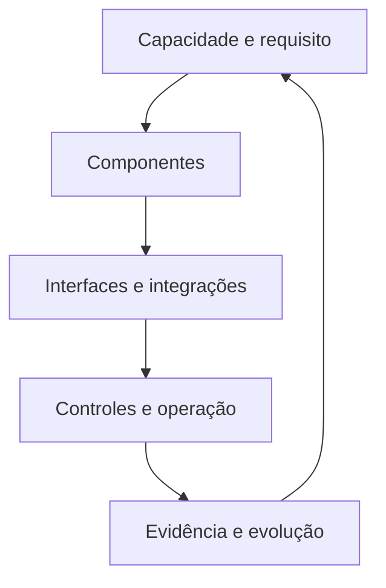
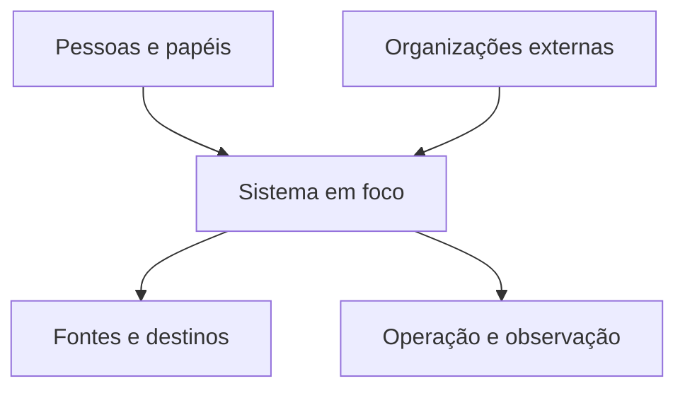

# Arquitetura de Tecnologia e Integrações — Ficha Operacional

**Sistema Operacional do Estúdio LICHTARA**  
**Módulo:** 3 — Arquitetura Organizacional  
**Ferramenta:** 08 — Arquitetura de Tecnologia e Integrações  
**Tipo:** Ficha metodológica, arquitetural e preenchível  
**Versão:** 0.1  
**Status:** Em desenvolvimento e validação pela prática  
**Data de criação:** 02/08/2026

**Documentos relacionados:**

- `README.md` deste diretório;
- `01-estado-atual-e-estado-futuro.md`;
- `02-arquitetura-de-processos-e-fluxos.md`;
- `03-papeis-responsabilidades-e-alcadas.md`;
- `04-arquitetura-de-informacao-e-conhecimento.md`;
- `05-arquitetura-da-comunicacao.md`;
- `06-arquitetura-documental.md`;
- `07-arquitetura-de-indicadores.md`;
- `../README.md`;
- `../fundamentos-da-arquitetura.md`;
- `../protocolo-de-arquitetura.md`;
- `../matriz-de-rastreabilidade.md`;
- `../templates/plano-de-arquitetura.md`;
- `../templates/03-catalogo-de-requisitos.md`;
- `../templates/04-matriz-de-rastreabilidade.md`;
- `../templates/05-arquitetura-integrada.md`;
- `../templates/06-registro-de-validacao.md`;
- `../templates/08-transicao-para-implantacao.md`.

---

## 1. Finalidade

Esta ferramenta orienta o desenho do suporte tecnológico e das integrações necessárias para que capacidades, processos, informação, comunicação, documentação, indicadores e controles funcionem de forma coerente, segura e sustentável.

Ela ajuda o Estúdio LICHTARA a:

- começar pela capacidade e pelo requisito, não pela ferramenta disponível ou preferida;
- distinguir tecnologia, sistema, aplicação, plataforma, serviço, componente, interface e integração;
- representar soluções manuais, assistidas, automatizadas e digitais como alternativas legítimas;
- inventariar o estado técnico atual, inclusive planilhas, scripts, contas e tecnologias invisíveis;
- definir arquitetura conceitual e lógica antes da configuração de implantação;
- relacionar componentes técnicos a processos, papéis, dados, documentos e decisões;
- especificar contratos de componentes, interfaces, integrações e dados;
- tratar identidades, acessos, segredos, segurança, privacidade e auditoria;
- desenhar disponibilidade, continuidade, recuperação e retorno manual;
- definir ambientes, configurações, mudanças, versões e reversão;
- tornar dependências, fornecedores, custos, licenças e limites visíveis;
- avaliar interoperabilidade, portabilidade e estratégia de saída;
- preparar migração, coexistência, corte, desativação e preservação;
- definir observabilidade, suporte, incidentes e manutenção;
- delimitar a base técnica necessária às funções de inteligência artificial;
- produzir um bloco rastreável para a Arquitetura Integrada e para o Módulo 4.

## 2. Pergunta central

> Que suporte tecnológico é necessário para sustentar as capacidades e os fluxos definidos, como seus componentes e dados se conectam, sob quais contratos, controles, responsabilidades e condições de continuidade, e como a organização poderá mudar ou sair dessa configuração sem perder governabilidade?

Perguntas derivadas:

- Que capacidade organizacional exige suporte técnico?
- Que problema permanece mesmo se nenhuma ferramenta for comprada?
- Que parte pode continuar humana ou manual?
- Que requisitos funcionais e atributos de qualidade são materiais?
- Que componentes existem e qual responsabilidade técnica cada um assume?
- Que fronteiras, interfaces e integrações são necessárias?
- Que informação atravessa cada fronteira e quem a governa?
- Qual componente constitui a fonte oficial de cada objeto?
- Como identidade, autenticação, autorização e acesso são tratados?
- Que falhas são esperadas e como o sistema se degrada ou recupera?
- Que indisponibilidade e perda de dados são toleráveis?
- Como mudanças, versões e configurações serão controladas?
- Quem opera, mantém, suporta, monitora e decide sobre cada componente?
- Que dependência de fornecedor, licença, formato ou pessoa está sendo criada?
- Quanto custa adquirir, integrar, operar, aprender, migrar e encerrar?
- Como a organização exporta seus dados e reconstrói sua operação?
- Que evidência demonstra que a arquitetura atende aos requisitos?

## 3. O que é

Arquitetura de Tecnologia e Integrações é uma ferramenta de desenho das capacidades técnicas, dos componentes e das relações que sustentarão a configuração organizacional futura.

Ela organiza:

1. **necessidades, capacidades, requisitos e restrições**;
2. **componentes humanos, manuais, digitais e automatizados**;
3. **sistemas, aplicações, serviços, plataformas e infraestrutura**;
4. **interfaces, integrações, contratos e movimentos de dados**;
5. **identidades, acessos, segurança, privacidade e auditoria**;
6. **ambientes, configurações, mudanças e versões**;
7. **disponibilidade, continuidade, recuperação e contingência**;
8. **observabilidade, suporte, incidentes e manutenção**;
9. **fornecedores, custos, licenças, portabilidade e saída**;
10. **migração, coexistência, desativação e evolução**.

Seu produto não é uma lista de produtos. É uma configuração técnica governável, explicável e proporcional, capaz de sustentar o trabalho sem aprisionar a organização em dependências que ela não compreende, não consegue operar ou não pode abandonar.

## 4. Distinções essenciais

### 4.1 Tecnologia

Tecnologia é o conjunto de conhecimentos, métodos, artefatos e meios utilizados para ampliar ou sustentar uma capacidade. Pode incluir papel, planilha, equipamento, software, automação ou infraestrutura.

### 4.2 Sistema

Sistema é um conjunto relacionado de pessoas, regras, informação e componentes que produz determinado comportamento ou resultado. Um sistema organizacional pode conter tecnologia sem se reduzir a ela.

### 4.3 Sistema de informação

Sistema de informação é a configuração que cria, processa, armazena, comunica ou preserva informação para uma finalidade organizacional. Inclui dimensões humanas e procedimentais além do software.

### 4.4 Aplicação

Aplicação é um software utilizado por pessoas ou outros sistemas para executar funções delimitadas.

### 4.5 Serviço técnico

Serviço técnico é uma capacidade disponibilizada por interface e condições de uso definidas, como autenticação, armazenamento, envio de mensagem ou cálculo.

### 4.6 Plataforma

Plataforma é uma base técnica que hospeda, conecta ou habilita múltiplas aplicações, serviços ou extensões.

### 4.7 Infraestrutura

Infraestrutura é o conjunto de recursos computacionais, de rede, armazenamento, execução, dispositivos e serviços de base que permite o funcionamento dos componentes.

### 4.8 Componente

Componente é uma unidade arquitetural com responsabilidade delimitada, entradas, saídas, dependências, responsável e ciclo de vida. Pode ser humano, manual ou técnico.

### 4.9 Interface

Interface é a fronteira pela qual dois componentes ou participantes interagem. Ela define o que pode ser solicitado, entregue, observado ou alterado, sem exigir que o consumidor conheça o funcionamento interno do outro lado.

### 4.10 Integração

Integração é a realização controlada da troca, coordenação ou sincronização entre componentes. Possui origem, destino, objeto, gatilho, contrato, tratamento de falha e responsabilidade.

### 4.11 Contrato de integração

Contrato de integração é o conjunto explícito de regras semânticas, técnicas e operacionais que torna uma integração compreensível e testável.

### 4.12 API

API é uma interface programável. Sua existência não garante compatibilidade, acesso, estabilidade, suporte, segurança nem adequação ao uso pretendido.

### 4.13 Evento

Evento é o registro de que algo relevante ocorreu em determinado momento. Pode iniciar comunicação, processamento, integração, medição ou resposta.

### 4.14 Automação

Automação é a execução de uma atividade ou decisão delimitada por mecanismo técnico segundo regras, eventos ou modelos. Toda automação precisa de condição de início, término, falha, supervisão e retorno.

### 4.15 Configuração

Configuração é o conjunto de parâmetros e opções que altera o comportamento de um componente sem modificar necessariamente seu código.

### 4.16 Ambiente

Ambiente é um contexto técnico segregado para desenvolvimento, teste, homologação, produção, contingência ou outra finalidade definida.

### 4.17 Dependência

Dependência é uma relação na qual o funcionamento, a mudança ou a recuperação de um componente depende de outro recurso, pessoa, serviço, contrato ou condição.

### 4.18 Interoperabilidade

Interoperabilidade é a capacidade de componentes distintos trocarem informação e utilizarem o significado recebido de forma compatível.

### 4.19 Portabilidade

Portabilidade é a capacidade de mover dados, configurações, código ou operação entre ambientes ou fornecedores com esforço, perda e risco conhecidos.

### 4.20 Reversibilidade

Reversibilidade é a capacidade de desfazer uma mudança, retornar a estado seguro ou abandonar uma alternativa sem dano desproporcional.

### 4.21 Disponibilidade

Disponibilidade é a condição em que um serviço ou componente pode ser utilizado conforme a necessidade e a janela definidas.

### 4.22 Resiliência

Resiliência técnica é a capacidade de absorver falhas, manter funções essenciais, recuperar-se e aprender sem perder controle do sistema.

### 4.23 Cópia de segurança e replicação

Cópia de segurança preserva uma versão recuperável dos dados. Replicação mantém cópias sincronizadas para disponibilidade. Uma não substitui automaticamente a outra.

### 4.24 Observabilidade

Observabilidade é a capacidade de inferir o estado interno de um sistema a partir de sinais suficientes, como métricas, registros, rastros, verificações e eventos.

### 4.25 Incidente

Incidente é um evento que compromete ou ameaça disponibilidade, integridade, confidencialidade, desempenho, conformidade ou resultado esperado.

### 4.26 Dívida técnica

Dívida técnica é uma obrigação futura criada por escolha, atalho, obsolescência ou acúmulo que aumenta custo, risco ou dificuldade de mudança.

### 4.27 Quadro comparativo

| Objeto | Delimita | Exemplo genérico | Não garante automaticamente |
| --- | --- | --- | --- |
| Capacidade | O que a organização precisa conseguir fazer | Acompanhar demandas | Solução técnica específica |
| Sistema | Relações que produzem comportamento | Gestão de demandas | Software único |
| Aplicação | Funções oferecidas por software | Interface de acompanhamento | Processo governado |
| Serviço | Capacidade técnica consumível | Envio de notificação | Continuidade |
| Plataforma | Base para múltiplos usos | Ambiente colaborativo | Adequação a todos os fluxos |
| Componente | Responsabilidade arquitetural | Registro de demandas | Produto ou fornecedor predeterminado |
| Interface | Fronteira de interação | Consulta de estado | Integração funcionando |
| Integração | Troca realizada sob regras | Sincronização de cliente | Significado compartilhado |
| Automação | Execução técnica delimitada | Criar tarefa após aceite | Julgamento correto em toda exceção |
| Observabilidade | Visibilidade do estado | Erros por integração | Causa conhecida |

## 5. Cadeia arquitetural

A ferramenta utiliza a cadeia:

`necessidade → capacidade → requisito → componente → interface → integração → controle → operação → evolução`.



### 5.1 Regra de derivação

Nenhum componente material deve entrar na arquitetura apenas porque já existe, é conhecido, foi comprado ou parece moderno. Sua presença precisa ser justificada por capacidade, requisito, risco, obrigação, continuidade ou transição explicitamente reconhecidos.

## 6. Função no protocolo de arquitetura

| Etapa do protocolo | Contribuição da ferramenta |
| --- | --- |
| Delimitação | Identificar capacidades e decisões com dependência técnica |
| Diagnóstico | Inventariar componentes, integrações, contas, dependências e falhas atuais |
| Requisitos | Traduzir necessidades em funções, qualidades, restrições e critérios técnicos |
| Desenho | Definir componentes, interfaces, contratos, controles e estados futuros |
| Integração | Relacionar tecnologia a processos, informação, papéis, documentos e indicadores |
| Validação | Testar adequação, falhas, recuperação, segurança e sustentabilidade |
| Aprovação | Constituir linha de base da arquitetura técnica |
| Transição | Informar seleção, configuração, desenvolvimento, migração e operação |

## 7. Saídas principais

A aplicação pode produzir:

- inventário técnico atual;
- mapa de capacidades dependentes de tecnologia;
- mapa de contexto e fronteiras;
- catálogo de componentes atuais e futuros;
- mapa de dependências e pontos únicos de falha;
- arquitetura conceitual e lógica futura;
- catálogo de interfaces e integrações;
- contratos de componente, integração e dados;
- matriz de fontes oficiais e movimentos de dados;
- arquitetura de identidades e acessos;
- requisitos de segurança, privacidade e auditoria;
- desenho de ambientes, configurações e mudanças;
- requisitos de disponibilidade, recuperação e contingência;
- modelo de observabilidade, suporte e incidentes;
- inventário de fornecedores, licenças e custos;
- estratégia de portabilidade e saída;
- registro de dívida técnica e ciclo de vida;
- matriz atual–futuro;
- alternativas técnicas comparáveis;
- plano arquitetural de migração e desativação;
- cenários de teste e validação;
- bloco consolidado para a Arquitetura Integrada;
- condições de entrada para o Módulo 4.

### 7.1 Seleção proporcional

| Contexto | Saída mínima recomendada |
| --- | --- |
| Organização de uma pessoa | Componentes, contas, dados, cópia, acesso, custo e saída |
| Equipe pequena | Catálogo, integrações, responsáveis, continuidade e suporte |
| Múltiplos sistemas | Contexto, contratos, identidades, observabilidade e migração |
| Alto risco ou regulação | Ameaças, controles, auditoria, recuperação e especialista |
| Dependência de fornecedor | Custos, níveis de serviço, portabilidade e encerramento |
| IA ou automação | Base técnica, dados, permissões, logs, interrupção e custo |
| Arquitetura sistêmica | Domínios, padrões, portfólio, governança e evolução |

## 8. O que a ferramenta não é

Esta ferramenta não é:

- catálogo de produtos ou funcionalidades;
- lista de desejos tecnológicos;
- justificativa posterior para ferramenta já escolhida;
- projeto de configuração detalhada;
- código, infraestrutura implantada ou manual de instalação;
- substituta de arquitetura de processos ou informação;
- presunção de que digitalizar melhora o trabalho;
- garantia de integração porque uma API existe;
- avaliação completa de inteligência artificial;
- parecer jurídico, de privacidade ou segurança especializada;
- plano de projeto do Módulo 4;
- promessa de disponibilidade absoluta ou risco zero.

## 9. Fronteiras com outras dimensões

| Dimensão | Esta ferramenta define | Outra ferramenta aprofunda |
| --- | --- | --- |
| Estado atual e futuro | Mudanças técnicas necessárias e preservadas | Capacidades e transição na ferramenta 01 |
| Processos | Suporte, automações e falhas técnicas | Trabalho, decisões e exceções na ferramenta 02 |
| Papéis | Administração, custódia, suporte e decisão técnica | Responsabilidades e alçadas na ferramenta 03 |
| Informação | Persistência, movimento e transformação técnica | Significado, fonte e qualidade na ferramenta 04 |
| Comunicação | Canais, notificações e disponibilidade | Públicos, eventos e confirmações na ferramenta 05 |
| Documentação | Repositórios, versões, exportação e preservação | Função documental e retenção na ferramenta 06 |
| Indicadores | Instrumentação, coleta, cálculo e observabilidade | Definição, interpretação e resposta na ferramenta 07 |
| IA | Infraestrutura, integrações, acesso e execução | Funções, supervisão e avaliação na ferramenta 09 |
| Alternativas | Configurações técnicas candidatas | Comparação e recomendação na ferramenta 10 |
| Implantação | Condições, pacotes e critérios técnicos | Cronograma, execução, treinamento e mudança no Módulo 4 |

## 10. Princípios

1. A capacidade antecede a tecnologia.
2. A solução mais simples que atende aos requisitos permanece candidata legítima.
3. Arquitetura descreve responsabilidades e relações antes de produtos.
4. Componentes humanos e manuais integram o sistema.
5. Toda integração possui contrato, dono, falha e reconciliação.
6. Informação mantém significado, origem e autoridade ao atravessar fronteiras.
7. Acesso segue necessidade, menor privilégio e ciclo de vida explícito.
8. Segurança, privacidade e continuidade entram no desenho desde o início.
9. Cópia somente conta como proteção quando a restauração é verificável.
10. Indisponibilidade, latência, erro e dado ausente são estados esperados.
11. Toda automação possui interrupção, exceção e retorno operacional.
12. Observabilidade serve à compreensão e à resposta, não à vigilância irrestrita.
13. Mudanças técnicas precisam ser versionáveis, testáveis e reversíveis conforme o risco.
14. Dependência de fornecedor exige portabilidade e saída proporcionais.
15. Custo inclui aquisição, integração, operação, aprendizagem, risco e encerramento.
16. O detalhe técnico cresce apenas quando modifica decisão, risco ou implantação.
17. IA não recebe exceção automática aos princípios arquiteturais.
18. Responsabilidade humana permanece identificável em toda decisão material.

## 11. Invariantes

Independentemente do porte, preserve:

- capacidade e requisito justificador;
- responsabilidade de cada componente;
- origem, destino e significado de cada integração;
- fonte oficial dos objetos materiais;
- identidade e regra de acesso;
- tratamento de falha e retorno;
- responsável por operação e manutenção;
- custo e dependência conhecidos;
- condição de continuidade e recuperação;
- forma de exportação ou saída;
- versão, estado e decisão;
- validação proporcional;
- limite entre arquitetura e implantação.

## 12. Quando utilizar

Utilize quando:

- uma capacidade depender de sistema, plataforma, equipamento ou automação;
- dados precisarem circular entre componentes ou organizações;
- ferramenta digital, fornecedor ou arquitetura precisar ser escolhida;
- processos atuais dependerem de planilhas, contas ou scripts frágeis;
- novas funções alterarem identidades, acessos ou responsabilidades;
- continuidade, segurança, privacidade ou auditoria forem materiais;
- migração, portabilidade ou encerramento precisarem ser planejados;
- integrações atuais falharem silenciosamente;
- indicadores exigirem instrumentação e coleta;
- IA depender de dados, modelos, APIs, armazenamento ou execução;
- crescimento, custo ou desempenho ameaçar sustentabilidade;
- implantação precisar de configuração técnica rastreável.

## 13. Quando não utilizar ou reduzir

Reduza quando:

- o fluxo puder ser sustentado manualmente com baixo risco e carga aceitável;
- a decisão ainda depender de esclarecimento de capacidade ou processo;
- não houver integração, dado sensível ou continuidade material;
- uma ferramenta isolada puder ser testada de forma reversível;
- o detalhe não alterar escolha, risco, custo ou implantação.

Não utilize para:

- começar pelo produto favorito;
- automatizar um processo ainda incompreendido;
- substituir conversa com usuários e responsáveis;
- detalhar código antes da aprovação da arquitetura;
- desenhar controle de segurança sem competência necessária;
- ignorar alternativa de não intervenção;
- criar diagrama sem decisão associada.

### 13.1 Registro da redução

| Campo | Preenchimento |
| --- | --- |
| Capacidade avaliada | CAP-ARQ-___ |
| Motivo da redução | [Baixo risco, baixa integração, reversibilidade ou simplicidade] |
| Solução mínima | [Manual, existente ou focal] |
| Risco residual | RSC-ARQ-___ |
| Proteção preservada | CTL-ARQ-___ |
| Responsável | PAP-ARQ-___ |
| Gatilho de aprofundamento | [Volume, incidente, integração, custo ou mudança] |

## 14. Proporcionalidade

| Fator | Pergunta | Efeito no desenho |
| --- | --- | --- |
| Criticidade | Que resultado é interrompido? | Continuidade e redundância |
| Sensibilidade | Que dados ou direitos são afetados? | Segurança, privacidade e acesso |
| Integração | Quantas fronteiras precisam funcionar? | Contratos e observabilidade |
| Mudança | Com que frequência componentes mudam? | Versionamento e testes |
| Escala | Que volume, usuários e crescimento existem? | Capacidade e desempenho |
| Reversibilidade | É possível retornar ou sair? | Rollback, exportação e coexistência |
| Maturidade | Quem consegue operar e manter? | Simplicidade e suporte |
| Fornecedor | Quanto controle permanece externo? | Nível de serviço e saída |
| Custo | Que gasto total e variabilidade existem? | Alternativas e limites |
| Regulação | Que obrigação exige evidência? | Auditoria e especialista |
| IA | Há processamento probabilístico ou externo? | Dados, supervisão e avaliação |

### 14.1 Níveis

| Nível | Aplicação | Conteúdo |
| --- | --- | --- |
| Essencial | Ferramenta ou fluxo focal | Componentes, dados, acessos, cópia, custo e saída |
| Intermediário | Vários componentes | Essencial + interfaces, contratos, falhas e suporte |
| Ampliado | Alto impacto ou integração | Intermediário + ameaças, continuidade, ambientes e migração |
| Sistêmico | Organização ou ecossistema | Portfólio, padrões, governança, fornecedores e evolução |

## 15. Escalas e camadas

### 15.1 Escalas

| Escala | Foco |
| --- | --- |
| Tarefa | Ferramenta ou automação local |
| Processo | Componentes que sustentam um fluxo |
| Serviço | Configuração que entrega capacidade a um público |
| Domínio | Conjunto coerente de informação e responsabilidades |
| Organização | Portfólio técnico e capacidades compartilhadas |
| Ecossistema | Fronteiras com clientes, parceiros e fornecedores |

### 15.2 Camadas

| Camada | Pergunta |
| --- | --- |
| Estratégica | Que capacidade, valor e risco orientam o desenho? |
| Conceitual | Que responsabilidades e relações precisam existir? |
| Lógica | Que componentes, interfaces e dados realizam a configuração? |
| Física | Que produtos, ambientes e recursos poderão materializá-la? |
| Operacional | Quem monitora, suporta, mantém e recupera? |
| Governança | Quem decide, controla, revisa e encerra? |

### 15.3 Limite entre arquitetura e configuração

| Arquitetura define | Implantação detalha |
| --- | --- |
| Responsabilidade do componente | Instância, tela e parâmetro exatos |
| Contrato da integração | Credencial, endpoint e configuração concreta |
| Requisito de ambiente | Provisionamento e pipeline |
| Critério de segurança | Controle técnico selecionado e configurado |
| Objetivo de recuperação | Procedimento operacional testado |
| Estratégia de migração | Lotes, datas, execução e reconciliação |

## 16. Participantes da aplicação

| Participante | Contribuição | Risco se ausente |
| --- | --- | --- |
| Responsável pela capacidade | Resultado e prioridade | Solução sem finalidade |
| Usuário ou pessoa afetada | Uso, fricção e exceções | Arquitetura impraticável |
| Responsável pelo processo | Eventos e contingências | Automação desconectada |
| Responsável pela informação | Significado, fonte e qualidade | Integração semanticamente incorreta |
| Responsável técnico | Viabilidade, dependências e operação | Desenho inexequível |
| Segurança e privacidade | Ameaças, dados e controles | Exposição ou controle insuficiente |
| Operação e suporte | Manutenção, incidente e recuperação | Solução sem continuidade |
| Financeiro ou contratual | Custo, licença e fornecedor | Dependência não sustentada |
| Decisor | Critérios e aceitação de risco | Escolha sem autoridade |
| Validador | Testes e evidência | Aprovação presumida |

### 16.1 Participantes reais

| Papel no desenho | Pessoa/papel | Participação | Disponibilidade | Acesso necessário | Limite de competência |
| --- | --- | --- | --- | --- | --- |
| [Preencher] | [Nome/PAP ID] | [Oficina, revisão, teste ou validação] | [Condição] | [Fontes/ambientes] | [Preencher] |

## 17. Autoridade e limites

| Decisão | Autoridade | Consulta | Limite | Evidência |
| --- | --- | --- | --- | --- |
| Aprovar requisito técnico | PAP/INS-ARQ-___ | [Usuário/técnico] | [Domínio] | REQ-ARQ-___ |
| Aprovar arquitetura | PAP/INS-ARQ-___ | [Responsáveis/especialistas] | [Escopo] | ATI-ARQ-___ |
| Selecionar produto | PAP/INS-ARQ-___ | [Técnico/financeiro/usuário] | [Orçamento] | ALT/DEC-ARQ-___ |
| Aceitar risco | PAP/INS-ARQ-___ | [Especialista/afetados] | [Alçada] | RSC/DEC-ARQ-___ |
| Autorizar dado | PAP/INS-ARQ-___ | [Dono/privacidade] | [Finalidade] | ACS-ARQ-___ |
| Aprovar produção | PAP/INS-ARQ-___ | [Técnico/operação] | [Ambiente] | VAL/DEC-ARQ-___ |
| Interromper serviço | PAP/INS-ARQ-___ | [Operação] | [Critério] | INC/DEC-ARQ-___ |
| Encerrar componente | PAP/INS-ARQ-___ | [Usuários/dono] | [Retenção] | DEC/MIG-ARQ-___ |

### 17.1 Barreiras de autoridade

- arquitetura não concede acesso;
- parecer técnico não aceita risco institucional;
- fornecedor não define finalidade organizacional;
- administrador não se torna dono do dado;
- automação não recebe autoridade implícita;
- IA não aprova requisito, segurança, implantação ou risco;
- urgência não elimina registro e revisão posterior.

## 18. Entradas necessárias

| Entrada | ID ou referência | Contribuição | Responsável | Estado | Limitação |
| --- | --- | --- | --- | --- | --- |
| Capacidades futuras | CAP-ARQ-___ | Finalidade | [Papel] | [Estado] | [Preencher] |
| Requisitos | REQ-ARQ-___ | Critérios | [Papel] | [Estado] | [Preencher] |
| Processos e exceções | PRC/FLX/EXC-ARQ-___ | Uso e contingência | [Papel] | [Estado] | [Preencher] |
| Papéis e alçadas | PAP/ALC-ARQ-___ | Operação e decisão | [Papel] | [Estado] | [Preencher] |
| Informação e dados | INF/DAD/FON-ARQ-___ | Conteúdo e autoridade | [Papel] | [Estado] | [Preencher] |
| Comunicação e documentos | COM/DOC-ARQ-___ | Canais e registros | [Papel] | [Estado] | [Preencher] |
| Indicadores e alertas | IND/ALR-ARQ-___ | Observação e resposta | [Papel] | [Estado] | [Preencher] |
| Riscos e controles | RSC/CTL-ARQ-___ | Proteção | [Papel] | [Estado] | [Preencher] |
| Inventário atual | [Referência] | Dependências e legado | [Papel] | [Estado] | [Preencher] |
| Contratos e custos | [Referência] | Viabilidade e saída | [Papel] | [Estado] | [Preencher] |

### 18.1 Regra de insuficiência

Se capacidade, processo, informação ou autoridade ainda estiverem materialmente indefinidos, interrompa a recomendação firme do componente afetado. Registre a lacuna, o risco de prosseguir, a hipótese provisória e a autoridade responsável pela resolução.

## 19. Qualidade das evidências

| Evidência | Pode sustentar | Limite |
| --- | --- | --- |
| Inventário verificado | Existência, versão e uso atual | Não prova adequação |
| Logs e métricas | Comportamento observado | Não explicam todo contexto |
| Contrato ou documentação oficial | Condições declaradas | Pode divergir da prática |
| Teste controlado | Comportamento no cenário | Não prova escala total |
| Relato de usuário | Fricção, exceção e impacto | Não representa todos |
| Parecer especializado | Risco e viabilidade no domínio | Depende de escopo e premissas |
| Proposta de fornecedor | Alternativa e condição comercial | Não é validação independente |
| Saída de IA | Hipótese, comparação ou rascunho | Não constitui fato nem decisão |

### 19.1 Controle de fonte

| Evidência | Fonte | Versão/data | Método de confirmação | Limitação | Uso autorizado |
| --- | --- | --- | --- | --- | --- |
| [ID] | [Referência] | [Preencher] | [Inspeção, teste ou validação] | [Preencher] | [Preencher] |

## 20. Preparação

- [ ] pergunta e capacidade estão definidas;
- [ ] escopo e fronteiras estão claros;
- [ ] requisitos e restrições foram reunidos;
- [ ] inventário inicial está disponível;
- [ ] responsáveis atuais e futuros foram identificados;
- [ ] dados sensíveis e acessos foram classificados;
- [ ] riscos que exigem especialista foram reconhecidos;
- [ ] alternativas manuais e existentes permanecem abertas;
- [ ] nível de detalhe foi definido;
- [ ] ambientes de teste ou evidências estão acessíveis;
- [ ] custos e contratos podem ser examinados;
- [ ] validação e decisão foram planejadas.

### 20.1 Insuficiência de entrada

| Entrada ausente | Efeito | Tratamento | Prosseguir? | Responsável | Prazo/gatilho |
| --- | --- | --- | --- | --- | --- |
| [Preencher] | [Preencher] | [Obter, testar, assumir ou devolver] | [Sim, não ou limitado] | PAP-ARQ-___ | [Preencher] |

## 21. Plano da aplicação

| Etapa | Atividade | Responsável | Participantes | Entrada | Saída | Critério |
| --- | --- | --- | --- | --- | --- | --- |
| Delimitar | [Capacidade, decisão e fronteira] | PAP-ARQ-___ | [Papéis] | [IDs] | [Escopo] | [Preencher] |
| Inventariar | [Componentes e integrações atuais] | PAP-ARQ-___ | [Papéis] | [Fontes] | [Inventário] | [Preencher] |
| Requerer | [Funções, qualidades e restrições] | PAP-ARQ-___ | [Papéis] | [IDs] | [Requisitos] | [Preencher] |
| Desenhar | [Componentes, contratos e controles] | PAP-ARQ-___ | [Papéis] | [Requisitos] | ATI-ARQ-___ | [Preencher] |
| Comparar | [Configurações candidatas] | PAP-ARQ-___ | [Papéis] | [Alternativas] | ALT-ARQ-___ | [Preencher] |
| Validar | [Cenários e falhas] | PAP-ARQ-___ | [Validadores] | [Desenho] | VAL/TST-ARQ-___ | [Preencher] |
| Integrar | [Arquitetura Integrada] | PAP-ARQ-___ | [Responsáveis] | [Saídas] | [Bloco] | [Preencher] |
| Transicionar | [Pacotes e condições] | PAP-ARQ-___ | [Implantação] | [Aprovados] | [Transição] | [Preencher] |

## 22. Identificação, versão e validade

| Campo | Registro |
| --- | --- |
| ID do artefato | ATI-ARQ-AAAA-NNN |
| Projeto/cliente | [Preencher] |
| Título | [Preencher] |
| Escopo | [Preencher] |
| Versão | [Número] |
| Estado | [Rascunho, em revisão, validada, aprovada, substituída ou encerrada] |
| Responsável | PAP-ARQ-___ |
| Validadores | [PAP/INS IDs] |
| Decisão | DEC-ARQ-___ |
| Vigência | [Data/condição] |
| Próxima revisão | [Data/evento] |
| Sensibilidade | [Classe] |

### 22.1 Identificadores específicos

| Objeto | Prefixo | Exemplo |
| --- | --- | --- |
| Arquitetura de tecnologia e integrações | ATI-ARQ | ATI-ARQ-2026-001 |
| Sistema | SIS-ARQ | SIS-ARQ-001 |
| Aplicação | APL-ARQ | APL-ARQ-001 |
| Serviço técnico | SRV-ARQ | SRV-ARQ-001 |
| Plataforma | PLT-ARQ | PLT-ARQ-001 |
| Infraestrutura | ITF-ARQ | ITF-ARQ-001 |
| Componente | CMP-ARQ | CMP-ARQ-001 |
| Interface | INT-ARQ | INT-ARQ-001 |
| Integração | ITG-ARQ | ITG-ARQ-001 |
| Contrato de integração | CTI-ARQ | CTI-ARQ-001 |
| Ambiente | AMB-ARQ | AMB-ARQ-001 |
| Configuração | CFG-ARQ | CFG-ARQ-001 |
| Identidade técnica | IDT-ARQ | IDT-ARQ-001 |
| Nível de serviço | NVS-ARQ | NVS-ARQ-001 |
| Incidente | INC-ARQ | INC-ARQ-001 |
| Observabilidade | OBV-ARQ | OBV-ARQ-001 |
| Dívida técnica | DVT-ARQ | DVT-ARQ-001 |
| Fornecedor técnico | FRT-ARQ | FRT-ARQ-001 |
| Licença | LIC-ARQ | LIC-ARQ-001 |

### 22.2 Regra de coexistência dos códigos

Os identificadores específicos complementam os códigos compartilhados do Módulo 3. `CMP-ARQ` continua representando qualquer componente arquitetural; `INT-ARQ` representa a fronteira; `ITG-ARQ` representa a realização da troca. `DAD`, `FON`, `ACS`, `RSC`, `CTL`, `MIG`, `TST`, `VAL` e `DEC` preservam os significados definidos nas fichas anteriores.

## 23. Contexto e fronteiras

| Questão | Registro |
| --- | --- |
| Capacidade ou serviço em foco | CAP-ARQ-___ |
| Públicos e usuários | PUB/PAP-ARQ-___ |
| Processos incluídos | PRC-ARQ-___ |
| Domínios de informação | DOM-ARQ-___ |
| Organizações externas | [IDs/nomes] |
| Componentes incluídos | [IDs/classes] |
| Componentes excluídos | [IDs/motivo] |
| Localidades e jurisdições | [Preencher] |
| Horizonte | [Data/período] |
| Restrições | [IDs] |
| Dependências externas | DEP-ARQ-___ |

### 23.1 Diagrama de contexto preenchível



### 23.2 Fora de escopo

| Elemento | Motivo | Dependência preservada | Risco | Condição para incluir |
| --- | --- | --- | --- | --- |
| [Preencher] | [Preencher] | DEP-ARQ-___ | RSC-ARQ-___ | [Gatilho] |

## 24. Inventário técnico atual

Inventarie também aquilo que não recebe o nome de sistema: planilhas, formulários, scripts, pastas, dispositivos, contas pessoais, extensões, automações locais, certificados, domínios, chaves e procedimentos manuais.

| ID | Nome | Tipo | Função real | Usuários | Dados | Responsável | Fornecedor | Custo | Estado |
| --- | --- | --- | --- | --- | --- | --- | --- | --- | --- |
| [SIS/APL/SRV/PLT/ITF/CMP]-ARQ-___ | [Nome] | [Classe] | [O que sustenta] | [PAP/PUB] | [INF/DAD] | PAP-ARQ-___ | FRT-ARQ-___/N/A | [Faixa] | [Ativo, frágil, transição ou encerramento] |

### 24.1 Recursos invisíveis

| Recurso | Onde existe | Quem conhece | Dependência | Risco | Tratamento |
| --- | --- | --- | --- | --- | --- |
| [Planilha, script, conta, dispositivo ou regra] | [Local] | PAP-ARQ-___ | DEP-ARQ-___ | RSC-ARQ-___ | [Formalizar, migrar, substituir ou encerrar] |

### 24.2 Verificação do inventário

- [ ] nome e função foram confirmados;
- [ ] responsável organizacional foi identificado;
- [ ] fornecedor e contrato foram localizados;
- [ ] dados e integrações foram relacionados;
- [ ] contas administrativas foram reconhecidas;
- [ ] custo direto e indireto foi estimado;
- [ ] criticidade e estado foram registrados;
- [ ] possibilidade de exportação foi testada ou declarada desconhecida.

## 25. Tecnologia paralela e não governada

Tecnologia paralela surge quando pessoas criam meios fora do arranjo reconhecido para conseguir trabalhar. Ela pode revelar iniciativa e lacuna legítima, ao mesmo tempo que cria risco de perda, divergência, exposição ou dependência pessoal.

| Recurso paralelo | Necessidade atendida | Por que surgiu | Dados | Benefício | Risco | Decisão |
| --- | --- | --- | --- | --- | --- | --- |
| [Preencher] | CAP-ARQ-___ | [Lacuna/fricção] | [IDs/classes] | [Preencher] | RSC-ARQ-___ | [Integrar, substituir, restringir ou preservar] |

### 25.1 Tratamento

Não elimine o recurso antes de compreender a necessidade que ele absorve. A retirada sem alternativa pode deslocar o trabalho para outro canal ainda menos visível.

## 26. Capacidades e jornadas críticas

| Capacidade | Jornada/processo | Momento crítico | Suporte atual | Falha atual | Resultado futuro |
| --- | --- | --- | --- | --- | --- |
| CAP-ARQ-___ | PRC/FLX-ARQ-___ | [Evento/estado] | [IDs/manual] | [Preencher] | RSL-ARQ-___ |

### 26.1 Dependência tecnológica da capacidade

| Capacidade | Pode operar sem tecnologia? | Janela manual | Volume suportável | Dado necessário | Automação justificável? |
| --- | --- | --- | --- | --- | --- |
| CAP-ARQ-___ | [Sim, parcialmente ou não] | [Faixa] | [Faixa] | INF/DAD-ARQ-___ | [Sim/não/condição] |

## 27. Resultados técnicos esperados

Resultado técnico é uma condição verificável que permite à capacidade funcionar. Evite formulá-lo como nome de produto.

| ID | Resultado técnico | Capacidade | Beneficiário | Evidência | Horizonte | Limite |
| --- | --- | --- | --- | --- | --- | --- |
| RSL-ARQ-___ | [Condição observável] | CAP-ARQ-___ | [PAP/PUB] | IND/VAL-ARQ-___ | [Período] | [Preencher] |

### 27.1 Exemplos de formulação

| Formulação frágil | Formulação arquitetural |
| --- | --- |
| Implantar ferramenta X | Demandas possuem estado, responsável e histórico recuperável |
| Criar integração | Dados aprovados atravessam a fronteira sem redigitação e com reconciliação |
| Colocar tudo na nuvem | Registros críticos permanecem disponíveis, protegidos e exportáveis |
| Automatizar atendimento | Solicitações elegíveis recebem encaminhamento verificável e retorno humano |

## 28. Arquitetura de requisitos

| Requisito | Tipo | Origem | Prioridade | Critério de aceite | Flexibilidade | Responsável |
| --- | --- | --- | --- | --- | --- | --- |
| REQ-ARQ-___ | [Funcional, qualidade, segurança, dado, integração, operação ou restrição] | [ID/fonte] | [Obrigatório, desejável ou exploratório] | [Verificável] | [Fixo/negociável] | PAP-ARQ-___ |

### 28.1 Qualidade do requisito técnico

Um requisito sólido é:

- relacionado a capacidade, risco ou obrigação;
- compreensível aos participantes pertinentes;
- verificável por critério explícito;
- independente de produto quando a escolha permanece aberta;
- suficientemente específico para comparar alternativas;
- proporcional ao impacto;
- acompanhado de origem, prioridade e autoridade.

## 29. Requisitos funcionais

Requisito funcional descreve o comportamento que a configuração precisa oferecer.

| ID | Ator/componente | Evento | Função necessária | Entrada | Saída | Exceção | Aceite |
| --- | --- | --- | --- | --- | --- | --- | --- |
| REQ-ARQ-___ | PAP/CMP-ARQ-___ | EVT-ARQ-___ | [Verbo + objeto] | INF/DAD-ARQ-___ | INF/DOC/EVT-ARQ-___ | EXC-ARQ-___ | TST-ARQ-___ |

### 29.1 Regra

Funcionalidade sem usuário, evento, objeto e resultado tende a gerar catálogo de recursos em vez de arquitetura.

## 30. Atributos de qualidade

| Atributo | Pergunta | Critério | Cenário | Responsável |
| --- | --- | --- | --- | --- |
| Disponibilidade | Quando precisa funcionar? | [Janela/percentual] | [Falha] | PAP-ARQ-___ |
| Desempenho | Que resposta é aceitável? | [Latência/volume] | [Pico] | PAP-ARQ-___ |
| Segurança | Que ameaça precisa ser reduzida? | [Controle/evidência] | [Ataque/erro] | PAP-ARQ-___ |
| Privacidade | Que tratamento é proporcional? | [Minimização/regra] | [Uso] | PAP-ARQ-___ |
| Usabilidade | Quem consegue completar a tarefa? | [Taxa/tempo/evidência] | [Perfil] | PAP-ARQ-___ |
| Acessibilidade | Que barreira precisa ser removida? | [Critério] | [Tecnologia assistiva] | PAP-ARQ-___ |
| Manutenibilidade | Como mudança permanece segura? | [Tempo/teste] | [Alteração] | PAP-ARQ-___ |
| Interoperabilidade | Como outro componente usa o significado? | [Padrão/contrato] | [Troca] | PAP-ARQ-___ |
| Portabilidade | Como dados e operação saem? | [Formato/tempo] | [Encerramento] | PAP-ARQ-___ |
| Observabilidade | Como reconhecer estado e falha? | [Sinais] | [Incidente] | PAP-ARQ-___ |

### 30.1 Cenário de qualidade

| Fonte do estímulo | Estímulo | Ambiente | Componente | Resposta esperada | Medida |
| --- | --- | --- | --- | --- | --- |
| [Pessoa/sistema/evento] | [Condição] | AMB-ARQ-___ | CMP-ARQ-___ | [Comportamento] | [Critério] |

## 31. Restrições

| Restrição | Origem | Escopo | Efeito | Negociável? | Autoridade | Revisão |
| --- | --- | --- | --- | --- | --- | --- |
| [Orçamento, prazo, tecnologia, contrato, dado, competência ou regulação] | [ID/fonte] | [Objetos] | [Preencher] | [Sim/não/condição] | PAP/INS-ARQ-___ | [Evento] |

### 31.1 Restrição herdada

Uma tecnologia existente não deve ser tratada como restrição imutável sem que custo de mudança, obrigação contratual, dependência e alternativa tenham sido examinados.

## 32. Premissas e incertezas

| ID | Premissa ou incerteza | Efeito se falsa | Evidência atual | Teste | Prazo | Responsável |
| --- | --- | --- | --- | --- | --- | --- |
| [ID] | [Preencher] | [Preencher] | [Fonte/ausente] | TST-ARQ-___ | [Data] | PAP-ARQ-___ |

### 32.1 Estados permitidos

- confirmada;
- plausível e provisória;
- contestada;
- desconhecida;
- invalidada;
- substituída.

## 33. Decisões arquiteturais

| Decisão | Questão | Alternativas | Critérios | Escolha | Consequências | Reversão | Autoridade |
| --- | --- | --- | --- | --- | --- | --- | --- |
| DEC-ARQ-___ | [Preencher] | ALT-ARQ-___ | [REQ/RSC IDs] | [Preencher] | [Benefícios, custos e riscos] | [Condição] | PAP/INS-ARQ-___ |

### 33.1 Registro mínimo

Toda decisão material preserva:

- contexto;
- problema;
- alternativas reais, inclusive manter ou simplificar;
- critérios e impedimentos;
- evidências e incertezas;
- escolha e autoridade;
- consequências desejadas e aceitas;
- condição de revisão ou reversão.

## 34. Neutralidade de solução

Antes de nomear produtos, descreva a responsabilidade necessária.

| Necessidade | Responsabilidade técnica | Interface | Qualidade | Alternativas possíveis |
| --- | --- | --- | --- | --- |
| [Preencher] | [Armazenar, autenticar, notificar, calcular ou outro] | INT-ARQ-___ | [REQ IDs] | [Manual, existente, configurar, desenvolver ou contratar] |

### 34.1 Teste de neutralidade

Substitua o nome do produto por sua função. Se o requisito perder sentido, ele provavelmente estava descrevendo preferência ou solução, e não necessidade.

## 35. Graus de suporte tecnológico

| Grau | Configuração | Adequado quando | Risco principal |
| --- | --- | --- | --- |
| Manual | Pessoa e registro controlado | Baixo volume e julgamento alto | Dependência e carga |
| Assistido | Ferramenta apoia, pessoa conduz | Variação e revisão são materiais | Dupla manutenção |
| Automatizado por regra | Evento e regra executam tarefa | Critério estável e exceção conhecida | Erro em escala |
| Automatizado probabilístico | Modelo sugere ou executa sob controle | Ambiguidade tolerável e avaliação disponível | Imprevisibilidade e opacidade |
| Integrado | Componentes trocam informação | Redigitação cria risco ou carga | Acoplamento e falha distribuída |

### 35.1 Decisão preenchível

| Capacidade/tarefa | Grau atual | Grau futuro | Justificativa | Supervisão | Retorno | Critério de revisão |
| --- | --- | --- | --- | --- | --- | --- |
| CAP/ATV-ARQ-___ | [Grau] | [Grau] | [REQ/RSC IDs] | PAP-ARQ-___ | [Manual/alternativo] | [Evento/indicador] |

## 36. Princípios da arquitetura futura

| ID | Princípio | Implicação | Exceção admissível | Autoridade |
| --- | --- | --- | --- | --- |
| [ID] | [Ex.: uma fonte oficial por objeto e contexto] | [Efeito no desenho] | [Condição registrada] | PAP/INS-ARQ-___ |

### 36.1 Exemplos a avaliar

- responsabilidade antes de produto;
- configuração antes de desenvolvimento quando suficiente;
- padrões abertos quando materialmente úteis;
- dados exportáveis em formato utilizável;
- identidades organizacionais em recursos críticos;
- menor privilégio e segregação proporcional;
- integrações explícitas em vez de cópia silenciosa;
- falha visível e reconciliação prevista;
- ambientes e mudanças controlados;
- retorno manual para funções essenciais;
- desativação planejada desde a entrada;
- simplicidade compatível com a capacidade de manutenção.

## 37. Matriz estado atual–estado futuro

| Objeto | Estado atual | Evidência | Estado futuro | Mudança | Preservar | Encerrar | Dependência |
| --- | --- | --- | --- | --- | --- | --- | --- |
| [SIS/APL/SRV/CMP/ITG]-ARQ-___ | [Preencher] | [Fonte] | [Preencher] | [Configurar, integrar, substituir, criar ou retirar] | [Elemento] | [Elemento] | DEP-ARQ-___ |

### 37.1 Estados de transição

| Estado | Significado |
| --- | --- |
| Preservado | Permanece sem mudança material |
| Adaptado | Permanece com configuração ou responsabilidade alterada |
| Integrado | Passa a trocar dados ou eventos sob contrato |
| Substituído | Função migra para outro componente |
| Novo | Entra na configuração futura |
| Coexistente | Opera temporariamente com outro componente |
| Congelado | Não recebe novos usos ou mudanças, salvo proteção |
| Desativado | Deixa de operar após critérios de encerramento |

## 38. Mapa capacidade–tecnologia

| Capacidade | Processo | Responsabilidade técnica | Componente atual | Componente futuro | Critério | Alternativa manual |
| --- | --- | --- | --- | --- | --- | --- |
| CAP-ARQ-___ | PRC-ARQ-___ | [Preencher] | [ID/ausente] | CMP-ARQ-___ | REQ-ARQ-___ | [Forma/limite] |

### 38.1 Lacunas e excessos

| Tipo | Situação | Efeito | Decisão necessária |
| --- | --- | --- | --- |
| Lacuna | Capacidade sem suporte suficiente | Falha, carga ou risco | Criar, contratar, configurar ou preservar manual |
| Duplicidade | Vários componentes assumem mesma fonte ou função | Divergência e custo | Consolidar ou delimitar contextos |
| Excesso | Recurso sem capacidade, obrigação ou transição associada | Complexidade | Encerrar ou justificar |
| Dependência | Capacidade crítica concentrada | Fragilidade | Reduzir, proteger ou aceitar |

## 39. Domínios técnicos

Domínio técnico agrupa responsabilidades coerentes. Ele não precisa reproduzir departamentos nem fornecedores.

| Domínio | Responsabilidade | Capacidades | Informação | Responsável | Fronteiras |
| --- | --- | --- | --- | --- | --- |
| [Nome/ID] | [Preencher] | [CAP IDs] | [DOM/INF IDs] | PAP-ARQ-___ | INT-ARQ-___ |

### 39.1 Critérios de domínio

- responsabilidade compreensível;
- informação relacionada;
- ritmo de mudança compatível;
- autoridade identificável;
- fronteiras explícitas;
- dependências observáveis;
- tamanho sustentável.

## 40. Mapa de contexto técnico

| Elemento externo | Relação | Sistema em foco | Objeto trocado | Evento | Confiança | Responsável |
| --- | --- | --- | --- | --- | --- | --- |
| [Pessoa, organização ou sistema] | [Fornece, consome, autentica ou regula] | SIS-ARQ-___ | INF/DAD/DOC-ARQ-___ | EVT-ARQ-___ | [Interno, parceiro, público ou não confiável] | PAP-ARQ-___ |

### 40.1 Fronteiras de confiança

Uma fronteira de confiança existe quando identidade, controle, exposição ou garantia muda. Toda travessia material deve explicitar autenticação, autorização, proteção, validação e registro proporcionais.

## 41. Catálogo de componentes

| ID | Nome lógico | Classe | Responsabilidade | Entradas | Saídas | Dados | Responsável | Estado |
| --- | --- | --- | --- | --- | --- | --- | --- | --- |
| CMP-ARQ-___ | [Nome] | [Humano, manual, aplicação, serviço, plataforma ou infraestrutura] | [Uma responsabilidade principal] | [INT/INF IDs] | [INT/INF IDs] | [DAD IDs] | PAP-ARQ-___ | [Atual/futuro/transição] |

### 41.1 Critérios de bom componente

Um componente possui:

- responsabilidade coesa;
- limite compreensível;
- entradas e saídas conhecidas;
- informação governada;
- dependências identificadas;
- responsável por operação e ciclo de vida;
- falhas e contingências reconhecidas;
- possibilidade de substituição avaliada.

## 42. Contrato do componente

| Campo | Registro |
| --- | --- |
| ID | CMP-ARQ-___ |
| Nome lógico | [Preencher] |
| Responsabilidade | [Preencher] |
| Capacidades atendidas | CAP-ARQ-___ |
| Requisitos | REQ-ARQ-___ |
| Usuários/consumidores | PAP/PUB/CMP-ARQ-___ |
| Entradas | INT/INF/DAD-ARQ-___ |
| Saídas | INT/INF/DAD/EVT-ARQ-___ |
| Fonte oficial que mantém | FON-ARQ-___/nenhuma |
| Dependências | DEP-ARQ-___ |
| Acessos | ACS-ARQ-___ |
| Nível de serviço | NVS-ARQ-___ |
| Observabilidade | OBV-ARQ-___ |
| Continuidade | [Referência] |
| Responsável organizacional | PAP-ARQ-___ |
| Responsável técnico | PAP-ARQ-___ |
| Fornecedor | FRT-ARQ-___/N/A |
| Custo | [Referência/faixa] |
| Estado e versão | [Preencher] |
| Saída/encerramento | [Regra] |

### 42.1 Regra de responsabilidade única

Responsabilidade única significa que a razão arquitetural principal do componente pode ser explicada claramente. Não impede funções auxiliares, mas evita blocos indefinidos que acumulam tudo e tornam mudança, acesso e falha incompreensíveis.

## 43. Componentes humanos e manuais

| ID | Função | Papel | Entrada | Regra | Saída | Registro | Substituição |
| --- | --- | --- | --- | --- | --- | --- | --- |
| CMP-ARQ-___ | [Revisar, decidir, reconciliar ou contingenciar] | PAP-ARQ-___ | [ID] | [Critério] | [ID] | DOC/RGT-ARQ-___ | SUB-ARQ-___ |

### 43.1 Condições de governabilidade

- carga compatível;
- competência disponível;
- acesso suficiente;
- prazo explícito;
- substituição prevista;
- decisão registrada;
- retorno ao fluxo técnico definido;
- limite entre julgamento e operação mecânica visível.

## 44. Automações

| Automação | Tarefa | Gatilho | Regra/modelo | Entrada | Saída | Exceção | Interrupção | Responsável |
| --- | --- | --- | --- | --- | --- | --- | --- | --- |
| [ID/CMP] | ATV-ARQ-___ | EVT-ARQ-___ | [Referência] | INF/DAD-ARQ-___ | [ID] | EXC-ARQ-___ | [Mecanismo] | PAP-ARQ-___ |

### 44.1 Teste de automatização

Antes de automatizar, responda:

- a tarefa possui finalidade estável?
- a entrada possui qualidade suficiente?
- a regra ou critério está explícito?
- as exceções relevantes são reconhecíveis?
- o erro pode ser detectado?
- existe retorno ou correção?
- a escala do erro é aceitável?
- a pessoa afetada possui canal de contestação?
- o custo de manter é proporcional?

## 45. Dependências

| ID | Dependente | Dependência | Tipo | Criticidade | Falha | Alternativa | Responsável |
| --- | --- | --- | --- | --- | --- | --- | --- |
| DEP-ARQ-___ | CMP/SRV/ITG-ARQ-___ | [Componente, pessoa, fornecedor, licença, rede, dado ou contrato] | [Obrigatória/opcional/transitória] | [Nível] | [Efeito] | [Fallback/substituto] | PAP-ARQ-___ |

### 45.1 Dependências transitivas

Uma dependência direta pode ocultar cadeias externas. Registre, quando material, fornecedores subjacentes, serviços de identidade, infraestrutura, extensões, bibliotecas, certificados, domínios e pessoas sem substituição.

## 46. Criticidade e pontos únicos de falha

| Componente/dependência | Capacidade afetada | Ponto único? | Impacto | Detecção | Proteção | Decisão |
| --- | --- | --- | --- | --- | --- | --- |
| [ID] | CAP-ARQ-___ | [Sim/não/parcial] | [Preencher] | OBV/IND-ARQ-___ | CTL-ARQ-___ | DEC-ARQ-___ |

### 46.1 Tratamentos possíveis

- eliminar a dependência;
- reduzir criticidade;
- criar redundância;
- estabelecer contingência manual;
- garantir substituição humana;
- manter cópia e restauração;
- negociar nível de serviço;
- aceitar formalmente o risco;
- limitar o escopo da capacidade.

## 47. Interface e integração

| Aspecto | Interface | Integração |
| --- | --- | --- |
| Pergunta | Como um componente pode interagir? | Como a troca concreta acontece? |
| Escopo | Fronteira e contrato exposto | Origem, destino, execução e operação |
| Existência | Pode existir sem consumidor atual | Existe para realizar relação definida |
| Falha | Define respostas possíveis | Trata detecção, repetição e reconciliação |
| Código | INT-ARQ-___ | ITG-ARQ-___ |

### 47.1 Regra

Documentar apenas endpoints ou nomes de conectores não constitui arquitetura de integração. O sentido organizacional, a autoridade do dado, a falha e a responsabilidade também pertencem ao contrato.

## 48. Catálogo de interfaces e integrações

| Integração | Interface | Origem | Destino | Objeto | Gatilho | Padrão | Contrato | Estado |
| --- | --- | --- | --- | --- | --- | --- | --- | --- |
| ITG-ARQ-___ | INT-ARQ-___ | CMP-ARQ-___ | CMP-ARQ-___ | INF/DAD/EVT-ARQ-___ | [Evento/cadência] | [Síncrono, assíncrono, lote, arquivo ou manual] | CTI-ARQ-___ | [Atual/futuro/transição] |

### 48.1 Visões

| Visão | Uso |
| --- | --- |
| Por componente | Reconhecer tudo que entra e sai |
| Por objeto informacional | Reconstruir origem, transformações e destinos |
| Por processo | Verificar suporte aos eventos de trabalho |
| Por criticidade | Priorizar controles e testes |
| Por fornecedor | Reconhecer concentração externa |
| Por estado | Planejar migração e encerramento |

## 49. Contrato de integração

| Campo | Registro |
| --- | --- |
| ID | CTI-ARQ-___ |
| Integração | ITG-ARQ-___ |
| Finalidade | [Capacidade/processo] |
| Produtor | CMP-ARQ-___ |
| Consumidor | CMP-ARQ-___ |
| Interface | INT-ARQ-___ |
| Objeto e significado | INF/DAD/EVT-ARQ-___ |
| Fonte oficial | FON-ARQ-___ |
| Gatilho/frequência | [Preencher] |
| Padrão de troca | [Preencher] |
| Esquema/formato | [Referência/versão] |
| Identificadores | [Chaves/regras] |
| Autenticação | [Método/requisito] |
| Autorização | ACS-ARQ-___ |
| Proteção | CTL-ARQ-___ |
| Validação | QID/TST-ARQ-___ |
| Tempo limite | [Regra] |
| Repetição | [Regra] |
| Idempotência | [Chave/comportamento] |
| Ordenação | [Garantia/ausente] |
| Duplicidade | [Detecção/tratamento] |
| Erro | [Códigos/estados] |
| Reconciliação | [Método/cadência] |
| Observabilidade | OBV-ARQ-___ |
| Nível de serviço | NVS-ARQ-___ |
| Versão e mudança | [Regra] |
| Contingência | [Forma manual/alternativa] |
| Responsáveis | [PAP IDs] |
| Retenção de evidência | RTN-ARQ-___ |

### 49.1 Contrato como acordo operacional

O contrato pertence simultaneamente ao produtor e ao consumidor. Mudança unilateral que preserve sintaxe, mas altere significado, frequência, completude ou regra de erro, continua sendo mudança material.

## 50. Produtores e consumidores

| Objeto | Produtor | Autoridade para criar | Consumidor | Uso autorizado | Confirmação | Correção |
| --- | --- | --- | --- | --- | --- | --- |
| INF/DAD/EVT-ARQ-___ | CMP/PAP-ARQ-___ | PAP/INS-ARQ-___ | CMP/PAP-ARQ-___ | [Finalidade] | CNF-ARQ-___/N/A | [Fluxo] |

### 50.1 Responsabilidade compartilhada

O produtor responde pelo contrato de saída e pela qualidade acordada. O consumidor responde por validar o que recebe, utilizar apenas para finalidade autorizada e tratar estados inválidos sem convertê-los silenciosamente em sucesso.

## 51. Contrato de dados

| Campo | Registro |
| --- | --- |
| Objeto | INF/DAD-ARQ-___ |
| Definição | [Referência semântica] |
| Esquema | [Campos, tipos e relações] |
| Obrigatoriedade | [Por campo/condição] |
| Domínio de valores | [Lista/faixa/regra] |
| Unidade e fuso | [Preencher] |
| Identificador | [Chave] |
| Fonte oficial | FON-ARQ-___ |
| Qualidade | QID-ARQ-___ |
| Sensibilidade | [Classe] |
| Finalidades | [Usos autorizados] |
| Retenção | RTN-ARQ-___ |
| Versão | [Regra] |
| Responsável semântico | PAP-ARQ-___ |
| Responsável técnico | PAP-ARQ-___ |

### 51.1 Sintaxe e semântica

Dois campos com o mesmo nome podem ter significados diferentes; dois campos com nomes diferentes podem representar o mesmo conceito. Compatibilidade exige acordo semântico além de formato aceito.

## 52. Identificadores e chaves

| Objeto | Identificador | Emissor | Unicidade | Estabilidade | Mapeamento | Colisão | Tratamento |
| --- | --- | --- | --- | --- | --- | --- | --- |
| INF/DAD-ARQ-___ | [Chave] | CMP/FON-ARQ-___ | [Escopo] | [Regra] | [Referência] | [Possível/não] | [Preencher] |

### 52.1 Regras

- identidade técnica não é necessariamente identidade humana;
- nome, e-mail e posição não devem ser usados como chave estável sem análise;
- chaves externas preservam origem;
- junção incerta permanece marcada;
- reconciliação não apaga divergência sem registro;
- reutilização de identificador exige regra explícita.

## 53. Mapeamento semântico e transformação

| Origem | Campo/valor | Significado | Destino | Campo/valor | Transformação | Perda | Validação |
| --- | --- | --- | --- | --- | --- | --- | --- |
| CMP/FON-ARQ-___ | DAD-ARQ-___ | [Definição] | CMP-ARQ-___ | DAD-ARQ-___ | [Regra] | [Nenhuma/declarada] | QID/TST-ARQ-___ |

### 53.1 Transformações materiais

Exigem rastreabilidade:

- agregação;
- conversão de unidade ou fuso;
- normalização;
- classificação;
- enriquecimento;
- anonimização ou pseudonimização;
- deduplicação;
- inferência;
- truncamento;
- exclusão de campos;
- mudança de categoria;
- síntese por IA.

## 54. Padrões de integração

| Padrão | Adequado quando | Vantagem | Risco | Controle essencial |
| --- | --- | --- | --- | --- |
| Solicitação síncrona | Resposta imediata é necessária | Simplicidade de interação | Acoplamento temporal | Timeout e falha explícita |
| Evento assíncrono | Produtor não precisa esperar | Desacoplamento | Duplicidade e ordem | Idempotência e observação |
| Lote | Janela periódica é suficiente | Eficiência | Atraso e reconciliação | Controle de completude |
| Arquivo | Sistemas possuem troca limitada | Portabilidade | Versão e exposição | Formato, canal e confirmação |
| Webhook | Evento externo inicia ação | Baixa latência | Entrega e autenticidade | Assinatura e repetição |
| Manual assistido | Julgamento ou baixo volume domina | Flexibilidade | Erro e carga | Checklist e dupla verificação |
| Base compartilhada | Contexto estritamente controlado | Acesso direto | Acoplamento e autoridade | Propriedade e restrição |
| Automação de interface | API não existe e transição justifica | Rapidez inicial | Fragilidade | Monitoramento e saída |

## 55. Integração síncrona

| Questão | Registro |
| --- | --- |
| Solicitante | CMP-ARQ-___ |
| Provedor | SRV/CMP-ARQ-___ |
| Operação | [Preencher] |
| Latência aceitável | [Faixa] |
| Tempo limite | [Regra] |
| Falha temporária | [Resposta] |
| Falha definitiva | [Resposta] |
| Repetição segura | [Condição] |
| Contingência | [Alternativa] |

### 55.1 Risco de cadeia

Uma sequência de chamadas síncronas amplia dependências de disponibilidade e latência. Registre a cadeia crítica e determine onde falhar rapidamente, degradar, armazenar temporariamente ou retornar estado pendente.

## 56. Integração assíncrona e eventos

| Evento | Produtor | Consumidor | Entrega | Ordem | Duplicidade | Retenção | Falha |
| --- | --- | --- | --- | --- | --- | --- | --- |
| EVT-ARQ-___ | CMP-ARQ-___ | CMP-ARQ-___ | [Garantia declarada] | [Garantia/ausente] | [Tratamento] | [Período] | [Fila de exceção/reprocesso] |

### 56.1 Regra

Assíncrono significa que estados intermediários existem. A arquitetura precisa representar `recebido`, `pendente`, `processado`, `rejeitado`, `duplicado`, `expirado` e `reconciliado` quando materiais.

## 57. Lotes e arquivos

| Lote/arquivo | Origem | Destino | Janela | Formato | Completude | Proteção | Confirmação | Reprocesso |
| --- | --- | --- | --- | --- | --- | --- | --- | --- |
| ITG-ARQ-___ | CMP-ARQ-___ | CMP-ARQ-___ | [Cadência] | [Padrão/versão] | [Manifesto/contagem] | CTL-ARQ-___ | CNF-ARQ-___ | [Regra] |

### 57.1 Condições mínimas

- nome e versão controlados;
- canal definido;
- integridade verificável;
- conteúdo mínimo e máximo conhecido;
- duplicidade detectável;
- recepção confirmada;
- erro por item ou lote explícito;
- retenção temporária definida;
- reconciliação possível.

## 58. Integração manual assistida

| Passagem | Origem | Papel | Destino | Objeto | Verificação | Registro | Limite de escala |
| --- | --- | --- | --- | --- | --- | --- | --- |
| ITG-ARQ-___ | [ID] | PAP-ARQ-___ | [ID] | INF/DAD-ARQ-___ | [Critério] | RGT/DOC-ARQ-___ | [Volume/tempo] |

### 58.1 Valor arquitetural

A integração manual pode ser solução permanente e adequada quando o volume é baixo, o julgamento é material e o controle é suficiente. Ela deve permanecer visível como trabalho, custo e dependência, não como espaço vazio entre sistemas.

## 59. Base compartilhada e automação de interface

| Alternativa | Condição de uso | Risco | Proteção | Saída |
| --- | --- | --- | --- | --- |
| Acesso direto à base | Controle comum e necessidade justificada | Acoplamento e alteração indevida | Leitura restrita, contrato e auditoria | Interface estável |
| Planilha compartilhada | Baixa escala e colaboração simples | Concorrência e versão | Permissões, histórico e validação | Sistema ou processo controlado |
| Automação de tela | Ausência temporária de interface | Quebra silenciosa | Monitoramento, teste e responsável | API, processo ou encerramento |
| Cópia periódica | Análise ou contingência | Desatualização e duplicidade | Carimbo de tempo e autoridade | Integração governada |

### 59.1 Regra de exceção

Padrões frágeis exigem justificativa, prazo de revisão, detecção de falha e estratégia de saída. Conveniência inicial não transforma acoplamento oculto em arquitetura sustentável.

## 60. Orquestração e coreografia

| Modelo | Coordenação | Adequado quando | Risco | Evidência necessária |
| --- | --- | --- | --- | --- |
| Orquestração | Um componente coordena etapas | Sequência e compensação são centrais | Concentrador crítico | Estado e recuperação |
| Coreografia | Componentes reagem a eventos | Autonomia de domínios é valiosa | Fluxo difícil de reconstruir | Correlação e observabilidade |
| Híbrido | Coordenação varia por trecho | Há necessidades distintas | Complexidade | Fronteiras justificadas |

### 60.1 Pergunta de escolha

Quem precisa conhecer o processo completo, quem pode agir apenas sobre eventos e como a organização reconstruirá uma execução quando algo falhar?

## 61. Semântica de entrega

| Garantia declarada | Consequência | Requisito do consumidor |
| --- | --- | --- |
| No máximo uma vez | Mensagem pode ser perdida | Detectar ausência ou aceitar perda |
| Pelo menos uma vez | Mensagem pode duplicar | Processamento idempotente |
| Ordem não garantida | Evento posterior pode chegar antes | Versionar ou ordenar logicamente |
| Entrega eventual | Estado pode divergir temporariamente | Expor pendência e reconciliar |

### 61.1 Precisão da promessa

Não declare “exatamente uma vez” sem delimitar camada, mecanismo e falhas abrangidas. O resultado organizacional costuma exigir idempotência, identificadores, registro e reconciliação mesmo quando a infraestrutura oferece garantias fortes.

## 62. Idempotência e repetição segura

| Operação | Chave idempotente | Janela | Resultado repetido | Efeito colateral | Teste |
| --- | --- | --- | --- | --- | --- |
| [Preencher] | [Chave/regra] | [Período] | [Mesmo resultado/estado] | [Como evitar duplicação] | TST-ARQ-___ |

### 62.1 Operações críticas

Examine especialmente:

- criar cobrança;
- enviar comunicação;
- conceder acesso;
- registrar aceite;
- atualizar saldo;
- excluir dado;
- publicar documento;
- iniciar processamento de IA;
- alterar estado de compromisso.

## 63. Ordenação, concorrência e conflito

| Objeto | Mudanças concorrentes | Regra de versão | Ordem necessária | Conflito | Resolução | Registro |
| --- | --- | --- | --- | --- | --- | --- |
| INF/DAD/DOC-ARQ-___ | [Cenário] | [Número/data/chave] | [Sim/não/por quê] | [Detecção] | [Regra/humano] | RGT-ARQ-___ |

### 63.1 Atualização perdida

Quando duas mudanças podem sobrescrever uma à outra, a arquitetura deve prever versão, bloqueio, mesclagem, fila ou decisão humana. “Última gravação vence” é uma escolha com consequências, não um comportamento neutro.

## 64. Tempo limite, repetição e proteção de dependências

| Chamada | Timeout | Tentativas | Intervalo | Condição de parada | Proteção do destino | Contingência |
| --- | --- | --- | --- | --- | --- | --- |
| ITG-ARQ-___ | [Faixa] | [Número/regra] | [Fixo/progressivo] | [Critério] | [Limite/interrupção] | [Fallback/pendência] |

### 64.1 Repetição responsável

Repetir indefinidamente pode ampliar indisponibilidade, custo e duplicidade. A política deve distinguir erro transitório, erro permanente, limite de consumo e momento de encaminhar para investigação ou fila de exceção.

## 65. Tratamento de erros

| Erro | Detectado por | Estado exposto | Resposta automática | Resposta humana | Comunicação | Registro |
| --- | --- | --- | --- | --- | --- | --- |
| [Código/condição] | OBV/CTL-ARQ-___ | [Falha, pendente, parcial ou desconhecido] | [Ação] | PAP-ARQ-___ | COM/ALR-ARQ-___ | INC/RGT-ARQ-___ |

### 65.1 Falha parcial

Se uma etapa for concluída e outra falhar, determine se o sistema compensa, prossegue parcialmente, aguarda, reverte ou exige decisão humana. Nenhum estado parcial material deve aparecer como conclusão integral.

## 66. Reconciliação

| Objeto | Fontes comparadas | Chave | Cadência | Divergência | Autoridade | Correção | Evidência |
| --- | --- | --- | --- | --- | --- | --- | --- |
| INF/DAD-ARQ-___ | FON-ARQ-___ | [Chave] | [Evento/período] | [Regra] | PAP-ARQ-___ | [Automática/manual] | RGT/IND-ARQ-___ |

### 66.1 Princípio

Integração sem reconciliação presume que toda entrega bem-sucedida produziu o estado pretendido. Para objetos críticos, a organização precisa conseguir comparar intenção, envio, recebimento, processamento e resultado.

## 67. Observabilidade das integrações

| Integração | Sinal | Evento esperado | Ausência | Erro | Latência | Volume | Correlação | Responsável |
| --- | --- | --- | --- | --- | --- | --- | --- | --- |
| ITG-ARQ-___ | OBV/IND-ARQ-___ | [Preencher] | [Detecção] | [Regra] | [Faixa] | [Faixa] | [ID] | PAP-ARQ-___ |

### 67.1 Estados visíveis

- saudável;
- degradada;
- atrasada;
- parcialmente processada;
- falha;
- em recuperação;
- desconhecida;
- suspensa por controle.

## 68. Versionamento e mudança de contrato

| Contrato | Versão atual | Mudança | Compatibilidade | Consumidores | Transição | Prazo | Aprovação |
| --- | --- | --- | --- | --- | --- | --- | --- |
| CTI-ARQ-___ | [Versão] | [Preencher] | [Compatível, condicional ou incompatível] | [IDs] | [Coexistir, migrar ou bloquear] | [Data] | DEC-ARQ-___ |

### 68.1 Mudanças materiais

Incluem alteração de:

- significado;
- campo obrigatório;
- identificador;
- unidade ou fuso;
- frequência;
- ordenação;
- garantia de entrega;
- código de erro;
- autenticação ou autorização;
- limite de consumo;
- retenção;
- fonte oficial;
- finalidade permitida.

## 69. Governança de APIs

| API/interface | Responsabilidade | Consumidores | Autenticação | Versão | Limites | Suporte | Encerramento |
| --- | --- | --- | --- | --- | --- | --- | --- |
| INT-ARQ-___ | [Preencher] | [IDs] | [Método] | [Regra] | [Quota/faixa] | PAP/FRT-ARQ-___ | [Aviso/migração] |

### 69.1 Critérios

- finalidade e público definidos;
- contrato localizável;
- autorização proporcional;
- erros previsíveis;
- limites publicados;
- mudança comunicada;
- ambiente de teste quando necessário;
- observabilidade disponível;
- versão obsoleta possui encerramento governado.

## 70. Eventos e webhooks

| Evento | Significado | Produtor | Assinante | Autenticidade | Repetição | Expiração | Teste |
| --- | --- | --- | --- | --- | --- | --- | --- |
| EVT-ARQ-___ | [Fato passado] | CMP-ARQ-___ | CMP-ARQ-___ | [Assinatura/origem] | [Regra] | [Prazo] | TST-ARQ-___ |

### 70.1 Nomeação

Prefira nomes que expressem fato ocorrido, como `proposta_aceita` ou `documento_aprovado`, quando a intenção for evento. Comandos, solicitações e estados possuem semânticas distintas e não devem ser trocados apenas por conveniência técnica.

## 71. Quotas, limites e consumo

| Recurso | Limite | Janela | Consumidor | Comportamento ao exceder | Alerta | Custo marginal |
| --- | --- | --- | --- | --- | --- | --- |
| SRV/INT-ARQ-___ | [Valor] | [Período] | CMP-ARQ-___ | [Recusar, aguardar, degradar ou contratar] | ALR-ARQ-___ | [Faixa] |

### 71.1 Capacidade compartilhada

Quando vários fluxos consomem o mesmo recurso, defina prioridade, isolamento, orçamento e proteção contra um consumidor comprometer os demais.

## 72. Interoperabilidade e padrões

| Objeto | Padrão/formato | Versão | Perfil adotado | Extensão | Validador | Saída |
| --- | --- | --- | --- | --- | --- | --- |
| [Interface/dado/documento] | [Padrão] | [Versão] | [Subconjunto/regras] | [Se houver] | [Método] | [Formato alternativo] |

### 72.1 Uso responsável de padrões

Um padrão reduz ambiguidade apenas quando versão, perfil, extensões e interpretação são compartilhados. Declarar compatibilidade sem teste de uso não demonstra interoperabilidade.

## 73. Interseção com a arquitetura de informação

| Objeto informacional | Fonte oficial | Componente custodiante | Interfaces | Transformações | Destinos | Qualidade |
| --- | --- | --- | --- | --- | --- | --- |
| INF/DAD-ARQ-___ | FON-ARQ-___ | CMP-ARQ-___ | INT-ARQ-___ | [IDs/regras] | CMP-ARQ-___ | QID-ARQ-___ |

### 73.1 Regra de precedência

A tecnologia implementa representação, persistência e movimento; a arquitetura de informação governa significado, autoridade, qualidade e uso. Divergência entre as duas precisa ser resolvida antes da implantação.

## 74. Fonte oficial e autoridade do dado

| Objeto/contexto | Fonte oficial | Autoridade de criação | Autoridade de correção | Réplicas | Latência | Contestação |
| --- | --- | --- | --- | --- | --- | --- |
| INF/DAD-ARQ-___ | FON/CMP-ARQ-___ | PAP/INS-ARQ-___ | PAP/INS-ARQ-___ | [IDs] | [Faixa] | [Fluxo] |

### 74.1 Réplica não é nova autoridade

Uma cópia pode servir a consulta, contingência ou análise, mas precisa conservar referência de origem, tempo de atualização e regra de correção. A facilidade de edição não concede autoridade.

## 75. Movimento e linhagem de dados

| Fluxo | Origem | Transformação | Destino | Finalidade | Base/autoridade | Frequência | Evidência |
| --- | --- | --- | --- | --- | --- | --- | --- |
| ITG-ARQ-___ | FON/CMP-ARQ-___ | [Regra/nenhuma] | CMP-ARQ-___ | [Uso] | [Referência] | [Evento/período] | LIN/RGT-ARQ-___ |

### 75.1 Perguntas de linhagem

- onde o dado nasceu?
- que versão e contexto possuía?
- que transformações sofreu?
- que componentes o armazenaram?
- quem o utilizou e para qual finalidade?
- como correção se propaga?
- como exclusão ou restrição se propaga?
- que evidência permite reconstruir o percurso?

## 76. Minimização e privacidade por desenho

| Dado | Finalidade | Necessidade | Coleta mínima | Transformação | Acesso | Retenção | Saída |
| --- | --- | --- | --- | --- | --- | --- | --- |
| DAD-ARQ-___ | [Uso] | [Justificativa] | [Campos estritamente necessários] | [Agregar, anonimizar, pseudonimizar ou nenhuma] | ACS-ARQ-___ | RTN-ARQ-___ | [Excluir, devolver ou preservar] |

### 76.1 Perguntas de proteção

- a finalidade é legítima e compreensível?
- o mesmo resultado pode ser obtido com menos dado?
- o dado precisa sair do componente de origem?
- o nível de detalhe precisa permanecer no destino?
- ambientes não produtivos precisam de dados reais?
- logs podem expor conteúdo desnecessário?
- fornecedor ou subfornecedor receberá o dado?
- correção, restrição e exclusão conseguem se propagar?
- a pessoa afetada consegue exercer direitos aplicáveis?

### 76.2 Encaminhamento especializado

Quando base legal, transferência, monitoramento, dado sensível, decisão automatizada ou obrigação regulatória forem materiais, registre a necessidade de análise jurídica ou de privacidade competente. A ficha organiza requisitos; não substitui parecer.

## 77. Retenção, exclusão e propagação

| Objeto | Componente | Retenção | Cópias | Exclusão | Propagação | Exceção | Evidência |
| --- | --- | --- | --- | --- | --- | --- | --- |
| INF/DAD/DOC-ARQ-___ | CMP-ARQ-___ | RTN-ARQ-___ | [Locais] | [Método] | ITG-ARQ-___ | [Obrigação/bloqueio] | RGT-ARQ-___ |

### 77.1 Exclusão distribuída

Excluir na fonte não elimina automaticamente réplicas, índices, caches, exportações, cópias de segurança ou sistemas consumidores. Delimite alcance, tempo, exceções, impossibilidades e prova proporcional.

## 78. Arquitetura de identidade e acesso

| Objeto | Pergunta |
| --- | --- |
| Identidade | Quem ou o que realiza a ação? |
| Autenticação | Como a identidade é verificada? |
| Autorização | Que ação pode realizar sobre qual recurso? |
| Sessão | Por quanto tempo a verificação permanece válida? |
| Delegação | Em nome de quem e dentro de qual limite age? |
| Auditoria | Como ação material é reconstruída? |
| Revogação | Como acesso deixa de existir? |

### 78.1 Mapa de acesso

| Identidade/papel | Componente | Recurso | Ação | Condição | Aprovação | Revisão | Revogação |
| --- | --- | --- | --- | --- | --- | --- | --- |
| IDT/PAP-ARQ-___ | CMP-ARQ-___ | INF/DAD/DOC/ATV-ARQ-___ | [Ler, criar, alterar, aprovar, excluir ou administrar] | [Contexto] | PAP/INS-ARQ-___ | [Cadência] | [Evento/método] |

## 79. Tipos de identidade

| Tipo | Exemplo | Risco | Regra |
| --- | --- | --- | --- |
| Humana nominal | Pessoa identificada | Compartilhamento ou permanência indevida | Conta individual e ciclo de vida |
| Organizacional funcional | Caixa ou função controlada | Responsabilidade difusa | Custodiante e membros registrados |
| Serviço | Integração ou processo técnico | Privilégio excessivo | Escopo mínimo e rotação |
| Dispositivo | Equipamento autorizado | Perda ou clonagem | Inventário e revogação |
| Externa | Cliente, parceiro ou fornecedor | Confiança inadequada | Federação ou acesso delimitado |
| Temporária | Suporte ou projeto | Esquecimento | Expiração automática |

### 79.1 Contas compartilhadas

Contas compartilhadas reduzem atribuição e dificultam revogação. Quando inevitáveis por limitação técnica, exigem custódia, acesso restrito, segredo controlado, registro compensatório e plano de substituição.

## 80. Autenticação

| Componente | Público | Método | Fator adicional | Recuperação | Risco | Evidência |
| --- | --- | --- | --- | --- | --- | --- |
| CMP-ARQ-___ | [PAP/PUB/IDT] | [Método] | [Exigido/condicional] | [Fluxo] | RSC-ARQ-___ | TST/RGT-ARQ-___ |

### 80.1 Recuperação de acesso

O fluxo de recuperação não pode ser mais frágil que o acesso normal. Defina verificação, autoridade, tempo, comunicação, registro e tratamento de conta administrativa indisponível.

## 81. Autorização

| Regra | Sujeito | Recurso | Ação | Contexto | Decisão | Negação | Registro |
| --- | --- | --- | --- | --- | --- | --- | --- |
| ACS-ARQ-___ | IDT/PAP-ARQ-___ | [ID/classe] | [Ação] | [Projeto, cliente, estado ou tempo] | [Papel/política] | [Padrão] | RGT-ARQ-___ |

### 81.1 Modelos possíveis

| Modelo | Base da decisão | Adequado quando | Cuidado |
| --- | --- | --- | --- |
| Por papel | Função organizacional | Responsabilidades são estáveis | Acúmulo de papéis |
| Por atributo | Propriedades e contexto | Regras dependem de condições | Complexidade e explicabilidade |
| Por recurso | Lista vinculada ao objeto | Compartilhamento focal | Manutenção e herança |
| Híbrido | Combinação explícita | Vários critérios são materiais | Teste de precedência |

## 82. Ciclo de vida do acesso

| Evento | Ação | Responsável | Prazo | Sistemas | Confirmação | Exceção |
| --- | --- | --- | --- | --- | --- | --- |
| Entrada | [Criar/conceder] | PAP-ARQ-___ | [Faixa] | [IDs] | CNF/RGT-ARQ-___ | [Fluxo] |
| Mudança | [Revisar/alterar] | PAP-ARQ-___ | [Faixa] | [IDs] | [Evidência] | [Fluxo] |
| Afastamento | [Suspender/delegar] | PAP-ARQ-___ | [Faixa] | [IDs] | [Evidência] | [Fluxo] |
| Saída | [Revogar/transferir] | PAP-ARQ-___ | [Faixa] | [IDs] | [Evidência] | [Fluxo] |
| Revisão | [Confirmar/remover] | PAP-ARQ-___ | [Cadência] | [IDs] | [Evidência] | [Fluxo] |

### 82.1 Acesso órfão

Toda conta sem pessoa, função, serviço, finalidade ou custodiante reconhecido deve ser investigada, restringida e tratada segundo risco. Ausência de responsável é condição de falha de governança.

## 83. Acesso privilegiado e administração

| Privilégio | Componente | Titulares | Uso permitido | Proteção | Monitoramento | Emergência | Revisão |
| --- | --- | --- | --- | --- | --- | --- | --- |
| [Administração, cobrança, segurança, dados ou implantação] | CMP-ARQ-___ | IDT/PAP-ARQ-___ | [Finalidade] | CTL-ARQ-___ | OBV/RGT-ARQ-___ | [Acesso temporário] | [Cadência] |

### 83.1 Princípios

- menor privilégio;
- separação entre uso cotidiano e administração;
- autenticação reforçada;
- concessão limitada no tempo quando possível;
- ação material registrada;
- revisão independente proporcional;
- conta de emergência protegida e testada;
- revogação imediata quando a condição termina.

## 84. Identidades de serviço, segredos e chaves

| Identidade | Uso | Escopo | Segredo/chave | Armazenamento | Rotação | Revogação | Responsável |
| --- | --- | --- | --- | --- | --- | --- | --- |
| IDT-ARQ-___ | ITG/CMP-ARQ-___ | [Permissões] | [Tipo/referência] | [Mecanismo] | [Cadência/evento] | [Método] | PAP-ARQ-___ |

### 84.1 Regras

- segredo não entra em documento, código ou mensagem sem proteção adequada;
- credencial de pessoa não sustenta integração permanente;
- ambiente possui segredo próprio;
- acesso ao segredo é menor que acesso ao componente quando possível;
- rotação considera continuidade;
- exposição presume revogação e investigação;
- saída de fornecedor ou colaborador aciona revisão.

## 85. Segregação de funções técnicas

| Ação crítica | Solicita | Aprova | Executa | Verifica | Evidência | Compensação em equipe pequena |
| --- | --- | --- | --- | --- | --- | --- |
| Alterar produção | PAP-ARQ-___ | PAP/INS-ARQ-___ | PAP-ARQ-___ | PAP-ARQ-___ | RGT-ARQ-___ | [Revisão posterior/log] |
| Conceder privilégio | PAP-ARQ-___ | PAP/INS-ARQ-___ | PAP-ARQ-___ | PAP-ARQ-___ | RGT-ARQ-___ | [Preencher] |
| Restaurar dados | PAP-ARQ-___ | PAP/INS-ARQ-___ | PAP-ARQ-___ | PAP-ARQ-___ | TST/RGT-ARQ-___ | [Preencher] |
| Excluir registros | PAP-ARQ-___ | PAP/INS-ARQ-___ | PAP-ARQ-___ | PAP-ARQ-___ | RGT-ARQ-___ | [Preencher] |

### 85.1 Proporcionalidade

Equipes pequenas podem não separar pessoas em todas as etapas. Nesse caso, separe momentos, credenciais, registros e revisão, preservando uma barreira verificável entre intenção e ação irreversível.

## 86. Arquitetura de segurança

Arquitetura de segurança relaciona ativos, ameaças, vulnerabilidades, riscos e controles aos componentes e fluxos reais.

| Ativo | Ameaça | Vulnerabilidade | Impacto | Probabilidade | Risco | Controle | Residual |
| --- | --- | --- | --- | --- | --- | --- | --- |
| [ID] | [Evento/agente] | [Condição] | [Preencher] | [Faixa] | RSC-ARQ-___ | CTL-ARQ-___ | [Faixa/decisão] |

### 86.1 Objetivos de proteção

| Objetivo | Pergunta |
| --- | --- |
| Confidencialidade | Quem pode conhecer? |
| Integridade | Como alteração indevida é evitada ou detectada? |
| Disponibilidade | Como acesso legítimo permanece possível? |
| Autenticidade | Como origem e identidade são verificadas? |
| Rastreabilidade | Como ação material é reconstruída? |
| Privacidade | Como finalidade, necessidade e direitos são preservados? |
| Segurança humana | Como o controle evita dano e coerção? |

## 87. Ameaças e fronteiras de confiança

| Fronteira | Origem | Destino | Ameaça | Dado/ação | Controle | Teste | Responsável |
| --- | --- | --- | --- | --- | --- | --- | --- |
| [ID] | [Zona/componente] | [Zona/componente] | [Preencher] | [IDs] | CTL-ARQ-___ | TST-ARQ-___ | PAP-ARQ-___ |

### 87.1 Cenários mínimos

- identidade comprometida;
- acesso além da função;
- dado alterado ou excluído;
- integração falsificada;
- segredo exposto;
- dispositivo perdido;
- fornecedor indisponível;
- usuário enganado;
- configuração incorreta;
- cópia não protegida;
- automação abusada;
- log contendo dado sensível;
- conta antiga ainda ativa.

## 88. Camadas de controle

| Camada | Exemplos de responsabilidade | Falha que não deve ocultar |
| --- | --- | --- |
| Humana | Aprovação, verificação e resposta | Sobrecarga ou autoridade ausente |
| Processual | Segregação, revisão e mudança | Exceção informal |
| Identidade | Autenticação e autorização | Conta compartilhada |
| Aplicação | Validação e restrição | Entrada malformada |
| Integração | Autenticidade e contrato | Repetição ou falsificação |
| Dados | Classificação, proteção e cópia | Exposição ou corrupção |
| Infraestrutura | Isolamento e atualização | Configuração insegura |
| Observação | Detecção e alerta | Falha silenciosa |

### 88.1 Defesa em profundidade

Controles independentes reduzem a possibilidade de uma única falha comprometer todo o sistema. Acumular ferramentas da mesma natureza não substitui diversidade funcional de prevenção, detecção, resposta e recuperação.

## 89. Proteção de dados em trânsito e repouso

| Dado/classe | Em trânsito | Em repouso | Chave | Responsável | Exceção | Evidência |
| --- | --- | --- | --- | --- | --- | --- |
| DAD/INF-ARQ-___ | [Requisito] | [Requisito] | [Gestão/referência] | PAP/FRT-ARQ-___ | [Condição] | TST/RGT-ARQ-___ |

### 89.1 Gestão de chaves

Considere geração, armazenamento, acesso, rotação, expiração, cópia, recuperação, revogação e destruição. Criptografia sem governança de chaves pode apenas deslocar o risco.

## 90. Vulnerabilidades, atualizações e obsolescência

| Componente | Fonte de atualização | Cadência | Criticidade | Janela | Teste | Exceção | Encerramento |
| --- | --- | --- | --- | --- | --- | --- | --- |
| CMP/APL/SRV/ITF-ARQ-___ | [Fornecedor/repositório] | [Evento/período] | [Nível] | [Prazo] | TST-ARQ-___ | [Aceite de risco] | [Data/condição] |

### 90.1 Componente sem suporte

Fim de suporte, dependência abandonada ou formato obsoleto exige decisão: atualizar, isolar, substituir, reduzir uso ou aceitar risco por prazo definido. A ausência de ação também constitui decisão e precisa ser visível.

## 91. Terceiros e cadeia de fornecimento

| Fornecedor | Serviço | Subfornecedores materiais | Dados | Localização | Controles | Incidente | Saída |
| --- | --- | --- | --- | --- | --- | --- | --- |
| FRT-ARQ-___ | SRV/PLT-ARQ-___ | [Conhecidos/desconhecidos] | [Classes] | [Região/condição] | [Evidência] | [Comunicação/resposta] | [Plano] |

### 91.1 Dependência externa desconhecida

Quando a cadeia não puder ser identificada no grau necessário ao risco, registre a incerteza como condição arquitetural. Não converta ausência de informação em confiança presumida.

## 92. Registros técnicos e auditoria

| Evento/ação | Registro | Campos mínimos | Acesso | Retenção | Integridade | Monitoramento | Uso permitido |
| --- | --- | --- | --- | --- | --- | --- | --- |
| [Login, alteração, integração, administração ou incidente] | RGT-ARQ-___ | [Quem/o quê/quando/origem/resultado] | ACS-ARQ-___ | RTN-ARQ-___ | [Controle] | OBV-ARQ-___ | [Segurança, suporte ou prova] |

### 92.1 Limite de observação

Logs precisam de finalidade, minimização, acesso e retenção. Capturar tudo pode expor segredos, conteúdo pessoal e comportamento desnecessário, ampliar custo e criar vigilância.

## 93. Ambientes

| Ambiente | Finalidade | Dados permitidos | Acessos | Integrações | Mudanças | Continuidade | Responsável |
| --- | --- | --- | --- | --- | --- | --- | --- |
| AMB-ARQ-___ | [Desenvolvimento, teste, homologação, produção ou contingência] | [Classes] | ACS-ARQ-___ | ITG-ARQ-___ | [Regra] | [Requisito] | PAP-ARQ-___ |

### 93.1 Segregação de ambientes

- produção não é ambiente de experimento;
- teste não recebe dado real sem necessidade e proteção;
- credenciais não são compartilhadas entre ambientes;
- integrações externas possuem destinos claros;
- ações irreversíveis são bloqueadas ou simuladas fora de produção;
- diferenças intencionais são documentadas;
- promoção entre ambientes possui evidência.

## 94. Configuração

| Parâmetro/conjunto | Componente | Ambiente | Fonte oficial | Sensibilidade | Mudança | Validação | Retorno |
| --- | --- | --- | --- | --- | --- | --- | --- |
| [ID/nome] | CMP-ARQ-___ | AMB-ARQ-___ | FON/DOC-ARQ-___ | [Classe] | [Fluxo] | TST-ARQ-___ | [Versão anterior] |

### 94.1 Deriva de configuração

Deriva ocorre quando ambientes ou instâncias se afastam da configuração aprovada sem decisão visível. Compare estados, registre exceções e defina fonte controladora quando o risco justificar.

## 95. Código, repositórios e artefatos técnicos

| Objeto | Repositório/fonte | Responsável | Acesso | Versão | Revisão | Cópia | Saída |
| --- | --- | --- | --- | --- | --- | --- | --- |
| [Código, esquema, automação, configuração ou pacote] | FON-ARQ-___ | PAP-ARQ-___ | ACS-ARQ-___ | [Regra] | [Método] | [Proteção] | [Exportação/transferência] |

### 95.1 Custódia organizacional

Recursos críticos não devem depender exclusivamente de conta pessoal, dispositivo único ou conhecimento inacessível. Custódia inclui acesso organizacional, histórico, licenças, documentação mínima e substituição.

## 96. Gestão de mudança técnica

| Mudança | Motivo | Escopo | Risco | Aprovador | Teste | Comunicação | Janela | Retorno |
| --- | --- | --- | --- | --- | --- | --- | --- | --- |
| [ID] | [REQ/INC/DVT] | [Componentes] | RSC-ARQ-___ | PAP/INS-ARQ-___ | TST-ARQ-___ | COM-ARQ-___ | [Período] | [Plano] |

### 96.1 Classes de mudança

| Classe | Característica | Governança provável |
| --- | --- | --- |
| Padrão | Repetível, conhecida e de baixo risco | Autorização prévia e registro |
| Normal | Avaliação e aprovação proporcionais | Revisão antes da execução |
| Emergencial | Risco de não agir supera fluxo normal | Autoridade clara e revisão posterior |
| Experimental | Hipótese limitada e reversível | Ambiente isolado e critérios de parada |

## 97. Liberação, implantação técnica e reversão

| Unidade de liberação | Ambiente | Pré-condições | Verificação | Aprovação | Implantação | Reversão | Evidência |
| --- | --- | --- | --- | --- | --- | --- | --- |
| [Versão/configuração] | AMB-ARQ-___ | [Critérios] | TST/VAL-ARQ-___ | DEC-ARQ-___ | [Estratégia] | [Gatilho/método] | RGT-ARQ-___ |

### 97.1 Estratégias a avaliar

- substituição em janela;
- liberação gradual;
- grupo piloto;
- duas versões coexistentes;
- ativação por configuração;
- ambiente paralelo;
- retorno à versão anterior;
- compensação de dados quando rollback técnico não for suficiente.

## 98. Infraestrutura e configuração reproduzível

| Recurso | Especificação lógica | Fonte controladora | Provisionamento | Mudança | Deriva | Recuperação |
| --- | --- | --- | --- | --- | --- | --- |
| ITF-ARQ-___ | [Capacidade/requisito] | [Repositório/documento] | [Manual controlado/automatizado] | [Fluxo] | [Detecção] | [Método] |

### 98.1 Regra

O grau de automatização da infraestrutura deve corresponder à frequência, escala, risco e capacidade de manutenção. Reprodutibilidade pode ser obtida por código, configuração exportável ou procedimento verificado, conforme o contexto.

## 99. Disponibilidade e níveis de serviço

| Serviço | Janela | Objetivo | Dependências | Medição | Exclusões | Resposta | Responsável |
| --- | --- | --- | --- | --- | --- | --- | --- |
| NVS-ARQ-___ / SRV-ARQ-___ | [Horário/período] | [Faixa] | DEP-ARQ-___ | IND-ARQ-___ | [Planejadas/condições] | [Protocolo] | PAP/FRT-ARQ-___ |

### 99.1 Distinções

| Termo | Função |
| --- | --- |
| Indicador de nível de serviço | Mede comportamento observado |
| Objetivo de nível de serviço | Define condição interna desejada |
| Acordo de nível de serviço | Formaliza compromisso entre partes |
| Orçamento de erro | Torna tolerância à indisponibilidade gerenciável |

### 99.2 Cuidado

Percentual sem janela, população, método de cálculo e exclusões pode criar precisão aparente. Disponibilidade do componente também não prova que a capacidade organizacional permaneceu utilizável.

## 100. Análise de impacto e criticidade

| Capacidade/processo | Interrupção | Impacto ao longo do tempo | Dependências | Prioridade de recuperação | Autoridade |
| --- | --- | --- | --- | --- | --- |
| CAP/PRC-ARQ-___ | [Cenário] | [Imediato, horas, dias] | [IDs] | [Nível] | PAP/INS-ARQ-___ |

### 100.1 Dimensões de impacto

- pessoas e segurança;
- clientes e compromissos;
- finanças e caixa;
- informação e memória;
- obrigação e evidência;
- reputação e confiança;
- operação e capacidade acumulada;
- ecossistema e terceiros.

## 101. Objetivos de recuperação

| Componente/dado | Interrupção tolerável | Perda tolerável | Prioridade | Dependências | Método | Teste |
| --- | --- | --- | --- | --- | --- | --- |
| CMP/INF/DAD-ARQ-___ | [RTO/faixa] | [RPO/faixa] | [Nível] | DEP-ARQ-___ | [Recuperação] | TST-ARQ-___ |

### 101.1 Interpretação

- **objetivo de tempo de recuperação (RTO):** quanto tempo a função pode permanecer indisponível antes de exigir recuperação;
- **objetivo de ponto de recuperação (RPO):** quanta perda temporal de dados pode ser tolerada;
- ambos derivam do impacto organizacional e precisam ser compatíveis com dependências, custo e testes.

## 102. Cópia, restauração e preservação

| Objeto | Escopo | Frequência | Local/proteção | Retenção | Restauração | Verificação | Responsável |
| --- | --- | --- | --- | --- | --- | --- | --- |
| INF/DAD/DOC/CMP-ARQ-___ | [Conteúdo/configuração] | [Cadência] | [Separação/controle] | RTN-ARQ-___ | [Método] | TST-ARQ-___ | PAP/FRT-ARQ-___ |

### 102.1 Teste de restauração

Uma cópia somente se torna evidência de recuperação quando:

- pode ser localizada;
- a chave ou credencial necessária existe;
- o formato permanece utilizável;
- integridade é verificada;
- tempo de restauração é conhecido;
- dependências também podem ser recompostas;
- responsáveis conseguem executar;
- resultado é reconciliado.

## 103. Redundância e recuperação de falha

| Componente | Falha coberta | Redundância | Separação | Ativação | Consistência | Retorno | Teste |
| --- | --- | --- | --- | --- | --- | --- | --- |
| CMP/SRV/ITF-ARQ-___ | [Cenário] | [Ativa, passiva ou nenhuma] | [Falha independente?] | [Automática/manual] | [Regra] | [Método] | TST-ARQ-___ |

### 103.1 Redundância real

Duas cópias que dependem da mesma conta, região, fornecedor, configuração incorreta ou pessoa podem falhar juntas. Avalie independência suficiente ao cenário considerado.

## 104. Degradação e contingência manual

| Capacidade | Falha técnica | Função essencial | Modo degradado | Responsável | Limite | Retorno ao normal |
| --- | --- | --- | --- | --- | --- | --- |
| CAP-ARQ-___ | [Cenário] | [Preencher] | [Manual, parcial, fila ou suspensão] | PAP-ARQ-___ | [Tempo/volume] | [Reconciliação] |

### 104.1 Continuidade sem duplicidade oculta

O modo manual deve definir onde registrar, como evitar compromissos conflitantes e como reintegrar ações realizadas durante a indisponibilidade.

## 105. Incidentes

| Incidente | Severidade | Detecção | Coordenação | Contenção | Continuidade | Comunicação | Recuperação | Aprendizagem |
| --- | --- | --- | --- | --- | --- | --- | --- | --- |
| INC-ARQ-___ | [Nível] | OBV/ALR-ARQ-___ | PAP-ARQ-___ | [Ação] | [Modo] | COM-ARQ-___ | [Critério] | [Revisão] |

### 105.1 Severidade

| Critério | Pergunta |
| --- | --- |
| Impacto | Quem e o que estão afetados? |
| Extensão | Quantos componentes, dados ou públicos? |
| Urgência | Como o dano cresce com o tempo? |
| Sensibilidade | Há exposição ou direito afetado? |
| Reversibilidade | A condição pode ser desfeita? |
| Incerteza | O alcance ainda é desconhecido? |

### 105.2 Pós-incidente

Registre fatos, linha do tempo, impacto, decisões, contenção, recuperação, causas contribuintes, controles que falharam, condições organizacionais e mudanças aprovadas. Evite transformar análise em busca de culpa individual.

## 106. Modelo de observabilidade

| Componente/capacidade | Pergunta operacional | Sinal | Fonte | Frequência | Limite | Resposta |
| --- | --- | --- | --- | --- | --- | --- |
| CMP/CAP-ARQ-___ | [O que precisamos reconhecer?] | OBV/IND-ARQ-___ | FON-ARQ-___ | [Cadência] | LMT-ARQ-___ | [Protocolo] |

### 106.1 Camadas observáveis

| Camada | Exemplos |
| --- | --- |
| Experiência | Tarefa concluída, erro percebido, acessibilidade |
| Capacidade | Serviço organizacional utilizável |
| Aplicação | Erro, latência, saturação e versão |
| Integração | Entrega, fila, rejeição e reconciliação |
| Dados | Qualidade, atraso, volume e divergência |
| Infraestrutura | Uso, disponibilidade e falha de recurso |
| Segurança | Acesso anômalo, alteração e exposição |
| Custo | Consumo, tendência e limite financeiro |

## 107. Métricas, registros e rastros

| Sinal | Responde melhor a | Cuidado |
| --- | --- | --- |
| Métrica | Quanto, com que frequência e tendência | Agregação pode ocultar casos |
| Registro | Que evento ocorreu e com quais atributos | Volume e dado sensível |
| Rastro distribuído | Como uma execução atravessou componentes | Custo e correlação |
| Verificação de saúde | O componente responde ao teste definido | Pode não representar uso real |
| Teste sintético | Uma jornada controlada funciona | Difere de pessoa real |
| Manifestação do usuário | Como a falha foi vivida | Nem toda falha é reportada |

### 107.1 Correlação

| Execução | Identificador de correlação | Componentes | Evento inicial | Resultado | Retenção |
| --- | --- | --- | --- | --- | --- |
| [ID] | [Chave] | [IDs] | EVT-ARQ-___ | [Estado] | RTN-ARQ-___ |

## 108. Alertas e runbooks

| Alerta | Condição | Público | Canal | Urgência | Ação inicial | Runbook | Encerramento |
| --- | --- | --- | --- | --- | --- | --- | --- |
| ALR-ARQ-___ | [Sinal + limite + duração] | PAP-ARQ-___ | CAN-ARQ-___ | [Nível] | [Verificar/conter] | DOC-ARQ-___ | [Critério] |

### 108.1 Qualidade do alerta

Um alerta útil indica:

- o que foi observado;
- qual componente e capacidade podem estar afetados;
- desde quando;
- qual confiança ou incerteza existe;
- que ação inicial é esperada;
- quem possui responsabilidade;
- onde encontrar o procedimento;
- como reconhecer recuperação.

### 108.2 Fadiga de alerta

Alertas repetidos sem resposta, falsos positivos frequentes ou condições sem autoridade de ação devem ser revisados. Silenciar sintoma sem tratar causa pode apenas tornar falha invisível.

## 109. Desempenho, capacidade e escala

| Jornada/operação | Volume normal | Pico | Concorrência | Latência | Crescimento | Limite | Teste |
| --- | --- | --- | --- | --- | --- | --- | --- |
| [ID] | [Faixa] | [Faixa] | [Faixa] | [Faixa] | [Hipótese] | [Capacidade/quota] | TST-ARQ-___ |

### 109.1 Dimensões

- quantidade de pessoas e organizações;
- solicitações por período;
- tamanho de mensagens e arquivos;
- armazenamento e retenção;
- simultaneidade;
- latência de dependências;
- chamadas externas e quotas;
- processamento de IA;
- crescimento histórico e cenários;
- custo por unidade.

### 109.2 Escala proporcional

Projete para a faixa plausível e uma margem justificada. Superdimensionamento prematuro cria custo e complexidade; subdimensionamento invisível cria falha e urgência. Registre hipótese e gatilho de revisão.

## 110. Usabilidade e acessibilidade técnica

| Público | Tarefa | Dispositivo/contexto | Barreira | Requisito | Teste | Alternativa |
| --- | --- | --- | --- | --- | --- | --- |
| PUB/PAP-ARQ-___ | ATV-ARQ-___ | [Preencher] | [Cognitiva, sensorial, motora, linguística ou técnica] | REQ-ARQ-___ | TST-ARQ-___ | [Canal/apoio] |

### 110.1 Critério de funcionamento

Uma função não está disponível apenas porque a tela carrega. O público pertinente precisa conseguir perceber, compreender, operar, corrigir e concluir a tarefa nas condições reais de uso.

## 111. Operação, suporte e gestão de serviço

| Necessidade | Nível inicial | Responsável | Canal | Horário | Escalonamento | Conhecimento | Evidência |
| --- | --- | --- | --- | --- | --- | --- | --- |
| [Dúvida, solicitação, falha, acesso ou mudança] | PAP-ARQ-___ | PAP-ARQ-___ | CAN-ARQ-___ | [Janela] | ESC-ARQ-___ | DOC/CON-ARQ-___ | RGT/IND-ARQ-___ |

### 111.1 Modelo de suporte

| Nível | Função | Limite |
| --- | --- | --- |
| Autosserviço | Orientação e ação segura pelo usuário | Não oculta falha complexa |
| Atendimento inicial | Classificar, resolver casos conhecidos e registrar | Não improvisa privilégio ou correção |
| Especializado | Diagnosticar componente ou domínio | Atua dentro da competência |
| Fornecedor | Resolver condição contratada | Não substitui coordenação interna |
| Autoridade | Decidir risco, prioridade ou interrupção | Registra decisão |

### 111.2 Conhecimento operacional

Devem permanecer localizáveis, na medida necessária:

- arquitetura vigente;
- responsáveis e contatos;
- dependências;
- catálogo de serviços;
- procedimentos de acesso;
- runbooks;
- contingências;
- histórico de mudança;
- incidentes conhecidos;
- limites de fornecedor;
- critérios de recuperação e encerramento.

## 112. Propriedade, manutenção e custódia

| Objeto | Dono organizacional | Mantenedor técnico | Operação | Segurança | Dados | Fornecedor | Substituto |
| --- | --- | --- | --- | --- | --- | --- | --- |
| CMP/ITG/AMB-ARQ-___ | PAP-ARQ-___ | PAP/FRT-ARQ-___ | PAP-ARQ-___ | PAP-ARQ-___ | PAP-ARQ-___ | FRT-ARQ-___/N/A | SUB-ARQ-___ |

### 112.1 Distinção de propriedade

| Papel | Responde por |
| --- | --- |
| Dono organizacional | Finalidade, prioridade, risco e continuidade da capacidade |
| Mantenedor técnico | Integridade técnica, mudança e resolução especializada |
| Operação | Funcionamento cotidiano, observação e resposta inicial |
| Dono do dado | Significado, autorização, qualidade e uso |
| Fornecedor | Obrigações contratadas dentro do serviço |

### 112.2 Capacidade de manutenção

| Componente | Competência necessária | Disponível? | Concentração | Documentação | Tempo | Tratamento |
| --- | --- | --- | --- | --- | --- | --- |
| CMP-ARQ-___ | [Preencher] | [Sim/parcial/não] | [Pessoas/fornecedor] | DOC-ARQ-___ | [Faixa] | [Treinar, contratar, simplificar ou substituir] |

## 113. Custos, licenças e custo total

| Categoria | Item | Modelo | Valor/faixa | Variável | Horizonte | Responsável | Evidência |
| --- | --- | --- | --- | --- | --- | --- | --- |
| Aquisição | [Licença/equipamento] | [Único/recorrente] | [Preencher] | [Por pessoa, uso, dado ou chamada] | [Período] | PAP-ARQ-___ | [Fonte] |
| Implantação | [Configuração/desenvolvimento] | [Projeto] | [Preencher] | [Condição] | [Período] | PAP-ARQ-___ | [Fonte] |
| Integração | [Conector/manutenção] | [Modelo] | [Preencher] | [Condição] | [Período] | PAP-ARQ-___ | [Fonte] |
| Operação | [Suporte/infraestrutura] | [Recorrente] | [Preencher] | [Condição] | [Período] | PAP-ARQ-___ | [Fonte] |
| Pessoas | [Treinamento/carga] | [Tempo] | [Preencher] | [Condição] | [Período] | PAP-ARQ-___ | [Fonte] |
| Risco | [Indisponibilidade/exposição] | [Estimativa] | [Preencher] | [Condição] | [Período] | PAP-ARQ-___ | [Fonte] |
| Mudança | [Migração/evolução] | [Evento] | [Preencher] | [Condição] | [Período] | PAP-ARQ-___ | [Fonte] |
| Saída | [Exportação/desativação] | [Evento] | [Preencher] | [Condição] | [Período] | PAP-ARQ-___ | [Fonte] |

### 113.1 Licenças

| Licença | Objeto | Titular | Uso permitido | Restrição | Renovação | Dependência | Saída |
| --- | --- | --- | --- | --- | --- | --- | --- |
| LIC-ARQ-___ | [Software, conteúdo, biblioteca ou serviço] | [Organização/pessoa] | [Escopo] | [Usuários, território, distribuição ou outro] | [Data/regra] | DEP-ARQ-___ | [Transferência/exportação] |

### 113.2 Custos ocultos

Examine:

- administração;
- dupla digitação;
- reconciliação;
- treinamento contínuo;
- suporte informal;
- crescimento de armazenamento;
- chamadas excedentes;
- ambientes adicionais;
- segurança e conformidade;
- integrações premium;
- migração entre planos;
- inatividade contratada;
- encerramento e preservação.

## 114. Avaliação de fornecedor

| Critério | Pergunta | Evidência | Estado | Impedimento? |
| --- | --- | --- | --- | --- |
| Adequação | Atende capacidades e requisitos? | [Teste/documentação] | [Resultado] | [Sim/não] |
| Sustentabilidade | Custo e modelo permanecem viáveis? | [Proposta/cenário] | [Resultado] | [Sim/não] |
| Segurança | Controles são proporcionais? | [Evidência/parecer] | [Resultado] | [Sim/não] |
| Privacidade | Tratamento e cadeia são aceitáveis? | [Termos/análise] | [Resultado] | [Sim/não] |
| Continuidade | Serviço, cópia e recuperação são suficientes? | [SLA/teste] | [Resultado] | [Sim/não] |
| Suporte | Há canal, prazo e competência? | [Contrato/referência] | [Resultado] | [Sim/não] |
| Evolução | Mudanças são comunicadas e governáveis? | [Política/histórico] | [Resultado] | [Sim/não] |
| Portabilidade | Dados e configurações são exportáveis? | [Teste/formato] | [Resultado] | [Sim/não] |
| Encerramento | Exclusão, devolução e transição são possíveis? | [Contrato/teste] | [Resultado] | [Sim/não] |

### 114.1 Evidência comercial

Demonstração, promessa de venda, lista de clientes e marca reconhecida podem apoiar investigação, mas não substituem contrato, teste, referência contextualizada ou análise de risco.

### 114.2 Mudança do fornecedor

| Mudança externa | Aviso necessário | Impacto | Teste | Decisão | Contingência |
| --- | --- | --- | --- | --- | --- |
| Preço, função, API, termos, região, subfornecedor ou encerramento | [Prazo/canal] | [IDs] | TST-ARQ-___ | DEC-ARQ-___ | [Alternativa] |

## 115. Portabilidade e estratégia de saída

| Objeto | Exportação | Formato | Completude | Metadados | Frequência | Destino alternativo | Teste |
| --- | --- | --- | --- | --- | --- | --- | --- |
| INF/DAD/DOC/CFG-ARQ-___ | [Método] | [Aberto/proprietário] | [Critério] | [Incluídos/ausentes] | [Cadência/evento] | [Opção] | TST-ARQ-___ |

### 115.1 Plano de saída

| Campo | Registro |
| --- | --- |
| Gatilhos | [Preço, risco, fim de serviço, estratégia ou desempenho] |
| Autoridade | PAP/INS-ARQ-___ |
| Dados e configurações | [Escopo] |
| Formato e integridade | [Critérios] |
| Dependências substitutas | [IDs/opções] |
| Período de coexistência | [Faixa] |
| Continuidade | [Modo] |
| Exclusão pelo fornecedor | [Evidência] |
| Custos | [Faixa] |
| Teste | TST-ARQ-___ |

### 115.2 Portabilidade utilizável

Receber um arquivo não demonstra saída viável. A organização precisa conseguir compreender, validar, importar, relacionar e operar o conteúdo em alternativa plausível.

## 116. Dívida técnica e ciclo de vida

| Dívida | Origem | Benefício inicial | Custo/risco futuro | Prazo | Gatilho | Tratamento | Decisão |
| --- | --- | --- | --- | --- | --- | --- | --- |
| DVT-ARQ-___ | [Atalho, legado, obsolescência ou escolha] | [Preencher] | [Preencher] | [Data/faixa] | [Evento/indicador] | [Reduzir, aceitar, substituir ou retirar] | DEC-ARQ-___ |

### 116.1 Dívida consciente e dívida invisível

Dívida consciente possui motivo, consequência, responsável e revisão. Dívida invisível aparece como surpresa operacional, dependência pessoal, medo de mudança ou custo crescente sem registro.

### 116.2 Ciclo de vida do componente

| Estado | Critério de entrada | Uso permitido | Mudança | Critério de saída |
| --- | --- | --- | --- | --- |
| Candidato | Alternativa identificada | Pesquisa e teste | Livre no ambiente permitido | Seleção/rejeição |
| Piloto | Escopo e hipótese aprovados | Público e dados limitados | Controlada | Validar, ajustar ou encerrar |
| Ativo | Aceite e operação preparados | Produção | Governada | Substituir ou retirar |
| Legado | Mantido por dependência | Uso restrito | Proteção necessária | Migração |
| Congelado | Saída decidida | Continuidade mínima | Apenas risco/falha | Desativação |
| Desativado | Critérios concluídos | Nenhum uso operacional | Preservação necessária | Eliminação/arquivo |

## 117. Sustentabilidade e impacto tecnológico

| Dimensão | Pergunta | Evidência | Critério | Decisão |
| --- | --- | --- | --- | --- |
| Complexidade | A organização consegue compreender e manter? | [Mapa/carga] | [Limite] | [Preencher] |
| Pessoas | Que carga, interrupção ou vigilância é criada? | [Pesquisa/indicador] | [Guardrail] | [Preencher] |
| Financeira | Custo acompanha valor e crescimento? | [Cenários] | [Limite] | [Preencher] |
| Ambiental | Há consumo ou descarte material evitável? | [Estimativa] | [Critério] | [Preencher] |
| Social | Acesso ou dependência exclui públicos? | [Teste] | [Critério] | [Preencher] |
| Organizacional | O conhecimento permanece dentro da organização? | [Custódia] | [Critério] | [Preencher] |

### 117.1 Sobriedade técnica

Sobriedade técnica significa escolher o menor conjunto de componentes e integrações capaz de atender requisitos, proteger riscos e sustentar evolução. Ela reduz complexidade sem negar inovação.

## 118. Fronteira com a arquitetura de inteligência artificial

| Esta ficha define | A ferramenta 09 definirá |
| --- | --- |
| Ambiente, serviço, modelo acessado e integração | Função cognitiva e responsabilidade |
| Origem, transporte e armazenamento de dados | Dados adequados à tarefa e limites de uso |
| Identidade, permissão e segredo | Autoridade humana e supervisão |
| Logs, custo, latência e disponibilidade | Qualidade, erro e guardrails da função |
| Interrupção e contingência técnica | Critérios de intervenção e encerramento da IA |
| Portabilidade e dependência de provedor | Substituição ou combinação de funções de IA |

### 118.1 Base técnica para IA

| Função candidata | Componente/modelo | Dados | Contexto | Saída | Verificação | Log | Interrupção |
| --- | --- | --- | --- | --- | --- | --- | --- |
| [Referência provisória] | SRV/CMP-ARQ-___ | INF/DAD-ARQ-___ | [Fonte] | [Objeto] | [Critério humano/técnico] | RGT-ARQ-___ | [Mecanismo] |

### 118.2 Limite

A presença técnica de um modelo não autoriza sua função organizacional. A ferramenta 09 deverá definir finalidade, papel de IA, supervisão, qualidade, responsabilidade e limites antes da implantação.

## 119. Apoio da inteligência artificial na aplicação

| Função de apoio | Uso possível | Entrada necessária | Saída provisória | Validação humana |
| --- | --- | --- | --- | --- |
| Inventariante | Agrupar componentes e dependências | Fontes autorizadas | Catálogo candidato | Confirmar existência e uso |
| Analista | Identificar lacunas e conflitos | Requisitos e mapas | Hipóteses | Avaliar contexto e impacto |
| Modeladora | Sugerir decomposição e contratos | Arquitetura aprovada | Estrutura candidata | Revisar responsabilidades |
| Revisora | Verificar cobertura e consistência | Versões controladas | Alertas de revisão | Confirmar erro real |
| Geradora técnica | Rascunhar esquema, teste ou código | Contrato aprovado | Artefato não produtivo | Especialista testar e aprovar |
| Simuladora | Percorrer cenários de falha | Casos e regras | Resultados candidatos | Validar plausibilidade |
| Documental | Organizar IDs, versões e vínculos | Fontes oficiais | Registro estruturado | Custodiante revisar |

### 119.1 Proibições sem autorização específica

A IA não deve:

- receber credenciais ou segredos em texto aberto;
- acessar dados além da finalidade;
- inferir arquitetura atual como fato sem fonte;
- aprovar controle de segurança;
- aceitar risco;
- escolher fornecedor por popularidade;
- alterar produção;
- executar migração irreversível;
- conceder acesso;
- encerrar componente;
- afirmar conformidade jurídica;
- substituir teste humano e técnico.

### 119.2 Registro de uso

| Uso | Função de IA | Entradas | Ambiente/modelo | Saída | Revisão | Correção | Aprovação |
| --- | --- | --- | --- | --- | --- | --- | --- |
| [ID] | [Função] | [IDs/classes] | [Referência] | [Artefato] | PAP-ARQ-___ | [Preencher] | PAP/INS-ARQ-___ |

## 120. Responsabilidades humanas

Pessoas permanecem responsáveis por:

- definir capacidades, requisitos e critérios;
- confirmar o estado atual;
- interpretar necessidades e exceções;
- autorizar dados e acessos;
- avaliar impacto sobre pessoas;
- revisar segurança, privacidade e continuidade;
- validar contratos semânticos e técnicos;
- selecionar alternativas;
- aceitar riscos e custos;
- aprovar migração e produção;
- responder a incidentes;
- preservar conhecimento e custódia;
- decidir revisão, substituição e encerramento.

### 120.1 Matriz de responsabilidade da aplicação

| Entrega | Elabora | Consulta | Valida | Aprova | Mantém |
| --- | --- | --- | --- | --- | --- |
| Inventário | PAP-ARQ-___ | [Papéis] | PAP-ARQ-___ | [Papel] | PAP-ARQ-___ |
| Requisitos técnicos | PAP-ARQ-___ | [Usuários/especialistas] | PAP-ARQ-___ | PAP/INS-ARQ-___ | PAP-ARQ-___ |
| Componentes e integrações | PAP-ARQ-___ | [Responsáveis] | PAP-ARQ-___ | PAP/INS-ARQ-___ | PAP-ARQ-___ |
| Segurança e continuidade | PAP-ARQ-___ | [Especialistas] | PAP-ARQ-___ | PAP/INS-ARQ-___ | PAP-ARQ-___ |
| Arquitetura futura | PAP-ARQ-___ | [Afetados] | [Validadores] | PAP/INS-ARQ-___ | PAP-ARQ-___ |
| Transição | PAP-ARQ-___ | [Implantação] | [Responsáveis] | PAP/INS-ARQ-___ | PAP-ARQ-___ |

## 121. Arquitetura futura consolidada

A arquitetura futura deve permitir que uma pessoa autorizada compreenda o sistema sem depender de conhecimento privado do autor do desenho.

| Componente | Responsabilidade | Capacidade | Interfaces | Dados | Acessos | Qualidade | Continuidade | Responsável |
| --- | --- | --- | --- | --- | --- | --- | --- | --- |
| CMP-ARQ-___ | [Preencher] | CAP-ARQ-___ | INT/ITG-ARQ-___ | INF/DAD-ARQ-___ | ACS-ARQ-___ | REQ-ARQ-___ | [Referência] | PAP-ARQ-___ |

### 121.1 Representação lógica

```text
arquitetura-tecnologia-integracoes/
|-- 01-contexto-e-requisitos/
|-- 02-inventario-atual/
|-- 03-componentes/
|-- 04-interfaces-e-integracoes/
|-- 05-dados-identidades-e-acessos/
|-- 06-seguranca-e-privacidade/
|-- 07-continuidade-e-observabilidade/
|-- 08-fornecedores-custos-e-saida/
|-- 09-migracao-e-validacao/
`-- 10-decisoes-e-versoes/
```

### 121.2 Registro estruturado ilustrativo

```yaml
arquitetura_id: ATI-ARQ-2026-001
componente:
  id: CMP-ARQ-001
  responsabilidade: "[descrever]"
  capacidades: [CAP-ARQ-001]
  interfaces: [INT-ARQ-001]
  dados: [INF-ARQ-001]
  acessos: [ACS-ARQ-001]
  continuidade: "[referência]"
  responsavel: PAP-ARQ-001
  estado: futuro
integracao:
  id: ITG-ARQ-001
  contrato: CTI-ARQ-001
  origem: CMP-ARQ-001
  destino: CMP-ARQ-002
  objeto: INF-ARQ-001
  reconciliacao: "[regra]"
```

### 121.3 Perguntas de completude

- cada capacidade material possui suporte suficiente?
- cada componente possui responsabilidade e dono?
- cada integração possui contrato e reconciliação?
- cada dado possui fonte e finalidade?
- cada acesso possui ciclo de vida?
- cada falha crítica possui detecção e resposta?
- cada serviço essencial possui recuperação ou contingência?
- cada fornecedor material possui saída?
- cada mudança relevante pode ser testada e revertida?

## 122. Configurações alternativas

| Alternativa | Descrição | Atendimento | Riscos | Custo total | Manutenção | Portabilidade | Evidência |
| --- | --- | --- | --- | --- | --- | --- | --- |
| ALT-ARQ-___ | [Manual, existente adaptada, plataforma, composição, desenvolvimento ou híbrida] | [REQ IDs] | RSC-ARQ-___ | [Faixa] | [Capacidade] | [Nível] | [Teste/fonte] |

### 122.1 Alternativas mínimas obrigatórias a considerar

1. manter com controles adicionais;
2. simplificar ou redesenhar o processo sem nova tecnologia;
3. configurar recurso já disponível;
4. contratar serviço ou plataforma;
5. integrar componentes existentes;
6. desenvolver componente específico;
7. combinar solução manual e técnica;
8. adiar com gatilho explícito.

### 122.2 Comparação sem soma automática

| Critério | Peso/faixa | Alternativa A | Alternativa B | Alternativa C | Impedimento |
| --- | --- | --- | --- | --- | --- |
| [REQ, risco, custo, continuidade ou saída] | [Justificativa] | [Evidência] | [Evidência] | [Evidência] | [Sim/não] |

A pontuação pode organizar julgamento, mas não transforma critério impeditivo em compensação aceitável. A ferramenta 10 consolidará a comparação e a recomendação.

## 123. Estratégia arquitetural de migração

| Onda | Escopo | Origem | Destino | Dependências | Pré-condições | Validação | Retorno |
| --- | --- | --- | --- | --- | --- | --- | --- |
| MIG-ARQ-___ | [Componentes/dados/públicos] | [IDs] | [IDs] | DEP-ARQ-___ | [Critérios] | TST/VAL-ARQ-___ | [Plano] |

### 123.1 Migração de dados

| Objeto | Seleção | Mapeamento | Limpeza | Transformação | Reconciliação | Aceite | Destinação da origem |
| --- | --- | --- | --- | --- | --- | --- | --- |
| INF/DAD/DOC-ARQ-___ | [Escopo] | [Regra] | [Critério] | [Regra] | [Método] | VAL-ARQ-___ | [Arquivar, restringir ou eliminar] |

### 123.2 Qualidade de migração

Verifique:

- completude;
- integridade;
- significado preservado;
- identificadores;
- relações;
- histórico e metadados;
- permissões;
- retenção;
- duplicidade;
- valores não mapeados;
- trilha de transformação;
- capacidade de retorno.

## 124. Coexistência, corte, reversão e desativação

### 124.1 Coexistência

| Componentes coexistentes | Período | Fonte oficial | Escrita permitida | Sincronização | Divergência | Encerramento |
| --- | --- | --- | --- | --- | --- | --- |
| [IDs] | [Faixa] | FON-ARQ-___ | [Onde/por quem] | ITG-ARQ-___ | [Reconciliação] | [Critério] |

### 124.2 Corte

| Marco | Pré-condições | Janela | Autoridade | Comunicação | Verificação | Parada | Retorno |
| --- | --- | --- | --- | --- | --- | --- | --- |
| [ID/data] | [Critérios] | [Período] | PAP/INS-ARQ-___ | COM-ARQ-___ | TST/IND-ARQ-___ | [Gatilho] | [Plano] |

### 124.3 Reversão

Reversão técnica não garante reversão informacional. Se o novo componente já recebeu, transformou ou produziu dados e compromissos, defina como reconciliá-los antes do retorno.

### 124.4 Desativação

| Componente | Novos usos bloqueados | Dados destinados | Integrações retiradas | Acessos revogados | Contrato encerrado | Evidência | Responsável |
| --- | --- | --- | --- | --- | --- | --- | --- |
| CMP-ARQ-___ | [Data] | [Regra] | [IDs] | [Confirmação] | [Data/condição] | RGT/VAL-ARQ-___ | PAP-ARQ-___ |

## 125. Testes e validação

| Tipo | Pergunta | Cenário | Ambiente | Critério | Evidência | Validador |
| --- | --- | --- | --- | --- | --- | --- |
| Funcional | A função produz o resultado? | [Caso] | AMB-ARQ-___ | REQ-ARQ-___ | TST-ARQ-___ | PAP-ARQ-___ |
| Integração | Contratos funcionam entre componentes? | [Fluxo] | AMB-ARQ-___ | CTI-ARQ-___ | TST-ARQ-___ | PAP-ARQ-___ |
| Dados | Significado e qualidade são preservados? | [Caso] | AMB-ARQ-___ | QID-ARQ-___ | TST-ARQ-___ | PAP-ARQ-___ |
| Segurança | Controle resiste ao cenário? | [Ameaça] | [Controlado] | CTL-ARQ-___ | TST-ARQ-___ | [Especialista] |
| Desempenho | Faixa de carga é atendida? | [Normal/pico] | AMB-ARQ-___ | REQ-ARQ-___ | TST-ARQ-___ | PAP-ARQ-___ |
| Recuperação | Serviço e dados retornam? | [Falha] | [Controlado] | RTO/RPO | TST-ARQ-___ | PAP-ARQ-___ |
| Usabilidade | Público conclui tarefa real? | [Jornada] | [Contexto] | REQ-ARQ-___ | VAL-ARQ-___ | [Usuários] |
| Acessibilidade | Barreiras materiais foram tratadas? | [Perfil] | [Contexto] | REQ-ARQ-___ | VAL-ARQ-___ | [Usuários/especialista] |
| Saída | Dados e operação são portáveis? | [Encerramento] | [Alternativa] | [Critério] | TST-ARQ-___ | PAP-ARQ-___ |

### 125.1 Cenários mínimos de estresse

- entrada inválida;
- dado ausente;
- mensagem duplicada;
- eventos fora de ordem;
- integração atrasada;
- fornecedor indisponível;
- credencial revogada;
- acesso indevido tentado;
- volume acima do normal;
- espaço ou quota esgotados;
- mudança incompatível;
- restauração necessária;
- modo manual ativado;
- retorno após contingência;
- exportação e desativação.

### 125.2 Resultado da validação

| Objeto | Resultado | Evidência | Condição | Risco residual | Autoridade | Próximo movimento |
| --- | --- | --- | --- | --- | --- | --- |
| [ID] | [Validado, condicionado, parcial, devolvido, rejeitado ou suspenso] | VAL/TST-ARQ-___ | [Preencher] | RSC-ARQ-___ | PAP/INS-ARQ-___ | [Ajustar, aprovar ou aprofundar] |

### 125.3 Especialista

Exija revisão competente quando a decisão envolver, em grau material:

- segurança ofensiva ou controle crítico;
- dados pessoais sensíveis ou alto impacto;
- obrigação legal ou setorial;
- infraestrutura de alta disponibilidade;
- criptografia e gestão de chaves;
- transações financeiras;
- segurança física ou humana;
- migração irreversível;
- escala não testada;
- sistema de IA de alto impacto.

## 126. Rastreabilidade e integração das dimensões

### 126.1 Cadeia mínima

`evidência → capacidade → requisito → componente/interface → integração/controle → teste → decisão → transição`.

| Objeto técnico | Origem | Capacidade | Requisito | Risco/controle | Responsável | Validação | Destino |
| --- | --- | --- | --- | --- | --- | --- | --- |
| ATI/SIS/CMP/INT/ITG/CTI/AMB/NVS-ARQ-___ | [Fonte/achado] | CAP-ARQ-___ | REQ-ARQ-___ | RSC/CTL-ARQ-___ | PAP-ARQ-___ | VAL/TST-ARQ-___ | Arquitetura Integrada |

### 126.2 Integração com as ferramentas anteriores

| Ferramenta | Recebe desta ficha | Esta ficha recebe |
| --- | --- | --- |
| Estado atual e futuro | Mudanças técnicas e condições | Capacidades e transições |
| Processos e fluxos | Automação, falha e suporte | Atividades, eventos e exceções |
| Papéis e alçadas | Administração, suporte e risco | Autoridade, substituição e segregação |
| Informação e conhecimento | Persistência, movimento e acesso | Significado, fonte e qualidade |
| Comunicação | Canais técnicos e alertas | Públicos, mensagens e confirmações |
| Documental | Repositórios, exportação e preservação | Função, versão e retenção |
| Indicadores | Instrumentação e observabilidade | Definições, limites e respostas |
| IA | Ambiente, dados e integrações | Funções, supervisão e avaliação |
| Alternativas | Configurações candidatas | Critérios e decisão comparativa |

### 126.3 Verificações cruzadas

| Pergunta | Resultado/IDs |
| --- | --- |
| Toda automação corresponde a atividade e regra? | [Preencher] |
| Todo acesso corresponde a papel e finalidade? | [Preencher] |
| Todo dado corresponde a objeto, fonte e qualidade? | [Preencher] |
| Toda notificação corresponde a evento e público? | [Preencher] |
| Todo registro técnico possui retenção e acesso? | [Preencher] |
| Todo indicador possui instrumentação suficiente? | [Preencher] |
| Toda função de IA possui base técnica delimitada? | [Preencher] |
| Toda dependência crítica possui decisão? | [Preencher] |

## 127. Passagem para a Arquitetura Integrada

### 127.1 Bloco consolidado

| Campo | Conteúdo |
| --- | --- |
| Escopo técnico | [Domínios, capacidades e fronteiras] |
| Componentes | [IDs e responsabilidades] |
| Interfaces e integrações | [IDs e contratos] |
| Fontes e movimentos de dados | [IDs] |
| Identidades e acessos | [IDs/regras] |
| Segurança e privacidade | [Riscos e controles] |
| Continuidade e recuperação | [Objetivos e estratégias] |
| Observabilidade e suporte | [Sinais e responsáveis] |
| Fornecedores, custos e licenças | [IDs/condições] |
| Portabilidade e saída | [Estratégia] |
| Migração e coexistência | [Ondas/condições] |
| Validações | [IDs/resultados] |
| Decisões | [IDs] |
| Lacunas e condições | [IDs] |

### 127.2 Conflitos a resolver

| Saída A | Saída B | Conflito | Requisitos afetados | Alternativas | Decisão |
| --- | --- | --- | --- | --- | --- |
| [ID] | [ID] | [Preencher] | [IDs] | [Ajustar processo, tecnologia, acesso, custo ou prazo] | DEC-ARQ-___ |

### 127.3 Regra

A Arquitetura Integrada não deve ocultar contradições para apresentar desenho visualmente limpo. Dependências não resolvidas, riscos aceitos, lacunas de competência e condições de fornecedor permanecem visíveis.

## 128. Transição para implantação

### 128.1 Pacotes de implantação

| Pacote | Conteúdo | Dependências | Responsável futuro | Pré-condições | Aceite | Retorno |
| --- | --- | --- | --- | --- | --- | --- |
| [ID] | [Configuração, desenvolvimento, integração, migração, acesso, treinamento ou desativação] | [IDs] | PAP-ARQ-___ | [Critérios] | VAL-ARQ-___ | [Plano] |

### 128.2 Condições de entrada no Módulo 4

- arquitetura aprovada ou condicionada por autoridade;
- componentes e responsabilidades definidos;
- requisitos e critérios de aceite rastreáveis;
- alternativas materiais comparadas;
- fornecedor e custo tratados no grau necessário;
- dados, acessos e segurança autorizados;
- integrações e contratos especificados;
- ambientes e mudanças delimitados;
- migração, coexistência e desativação desenhadas;
- continuidade e retorno previstos;
- testes e validadores identificados;
- lacunas, riscos e especialistas registrados;
- usuários e suporte incluídos;
- documentação mínima definida.

### 128.3 Matriz arquitetura–implantação

| Saída arquitetural | Estado | Ação de implantação | Responsável | Dependência | Critério |
| --- | --- | --- | --- | --- | --- |
| Catálogo de componentes | [Estado] | Selecionar/configurar/construir | PAP-ARQ-___ | [ID] | [Aceite] |
| Contratos de integração | [Estado] | Implementar e testar | PAP-ARQ-___ | [ID] | TST-ARQ-___ |
| Acessos aprovados | [Estado] | Configurar e revisar | PAP-ARQ-___ | [ID] | [Aceite] |
| Controles de segurança | [Estado] | Implementar e verificar | PAP-ARQ-___ | [ID] | TST-ARQ-___ |
| Continuidade | [Estado] | Preparar e exercitar | PAP-ARQ-___ | [ID] | TST-ARQ-___ |
| Migração | [Estado] | Executar ondas e reconciliar | PAP-ARQ-___ | [ID] | VAL-ARQ-___ |
| Observabilidade | [Estado] | Instrumentar e ativar | PAP-ARQ-___ | [ID] | IND/ALR-ARQ-___ |
| Suporte | [Estado] | Treinar e disponibilizar | PAP-ARQ-___ | [ID] | [Aceite] |
| Legado | [Estado] | Congelar, preservar ou retirar | PAP-ARQ-___ | [ID] | VAL-ARQ-___ |

### 128.4 Fora da ficha

Cronograma detalhado, quadro Kanban, contratação executiva, configuração, desenvolvimento, testes de implantação, treinamento, gestão da mudança, corte real e estabilização pertencem ao Módulo 4. Esta ficha entrega as condições que essas atividades precisam respeitar.

## 129. Artefato, acesso, versões e checklists

### 129.1 Acesso ao artefato

| Conteúdo | Classificação | Acesso | Uso | Retenção | Proteção |
| --- | --- | --- | --- | --- | --- |
| Diagrama geral | [Classe] | ACS-ARQ-___ | [Desenho/operação] | RTN-ARQ-___ | [Minimização] |
| Inventário técnico | [Classe] | ACS-ARQ-___ | [Custódia] | RTN-ARQ-___ | [Restrição] |
| Mapa de integrações | [Classe] | ACS-ARQ-___ | [Operação] | RTN-ARQ-___ | [Ocultar detalhes sensíveis] |
| Identidades e privilégios | [Classe] | ACS-ARQ-___ | [Governança] | RTN-ARQ-___ | [Acesso estrito] |
| Ameaças e controles | [Classe] | ACS-ARQ-___ | [Segurança] | RTN-ARQ-___ | [Segregação] |
| Segredos e endpoints concretos | [Classe] | [Repositório próprio] | [Operação] | [Regra] | [Não incorporar ao artefato geral] |
| Custos e contratos | [Classe] | ACS-ARQ-___ | [Decisão] | RTN-ARQ-___ | [Restrição] |
| Incidentes | [Classe] | ACS-ARQ-___ | [Resposta/aprendizagem] | RTN-ARQ-___ | [Segregação] |
| Prompts e saídas de IA | [Classe] | ACS-ARQ-___ | [Rastreabilidade] | RTN-ARQ-___ | [Revisão] |

### 129.2 Regra sobre segredos

A arquitetura referencia a existência, a finalidade, o responsável e o mecanismo de gestão de segredos. Valores de senhas, tokens, chaves privadas e credenciais não pertencem ao documento arquitetural comum.

### 129.3 Versionamento

| Versão | Data | Alteração | Componentes afetados | Contratos afetados | Compatibilidade | Decisão |
| --- | --- | --- | --- | --- | --- | --- |
| [Número] | [Data] | [Preencher] | [IDs] | [IDs] | [Resultado] | DEC-ARQ-___ |

### 129.4 Checklist de desenho

- [ ] capacidade e requisitos justificam os componentes;
- [ ] alternativas manuais e existentes foram consideradas;
- [ ] inventário atual inclui recursos invisíveis;
- [ ] componentes possuem responsabilidade e dono;
- [ ] dependências e pontos únicos de falha estão visíveis;
- [ ] interfaces e integrações possuem contratos;
- [ ] fonte oficial e semântica dos dados estão preservadas;
- [ ] falhas, duplicidades e reconciliação estão tratadas;
- [ ] identidades, acessos e segredos possuem ciclo de vida;
- [ ] segurança e privacidade são proporcionais;
- [ ] ambientes, configurações e mudanças são governados;
- [ ] continuidade, cópia e restauração foram desenhadas;
- [ ] observabilidade, alertas e suporte possuem responsáveis;
- [ ] custo total, fornecedor e licença foram avaliados;
- [ ] portabilidade e saída foram testadas ou condicionadas;
- [ ] IA permanece dentro da função autorizada;
- [ ] arquitetura futura está integrada às demais dimensões;
- [ ] migração e desativação possuem critérios;
- [ ] validações e autoridades estão registradas.

### 129.5 Checklist de proteção

- [ ] dado coletado é necessário;
- [ ] travessias de fronteira estão identificadas;
- [ ] menor privilégio foi aplicado;
- [ ] contas compartilhadas possuem tratamento;
- [ ] privilégios administrativos são segregados;
- [ ] segredos não estão expostos no artefato;
- [ ] logs não capturam conteúdo excessivo;
- [ ] fornecedor e cadeia externa foram examinados;
- [ ] ameaças materiais possuem controles;
- [ ] risco residual possui autoridade;
- [ ] modo degradado protege compromissos e dados;
- [ ] restauração foi prevista;
- [ ] exclusão alcança cópias e consumidores no grau possível;
- [ ] pessoas afetadas possuem alternativa ou contestação quando necessária.

### 129.6 Checklist de transição

- [ ] linha de base foi aprovada;
- [ ] pacotes de implantação estão definidos;
- [ ] pré-condições e dependências foram ordenadas;
- [ ] ambientes e acessos poderão ser preparados;
- [ ] migração possui escopo e reconciliação;
- [ ] coexistência possui fonte oficial;
- [ ] corte possui critérios de parada e retorno;
- [ ] legado possui destinação;
- [ ] usuários e suporte serão preparados;
- [ ] indicadores de estabilização estão definidos;
- [ ] fornecedor e contratos estão prontos ou condicionados;
- [ ] riscos pendentes permanecem visíveis;
- [ ] conhecimento técnico terá custódiante;
- [ ] Módulo 4 recebeu as saídas.

## 130. Exemplo, indicadores da aplicação, antipadrões, aprendizagem e conclusão

### 130.1 Situação ilustrativa

O Estúdio LICHTARA precisa acompanhar demandas de clientes, preservar decisões e documentos, coordenar produção, observar prazos e manter continuidade sem depender da memória de uma única pessoa.

### 130.2 Capacidades e requisitos

| Elemento | Definição ilustrativa |
| --- | --- |
| Capacidade | Receber, qualificar, acompanhar e encerrar demanda com histórico |
| Processo | Entrada → qualificação → decisão → execução → validação → encerramento |
| Fonte oficial | Registro estruturado da demanda e de seu estado |
| Documento | Proposta, aceite, decisão e entrega em repositório governado |
| Indicador | Demandas sem próxima ação dentro da janela |
| Requisito | Estado, responsável, próxima ação, prazo, histórico e exportação |
| Guardrail | Carga de atualização manual e exposição de dados do cliente |
| Continuidade | Registro essencial acessível e exportável; contingência manual delimitada |

### 130.3 Configuração lógica ilustrativa

| Componente | Responsabilidade | Não define |
| --- | --- | --- |
| Entrada | Capturar solicitação mínima e origem | Prioridade automaticamente |
| Registro de demandas | Manter estado, responsável e próxima ação | Conteúdo documental integral |
| Repositório documental | Preservar propostas, decisões e entregas | Estado operacional da demanda |
| Integração de eventos | Criar referências e avisos sob contrato | Compromisso sem confirmação |
| Painel | Tornar situação e exceções observáveis | Causa ou decisão por si só |
| Contingência manual | Preservar entrada e compromissos durante falha | Operação indefinida em paralelo |

### 130.4 Contrato ilustrativo de integração

| Campo | Exemplo |
| --- | --- |
| Evento | Demanda aceita |
| Origem | Registro de demandas |
| Destino | Repositório documental |
| Objeto | ID da demanda, cliente autorizado, escopo e referência |
| Resultado | Estrutura documental criada e vinculada |
| Idempotência | ID da demanda impede criação duplicada |
| Falha | Demanda permanece `aceita — documentação pendente` |
| Reconciliação | Comparação diária entre demandas aceitas e estruturas criadas |
| Alerta | Pendência acima da janela |
| Contingência | Criação manual registrada |
| Autoridade | Pessoa confirma vínculo e resolve divergência |

### 130.5 Alternativas ilustrativas

| Alternativa | Configuração | Adequação provável | Limite |
| --- | --- | --- | --- |
| Manual controlada | Planilha + repositório + ritual | Baixo volume e início | Carga e integração humana |
| Plataforma configurada | Gestão de trabalho + documentos | Crescimento moderado | Dependência e licença |
| Composição integrada | Componentes especializados conectados | Funções distintas maduras | Manutenção das integrações |
| Desenvolvimento próprio | Aplicação específica | Requisito singular e capacidade técnica | Custo e continuidade |

Nenhuma alternativa é selecionada neste exemplo. A ferramenta 10 comparará atendimento, custo, manutenção, risco, portabilidade e capacidade real do Estúdio.

### 130.6 Indicadores de qualidade da aplicação

| Indicador | Pergunta | Fonte | Uso | Cuidado |
| --- | --- | --- | --- | --- |
| Componentes com capacidade | Cada bloco possui justificativa? | Rastreabilidade | Eliminar excesso | Vínculo formal não basta |
| Integrações contratadas | Trocas são compreensíveis e testáveis? | Catálogo/contratos | Confiabilidade | Documento desatualiza |
| Fontes oficiais únicas por contexto | Autoridade está clara? | Matriz de dados | Reduzir divergência | Contextos podem diferir |
| Dependências com responsável | Fragilidades possuem dono? | Mapa | Continuidade | Dono sem recurso não resolve |
| Restaurações verificadas | Cópias são utilizáveis? | Testes | Recuperação | Um teste não cobre todo cenário |
| Acessos revistos | Privilégios ainda são necessários? | Registros | Proteção | Revisão automática pode ser superficial |
| Alertas acionáveis | Sinais produzem resposta? | Incidentes | Operação | Evitar fadiga |
| Componentes exportáveis | Saída permanece possível? | Testes | Portabilidade | Exportar não garante importar |
| Dívidas com revisão | Atalhos permanecem conscientes? | Registro | Evolução | Catálogo sem ação não reduz risco |
| Correções de IA | Que sugestão técnica precisou de revisão? | Registro de uso | Governança | Incentivar correção visível |

### 130.7 Antipadrões

- começar pelo produto;
- confundir sistema com software;
- automatizar processo indefinido;
- chamar conexão disponível de integração pronta;
- usar mesma planilha como fonte oficial em contextos conflitantes;
- criar componente sem dono;
- usar credencial pessoal em automação permanente;
- compartilhar conta administrativa;
- registrar segredo no documento;
- presumir que backup restaura;
- presumir que replicação é backup;
- tratar indisponibilidade como evento impossível;
- repetir chamadas sem idempotência;
- ocultar estado parcial como sucesso;
- alterar contrato sem consumidor;
- usar produção para testar hipótese;
- manter dois sistemas gravando como fonte oficial sem reconciliação;
- contratar sem estimar custo de saída;
- aceitar formato exportado nunca testado;
- criar observabilidade que vira vigilância;
- permitir que IA gere e aprove solução técnica sozinha;
- detalhar implantação antes da decisão arquitetural.

### 130.8 Aprendizagem

| Pergunta | Registro |
| --- | --- |
| Que componente existia sem capacidade associada? | [Preencher] |
| Que processo precisava ser corrigido antes de automatizar? | [Preencher] |
| Que recurso paralelo revelou necessidade legítima? | [Preencher] |
| Que integração não possuía contrato ou reconciliação? | [Preencher] |
| Que dado perdia significado entre sistemas? | [Preencher] |
| Que acesso permanecia por inércia? | [Preencher] |
| Que dependência crítica estava invisível? | [Preencher] |
| Que cópia não podia ser restaurada? | [Preencher] |
| Que custo ou licença alterou a alternativa? | [Preencher] |
| Que saída do fornecedor era apenas nominal? | [Preencher] |
| Que desenho de IA precisou de correção técnica? | [Preencher] |
| O que melhorará a próxima aplicação? | [Preencher] |

### 130.9 Critérios de conclusão

A aplicação pode ser concluída quando:

- capacidades, requisitos, restrições e fronteiras estão explícitos;
- estado atual inclui componentes formais e paralelos;
- arquitetura futura é neutra o suficiente para comparar alternativas;
- componentes possuem responsabilidades, donos e ciclos de vida;
- interfaces e integrações possuem contratos;
- dados mantêm significado, fonte, qualidade e finalidade;
- falhas, estados parciais, repetição e reconciliação estão tratados;
- identidades, acessos, privilégios e segredos possuem governança;
- segurança, privacidade e riscos receberam análise proporcional;
- ambientes, configurações e mudanças estão delimitados;
- disponibilidade, recuperação e contingência derivam do impacto;
- observabilidade, alertas, incidentes e suporte possuem resposta;
- custos, licenças, fornecedores e cadeia externa estão visíveis;
- portabilidade, saída, dívida e obsolescência foram consideradas;
- base técnica de IA está separada da definição de sua função;
- migração, coexistência, corte, reversão e desativação possuem critérios;
- testes e validações cobrem cenários materiais;
- Arquitetura Integrada e Módulo 4 receberam saídas rastreáveis.

### 130.10 Termo de conclusão

| Campo | Preenchimento |
| --- | --- |
| Resultado | [Concluída, concluída com condições, suspensa ou devolvida] |
| Escopo | [Domínios, componentes e integrações] |
| Versão | [Número] |
| Validações | [IDs] |
| Condições pendentes | [IDs, responsáveis e prazos] |
| Riscos aceitos | [IDs e autoridades] |
| Decisão | DEC-ARQ-___ |
| Próximo movimento | [Alternativas, IA, implantação ou aprofundamento] |
| Responsável | [Nome/papel] |
| Data | [DD/MM/AAAA] |

### 130.11 Princípio de encerramento

Uma arquitetura de tecnologia e integrações é sólida quando a organização consegue reconhecer:

- que capacidade cada componente sustenta;
- que responsabilidade cada fronteira preserva;
- que informação atravessa cada integração;
- qual fonte possui autoridade;
- como identidade e acesso são controlados;
- como falha se torna visível;
- como estado parcial é reconciliado;
- quem opera, mantém, decide e responde;
- quanto a configuração custa durante todo o ciclo;
- que dependências e dívidas estão sendo aceitas;
- como dados e operação serão recuperados;
- como a organização poderá mudar ou sair;
- onde julgamento humano permanece indispensável.

O desenho está suficientemente completo quando a tecnologia deixa de ser uma coleção de ferramentas e passa a constituir uma arquitetura governável de capacidades, responsabilidades, contratos e condições de continuidade — simples o bastante para ser compreendida, robusta o bastante para sustentar o trabalho e reversível o bastante para permitir evolução.

---

## Registro final

**Ferramenta:** `08-arquitetura-de-tecnologia-e-integracoes.md`  
**Versão:** 0.1  
**Data:** 02/08/2026  
**Responsável pela custódia:** Estúdio LICHTARA  
**Estado:** Em desenvolvimento e validação pela prática  
**Próxima ficha prevista:** `09-arquitetura-de-inteligencia-artificial.md`  
