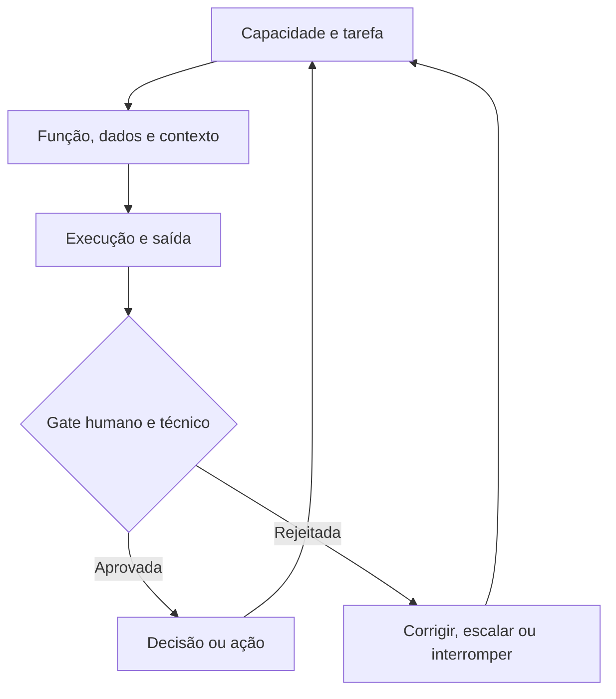
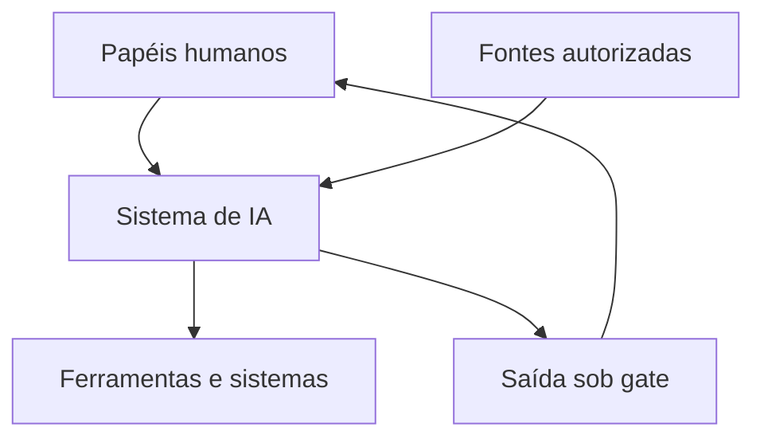
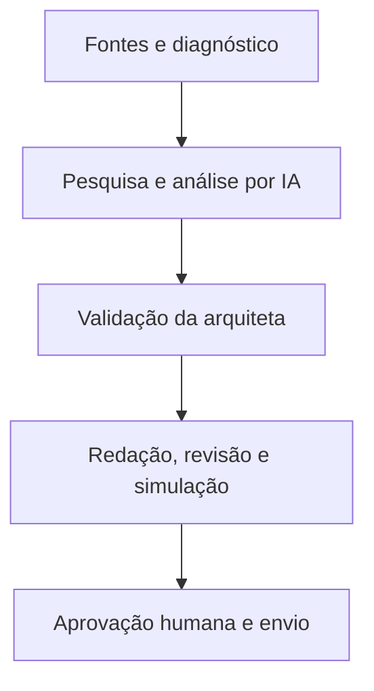

# Arquitetura de Inteligência Artificial — Ficha Operacional

**Sistema Operacional do Estúdio LICHTARA**  
**Módulo:** 3 — Arquitetura Organizacional  
**Ferramenta:** 09 — Arquitetura de Inteligência Artificial  
**Tipo:** Ficha metodológica, arquitetural e preenchível  
**Versão:** 0.1  
**Status:** Em desenvolvimento e validação pela prática  
**Data de criação:** 02/08/2026

**Documentos relacionados:**

- `README.md` deste diretório;
- `01-estado-atual-e-estado-futuro.md`;
- `02-arquitetura-de-processos-e-fluxos.md`;
- `03-papeis-responsabilidades-e-alcadas.md`;
- `04-arquitetura-de-informacao-e-conhecimento.md`;
- `05-arquitetura-da-comunicacao.md`;
- `06-arquitetura-documental.md`;
- `07-arquitetura-de-indicadores.md`;
- `08-arquitetura-de-tecnologia-e-integracoes.md`;
- `../README.md`;
- `../fundamentos-da-arquitetura.md`;
- `../protocolo-de-arquitetura.md`;
- `../matriz-de-rastreabilidade.md`;
- `../templates/plano-de-arquitetura.md`;
- `../templates/03-catalogo-de-requisitos.md`;
- `../templates/04-matriz-de-rastreabilidade.md`;
- `../templates/05-arquitetura-integrada.md`;
- `../templates/06-registro-de-validacao.md`;
- `../templates/08-transicao-para-implantacao.md`.

---

## 1. Finalidade

Esta ferramenta orienta o desenho de funções de inteligência artificial capazes de ampliar capacidades organizacionais sob responsabilidade, supervisão, evidência e limites humanos explícitos.

Ela ajuda o Estúdio LICHTARA a:

- começar pela capacidade, pela tarefa e pelo resultado, não pelo modelo ou pela ferramenta disponível;
- distinguir sistema de IA, modelo, serviço, função, agente, automação, ferramenta e papel humano;
- decompor trabalho cognitivo em tarefas observáveis e verificáveis;
- decidir onde IA agrega valor, onde deve apenas apoiar e onde não deve participar;
- definir funções como pesquisadora, analista, redatora, documental, gestora, revisora e financeira por contratos operacionais;
- separar nome funcional, interface conversacional, autoridade e responsabilidade institucional;
- atribuir responsável humano, revisor, aprovador, contestação e interrupção;
- classificar risco, impacto, autonomia, exposição, sensibilidade e reversibilidade;
- definir entradas, contexto, fontes, instruções, ferramentas, memória e saídas;
- estabelecer permissões, limites de ação e condições de parada;
- criar critérios de qualidade, conjuntos de teste, avaliações e gates de aceite;
- desenhar guardrails de entrada, processamento, saída, ação e operação;
- tratar incerteza, erro, fabricação, viés, deriva, abuso e falha;
- governar agentes, múltiplas funções, delegações e estado compartilhado;
- proteger dados, autoria, propriedade intelectual, privacidade e confidencialidade;
- monitorar correções humanas, incidentes, custo, latência e sustentabilidade;
- preparar piloto, implantação, operação, suspensão e encerramento;
- produzir um bloco rastreável para a Arquitetura Integrada;
- criar a ponte metodológica para o futuro Módulo 7 — Ecossistema de IA.

## 2. Pergunta central

> Que capacidade pode ser ampliada por inteligência artificial, em qual tarefa delimitada, com que dados, contexto, ferramentas, qualidade, supervisão, autoridade humana, limites de ação, evidências e condições de interrupção, para que o sistema produza valor sem perder governabilidade?

Perguntas derivadas:

- Que resultado organizacional justifica considerar IA?
- Que tarefa concreta será apoiada ou executada?
- A tarefa precisa de geração, recuperação, classificação, previsão, transformação ou decisão?
- Uma regra, melhoria de processo ou ferramenta convencional resolveria melhor?
- Que erro é possível e quem seria afetado?
- A saída pode ser verificada antes de produzir efeito?
- Que dados e fontes são necessários, permitidos e suficientes?
- Que contexto precisa acompanhar cada execução?
- Que modelo, serviço ou ferramenta pode realizar a função?
- Que ações a IA pode sugerir, preparar, executar ou jamais realizar?
- Quem responde pela função e possui autoridade para rejeitar a saída?
- Como a pessoa afetada compreende, corrige ou contesta?
- Que avaliação demonstra qualidade no contexto real?
- Que guardrail previne, detecta ou contém falhas materiais?
- Como reconhecer mudança de desempenho, custo ou comportamento?
- Quando suspender, retornar ao processo humano ou encerrar?
- Que conhecimento gerado precisa alimentar o Módulo 6 e o futuro Módulo 7?

## 3. O que é

Arquitetura de Inteligência Artificial é uma ferramenta de desenho organizacional das funções, relações, controles e condições sob as quais sistemas de IA participam do trabalho.

Ela organiza:

1. **capacidades, resultados e tarefas candidatas**;
2. **funções de IA e responsabilidades humanas**;
3. **dados, fontes, contexto, instruções e memória**;
4. **modelos, serviços, ferramentas, agentes e integrações**;
5. **saídas, verificações, decisões e ações**;
6. **autonomia, permissões, supervisão e contestação**;
7. **avaliação, guardrails, monitoramento e incidentes**;
8. **privacidade, equidade, autoria, segurança e impacto humano**;
9. **custos, fornecedores, portabilidade e ciclo de vida**;
10. **aprendizagem, documentação e evolução do ecossistema**.

Seu produto é uma configuração sociotécnica governável. A IA pode pesquisar, transformar, sugerir, gerar, classificar, comparar ou executar tarefas delimitadas; a organização continua responsável por finalidade, dados, critérios, decisões, consequências e continuidade.

## 4. Distinções essenciais

### 4.1 Inteligência artificial

Inteligência artificial designa sistemas computacionais capazes de produzir saídas como classificações, previsões, recomendações, conteúdo, decisões auxiliares ou ações a partir de dados, instruções, modelos e contexto.

### 4.2 Sistema de IA

Sistema de IA é a configuração completa que inclui modelo, dados, instruções, software, integrações, ferramentas, interfaces, pessoas, controles e operação. O comportamento observado pertence ao sistema inteiro, não apenas ao modelo.

### 4.3 Modelo de IA

Modelo de IA é um componente computacional treinado ou configurado para transformar entradas em saídas segundo padrões aprendidos. Modelo não equivale à função organizacional que o utiliza.

### 4.4 Serviço de IA

Serviço de IA é uma capacidade técnica disponibilizada por aplicação, interface ou plataforma, com condições de acesso, processamento, custo, versão e continuidade.

### 4.5 Função de IA

Função de IA é uma responsabilidade operacional delimitada atribuída ao sistema para apoiar determinada capacidade, como pesquisar, extrair, classificar, redigir ou revisar. Ela possui entradas, saídas, critérios, limites e responsável humano.

### 4.6 Tarefa de IA

Tarefa de IA é uma unidade concreta de trabalho realizada dentro de uma função, com evento de início, entrada, transformação, saída, critério e término.

### 4.7 Agente

Agente é uma configuração capaz de observar estado, planejar ou selecionar passos, utilizar ferramentas e produzir ações dentro de objetivo, permissões, orçamento e condições de parada definidos.

### 4.8 Assistente ou copiloto

Assistente é uma interface de apoio que produz sugestões, rascunhos ou transformações sob condução de uma pessoa. O nome não define seu grau real de autonomia.

### 4.9 Automação determinística

Automação determinística executa regras explícitas e tende a produzir o mesmo resultado para as mesmas condições. Ainda pode falhar por dados, integração, regra ou contexto.

### 4.10 Automação probabilística

Automação probabilística utiliza modelo cuja saída pode variar, conter incerteza ou depender de padrões não expressos como regra completa. Exige avaliação e controle compatíveis com essa variabilidade.

### 4.11 Ferramenta

Ferramenta é uma capacidade externa ou interna que o sistema pode consultar ou acionar, como busca, cálculo, banco de dados, geração de documento ou envio de mensagem.

### 4.12 Prompt ou instrução

Prompt é um conjunto de instruções e dados fornecidos ao modelo para orientar comportamento em uma execução. Faz parte da configuração e precisa de finalidade, versão e teste quando material.

### 4.13 Contexto

Contexto é o conjunto de informações, regras, exemplos, estado e referências disponibilizados para que a função interprete a tarefa adequadamente.

### 4.14 Recuperação

Recuperação é o mecanismo de localizar conteúdo pertinente em fontes autorizadas para compor contexto. Recuperar informação não garante que ela seja atual, correta ou suficiente.

### 4.15 Fundamentação

Fundamentação é a vinculação da saída a fontes, dados ou regras verificáveis, reduzindo a liberdade de afirmação fora da evidência disponível.

### 4.16 Memória

Memória é a persistência de estado ou informação entre passos, sessões ou relações. Possui fonte, finalidade, escrita, leitura, correção, retenção e exclusão.

### 4.17 Saída de IA

Saída de IA é o conteúdo, classificação, previsão, recomendação, código, chamada ou ação produzida pelo sistema. Permanece candidata até atingir o gate de verificação e autoridade correspondente.

### 4.18 Recomendação

Recomendação é uma saída que propõe opção ou direção segundo critérios. Ela não constitui decisão institucional apenas por ser clara ou convincente.

### 4.19 Decisão

Decisão é o ato autorizado que escolhe, compromete, aprova, rejeita ou altera estado organizacional. A IA pode apoiar a decisão; a autoridade precisa permanecer definida.

### 4.20 Ação

Ação é uma mudança produzida no mundo, no processo, no sistema, no dado ou na comunicação. Ação externa exige permissão, condição de execução, registro e retorno proporcionais.

### 4.21 Autonomia

Autonomia operacional é o grau em que o sistema seleciona ou executa passos sem aprovação humana imediata. Ela é sempre delimitada por objetivo, escopo, recurso, tempo, custo e risco.

### 4.22 Delegação

Delegação é a autorização limitada para realizar tarefa ou ação. Delegar execução à IA não transfere responsabilidade institucional.

### 4.23 Supervisão humana

Supervisão humana é a capacidade efetiva de compreender o funcionamento suficiente, observar resultados, intervir, rejeitar, corrigir, interromper e responder.

### 4.24 Verificação humana

Verificação humana é o exame de uma saída por pessoa competente segundo critério explícito. Presença nominal de revisor não demonstra controle efetivo.

### 4.25 Guardrail

Guardrail é uma barreira ou regra de prevenção, detecção, contenção ou resposta aplicada a entrada, contexto, geração, ferramenta, saída ou ação.

### 4.26 Avaliação

Avaliação é o processo de testar qualidade, segurança e adequação da função por casos, critérios, métricas e julgamento humano antes e durante o uso.

### 4.27 Monitoramento

Monitoramento é a observação contínua ou periódica do comportamento, uso, falhas, correções, custos, impactos e mudanças do sistema em operação.

### 4.28 Deriva

Deriva é uma mudança material no desempenho ou no contexto decorrente de alterações em dados, público, tarefa, modelo, fonte, ferramenta, instrução ou ambiente.

### 4.29 Persona

Persona é uma camada de linguagem, identidade comunicativa ou apresentação. Ela pode facilitar interação, mas não substitui contrato funcional, permissão, avaliação ou responsável.

### 4.30 Ecossistema de IA

Ecossistema de IA é o conjunto governado de funções, agentes, pessoas, modelos, ferramentas, dados, contratos e aprendizagens que se relacionam ao longo do trabalho.

### 4.31 Quadro comparativo

| Objeto | Define | Exemplo | Não demonstra automaticamente |
| --- | --- | --- | --- |
| Modelo | Capacidade computacional | Gerar texto | Função confiável |
| Sistema de IA | Configuração completa | Assistente documental | Governabilidade |
| Função | Responsabilidade operacional | Revisar consistência | Autoridade institucional |
| Tarefa | Unidade de trabalho | Comparar duas versões | Resultado final aprovado |
| Agente | Seleção e execução de passos | Pesquisar e organizar fontes | Autonomia ilimitada |
| Prompt | Instrução de execução | Extrair campos definidos | Controle completo |
| Contexto | Informação disponibilizada | Documentos aprovados | Verdade automática |
| Memória | Estado persistido | Preferência validada | Consentimento permanente |
| Saída | Resultado produzido | Rascunho de relatório | Evidência ou decisão |
| Guardrail | Barreira de proteção | Bloquear envio sem aprovação | Ausência de risco |

## 5. Cadeia arquitetural

A ferramenta utiliza a cadeia:

`capacidade → tarefa → função de IA → dados e contexto → execução → saída → verificação → decisão ou ação → evidência → aprendizagem`.



### 5.1 Regra de derivação

Nenhuma função de IA entra na arquitetura apenas porque um modelo consegue demonstrá-la. A função precisa responder a capacidade real, possuir tarefa delimitada, evidência de utilidade, verificação possível, risco tratável e responsabilidade humana.

## 6. Função no protocolo de arquitetura

| Etapa do protocolo | Contribuição da ferramenta |
| --- | --- |
| Delimitação | Identificar capacidades e tarefas candidatas à ampliação por IA |
| Diagnóstico | Reconhecer usos atuais, informais, riscos, dados e dependências |
| Requisitos | Definir função, qualidade, supervisão, permissões e limites |
| Desenho | Especificar sistema, fluxos, contratos, avaliações e guardrails |
| Integração | Relacionar IA a processos, papéis, informação, tecnologia e indicadores |
| Validação | Testar casos normais, extremos, adversariais e impactos humanos |
| Aprovação | Constituir linha de base da arquitetura de IA |
| Transição | Informar piloto, preparação, implantação, treinamento e operação |

## 7. Saídas principais

A aplicação pode produzir:

- inventário de usos atuais e paralelos de IA;
- mapa de capacidades e tarefas candidatas;
- avaliação de adequação e risco das tarefas;
- catálogo de funções de IA;
- contratos de função e de saída;
- mapa de responsabilidades humanas;
- níveis de autonomia e gates de aprovação;
- arquitetura de contexto, fontes, instruções e memória;
- matriz de dados permitidos, condicionais e proibidos;
- catálogo de ferramentas e permissões;
- desenho de agentes e coordenação entre funções;
- modelo de supervisão, contestação e interrupção;
- taxonomia de erros e danos;
- arquitetura de avaliações e conjuntos de teste;
- guardrails de entrada, saída, ação e operação;
- indicadores de qualidade, correção, custo e impacto;
- modelo de logs, versões e rastreabilidade;
- requisitos de segurança e privacidade;
- regras de autoria e propriedade intelectual;
- critérios de seleção, portabilidade e saída de modelo ou fornecedor;
- ciclo de vida, piloto, suspensão e encerramento;
- bloco consolidado para a Arquitetura Integrada;
- insumos para os Módulos 4, 6 e 7.

### 7.1 Seleção proporcional

| Contexto | Saída mínima recomendada |
| --- | --- |
| Uso individual assistido | Função, dados permitidos, verificação, registro e responsável |
| Equipe pequena | Catálogo, contratos, permissões, avaliações e supervisão |
| Saída externa | Fonte, revisão, autoria, aprovação e contestação |
| Ação automatizada | Autonomia, ferramenta, limite, idempotência, interrupção e log |
| Dado sensível ou alto impacto | Avaliação ampliada, especialista, proteção e gate forte |
| Múltiplos agentes | Contratos entre funções, estado, orçamento e resolução de conflito |
| Ecossistema organizacional | Portfólio, padrões, governança, monitoramento e aprendizagem |

## 8. O que a ferramenta não é

Esta ferramenta não é:

- lista de ferramentas populares;
- catálogo de personas ou nomes de agentes;
- promessa de substituir trabalho humano;
- autorização para usar todo dado disponível;
- equivalência entre fluência e confiabilidade;
- garantia de neutralidade, objetividade ou ausência de viés;
- transferência de responsabilidade para fornecedor ou modelo;
- avaliação técnica isolada da organização;
- parecer jurídico, de segurança, privacidade ou impacto especializado;
- manual de prompts;
- projeto detalhado de infraestrutura;
- plano de implantação do Módulo 4;
- desenho completo do Ecossistema de IA do Módulo 7.

## 9. Fronteiras com outras dimensões e módulos

| Dimensão | Esta ferramenta define | Outra ferramenta ou módulo aprofunda |
| --- | --- | --- |
| Estado atual e futuro | Mudança produzida pela função de IA | Capacidades e transição na ferramenta 01 |
| Processos | Tarefa, evento, exceção e retorno humano | Fluxo integral na ferramenta 02 |
| Papéis | Responsável, revisor, aprovador e interrupção | Autoridade e alçada na ferramenta 03 |
| Informação | Dados, contexto, memória e fontes da função | Significado, qualidade e conhecimento na ferramenta 04 |
| Comunicação | Saídas, explicações e canais de contestação | Públicos, mensagens e confirmações na ferramenta 05 |
| Documentação | Prompts, versões, avaliações e registros | Função documental, retenção e preservação na ferramenta 06 |
| Indicadores | Métricas, limites e guardrails da função | Contratos métricos e resposta na ferramenta 07 |
| Tecnologia | Modelo, ferramenta e integração necessários | Infraestrutura, acesso e continuidade na ferramenta 08 |
| Alternativas | Configurações humanas e de IA candidatas | Comparação e recomendação na ferramenta 10 |
| Implantação | Condições e gates de entrada | Projeto, treinamento e mudança no Módulo 4 |
| Inteligência Organizacional | Evidência e aprendizagem produzidas | Ciclo de conhecimento no Módulo 6 |
| Ecossistema de IA | Função aplicada ao projeto | Papéis permanentes e relações no Módulo 7 |

### 9.1 Fronteira com o Módulo 7

Esta ficha responde: **como determinada função de IA deve operar neste projeto ou arquitetura?**

O Módulo 7 responderá: **quais funções de IA compõem o ecossistema permanente do Estúdio, como se relacionam, que padrões compartilham e como evoluem entre projetos?**

### 9.2 Unidade de desenho

| Ferramenta 09 | Módulo 7 |
| --- | --- |
| Função ou sistema em contexto delimitado | Portfólio institucional de funções |
| Requisitos do projeto | Padrões comuns do Estúdio |
| Responsável e avaliação locais | Governança transversal |
| Dados e ferramentas do caso | Recursos compartilhados |
| Aprendizagem da aplicação | Aprendizagem acumulada entre projetos |

## 10. Princípios

1. A capacidade e a tarefa antecedem o modelo.
2. IA é componente do sistema; responsabilidade institucional permanece humana.
3. Função precede persona.
4. Dados e contexto possuem finalidade, autoridade e limite.
5. Saída fluente continua sendo saída candidata.
6. Verificação acompanha risco, impacto e reversibilidade.
7. Autonomia é concedida por ação e contexto, nunca de forma abstrata.
8. Toda ferramenta possui permissão mínima e condição de parada.
9. Toda ação externa possui autoridade, registro e retorno.
10. Guardrails reduzem risco; não provam segurança.
11. Avaliações representam o uso real e suas exceções.
12. Correções humanas são evidência de aprendizagem, não ruído a ocultar.
13. Pessoas afetadas possuem compreensão e contestação proporcionais.
14. Monitoramento serve à qualidade e à proteção, não à vigilância irrestrita.
15. Mudança de modelo, dado, contexto, prompt ou ferramenta pode alterar o sistema.
16. Custo, latência e impacto ambiental pertencem à qualidade arquitetural.
17. Portabilidade e encerramento entram no desenho desde o início.
18. O conhecimento gerado melhora o próximo projeto e o ecossistema.

## 11. Invariantes

Independentemente do porte, preserve:

- capacidade e tarefa justificadoras;
- função de IA delimitada;
- responsável humano identificável;
- dados, fontes e finalidades autorizados;
- entrada e saída contratadas;
- critério de qualidade;
- limite de autonomia e permissão;
- verificação ou gate correspondente;
- tratamento de erro e exceção;
- interrupção e retorno humano;
- versão e configuração rastreáveis;
- registro proporcional;
- contestação quando houver pessoa afetada;
- avaliação antes de ampliar o uso;
- condição de revisão e encerramento.

## 12. Quando utilizar

Utilize quando:

- tarefa cognitiva recorrente puder receber apoio;
- pesquisa, extração, classificação, síntese, redação ou revisão forem consideradas;
- recomendação influenciar decisão;
- modelo gerar comunicação, documento, código ou análise;
- automação probabilística puder alterar processo ou dado;
- agente utilizar ferramentas ou executar passos;
- mais de uma função de IA precisar cooperar;
- dados internos ou de clientes entrarem em contexto;
- resultado exigir avaliação própria;
- correções humanas precisarem alimentar aprendizagem;
- fornecedor, custo ou modelo criar dependência;
- implantação exigir supervisão, treinamento e resposta a falhas.

## 13. Quando não utilizar ou reduzir

Reduza quando:

- a tarefa é ocasional, reversível e inteiramente verificada antes do uso;
- nenhum dado protegido ou ação externa está envolvido;
- a função pode permanecer experimental e isolada;
- uma regra simples produz resultado mais confiável;
- o ganho é menor que custo de revisão e manutenção.

Não utilize IA quando:

- finalidade e tarefa permanecem indefinidas;
- erro material não pode ser detectado ou reparado;
- dados necessários não possuem autorização ou qualidade;
- pessoa responsável não consegue compreender ou rejeitar a saída;
- efeito sobre direitos, segurança ou dignidade não é tratável;
- fornecedor ou ambiente viola condição impeditiva;
- a organização não consegue interromper ou retornar;
- uma solução humana ou determinística atende melhor.

### 13.1 Registro de não adoção ou redução

| Campo | Preenchimento |
| --- | --- |
| Capacidade/tarefa | CAP/TAI-ARQ-___ |
| Alternativa escolhida | [Humana, processual, determinística ou adiamento] |
| Motivo | [Qualidade, risco, custo, dado, verificação ou maturidade] |
| Evidência | [Fonte/teste] |
| Risco residual | RSC-ARQ-___ |
| Responsável | PAP-ARQ-___ |
| Gatilho de reconsideração | [Evento/evidência] |

## 14. Proporcionalidade

| Fator | Pergunta | Efeito possível |
| --- | --- | --- |
| Impacto | Quem sofre consequência do erro? | Gate e avaliação mais fortes |
| Autonomia | O sistema apenas sugere ou age? | Permissões e interrupção |
| Exposição | A saída permanece interna ou alcança terceiros? | Revisão, autoria e comunicação |
| Sensibilidade | Que dados entram ou são inferidos? | Minimização e proteção |
| Reversibilidade | O efeito pode ser desfeito? | Aprovação prévia e rollback |
| Escala | Quantas pessoas ou ações são afetadas? | Amostra, monitoramento e limites |
| Variabilidade | Quanto a saída pode mudar? | Testes e tolerâncias |
| Verificabilidade | É possível reconhecer erro? | Escopo e supervisão |
| Maturidade | A equipe consegue operar e revisar? | Simplicidade e treinamento |
| Dependência | Quanto controle está no fornecedor? | Portabilidade e saída |
| Custo | Qual gasto por execução e revisão? | Orçamento e roteamento |

### 14.1 Níveis

| Nível | Aplicação | Conteúdo |
| --- | --- | --- |
| Essencial | Apoio individual de baixo risco | Função, dados, revisão, registro e responsável |
| Intermediário | Fluxo recorrente ou saída compartilhada | Essencial + contrato, avaliação, guardrails e monitoramento |
| Ampliado | Ação, alto impacto ou dado sensível | Intermediário + especialistas, adversarial, incidente e contestação |
| Sistêmico | Múltiplas funções ou ecossistema | Portfólio, orquestração, padrões, governança e aprendizagem |

## 15. Escalas e camadas

### 15.1 Escalas

| Escala | Foco |
| --- | --- |
| Interação | Uma entrada e uma saída |
| Tarefa | Unidade de trabalho delimitada |
| Função | Conjunto coerente de tarefas |
| Processo | Participação da IA em fluxo organizacional |
| Serviço | Capacidade oferecida a público |
| Organização | Portfólio de funções e responsabilidades |
| Ecossistema | Relações entre pessoas, agentes, fornecedores e conhecimento |

### 15.2 Camadas

| Camada | Pergunta |
| --- | --- |
| Organizacional | Que capacidade, resultado e responsabilidade justificam a IA? |
| Trabalho | Que tarefa, evento, passagem e exceção existem? |
| Humana | Quem conduz, verifica, decide, contesta e interrompe? |
| Informacional | Que dados, fontes, contexto e memória são utilizados? |
| Cognitiva | Que transformação, modelo e instrução produzem a saída? |
| Técnica | Que serviço, integração, ferramenta e ambiente sustentam? |
| Avaliativa | Como qualidade, risco e impacto são demonstrados? |
| Governança | Quem autoriza, monitora, muda, suspende e encerra? |

### 15.3 Separação das camadas

Escolher modelo não define função; escrever prompt não define responsabilidade; criar interface não define processo; instalar guardrail não define risco aceitável. Cada camada precisa ser integrada sem apagar as demais.

## 16. Participantes da aplicação

| Participante | Contribuição | Risco se ausente |
| --- | --- | --- |
| Responsável pela capacidade | Finalidade e resultado | IA sem valor real |
| Executor atual | Prática, exceções e conhecimento tácito | Tarefa mal representada |
| Pessoa afetada | Impacto, compreensão e contestação | Dano invisível |
| Responsável pela informação | Fonte, qualidade e autorização | Contexto inadequado |
| Responsável técnico | Modelo, integração, acesso e continuidade | Desenho inexequível |
| Revisor humano | Critério e capacidade de rejeição | Supervisão nominal |
| Segurança e privacidade | Ameaças, dados e controles | Exposição ou abuso |
| Especialista do domínio | Correção e limite de inferência | Saída plausível, porém errada |
| Responsável financeiro | Custo e sustentabilidade | Escala inviável |
| Decisor | Autoridade e risco residual | Aprovação presumida |
| Validador | Casos, testes e evidência | Qualidade declarada |

### 16.1 Participantes reais

| Papel no desenho | Pessoa/papel | Participação | Competência | Autoridade | Disponibilidade | Conflito de interesse |
| --- | --- | --- | --- | --- | --- | --- |
| [Preencher] | [Nome/PAP ID] | [Oficina, teste, revisão ou decisão] | [Preencher] | [Alçada] | [Condição] | [Sim/não/tratamento] |

## 17. Autoridade e limites

| Decisão | Autoridade | Consulta | Limite | Evidência |
| --- | --- | --- | --- | --- |
| Aprovar função de IA | PAP/INS-ARQ-___ | [Capacidade/afetados] | [Escopo] | FIA/DEC-ARQ-___ |
| Autorizar dados | PAP/INS-ARQ-___ | [Dono/privacidade] | [Finalidade] | ACS-ARQ-___ |
| Aprovar modelo ou fornecedor | PAP/INS-ARQ-___ | [Técnico/financeiro] | [Critérios] | ALT/DEC-ARQ-___ |
| Definir autonomia | PAP/INS-ARQ-___ | [Processo/risco] | [Ações] | DEC-ARQ-___ |
| Aprovar produção | PAP/INS-ARQ-___ | [Validador/operação] | [Gate] | EIA/VAL-ARQ-___ |
| Publicar ou enviar saída | PAP/INS-ARQ-___ | [Revisor] | [Público/tema] | APR/RGT-ARQ-___ |
| Aceitar risco residual | PAP/INS-ARQ-___ | [Especialistas/afetados] | [Alçada] | RSC/DEC-ARQ-___ |
| Suspender função | PAP/INS-ARQ-___ | [Operação] | [Gatilho] | INC/DEC-ARQ-___ |
| Encerrar função | PAP/INS-ARQ-___ | [Responsável/usuários] | [Retenção] | DEC-ARQ-___ |

### 17.1 Autoridade que não pode ser presumida

- gerar texto não autoriza publicar;
- recomendar não autoriza decidir;
- classificar não autoriza excluir ou priorizar pessoa;
- calcular não autoriza assumir compromisso financeiro;
- acessar ferramenta não autoriza utilizá-la em toda ação;
- produzir código não autoriza implantá-lo;
- detectar risco não autoriza acusar ou sancionar;
- coordenar tarefas não autoriza alterar alçadas;
- nome de persona não cria responsabilidade institucional.

## 18. Entradas necessárias

| Entrada | ID ou referência | Contribuição | Responsável | Estado | Limitação |
| --- | --- | --- | --- | --- | --- |
| Capacidades e resultados | CAP/RSL-ARQ-___ | Finalidade | [Papel] | [Estado] | [Preencher] |
| Processos e tarefas | PRC/ATV/FLX-ARQ-___ | Momento e exceções | [Papel] | [Estado] | [Preencher] |
| Papéis e alçadas | PAP/ALC/ATD-ARQ-___ | Responsabilidade e decisão | [Papel] | [Estado] | [Preencher] |
| Informação e fontes | INF/DAD/FON-ARQ-___ | Contexto e evidência | [Papel] | [Estado] | [Preencher] |
| Conhecimento | CON/COR-ARQ-___ | Competência e referência | [Papel] | [Estado] | [Preencher] |
| Comunicação e documentos | COM/DOC-ARQ-___ | Saídas e registros | [Papel] | [Estado] | [Preencher] |
| Indicadores e guardrails | IND/GRD-ARQ-___ | Qualidade e resposta | [Papel] | [Estado] | [Preencher] |
| Tecnologia e integrações | CMP/ITG/CTI-ARQ-___ | Execução técnica | [Papel] | [Estado] | [Preencher] |
| Riscos e controles | RSC/CTL-ARQ-___ | Proteção | [Papel] | [Estado] | [Preencher] |
| Usos atuais de IA | [Inventário] | Evidência e dependência | [Papel] | [Estado] | [Preencher] |

### 18.1 Regra de insuficiência

Se tarefa, dado, responsável, critério de qualidade ou possibilidade de verificação estiverem materialmente indefinidos, interrompa a recomendação firme. Registre a lacuna, o risco, a hipótese provisória e o responsável pela resolução.

## 19. Qualidade das evidências

| Evidência | Pode sustentar | Limite |
| --- | --- | --- |
| Observação do trabalho | Tarefas, exceções e carga | Não define solução por si só |
| Amostra de entradas e saídas | Casos e critérios iniciais | Pode não representar produção |
| Avaliação controlada | Desempenho no conjunto testado | Não garante contexto futuro |
| Log de uso atual | Frequência, erro e correção | Pode conter seleção e dados sensíveis |
| Teste de fornecedor | Capacidade no cenário | Pode mudar por versão |
| Documentação oficial | Condições declaradas | Não substitui teste local |
| Relato de usuário | Utilidade, fricção e impacto | Não representa todos os públicos |
| Parecer especializado | Risco e adequação no domínio | Depende de escopo e premissas |
| Saída do próprio modelo | Hipótese ou material de teste | Não comprova sua qualidade |

### 19.1 Controle de fonte

| Evidência | Fonte | Versão/data | Método | Limitação | Uso autorizado |
| --- | --- | --- | --- | --- | --- |
| [ID] | [Referência] | [Preencher] | [Observação, teste, amostra ou parecer] | [Preencher] | [Preencher] |

## 20. Preparação

- [ ] capacidade e resultado estão definidos;
- [ ] tarefa atual foi observada;
- [ ] alternativas não baseadas em IA permanecem abertas;
- [ ] papéis humanos e autoridade são conhecidos;
- [ ] fontes e dados foram classificados;
- [ ] público afetado foi reconhecido;
- [ ] riscos que exigem especialista foram identificados;
- [ ] critérios de qualidade podem ser formulados;
- [ ] amostras e ambiente de teste estão disponíveis;
- [ ] modelo, fornecedor e integração permanecem candidatos, não pressupostos;
- [ ] custo de revisão humana foi considerado;
- [ ] gate de decisão e interrupção foi planejado.

### 20.1 Insuficiência de preparação

| Condição ausente | Efeito | Tratamento | Prosseguir? | Responsável | Prazo/gatilho |
| --- | --- | --- | --- | --- | --- |
| [Preencher] | [Preencher] | [Obter, testar, limitar ou devolver] | [Sim, não ou experimental] | PAP-ARQ-___ | [Preencher] |

## 21. Plano da aplicação

| Etapa | Atividade | Responsável | Participantes | Entrada | Saída | Critério |
| --- | --- | --- | --- | --- | --- | --- |
| Delimitar | [Capacidade, tarefa e efeito] | PAP-ARQ-___ | [Papéis] | [IDs] | [Escopo] | [Preencher] |
| Diagnosticar | [Uso atual, dados, erros e carga] | PAP-ARQ-___ | [Papéis] | [Fontes] | [Inventário] | [Preencher] |
| Classificar | [Adequação, risco e autonomia] | PAP-ARQ-___ | [Especialistas] | [Casos] | [Perfis] | [Preencher] |
| Desenhar | [Função, contexto, ferramentas e gates] | PAP-ARQ-___ | [Papéis] | [Requisitos] | AIA-ARQ-___ | [Preencher] |
| Avaliar | [Casos, métricas e impactos] | PAP-ARQ-___ | [Validadores] | [Configuração] | EIA/VAL-ARQ-___ | [Preencher] |
| Integrar | [Processos, tecnologia e governança] | PAP-ARQ-___ | [Responsáveis] | [Saídas] | [Bloco] | [Preencher] |
| Aprovar | [Risco, gate e escopo] | PAP/INS-ARQ-___ | [Decisores] | [Evidência] | DEC-ARQ-___ | [Preencher] |
| Transicionar | [Piloto, implantação e operação] | PAP-ARQ-___ | [Módulo 4] | [Aprovados] | [Pacote] | [Preencher] |

## 22. Identificação, versão e validade

| Campo | Registro |
| --- | --- |
| ID do artefato | AIA-ARQ-AAAA-NNN |
| Projeto/cliente | [Preencher] |
| Título | [Preencher] |
| Escopo | [Preencher] |
| Versão | [Número] |
| Estado | [Rascunho, em avaliação, piloto, aprovada, suspensa, substituída ou encerrada] |
| Responsável | PAP-ARQ-___ |
| Validadores | [PAP/INS IDs] |
| Decisão | DEC-ARQ-___ |
| Vigência | [Data/condição] |
| Próxima revisão | [Data/evento] |
| Sensibilidade | [Classe] |

### 22.1 Identificadores específicos

| Objeto | Prefixo | Exemplo |
| --- | --- | --- |
| Arquitetura de IA | AIA-ARQ | AIA-ARQ-2026-001 |
| Sistema de IA | SIA-ARQ | SIA-ARQ-001 |
| Função de IA | FIA-ARQ | FIA-ARQ-001 |
| Tarefa de IA | TAI-ARQ | TAI-ARQ-001 |
| Agente | AGT-ARQ | AGT-ARQ-001 |
| Modelo de IA | MIA-ARQ | MIA-ARQ-001 |
| Prompt/instrução | PRM-ARQ | PRM-ARQ-001 |
| Pacote de contexto | CXT-ARQ | CXT-ARQ-001 |
| Saída de IA | OIA-ARQ | OIA-ARQ-001 |
| Avaliação de IA | EIA-ARQ | EIA-ARQ-001 |
| Guardrail de IA | GIA-ARQ | GIA-ARQ-001 |
| Interação humano–IA | IHA-ARQ | IHA-ARQ-001 |
| Orquestração de IA | ORQ-ARQ | ORQ-ARQ-001 |
| Conjunto de casos de avaliação | CJI-ARQ | CJI-ARQ-001 |

### 22.2 Códigos compartilhados

`CAP`, `PRC`, `ATV`, `PAP`, `ALC`, `INF`, `DAD`, `FON`, `CON`, `COR`, `DOC`, `IND`, `GRD`, `CMP`, `ITG`, `CTI`, `ACS`, `RSC`, `CTL`, `TST`, `VAL`, `INC` e `DEC` preservam os significados definidos nas fichas anteriores.

## 23. Contexto e fronteiras

| Questão | Registro |
| --- | --- |
| Capacidade em foco | CAP-ARQ-___ |
| Resultado esperado | RSL-ARQ-___ |
| Processo e tarefa | PRC/ATV-ARQ-___ |
| Públicos e pessoas afetadas | PAP/PUB-ARQ-___ |
| Domínios de informação | DOM-ARQ-___ |
| Sistemas e ferramentas | CMP/ITG-ARQ-___ |
| Ambientes | AMB-ARQ-___ |
| Organizações externas | [IDs/nomes] |
| Ações externas possíveis | [Classes/nenhuma] |
| Fora de escopo | [Descrição] |
| Horizonte | [Data/período] |
| Restrições | [IDs] |

### 23.1 Diagrama de contexto preenchível



### 23.2 Fora de escopo

| Elemento | Motivo | Dependência preservada | Risco | Condição para incluir |
| --- | --- | --- | --- | --- |
| [Preencher] | [Preencher] | DEP-ARQ-___ | RSC-ARQ-___ | [Gatilho] |

## 24. Inventário atual de IA

Inventarie usos aprovados e informais, inclusive contas individuais, recursos embutidos em outras ferramentas, extensões, automações, prompts pessoais, planilhas enriquecidas e modelos locais.

| ID | Uso atual | Função real | Usuários | Dados | Modelo/serviço | Saída | Revisão | Estado |
| --- | --- | --- | --- | --- | --- | --- | --- | --- |
| [SIA/FIA/AGT]-ARQ-___ | [Nome/descrição] | [O que faz na prática] | PAP-ARQ-___ | INF/DAD-ARQ-___ | MIA/SRV-ARQ-___ | OIA-ARQ-___ | [Papel/regra] | [Aprovado, informal, piloto, restrito ou suspenso] |

### 24.1 Elementos a localizar

- contas e planos;
- modelos e versões;
- prompts e instruções;
- fontes carregadas;
- memórias persistentes;
- ferramentas conectadas;
- permissões de escrita;
- automações e agentes;
- logs e históricos;
- custos;
- responsáveis;
- saídas publicadas;
- incidentes e correções.

### 24.2 Verificação do inventário

| Pergunta | Estado | Evidência |
| --- | --- | --- |
| A finalidade é conhecida? | [ ] | [Referência] |
| O responsável está identificado? | [ ] | [PAP ID] |
| Os dados foram autorizados? | [ ] | [ACS ID] |
| A retenção é conhecida? | [ ] | [Regra] |
| As ferramentas conectadas são visíveis? | [ ] | [Mapa] |
| A saída recebe revisão adequada? | [ ] | [Registro] |
| O modelo ou serviço pode mudar? | [ ] | [Contrato/configuração] |
| O uso pode ser interrompido? | [ ] | [Procedimento] |

## 25. IA paralela e uso não governado

Uso paralelo costuma revelar necessidade, curiosidade ou lacuna real. Também pode criar exposição de dados, perda de autoria, divergência, dependência pessoal e saída externa sem revisão.

| Uso paralelo | Necessidade atendida | Por que surgiu | Dados | Benefício | Risco | Tratamento |
| --- | --- | --- | --- | --- | --- | --- |
| [Preencher] | CAP-ARQ-___ | [Lacuna/fricção] | [Classes] | [Preencher] | RSC-ARQ-___ | [Integrar, limitar, substituir, treinar ou encerrar] |

### 25.1 Tratamento responsável

Evite punir ou eliminar antes de compreender a função absorvida. Crie alternativa segura, preserve aprendizagem útil, remova dados quando necessário e comunique limites de forma praticável.

## 26. Capacidades candidatas

| Capacidade | Resultado | Gargalo atual | Trabalho cognitivo | Evidência | IA candidata? | Alternativa |
| --- | --- | --- | --- | --- | --- | --- |
| CAP-ARQ-___ | RSL-ARQ-___ | [Tempo, qualidade, escala ou acesso] | [Pesquisar, comparar, gerar, classificar ou outro] | [Fonte] | [Sim, não ou explorar] | [Humana/determinística/processual] |

### 26.1 Ampliação de capacidade

Pergunte o que se torna possível ou melhor para a organização e para o público. Reduzir minutos de execução pode ser irrelevante se aumentar revisão, risco, retrabalho ou perda de compreensão.

## 27. Decomposição da tarefa

| Tarefa | Evento | Entrada | Transformação | Saída | Critério | Exceção | Responsável atual |
| --- | --- | --- | --- | --- | --- | --- | --- |
| TAI-ARQ-___ | EVT-ARQ-___ | INF/DAD/DOC-ARQ-___ | [Operação cognitiva] | OIA-ARQ-___ | [Regra/rubrica] | EXC-ARQ-___ | PAP-ARQ-___ |

### 27.1 Operações cognitivas

| Operação | Pergunta |
| --- | --- |
| Recuperar | Que conteúdo pertinente precisa ser localizado? |
| Extrair | Que elementos explícitos precisam ser estruturados? |
| Classificar | A que categoria definida o objeto pertence? |
| Comparar | Que semelhanças, diferenças e critérios existem? |
| Resumir | Que conteúdo essencial precisa ser preservado? |
| Sintetizar | Que estrutura pode integrar múltiplas fontes? |
| Gerar | Que novo artefato precisa ser produzido? |
| Revisar | Que erro, lacuna ou conflito precisa ser identificado? |
| Prever | Que resultado futuro é estimado a partir de padrões? |
| Recomendar | Que alternativa é proposta segundo critérios? |
| Planejar | Que sequência candidata pode atingir objetivo? |
| Executar | Que ação autorizada pode alterar estado? |

### 27.2 Tarefa composta

Separe recuperação, interpretação, geração, verificação e ação quando possuírem riscos, dados ou critérios diferentes. Um único rótulo como “analisar cliente” pode ocultar várias funções e alçadas.

## 28. Adequação da tarefa à IA

| Critério | Pergunta | Favorável | Desfavorável |
| --- | --- | --- | --- |
| Delimitação | Entrada, saída e término são claros? | Contrato possível | Tarefa aberta sem limite |
| Exemplos | Existem casos representativos? | Avaliação possível | Ausência de referência |
| Verificação | Erro pode ser reconhecido? | Gate objetivo ou especializado | Erro invisível |
| Reversibilidade | Saída pode ser rejeitada ou desfeita? | Baixo custo de correção | Efeito irreversível |
| Frequência | Há repetição suficiente? | Aprendizagem e escala | Uso raro |
| Variabilidade | Julgamento tolera alternativas? | Geração útil | Única resposta crítica |
| Dados | Fontes são adequadas e autorizadas? | Contexto governado | Dado proibido ou pobre |
| Impacto | Consequência é limitada? | Experimentação segura | Alto dano possível |
| Maturidade | Equipe consegue supervisionar? | Responsável competente | Dependência cega |
| Alternativa | IA supera regra ou melhoria simples? | Valor adicional | Complexidade desnecessária |

### 28.1 Decisão de adequação

| Tarefa | Resultado | Justificativa | Condições | Próximo movimento |
| --- | --- | --- | --- | --- |
| TAI-ARQ-___ | [Adequada, adequada com limites, experimental, inadequada ou adiada] | [Evidência] | [Dados, gate, escopo ou especialista] | [Desenhar, testar ou encerrar] |

## 29. Classificação de risco

| Dimensão | Nível | Evidência | Efeito no desenho |
| --- | --- | --- | --- |
| Impacto sobre pessoa | [Baixo/médio/alto/crítico] | [Fonte] | [Revisão/contestação] |
| Autonomia | [Sugere/prepara/executa] | [Fluxo] | [Permissão/gate] |
| Sensibilidade de dados | [Classe] | [Inventário] | [Minimização/proteção] |
| Exposição externa | [Interna/cliente/pública] | [Canal] | [Aprovação/autoria] |
| Reversibilidade | [Alta/média/baixa] | [Cenário] | [Rollback/impedimento] |
| Escala | [Faixa] | [Volume] | [Monitoramento/limite] |
| Verificabilidade | [Alta/média/baixa] | [Método] | [Escopo] |
| Vulnerabilidade do público | [Condição] | [Fonte] | [Proteção/especialista] |
| Dependência do fornecedor | [Nível] | [Contrato] | [Saída/fallback] |
| Incerteza | [Nível] | [Lacunas] | [Piloto/adiamento] |

### 29.1 Perfil de risco

| Perfil | Condição típica | Governança mínima provável |
| --- | --- | --- |
| Assistivo baixo | Rascunho interno reversível | Revisão do usuário e dados permitidos |
| Assistivo material | Saída influencia trabalho ou cliente | Contrato, avaliação, revisor e logs |
| Automação limitada | Sistema executa ação reversível | Gate, permissão, monitoramento e retorno |
| Alto impacto | Direitos, finanças, saúde, segurança ou oportunidade | Especialista, aprovação forte e contestação |
| Impeditivo | Dano não controlável ou verificação insuficiente | Não adotar ou redesenhar |

### 29.2 Risco agregado

Não reduza o perfil a uma média simples. Uma única condição impeditiva pode prevalecer sobre vantagens em outras dimensões.

## 30. Resultados esperados

| Resultado | Capacidade | Beneficiário | Linha de referência | Evidência | Guardrail | Horizonte |
| --- | --- | --- | --- | --- | --- | --- |
| RSL-ARQ-___ | CAP-ARQ-___ | PAP/PUB-ARQ-___ | BSL-ARQ-___ | IND/VAL-ARQ-___ | GRD/GIA-ARQ-___ | [Período] |

### 30.1 Resultado e eficiência

| Resultado real | Proxy insuficiente quando isolada |
| --- | --- |
| Pesquisa mais confiável | Quantidade de páginas produzidas |
| Decisão mais bem fundamentada | Velocidade da resposta |
| Documento mais consistente | Número de palavras |
| Atendimento mais acessível | Número de interações automatizadas |
| Operação mais sustentável | Redução de horas humanas |
| Aprendizagem acumulada | Volume de logs |

## 31. Requisitos da função de IA

| Requisito | Tipo | Origem | Prioridade | Critério de aceite | Flexibilidade | Responsável |
| --- | --- | --- | --- | --- | --- | --- |
| REQ-ARQ-___ | [Funcional, qualidade, dado, humano, segurança, operação ou restrição] | [ID/fonte] | [Obrigatório, desejável ou exploratório] | [Verificável] | [Fixo/negociável] | PAP-ARQ-___ |

### 31.1 Requisitos humanos indispensáveis

- competência para formular e revisar;
- tempo real de supervisão;
- autoridade para rejeitar;
- canal de escalonamento;
- compreensão dos limites;
- substituição durante ausência;
- proteção contra sobrecarga;
- acesso às fontes necessárias;
- possibilidade de contestação;
- aprendizagem com correções.

## 32. Requisitos funcionais

| Ator | Evento | Função | Entrada | Saída | Ferramenta | Gate | Exceção |
| --- | --- | --- | --- | --- | --- | --- | --- |
| PAP/SIA/AGT-ARQ-___ | EVT-ARQ-___ | FIA/TAI-ARQ-___ | INF/DAD-ARQ-___ | OIA-ARQ-___ | [CMP/FER IDs] | [PAP/VAL] | EXC-ARQ-___ |

### 32.1 Formulação

Utilize verbo, objeto, condição e limite. “Usar IA para gestão” é amplo demais; “identificar tarefas sem próxima ação e sugerir encaminhamento ao gestor, sem alterar responsável ou prazo” é verificável.

## 33. Atributos de qualidade

| Atributo | Pergunta | Critério | Método | Guardrail |
| --- | --- | --- | --- | --- |
| Correção | A saída corresponde às fontes e regras? | [Faixa/rubrica] | EIA-ARQ-___ | GIA-ARQ-___ |
| Completude | Elementos necessários estão presentes? | [Critério] | EIA-ARQ-___ | [Regra] |
| Relevância | Responde à tarefa sem excesso? | [Rubrica] | EIA-ARQ-___ | [Limite] |
| Consistência | Casos equivalentes recebem tratamento compatível? | [Critério] | EIA-ARQ-___ | [Revisão] |
| Rastreabilidade | Fontes, versão e passos são reconstruíveis? | [Campos] | [Inspeção] | RGT-ARQ-___ |
| Robustez | Resiste a variação e entrada adversarial? | [Casos] | EIA-ARQ-___ | GIA-ARQ-___ |
| Equidade | Erros não se concentram injustificadamente? | [Segmentos] | EIA-ARQ-___ | GRD-ARQ-___ |
| Privacidade | Dados permanecem dentro da finalidade? | [Critério] | VAL-ARQ-___ | CTL-ARQ-___ |
| Latência | Resposta atende ao fluxo? | [Faixa] | IND-ARQ-___ | [Fallback] |
| Custo | Uso permanece sustentável? | [Faixa] | IND-ARQ-___ | LMT-ARQ-___ |
| Explicabilidade operacional | Usuário entende base e limite suficientes? | [Teste] | VAL-ARQ-___ | [Mensagem] |

### 33.1 Qualidade composta

Uma saída pode ser correta e ainda inadequada por exposição, tom, atraso, custo, ausência de fonte ou impacto desigual. Defina quais dimensões são impeditivas e quais admitem compensação.

## 34. Restrições

| Restrição | Origem | Escopo | Efeito | Negociável? | Autoridade | Revisão |
| --- | --- | --- | --- | --- | --- | --- |
| [Dado, modelo, ambiente, custo, ação, público, contrato ou regulação] | [ID/fonte] | [Objetos] | [Preencher] | [Sim/não/condição] | PAP/INS-ARQ-___ | [Evento] |

### 34.1 Restrições típicas

- dados que não podem sair de ambiente definido;
- proibição de treinamento ou retenção pelo fornecedor;
- saída externa exige aprovação humana;
- ação financeira exige confirmação específica;
- ferramenta de escrita permanece somente leitura;
- memória persistente é desativada para determinada classe;
- fonte sem validação não pode fundamentar afirmação;
- custo por execução possui teto;
- modelo não pode decidir sobre pessoa;
- idioma, acessibilidade ou jurisdição limitam uso.

## 35. Premissas e incertezas

| ID | Premissa ou incerteza | Efeito se falsa | Evidência atual | Teste | Prazo | Responsável |
| --- | --- | --- | --- | --- | --- | --- |
| [ID] | [Preencher] | [Preencher] | [Fonte/ausente] | EIA/TST-ARQ-___ | [Data] | PAP-ARQ-___ |

### 35.1 Estados permitidos

- confirmada;
- plausível e provisória;
- contestada;
- desconhecida;
- invalidada;
- substituída.

## 36. Catálogo de funções de IA

| ID | Nome funcional | Capacidade | Tarefas | Entradas | Saídas | Responsável humano | Estado |
| --- | --- | --- | --- | --- | --- | --- | --- |
| FIA-ARQ-___ | [Nome] | CAP-ARQ-___ | TAI-ARQ-___ | INF/DAD-ARQ-___ | OIA-ARQ-___ | PAP-ARQ-___ | [Candidata, teste, piloto, ativa, restrita, suspensa ou encerrada] |

### 36.1 Critérios de coesão

Uma função de IA possui:

- finalidade reconhecível;
- conjunto coerente de tarefas;
- entradas e saídas delimitadas;
- critérios próprios de qualidade;
- permissões compatíveis;
- responsável humano;
- relação clara com outras funções;
- ciclo de vida independente quando necessário.

### 36.2 Decompor ou combinar

Separe funções quando dados, riscos, critérios, modelos, revisores ou permissões forem materialmente diferentes. Combine quando a divisão apenas criar passagem artificial sem melhorar controle, especialização ou aprendizagem.

## 37. Contrato da função de IA

| Campo | Registro |
| --- | --- |
| ID | FIA-ARQ-___ |
| Nome funcional | [Preencher] |
| Finalidade | [Capacidade e resultado] |
| Tarefas | TAI-ARQ-___ |
| Evento de início | EVT-ARQ-___ |
| Entradas | INF/DAD/DOC-ARQ-___ |
| Fontes autorizadas | FON/COR-ARQ-___ |
| Contexto | CXT-ARQ-___ |
| Instrução | PRM-ARQ-___ |
| Modelo/serviço | MIA/SRV-ARQ-___ |
| Ferramentas | CMP/FER-ARQ-___ |
| Saída | OIA-ARQ-___ |
| Critérios de qualidade | REQ/EIA-ARQ-___ |
| Guardrails | GIA/GRD-ARQ-___ |
| Autonomia | [Nível/ações] |
| Verificação | [Papel/método] |
| Gate de uso | [Critério/autoridade] |
| Exceções | EXC-ARQ-___ |
| Contestação | RTA/CAN-ARQ-___ |
| Interrupção | [Gatilho/papel] |
| Responsável humano | PAP-ARQ-___ |
| Versão | [Referência] |
| Estado | [Ciclo de vida] |

### 37.1 Declaração de limite

Toda função completa a frase:

> Esta função pode **[ações permitidas]** sobre **[objetos]** dentro de **[contexto]**, mas não pode **[ações vedadas]**; sua saída somente produz efeito após **[gate]**, sob responsabilidade de **[papel]**.

## 38. Nome funcional, persona e autoridade

| Camada | Define | Exemplo | Cuidado |
| --- | --- | --- | --- |
| Nome funcional | Como a função é reconhecida | IA Pesquisadora | Não implica pessoa |
| Persona | Tom e forma de interação | Clara e analítica | Não substitui critério |
| Função | Tarefas e saídas | Localizar e organizar fontes | Precisa de contrato |
| Papel humano | Responsabilidade | Líder de pesquisa | Possui alçada real |
| Autoridade | Decisões permitidas | Aprovar fonte | Não pertence à persona |

### 38.1 Antropomorfização controlada

Nomes podem facilitar composição do ecossistema, memória de uso e comunicação. Preserve em todos os registros a natureza técnica da função, o responsável humano e o limite de representação, evitando que linguagem de intenção, confiança ou consciência substitua evidência operacional.

## 39. Funções candidatas do Estúdio LICHTARA

| Função | Responsabilidade operacional possível | Saída | Limite humano essencial |
| --- | --- | --- | --- |
| IA pesquisadora | Localizar, selecionar e organizar fontes autorizadas | Dossiê de pesquisa com proveniência | Pessoa confirma fonte, pertinência e uso |
| IA analista | Estruturar evidências, diferenças, padrões e lacunas | Hipóteses e síntese analítica | Pessoa interpreta contexto e decide |
| IA redatora | Produzir rascunhos segundo conteúdo aprovado | Texto candidato | Autoria, tom e publicação são aprovados por pessoa |
| IA documental | Organizar IDs, metadados, versões e vínculos | Registro estruturado | Custodiante confirma fonte e estado oficial |
| IA gestora | Observar fluxo e sugerir próximos movimentos | Sinal, resumo ou sugestão | Não altera autoridade, prazo ou compromisso sozinha |
| IA revisora | Verificar consistência, cobertura e critérios | Achados candidatos | Especialista decide se há erro real |
| IA financeira | Calcular cenários e verificar regras aprovadas | Simulação e alerta | Não define preço, gasto, cobrança ou compromisso |
| IA tradutora | Produzir tradução preservando termos e estrutura | Versão candidata | Pessoa competente valida sentido e público |
| IA criativa | Gerar alternativas de conceito e expressão | Opções | Direção criativa e direitos permanecem humanos |
| IA técnica | Rascunhar código, esquema ou teste | Artefato não produtivo | Especialista revisa, testa e autoriza |

### 39.1 Status deste catálogo

Esta tabela constitui repertório inicial, não arquitetura permanente aprovada. Cada projeto seleciona apenas as funções justificadas. O Módulo 7 consolidará nomes, padrões, relações e responsabilidades comuns após evidência acumulada.

## 40. Papel humano correspondente

| Função de IA | Responsável | Condutor | Revisor | Aprovador | Interrupção | Substituição |
| --- | --- | --- | --- | --- | --- | --- |
| FIA-ARQ-___ | PAP-ARQ-___ | PAP-ARQ-___ | PAP-ARQ-___ | PAP/INS-ARQ-___ | PAP-ARQ-___ | SUB-ARQ-___ |

### 40.1 Condições de exercício

| Papel humano | Competência | Informação | Tempo | Autoridade | Ferramenta | Limite de carga |
| --- | --- | --- | --- | --- | --- | --- |
| PAP-ARQ-___ | [Conhecimento necessário] | [Fontes/contexto] | [Faixa] | ALC-ARQ-___ | [Acesso] | [Volume/período] |

### 40.2 Responsabilidade efetiva

Responsabilidade exige poder observar, compreender o suficiente, rejeitar, corrigir, escalar e interromper. Atribuir o nome de uma pessoa sem disponibilizar essas condições cria aparência de supervisão.

## 41. Direitos decisórios

| Objeto | IA pode | IA não pode | Papel decide | Evidência |
| --- | --- | --- | --- | --- |
| Fonte | Sugerir e classificar | Declarar validade final | PAP-ARQ-___ | RGT/VAL-ARQ-___ |
| Diagnóstico | Organizar achados | Concluir sem validação | PAP-ARQ-___ | DOC/DEC-ARQ-___ |
| Texto | Rascunhar e revisar | Publicar sem gate | PAP-ARQ-___ | APR/RGT-ARQ-___ |
| Documento oficial | Preparar metadados | Tornar versão oficial | PAP-ARQ-___ | DOC/DEC-ARQ-___ |
| Projeto | Sinalizar atraso | Repriorizar ou prometer | PAP-ARQ-___ | DEC-ARQ-___ |
| Financeiro | Calcular cenário | Fixar preço, pagar ou cobrar | PAP/INS-ARQ-___ | DEC/RGT-ARQ-___ |
| Acesso | Identificar possível necessidade | Conceder privilégio | PAP/INS-ARQ-___ | ACS/RGT-ARQ-___ |
| Pessoa | Resumir informação autorizada | Sancionar, excluir ou rotular caráter | PAP/INS-ARQ-___ | [Processo] |

### 41.1 Matriz ação–autoridade

| Ação | Preparar | Recomendar | Aprovar | Executar | Verificar | Interromper |
| --- | --- | --- | --- | --- | --- | --- |
| [Objeto] | [FIA/PAP] | [FIA/PAP] | PAP/INS-ARQ-___ | [FIA/PAP/CMP] | PAP-ARQ-___ | PAP-ARQ-___ |

## 42. Níveis de autonomia

| Nível | Comportamento | Gate | Exemplo | Condição |
| --- | --- | --- | --- | --- |
| 0 — sem IA | Trabalho humano ou determinístico | N/A | Decisão manual | IA inadequada |
| 1 — consulta | Responde sob solicitação | Pessoa interpreta | Explicar conceito | Baixo efeito |
| 2 — rascunho | Produz artefato candidato | Revisão antes do uso | Minuta de texto | Saída reversível |
| 3 — recomendação | Propõe alternativa priorizada | Pessoa decide | Sugerir encaminhamento | Critérios visíveis |
| 4 — execução aprovada | Prepara ação e executa após confirmação específica | Aprovação por ação ou lote | Criar registros aprovados | Ação delimitada |
| 5 — execução limitada | Executa classe previamente autorizada e escalona exceções | Monitoramento e revisão | Classificar entrada de baixo risco | Reversibilidade e controle |

### 42.1 Proibição de autonomia abstrata

O nível é atribuído a uma ação dentro de contexto, dado, público, limite e período. Uma mesma função pode operar no nível 2 para comunicação externa e no nível 5 para classificação interna reversível.

### 42.2 Registro

| Função/tarefa | Ação | Nível | Escopo | Limite | Gate | Escalonamento | Revisão |
| --- | --- | --- | --- | --- | --- | --- | --- |
| FIA/TAI-ARQ-___ | [Ação] | [0–5] | [Objetos/público] | [Volume/custo/risco] | [PAP/regra] | ESC-ARQ-___ | [Cadência] |

## 43. Modos de supervisão

| Modo | Momento humano | Adequado quando | Risco |
| --- | --- | --- | --- |
| Condução direta | Pessoa formula cada execução | Exploração e tarefa variável | Dependência de habilidade individual |
| Revisão integral | Toda saída é examinada | Saída material e volume viável | Sobrecarga e aprovação automática |
| Aprovação por ação | Pessoa confirma efeito externo | Ação reversível, porém material | Confirmação sem compreensão |
| Revisão por risco | Casos acima de regra são escalados | Critérios de risco funcionam | Falha de classificação |
| Amostragem | Parte das saídas é avaliada | Baixo impacto e alta escala | Erro raro pode escapar |
| Monitoramento posterior | Ação ocorre e sinais são revisados | Efeito facilmente reversível | Dano antes da detecção |
| Dupla revisão | Duas perspectivas independentes | Alto impacto ou alta incerteza | Custo e falsa independência |

### 43.1 Supervisão híbrida

| Classe de saída | Gate | Amostra adicional | Indicador | Gatilho de ampliar revisão |
| --- | --- | --- | --- | --- |
| [Baixa, média, alta ou impeditiva] | [Modo] | [Percentual/regra] | IND-ARQ-___ | [Erro, mudança, incidente ou público] |

## 44. Passagem humano–IA

| Interação | Origem | Destino | Objeto | Contexto mínimo | Confirmação | Falha | Registro |
| --- | --- | --- | --- | --- | --- | --- | --- |
| IHA-ARQ-___ | PAP/FIA-ARQ-___ | PAP/FIA-ARQ-___ | INF/OIA/DEC-ARQ-___ | CXT-ARQ-___ | CNF-ARQ-___ | [Devolver, completar ou escalar] | RGT-ARQ-___ |

### 44.1 Qualidade da passagem

Uma passagem precisa tornar visível:

- o que foi solicitado;
- que fontes e contexto foram usados;
- o que a IA produziu;
- que incerteza ou lacuna existe;
- o que a pessoa precisa verificar;
- qual decisão ou ação está pendente;
- como corrigir;
- quando escalar.

## 45. Capacidade real de revisão humana

| Saída | Volume | Tempo por revisão | Competência | Ferramenta | Taxa máxima | Fila tolerável | Tratamento |
| --- | --- | --- | --- | --- | --- | --- | --- |
| OIA-ARQ-___ | [Faixa] | [Faixa] | [Preencher] | [Interface] | [Faixa] | [Faixa] | [Reduzir, amostrar, automatizar controle ou suspender] |

### 45.1 Custo da supervisão

Inclua tempo de:

- formular entrada;
- localizar fonte;
- ler saída;
- verificar afirmações;
- corrigir;
- registrar;
- responder a exceção;
- aprender nova versão;
- tratar incidente.

### 45.2 Supervisão inviável

Se o volume ou a complexidade superar a capacidade real de revisão, reduza autonomia, limite uso, melhore verificabilidade, amplie equipe ou suspenda. Não mantenha gate nominal que as pessoas apenas confirmam.

## 46. Viés de automação e influência da interface

| Risco | Manifestação | Proteção | Evidência |
| --- | --- | --- | --- |
| Ancoragem | Primeira sugestão domina análise | Pessoa registra critério antes ou vê alternativas | [Teste] |
| Confiança por fluência | Texto seguro parece correto | Fontes e incerteza visíveis | [Avaliação] |
| Aprovação por fadiga | Alto volume reduz revisão | Limite de carga e amostra | [Indicador] |
| Autoridade aparente | Persona parece especialista | Limite funcional explícito | [Teste com usuários] |
| Homogeneização | Alternativas convergem ao padrão do modelo | Diversidade de fonte e criação humana | [Revisão] |
| Desresponsabilização | Pessoa atribui decisão à IA | Registro de autoridade e justificativa | [Auditoria] |

### 46.1 Interface de revisão

Exiba, quando material:

- pedido original;
- fontes;
- versão da função;
- saída editável;
- diferenças e correções;
- campos não verificados;
- ações disponíveis;
- consequência da aprovação;
- forma de rejeitar ou escalar.

## 47. Exceções e escalonamento

| Exceção | Detecção | Ação da IA | Destino humano | Tempo | Estado enquanto aguarda | Registro |
| --- | --- | --- | --- | --- | --- | --- |
| EXC-ARQ-___ | [Regra/sinal] | [Parar, devolver, marcar ou limitar] | PAP/INS-ARQ-___ | [Faixa] | [Pendente, bloqueado ou manual] | RGT/INC-ARQ-___ |

### 47.1 Exceções mínimas

- entrada fora do domínio;
- fonte ausente ou conflitante;
- dado sensível não autorizado;
- instruções incompatíveis;
- baixa confiança verificável;
- ferramenta indisponível;
- custo ou passos acima do limite;
- ação irreversível;
- pessoa vulnerável ou caso de alto impacto;
- pedido de burlar controle;
- resultado que exige especialista;
- suspeita de incidente.

## 48. Contestação e correção

| Objeto contestável | Quem pode contestar | Canal | Prazo | Revisor | Efeito imediato | Resultado | Evidência |
| --- | --- | --- | --- | --- | --- | --- | --- |
| OIA/DEC/ACS-ARQ-___ | PAP/PUB-ARQ-___ | CAN/RTA-ARQ-___ | [Faixa] | PAP-ARQ-___ | [Suspender, marcar ou manter] | [Corrigir, confirmar ou escalar] | RGT-ARQ-___ |

### 48.1 Correção propagada

Determine se a correção altera:

- saída individual;
- fonte;
- memória;
- prompt;
- exemplo;
- conjunto de avaliação;
- regra de processo;
- função inteira;
- documentos e decisões derivados.

## 49. Sistema de IA

| Componente | Responsabilidade | ID | Responsável |
| --- | --- | --- | --- |
| Interface humana | Coletar pedido e expor limites | CMP/IHA-ARQ-___ | PAP-ARQ-___ |
| Orquestração | Preparar contexto e coordenar passos | ORQ/CMP-ARQ-___ | PAP-ARQ-___ |
| Modelo | Produzir transformação probabilística | MIA-ARQ-___ | PAP/FRT-ARQ-___ |
| Recuperação | Localizar fontes autorizadas | CMP/ITG-ARQ-___ | PAP-ARQ-___ |
| Ferramentas | Consultar ou alterar recursos | CMP/FER-ARQ-___ | PAP-ARQ-___ |
| Guardrails | Prevenir, detectar e conter | GIA/CTL-ARQ-___ | PAP-ARQ-___ |
| Avaliação | Testar qualidade e risco | EIA-ARQ-___ | PAP-ARQ-___ |
| Observabilidade | Registrar sinais e incidentes | OBV/IND-ARQ-___ | PAP-ARQ-___ |
| Supervisão | Verificar, decidir e interromper | PAP/INS-ARQ-___ | PAP-ARQ-___ |

### 49.1 Contrato do sistema

| Campo | Registro |
| --- | --- |
| ID | SIA-ARQ-___ |
| Funções | FIA-ARQ-___ |
| Públicos | PAP/PUB-ARQ-___ |
| Componentes | CMP/MIA/AGT-ARQ-___ |
| Dados e contexto | INF/DAD/CXT-ARQ-___ |
| Integrações | ITG/CTI-ARQ-___ |
| Ações | [Classes] |
| Responsabilidade humana | PAP/INS-ARQ-___ |
| Avaliações | EIA-ARQ-___ |
| Guardrails | GIA/GRD-ARQ-___ |
| Observabilidade | OBV/IND-ARQ-___ |
| Continuidade | [Referência] |
| Estado e versão | [Preencher] |

## 50. Modelo de IA

| Campo | Registro |
| --- | --- |
| ID | MIA-ARQ-___ |
| Modelo/versão | [Identificador] |
| Fornecedor/origem | FRT-ARQ-___ |
| Modalidades | [Texto, imagem, áudio, código ou outra] |
| Funções atendidas | FIA-ARQ-___ |
| Janela/contexto | [Condição] |
| Ferramentas suportadas | [Referência] |
| Dados processados | [Classes] |
| Retenção/treinamento | [Condições] |
| Região/ambiente | AMB-ARQ-___ |
| Custo | [Modelo/faixa] |
| Latência | [Faixa] |
| Limites conhecidos | [Preencher] |
| Avaliação local | EIA-ARQ-___ |
| Substituto | MIA-ARQ-___/manual |

### 50.1 Modelo como componente substituível

Evite incorporar comportamento específico do modelo ao processo sem registro. A função deve declarar quais capacidades são essenciais, quais dependem do modelo atual e que reavaliação ocorre na substituição.

## 51. Seleção de modelo e fornecedor

| Critério | Pergunta | Evidência | Impedimento? |
| --- | --- | --- | --- |
| Adequação | Atende à tarefa no conjunto local? | EIA-ARQ-___ | [Sim/não] |
| Consistência | Variação permanece dentro do aceitável? | [Teste] | [Sim/não] |
| Contexto | Suporta fontes e volume necessários? | [Teste] | [Sim/não] |
| Ferramentas | Permissões e contratos são compatíveis? | [Teste] | [Sim/não] |
| Dados | Retenção, uso e localização atendem requisitos? | [Contrato/análise] | [Sim/não] |
| Segurança | Controles e cadeia são suficientes? | [Evidência] | [Sim/não] |
| Custo | Cenários normal e pico são sustentáveis? | [Cálculo] | [Sim/não] |
| Latência | Fluxo tolera tempo e variabilidade? | [Medição] | [Sim/não] |
| Mudança | Versões e avisos são governáveis? | [Política] | [Sim/não] |
| Portabilidade | Função pode migrar? | [Teste/plano] | [Sim/não] |
| Suporte | Incidentes e dúvidas possuem resposta? | [Contrato] | [Sim/não] |

### 51.1 Benchmark externo

Benchmark público pode indicar candidato. A decisão depende de avaliação local com tarefa, idioma, fontes, público, custo, integração e risco reais.

## 52. Roteamento e fallback de modelo

| Classe de tarefa | Modelo primário | Critério de rota | Alternativa | Falha | Qualidade mínima | Custo máximo |
| --- | --- | --- | --- | --- | --- | --- |
| TAI-ARQ-___ | MIA-ARQ-___ | [Risco, volume, modalidade ou complexidade] | [MIA-ARQ-___ ou processo manual] | [Tratamento] | REQ-ARQ-___ | LMT-ARQ-___ |

### 52.1 Roteamento proporcional

Use a configuração menos onerosa que atenda ao critério do caso. Tarefas simples podem utilizar componente menor ou determinístico; casos complexos ou sensíveis podem exigir modelo distinto, fonte reforçada e revisão especializada.

### 52.2 Fallback seguro

Fallback não significa sempre trocar de modelo. Pode significar:

- reduzir escopo;
- solicitar dado adicional;
- devolver estado desconhecido;
- usar regra determinística;
- encaminhar a pessoa;
- aguardar serviço;
- suspender a função.

## 53. Arquitetura de contexto

| Camada de contexto | Conteúdo | Fonte | Prioridade | Atualização | Sensibilidade | Limite |
| --- | --- | --- | --- | --- | --- | --- |
| Institucional | Princípios e políticas | DOC/FON-ARQ-___ | [Nível] | [Evento] | [Classe] | [Escopo] |
| Funcional | Contrato da função | FIA/PRM-ARQ-___ | [Nível] | [Versão] | [Classe] | [Escopo] |
| Domínio | Conceitos, regras e vocabulário | COR/GLO-ARQ-___ | [Nível] | [Curadoria] | [Classe] | [Escopo] |
| Tarefa | Pedido, dados e critérios | TAI/INF-ARQ-___ | [Nível] | [Execução] | [Classe] | [Escopo] |
| Estado | Passos, decisões e memória autorizada | CXT/RGT-ARQ-___ | [Nível] | [Execução] | [Classe] | [Retenção] |
| Evidência | Fontes recuperadas | FON/COR-ARQ-___ | [Nível] | [Consulta] | [Classe] | [Uso] |

### 53.1 Pacote de contexto

| Campo | Registro |
| --- | --- |
| ID | CXT-ARQ-___ |
| Função/tarefa | FIA/TAI-ARQ-___ |
| Fontes | FON/COR-ARQ-___ |
| Seleção | [Regra] |
| Ordenação/prioridade | [Regra] |
| Janela temporal | [Condição] |
| Sensibilidade | [Classe] |
| Atualidade | [Critério] |
| Tamanho/limite | [Faixa] |
| Conteúdo ausente | [Tratamento] |
| Responsável | PAP-ARQ-___ |
| Versão | [Referência] |

## 54. Hierarquia de instruções

| Nível | Origem | Autoridade | Pode alterar | Não pode alterar |
| --- | --- | --- | --- | --- |
| Política institucional | INS/DOC-ARQ-___ | [Instância] | [Regras gerais] | [Obrigações superiores] |
| Contrato da função | FIA/PRM-ARQ-___ | [Responsável] | [Comportamento funcional] | [Política] |
| Configuração técnica | CFG-ARQ-___ | [Técnico] | [Parâmetros permitidos] | [Finalidade/alçada] |
| Pedido do usuário | IHA-ARQ-___ | [Usuário no escopo] | [Tarefa concreta] | [Guardrails/permissões] |
| Conteúdo recuperado | FON/COR-ARQ-___ | [Fonte de dado] | Nenhuma instrução de controle | [Hierarquia] |

### 54.1 Conflito de instruções

Conteúdo, documento ou página recuperada deve ser tratado como dado, salvo quando sua autoridade instrucional tiver sido explicitamente definida. Em conflito, a função interrompe, ignora a instrução não autorizada ou escala conforme regra registrada.

## 55. Contrato do prompt ou instrução

| Campo | Registro |
| --- | --- |
| ID | PRM-ARQ-___ |
| Função | FIA-ARQ-___ |
| Objetivo | [Preencher] |
| Escopo | [Preencher] |
| Entradas esperadas | [Contrato] |
| Fontes permitidas | FON/COR-ARQ-___ |
| Operações | [Verbos] |
| Critérios | REQ-ARQ-___ |
| Saída | OIA-ARQ-___ |
| Incerteza | [Como declarar] |
| Recusas/escala | [Condições] |
| Ferramentas | [Permissões] |
| Exemplos | CJI-ARQ-___ |
| Versão | [Número] |
| Avaliação | EIA-ARQ-___ |
| Responsável | PAP-ARQ-___ |

### 55.1 Prompt como configuração

Prompts materiais são versionados, testados e vinculados à função. Alteração de instrução pode modificar desempenho tanto quanto troca de modelo.

## 56. Contrato de entrada

| Entrada | Obrigatória | Tipo/formato | Fonte | Validação | Sensibilidade | Ausência | Uso |
| --- | --- | --- | --- | --- | --- | --- | --- |
| INF/DAD/DOC-ARQ-___ | [Sim/não/condicional] | [Esquema] | FON-ARQ-___ | QID/GIA-ARQ-___ | [Classe] | [Solicitar, marcar, recusar ou escalar] | [Finalidade] |

### 56.1 Entrada não confiável

Toda entrada externa, recuperada ou enviada por usuário pode conter erro, manipulação, instrução indevida ou dado proibido. Validar forma não demonstra validade semântica ou autorização.

## 57. Contrato de saída

| Campo | Registro |
| --- | --- |
| ID | OIA-ARQ-___ |
| Função/tarefa | FIA/TAI-ARQ-___ |
| Tipo | [Texto, classificação, estrutura, recomendação, ação ou outro] |
| Esquema/formato | [Referência] |
| Conteúdo obrigatório | [Campos/elementos] |
| Fonte/proveniência | [Regra] |
| Incerteza | [Representação] |
| Campos vedados | [Preencher] |
| Critério de qualidade | REQ/EIA-ARQ-___ |
| Gate | PAP/VAL-ARQ-___ |
| Destino | [Papel/sistema/documento] |
| Retenção | RTN-ARQ-___ |
| Versão | [Referência] |

### 57.1 Estados da saída

| Estado | Significado | Uso permitido |
| --- | --- | --- |
| Gerada | Produzida, ainda não examinada | Avaliação interna |
| Em verificação | Sob revisão técnica ou humana | Nenhum efeito externo |
| Aprovada | Gate atendido | Uso no escopo aprovado |
| Aprovada com ressalva | Limite permanece visível | Uso condicionado |
| Rejeitada | Critério não atendido | Correção ou descarte |
| Contestada | Validade ou efeito questionado | Suspensão conforme regra |
| Expirada | Contexto ou versão perdeu validade | Reprocessar ou revisar |
| Revogada | Uso anterior foi retirado | Tratar derivados |

## 58. Saída estruturada

| Campo | Tipo | Obrigatório | Regra | Fonte | Validação | Erro |
| --- | --- | --- | --- | --- | --- | --- |
| [Nome] | [Texto, número, categoria, lista ou objeto] | [Sim/não] | [Domínio/faixa] | [Referência] | [Método] | [Rejeitar, corrigir ou marcar] |

### 58.1 Estrutura e verdade

Esquema válido demonstra que a saída possui forma esperada. Não demonstra que valores, fontes ou inferências são corretos. Validação estrutural e verificação semântica são controles diferentes.

## 59. Incerteza e estado desconhecido

| Situação | Representação | Ação permitida | Escalonamento |
| --- | --- | --- | --- |
| Fonte ausente | `fonte não disponível` | Solicitar ou limitar | [Papel] |
| Fontes conflitantes | `divergência não resolvida` | Expor alternativas | [Especialista] |
| Fora do domínio | `não coberto pela função` | Recusar ou encaminhar | [Papel] |
| Evidência insuficiente | `não é possível concluir` | Manter hipótese separada | [Papel] |
| Cálculo não verificado | `resultado provisório` | Recalcular | [Técnico] |
| Baixa qualidade de entrada | `entrada inadequada` | Devolver | [Origem] |

### 59.1 Confiança numérica

Não apresente percentual de confiança apenas para transmitir segurança. Use probabilidade ou escore quando houver definição, calibração, validação e interpretação adequadas à decisão.

## 60. Fundamentação e afirmações

| Tipo de afirmação | Fonte exigida | Verificação | Linguagem | Uso |
| --- | --- | --- | --- | --- |
| Fato externo | Fonte identificável e atual | Conferência | Afirmativa proporcional | [Escopo] |
| Fato interno | Fonte oficial | Conferência | Estado e data | [Escopo] |
| Inferência | Evidência e regra | Especialista | `indica`, `sugere` ou equivalente | [Limite] |
| Hipótese | Lacuna e razão | Teste futuro | Hipótese explícita | Exploração |
| Recomendação | Critérios e alternativas | Decisor | Condicional e justificável | Apoio à decisão |
| Criação | Briefing e referências | Direção/revisão | Autoria conforme política | Produção |

### 60.1 Matriz afirmação–fonte

| Afirmação | Trecho/objeto | Fonte | Data/versão | Apoio direto? | Revisor | Resultado |
| --- | --- | --- | --- | --- | --- | --- |
| [ID] | [Referência] | FON/DOC-ARQ-___ | [Preencher] | [Sim, parcial ou não] | PAP-ARQ-___ | [Manter, ajustar ou retirar] |

## 61. Recuperação de informação

| Etapa | Pergunta | Regra | Evidência |
| --- | --- | --- | --- |
| Seleção de corpus | Que fontes podem participar? | COR/ACS-ARQ-___ | [Catálogo] |
| Preparação | Como conteúdo é segmentado e descrito? | [Regra] | [Versão] |
| Consulta | Como necessidade vira busca? | [Método] | RGT-ARQ-___ |
| Recuperação | Quantos e quais resultados entram? | [Critério] | [Resultados] |
| Ordenação | O que determina prioridade? | [Regra] | [Teste] |
| Contextualização | Como fonte acompanha trecho? | [Metadados] | CXT-ARQ-___ |
| Geração | Como saída se limita às fontes? | PRM/GIA-ARQ-___ | OIA-ARQ-___ |
| Verificação | Como apoio é conferido? | EIA/VAL-ARQ-___ | [Resultado] |

### 61.1 Falhas de recuperação

- fonte pertinente não indexada;
- versão desatualizada;
- trecho retirado do contexto;
- consulta ambígua;
- resultado popular supera resultado correto;
- permissão filtra fonte necessária;
- conteúdo duplicado domina contexto;
- documento hostil injeta instrução;
- fonte recuperada não apoia a afirmação.

## 62. Fontes e corpus autorizados

| Corpus/fonte | Conteúdo | Autoridade | Atualização | Acesso | Qualidade | Uso permitido | Exclusão |
| --- | --- | --- | --- | --- | --- | --- | --- |
| COR/FON-ARQ-___ | [Descrição] | PAP/INS-ARQ-___ | [Cadência] | ACS-ARQ-___ | QID-ARQ-___ | [Funções] | [Regra] |

### 62.1 Hierarquia de fonte

| Nível | Uso |
| --- | --- |
| Controladora | Define o estado oficial do objeto |
| Primária | Registra evento, decisão ou conteúdo original |
| Especializada | Sustenta interpretação técnica ou normativa |
| Contextual | Ajuda a compreender ambiente e comparação |
| Exploratória | Gera hipótese e direção de pesquisa |
| Não validada | Pode indicar pista; não fundamenta saída material |

## 63. Memória

| Tipo | Conteúdo | Escrita | Leitura | Validação | Retenção | Correção | Exclusão |
| --- | --- | --- | --- | --- | --- | --- | --- |
| Execução | Estado do passo atual | [Sistema] | [Função] | [Regra] | [Sessão] | [Reprocesso] | [Automática] |
| Sessão | Contexto da conversa | [Pessoa/sistema] | [Função] | [Limite] | [Período] | [Pessoa] | [Método] |
| Projeto | Decisões e objetos aprovados | [Papel/processo] | [Funções] | [Fonte oficial] | RTN-ARQ-___ | [Fluxo] | [Regra] |
| Organizacional | Padrões e aprendizagens | [Curador] | [Funções autorizadas] | [Governança] | RTN-ARQ-___ | [Versão] | [Regra] |
| Pessoa | Preferência ou histórico individual | [Autorização] | [Escopo] | [Confirmação] | RTN-ARQ-___ | [Canal] | [Direito/regra] |

### 63.1 Memória não é fonte oficial

Memória pode acelerar contexto, mas precisa apontar para fonte autorizada quando sustenta fato ou decisão. Correção no sistema oficial deve propagar ou invalidar memória derivada.

### 63.2 Escrita em memória

| Informação candidata | Quem propõe | Quem valida | Escopo | Sensibilidade | Vigência | ID de origem |
| --- | --- | --- | --- | --- | --- | --- |
| [Preencher] | PAP/FIA-ARQ-___ | PAP-ARQ-___ | [Sessão/projeto/organização] | [Classe] | [Período] | FON/RGT-ARQ-___ |

## 64. Dados de entrada

| Dado | Função | Finalidade | Fonte | Qualidade | Sensibilidade | Transformação | Responsável |
| --- | --- | --- | --- | --- | --- | --- | --- |
| DAD-ARQ-___ | FIA-ARQ-___ | [Uso] | FON-ARQ-___ | QID-ARQ-___ | [Classe] | [Minimizar, anonimizar, agregar ou nenhuma] | PAP-ARQ-___ |

### 64.1 Dados inferidos

| Inferência | Dados de origem | Finalidade | Validade | Risco | Contestação | Retenção |
| --- | --- | --- | --- | --- | --- | --- |
| [Categoria, perfil, tendência ou hipótese] | DAD-ARQ-___ | [Uso] | [Critério] | RSC-ARQ-___ | [Canal] | RTN-ARQ-___ |

Inferência pode ser mais sensível que cada dado isolado. Não a trate como fato observado.

## 65. Dados permitidos, condicionais e proibidos

| Classe/dado | Permitido | Condição | Funções | Ambiente | Retenção | Justificativa |
| --- | --- | --- | --- | --- | --- | --- |
| [Classe] | [Sim, não ou condicional] | [Minimização, anonimização, contrato, consentimento ou outro] | FIA-ARQ-___ | AMB-ARQ-___ | RTN-ARQ-___ | [Referência] |

### 65.1 Regra de proibição

Dado proibido permanece proibido mesmo quando inserido pelo usuário, recuperado de documento, necessário para melhorar resultado ou aceito tecnicamente pelo fornecedor.

## 66. Privacidade e minimização

| Pergunta | Registro |
| --- | --- |
| A finalidade é compreensível? | [Preencher] |
| O mesmo resultado exige menos dado? | [Preencher] |
| O modelo precisa receber conteúdo integral? | [Preencher] |
| Metadados revelam informação adicional? | [Preencher] |
| O fornecedor retém ou utiliza entradas? | [Preencher] |
| Há transferência entre ambientes ou regiões? | [Preencher] |
| Logs contêm prompts e saídas? | [Preencher] |
| A pessoa pode corrigir ou excluir? | [Preencher] |
| Memória persistente é necessária? | [Preencher] |
| Dados de teste são protegidos? | [Preencher] |

### 66.1 Técnicas de redução

- remover campos;
- substituir identificadores;
- agregar;
- resumir localmente;
- selecionar trechos;
- mascarar;
- separar chaves;
- utilizar dados sintéticos adequados ao teste;
- desativar retenção;
- limitar memória;
- processar em ambiente mais controlado;
- não coletar.

### 66.2 Encaminhamento especializado

Quando tratamento de dados pessoais, sensíveis, transferência, monitoramento, perfil ou decisão automatizada forem materiais, registre revisão jurídica ou de privacidade competente. A ficha não substitui parecer.

## 67. Proveniência

| Objeto | Origem | Autor/criador | Transformações | Modelo/função | Data/versão | Revisor | Destino |
| --- | --- | --- | --- | --- | --- | --- | --- |
| INF/DOC/OIA-ARQ-___ | FON-ARQ-___ | [PAP/organização] | [Resumo, tradução, geração ou outro] | MIA/FIA-ARQ-___ | [Preencher] | PAP-ARQ-___ | [Uso] |

### 67.1 Cadeia de derivação

`fonte → seleção → contexto → instrução → modelo → saída → revisão → decisão → artefato`.

Cada elo material precisa ser reconstruível no grau necessário ao risco, autoria e aprendizagem.

## 68. Retenção, exclusão e derivados

| Objeto | Local | Retenção | Cópias | Exclusão | Derivados | Evidência | Responsável |
| --- | --- | --- | --- | --- | --- | --- | --- |
| PRM/CXT/OIA/RGT-ARQ-___ | [Componente/fornecedor] | RTN-ARQ-___ | [Locais] | [Método] | [IDs/classes] | RGT-ARQ-___ | PAP/FRT-ARQ-___ |

### 68.1 Exclusão e aprendizagem

Excluir entrada pode exigir invalidar saída, memória, índice, exemplo ou conjunto de avaliação derivado. Registre alcance, exceções e limitações técnicas.

## 69. Ferramentas disponíveis à IA

| Ferramenta | Função | Operações | Dados | Efeito | Autenticação | Responsável |
| --- | --- | --- | --- | --- | --- | --- |
| CMP/FER-ARQ-___ | FIA-ARQ-___ | [Buscar, ler, calcular, criar, alterar, enviar ou excluir] | [Classes] | [Somente leitura, interno ou externo] | IDT-ARQ-___ | PAP-ARQ-___ |

### 69.1 Ferramenta como ampliação de capacidade e risco

Um modelo que apenas redige possui risco diferente de um agente que consulta clientes, altera projetos ou envia mensagens. Permissões são concedidas ferramenta por ferramenta e operação por operação.

## 70. Matriz de permissões

| Função/agente | Recurso | Ler | Criar | Alterar | Enviar | Excluir | Aprovação | Limite |
| --- | --- | --- | --- | --- | --- | --- | --- | --- |
| FIA/AGT-ARQ-___ | [ID] | [Sim/não] | [Sim/não] | [Sim/não] | [Sim/não] | [Sim/não] | PAP/INS-ARQ-___ | [Escopo/volume/custo] |

### 70.1 Menor privilégio

Conceda somente as operações necessárias à tarefa atual, no ambiente correto, pelo período necessário. A facilidade de conexão não justifica permissão permanente.

### 70.2 Permissão temporária

| Permissão | Motivo | Início | Expiração | Aprovador | Uso | Revogação |
| --- | --- | --- | --- | --- | --- | --- |
| ACS-ARQ-___ | [Tarefa/exceção] | [Data/evento] | [Data/evento] | PAP/INS-ARQ-___ | RGT-ARQ-___ | [Automática/manual] |

## 71. Ações e efeitos

| Ação | Objeto | Efeito | Reversibilidade | Gate | Confirmação | Registro | Contingência |
| --- | --- | --- | --- | --- | --- | --- | --- |
| [Criar, alterar, comunicar, contratar, pagar, excluir ou outro] | [ID] | [Interno/externo] | [Alta/média/baixa] | PAP/INS-ARQ-___ | CNF-ARQ-___ | RGT-ARQ-___ | [Retorno] |

### 71.1 Preparar, aprovar e executar

Separe quando material:

1. IA prepara a ação;
2. pessoa examina objeto, efeito e destino;
3. pessoa aprova especificamente;
4. sistema executa com chave e limite;
5. resultado é confirmado;
6. falha é reconciliada.

## 72. Comunicação externa e representação

| Saída | Público | Canal | Representação | Revisão | Aprovação | Registro | Contestação |
| --- | --- | --- | --- | --- | --- | --- | --- |
| OIA-ARQ-___ | PUB-ARQ-___ | CAN-ARQ-___ | [Rascunho humano, apoiado por IA ou automatizado declarado] | PAP-ARQ-___ | PAP/INS-ARQ-___ | RGT-ARQ-___ | RTA-ARQ-___ |

### 72.1 Voz institucional

A IA pode adaptar forma e produzir rascunho. Compromissos, posições, diagnósticos, promessas, preços, aconselhamento e declarações sensíveis exigem autoridade humana definida.

### 72.2 Transparência proporcional

Determine quando e como informar participação de IA considerando natureza da interação, expectativa legítima, autoria, risco, obrigação e possibilidade de contestação. Evite fórmulas genéricas que não expliquem o que realmente ocorreu.

## 73. Ações financeiras

| Ação | IA pode | Gate humano | Limite | Verificação | Evidência |
| --- | --- | --- | --- | --- | --- |
| Calcular cenário | Sim, segundo regra | Revisão quando material | [Faixa] | Recalcular | [Planilha/log] |
| Sugerir preço | Condicional | Decisor define | [Critérios] | Comparar premissas | DEC-ARQ-___ |
| Preparar cobrança | Condicional | Aprovação específica | [Cliente/valor] | Conferir contrato | APR/RGT-ARQ-___ |
| Enviar cobrança | Não sem autorização explícita | PAP/INS-ARQ-___ | [Canal] | Confirmação | RGT-ARQ-___ |
| Efetuar pagamento | Não por padrão | Alçada e controle financeiro | [Valor/beneficiário] | Dupla verificação | RGT-ARQ-___ |
| Alterar dado bancário | Não por padrão | Fluxo independente reforçado | [Nenhum implícito] | Confirmação externa | RGT-ARQ-___ |

### 73.1 Regra

Texto natural não constitui instrução financeira suficiente. Valor, moeda, parte, motivo, fonte, alçada e confirmação precisam ser estruturados e verificados.

## 74. Geração de código e artefatos técnicos

| Artefato | Ambiente | Fonte/requisito | Testes | Revisão | Permissão de implantação | Proveniência |
| --- | --- | --- | --- | --- | --- | --- |
| [Código, consulta, configuração, esquema ou automação] | AMB-ARQ-___ | REQ/DOC-ARQ-___ | TST-ARQ-___ | PAP-ARQ-___ | PAP/INS-ARQ-___ | RGT-ARQ-___ |

### 74.1 Condições

- segredo não entra em prompt ou saída;
- dependência adicionada é examinada;
- código executa em ambiente isolado durante teste;
- testes relevantes são independentes do mesmo gerador quando possível;
- revisão considera segurança e manutenção;
- resultado não altera produção sem fluxo técnico;
- licença e autoria são tratadas;
- rollback está disponível.

## 75. Arquitetura do agente

| Campo | Registro |
| --- | --- |
| ID | AGT-ARQ-___ |
| Objetivo delimitado | [Preencher] |
| Funções | FIA-ARQ-___ |
| Estado observado | [Fontes] |
| Planejamento | [Método/limite] |
| Ferramentas | [IDs] |
| Memória | [Tipo/limite] |
| Permissões | ACS-ARQ-___ |
| Passos máximos | [Número/regra] |
| Tempo máximo | [Faixa] |
| Custo máximo | LMT-ARQ-___ |
| Condição de sucesso | [Critério] |
| Condições de parada | [Regras] |
| Escalonamento | ESC-ARQ-___ |
| Responsável humano | PAP-ARQ-___ |
| Avaliação | EIA-ARQ-___ |

## 76. Planejamento e ciclos do agente

| Etapa | Entrada | Decisão permitida | Ferramenta | Saída | Verificação | Limite |
| --- | --- | --- | --- | --- | --- | --- |
| Observar | [Estado] | [Selecionar informação] | [Leitura] | [Contexto] | [Validação] | [Escopo] |
| Planejar | [Objetivo/contexto] | [Propor passos] | [Nenhuma/consulta] | [Plano candidato] | [Gate] | [Passos] |
| Executar | [Passo aprovado] | [Ação delimitada] | [ID] | [Resultado] | [Confirmação] | [Permissão] |
| Avaliar | [Resultado] | [Comparar critério] | [Verificação] | [Estado] | [Humano/regra] | [Tentativas] |
| Encerrar | [Sucesso/falha] | [Finalizar ou escalar] | [Registro] | [Resumo] | [Gate] | [Condição] |

### 76.1 Replanejamento

Replanejar não autoriza expandir objetivo, acessar nova fonte, elevar privilégio ou alterar critério. Mudança de escopo retorna ao gate correspondente.

### 76.2 Estado intermediário

| Estado | Significado | Ação permitida |
| --- | --- | --- |
| Iniciado | Objetivo e limites carregados | Observar |
| Planejado | Passos candidatos definidos | Verificar ou executar conforme nível |
| Em execução | Passo autorizado em andamento | Aguardar, observar ou interromper |
| Pendente | Dependência ou aprovação ausente | Escalar ou aguardar |
| Parcial | Parte concluída | Compensar, prosseguir ou devolver |
| Bloqueado | Guardrail ou erro impediu avanço | Nenhuma ação externa |
| Concluído | Critério de sucesso atendido | Registrar e entregar |
| Encerrado sem sucesso | Limite atingido | Escalar ou retornar humano |

## 77. Orçamento e limites de execução

| Recurso | Limite por execução | Limite por período | Alerta | Ação ao exceder | Autoridade |
| --- | --- | --- | --- | --- | --- |
| Passos | [Número] | [Faixa] | ALR-ARQ-___ | [Parar/escalar] | PAP-ARQ-___ |
| Tempo | [Faixa] | [Faixa] | ALR-ARQ-___ | [Parar/devolver] | PAP-ARQ-___ |
| Custo | [Valor] | [Valor] | ALR-ARQ-___ | [Rota mais simples/suspender] | PAP/INS-ARQ-___ |
| Chamadas | [Número] | [Número] | ALR-ARQ-___ | [Limitar] | PAP-ARQ-___ |
| Dados | [Volume] | [Volume] | ALR-ARQ-___ | [Reduzir/recusar] | PAP-ARQ-___ |
| Ações | [Número/classe] | [Número] | ALR-ARQ-___ | [Gate adicional] | PAP/INS-ARQ-___ |

### 77.1 Orçamento como controle

Limites reduzem loops, consumo inesperado, repetição de ação e expansão silenciosa. Devem ser definidos por função, risco, ambiente e público.

## 78. Condições de parada

| Gatilho | Detecção | Estado final | Ação automática | Destino humano | Registro |
| --- | --- | --- | --- | --- | --- |
| Objetivo atendido | [Critério] | Concluído | Entregar ao gate | PAP-ARQ-___ | RGT-ARQ-___ |
| Entrada insuficiente | GIA-ARQ-___ | Pendente | Solicitar dado | PAP-ARQ-___ | RGT-ARQ-___ |
| Fonte conflitante | GIA-ARQ-___ | Bloqueado | Expor divergência | [Especialista] | RGT-ARQ-___ |
| Limite atingido | IND/LMT-ARQ-___ | Encerrado | Parar ferramentas | PAP-ARQ-___ | INC/RGT-ARQ-___ |
| Ação proibida | ACS/GIA-ARQ-___ | Bloqueado | Recusar | PAP/INS-ARQ-___ | RGT-ARQ-___ |
| Suspeita de ataque | CTL/GIA-ARQ-___ | Suspenso | Isolar | [Segurança] | INC-ARQ-___ |
| Falha repetida | OBV-ARQ-___ | Encerrado | Retorno humano | PAP-ARQ-___ | INC-ARQ-___ |

### 78.1 Encerramento limpo

Ao parar, preserve o que foi tentado, ações concluídas, efeitos parciais, dados alterados, custos, erro e próximo passo. Interromper processo não deve ocultar estado externo já modificado.

## 79. Múltiplas funções e agentes

| Função/agente | Responsabilidade | Recebe de | Entrega a | Estado compartilhado | Autoridade humana |
| --- | --- | --- | --- | --- | --- |
| FIA/AGT-ARQ-___ | [Preencher] | [PAP/FIA IDs] | [PAP/FIA IDs] | [CXT/RGT IDs] | PAP-ARQ-___ |

### 79.1 Razões legítimas para decompor

- especialização de tarefa;
- dados ou permissões diferentes;
- modelo diferente;
- avaliação própria;
- independência de revisão;
- escalabilidade;
- possibilidade de substituir componente;
- proteção de fronteira.

### 79.2 Complexidade adicional

Cada nova função cria contratos, passagem de contexto, latência, custo, falhas, versões e responsabilidade. Não crie múltiplos agentes apenas para imitar uma equipe humana.

## 80. Orquestração de IA

| Campo | Registro |
| --- | --- |
| ID | ORQ-ARQ-___ |
| Objetivo | [Preencher] |
| Funções participantes | FIA/AGT-ARQ-___ |
| Ordem/condições | [Fluxo] |
| Estado comum | CXT/RGT-ARQ-___ |
| Contratos de passagem | IHA/CTI-ARQ-___ |
| Critério de roteamento | [Regra] |
| Tratamento de conflito | [Regra/papel] |
| Orçamento comum | [Limites] |
| Gate humano | PAP/INS-ARQ-___ |
| Observabilidade | OBV/IND-ARQ-___ |
| Interrupção | [Mecanismo/papel] |

### 80.1 Orquestração central e distribuída

| Modelo | Vantagem | Risco | Evidência necessária |
| --- | --- | --- | --- |
| Central | Fluxo e estado mais visíveis | Concentrador e rigidez | Recuperação e limite |
| Distribuída | Funções reagem com autonomia local | Percurso difícil de reconstruir | Correlação e contratos |
| Híbrida | Combina coordenação e especialização | Complexidade | Fronteiras justificadas |

## 81. Mensagens e estado compartilhado

| Passagem | Emissor | Receptor | Objeto | Esquema | Fonte | Estado | Confirmação |
| --- | --- | --- | --- | --- | --- | --- | --- |
| [ID] | FIA/AGT-ARQ-___ | FIA/AGT-ARQ-___ | OIA/CXT-ARQ-___ | [Referência] | FON/RGT-ARQ-___ | [Provisório/aprovado] | CNF-ARQ-___ |

### 81.1 Saída de IA como entrada de outra IA

Quando uma saída gerada alimenta outra função, preserve sua condição provisória, proveniência, versão e limitações. Uma cadeia de sínteses não transforma hipótese em fonte primária.

### 81.2 Estado oficial

O estado compartilhado utilizado para ação deve distinguir:

- fato de fonte oficial;
- entrada de usuário;
- inferência;
- hipótese;
- saída gerada;
- revisão humana;
- decisão autorizada;
- ação confirmada.

## 82. Conflito, loop e impasse

| Condição | Exemplo | Detecção | Tratamento | Autoridade |
| --- | --- | --- | --- | --- |
| Conflito de saída | Funções recomendam opções incompatíveis | [Regra/revisor] | Expor critérios e escalar | PAP-ARQ-___ |
| Loop | Agentes devolvem tarefa entre si | [Contagem/estado] | Parar e registrar | PAP-ARQ-___ |
| Impasse | Nenhuma função aceita o caso | [Estado] | Retorno humano | PAP/INS-ARQ-___ |
| Duplicidade | Duas funções executam mesma ação | [Chave] | Bloquear/reconciliar | PAP-ARQ-___ |
| Corrida | Estado muda durante plano | [Versão] | Revalidar | PAP-ARQ-___ |
| Escopo crescente | Plano incorpora novo objetivo | [Comparação] | Voltar ao gate | PAP/INS-ARQ-___ |

### 82.1 Ausência de consenso

Não use votação entre agentes como evidência automática de verdade. Diversidade de modelos ou prompts pode ajudar a localizar incerteza, mas decisão exige critério, fonte e autoridade.

## 83. Arquitetura de segurança para IA

| Ativo | Ameaça | Vulnerabilidade | Impacto | Risco | Controle | Teste | Residual |
| --- | --- | --- | --- | --- | --- | --- | --- |
| [Dados, prompt, modelo, ferramenta, ação, reputação ou pessoa] | [Evento/agente] | [Condição] | [Preencher] | RSC-ARQ-___ | CTL/GIA-ARQ-___ | TST/EIA-ARQ-___ | [Nível/decisão] |

### 83.1 Fronteiras de confiança

| Fronteira | Origem | Destino | Conteúdo | Confiança | Validação | Permissão | Registro |
| --- | --- | --- | --- | --- | --- | --- | --- |
| [ID] | [Pessoa, fonte, modelo ou ferramenta] | [Componente] | [Dados/instruções] | [Nível] | GIA/CTL-ARQ-___ | ACS-ARQ-___ | RGT-ARQ-___ |

### 83.2 Cenários mínimos

- instrução hostil em conteúdo recuperado;
- usuário tenta elevar privilégio;
- modelo expõe contexto ou segredo;
- ferramenta retorna conteúdo manipulado;
- memória recebe informação falsa;
- ação externa é repetida;
- saída contém código ou comando perigoso;
- fornecedor ou versão muda silenciosamente;
- conjunto de avaliação é contaminado;
- atacante induz custo excessivo;
- agente acessa recurso fora do objetivo;
- conteúdo gerado é tratado como fonte confiável.

## 84. Injeção de instruções

| Origem possível | Conteúdo | Risco | Tratamento |
| --- | --- | --- | --- |
| Pedido do usuário | Comando para ignorar limites | Elevação de escopo | Hierarquia e recusa |
| Documento recuperado | Texto apresentado como instrução | Controle por fonte externa | Tratar como dado |
| Página ou mensagem | Solicitação de segredo ou ferramenta | Exfiltração | Isolar e bloquear |
| Saída de outro agente | Instrução não autorizada | Propagação | Contrato entre funções |
| Memória | Regra falsa persistida | Comprometimento contínuo | Validação de escrita |
| Resultado de ferramenta | Comando embutido | Abuso indireto | Esquema e filtragem |

### 84.1 Regra estrutural

Não dependa apenas de instruir o modelo a ignorar ataques. Reduza privilégios, separe conteúdo de controle, valide argumentos de ferramentas, limite destinos, exija gates e monitore ações.

## 85. Exfiltração, confidencialidade e segredos

| Risco | Vetor | Prevenção | Detecção | Resposta |
| --- | --- | --- | --- | --- |
| Segredo no prompt | Usuário, log ou contexto | Redação, cofre e bloqueio | Varredura/log | Revogar e investigar |
| Dado em saída | Geração ou ferramenta | Minimização e política | Filtro/revisão | Conter e notificar conforme regra |
| Envio externo | Ferramenta de comunicação | Destinos permitidos e gate | Confirmação | Interromper/revogar |
| Memória indevida | Persistência automática | Escrita autorizada | Auditoria | Corrigir/excluir |
| Treinamento não autorizado | Condição do fornecedor | Contrato/configuração | Revisão | Suspender/migrar |

### 85.1 Segredos

Valores de credenciais, tokens, chaves privadas e senhas não entram em instruções, memória ou documentos de arquitetura. A função recebe identidade técnica e permissão por mecanismo controlado.

## 86. Envenenamento e conteúdo não confiável

| Objeto | Fonte | Como pode ser manipulado | Efeito | Controle | Recuperação |
| --- | --- | --- | --- | --- | --- |
| Corpus | [Origem] | Inserção ou alteração | Saída falsa persistente | Curadoria, versão e amostra | Remover/reindexar |
| Exemplo | [Origem] | Rótulo incorreto | Avaliação ou comportamento distorcido | Dupla revisão | Corrigir/reavaliar |
| Memória | [Origem] | Informação falsa | Contexto futuro comprometido | Gate de escrita | Invalidar derivados |
| Ferramenta | [Origem] | Resposta hostil | Ação indevida | Esquema/validação | Isolar |
| Feedback | [Origem] | Sinal estratégico | Aprendizagem manipulada | Autenticidade/amostra | Reverter mudança |

### 86.1 Curadoria

Fonte autorizada também pode conter erro. Preserve autoria, versão, histórico de mudança, contestação e capacidade de retirar conteúdo sem apagar evidência da correção.

## 87. Abuso de ferramentas

| Ferramenta | Abuso possível | Limite preventivo | Gate | Detecção | Resposta |
| --- | --- | --- | --- | --- | --- |
| Busca | Coleta excessiva | Domínios, volume e finalidade | [Regra] | [Log] | Parar |
| Banco de dados | Consulta ou alteração indevida | Escopo e somente leitura | [Papel] | [Auditoria] | Revogar |
| E-mail/mensagem | Envio errado ou em massa | Destinatário e lote | Aprovação | Confirmação | Conter |
| Financeira | Valor ou parte incorreta | Limites e dupla verificação | Alçada | Reconciliação | Bloquear |
| Código/execução | Comando perigoso | Ambiente isolado | Aprovação técnica | Monitoramento | Encerrar ambiente |
| Arquivos | Exclusão ou exposição | Pasta e operação restritas | Gate | Log | Recuperar |

### 87.1 Validação de argumentos

Nome da ferramenta permitido não torna todo argumento seguro. Valide recurso, operação, valor, destino, caminho, quantidade, contexto e versão antes da chamada.

## 88. Tratamento seguro da saída

| Saída | Consumidor | Risco | Tratamento |
| --- | --- | --- | --- |
| Texto | Pessoa/site | Conteúdo falso ou impróprio | Revisão e escape |
| Estrutura | Sistema | Campo inventado ou inválido | Esquema e validação semântica |
| Código | Ambiente | Execução perigosa | Sandbox, teste e revisão |
| Consulta | Banco | Acesso ou alteração indevida | Parâmetros e permissão |
| Link/referência | Pessoa/sistema | Destino malicioso | Validação de origem |
| Comando de ferramenta | Integração | Efeito externo indevido | Gate e lista permitida |
| Documento | Repositório | Versão oficial falsa | Estado provisório e aprovação |

### 88.1 Saída como dado não confiável

Todo consumidor valida a saída de IA segundo seu próprio contrato. Nenhum sistema posterior deve presumir correção apenas porque a saída veio de função interna aprovada.

## 89. Arquitetura de guardrails

| Camada | Objetivo | Exemplo | Responsável | Evidência |
| --- | --- | --- | --- | --- |
| Entrada | Impedir dado ou pedido inadequado | Validar classe e escopo | PAP/CTL-ARQ-___ | [Teste/log] |
| Contexto | Controlar fontes e instruções | Corpus autorizado | PAP/GIA-ARQ-___ | [Versão] |
| Modelo | Limitar comportamento | Configuração e recusa | PAP/FRT-ARQ-___ | EIA-ARQ-___ |
| Ferramenta | Restringir capacidade | Menor privilégio | PAP/ACS-ARQ-___ | RGT-ARQ-___ |
| Saída | Detectar conteúdo inadequado | Esquema, fonte e filtro | PAP/GIA-ARQ-___ | EIA-ARQ-___ |
| Ação | Impedir efeito indevido | Gate humano | PAP/INS-ARQ-___ | APR/RGT-ARQ-___ |
| Operação | Reconhecer mudança ou abuso | Monitoramento e limite | PAP/OBV-ARQ-___ | IND/INC-ARQ-___ |

### 89.1 Contrato do guardrail

| Campo | Registro |
| --- | --- |
| ID | GIA-ARQ-___ |
| Risco protegido | RSC-ARQ-___ |
| Camada | [Entrada, contexto, modelo, ferramenta, saída, ação ou operação] |
| Regra | [Preencher] |
| Cobertura | [Casos] |
| Falso positivo | [Efeito/tratamento] |
| Falso negativo | [Efeito/tratamento] |
| Resposta | [Bloquear, marcar, devolver, escalar ou suspender] |
| Teste | EIA/TST-ARQ-___ |
| Responsável | PAP-ARQ-___ |
| Versão | [Referência] |

## 90. Guardrails de entrada e contexto

| Controle | Objeto | Critério | Falha | Resposta |
| --- | --- | --- | --- | --- |
| Validação de formato | Entrada | [Esquema] | Campo inválido | Devolver |
| Classificação de dado | Entrada/contexto | [Classes] | Dado proibido | Bloquear/redigir |
| Escopo | Pedido | [Domínio] | Fora da função | Recusar/encaminhar |
| Fonte autorizada | Contexto | [Catálogo] | Origem não permitida | Excluir/marcar |
| Atualidade | Fonte | [Prazo/versão] | Conteúdo expirado | Atualizar/escalar |
| Instrução hostil | Conteúdo | [Sinais/teste] | Manipulação | Isolar |
| Tamanho | Contexto | [Limite] | Excesso/truncamento | Selecionar/avisar |

### 90.1 Dados redigidos

Registre que transformação ocorreu e preserve, quando necessário, vínculo seguro com a origem. Redação automática também pode falhar e precisa de avaliação por classe de dado.

## 91. Guardrails de saída

| Controle | Detecta | Método | Resposta | Limite |
| --- | --- | --- | --- | --- |
| Esquema | Campo ou tipo inválido | Validação | Regerar/rejeitar | Não verifica verdade |
| Fonte | Afirmação sem apoio | Checagem | Marcar/retirar | Depende da recuperação |
| Dado sensível | Exposição | Classificador/regra | Bloquear/redigir | Falsos negativos |
| Política | Conteúdo vedado | Regra/modelo | Recusar/escalar | Contexto importa |
| Consistência | Contradição interna | Regra/revisor | Devolver | Não prova correção externa |
| Tom | Linguagem inadequada | Rubrica | Revisar | Subjetividade |
| Ação | Operação não autorizada | Permissão | Bloquear | Requer cobertura completa |

### 91.1 Dupla checagem por IA

Uma segunda função pode localizar erros candidatos, mas não cria independência suficiente quando compartilha modelo, contexto, fonte ou viés. Use verificação determinística, fonte e julgamento humano conforme o objeto.

## 92. Guardrails de ação

| Ação | Pré-condições | Aprovação | Limites | Idempotência | Confirmação | Compensação |
| --- | --- | --- | --- | --- | --- | --- |
| [Preencher] | [Estado, dados e teste] | PAP/INS-ARQ-___ | [Valor, volume, destino] | [Chave] | CNF-ARQ-___ | [Retorno/correção] |

### 92.1 Gate significativo

O gate mostra objeto, efeito, destino, valor, fonte e irreversibilidade em linguagem compreensível. Um botão genérico de confirmação não demonstra consentimento informado nem revisão.

## 93. Limites dos guardrails

Guardrails podem:

- falhar em caso novo;
- bloquear saída legítima;
- ser contornados por composição;
- depender do mesmo modelo que supervisionam;
- perder eficácia após mudança;
- gerar falsa confiança;
- deslocar risco para etapa posterior.

### 93.1 Defesa em camadas

Combine redução de escopo, dados mínimos, permissões, avaliação, interface, gate, monitoramento, contingência e responsabilidade. Nenhuma camada isolada substitui arquitetura.

## 94. Arquitetura de avaliação

| Elemento | Registro |
| --- | --- |
| ID | EIA-ARQ-___ |
| Função/versão | FIA/SIA-ARQ-___ |
| Pergunta | [O que precisa ser demonstrado?] |
| Conjunto de casos | CJI-ARQ-___ |
| Baseline | [Humano, regra, processo ou versão] |
| Dimensões | [Correção, utilidade, segurança etc.] |
| Métricas/rubricas | [IND/REQ IDs] |
| Segmentos | [Contextos/públicos] |
| Avaliadores | PAP-ARQ-___ |
| Critérios de aceite | [Gates] |
| Guardrails | GIA-ARQ-___ |
| Data/ambiente | [Preencher] |
| Resultado | [Aprovado, condicionado, reprovado ou inconclusivo] |

### 94.1 Avaliação antes e durante o uso

| Momento | Finalidade |
| --- | --- |
| Exploratória | Verificar se a função é plausível |
| Pré-piloto | Comparar configurações e falhas básicas |
| Gate de piloto | Autorizar uso limitado |
| Gate de produção | Demonstrar critérios no contexto aprovado |
| Contínua | Reconhecer deriva, falha e impacto |
| Pós-incidente | Verificar correção e não regressão |
| Mudança material | Reavaliar modelo, prompt, dado, ferramenta ou público |

## 95. Baseline e comparação

| Baseline | Processo | Qualidade | Tempo | Custo | Erro | Carga humana | Limitação |
| --- | --- | --- | --- | --- | --- | --- | --- |
| [Humano atual, regra, sem intervenção ou versão anterior] | [Descrição] | [Medida] | [Faixa] | [Faixa] | [Taxonomia] | [Faixa] | [Preencher] |

### 95.1 Valor incremental

Compare o sistema completo, incluindo formulação, revisão, correção, infraestrutura e incidente. Saída mais rápida não representa ganho se a verificação consome o tempo ou transfere risco ao público.

## 96. Conjunto de casos de avaliação

| Campo | Registro |
| --- | --- |
| ID | CJI-ARQ-___ |
| Função | FIA-ARQ-___ |
| População representada | [Descrição] |
| Fontes | [Origem] |
| Casos | [Quantidade/tipos] |
| Respostas esperadas | [Rótulos/rubricas] |
| Segmentos | [Classes] |
| Casos extremos | [Descrição] |
| Casos adversariais | [Descrição] |
| Sensibilidade | [Classe] |
| Separação de desenvolvimento | [Regra] |
| Versão | [Número] |
| Responsável | PAP-ARQ-___ |

### 96.1 Qualidade do conjunto

- representa tarefa real;
- cobre variações importantes;
- inclui entradas incompletas e inválidas;
- preserva casos raros materiais;
- possui rótulos ou rubricas justificáveis;
- registra divergência entre avaliadores;
- evita exposição indevida;
- mantém separação suficiente do ajuste;
- possui versão e condição de renovação.

## 97. Casos normais, extremos e adversariais

| Classe | Caso | Resultado esperado | Dano evitado | Critério |
| --- | --- | --- | --- | --- |
| Normal | Entrada típica completa | Saída útil | [Preencher] | [Métrica] |
| Limite | Entrada no extremo permitido | Comportamento controlado | [Preencher] | [Métrica] |
| Ausência | Campo ou fonte faltante | Estado desconhecido/solicitação | Fabricação | [Regra] |
| Conflito | Fontes divergentes | Divergência explícita | Falsa certeza | [Regra] |
| Fora de domínio | Pedido não coberto | Recusa/encaminhamento | Resposta inadequada | [Regra] |
| Adversarial | Tentativa de burlar controle | Bloqueio/registro | Abuso | [Regra] |
| Ferramenta falha | Serviço indisponível | Contingência | Ação parcial | [Regra] |
| Alto impacto | Caso material | Gate reforçado | Dano | [Regra] |

## 98. Métricas e rubricas

| Dimensão | Métrica/rubrica | Unidade | Segmentos | Limite | Guardrail | Decisão |
| --- | --- | --- | --- | --- | --- | --- |
| [Correção, cobertura, relevância, segurança, custo etc.] | IND/EIA-ARQ-___ | [Valor/escala] | [Classes] | LMT-ARQ-___ | GRD/GIA-ARQ-___ | [Aprovar, ajustar, limitar ou rejeitar] |

### 98.1 Métrica adequada à tarefa

Não use uma única métrica geral para funções diferentes. Extração, classificação, síntese, redação, código e recomendação possuem objetos e erros distintos.

### 98.2 Distribuição de erro

Além da média, observe:

- pior caso;
- variância;
- segmentos;
- classes raras;
- erros de alta severidade;
- frequência de recusa;
- correções humanas;
- confiança indevida;
- custo por caso bem-sucedido.

## 99. Avaliação de factualidade e fundamentação

| Caso | Afirmações | Apoiadas | Parcialmente apoiadas | Sem apoio | Contraditas | Fonte válida | Resultado |
| --- | --- | --- | --- | --- | --- | --- | --- |
| [ID] | [N] | [N] | [N] | [N] | [N] | [Critério] | [Preencher] |

### 99.1 Unidade de avaliação

Avalie afirmação verificável, não apenas impressão global do texto. Uma resposta pode parecer excelente e conter um único erro material.

### 99.2 Atualidade

Registre data da fonte e validade temporal. Informação correta em período anterior pode estar errada no momento de uso.

## 100. Avaliação de classificação e extração

| Objeto | Classes/campos | Referência | Acerto | Omissão | Inclusão indevida | Ambiguidade | Segmentos |
| --- | --- | --- | --- | --- | --- | --- | --- |
| TAI-ARQ-___ | [Lista] | [Rótulo/registro] | [Métrica] | [Métrica] | [Métrica] | [Tratamento] | [Classes] |

### 100.1 Custo dos erros

Falso positivo e falso negativo podem possuir impactos diferentes. Defina resposta e limite por classe, não apenas acurácia total.

### 100.2 Extração com fonte

Campos extraídos devem apontar para trecho, página, registro ou objeto de origem quando a verificação material exigir.

## 101. Avaliação de redação e síntese

| Critério | Pergunta | Escala | Impedimento |
| --- | --- | --- | --- |
| Fidelidade | Preserva fatos e intenção aprovados? | [Rubrica] | [Condição] |
| Estrutura | Cumpre arquitetura do texto? | [Rubrica] | [Condição] |
| Clareza | Público compreende sem ambiguidade material? | [Rubrica] | [Condição] |
| Especificidade | Evita linguagem genérica ou intercambiável? | [Rubrica] | [Condição] |
| Tom | Corresponde à voz e ao contexto? | [Rubrica] | [Condição] |
| Cobertura | Inclui elementos obrigatórios? | [Rubrica] | [Condição] |
| Originalidade | Não reproduz conteúdo indevido? | [Método] | [Condição] |
| Rastreabilidade | Afirmações materiais apontam para fontes? | [Rubrica] | [Condição] |
| Ação | Próximo movimento é correto e autorizado? | [Rubrica] | [Condição] |

### 101.1 Avaliadores

Redação exige leitura de conteúdo e de forma. Sempre que possível, separe revisão factual, editorial, institucional e especializada.

## 102. Avaliação de código, cálculo e estrutura

| Saída | Verificação determinística | Revisão humana | Ambiente | Critério | Proibição |
| --- | --- | --- | --- | --- | --- |
| Cálculo | Recalcular por fórmula | Conferir premissas | [Controlado] | Resultado e unidade | Não confiar na explicação |
| Código | Testes, análise e execução isolada | Revisar lógica e segurança | AMB-ARQ-___ | Requisitos atendidos | Não implantar direto |
| Consulta | Validar sintaxe, plano e resultado | Conferir escopo e acesso | [Cópia/teste] | Somente dados autorizados | Não alterar produção |
| Estrutura | Validar esquema | Conferir significado | [Controlado] | Campos e relações | Não confundir forma com verdade |
| Configuração | Comparar versão e política | Conferir efeito | AMB-ARQ-___ | Estado esperado | Não expor segredo |

### 102.1 Independência de verificação

Pedir ao mesmo modelo que confira sua própria saída pode ajudar a localizar candidato a erro. Para critério material, utilize teste determinístico, fonte externa, avaliador humano ou configuração suficientemente independente.

## 103. Avaliação de recomendação e apoio à decisão

| Critério | Pergunta | Evidência |
| --- | --- | --- |
| Alternativas | Opções reais foram consideradas? | [Matriz] |
| Critérios | Foram definidos antes da recomendação? | [Registro] |
| Evidência | Cada argumento possui suporte? | [Fontes] |
| Compensações | Custos e perdas permanecem visíveis? | [Análise] |
| Incerteza | Lacunas são explícitas? | [Saída] |
| Sensibilidade | Mudança de premissa altera resultado? | [Cenários] |
| Autoridade | Decisor está identificado? | [PAP/DEC ID] |
| Contestação | Outra leitura pode ser registrada? | [Canal] |

### 103.1 Limite causal

O sistema pode identificar associação, padrão e hipótese. Afirmação causal exige desenho, evidência e competência adequados; fluência analítica não substitui método.

## 104. Avaliação humana

| Campo | Registro |
| --- | --- |
| Objeto | OIA/FIA-ARQ-___ |
| Avaliadores | PAP-ARQ-___ |
| Competência | [Preencher] |
| Rubrica | [Referência] |
| Escala | [Valores/âncoras] |
| Calibração | [Exemplos/alinhamento] |
| Duplo julgamento | [Amostra/regra] |
| Divergência | [Tratamento] |
| Carga | [Casos/tempo] |
| Evidência | EIA/VAL-ARQ-___ |

### 104.1 Divergência legítima

Nem todo desacordo é erro do avaliador. Pode revelar critério ambíguo, contexto faltante, pluralidade legítima ou tarefa inadequadamente delimitada.

## 105. Equidade e distribuição de impacto

| Público/segmento | Uso | Benefício | Erro | Severidade | Acesso à revisão | Guardrail | Resultado |
| --- | --- | --- | --- | --- | --- | --- | --- |
| PUB/SGM-ARQ-___ | [Função] | [Preencher] | [Tipo/taxa] | [Nível] | [Canal] | GRD/GIA-ARQ-___ | [Preencher] |

### 105.1 Questões

- o conjunto representa diferentes contextos relevantes?
- a qualidade varia por idioma, formato ou perfil?
- pessoas com menor poder suportam mais erro?
- acesso ao humano é equivalente?
- automação retira oportunidade de explicar contexto?
- proxy reproduz desigualdade anterior?
- a função cria vigilância ou perfil indevido?
- acessibilidade foi testada com pessoas pertinentes?

### 105.2 Proteção contra inferência sobre pessoas

Evite inferir caráter, intenção, emoção, competência ou risco pessoal a partir de sinais frágeis. Quando qualquer inferência sobre pessoa for considerada, exija finalidade, evidência, especialista, contestação e análise de dano proporcionais.

## 106. Robustez

| Variação | Exemplo | Resultado esperado | Teste |
| --- | --- | --- | --- |
| Forma | Ordem, ruído ou formato diferente | Qualidade dentro da tolerância | EIA-ARQ-___ |
| Conteúdo | Caso raro ou linguagem ambígua | Incerteza ou escalonamento | EIA-ARQ-___ |
| Fonte | Documento ausente ou desatualizado | Não fabricar | EIA-ARQ-___ |
| Modelo | Versão ou fornecedor alternativo | Critério mínimo preservado | EIA-ARQ-___ |
| Ferramenta | Erro, atraso ou resposta parcial | Contingência | TST-ARQ-___ |
| Ataque | Instrução hostil ou elevação | Bloqueio | EIA/TST-ARQ-___ |
| Escala | Volume ou contexto maior | Limite e custo controlados | TST-ARQ-___ |

### 106.1 Robustez fora do teste

Boa média em casos normais não demonstra comportamento seguro em condições de ausência, conflito, adversarial, mudança ou pressão operacional.

## 107. Calibração e recusa

| Faixa/estado | Significado | Ação | Validação |
| --- | --- | --- | --- |
| Evidência suficiente | Critério atendido no domínio | Produzir saída | [Teste] |
| Evidência parcial | Parte apoiada, parte desconhecida | Separar e ressalvar | [Teste] |
| Ambígua | Mais de uma interpretação plausível | Solicitar contexto | [Teste] |
| Fora do domínio | Função não cobre o caso | Recusar/encaminhar | [Teste] |
| Alto risco | Gate reforçado necessário | Escalar | [Teste] |

### 107.1 Qualidade da recusa

Recusa útil informa limite, razão suficiente, dado que falta e próximo caminho seguro. Recusar em excesso também reduz valor e deve ser medido.

## 108. Versionamento da avaliação

| Avaliação | Função | Modelo | Prompt | Corpus | Ferramentas | Casos | Data | Resultado |
| --- | --- | --- | --- | --- | --- | --- | --- | --- |
| EIA-ARQ-___ | FIA-ARQ-___ | MIA-ARQ-___ | PRM-ARQ-___ | COR-ARQ-___ | [IDs] | CJI-ARQ-___ | [Data] | [Preencher] |

### 108.1 Comparabilidade

Resultados só são comparáveis quando tarefa, casos, critérios, avaliadores, configuração e método permanecem suficientemente compatíveis. Mudança precisa aparecer na leitura.

### 108.2 Contaminação

Casos de avaliação utilizados repetidamente para ajustar prompt ou modelo podem deixar de representar teste independente. Mantenha conjunto reservado ou renovação proporcional.

## 109. Gates de aceite

| Gate | Objeto | Critérios obrigatórios | Guardrails | Autoridade | Resultado possível |
| --- | --- | --- | --- | --- | --- |
| Exploração | Função candidata | Utilidade plausível e dados permitidos | [IDs] | PAP-ARQ-___ | Prosseguir/encerrar |
| Piloto | Configuração | Avaliação mínima e escopo seguro | [IDs] | PAP/INS-ARQ-___ | Aprovar/condicionar/rejeitar |
| Produção limitada | Público/processo | Qualidade, operação e contestação | [IDs] | PAP/INS-ARQ-___ | Liberar/restringir |
| Ampliação | Escala/autonomia | Evidência em uso e capacidade de supervisão | [IDs] | PAP/INS-ARQ-___ | Ampliar/manter/reduzir |
| Mudança | Nova versão | Não regressão e risco tratado | [IDs] | PAP/INS-ARQ-___ | Substituir/retornar |
| Encerramento | Função ativa | Dados, dependências e comunicação tratados | [IDs] | PAP/INS-ARQ-___ | Encerrar/adiar |

### 109.1 Condição impeditiva

Critério crítico não deve desaparecer em média ou pontuação. Dado proibido, ausência de autoridade, impossibilidade de interrupção ou dano incontrolável pode impedir a função mesmo quando outras métricas são altas.

## 110. Monitoramento em operação

| Pergunta | Indicador | Fonte | Frequência | Limite | Responsável | Resposta |
| --- | --- | --- | --- | --- | --- | --- |
| A qualidade permanece? | IND-ARQ-___ | [Amostra/log] | [Cadência] | LMT-ARQ-___ | PAP-ARQ-___ | [Reavaliar] |
| Correções aumentaram? | IND-ARQ-___ | RGT-ARQ-___ | [Cadência] | LMT-ARQ-___ | PAP-ARQ-___ | [Investigar] |
| Guardrails falham? | IND/GRD-ARQ-___ | GIA/RGT-ARQ-___ | [Cadência] | LMT-ARQ-___ | PAP-ARQ-___ | [Conter] |
| Segmento é afetado? | IND-ARQ-___ | [Amostra] | [Cadência] | LMT-ARQ-___ | PAP-ARQ-___ | [Restringir] |
| Custo é sustentável? | IND-ARQ-___ | [Fatura/log] | [Cadência] | LMT-ARQ-___ | PAP-ARQ-___ | [Rotear/limitar] |
| Latência afeta fluxo? | IND-ARQ-___ | OBV-ARQ-___ | [Cadência] | LMT-ARQ-___ | PAP-ARQ-___ | [Fallback] |
| Pessoas contestam? | IND-ARQ-___ | RTA-ARQ-___ | [Cadência] | [Qualitativo/quantitativo] | PAP-ARQ-___ | [Revisar] |

### 110.1 Amostra de produção

| Classe | Método de seleção | Tamanho | Avaliador | Rubrica | Tratamento de achado |
| --- | --- | --- | --- | --- | --- |
| [Aleatória, por risco, por segmento, por erro ou por mudança] | [Regra] | [Faixa] | PAP-ARQ-___ | [Referência] | [Corrigir, ampliar amostra, suspender ou reavaliar] |

## 111. Correção, override e feedback

| Saída/ação | Correção humana | Motivo | Severidade | Propagação | Uso em aprendizagem | Aprovação |
| --- | --- | --- | --- | --- | --- | --- |
| OIA/RGT-ARQ-___ | [Antes/depois] | [Taxonomia] | [Nível] | [Documento, memória, decisão ou nenhum] | [Sim/não/condição] | PAP-ARQ-___ |

### 111.1 Taxonomia de correção

| Tipo | Exemplo | Possível causa |
| --- | --- | --- |
| Factual | Afirmação incorreta | Fonte, recuperação ou geração |
| Omissão | Elemento obrigatório ausente | Prompt, contexto ou limite |
| Estrutural | Formato inadequado | Contrato ou validação |
| Interpretativa | Leitura indevida | Tarefa ambígua ou domínio |
| Tom | Linguagem incompatível | Persona ou público |
| Segurança | Conteúdo ou ação proibida | Guardrail ou permissão |
| Equidade | Impacto concentrado | Dados, modelo ou processo |
| Operacional | Ação no momento ou destino errado | Estado, integração ou gate |
| Autoria | Crédito ou fonte inadequados | Proveniência e política |

### 111.2 Feedback não é aprovação automática para treinamento

Correções podem conter dados, escolhas contextuais ou desacordos legítimos. Antes de reutilizar, defina finalidade, curadoria, autorização, representatividade e forma de remoção.

## 112. Deriva e mudança de contexto

| Fonte de deriva | Sinal | Efeito | Teste | Resposta |
| --- | --- | --- | --- | --- |
| Dados | Novos formatos ou distribuição | Qualidade reduzida | EIA-ARQ-___ | Atualizar ou limitar |
| Público | Novo idioma ou perfil | Erro desigual | EIA-ARQ-___ | Segmentar/treinar/restringir |
| Tarefa | Escopo cresceu | Saída fora do contrato | [Revisão] | Redesenhar função |
| Fonte | Conteúdo mudou ou expirou | Fundamentação inadequada | [Validação] | Reindexar/rever |
| Modelo | Versão alterada | Comportamento diferente | EIA-ARQ-___ | Gate de mudança |
| Prompt | Instrução ajustada | Regressão | EIA-ARQ-___ | Retornar versão |
| Ferramenta | API ou permissão mudou | Falha ou ação distinta | TST-ARQ-___ | Contingência |
| Organização | Política ou alçada mudou | Uso não autorizado | [Revisão] | Suspender/atualizar |

### 112.1 Gatilhos de reavaliação

- aumento de correções;
- incidente;
- novo público;
- nova classe de dado;
- autonomia ampliada;
- nova ferramenta;
- modelo ou fornecedor alterado;
- custo acima do limite;
- fonte controladora mudou;
- mudança regulatória ou contratual material;
- contestação recorrente;
- alteração do processo.

## 113. Gestão de mudança da configuração

| Mudança | Motivo | Objetos afetados | Risco | Avaliação | Aprovação | Comunicação | Retorno |
| --- | --- | --- | --- | --- | --- | --- | --- |
| [Modelo, prompt, contexto, corpus, ferramenta, permissão, gate ou interface] | [Preencher] | [IDs] | RSC-ARQ-___ | EIA/TST-ARQ-___ | DEC-ARQ-___ | COM-ARQ-___ | [Versão/plano] |

### 113.1 Mudança material

Considere material quando puder alterar:

- finalidade;
- população;
- dados;
- qualidade;
- frequência de erro;
- autonomia;
- efeito externo;
- explicação;
- custo;
- latência;
- retenção;
- responsabilidade;
- contestação;
- portabilidade.

## 114. Incidentes de IA

| Incidente | Severidade | Detecção | Contenção | Efeito externo | Comunicação | Recuperação | Aprendizagem |
| --- | --- | --- | --- | --- | --- | --- | --- |
| INC-ARQ-___ | [Nível] | OBV/ALR/RTA-ARQ-___ | [Suspender, revogar, bloquear ou isolar] | [Objetos/públicos] | COM-ARQ-___ | [Corrigir/reprocessar] | [Revisão] |

### 114.1 Tipos de incidente

- dado exposto;
- ação não autorizada;
- saída material falsa utilizada;
- discriminação ou tratamento desigual;
- ferramenta abusada;
- modelo ou contexto comprometido;
- custo descontrolado;
- loop de agente;
- publicação indevida;
- perda de rastreabilidade;
- contestação não tratada;
- função operando fora do escopo;
- falha de interrupção.

### 114.2 Resposta

| Momento | Pergunta |
| --- | --- |
| Reconhecer | O que ocorreu e ainda está ocorrendo? |
| Conter | Que função, permissão, dado ou ação precisa parar? |
| Preservar | Que evidência precisa permanecer? |
| Avaliar | Quem e o que foram afetados? |
| Comunicar | Quem precisa saber, quando e por qual canal? |
| Corrigir | Que saída, decisão, documento ou dado precisa ser tratado? |
| Recuperar | Como retornar com segurança? |
| Aprender | Que causa e condição sistêmica precisam mudar? |

## 115. Suspensão, fallback e retorno

| Gatilho | Escopo da suspensão | Fallback | Responsável | Comunicação | Critério de retorno |
| --- | --- | --- | --- | --- | --- |
| [Incidente, regressão, custo, fornecedor ou incerteza] | [Tarefa, função, agente ou sistema] | [Humano, regra, modelo alternativo ou pausa] | PAP/INS-ARQ-___ | COM-ARQ-___ | EIA/VAL-ARQ-___ |

### 115.1 Suspensão parcial

Pode ser suficiente revogar ferramenta, reduzir autonomia, impedir saída externa, desativar memória, trocar fonte ou exigir revisão integral. O escopo precisa corresponder ao risco sem manter efeito inseguro.

### 115.2 Retorno seguro

Antes de reativar:

- causa foi compreendida no grau necessário;
- contenção permanece;
- correção foi testada;
- casos de regressão entraram na avaliação;
- dados e saídas afetados foram tratados;
- responsáveis foram informados;
- gate autorizou a nova versão;
- monitoramento reforçado foi definido.

## 116. Configuração e versionamento

| Versão do sistema | Função | Modelo | Prompt | Contexto/corpus | Ferramentas | Guardrails | Avaliação | Vigência |
| --- | --- | --- | --- | --- | --- | --- | --- | --- |
| [Versão] | FIA-ARQ-___ | MIA-ARQ-___ | PRM-ARQ-___ | CXT/COR-ARQ-___ | [IDs] | GIA-ARQ-___ | EIA-ARQ-___ | [Data/condição] |

### 116.1 Unidade de reprodução

Para reproduzir uma saída material, preserve quando proporcional:

- versão da função;
- modelo e parâmetros relevantes;
- prompt;
- contexto e fontes;
- ferramentas e respostas;
- data e ambiente;
- entrada;
- estado e memória;
- saída;
- revisão e decisão.

### 116.2 Reprodutibilidade limitada

Sistemas probabilísticos podem variar mesmo sob configuração equivalente. Rastreabilidade busca reconstruir condições e justificar uso; não promete repetição textual absoluta.

## 117. Observabilidade e registros

| Evento | Campos mínimos | Sensibilidade | Retenção | Acesso | Uso |
| --- | --- | --- | --- | --- | --- |
| Execução | Função, versão, tempo, estado e correlação | [Classe] | RTN-ARQ-___ | ACS-ARQ-___ | Operação |
| Entrada | Referência ou classe, não conteúdo excessivo | [Classe] | RTN-ARQ-___ | ACS-ARQ-___ | Diagnóstico |
| Fonte | IDs, versões e trechos quando necessário | [Classe] | RTN-ARQ-___ | ACS-ARQ-___ | Fundamentação |
| Ferramenta | Operação, argumento controlado e resultado | [Classe] | RTN-ARQ-___ | ACS-ARQ-___ | Segurança |
| Saída | ID, estado, versão e destino | [Classe] | RTN-ARQ-___ | ACS-ARQ-___ | Qualidade |
| Revisão | Revisor, correção e decisão | [Classe] | RTN-ARQ-___ | ACS-ARQ-___ | Aprendizagem |
| Incidente | Linha do tempo, efeito e resposta | [Classe] | RTN-ARQ-___ | ACS-ARQ-___ | Proteção |

### 117.1 Minimização de logs

Evite registrar conteúdo integral por conveniência. Use identificadores, hashes, classes, amostras protegidas ou referências quando suficientes. Logs também são dados e podem criar novo risco.

### 117.2 Correlação

| Execução | Interações | Ferramentas | Saídas | Gate | Ações | Incidente |
| --- | --- | --- | --- | --- | --- | --- |
| [ID de correlação] | IHA-ARQ-___ | [IDs] | OIA-ARQ-___ | [ID] | RGT-ARQ-___ | INC-ARQ-___/N/A |

## 118. Custo, latência e capacidade

| Função | Unidade | Volume | Custo de modelo | Ferramenta | Infraestrutura | Revisão humana | Total/faixa |
| --- | --- | --- | --- | --- | --- | --- | --- |
| FIA-ARQ-___ | [Execução, documento, caso ou ação] | [Faixa] | [Valor] | [Valor] | [Valor] | [Tempo/valor] | [Faixa] |

### 118.1 Cenários

| Cenário | Volume | Complexidade | Latência | Custo | Limite | Resposta |
| --- | --- | --- | --- | --- | --- | --- |
| Normal | [Faixa] | [Faixa] | [Faixa] | [Faixa] | LMT-ARQ-___ | [Operar] |
| Pico | [Faixa] | [Faixa] | [Faixa] | [Faixa] | LMT-ARQ-___ | [Fila/rota/limite] |
| Degradação | [Faixa] | [Faixa] | [Faixa] | [Faixa] | LMT-ARQ-___ | [Fallback] |
| Incidente | [Faixa] | [Faixa] | [Faixa] | [Faixa] | [Critério] | [Suspender] |

### 118.2 Custo por resultado útil

Considere execuções rejeitadas, repetidas, corrigidas e incidentes. Custo por chamada pode cair enquanto custo por saída aprovada cresce.

## 119. Sustentabilidade

| Dimensão | Pergunta | Indicador/guardrail | Decisão |
| --- | --- | --- | --- |
| Técnica | A organização consegue manter e substituir? | IND/GRD-ARQ-___ | [Preencher] |
| Humana | A revisão cria sobrecarga ou empobrecimento do trabalho? | IND/GRD-ARQ-___ | [Preencher] |
| Cognitiva | Pessoas preservam competência e compreensão? | IND/QLT-ARQ-___ | [Preencher] |
| Financeira | Custo cresce de forma previsível? | IND/LMT-ARQ-___ | [Preencher] |
| Ambiental | Uso de processamento é proporcional ao valor? | [Estimativa/critério] | [Preencher] |
| Organizacional | Conhecimento permanece recuperável pelo Estúdio? | IND-ARQ-___ | [Preencher] |
| Social | Acesso, linguagem e impacto permanecem equitativos? | GRD-ARQ-___ | [Preencher] |

### 119.1 Sobriedade de IA

Utilize a menor configuração capaz de atender ao critério: regra antes de geração quando suficiente, contexto mínimo, modelo proporcional, execução limitada, memória somente quando necessária e múltiplos agentes apenas quando a decomposição agrega controle ou qualidade.

### 119.2 Preservação de competência

| Competência | Risco de perda | Prática de preservação | Teste |
| --- | --- | --- | --- |
| [Pesquisa, escrita, julgamento, cálculo, relação ou técnica] | [Dependência/desaprendizagem] | [Revisão ativa, rodízio, execução manual ou formação] | [Cadência] |

## 120. Autoria, propriedade intelectual e integridade

| Objeto | Origem | Direitos/condições | Participação de IA | Revisão | Crédito | Uso |
| --- | --- | --- | --- | --- | --- | --- |
| [Texto, imagem, código, pesquisa, documento ou dado] | FON-ARQ-___ | [Licença, contrato ou autorização] | [Função/transformação] | PAP-ARQ-___ | [Regra] | [Finalidade] |

### 120.1 Entradas

Verifique:

- autorização para utilizar;
- confidencialidade;
- licença;
- dados de terceiros;
- segredo de negócio;
- material de cliente;
- atribuição;
- restrição contratual;
- possibilidade de retenção pelo fornecedor.

### 120.2 Saídas

Verifique:

- contribuição humana material;
- fidelidade às fontes;
- reprodução indevida;
- licença de componentes;
- autoria e crédito;
- uso comercial;
- versão e histórico;
- responsabilidade pela publicação;
- possibilidade de contestação.

### 120.3 Limite

A ficha organiza evidências e condições. Dúvida jurídica material exige análise profissional adequada ao contexto e à jurisdição.

## 121. Fornecedor, portabilidade e saída

| Critério | Pergunta | Evidência | Estado |
| --- | --- | --- | --- |
| Dados | Como entradas, saídas e logs são tratados? | [Contrato/configuração] | [Preencher] |
| Modelo | Pode mudar sem aviso? | [Política] | [Preencher] |
| Avaliação | Há acesso suficiente para testar? | [Teste] | [Preencher] |
| Ferramentas | Contratos e permissões são portáveis? | [Arquitetura] | [Preencher] |
| Custo | Preço e limites são previsíveis? | [Cenário] | [Preencher] |
| Continuidade | Que indisponibilidade e encerramento existem? | [SLA/plano] | [Preencher] |
| Exportação | Prompts, dados, memória e logs podem sair? | [Teste] | [Preencher] |
| Substituição | Outro modelo atende à função? | EIA-ARQ-___ | [Preencher] |
| Exclusão | Conteúdo é devolvido ou eliminado? | [Evidência] | [Preencher] |

### 121.1 Plano de saída

| Campo | Registro |
| --- | --- |
| Gatilhos | [Preço, risco, desempenho, contrato ou estratégia] |
| Funções afetadas | FIA-ARQ-___ |
| Substituto | [Modelo, fornecedor, regra ou humano] |
| Dados e memória | [Exportação/destinação] |
| Prompts e configurações | [Formato] |
| Avaliações | [Reexecução necessária] |
| Coexistência | [Período] |
| Continuidade | [Fallback] |
| Exclusão | [Evidência] |
| Autoridade | PAP/INS-ARQ-___ |

### 121.2 Portabilidade funcional

Portabilidade não exige saída idêntica; exige que a capacidade permaneça atendida no critério mínimo, com diferenças conhecidas, reavaliação e transição governada.

## 122. Documentação mínima

| Documento/registro | Conteúdo | Custodiante | Atualização | Acesso |
| --- | --- | --- | --- | --- |
| Catálogo de funções | Finalidade, tarefas e estados | PAP-ARQ-___ | [Evento] | ACS-ARQ-___ |
| Contrato de função | Entradas, saídas, limites e responsabilidade | PAP-ARQ-___ | [Versão] | ACS-ARQ-___ |
| Registro de modelo | Fornecedor, versão e condições | PAP-ARQ-___ | [Mudança] | ACS-ARQ-___ |
| Prompts materiais | Instruções, exemplos e testes | PAP-ARQ-___ | [Mudança] | ACS-ARQ-___ |
| Fontes e contexto | Corpus, seleção e qualidade | PAP-ARQ-___ | [Curadoria] | ACS-ARQ-___ |
| Avaliações | Casos, rubricas, resultados e ressalvas | PAP-ARQ-___ | [Gate] | ACS-ARQ-___ |
| Guardrails | Risco, regra, cobertura e resposta | PAP-ARQ-___ | [Mudança] | ACS-ARQ-___ |
| Incidentes | Efeito, resposta e aprendizagem | PAP-ARQ-___ | [Evento] | ACS-ARQ-___ |
| Decisões | Aprovação, risco e escopo | PAP/INS-ARQ-___ | [Marco] | ACS-ARQ-___ |

### 122.1 Documentação gerada por IA

Pode ser preparada pela IA documental, desde que fonte, estado, versão e custódia sejam verificados. O sistema não declara sua própria configuração oficial sem gate humano.

## 123. Registro organizacional de sistemas de IA

| Sistema | Funções | Responsável | Público | Dados | Autonomia máxima | Risco | Estado | Revisão |
| --- | --- | --- | --- | --- | --- | --- | --- | --- |
| SIA-ARQ-___ | FIA-ARQ-___ | PAP-ARQ-___ | PAP/PUB-ARQ-___ | [Classes] | [0–5 por ação] | [Perfil] | [Estado] | [Data/evento] |

### 123.1 Visões do registro

| Visão | Pergunta |
| --- | --- |
| Por capacidade | Onde IA amplia o trabalho? |
| Por dado | Que funções utilizam determinada classe? |
| Por pessoa afetada | Que sistemas influenciam sua experiência? |
| Por modelo/fornecedor | Onde existe concentração? |
| Por ferramenta | Que ações externas são possíveis? |
| Por risco | Que funções exigem supervisão reforçada? |
| Por estado | O que está em teste, ativo, suspenso ou encerrado? |

## 124. Arquitetura futura consolidada

| Função | Tarefa | Papel humano | Dados/contexto | Modelo/ferramentas | Saída | Gate | Avaliação | Estado |
| --- | --- | --- | --- | --- | --- | --- | --- | --- |
| FIA-ARQ-___ | TAI-ARQ-___ | PAP-ARQ-___ | CXT/INF-ARQ-___ | MIA/CMP-ARQ-___ | OIA-ARQ-___ | [PAP/regra] | EIA-ARQ-___ | [Futuro] |

### 124.1 Estrutura lógica

```text
arquitetura-de-ia/
|-- 01-contexto-capacidades-e-tarefas/
|-- 02-inventario-e-riscos/
|-- 03-funcoes-e-responsabilidades/
|-- 04-dados-contexto-fontes-e-memoria/
|-- 05-modelos-ferramentas-e-agentes/
|-- 06-saidas-gates-e-contestacao/
|-- 07-avaliacoes-e-guardrails/
|-- 08-monitoramento-incidentes-e-custos/
|-- 09-piloto-transicao-e-encerramento/
`-- 10-decisoes-versoes-e-aprendizagem/
```

### 124.2 Registro estruturado ilustrativo

```yaml
arquitetura_id: AIA-ARQ-2026-001
funcao:
  id: FIA-ARQ-001
  finalidade: "[capacidade e resultado]"
  tarefas: [TAI-ARQ-001]
  responsavel_humano: PAP-ARQ-001
  dados: [DAD-ARQ-001]
  contexto: CXT-ARQ-001
  modelo: MIA-ARQ-001
  ferramentas: []
  saida: OIA-ARQ-001
  autonomia: 2
  gate: "revisao integral"
  avaliacao: EIA-ARQ-001
  guardrails: [GIA-ARQ-001]
  estado: piloto
```

### 124.3 Perguntas de completude

- cada função possui capacidade e tarefa?
- cada tarefa possui entrada, saída e critério?
- cada função possui responsável humano efetivo?
- cada dado possui autorização e finalidade?
- cada saída possui gate e estado?
- cada ferramenta possui permissão mínima?
- cada ação possui limite e retorno?
- cada avaliação representa o uso?
- cada guardrail possui risco e teste?
- cada função pode ser interrompida e substituída?

## 125. Configurações alternativas

| Alternativa | Distribuição do trabalho | IA | Humano | Qualidade | Risco | Custo | Reversibilidade |
| --- | --- | --- | --- | --- | --- | --- | --- |
| ALT-ARQ-___ | [Preencher] | [Funções/níveis] | [Papéis/gates] | [Evidência] | RSC-ARQ-___ | [Faixa] | [Nível] |

### 125.1 Alternativas mínimas a considerar

1. trabalho humano com melhoria de processo;
2. regra determinística;
3. IA apenas para consulta;
4. IA para rascunho com revisão integral;
5. IA para recomendação;
6. execução aprovada por ação;
7. automação limitada com exceções;
8. combinação de funções especializadas;
9. não adoção ou adiamento.

### 125.2 Compensações

| Dimensão | Pergunta |
| --- | --- |
| Qualidade | O que melhora e o que se torna mais variável? |
| Pessoas | Que trabalho desaparece, surge ou muda de natureza? |
| Controle | Quem compreende, verifica e interrompe? |
| Dados | Que novas fontes e exposições aparecem? |
| Tempo | Execução e revisão melhoram o ciclo completo? |
| Custo | Qual é o custo por resultado aprovado? |
| Dependência | O que fica preso a modelo, fornecedor ou especialista? |
| Aprendizagem | A organização preserva conhecimento? |

A ferramenta 10 consolidará a comparação e a recomendação.

## 126. Piloto e experimentação

| Campo | Registro |
| --- | --- |
| Hipótese | [Preencher] |
| Função/configuração | FIA/SIA-ARQ-___ |
| Escopo | [Tarefa, público, dados e período] |
| Baseline | [Referência] |
| Casos | CJI-ARQ-___ |
| Critérios de sucesso | [IND/REQ IDs] |
| Guardrails | GIA/GRD-ARQ-___ |
| Pessoas responsáveis | PAP-ARQ-___ |
| Ambiente | AMB-ARQ-___ |
| Limites | [Volume, custo, autonomia] |
| Parada | [Gatilhos] |
| Decisão ao final | [Ampliar, ajustar, manter, reduzir ou encerrar] |

### 126.1 Experimento protegido

- dados mínimos e autorizados;
- público ciente quando necessário;
- nenhuma ação irreversível;
- versão congelada durante comparação;
- logs proporcionais;
- gate humano real;
- critérios definidos antes do resultado;
- falha contida;
- aprendizagem documentada;
- encerramento possível.

### 126.2 Protótipo e produção

Protótipo demonstra interação ou viabilidade limitada. Não prova segurança, escala, custo, continuidade, equidade ou capacidade operacional.

## 127. Ciclo de vida e transição

| Estado | Critério de entrada | Uso permitido | Controle | Critério de saída |
| --- | --- | --- | --- | --- |
| Candidata | Capacidade e tarefa identificadas | Investigação | Dados não produtivos | Adequação/rejeição |
| Sandbox | Configuração isolada | Teste interno | Sem efeito externo | Avaliação mínima |
| Piloto | Gate e escopo aprovados | Público/dados limitados | Supervisão reforçada | Decisão do piloto |
| Produção limitada | Qualidade e operação validadas | Escopo específico | Monitoramento | Ampliação/manutenção |
| Produção | Critérios sustentados | Uso aprovado | Governança contínua | Mudança/restrição |
| Restrita | Risco ou regressão | Uso reduzido | Gate reforçado | Recuperar/suspender |
| Suspensa | Gatilho material | Nenhuma nova execução | Preservar evidência | Revalidar/encerrar |
| Encerrada | Saída aprovada | Nenhum uso | Destinação | Arquivo/exclusão |

### 127.1 Migração entre versões

| Origem | Destino | Diferenças | Reavaliação | Coexistência | Retorno | Decisão |
| --- | --- | --- | --- | --- | --- | --- |
| [SIA/FIA/MIA versão] | [Nova versão] | [Comportamento/contrato] | EIA-ARQ-___ | [Período] | [Plano] | DEC-ARQ-___ |

### 127.2 Encerramento

| Objeto | Ações pendentes | Dados/memória | Acessos | Integrações | Comunicação | Evidência |
| --- | --- | --- | --- | --- | --- | --- |
| FIA/SIA/AGT-ARQ-___ | [Concluir/cancelar] | [Exportar, excluir ou preservar] | [Revogar] | [Retirar] | COM-ARQ-___ | VAL/RGT-ARQ-___ |

## 128. Validação integrada

| Dimensão | Pergunta | Método | Validador | Critério | Resultado |
| --- | --- | --- | --- | --- | --- |
| Finalidade | A função produz valor para a capacidade? | [Piloto] | [Responsável/usuário] | [Critério] | [Preencher] |
| Tarefa | Escopo, entrada e saída são claros? | [Walkthrough] | [Executor] | [Critério] | [Preencher] |
| Dados | Fontes, qualidade e autorização são suficientes? | [Revisão] | [Dono/especialista] | [Critério] | [Preencher] |
| Humana | Supervisão e contestação são reais? | [Simulação] | [Usuários/afetados] | [Critério] | [Preencher] |
| Técnica | Modelo, ferramentas e continuidade funcionam? | [Teste] | [Técnico] | [Critério] | [Preencher] |
| Qualidade | Saídas atendem rubricas e segmentos? | EIA-ARQ-___ | [Avaliadores] | [Gate] | [Preencher] |
| Segurança | Ameaças e permissões estão controladas? | [Teste/revisão] | [Especialista] | [Critério] | [Preencher] |
| Impacto | Benefícios e danos estão distribuídos? | [Análise] | [Afetados/especialista] | [Critério] | [Preencher] |
| Operação | Monitoramento, incidente e fallback são sustentáveis? | [Simulação] | [Operação] | [Critério] | [Preencher] |
| Saída | Portabilidade e encerramento são possíveis? | [Teste] | [Responsáveis] | [Critério] | [Preencher] |

### 128.1 Cenários integrados

- entrada completa;
- pedido ambíguo;
- fonte ausente;
- fontes conflitantes;
- dado proibido;
- instrução hostil em documento;
- ferramenta indisponível;
- ação duplicada;
- revisão humana rejeita;
- pessoa contesta;
- custo excede limite;
- modelo muda;
- função é suspensa;
- processo retorna ao modo humano;
- sistema precisa ser encerrado.

### 128.2 Resultado

| Objeto | Resultado | Evidência | Condições | Risco residual | Autoridade | Próximo movimento |
| --- | --- | --- | --- | --- | --- | --- |
| [ID] | [Validado, condicionado, parcial, devolvido, rejeitado ou suspenso] | EIA/VAL-ARQ-___ | [Preencher] | RSC-ARQ-___ | PAP/INS-ARQ-___ | [Ajustar, aprovar, limitar ou encerrar] |

### 128.3 Especialista

Exija revisão competente quando houver, em grau material:

- alto impacto sobre pessoas;
- dado sensível;
- segurança ou fraude;
- transação financeira;
- inferência sobre pessoa;
- aconselhamento especializado;
- código ou ação crítica;
- propriedade intelectual complexa;
- obrigação jurídica ou setorial;
- escala elevada;
- baixa reversibilidade;
- agente com ferramentas externas.

## 129. Rastreabilidade e integração

### 129.1 Cadeia mínima

`evidência → capacidade → tarefa → função → dados/contexto → modelo/ferramenta → saída → gate → avaliação → decisão → aprendizagem`.

| Objeto de IA | Origem | Capacidade | Requisito | Risco/controle | Responsável | Validação | Destino |
| --- | --- | --- | --- | --- | --- | --- | --- |
| AIA/SIA/FIA/TAI/AGT/MIA/PRM/CXT/OIA/EIA/GIA-ARQ-___ | [Fonte/achado] | CAP-ARQ-___ | REQ-ARQ-___ | RSC/CTL-ARQ-___ | PAP-ARQ-___ | VAL/TST-ARQ-___ | Arquitetura Integrada |

### 129.2 Integração com as ferramentas anteriores

| Ferramenta | Recebe desta ficha | Esta ficha recebe |
| --- | --- | --- |
| Estado atual e futuro | Mudança de capacidade e trabalho | Capacidades e transição |
| Processos e fluxos | Tarefas, automações, falhas e retorno | Eventos, decisões e exceções |
| Papéis e alçadas | Responsáveis, gates e interrupção | Autoridade, substituição e segregação |
| Informação e conhecimento | Contexto, memória e fontes necessárias | Significado, qualidade e curadoria |
| Comunicação | Saídas, explicações e contestação | Públicos, canais e confirmações |
| Documental | Prompts, avaliações e registros | Versão, retenção e custódia |
| Indicadores | Métricas, erros e guardrails | Definições, limites e respostas |
| Tecnologia e integrações | Modelos, ferramentas e permissões | Infraestrutura, contratos e continuidade |
| Alternativas | Configurações candidatas | Comparação integrada |

### 129.3 Verificações cruzadas

| Pergunta | Resultado/IDs |
| --- | --- |
| Toda função corresponde a capacidade e tarefa? | [Preencher] |
| Toda tarefa possui responsável humano? | [Preencher] |
| Todo dado possui fonte, qualidade e autorização? | [Preencher] |
| Toda saída material possui gate? | [Preencher] |
| Toda ferramenta possui permissão mínima? | [Preencher] |
| Toda ação possui alçada e retorno? | [Preencher] |
| Todo guardrail possui risco e teste? | [Preencher] |
| Toda avaliação representa o uso real? | [Preencher] |
| Toda pessoa afetada possui proteção proporcional? | [Preencher] |
| Toda função pode ser suspensa e encerrada? | [Preencher] |

## 130. Passagem para a Arquitetura Integrada

### 130.1 Bloco consolidado

| Campo | Conteúdo |
| --- | --- |
| Escopo e capacidades | [CAP/RSL IDs] |
| Tarefas candidatas | [TAI IDs] |
| Funções de IA | [FIA IDs] |
| Responsabilidades humanas | [PAP/ALC IDs] |
| Dados, contexto, fontes e memória | [INF/DAD/CXT/COR IDs] |
| Modelos, agentes e ferramentas | [MIA/AGT/CMP IDs] |
| Saídas, gates e ações | [OIA/IHA/DEC IDs] |
| Autonomia e permissões | [Níveis/ACS IDs] |
| Avaliações e guardrails | [EIA/GIA/GRD IDs] |
| Monitoramento e incidentes | [IND/INC IDs] |
| Custos e fornecedores | [Referências] |
| Portabilidade e saída | [Estratégia] |
| Validações | [VAL/TST IDs] |
| Condições e riscos | [LAC/RSC IDs] |

### 130.2 Conflitos a resolver

| Saída A | Saída B | Conflito | Requisitos afetados | Tratamento | Decisão |
| --- | --- | --- | --- | --- | --- |
| [ID] | [ID] | [Processo, papel, dado, tecnologia, IA, custo ou impacto] | [IDs] | [Redesenhar, limitar, escolher ou adiar] | DEC-ARQ-___ |

### 130.3 Regra

A Arquitetura Integrada preserva incerteza, restrições, supervisão necessária, riscos aceitos e funções não adotadas. Aparência de completude não substitui governabilidade.

## 131. Transição para o Módulo 4 — Implantação

### 131.1 Pacotes de implantação

| Pacote | Conteúdo | Dependências | Responsável futuro | Pré-condições | Gate | Retorno |
| --- | --- | --- | --- | --- | --- | --- |
| [ID] | [Dados, função, modelo, integração, avaliação, treinamento ou monitoramento] | [IDs] | PAP-ARQ-___ | [Critérios] | VAL/DEC-ARQ-___ | [Plano] |

### 131.2 Condições de entrada

- função e tarefa aprovadas;
- responsável humano designado;
- dados e fontes autorizados;
- contratos de entrada e saída definidos;
- modelo e fornecedor selecionados ou condicionados;
- ferramentas e permissões delimitadas;
- autonomia e gates aprovados;
- avaliações mínimas concluídas;
- guardrails testados;
- piloto e critérios de parada preparados;
- monitoramento, incidente e fallback definidos;
- custos e capacidade de revisão sustentáveis;
- treinamento e comunicação planejados;
- portabilidade e encerramento tratados;
- riscos pendentes visíveis.

### 131.3 Matriz arquitetura–implantação

| Saída arquitetural | Estado | Ação de implantação | Responsável | Dependência | Aceite |
| --- | --- | --- | --- | --- | --- |
| Funções e contratos | [Estado] | Configurar fluxo | PAP-ARQ-___ | [ID] | VAL-ARQ-___ |
| Dados e contexto | [Estado] | Preparar fontes e acessos | PAP-ARQ-___ | [ID] | QID/VAL-ARQ-___ |
| Modelos e ferramentas | [Estado] | Configurar e integrar | PAP-ARQ-___ | [ID] | TST-ARQ-___ |
| Avaliações | [Estado] | Executar gates | PAP-ARQ-___ | [ID] | EIA-ARQ-___ |
| Guardrails | [Estado] | Implementar e testar | PAP-ARQ-___ | [ID] | TST-ARQ-___ |
| Supervisão | [Estado] | Designar e treinar | PAP-ARQ-___ | [ID] | VAL-ARQ-___ |
| Monitoramento | [Estado] | Instrumentar e ativar | PAP-ARQ-___ | [ID] | IND-ARQ-___ |
| Fallback | [Estado] | Exercitar retorno | PAP-ARQ-___ | [ID] | TST-ARQ-___ |

### 131.4 Fora da ficha

Cronograma, Kanban, configuração concreta, construção, execução do piloto, treinamento, gestão da mudança, liberação, estabilização e operação pertencem aos módulos seguintes. Esta ficha entrega condições, gates e critérios.

## 132. Passagem para o Módulo 7 — Ecossistema de IA

### 132.1 Aprendizagens transferíveis

| Aprendizagem | Projeto | Função | Evidência | Aplicabilidade | Destino |
| --- | --- | --- | --- | --- | --- |
| [Padrão, erro, prompt, avaliação, guardrail ou relação] | [ID] | FIA-ARQ-___ | [ID] | [Geral, domínio ou caso] | [Módulo 7] |

### 132.2 Candidatura a função permanente

| Função local | Repetição entre projetos | Padrão estável | Dados comuns | Avaliação reutilizável | Risco comum | Decisão futura |
| --- | --- | --- | --- | --- | --- | --- |
| FIA-ARQ-___ | [Evidência] | [Sim/parcial/não] | [Classes] | EIA-ARQ-___ | RSC-ARQ-___ | [Consolidar, observar ou manter local] |

### 132.3 O que não transferir automaticamente

- dado de cliente;
- memória pessoal;
- prompt dependente de contexto;
- saída não validada;
- regra contratual específica;
- erro sem análise;
- permissão local;
- avaliação contaminada;
- persona sem função comprovada;
- fornecedor escolhido por conveniência pontual.

### 132.4 Relação com o Módulo 6

O Módulo 6 preservará evidências, correções e padrões aprendidos. O Módulo 7 transformará parte desse conhecimento em funções, contratos e relações compartilhadas. O Módulo 8 revisará o próprio método quando as aprendizagens alterarem princípios ou estruturas.

## 133. Responsabilidades, acesso, versões e checklists

### 133.1 Responsabilidades humanas da aplicação

| Objeto | Elabora | Consulta | Valida | Aprova | Mantém | Encerra |
| --- | --- | --- | --- | --- | --- | --- |
| Função de IA | PAP-ARQ-___ | [Executor/afetado] | PAP-ARQ-___ | PAP/INS-ARQ-___ | PAP-ARQ-___ | PAP/INS-ARQ-___ |
| Dados e contexto | PAP-ARQ-___ | [Dono/especialista] | PAP-ARQ-___ | PAP/INS-ARQ-___ | PAP-ARQ-___ | PAP/INS-ARQ-___ |
| Prompt/configuração | PAP-ARQ-___ | [Domínio/técnico] | PAP-ARQ-___ | PAP/INS-ARQ-___ | PAP-ARQ-___ | PAP/INS-ARQ-___ |
| Avaliação | PAP-ARQ-___ | [Avaliadores] | PAP-ARQ-___ | PAP/INS-ARQ-___ | PAP-ARQ-___ | PAP/INS-ARQ-___ |
| Guardrail | PAP-ARQ-___ | [Segurança/afetados] | PAP-ARQ-___ | PAP/INS-ARQ-___ | PAP-ARQ-___ | PAP/INS-ARQ-___ |
| Sistema consolidado | PAP-ARQ-___ | [Responsáveis] | [Validadores] | PAP/INS-ARQ-___ | PAP-ARQ-___ | PAP/INS-ARQ-___ |

### 133.2 Acesso ao artefato

| Conteúdo | Classificação | Acesso | Uso | Retenção | Proteção |
| --- | --- | --- | --- | --- | --- |
| Catálogo de funções | [Classe] | ACS-ARQ-___ | [Governança] | RTN-ARQ-___ | [Integridade] |
| Prompts e configurações | [Classe] | ACS-ARQ-___ | [Operação] | RTN-ARQ-___ | [Versionamento] |
| Fontes e contexto | [Classe] | ACS-ARQ-___ | [Execução] | RTN-ARQ-___ | [Minimização] |
| Casos de avaliação | [Classe] | ACS-ARQ-___ | [Qualidade] | RTN-ARQ-___ | [Separação] |
| Ameaças e guardrails | [Classe] | ACS-ARQ-___ | [Segurança] | RTN-ARQ-___ | [Restrição] |
| Logs e correções | [Classe] | ACS-ARQ-___ | [Operação/aprendizagem] | RTN-ARQ-___ | [Minimização] |
| Incidentes | [Classe] | ACS-ARQ-___ | [Resposta] | RTN-ARQ-___ | [Segregação] |
| Custos e contratos | [Classe] | ACS-ARQ-___ | [Decisão] | RTN-ARQ-___ | [Restrição] |
| Segredos | [Especial] | [Repositório próprio] | [Execução] | [Regra] | [Nunca incorporar valores] |

### 133.3 Versionamento

| Versão | Data | Mudança | Funções afetadas | Avaliações | Compatibilidade | Decisão |
| --- | --- | --- | --- | --- | --- | --- |
| [Número] | [Data] | [Preencher] | [IDs] | EIA-ARQ-___ | [Resultado] | DEC-ARQ-___ |

### 133.4 Checklist de desenho

- [ ] capacidade e tarefa justificam a IA;
- [ ] alternativa humana ou determinística foi considerada;
- [ ] função e persona estão separadas;
- [ ] responsável humano possui condições reais;
- [ ] entradas, contexto e fontes estão contratados;
- [ ] dados são necessários e autorizados;
- [ ] memória possui escrita, correção e exclusão;
- [ ] modelo e fornecedor foram avaliados localmente;
- [ ] ferramentas possuem menor privilégio;
- [ ] saídas possuem esquema, estado e gate;
- [ ] autonomia está definida por ação;
- [ ] exceções e contestação estão desenhadas;
- [ ] guardrails correspondem a riscos;
- [ ] avaliações representam casos reais e extremos;
- [ ] monitoramento observa correções e impactos;
- [ ] incidente, suspensão e fallback estão definidos;
- [ ] custo completo e carga humana são sustentáveis;
- [ ] portabilidade e encerramento foram tratados;
- [ ] aprendizagem poderá ser transferida com segurança.

### 133.5 Checklist de proteção

- [ ] dado proibido não entra por nenhum canal;
- [ ] conteúdo recuperado é tratado como dado;
- [ ] segredos permanecem fora de prompts e logs;
- [ ] argumentos de ferramentas são validados;
- [ ] ação externa exige gate compatível;
- [ ] alto impacto possui especialista e contestação;
- [ ] inferências sobre pessoas foram limitadas;
- [ ] segmentos e acessibilidade foram avaliados;
- [ ] revisão humana não está sobrecarregada;
- [ ] logs são minimizados;
- [ ] guardrails foram testados contra falsos negativos;
- [ ] função pode ser interrompida;
- [ ] retorno humano consegue absorver o fluxo;
- [ ] correção alcança derivados relevantes;
- [ ] risco residual possui autoridade.

### 133.6 Checklist de transição

- [ ] linha de base foi aprovada;
- [ ] piloto possui hipótese, escopo e parada;
- [ ] responsáveis foram designados;
- [ ] treinamento foi planejado;
- [ ] dados e ambientes poderão ser preparados;
- [ ] avaliações e gates serão executados;
- [ ] guardrails e permissões poderão ser configurados;
- [ ] monitoramento e suporte possuem donos;
- [ ] incidente e comunicação estão preparados;
- [ ] fallback foi exercitado;
- [ ] custos possuem orçamento e limite;
- [ ] usuários e pessoas afetadas foram considerados;
- [ ] documentação possui custódia;
- [ ] Módulos 4, 6 e 7 receberam as saídas.

## 134. Exemplo integrado do Estúdio LICHTARA

### 134.1 Situação

O Estúdio precisa preparar uma proposta de arquitetura organizacional a partir de diagnóstico, fontes autorizadas, escopo, capacidade disponível e condições financeiras, preservando autoria, responsabilidade e compromisso humano com o cliente.

### 134.2 Funções candidatas

| Função | Tarefa | Entrada | Saída | Gate humano |
| --- | --- | --- | --- | --- |
| IA pesquisadora | Localizar referências autorizadas | Pergunta e fontes permitidas | Dossiê com proveniência | Especialista confirma fontes |
| IA analista | Estruturar achados, lacunas e hipóteses | Dossiê e diagnóstico | Síntese provisória | Arquiteta interpreta e valida |
| IA redatora | Produzir minuta da proposta | Estrutura e conteúdo aprovados | Texto candidato | Responsável revisa tom e compromisso |
| IA revisora | Verificar coerência e cobertura | Minuta, requisitos e rubrica | Achados candidatos | Pessoa decide correções |
| IA documental | Organizar IDs, versões e vínculos | Artefatos aprovados | Registro estruturado | Custodiante oficializa |
| IA financeira | Calcular cenários de preço e esforço | Premissas e regras aprovadas | Simulação | Decisor define preço e condições |
| IA gestora | Sinalizar pendências do fluxo | Estados e prazos autorizados | Resumo e próximos passos sugeridos | Gestor prioriza e designa |

### 134.3 Separação de autoridade

| Objeto | IA apoia | Pessoa decide |
| --- | --- | --- |
| Fonte | Localização e organização | Validade e uso |
| Diagnóstico | Estrutura e comparação | Interpretação e conclusão |
| Escopo | Consistência e lacunas | O que será oferecido |
| Preço | Cálculo e cenários | Valor, desconto e condição |
| Prazo | Estimativa baseada em premissas | Compromisso com cliente |
| Texto | Rascunho e revisão | Voz, autoria e publicação |
| Documento | Metadados e vínculos | Versão oficial |
| Projeto | Sinais e sugestões | Prioridade, responsabilidade e mudança |

### 134.4 Fluxo ilustrativo



### 134.5 Guardrails ilustrativos

| Risco | Guardrail | Resposta |
| --- | --- | --- |
| Fonte inventada | Toda afirmação externa exige referência verificável | Retirar ou pesquisar novamente |
| Dado de cliente exposto | Contexto mínimo em ambiente autorizado | Bloquear e investigar |
| Diagnóstico convertido em certeza | Hipótese e evidência permanecem separadas | Revisão da arquiteta |
| Preço definido pela IA | Saída marcada como simulação | Decisor fixa valor |
| Prazo prometido sem capacidade | Gate exige carga e alçada | Não enviar |
| Texto genérico | Rubrica exige especificidade do cliente e do LICHTARA | Redigir novamente |
| Documento oficializado automaticamente | Estado inicial permanece candidato | Custodiante aprova |
| Gestora altera prioridade | Permissão somente leitura e sugestão | Gestor decide |

### 134.6 Avaliação ilustrativa

| Dimensão | Critério |
| --- | --- |
| Pesquisa | Fontes reais, pertinentes e atuais |
| Análise | Achado, hipótese e recomendação separados |
| Redação | Clareza, especificidade, fidelidade e voz |
| Revisão | Cobertura de requisitos e conflitos materiais |
| Financeira | Fórmulas reproduzíveis e premissas visíveis |
| Documental | IDs, fontes, estados e versões corretos |
| Gestora | Pendências verdadeiras sem alteração de autoridade |
| Sistema | Tempo completo, carga de revisão, custo e correções sustentáveis |

### 134.7 Resultado esperado

O ecossistema não substitui a arquiteta do Estúdio. Ele distribui pesquisa, estruturação, redação, verificação, documentação e cálculo em funções especializadas, tornando cada contribuição observável e revisável. A responsabilidade por compreender o cliente, definir a solução, assumir compromissos e enviar a proposta permanece humana.

## 135. Indicadores da aplicação, antipadrões, aprendizagem e conclusão

### 135.1 Indicadores de qualidade da aplicação

| Indicador | Pergunta | Fonte | Uso | Cuidado |
| --- | --- | --- | --- | --- |
| Funções com tarefa | Cada nome corresponde a trabalho delimitado? | Catálogo | Eliminar abstração | Campo preenchido não basta |
| Saídas com gate | Efeito possui autoridade? | Contratos/logs | Governança | Gate pode ser nominal |
| Fontes verificadas | Afirmações materiais possuem apoio? | Avaliações | Confiabilidade | Fonte pode estar errada |
| Correções humanas | Que erros e excessos aparecem? | Registros | Aprendizagem | Não punir correção |
| Overrides por classe | Onde pessoas rejeitam recomendação? | Logs | Redesenho | Override pode ser erro humano |
| Guardrails acionados | Que risco foi prevenido ou bloqueado? | Registros | Proteção | Ausência não prova segurança |
| Casos fora do domínio | A função reconhece limite? | Avaliação | Calibração | Recusa excessiva reduz valor |
| Incidentes | Que dano ou quase falha ocorreu? | Registro | Contenção | Subnotificação |
| Custo por saída aprovada | Valor inclui revisão e repetição? | Financeiro/log | Sustentabilidade | Alocação pode ser estimada |
| Funções encerradas | Componentes sem valor deixam de operar? | Portfólio | Evolução | Preservar evidência necessária |

### 135.2 Antipadrões

- começar pelo modelo;
- criar persona antes da função;
- chamar toda automação de agente;
- tratar fluência como verdade;
- usar saída de IA como fonte primária;
- atribuir responsabilidade institucional à IA;
- conceder ferramenta com privilégios amplos;
- permitir ação externa sem gate significativo;
- usar credencial pessoal em agente;
- colocar segredo em prompt;
- tornar memória permanente por conveniência;
- registrar todo conteúdo em log;
- avaliar apenas casos fáceis;
- ajustar sobre o mesmo conjunto usado como prova;
- medir somente média;
- pedir ao mesmo modelo que prove sua correção;
- usar votação entre agentes como verdade;
- manter supervisão impossível pelo volume;
- ocultar correções humanas;
- converter recomendação em decisão automática;
- inferir caráter ou intenção a partir de proxy;
- implantar código gerado sem teste e revisão;
- considerar guardrail prova de segurança;
- ampliar autonomia sem nova avaliação;
- trocar modelo sem gate de mudança;
- contratar sem portabilidade;
- criar múltiplos agentes sem necessidade arquitetural.

### 135.3 Aprendizagem

| Pergunta | Registro |
| --- | --- |
| Que tarefa parecia adequada e não era? | [Preencher] |
| Que alternativa simples atendia melhor? | [Preencher] |
| Que função estava ampla demais? | [Preencher] |
| Que dado não era realmente necessário? | [Preencher] |
| Que fonte causou erro ou conflito? | [Preencher] |
| Que correção humana revelou padrão? | [Preencher] |
| Que guardrail falhou ou bloqueou em excesso? | [Preencher] |
| Que segmento recebeu qualidade diferente? | [Preencher] |
| Que ferramenta possuía privilégio excessivo? | [Preencher] |
| Que custo surgiu apenas na operação? | [Preencher] |
| Que função merece entrar no Módulo 7? | [Preencher] |
| O que torna o próximo projeto melhor? | [Preencher] |

### 135.4 Critérios de conclusão

A aplicação pode ser concluída quando:

- capacidade, resultado e tarefa estão explícitos;
- adequação da IA foi comparada a alternativas;
- risco, impacto, autonomia e reversibilidade foram classificados;
- funções possuem contratos e responsáveis humanos;
- persona, função e autoridade estão separadas;
- dados, fontes, contexto e memória estão governados;
- modelos, fornecedores e ferramentas foram selecionados por evidência;
- entradas e saídas possuem contratos e estados;
- permissões e ações respeitam menor privilégio;
- agentes possuem orçamento, parada e escalonamento;
- múltiplas funções possuem contratos e estado rastreável;
- ameaças e guardrails foram tratados em camadas;
- avaliações cobrem casos normais, extremos e adversariais;
- gates impeditivos e critérios de mudança estão definidos;
- supervisão, contestação e correção são praticáveis;
- monitoramento, incidentes, suspensão e fallback estão preparados;
- custo, carga humana e sustentabilidade foram avaliados;
- autoria, privacidade e propriedade intelectual foram tratadas;
- portabilidade, migração e encerramento estão previstos;
- Arquitetura Integrada e Módulos 4, 6 e 7 receberam as saídas.

### 135.5 Termo de conclusão

| Campo | Preenchimento |
| --- | --- |
| Resultado | [Concluída, concluída com condições, suspensa ou devolvida] |
| Escopo | [Funções, tarefas e sistemas] |
| Versão | [Número] |
| Avaliações e validações | [IDs] |
| Condições pendentes | [IDs, responsáveis e prazos] |
| Riscos aceitos | [IDs e autoridades] |
| Decisão | DEC-ARQ-___ |
| Próximo movimento | [Alternativas, implantação, aprendizagem ou aprofundamento] |
| Responsável | [Nome/papel] |
| Data | [DD/MM/AAAA] |

### 135.6 Princípio de encerramento

Uma arquitetura de inteligência artificial é sólida quando a organização consegue reconhecer:

- por que a função existe;
- que tarefa realiza;
- que dados e fontes utiliza;
- que modelo e ferramentas a sustentam;
- que saída produz e como é verificada;
- que ação pode ou não executar;
- quem responde, decide, contesta e interrompe;
- que erros e danos são possíveis;
- que avaliação demonstra qualidade;
- que guardrails reduzem risco;
- como mudança e deriva são reconhecidas;
- quanto custa o resultado aprovado;
- como a função retorna ao humano;
- como pode ser substituída ou encerrada;
- que aprendizagem deixa para o próximo projeto e para o ecossistema.

O desenho está suficientemente completo quando a IA deixa de ser tratada como presença genérica e passa a existir como conjunto explícito de funções, contratos, evidências e limites — capaz de ampliar a inteligência organizacional sem dissolver responsabilidade, autoria, discernimento e governabilidade humana.

---

## Registro final

**Ferramenta:** `09-arquitetura-de-inteligencia-artificial.md`  
**Versão:** 0.1  
**Data:** 02/08/2026  
**Responsável pela custódia:** Estúdio LICHTARA  
**Estado:** Em desenvolvimento e validação pela prática  
**Próxima ficha prevista:** `10-avaliacao-de-alternativas.md`  
