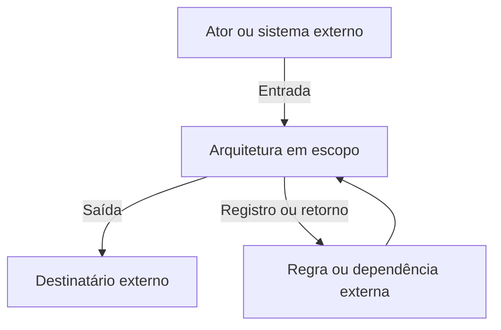
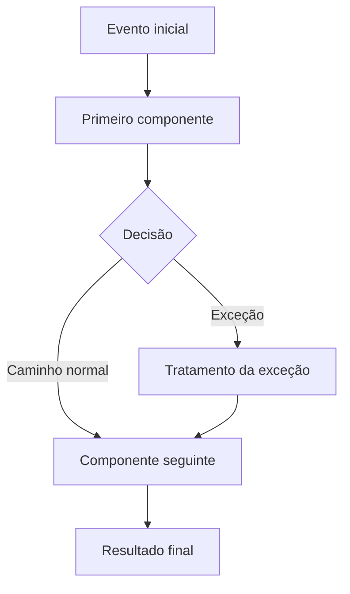

# Arquitetura Integrada — Template Preenchível

**Identificação técnica no repositório**

```yaml
id_arquitetura_integrada: ARQ-INT-AAAA-NNN
id_projeto_arquitetura: ARQ-AAAA-NNN
titulo: "[Nome da arquitetura — Arquitetura Integrada]"
organizacao:
area_ou_processo:
id_termo_de_abertura: TER-ARQ-AAAA-NNN
id_plano: PLA-ARQ-AAAA-NNN
id_catalogo_requisitos: CAT-REQ-AAAA-NNN
id_matriz_rastreabilidade: MTR-ARQ-AAAA-NNN
id_decisao_de_arquitetura: DEC-AAAA-NNN
responsavel_pela_arquitetura:
responsavel_pelo_documento:
data_de_criacao: AAAA-MM-DD
data_da_ultima_revisao:
estado: em_construcao
linha_de_base:
nivel_sensibilidade: "publica | interna | confidencial | sensivel"
versao: 0.1
```

**Sistema Operacional do Estúdio LICHTARA**  
**Módulo:** 3 — Arquitetura Organizacional  
**Tipo:** Template operacional preenchível  
**Função:** Consolidar e comunicar o funcionamento conjunto da arquitetura organizacional proposta  
**Entrada principal:** Configuração arquitetural selecionada no PC-3  
**Saída principal:** Arquitetura integrada validada e apta a compor a linha de base  
**Uso transversal:** PC-3, PC-4 e PC-5

**Documentos relacionados:**

- fundamentos-da-arquitetura.md;
- protocolo-de-arquitetura.md;
- Termo de Abertura da Arquitetura;
- Plano de Arquitetura;
- Catálogo de Requisitos;
- Matriz de Rastreabilidade;
- modelos do estado atual e futuro;
- mapas dimensionais;
- avaliações de alternativas;
- registros de decisão;
- registros de validação;
- Transição para Implantação;
- Relatório ou Dossiê de Arquitetura.

---

## 1. Finalidade

A Arquitetura Integrada apresenta como a configuração futura deverá funcionar como sistema.

Ela reúne, no grau necessário para compreensão, validação, aprovação e implantação:

- capacidades;
- componentes;
- relações;
- interfaces;
- fluxos;
- papéis;
- responsabilidades;
- autoridades;
- informação;
- conhecimento;
- comunicação;
- documentos;
- tecnologia;
- inteligência artificial;
- indicadores;
- riscos;
- controles;
- exceções;
- manutenção;
- continuidade;
- evolução.

O documento deve permitir responder:

> Como esta organização deverá funcionar, quem fará o quê, que elementos precisarão cooperar, o que acontecerá nas interfaces e como o funcionamento será sustentado, verificado e transformado em realidade?

## 2. Resultado esperado

Ao concluir este template, uma pessoa autorizada deve conseguir:

1. compreender a transformação proposta sem consultar todos os artefatos de trabalho;
2. reconhecer a fronteira e o contexto da arquitetura;
3. identificar as capacidades que o desenho deverá produzir ou preservar;
4. localizar os componentes que realizam essas capacidades;
5. acompanhar os principais fluxos de ponta a ponta;
6. compreender responsabilidades, autoridades e decisões;
7. examinar interfaces e transferências críticas;
8. reconhecer onde informação, conhecimento, documentos, tecnologia e IA participam;
9. verificar riscos, controles, exceções e formas de recuperação;
10. distinguir arquitetura inicial, transição e evolução futura;
11. localizar justificativas e evidências por meio da Matriz de Rastreabilidade;
12. validar o funcionamento em cenários normais, excepcionais e de falha;
13. compreender o que o Módulo 4 precisará implantar;
14. identificar a linha de base vigente e as condições de revisão.

## 3. Posição no ciclo

```text
Requisitos consolidados
          ↓
Capacidades futuras
          ↓
Alternativas arquiteturais
          ↓
Decisão da configuração preferida — PC-3
          ↓
Desenhos dimensionais e componentes
          ↓
ARQUITETURA INTEGRADA
          ↓
Validação e ajustes
          ↓
Linha de base aprovada — PC-4
          ↓
Transição para Implantação — PC-5
```

A primeira versão pode começar durante o desenho, mas somente se torna candidata a linha de base depois que a configuração preferida estiver decidida, as relações críticas estiverem integradas e as lacunas materiais estiverem tratadas.

## 4. Natureza do documento

A Arquitetura Integrada é:

- uma representação governada do funcionamento futuro;
- uma síntese de múltiplas dimensões;
- uma visão orientada a relações e interfaces;
- um instrumento de validação;
- uma referência para aprovação;
- uma entrada para implantação;
- uma projeção legível das fontes oficiais.

Ela não é:

- inventário exaustivo de todos os documentos do projeto;
- repetição integral do diagnóstico;
- substituta do Catálogo de Requisitos;
- substituta da Matriz de Rastreabilidade;
- coleção independente de desenhos dimensionais;
- cronograma de implantação;
- manual operacional definitivo;
- promessa de que o estado futuro já existe;
- descrição idealizada sem condições de sustentação.

### 4.1 Regra de não duplicação

Quando um objeto possuir registro oficial em outro artefato, esta arquitetura deve reutilizar seu identificador, apresentar apenas a informação necessária para compreender o conjunto e apontar para a fonte.

### 4.2 Regra de integração

A inclusão de componentes em um mesmo documento não demonstra integração. A integração somente existe quando relações, interfaces, responsabilidades, transferências, exceções e efeitos cruzados foram examinados.

## 5. Instruções de uso

1. Duplique este arquivo para cada arquitetura real.
2. Não preencha diretamente o template-mestre.
3. Reutilize os IDs do Catálogo de Requisitos e da Matriz de Rastreabilidade.
4. Registre somente a configuração selecionada como arquitetura principal.
5. Preserve alternativas e justificativas nos registros correspondentes.
6. Represente a arquitetura no grau necessário à decisão e à implantação.
7. Utilize tabelas para registros exatos e diagramas para relações espaciais ou sequenciais.
8. Não use diagramas sem legenda, versão ou fonte.
9. Não esconda lacunas para produzir aparência de completude.
10. Diferencie fato, decisão, premissa, proposta, condição e pendência.
11. Não trate ferramenta, automação ou IA como capacidade organizacional.
12. Verifique o funcionamento normal, excepcional e degradado.
13. Registre responsáveis por execução, decisão, verificação, alteração e manutenção.
14. Atualize a Matriz de Rastreabilidade quando novos componentes ou interfaces forem criados.
15. Submeta conteúdo produzido por IA à revisão humana.
16. Estabeleça linha de base antes da passagem ao Módulo 4.

### 5.1 Convenções

| Convenção | Significado |
| --- | --- |
| `[Preencher]` | Informação necessária. |
| `N/A` | Campo avaliado e não aplicável. |
| `Não determinado` | Evidência insuficiente. |
| `Pendente` | Tratamento futuro com responsável e prazo. |
| `CMP-NNN` | Componente arquitetural. |
| `INT-NNN` | Interface. |
| `CAP-NNN` | Capacidade. |
| `REQ-NNN` | Requisito. |
| `DEC-NNN` | Decisão. |
| `VAL-NNN` | Validação. |
| `LB-ARQ-NNN` | Linha de base. |

### 5.2 Sinalização recomendada

| Marcador | Uso |
| --- | --- |
| **Fato** | Informação sustentada por evidência. |
| **Decisão** | Escolha autorizada. |
| **Premissa** | Condição assumida e ainda verificável. |
| **Condição** | Requisito para validade ou avanço. |
| **Pendência** | Questão aberta com tratamento definido. |
| **Risco aceito** | Exposição conhecida e autorizada. |

## 6. Princípio de proporcionalidade

A arquitetura deve possuir completude suficiente para orientar implantação, responsabilidade, verificação e continuidade. Detalhamento adicional precisa ter uso reconhecível.

### 6.1 Arquitetura focal

Pode concentrar-se em:

- uma capacidade;
- um processo;
- poucas interfaces;
- um conjunto reduzido de papéis;
- uma mudança específica de tecnologia ou IA.

Utilize a versão reduzida da seção 69 quando ela preservar clareza e segurança.

### 6.2 Arquitetura funcional

Deve integrar as dimensões que afetam uma função, área ou jornada completa e explicitar interfaces com elementos fora do escopo.

### 6.3 Arquitetura sistêmica

Deve separar o documento principal das visões dimensionais e anexos quando o volume comprometer leitura, manutenção ou controle de acesso. Utilize a estrutura da seção 70.

### 6.4 Teste de suficiência

O detalhamento é suficiente quando:

- os requisitos obrigatórios possuem tratamento;
- os componentes essenciais estão definidos;
- as relações críticas são compreensíveis;
- as interfaces de maior risco estão tratadas;
- as responsabilidades e autoridades são identificáveis;
- exceções relevantes possuem encaminhamento;
- as lacunas remanescentes não impedem o próximo movimento;
- o Módulo 4 consegue transformar o desenho em trabalho.

## 7. Identificação da arquitetura

| Campo | Registro |
| --- | --- |
| ID da Arquitetura Integrada | ARQ-INT-AAAA-NNN |
| ID do projeto de arquitetura | ARQ-AAAA-NNN |
| Título | [Nome] |
| Organização | [Nome] |
| Área, processo ou sistema | [Quando aplicável] |
| Patrocinador | [Nome] |
| Decisor da arquitetura | [Nome/papel] |
| Responsável pela arquitetura | [Nome] |
| Responsável pelo documento | [Nome] |
| Custodiante | [Nome] |
| Data de criação | [DD/MM/AAAA] |
| Data da última revisão | [DD/MM/AAAA] |
| Versão | [0.1] |
| Linha de base | [LB-ARQ-NNN ou não aplicável] |
| Sensibilidade | [Pública, interna, confidencial ou sensível] |
| Estado | [Selecionar na seção 8] |

### 7.1 Documentos relacionados

| Documento | ID | Versão | Estado | Referência |
| --- | --- | --- | --- | --- |
| Termo de Abertura | TER-ARQ-AAAA-NNN | [Versão] | [Estado] | [Link] |
| Plano de Arquitetura | PLA-ARQ-AAAA-NNN | [Versão] | [Estado] | [Link] |
| Catálogo de Requisitos | CAT-REQ-AAAA-NNN | [Versão] | [Estado] | [Link] |
| Matriz de Rastreabilidade | MTR-ARQ-AAAA-NNN | [Versão] | [Estado] | [Link] |
| Decisão da configuração | DEC-AAAA-NNN | [Versão] | [Estado] | [Link] |
| Registro de Validação | VAL-ARQ-AAAA-NNN | [Versão] | [Estado] | [Link] |
| Transição para Implantação | TRA-IMP-AAAA-NNN | [Versão] | [Estado] | [Link] |

## 8. Estado da arquitetura integrada

Selecione um único estado vigente.

- [ ] **Em preparação** — fontes e estrutura estão sendo reunidas.
- [ ] **Em construção** — componentes e visões estão sendo consolidados.
- [ ] **Em integração** — relações, interfaces e efeitos cruzados estão em exame.
- [ ] **Candidata** — configuração pronta para validação formal.
- [ ] **Em validação** — verificações e divergências estão sendo registradas.
- [ ] **Em revisão** — ajustes decorrentes da validação estão sendo incorporados.
- [ ] **Aguardando aprovação** — conteúdo consolidado e submetido ao decisor.
- [ ] **Aprovada com condições** — utilizável dentro das condições registradas.
- [ ] **Linha de base aprovada** — referência oficial para implantação.
- [ ] **Em atualização** — mudança material está sendo incorporada.
- [ ] **Reaberta** — fato novo exige revisão do desenho aprovado.
- [ ] **Substituída** — nova linha de base constitui a referência vigente.
- [ ] **Suspensa** — avanço interrompido por condição registrada.
- [ ] **Encerrada** — ciclo concluído e histórico preservado.

**Data da última mudança:** [DD/MM/AAAA]  
**Responsável:** [Nome]  
**Motivo ou referência:** [Preencher]

## 9. Governança e fontes oficiais

### 9.1 Regra

Este documento comunica o funcionamento conjunto. Ele não deve alterar silenciosamente requisitos, decisões, vínculos ou evidências cuja fonte oficial esteja em outro artefato.

### 9.2 Mapa de fontes

| Objeto | Fonte oficial | O que aparece aqui | Responsável pela sincronização |
| --- | --- | --- | --- |
| Problema e escopo | Termo de Abertura | Síntese vigente | [Nome] |
| Requisitos | Catálogo de Requisitos | IDs, prioridade e cobertura resumida | [Nome] |
| Vínculos e justificativas | Matriz de Rastreabilidade | Referências e síntese de cobertura | [Nome] |
| Alternativas | Avaliação de Alternativas | Configuração selecionada e compensações | [Nome] |
| Decisões | Registro de Decisão | ID, resultado e condição de revisão | [Nome] |
| Componentes | Arquitetura Integrada | Registro oficial dos componentes aprovados | [Nome] |
| Interfaces | Arquitetura Integrada | Registro oficial das interfaces aprovadas | [Nome] |
| Validações | Registro de Validação | Resultado e ajustes incorporados | [Nome] |
| Implantação | Transição / Módulo 4 | Condições, não cronograma detalhado | [Nome] |

### 9.3 Regra de divergência

Quando duas fontes divergirem:

1. não escolher silenciosamente uma versão;
2. registrar a divergência;
3. identificar a linha de base afetada;
4. consultar o responsável pela fonte;
5. decidir a correção;
6. sincronizar os artefatos afetados;
7. preservar o histórico.

### 9.4 Autoridade

| Ação | Papel autorizado | Substituto | Evidência de autorização |
| --- | --- | --- | --- |
| Propor componente | [Papel] | [Papel] | [Referência] |
| Aprovar componente | [Papel] | [Papel] | [Referência] |
| Alterar relação crítica | [Papel] | [Papel] | [Referência] |
| Aceitar risco | [Papel] | [Papel] | [Referência] |
| Estabelecer linha de base | [Papel] | [Papel] | [Referência] |
| Reabrir arquitetura | [Papel] | [Papel] | [Referência] |

## 10. Condições de entrada

### 10.1 Verificação

- [ ] transição do diagnóstico foi aceita;
- [ ] problema de arquitetura está formulado;
- [ ] decisão apoiada está explícita;
- [ ] escopo e não objetivos estão definidos;
- [ ] requisitos prioritários estão consolidados;
- [ ] capacidades futuras foram formuladas;
- [ ] alternativas pertinentes foram examinadas;
- [ ] configuração preferida possui decisão;
- [ ] componentes dimensionais possuem identificação;
- [ ] Matriz de Rastreabilidade está utilizável;
- [ ] responsáveis pela integração estão definidos;
- [ ] fontes sensíveis possuem tratamento adequado.

### 10.2 Entrada incompleta

| Condição ausente | Efeito sobre a arquitetura | Tratamento | Responsável | Limite |
| --- | --- | --- | --- | --- |
| [Preencher] | [Preencher] | [Complementar, aceitar condição, devolver ou suspender] | [Nome] | [Data/evento] |

Uma entrada incompleta somente pode ser aceita quando sua ausência não impedir entendimento, decisão, segurança ou rastreabilidade e houver responsável pelo tratamento.

## 11. Síntese executiva

Preencher ao final, depois da validação.

**Contexto:** [Em até dois parágrafos]  
**Transformação necessária:** [Preencher]  
**Configuração selecionada:** [Preencher]  
**Capacidades centrais:** [IDs e nomes]  
**Componentes determinantes:** [IDs e nomes]  
**Mudanças principais no funcionamento:** [Preencher]  
**Benefícios esperados:** [Preencher]  
**Impactos humanos relevantes:** [Preencher]  
**Riscos e compensações materiais:** [Preencher]  
**Condições para implantação:** [Preencher]  
**Pendências aceitas:** [Preencher]  
**Resultado da validação:** [Preencher]  
**Decisão de aprovação:** [Preencher]  
**Linha de base:** [ID e versão]

## 12. Problema e decisão apoiada

### 12.1 Problema de arquitetura

**Formulação vigente:** [Preencher]  
**ID do problema:** PRB-NNN  
**Origem diagnóstica:** [IDs]  
**Efeito organizacional:** [Preencher]  
**Pessoas, áreas ou sistemas afetados:** [Preencher]  
**Limite temporal:** [Preencher]

### 12.2 Decisão apoiada

> [Que decisão esta arquitetura precisa permitir?]

| Elemento | Registro |
| --- | --- |
| Decisor | [Nome/papel] |
| Data necessária | [DD/MM/AAAA] |
| Critérios principais | [IDs/nomes] |
| Restrições | [IDs/nomes] |
| Alternativas consideradas | [IDs] |
| Registro da decisão | DEC-NNN |
| Condição de revisão | [Evento ou evidência] |

### 12.3 Resultado esperado

**Capacidade organizacional resultante:** [Preencher]  
**Mudança observável:** [Preencher]  
**Critério de suficiência:** [Preencher]

## 13. Escopo, fronteiras e não objetivos

### 13.1 Escopo incluído

| Objeto | Fronteira incluída | Profundidade | Responsável |
| --- | --- | --- | --- |
| [Processo, área, capacidade, sistema ou jornada] | [Início e fim] | [Focal, funcional ou sistêmica] | [Nome] |

### 13.2 Interfaces externas ao escopo

| Interface | Elemento externo | O que atravessa a fronteira | Responsável interno | Tratamento |
| --- | --- | --- | --- | --- |
| INT-NNN | [Área, parceiro ou sistema] | [Informação, decisão, trabalho ou dado] | [Nome] | [Preencher] |

### 13.3 Não objetivos

| Não objetivo | Motivo | Risco de confusão | Onde será tratado |
| --- | --- | --- | --- |
| [Preencher] | [Preencher] | [Preencher] | [Documento/módulo] |

### 13.4 Limites profissionais

| Tema fora da competência do projeto | Especialidade necessária | Encaminhamento | Impacto enquanto pendente |
| --- | --- | --- | --- |
| [Jurídico, contábil, segurança, saúde, outro] | [Preencher] | [Nome/referência] | [Preencher] |

## 14. Contexto e estado atual de referência

Este documento não reproduz o diagnóstico. Registra somente a condição atual necessária para compreender a transformação.

### 14.1 Síntese do estado atual

**Funcionamento de referência:** [Preencher]  
**Capacidades preserváveis:** [IDs e nomes]  
**Limitações determinantes:** [IDs]  
**Riscos existentes:** [IDs]  
**Dependências existentes:** [IDs]  
**Práticas informais relevantes:** [Preencher]  
**Pontos fortes que não podem ser perdidos:** [Preencher]

### 14.2 Elementos atuais e destino

| Elemento atual | Função real | Evidência | Destino proposto | Decisão |
| --- | --- | --- | --- | --- |
| [ID/nome] | [O que sustenta hoje] | [ID] | [Preservar, adaptar, substituir, desativar ou investigar] | DEC-NNN |

### 14.3 Referências

| Visão atual | Documento | Versão | Data de validade | Observação |
| --- | --- | --- | --- | --- |
| [Mapa, inventário ou análise] | [Referência] | [Versão] | [Data/evento] | [Preencher] |

## 15. Tese de transformação

Complete a estrutura:

> Para que **[organização/área]** desenvolva ou preserve **[capacidades]** e produza **[resultado]**, a arquitetura reorganizará **[componentes e relações centrais]**, mantendo **[elementos preservados]**, reduzindo **[limitações/riscos]** e respeitando **[restrições, identidade e limites]**.

### 15.1 Mudanças estruturais

| De | Para | Justificativa | IDs relacionados | Evidência futura de mudança |
| --- | --- | --- | --- | --- |
| [Funcionamento atual] | [Funcionamento futuro] | [Por que mudar] | [REQ/CAP/DEC] | [O que será observável] |

### 15.2 Permanências intencionais

| Elemento preservado | Função protegida | Motivo | Proteção no desenho |
| --- | --- | --- | --- |
| [Preencher] | [Preencher] | [Preencher] | [Componente, regra ou controle] |

### 15.3 Mudanças que não ocorrerão neste ciclo

| Elemento adiado | Motivo | Risco do adiamento | Condição de entrada futura | Responsável pela revisão |
| --- | --- | --- | --- | --- |
| [Preencher] | [Preencher] | [Preencher] | [Evento/evidência] | [Nome] |

## 16. Princípios e critérios de desenho

### 16.1 Princípios aplicados

| ID | Princípio | Implicação concreta | Componentes afetados | Como verificar |
| --- | --- | --- | --- | --- |
| PRI-NNN | [Preencher] | [O que o desenho deve ou não deve fazer] | [IDs] | [Critério] |

### 16.2 Critérios de desenho

| ID | Critério | Peso/prioridade | Evidência considerada | Resultado da configuração |
| --- | --- | --- | --- | --- |
| CRT-NNN | [Preencher] | [Obrigatório, alto, médio ou baixo] | [Referência] | [Atende, parcial, condicionado, não atende] |

### 16.3 Hierarquia em caso de tensão

| Critério A | Critério B | Regra de precedência | Autoridade | Exceção permitida |
| --- | --- | --- | --- | --- |
| [Preencher] | [Preencher] | [Preencher] | [Papel] | [Condição] |

### 16.4 Restrições do desenho

| ID | Restrição | Origem | Efeito | Tratamento |
| --- | --- | --- | --- | --- |
| RES-NNN | [Preencher] | [Contrato, recurso, norma, contexto, outro] | [Preencher] | [Incorporada, contestada, escalada ou aceita] |

## 17. Configuração selecionada

### 17.1 Identificação

| Campo | Registro |
| --- | --- |
| ID da alternativa de origem | ALT-NNN |
| Nome da configuração | [Preencher] |
| Registro da decisão | DEC-NNN |
| Data da decisão | [DD/MM/AAAA] |
| Decisor | [Nome/papel] |
| Participantes consultados | [Nomes/papéis] |
| Resultado | [Selecionada, combinação, experimento ou outra] |
| Condição de revisão | [Evento/evidência] |

### 17.2 Descrição

**Núcleo da configuração:** [Preencher]  
**Lógica de funcionamento:** [Preencher]  
**Por que foi escolhida:** [Preencher]  
**O que ela deliberadamente não resolve:** [Preencher]

### 17.3 Elementos combinados

| Elemento selecionado | Alternativa de origem | Motivo | Ajuste realizado | Decisão relacionada |
| --- | --- | --- | --- | --- |
| [Preencher] | ALT-NNN | [Preencher] | [Preencher] | DEC-NNN |

## 18. Alternativas, compensações e riscos aceitos

### 18.1 Alternativas não selecionadas

| Alternativa | Vantagem preservada como referência | Motivo da não seleção | Condição de reavaliação |
| --- | --- | --- | --- |
| ALT-NNN | [Preencher] | [Preencher] | [Evento/evidência] |

### 18.2 Compensações da escolha

| ID | Benefício obtido | Custo ou perda criada | Pessoas afetadas | Reversibilidade | Decisão |
| --- | --- | --- | --- | --- | --- |
| CMPN-NNN | [Preencher] | [Preencher] | [Preencher] | [Alta, média ou baixa] | DEC-NNN |

### 18.3 Riscos aceitos

| Risco | Motivo da aceitação | Exposição residual | Autoridade | Condição de revisão | Controle |
| --- | --- | --- | --- | --- | --- |
| RSC-NNN | [Preencher] | [Preencher] | [Nome/papel] | [Evento/evidência] | CTL-NNN |

## 19. Estados temporais da arquitetura

| Estado | Definição neste projeto | Data ou condição | Fonte oficial |
| --- | --- | --- | --- |
| Atual de referência | [Como funciona hoje] | [Data] | [Documento] |
| Transição | [Convivência entre antigo e novo] | [Período/condição] | [Transição para Implantação] |
| Futuro inicial | [Primeiro funcionamento aprovado] | [Critério de entrada] | [Esta arquitetura] |
| Futuro evolutivo | [Desenvolvimento condicionado] | [Gatilhos] | [Registro de evolução] |
| Encerramento | [Desativação, substituição ou término] | [Gatilhos] | [Decisão/registro] |

### 19.1 Regra temporal

Não misture elementos de horizontes diferentes em uma única representação sem identificá-los. Todo componente deve indicar em que estado entra, permanece, muda ou deixa de existir.

## 20. Narrativa integrada do funcionamento

Descreva em prosa contínua, na ordem em que o sistema funciona:

1. que evento inicia o funcionamento;
2. quem reconhece a entrada;
3. que informação é necessária;
4. que processos ou decisões ocorrem;
5. que componentes cooperam;
6. onde existem transferências;
7. onde tecnologia ou IA participam;
8. como exceções são tratadas;
9. que saída é produzida;
10. como qualidade e resultado são verificados;
11. que conhecimento retorna ao sistema;
12. quem mantém o funcionamento.

### 20.1 Narrativa principal

[Preencher]

### 20.2 Teste da narrativa

- [ ] possui início e fim reconhecíveis;
- [ ] identifica os atores necessários;
- [ ] não depende de termos vagos como “o sistema faz”;
- [ ] explicita decisões e transferências críticas;
- [ ] diferencia ação humana, automação e IA;
- [ ] inclui exceção e verificação;
- [ ] corresponde aos componentes registrados;
- [ ] pode ser reconstruída pela Matriz de Rastreabilidade.

## 21. Visão de contexto e fronteira

### 21.1 Registro

| Elemento externo | Relação com a arquitetura | Entrada recebida | Saída entregue | Interface | Responsável |
| --- | --- | --- | --- | --- | --- |
| [Cliente, área, fornecedor, sistema ou norma] | [Preencher] | [Preencher] | [Preencher] | INT-NNN | [Nome/papel] |

### 21.2 Diagrama opcional

Substitua os rótulos pelo contexto real e mantenha o registro tabular como fonte verificável.



**Versão do diagrama:** [Preencher]  
**Data:** [DD/MM/AAAA]  
**Fonte dos elementos:** [IDs/documentos]  
**Legenda:** [Preencher]

## 22. Arquitetura de capacidades

Capacidade descreve o que a organização precisa ser capaz de realizar de forma sustentada. Não substitua capacidade por atividade, pessoa ou ferramenta.

### 22.1 Registro de capacidades

| Capacidade | Natureza | Resultado produzido | Nível atual | Nível futuro necessário | Requisitos | Componentes realizadores | Responsável |
| --- | --- | --- | --- | --- | --- | --- | --- |
| CAP-NNN | [Existente, futura ou preservada] | [Preencher] | [Escala] | [Escala] | [REQs] | [CMPs] | [Papel] |

### 22.2 Capacidades preservadas

| Capacidade | Como funciona hoje | Risco de perda | Proteção arquitetural | Validação necessária |
| --- | --- | --- | --- | --- |
| CAP-NNN | [Preencher] | [Preencher] | [CMP/CTL/DEC] | [VAL/TST] |

### 22.3 Dependências entre capacidades

| Capacidade origem | Relação | Capacidade destino | Efeito da ausência | Tratamento |
| --- | --- | --- | --- | --- |
| CAP-NNN | [Depende de, habilita, limita ou substitui] | CAP-NNN | [Preencher] | [Preencher] |

### 22.4 Lacuna de capacidade

| Capacidade necessária | Lacuna atual | Componente ainda ausente | Consequência | Decisão |
| --- | --- | --- | --- | --- |
| CAP-NNN | [Preencher] | [Preencher] | [Preencher] | [DEC/pendência] |

## 23. Registro mestre de componentes

Cada linha representa um componente arquitetural reconhecível. Os detalhes permanecem na ficha da seção 24 ou no artefato dimensional indicado.

| ID | Nome | Tipo | Finalidade | Capacidade | Requisitos | Estado temporal | Responsável | Fonte detalhada |
| --- | --- | --- | --- | --- | --- | --- | --- | --- |
| CMP-NNN | [Nome] | [Processo, papel, regra, documento, sistema, IA, indicador, controle, ritual, base de conhecimento ou outro] | [Função] | CAP-NNN | [REQs] | [Atual adaptado, transição, futuro inicial ou evolução] | [Papel] | [Referência] |

### 23.1 Estados do componente

- **Proposto** — ainda em desenho.
- **Selecionado** — pertence à configuração decidida.
- **Em validação** — funcionamento em exame.
- **Aprovado** — autorizado para a linha de base.
- **Aprovado com condição** — válido dentro de limites registrados.
- **Adiado** — não integra o primeiro ciclo.
- **Substituído** — outro componente assumirá sua função.
- **Desativação planejada** — possui trajetória de encerramento.
- **Rejeitado** — permanece apenas no histórico.

### 23.2 Teste do componente

Um componente só deve permanecer na arquitetura quando houver resposta suficiente para:

- por que existe;
- que capacidade realiza;
- que requisito atende;
- de que depende;
- quem responde por ele;
- que trabalho recorrente cria;
- o que acontece quando falha;
- como será mantido;
- quando será revisto ou encerrado.

## 24. Ficha de componente

Duplique esta seção para cada componente material.

### 24.1 Identificação

| Campo | Registro |
| --- | --- |
| ID | CMP-NNN |
| Nome | [Preencher] |
| Tipo | [Preencher] |
| Versão | [Preencher] |
| Estado | [Selecionar na seção 23.1] |
| Horizonte | [Atual adaptado, transição, futuro inicial ou evolução] |
| Fonte detalhada | [Documento/seção] |
| Sensibilidade | [Classificação] |

### 24.2 Finalidade e justificação

**Finalidade:** [Preencher]  
**Capacidades relacionadas:** [CAPs]  
**Requisitos atendidos:** [REQs e cobertura]  
**Decisões relacionadas:** [DECs]  
**Evidências de origem:** [EVD/ACH/PRB]  
**Alternativa de origem:** [ALT]

### 24.3 Funcionamento

**Descrição operacional:** [Preencher]  
**Evento de entrada:** [Preencher]  
**Entradas:** [Trabalho, informação, dados, documentos ou decisões]  
**Saídas:** [Preencher]  
**Regras:** [IDs/referências]  
**Exceções:** [IDs/referências]  
**Frequência ou gatilho:** [Preencher]

### 24.4 Responsabilidade e autoridade

| Função | Papel | Autoridade necessária | Substituição |
| --- | --- | --- | --- |
| Executar | [Papel] | [Preencher] | [Papel/regra] |
| Decidir | [Papel] | [Preencher] | [Papel/regra] |
| Verificar | [Papel] | [Preencher] | [Papel/regra] |
| Alterar | [Papel] | [Preencher] | [Papel/regra] |
| Manter | [Papel] | [Preencher] | [Papel/regra] |

### 24.5 Relações e interfaces

| Objeto relacionado | Relação | Interface | Dependência | Criticidade |
| --- | --- | --- | --- | --- |
| [ID] | [Vocabulário da Matriz] | INT-NNN | [Preencher] | [Baixa, média, alta ou crítica] |

### 24.6 Riscos, controles e falha

| Risco | Causa | Efeito | Controle | Funcionamento degradado | Recuperação |
| --- | --- | --- | --- | --- | --- |
| RSC-NNN | [Preencher] | [Preencher] | CTL-NNN | [Preencher] | [Preencher] |

### 24.7 Manutenção e encerramento

| Elemento | Registro |
| --- | --- |
| Mantenedor | [Nome/papel] |
| Frequência | [Preencher] |
| Tempo estimado | [Preencher] |
| Competência | [Preencher] |
| Custo recorrente | [Preencher] |
| Documento de apoio | [Referência] |
| Critério de atendimento | [Preencher] |
| Gatilho de revisão | [Evento/evidência] |
| Condição de substituição | [Preencher] |
| Condição de encerramento | [Preencher] |

## 25. Relações estruturais

O registro oficial de vínculos permanece na Matriz de Rastreabilidade. Esta seção apresenta as relações necessárias para compreender o funcionamento conjunto.

| Origem | Relação canônica | Destino | Significado no funcionamento | Interface | Estado | Referência na matriz |
| --- | --- | --- | --- | --- | --- | --- |
| [ID] | [depende_de, realiza, transfere_para, controla, monitora ou outra relação aprovada] | [ID] | [Preencher] | INT-NNN/N/A | [Proposta, confirmada, condicionada ou invalidada] | VNC-NNN |

### 25.1 Relações materiais

Uma relação é material quando sua ausência ou alteração pode:

- impedir capacidade;
- alterar autoridade;
- interromper fluxo;
- expor dado;
- criar risco;
- mudar requisito;
- exigir implantação;
- afetar continuidade.

### 25.2 Relação não confirmada

| Relação | Dúvida | Evidência necessária | Responsável | Limite | Uso permitido |
| --- | --- | --- | --- | --- | --- |
| VNC-NNN | [Preencher] | [Preencher] | [Nome] | [Data/evento] | [Nenhum, desenho provisório ou experimento] |

## 26. Interfaces críticas

Interface é o ponto de passagem entre componentes, papéis, áreas ou sistemas. Ela precisa tornar explícito o que atravessa a fronteira e como a passagem é concluída.

### 26.1 Registro mestre

| ID | Origem | Destino | Objeto transferido | Momento/gatilho | Entregador | Recebedor | Confirmação | Criticidade |
| --- | --- | --- | --- | --- | --- | --- | --- | --- |
| INT-NNN | [CMP/papel/sistema] | [CMP/papel/sistema] | [Informação, trabalho, decisão, dado ou documento] | [Preencher] | [Papel] | [Papel] | [Como se confirma] | [Baixa, média, alta ou crítica] |

### 26.2 Ficha de interface

| Campo | Registro |
| --- | --- |
| ID e nome | INT-NNN — [Nome] |
| Finalidade | [Preencher] |
| Origem | [ID] |
| Destino | [ID] |
| Objeto transferido | [Preencher] |
| Formato | [Preencher] |
| Canal ou meio | [Preencher] |
| Frequência/gatilho | [Preencher] |
| Prazo esperado | [Preencher] |
| Responsável pela entrega | [Papel] |
| Responsável pelo recebimento | [Papel] |
| Critério de completude | [Preencher] |
| Confirmação | [Preencher] |
| Registro da passagem | [Referência] |
| Sensibilidade | [Preencher] |
| Risco | RSC-NNN |
| Controle | CTL-NNN |

### 26.3 Falha da interface

| Situação | Detecção | Resposta imediata | Autoridade | Registro | Recuperação |
| --- | --- | --- | --- | --- | --- |
| Entrega ausente | [Preencher] | [Preencher] | [Papel] | [Referência] | [Preencher] |
| Entrega incompleta | [Preencher] | [Preencher] | [Papel] | [Referência] | [Preencher] |
| Atraso | [Preencher] | [Preencher] | [Papel] | [Referência] | [Preencher] |
| Formato incompatível | [Preencher] | [Preencher] | [Papel] | [Referência] | [Preencher] |
| Contexto perdido | [Preencher] | [Preencher] | [Papel] | [Referência] | [Preencher] |
| Destinatário indisponível | [Preencher] | [Preencher] | [Papel] | [Referência] | [Preencher] |

## 27. Fluxos de ponta a ponta

### 27.1 Registro

| ID | Fluxo | Evento inicial | Resultado final | Capacidades | Componentes | Interfaces | Responsável pelo conjunto |
| --- | --- | --- | --- | --- | --- | --- | --- |
| FLX-NNN | [Nome] | [Preencher] | [Preencher] | [CAPs] | [CMPs] | [INTs] | [Papel] |

### 27.2 Etapas do fluxo

| Ordem | Evento/entrada | Ação | Responsável | Componente | Saída | Próximo destino | Regra de passagem |
| --- | --- | --- | --- | --- | --- | --- | --- |
| 1 | [Preencher] | [Preencher] | [Papel] | CMP-NNN | [Preencher] | [ID] | [Preencher] |

### 27.3 Diagrama opcional



**Fluxo representado:** FLX-NNN  
**Versão:** [Preencher]  
**Exceções não mostradas:** [Preencher]  
**Fonte:** [IDs/documentos]

### 27.4 Responsabilidade pelo conjunto

Responsabilidade por uma etapa não equivale a responsabilidade pelo resultado de ponta a ponta. Registre quem observa falhas entre componentes e possui autoridade para coordenar correções.

## 28. Cenário normal de funcionamento

| Campo | Registro |
| --- | --- |
| ID do cenário | CEN-NNN |
| Nome | [Preencher] |
| Evento inicial | [Preencher] |
| Condições de entrada | [Preencher] |
| Atores | [Preencher] |
| Componentes | [IDs] |
| Sequência esperada | [Preencher] |
| Decisões | [IDs] |
| Informação utilizada | [Preencher] |
| Tecnologia/IA | [IDs e função] |
| Resultado | [Preencher] |
| Registro produzido | [Preencher] |
| Indicador | IND-NNN |
| Critério de sucesso | [Preencher] |

### 28.1 Verificação

- [ ] o cenário pode ser executado com as responsabilidades definidas;
- [ ] as autoridades são suficientes;
- [ ] as entradas existem no momento necessário;
- [ ] as interfaces possuem confirmação;
- [ ] o resultado pode ser registrado;
- [ ] o indicador pode ser produzido;
- [ ] o funcionamento não depende de conhecimento invisível não tratado.

## 29. Cenários de exceção e limite

### 29.1 Registro

| Cenário | Gatilho | Desvio do fluxo normal | Decisão necessária | Responsável | Controle | Retorno ao fluxo |
| --- | --- | --- | --- | --- | --- | --- |
| CEN-NNN | [Preencher] | [Preencher] | [Preencher] | [Papel] | CTL-NNN | [Condição] |

### 29.2 Cenários mínimos a considerar

- entrada incompleta;
- solicitação fora do escopo;
- urgência;
- conflito de prioridade;
- ausência do responsável;
- falha de ferramenta;
- indisponibilidade de IA;
- dado inconsistente;
- acesso negado;
- aumento inesperado de volume;
- incidente de segurança;
- necessidade de decisão não prevista;
- resultado contestado;
- encerramento antecipado.

### 29.3 Exceção sem tratamento

| Exceção | Probabilidade/recorrência | Impacto | Decisão provisória | Responsável | Prazo |
| --- | --- | --- | --- | --- | --- |
| [Preencher] | [Preencher] | [Preencher] | [Preencher] | [Nome] | [Data] |

## 30. Arquitetura de processos e fluxos

### 30.1 Visão consolidada

| Processo/fluxo | Finalidade | Início | Fim | Responsável | Capacidade | Requisitos | Estado futuro |
| --- | --- | --- | --- | --- | --- | --- | --- |
| [ID/nome] | [Preencher] | [Evento] | [Resultado] | [Papel] | CAP-NNN | [REQs] | [Novo, adaptado, preservado ou encerrado] |

### 30.2 Mudanças no processo

| Elemento | Atual | Futuro | Motivo | Impacto | Validação |
| --- | --- | --- | --- | --- | --- |
| [Etapa, regra, handoff ou exceção] | [Preencher] | [Preencher] | [REQ/DEC] | [Preencher] | [VAL/TST] |

### 30.3 Pontos de controle do fluxo

| Ponto | O que verifica | Momento | Responsável | Evidência | Tratamento de falha |
| --- | --- | --- | --- | --- | --- |
| CTL-NNN | [Preencher] | [Preencher] | [Papel] | [Registro] | [Preencher] |

### 30.4 Limite

O desenho de arquitetura define o funcionamento necessário. O procedimento operacional detalhado será desenvolvido ou atualizado na implantação quando sua ausência não impedir validação da arquitetura.

## 31. Papéis, responsabilidades e autoridades

### 31.1 Registro de papéis

| Papel | Finalidade | Responsabilidades | Autoridades | Informação necessária | Competências | Substituição |
| --- | --- | --- | --- | --- | --- | --- |
| PAP-NNN | [Preencher] | [Preencher] | [Preencher] | [Preencher] | [Preencher] | [Papel/regra] |

### 31.2 Matriz de responsabilidade

Use os códigos locais definidos no plano. Uma opção é `R` executa, `A` responde pelo resultado, `C` é consultado e `I` é informado.

| Componente/decisão | Papel 1 | Papel 2 | Papel 3 | Regra em conflito |
| --- | --- | --- | --- | --- |
| [ID] | [R/A/C/I] | [R/A/C/I] | [R/A/C/I] | [Preencher] |

### 31.3 Congruência entre responsabilidade e autoridade

| Responsabilidade | Papel | Autoridade necessária | Autoridade concedida | Lacuna | Tratamento |
| --- | --- | --- | --- | --- | --- |
| [Preencher] | [Papel] | [Preencher] | [Preencher] | [Sim/não] | [Preencher] |

### 31.4 Concentração e dependência

| Papel | Funções concentradas | Risco | Segregação necessária | Continuidade |
| --- | --- | --- | --- | --- |
| [Papel] | [Executa, decide, verifica, mantém] | [Preencher] | [Preencher] | [Substituto/documentação] |

## 32. Arquitetura de decisão e escalonamento

### 32.1 Direitos decisórios

| Decisão | Gatilho | Decisor | Critérios | Consultados | Prazo | Registro | Revisão |
| --- | --- | --- | --- | --- | --- | --- | --- |
| DEC-TIP-NNN | [Preencher] | [Papel] | [Preencher] | [Papéis] | [Preencher] | [Onde] | [Condição] |

### 32.2 Escalonamento

| Situação | Primeiro nível | Condição de escalada | Próximo nível | Prazo | Continuidade enquanto decide |
| --- | --- | --- | --- | --- | --- |
| [Preencher] | [Papel] | [Preencher] | [Papel] | [Preencher] | [Preencher] |

### 32.3 Impasse

| Tipo de impasse | Autoridade final | Evidência mínima | Registro da divergência | Regra provisória |
| --- | --- | --- | --- | --- |
| [Preencher] | [Papel] | [Preencher] | [Referência] | [Preencher] |

### 32.4 Decisão automatizada ou apoiada por IA

Nenhuma decisão deve ser atribuída genericamente “ao sistema”. Registre a função técnica, o grau de autonomia, o responsável humano e o mecanismo de contestação na seção 38.

## 33. Arquitetura de informação e dados

### 33.1 Objetos informacionais

| Informação/dado | Finalidade | Origem | Usuário/destino | Momento | Qualidade necessária | Sensibilidade | Registro oficial |
| --- | --- | --- | --- | --- | --- | --- | --- |
| INF-NNN | [Preencher] | [Fonte] | [Papel/CMP] | [Preencher] | [Preencher] | [Classificação] | [Sistema/documento] |

### 33.2 Fluxo informacional

| Origem | Informação | Destino | Interface | Transformação | Responsável | Confirmação |
| --- | --- | --- | --- | --- | --- | --- |
| [ID] | INF-NNN | [ID] | INT-NNN | [Nenhuma, agregação, análise ou outra] | [Papel] | [Preencher] |

### 33.3 Qualidade e significado

| Informação | Definição | Critério de qualidade | Fonte de verdade | Regra de divergência | Responsável semântico |
| --- | --- | --- | --- | --- | --- |
| INF-NNN | [Preencher] | [Completude, atualidade, exatidão, consistência] | [Fonte] | [Preencher] | [Papel] |

### 33.4 Ciclo de vida

| Informação | Coleta/criação | Uso | Compartilhamento | Retenção | Atualização | Descarte |
| --- | --- | --- | --- | --- | --- | --- |
| INF-NNN | [Preencher] | [Preencher] | [Preencher] | [Regra] | [Regra] | [Regra] |

## 34. Arquitetura de conhecimento

### 34.1 Conhecimento necessário

| Conhecimento | Aplicação | Detentor atual | Usuários futuros | Forma de preservação | Atualização | Risco de perda |
| --- | --- | --- | --- | --- | --- | --- |
| CON-NNN | [Preencher] | [Pessoa/papel] | [Papéis] | [Documento, prática, treinamento, mentoria ou sistema] | [Gatilho] | [Preencher] |

### 34.2 Conhecimento que deve permanecer humano

| Conhecimento/julgamento | Motivo | Papel humano | Apoio possível de IA | Proteção |
| --- | --- | --- | --- | --- |
| [Preencher] | [Contexto, ética, negociação, exceção, autoria ou outro] | [Papel] | [Função limitada] | [Preencher] |

### 34.3 Conversão e aprendizagem

| Evento | Conhecimento produzido | Como é registrado | Quem valida | Onde retorna ao funcionamento |
| --- | --- | --- | --- | --- |
| [Projeto, exceção, erro, revisão ou operação] | [Preencher] | [Referência] | [Papel] | [CMP/decisão/processo] |

### 34.4 Dependência de conhecimento implícito

| Atividade/decisão | Conhecimento invisível | Pessoa concentradora | Risco | Tratamento proporcional |
| --- | --- | --- | --- | --- |
| [Preencher] | [Preencher] | [Nome/papel] | [Preencher] | [Documentar, parear, treinar, substituir ou aceitar] |

## 35. Arquitetura da comunicação

### 35.1 Eventos de comunicação

| Evento | Finalidade | Emissor | Destinatário | Conteúdo mínimo | Canal | Momento | Confirmação |
| --- | --- | --- | --- | --- | --- | --- | --- |
| COM-NNN | [Preencher] | [Papel] | [Papel/grupo] | [Preencher] | [Preencher] | [Preencher] | [Preencher] |

### 35.2 Comunicação decisória

| Decisão | Quem precisa compreender | Mensagem | Contexto preservado | Registro | Responsável |
| --- | --- | --- | --- | --- | --- |
| DEC-NNN | [Pessoas/papéis] | [Preencher] | [Alternativas, motivo, efeito e limite] | [Referência] | [Papel] |

### 35.3 Comunicação de exceção

| Exceção | Quem aciona | Quem recebe | Urgência | Canal alternativo | Escalonamento |
| --- | --- | --- | --- | --- | --- |
| [Preencher] | [Papel] | [Papel] | [Preencher] | [Preencher] | [Regra] |

### 35.4 Sobrecarga e ruído

| Comunicação | Risco de excesso/omissão | Regra de relevância | Possibilidade de consolidação | Responsável |
| --- | --- | --- | --- | --- |
| COM-NNN | [Preencher] | [Quem precisa saber o quê e quando] | [Preencher] | [Papel] |

## 36. Arquitetura documental

### 36.1 Registro de documentos

| Documento | Finalidade | Evento de criação | Autor | Aprovador | Usuários | Fonte de verdade | Manutenção | Encerramento |
| --- | --- | --- | --- | --- | --- | --- | --- | --- |
| DOC-NNN | [Preencher] | [Preencher] | [Papel] | [Papel] | [Papéis] | [Local] | [Papel/frequência] | [Regra] |

### 36.2 Relação documento–decisão–processo

| Documento | Processo/componente | Decisão apoiada | Informação contida | Risco se desatualizado | Controle |
| --- | --- | --- | --- | --- | --- |
| DOC-NNN | [ID] | [ID] | [INF IDs] | [Preencher] | CTL-NNN |

### 36.3 Carga documental

| Documento | Trabalho de criação | Trabalho de manutenção | Valor produzido | Simplificação possível | Decisão |
| --- | --- | --- | --- | --- | --- |
| DOC-NNN | [Tempo/competência] | [Tempo/frequência] | [Preencher] | [Preencher] | [Manter, combinar, automatizar ou eliminar] |

### 36.4 Regra

Nenhum documento deve existir apenas porque “sempre foi feito”. Todo documento precisa apoiar funcionamento, decisão, responsabilidade, verificação, continuidade ou obrigação legítima.

## 37. Arquitetura de tecnologia e integrações

### 37.1 Componentes tecnológicos

| Sistema/ferramenta | Função arquitetural | Usuários | Dados | Integrações | Responsável | Dependência | Alternativa de continuidade |
| --- | --- | --- | --- | --- | --- | --- | --- |
| TEC-NNN | [Preencher] | [Papéis] | [INF IDs] | [INT IDs] | [Papel] | [Fornecedor, acesso, competência ou outra] | [Preencher] |

### 37.2 Integrações técnicas

| Interface | Origem | Destino | Dados/formato | Frequência | Autenticação | Tratamento de erro | Monitoramento |
| --- | --- | --- | --- | --- | --- | --- | --- |
| INT-NNN | [Sistema] | [Sistema] | [Preencher] | [Preencher] | [Preencher] | [Preencher] | [IND/CTL] |

### 37.3 Adequação sociotécnica

| Tecnologia | Rotina apoiada | Mudança exigida das pessoas | Competência | Carga adicional | Risco de desvio | Tratamento |
| --- | --- | --- | --- | --- | --- | --- |
| TEC-NNN | [Preencher] | [Preencher] | [Preencher] | [Preencher] | [Preencher] | [Preencher] |

### 37.4 Continuidade técnica

| Falha | Impacto | Detecção | Operação alternativa | Recuperação | Responsável | Tempo tolerável |
| --- | --- | --- | --- | --- | --- | --- |
| [Indisponibilidade, perda de acesso, erro de integração ou fornecedor] | [Preencher] | [Preencher] | [Preencher] | [Preencher] | [Papel] | [Preencher] |

## 38. Arquitetura de inteligência artificial

IA deve ser desenhada como função com responsabilidade definida, não como presença genérica de uma ferramenta.

### 38.1 Registro de funções de IA

| ID | Função | Entrada | Saída | Grau de autonomia | Responsável humano | Verificação | Registro |
| --- | --- | --- | --- | --- | --- | --- | --- |
| IA-NNN | [Pesquisar, classificar, analisar, redigir, revisar, monitorar ou outra] | [Preencher] | [Preencher] | [Assistiva, recomendatória, executora limitada ou automatizada] | [Papel] | [Método] | [Onde] |

### 38.2 Limites por função

| Função | Pode | Não pode | Escalada obrigatória | Dados proibidos/restritos | Condição de suspensão |
| --- | --- | --- | --- | --- | --- |
| IA-NNN | [Preencher] | [Preencher] | [Preencher] | [Preencher] | [Preencher] |

### 38.3 Verificação humana

| Saída de IA | Risco | Verificador | Critério | Amostra/frequência | Ação em erro | Evidência |
| --- | --- | --- | --- | --- | --- | --- |
| [Preencher] | [Preencher] | [Papel] | [Preencher] | [Preencher] | [Corrigir, rejeitar, escalar ou suspender] | [Registro] |

### 38.4 Contestação e responsabilização

| Decisão ou efeito apoiado por IA | Pessoa afetada pode contestar? | Canal | Autoridade revisora | Prazo | Registro |
| --- | --- | --- | --- | --- | --- |
| [Preencher] | [Sim/não e limite] | [Preencher] | [Papel] | [Preencher] | [Referência] |

### 38.5 Continuidade sem IA

| Função | Tempo máximo sem IA | Operação alternativa | Capacidade reduzida | Responsável | Retorno seguro |
| --- | --- | --- | --- | --- | --- |
| IA-NNN | [Preencher] | [Preencher] | [Preencher] | [Papel] | [Critério] |

### 38.6 Modelo, fornecedor e mudança

| Elemento | Versão/configuração | Dependência | Risco de mudança | Revalidação necessária | Responsável |
| --- | --- | --- | --- | --- | --- |
| [Modelo, prompt, base, agente ou fornecedor] | [Preencher] | [Preencher] | [Preencher] | [Evento/teste] | [Papel] |

## 39. Arquitetura de indicadores

### 39.1 Cadeia indicador–decisão

| Indicador | Objeto observado | Pergunta respondida | Decisão apoiada | Responsável pela leitura | Frequência | Gatilho de ação |
| --- | --- | --- | --- | --- | --- | --- |
| IND-NNN | [CAP/REQ/CMP/RSC] | [Preencher] | [Preencher] | [Papel] | [Preencher] | [Limite/evento] |

### 39.2 Produção do indicador

| Indicador | Dados de origem | Fórmula/regra | Responsável pelo dado | Responsável pelo cálculo | Registro | Limitação |
| --- | --- | --- | --- | --- | --- | --- |
| IND-NNN | [INF/DAD] | [Preencher] | [Papel] | [Papel/sistema] | [Local] | [Preencher] |

### 39.3 Resposta ao desvio

| Indicador | Condição esperada | Desvio | Primeiro tratamento | Autoridade | Escalonamento | Revisão arquitetural |
| --- | --- | --- | --- | --- | --- | --- |
| IND-NNN | [Meta/faixa] | [Condição] | [Preencher] | [Papel] | [Regra] | [Gatilho] |

### 39.4 Proibição

Indicador sem decisão, ação, aprendizagem ou obrigação legítima não deve ser incluído apenas para produzir aparência de controle.

## 40. Arquitetura de riscos e controles

### 40.1 Registro integrado

| Risco | Objeto afetado | Causa | Consequência | Exposição | Controle | Responsável | Risco residual |
| --- | --- | --- | --- | --- | --- | --- | --- |
| RSC-NNN | [ID] | [Preencher] | [Preencher] | [Escala] | CTL-NNN | [Papel] | [Escala] |

### 40.2 Controles

| Controle | Tipo | Risco tratado | Ação | Momento | Responsável | Evidência | Falha do controle |
| --- | --- | --- | --- | --- | --- | --- | --- |
| CTL-NNN | [Preventivo, detectivo ou corretivo; humano, técnico ou híbrido] | RSC-NNN | [Preencher] | [Preencher] | [Papel] | [Registro] | [Tratamento] |

### 40.3 Controle excessivo

| Controle | Carga criada | Valor protetivo | Autonomia afetada | Alternativa proporcional | Decisão |
| --- | --- | --- | --- | --- | --- |
| CTL-NNN | [Preencher] | [Preencher] | [Preencher] | [Preencher] | [Manter, ajustar ou retirar] |

### 40.4 Risco sem controle

| Risco | Motivo | Aceitação autorizada? | Autoridade | Condição de revisão | Implantação permitida? |
| --- | --- | --- | --- | --- | --- |
| RSC-NNN | [Preencher] | [Sim/não] | [Papel] | [Evento] | [Sim, não ou condicionada] |

## 41. Matriz de integração dimensional

Esta matriz verifica se cada dimensão participa do funcionamento e possui passagem compreensível para as demais. Preencha somente relações materiais.

| Dimensão | Entrega para | Recebe de | Interface crítica | Responsável | Risco cruzado | Evidência de integração |
| --- | --- | --- | --- | --- | --- | --- |
| Processos e fluxos | [Dimensões] | [Dimensões] | INT-NNN | [Papel] | RSC-NNN | [VAL/TST] |
| Papéis e autoridades | [Dimensões] | [Dimensões] | INT-NNN | [Papel] | RSC-NNN | [VAL/TST] |
| Informação e dados | [Dimensões] | [Dimensões] | INT-NNN | [Papel] | RSC-NNN | [VAL/TST] |
| Conhecimento | [Dimensões] | [Dimensões] | INT-NNN | [Papel] | RSC-NNN | [VAL/TST] |
| Comunicação | [Dimensões] | [Dimensões] | INT-NNN | [Papel] | RSC-NNN | [VAL/TST] |
| Documentação | [Dimensões] | [Dimensões] | INT-NNN | [Papel] | RSC-NNN | [VAL/TST] |
| Tecnologia e integrações | [Dimensões] | [Dimensões] | INT-NNN | [Papel] | RSC-NNN | [VAL/TST] |
| Inteligência artificial | [Dimensões] | [Dimensões] | INT-NNN | [Papel] | RSC-NNN | [VAL/TST] |
| Indicadores | [Dimensões] | [Dimensões] | INT-NNN | [Papel] | RSC-NNN | [VAL/TST] |
| Riscos e controles | [Dimensões] | [Dimensões] | INT-NNN | [Papel] | RSC-NNN | [VAL/TST] |

### 41.1 Relação ausente

| Dimensões que deveriam cooperar | Relação ausente | Consequência | Tratamento | Responsável | Prazo |
| --- | --- | --- | --- | --- | --- |
| [Preencher] | [Preencher] | [Preencher] | [Preencher] | [Nome] | [Data] |

## 42. Verificações cruzadas de consistência

| Pergunta | Resultado | Evidência | Lacuna | Ação |
| --- | --- | --- | --- | --- |
| Todo processo possui papel responsável? | [Sim, parcial, não ou N/A] | [IDs] | [Preencher] | [Preencher] |
| Toda responsabilidade possui autoridade correspondente? | [Resultado] | [IDs] | [Preencher] | [Preencher] |
| Toda atividade crítica possui informação no momento necessário? | [Resultado] | [IDs] | [Preencher] | [Preencher] |
| Todo documento possui fonte de verdade e mantenedor? | [Resultado] | [IDs] | [Preencher] | [Preencher] |
| Todo indicador possui decisão ou ação associada? | [Resultado] | [IDs] | [Preencher] | [Preencher] |
| Toda automação possui exceção e operação alternativa? | [Resultado] | [IDs] | [Preencher] | [Preencher] |
| Toda função de IA possui verificação e responsabilidade humana? | [Resultado] | [IDs] | [Preencher] | [Preencher] |
| Toda interface crítica preserva contexto e confirmação? | [Resultado] | [IDs] | [Preencher] | [Preencher] |
| Todo componente material possui manutenção? | [Resultado] | [IDs] | [Preencher] | [Preencher] |
| Todo risco material possui controle ou aceitação? | [Resultado] | [IDs] | [Preencher] | [Preencher] |
| Todo requisito obrigatório permanece visível? | [Resultado] | [IDs] | [Preencher] | [Preencher] |
| Toda decisão material pode ser reconstruída? | [Resultado] | [IDs] | [Preencher] | [Preencher] |

## 43. Arquitetura mínima do primeiro ciclo

Arquitetura mínima é o menor conjunto capaz de produzir funcionamento suficiente com responsabilidade, proteção e continuidade. Ela não é uma versão sem controles essenciais.

### 43.1 Componentes essenciais

| Componente | Por que é indispensável | Capacidade | Requisito obrigatório | Dependência | Critério de entrada |
| --- | --- | --- | --- | --- | --- |
| CMP-NNN | [Preencher] | CAP-NNN | REQ-NNN | [IDs] | [Preencher] |

### 43.2 Controles inegociáveis

| Controle | Risco | Motivo | Deve existir antes de | Evidência |
| --- | --- | --- | --- | --- |
| CTL-NNN | RSC-NNN | [Preencher] | [Teste, piloto ou operação] | [Preencher] |

### 43.3 Itens removidos por simplificação

| Item | Motivo da retirada | Função ainda necessária? | Solução provisória | Gatilho de reentrada |
| --- | --- | --- | --- | --- |
| [ID/nome] | [Preencher] | [Sim/não] | [Preencher] | [Evento/evidência] |

### 43.4 Teste de superdimensionamento

- [ ] nenhum componente foi incluído apenas por possibilidade futura incerta;
- [ ] o volume real justifica a estrutura;
- [ ] o custo recorrente é sustentável;
- [ ] a organização possui competência para manter o conjunto;
- [ ] alternativas temporárias simples foram examinadas;
- [ ] a implantação do primeiro ciclo permanece compreensível.

## 44. Arquitetura evolutiva

### 44.1 Elementos adiados

| Elemento | Requisito/capacidade | Motivo do adiamento | Dependência | Evidência de prontidão | Risco do adiamento | Responsável |
| --- | --- | --- | --- | --- | --- | --- |
| [ID/nome] | [IDs] | [Preencher] | [IDs] | [Gatilho mensurável] | [Preencher] | [Papel] |

### 44.2 Horizontes

| Horizonte | Resultado pretendido | Elementos candidatos | Condição de entrada | Decisão necessária | Não compromisso |
| --- | --- | --- | --- | --- | --- |
| Futuro inicial | [Preencher] | [IDs] | [Preencher] | [DEC] | [O que ainda não está autorizado] |
| Evolução 1 | [Preencher] | [IDs] | [Preencher] | [DEC] | [Preencher] |
| Evolução 2 | [Preencher] | [IDs] | [Preencher] | [DEC] | [Preencher] |

### 44.3 Gatilhos de evolução

| Gatilho | Fonte da evidência | Limiar | Quem avalia | Resultado possível |
| --- | --- | --- | --- | --- |
| [Volume, maturidade, receita, risco, capacidade, aprendizado ou mudança externa] | [IND/registro] | [Preencher] | [Papel] | [Iniciar desenho, manter, adiar ou encerrar] |

## 45. Dependências e pré-condições

| Dependência | Tipo | Objeto dependente | Responsável externo/interno | Condição necessária | Data/evento | Plano se não ocorrer |
| --- | --- | --- | --- | --- | --- | --- |
| DEP-NNN | [Pessoa, decisão, dado, tecnologia, contrato, recurso ou competência] | [ID] | [Papel] | [Preencher] | [Preencher] | [Preencher] |

### 45.1 Dependência circular

| Objetos envolvidos | Ciclo | Efeito | Forma de ruptura | Decisão |
| --- | --- | --- | --- | --- |
| [IDs] | [A depende de B, B depende de A] | [Preencher] | [Preencher] | DEC-NNN |

### 45.2 Dependência fora do controle

| Dependência | Grau de influência | Sinal de risco | Proteção | Autoridade para interromper |
| --- | --- | --- | --- | --- |
| DEP-NNN | [Alto, médio ou baixo] | [Preencher] | [Alternativa, prazo, contrato ou reserva] | [Papel] |

## 46. Condições de transição

Esta seção informa ao Módulo 4 o que precisa ser convertido em plano. Não substitui cronograma, Kanban ou gestão de projeto.

| Componente | Pré-condições | Sequência recomendada | Pessoas envolvidas | Dados/documentos | Teste prévio | Critério de passagem |
| --- | --- | --- | --- | --- | --- | --- |
| CMP-NNN | [Preencher] | [Preencher] | [Papéis] | [IDs] | TST-NNN | [Preencher] |

### 46.1 Convivência entre estado atual e futuro

| Elemento | Estado atual ativo até | Estado futuro entra quando | Operação paralela | Regra de conflito | Responsável |
| --- | --- | --- | --- | --- | --- |
| [ID/nome] | [Evento] | [Critério] | [Necessária? duração] | [Qual prevalece] | [Papel] |

### 46.2 Retorno e interrupção

| Mudança | Sinal de interrupção | Autoridade | Retorno possível | Limite de retorno | Dados/registros preservados |
| --- | --- | --- | --- | --- | --- |
| [Preencher] | [Preencher] | [Papel] | [Preencher] | [Preencher] | [Preencher] |

## 47. Manutenção da arquitetura praticada

### 47.1 Registro de manutenção

| Componente | Objeto mantido | Ação | Frequência/gatilho | Responsável | Competência | Tempo | Custo | Evidência |
| --- | --- | --- | --- | --- | --- | --- | --- | --- |
| CMP-NNN | [Processo, dado, documento, sistema, modelo, regra ou outro] | [Preencher] | [Preencher] | [Papel] | [Preencher] | [Preencher] | [Preencher] | [Registro] |

### 47.2 Governança de alterações operacionais

| Tipo de alteração | Pode ser feita por | Requer consulta | Requer nova validação | Requer análise de impacto | Registro |
| --- | --- | --- | --- | --- | --- |
| [Preencher] | [Papel] | [Papéis] | [Condição] | [Condição] | [Local] |

### 47.3 Arquitetura sem mantenedor

| Objeto | Consequência | Tratamento antes da aprovação | Responsável por resolver | Prazo |
| --- | --- | --- | --- | --- |
| [ID] | [Preencher] | [Atribuir, simplificar, retirar ou aceitar condição] | [Nome] | [Data] |

## 48. Continuidade, recuperação e encerramento

### 48.1 Cenários de continuidade

| Cenário | Capacidade afetada | Tempo tolerável | Funcionamento alternativo | Responsável | Recuperação | Teste |
| --- | --- | --- | --- | --- | --- | --- |
| Ausência de pessoa | [CAP] | [Preencher] | [Preencher] | [Papel] | [Preencher] | TST-NNN |
| Falha de ferramenta | [CAP] | [Preencher] | [Preencher] | [Papel] | [Preencher] | TST-NNN |
| Indisponibilidade de IA | [CAP] | [Preencher] | [Preencher] | [Papel] | [Preencher] | TST-NNN |
| Perda de acesso | [CAP] | [Preencher] | [Preencher] | [Papel] | [Preencher] | TST-NNN |
| Aumento de volume | [CAP] | [Preencher] | [Preencher] | [Papel] | [Preencher] | TST-NNN |
| Mudança de fornecedor | [CAP] | [Preencher] | [Preencher] | [Papel] | [Preencher] | TST-NNN |
| Incidente | [CAP] | [Preencher] | [Preencher] | [Papel] | [Preencher] | TST-NNN |
| Encerramento de contrato | [CAP] | [Preencher] | [Preencher] | [Papel] | [Preencher] | TST-NNN |

### 48.2 Encerramento de componentes

| Componente | Gatilho | Decisor | Dependentes afetados | Preservação de dados/conhecimento | Substituição | Evidência de encerramento |
| --- | --- | --- | --- | --- | --- | --- |
| CMP-NNN | [Preencher] | [Papel] | [IDs] | [Preencher] | [ID/N/A] | [Registro] |

## 49. Pontos únicos de falha

| Ponto | Tipo | Capacidade afetada | Efeito | Proteção atual | Proteção necessária | Decisão |
| --- | --- | --- | --- | --- | --- | --- |
| [Pessoa, sistema, fornecedor, dado, credencial ou conhecimento] | [Preencher] | CAP-NNN | [Preencher] | [Preencher] | [Preencher] | DEC-NNN |

### 49.1 Aceitação excepcional

Um ponto único de falha somente pode permanecer na linha de base quando:

- sua existência estiver explícita;
- a consequência for compreendida;
- houver autoridade que aceite o risco;
- existir prazo ou condição de revisão;
- a implantação não produzir exposição incompatível.

## 50. Impactos humanos e organizacionais

### 50.1 Grupos afetados

| Grupo/papel | Mudança percebida | Benefício | Custo ou perda | Risco | Participação na validação | Proteção |
| --- | --- | --- | --- | --- | --- | --- |
| [Preencher] | [Preencher] | [Preencher] | [Preencher] | RSC-NNN | [VAL] | [Preencher] |

### 50.2 Mudança de rotina

| Rotina | Atual | Futuro | Competência nova | Apoio necessário | Evidência de viabilidade |
| --- | --- | --- | --- | --- | --- |
| [Preencher] | [Preencher] | [Preencher] | [Preencher] | [Treinamento, comunicação, acompanhamento ou ferramenta] | [VAL/TST] |

### 50.3 Capacidade existente em risco

| Capacidade | Quem a sustenta hoje | Como pode ser perdida | Proteção no desenho | Condição de validação |
| --- | --- | --- | --- | --- |
| CAP-NNN | [Papel/pessoa] | [Preencher] | [Preencher] | [Preencher] |

## 51. Carga, competências e acessibilidade

### 51.1 Carga de trabalho

| Papel | Trabalho atual | Trabalho removido | Trabalho criado | Pico esperado | Capacidade disponível | Ajuste necessário |
| --- | --- | --- | --- | --- | --- | --- |
| [Papel] | [Preencher] | [Preencher] | [Preencher] | [Preencher] | [Preencher] | [Preencher] |

### 51.2 Competências

| Papel | Competência necessária | Nível atual | Lacuna | Forma de desenvolvimento | Momento necessário | Alternativa |
| --- | --- | --- | --- | --- | --- | --- |
| [Papel] | [Preencher] | [Escala] | [Preencher] | [Treinar, contratar, apoiar ou simplificar] | [Preencher] | [Preencher] |

### 51.3 Acessibilidade e inclusão

| Elemento | Necessidade | Barreira possível | Adaptação arquitetural | Validação com |
| --- | --- | --- | --- | --- |
| [Processo, comunicação, ferramenta, documento ou ambiente] | [Preencher] | [Preencher] | [Preencher] | [Pessoa/grupo] |

### 51.4 Sustentabilidade da carga

- [ ] o trabalho recorrente foi estimado;
- [ ] manutenção foi incluída na carga;
- [ ] exceções e picos foram considerados;
- [ ] novas responsabilidades possuem tempo e autoridade;
- [ ] automação não desloca trabalho invisível sem reconhecimento;
- [ ] pessoas afetadas puderam confrontar as estimativas.

## 52. Autonomia, poder e ética

### 52.1 Distribuição de poder

| Mudança | Poder ampliado para | Poder reduzido para | Justificativa | Risco | Proteção/contestação |
| --- | --- | --- | --- | --- | --- |
| [Decisão, acesso, controle, visibilidade ou automação] | [Papel/grupo] | [Papel/grupo] | [Preencher] | RSC-NNN | [Preencher] |

### 52.2 Autonomia

| Papel/grupo | Decisões que mantém | Decisões que transfere | Limites legítimos | Risco de dependência | Revisão |
| --- | --- | --- | --- | --- | --- |
| [Preencher] | [Preencher] | [Preencher] | [Preencher] | [Preencher] | [Condição] |

### 52.3 Verificação ética

| Tema | Pergunta | Resultado | Evidência | Ajuste |
| --- | --- | --- | --- | --- |
| Dignidade | O desenho instrumentaliza pessoas ou ignora contexto? | [Preencher] | [Preencher] | [Preencher] |
| Autonomia | Pessoas mantêm capacidade de compreender e contestar? | [Preencher] | [Preencher] | [Preencher] |
| Privacidade | Dados são proporcionais à finalidade? | [Preencher] | [Preencher] | [Preencher] |
| Autoria | Conhecimento e criação possuem atribuição e proteção? | [Preencher] | [Preencher] | [Preencher] |
| Responsabilidade | Efeitos possuem responsáveis humanos identificáveis? | [Preencher] | [Preencher] | [Preencher] |
| Acesso | Benefícios e custos estão distribuídos de modo defensável? | [Preencher] | [Preencher] | [Preencher] |

## 53. Privacidade, segurança e sensibilidade

### 53.1 Tratamento de dados

| Dado/informação | Finalidade | Base/autoridade | Acesso | Transferência | Retenção | Proteção | Responsável |
| --- | --- | --- | --- | --- | --- | --- | --- |
| INF-NNN | [Preencher] | [Preencher] | [Papéis] | [Destinos] | [Regra] | [Controle] | [Papel] |

### 53.2 Acesso aos componentes e registros

| Objeto | Classificação | Quem acessa | Quem autoriza | Registro de acesso | Revisão de acesso |
| --- | --- | --- | --- | --- | --- |
| [ID] | [Pública, interna, confidencial ou sensível] | [Papéis] | [Papel] | [Preencher] | [Frequência] |

### 53.3 Incidente

| Incidente | Detecção | Contenção | Autoridade | Comunicação | Recuperação | Aprendizado |
| --- | --- | --- | --- | --- | --- | --- |
| [Preencher] | [Preencher] | [Preencher] | [Papel] | [Regra] | [Preencher] | [Registro] |

### 53.4 Minimização

- [ ] apenas dados necessários são coletados;
- [ ] acessos correspondem a responsabilidades;
- [ ] transferências preservam finalidade e contexto;
- [ ] registros sensíveis estão separados quando necessário;
- [ ] dados utilizados por IA possuem autorização e proteção;
- [ ] retenção e descarte estão definidos;
- [ ] a arquitetura pode explicar por que cada dado existe.

## 54. Sustentabilidade financeira e de recursos

### 54.1 Custo arquitetural

| Componente | Custo inicial | Custo recorrente | Tempo humano | Competência externa | Variação por volume | Responsável orçamentário |
| --- | --- | --- | --- | --- | --- | --- |
| CMP-NNN | [Valor/faixa] | [Valor/faixa] | [Horas] | [Preencher] | [Preencher] | [Papel] |

### 54.2 Custo total de sustentação

Considere:

- licenças;
- implantação;
- integração;
- migração;
- treinamento;
- revisão humana;
- documentação;
- manutenção;
- suporte;
- segurança;
- atualização;
- substituição;
- encerramento.

**Estimativa do primeiro ciclo:** [Preencher]  
**Estimativa recorrente:** [Preencher]  
**Premissas financeiras:** [IDs]  
**Limite autorizado:** [Preencher]  
**Fonte:** [Referência]

### 54.3 Sustentabilidade

| Pergunta | Resposta | Evidência | Condição |
| --- | --- | --- | --- |
| A organização consegue manter a arquitetura depois da implantação? | [Preencher] | [Preencher] | [Preencher] |
| O custo cresce de forma previsível com o volume? | [Preencher] | [Preencher] | [Preencher] |
| Existe trabalho recorrente não orçado? | [Preencher] | [Preencher] | [Preencher] |
| A economia estimada desloca custo para pessoas ou riscos? | [Preencher] | [Preencher] | [Preencher] |

## 55. Fornecedores, portabilidade e saída

| Fornecedor/recurso externo | Função | Dependência | Dados/conhecimento envolvidos | Substituição | Tempo de saída | Custo de saída | Responsável |
| --- | --- | --- | --- | --- | --- | --- | --- |
| [Preencher] | [Preencher] | [Baixa, média, alta ou crítica] | [Preencher] | [Alternativa] | [Preencher] | [Preencher] | [Papel] |

### 55.1 Portabilidade

| Objeto | Formato de exportação | Frequência | Teste de recuperação | Limitação | Local alternativo |
| --- | --- | --- | --- | --- | --- |
| [Dados, documentos, modelos, configurações ou conhecimento] | [Preencher] | [Preencher] | [TST] | [Preencher] | [Preencher] |

### 55.2 Mudança unilateral

| Evento externo | Sinal | Efeito | Resposta | Autoridade | Revalidação |
| --- | --- | --- | --- | --- | --- |
| [Preço, termos, API, modelo, acesso, encerramento] | [Preencher] | [Preencher] | [Preencher] | [Papel] | [Condição] |

## 56. Cobertura dos requisitos

A Matriz de Rastreabilidade é a fonte dos vínculos. Esta seção apresenta a síntese necessária à aprovação.

### 56.1 Resumo de cobertura

| Prioridade | Total | Atendidos | Parciais | Condicionados | Não atendidos | Não determinados |
| --- | --- | --- | --- | --- | --- | --- |
| Obrigatória | [N] | [N] | [N] | [N] | [N] | [N] |
| Alta | [N] | [N] | [N] | [N] | [N] | [N] |
| Média | [N] | [N] | [N] | [N] | [N] | [N] |
| Baixa | [N] | [N] | [N] | [N] | [N] | [N] |

### 56.2 Requisitos materiais

| Requisito | Prioridade | Capacidade | Componentes | Cobertura | Condição | Validação | Decisão |
| --- | --- | --- | --- | --- | --- | --- | --- |
| REQ-NNN | [Preencher] | CAP-NNN | [CMPs] | [Completa, parcial, condicionada, nenhuma ou não determinada] | [Preencher] | [VAL/TST] | [DEC] |

### 56.3 Requisito obrigatório sem cobertura completa

| Requisito | Motivo | Risco | Tratamento | Autoridade | Implantação permitida? |
| --- | --- | --- | --- | --- | --- |
| REQ-NNN | [Preencher] | RSC-NNN | [Redesenhar, aceitar condição, adiar ou impedir] | [Papel] | [Sim, não ou condicionada] |

### 56.4 Componentes sem requisito suficiente

| Componente | Justificativa alegada | Capacidade | Evidência | Decisão |
| --- | --- | --- | --- | --- |
| CMP-NNN | [Preencher] | [CAP/N/A] | [Referência] | [Manter, revisar ou retirar] |

## 57. Premissas, lacunas, conflitos e incertezas

### 57.1 Premissas

| Premissa | Objeto afetado | Base atual | Teste/evidência | Responsável | Limite | Efeito se falsa |
| --- | --- | --- | --- | --- | --- | --- |
| PRE-NNN | [IDs] | [Preencher] | [TST/fonte] | [Papel] | [Data/evento] | [Preencher] |

### 57.2 Lacunas

| Lacuna | Dimensão | Efeito | Impede aprovação? | Tratamento | Responsável | Prazo |
| --- | --- | --- | --- | --- | --- | --- |
| LAC-NNN | [Preencher] | [Preencher] | [Sim/não/condiciona] | [Preencher] | [Nome] | [Data] |

### 57.3 Conflitos

| Conflito | Objetos | Posições | Critério de decisão | Autoridade | Estado | Referência |
| --- | --- | --- | --- | --- | --- | --- |
| CFL-NNN | [IDs] | [Preencher] | [Preencher] | [Papel] | [Aberto, resolvido ou aceito] | [DEC] |

### 57.4 Incerteza material

| Incerteza | Por que não pode ser resolvida agora | Experimento/reversibilidade | Limite de exposição | Decisão futura |
| --- | --- | --- | --- | --- |
| [Preencher] | [Preencher] | [Preencher] | [Preencher] | [Gatilho e autoridade] |

## 58. Validação da arquitetura integrada

### 58.1 Plano de validação

| Objeto | Pergunta | Método | Participantes | Evidência | Critério | Responsável | Data |
| --- | --- | --- | --- | --- | --- | --- | --- |
| [CAP/CMP/INT/FLX/CEN] | [Preencher] | [Walkthrough, simulação, protótipo, revisão, teste ou outro] | [Papéis/pessoas] | [Produzida] | [Preencher] | [Nome] | [Data] |

### 58.2 Perspectivas mínimas

| Perspectiva | O que confrontar | Participantes | Resultado | Registro |
| --- | --- | --- | --- | --- |
| Interna do Estúdio | Escopo, rastreabilidade, coerência, integração e proporcionalidade | [Nomes] | [Preencher] | VAL-NNN |
| Pessoas afetadas | Rotina, carga, compreensão, acessibilidade e exceções | [Nomes/papéis] | [Preencher] | VAL-NNN |
| Decisores | Direção, recursos, compensações, riscos e autoridade | [Nomes] | [Preencher] | VAL-NNN |
| Técnica | Dados, integração, segurança, desempenho e manutenção | [Especialistas] | [Preencher] | VAL-NNN |
| Especializada | Questões fora da competência do Estúdio | [Especialistas] | [Preencher] | VAL-NNN |

### 58.3 Apontamentos

| Apontamento | Classificação | Objeto | Evidência | Tratamento | Decisão | Estado |
| --- | --- | --- | --- | --- | --- | --- |
| APT-NNN | [Correção, ajuste, requisito, risco, restrição, divergência, implantação ou futuro] | [ID] | [Referência] | [Preencher] | DEC-NNN/N/A | [Aberto, incorporado, rejeitado ou aceito] |

### 58.4 Resultado

- [ ] validada;
- [ ] validada com condições;
- [ ] requer ajustes;
- [ ] requer nova alternativa;
- [ ] requer retorno ao diagnóstico;
- [ ] requer especialista;
- [ ] suspensa;
- [ ] não validada.

**Síntese:** [Preencher]  
**Condições:** [Preencher]  
**Responsável pelo registro:** [Nome]  
**Data:** [DD/MM/AAAA]

## 59. Teste de integração

### 59.1 Perguntas

1. Algum processo não possui papel responsável?
2. Alguma responsabilidade não possui autoridade?
3. Alguma decisão não possui critérios ou registro?
4. Alguma atividade crítica não possui informação?
5. Alguma informação não possui fonte de verdade?
6. Algum documento não possui manutenção?
7. Algum indicador não possui decisão associada?
8. Alguma automação não possui exceção?
9. Alguma função de IA não possui verificação humana?
10. Alguma transferência perde contexto ou não possui confirmação?
11. Algum componente depende de uma única pessoa?
12. Alguma integração técnica não possui tratamento de erro?
13. Algum risco não possui controle ou aceitação?
14. Algum requisito desapareceu entre os desenhos dimensionais?
15. Algum componente produz trabalho recorrente sem responsável ou recurso?
16. Algum elemento futuro foi tratado como já aprovado?
17. Alguma capacidade existente será perdida sem decisão?
18. Algum ponto de falha impede continuidade?

### 59.2 Registro

| Pergunta | Resultado | Objetos | Evidência | Correção | Responsável | Estado |
| --- | --- | --- | --- | --- | --- | --- |
| [Nº] | [Conforme, parcial, não conforme ou N/A] | [IDs] | [Referência] | [Preencher] | [Nome] | [Aberto/fechado] |

### 59.3 Critério

A arquitetura pode ser considerada integrada quando os componentes participam de um funcionamento comum, as interfaces críticas são compreensíveis e as não conformidades remanescentes possuem decisão compatível com o risco.

## 60. Testes de cenário e estresse

| Teste | Condição simulada | Resultado esperado | Resultado observado | Falha revelada | Ajuste | Revalidação |
| --- | --- | --- | --- | --- | --- | --- |
| TST-NNN | Caso normal | [Preencher] | [Preencher] | [Preencher] | [Preencher] | [Sim/não] |
| TST-NNN | Caso de exceção | [Preencher] | [Preencher] | [Preencher] | [Preencher] | [Sim/não] |
| TST-NNN | Pico de volume | [Preencher] | [Preencher] | [Preencher] | [Preencher] | [Sim/não] |
| TST-NNN | Ausência de pessoa-chave | [Preencher] | [Preencher] | [Preencher] | [Preencher] | [Sim/não] |
| TST-NNN | Indisponibilidade de ferramenta | [Preencher] | [Preencher] | [Preencher] | [Preencher] | [Sim/não] |
| TST-NNN | Indisponibilidade de IA | [Preencher] | [Preencher] | [Preencher] | [Preencher] | [Sim/não] |
| TST-NNN | Informação incorreta | [Preencher] | [Preencher] | [Preencher] | [Preencher] | [Sim/não] |
| TST-NNN | Interface incompleta | [Preencher] | [Preencher] | [Preencher] | [Preencher] | [Sim/não] |
| TST-NNN | Incidente de segurança | [Preencher] | [Preencher] | [Preencher] | [Preencher] | [Sim/não] |
| TST-NNN | Encerramento/substituição | [Preencher] | [Preencher] | [Preencher] | [Preencher] | [Sim/não] |

### 60.1 Limite

Simulação não prova o futuro. Ela torna premissas, falhas e dependências mais visíveis antes que a implantação amplie sua consequência.

## 61. Qualidade e coerência

### 61.1 Avaliação multidimensional

| Dimensão | Pergunta de qualidade | Resultado | Evidência | Ajuste/condição |
| --- | --- | --- | --- | --- |
| Finalidade | A transformação e a decisão apoiada estão explícitas? | [Preencher] | [Referência] | [Preencher] |
| Delimitação | Escopo, fronteiras e não objetivos estão claros? | [Preencher] | [Referência] | [Preencher] |
| Rastreabilidade | Componentes possuem origem e justificação? | [Preencher] | [Referência] | [Preencher] |
| Integração | Relações e interfaces foram examinadas? | [Preencher] | [Referência] | [Preencher] |
| Atendimento | Requisitos obrigatórios possuem tratamento? | [Preencher] | [Referência] | [Preencher] |
| Preservação | Capacidades existentes relevantes foram protegidas? | [Preencher] | [Referência] | [Preencher] |
| Proporcionalidade | A complexidade corresponde ao contexto? | [Preencher] | [Referência] | [Preencher] |
| Viabilidade | Existem condições realistas de implantação e manutenção? | [Preencher] | [Referência] | [Preencher] |
| Compreensibilidade | Pessoas necessárias entendem o funcionamento? | [Preencher] | [Referência] | [Preencher] |
| Responsabilidade | Execução, decisão, verificação e manutenção têm responsáveis? | [Preencher] | [Referência] | [Preencher] |
| Verificabilidade | Existem critérios observáveis? | [Preencher] | [Referência] | [Preencher] |
| Reversibilidade | Incertezas possuem proteção proporcional? | [Preencher] | [Referência] | [Preencher] |
| Continuidade | Falha, recuperação, substituição e encerramento foram tratados? | [Preencher] | [Referência] | [Preencher] |
| Ética | Autonomia, dados, autoria, dignidade e acesso estão protegidos? | [Preencher] | [Referência] | [Preencher] |
| Evolução | Gatilhos de aprendizagem e revisão estão definidos? | [Preencher] | [Referência] | [Preencher] |

### 61.2 Coerências específicas

| Coerência | Pergunta | Resultado | Tensão remanescente |
| --- | --- | --- | --- |
| Com a finalidade | Os componentes contribuem para a capacidade necessária? | [Preencher] | [Preencher] |
| Com o diagnóstico | O desenho responde à realidade observada? | [Preencher] | [Preencher] |
| Interna | Papéis, processos, informação, tecnologia, IA e controles funcionam juntos? | [Preencher] | [Preencher] |
| Contextual | A arquitetura corresponde à maturidade, aos recursos e à identidade? | [Preencher] | [Preencher] |
| Temporal | A transição permite chegar ao futuro sem ruptura incompatível? | [Preencher] | [Preencher] |
| Ética | Os efeitos são defensáveis e contestáveis? | [Preencher] | [Preencher] |
| De manutenção | A organização consegue sustentar o desenho? | [Preencher] | [Preencher] |

## 62. Checklist de invariantes

- [ ] soluções não foram tratadas como inevitáveis antes dos requisitos e alternativas;
- [ ] todo componente material possui finalidade e justificação;
- [ ] capacidades existentes não serão destruídas sem decisão explícita;
- [ ] responsabilidades possuem autoridade, informação e capacidade;
- [ ] interfaces críticas possuem entrada, saída, responsável e tratamento de falha;
- [ ] a complexidade é proporcional ao valor, risco e manutenção;
- [ ] requisitos obrigatórios permanecem visíveis;
- [ ] premissas não são apresentadas como fatos;
- [ ] decisões materiais preservam contexto, alternativas, critérios e revisão;
- [ ] funções de IA possuem finalidade, limites, verificação e responsabilidade humana;
- [ ] dados possuem finalidade e proteção proporcionais;
- [ ] indicadores possuem uso decisório ou operacional;
- [ ] implantação, operação, manutenção, revisão e encerramento foram considerados;
- [ ] divergências relevantes permanecem registradas;
- [ ] a arquitetura amplia a capacidade de a organização compreender e conduzir seu funcionamento.

### 62.1 Não conformidade com invariante

| Invariante | Objetos afetados | Não conformidade | Consequência | Tratamento | Autoridade | Resultado |
| --- | --- | --- | --- | --- | --- | --- |
| [Nº] | [IDs] | [Preencher] | [Preencher] | [Corrigir, impedir, condicionar ou rejeitar] | [Papel] | [Preencher] |

## 63. Prontidão para o Módulo 4

### 63.1 Perguntas de passagem

| Pergunta | Resultado | Evidência | Condição/pendência |
| --- | --- | --- | --- |
| Está claro o que será implantado? | [Sim, parcial ou não] | [IDs] | [Preencher] |
| A justificativa de cada componente material é localizável? | [Resultado] | [IDs] | [Preencher] |
| A sequência pode ser planejada? | [Resultado] | [IDs] | [Preencher] |
| Dependências anteriores estão visíveis? | [Resultado] | [IDs] | [Preencher] |
| Pessoas e competências necessárias foram identificadas? | [Resultado] | [IDs] | [Preencher] |
| Dados, documentos e ferramentas a preparar são conhecidos? | [Resultado] | [IDs] | [Preencher] |
| Testes e critérios de aceite são utilizáveis? | [Resultado] | [IDs] | [Preencher] |
| Riscos e controles de entrada estão definidos? | [Resultado] | [IDs] | [Preencher] |
| Operação paralela, retorno e desativação foram considerados? | [Resultado] | [IDs] | [Preencher] |
| Decisões abertas possuem dono e limite? | [Resultado] | [IDs] | [Preencher] |
| Restrições de acesso estão claras? | [Resultado] | [IDs] | [Preencher] |

### 63.2 Resultado

- [ ] pronta para implantação;
- [ ] pronta com condições;
- [ ] requer complementação arquitetural;
- [ ] requer nova validação;
- [ ] requer decisão;
- [ ] não pronta.

**Justificativa:** [Preencher]

## 64. Pacote e critérios de aceite para implantação

### 64.1 Componentes a implantar

| Componente | Prioridade | Dependências | Resultado implantável | Critério de aceite | Risco | Responsável arquitetural |
| --- | --- | --- | --- | --- | --- | --- |
| CMP-NNN | [Obrigatória, alta, média ou baixa] | [IDs] | [Preencher] | [Preencher] | RSC-NNN | [Papel] |

### 64.2 Entradas que acompanham a arquitetura

- [ ] Termo de Abertura;
- [ ] Plano de Arquitetura;
- [ ] diagnóstico e transição de origem;
- [ ] Catálogo de Requisitos;
- [ ] Matriz de Rastreabilidade;
- [ ] mapas atuais e futuros;
- [ ] avaliação de alternativas;
- [ ] registros de decisão;
- [ ] Arquitetura Integrada;
- [ ] registros de validação;
- [ ] linha de base;
- [ ] riscos e controles;
- [ ] dependências;
- [ ] condições de transição;
- [ ] critérios de aceite;
- [ ] pendências;
- [ ] restrições de acesso.

### 64.3 Limite com a implantação

O Módulo 3 define o que precisa existir, por que, com que relações, riscos e condições. O Módulo 4 definirá projetos, entregas, cronograma, Kanban, treinamento, comunicação, gestão da mudança, testes de implantação e acompanhamento.

## 65. Decisões abertas e condições de aprovação

| Item | Tipo | Objeto afetado | Decisor | Evidência necessária | Limite | Efeito se não resolvido |
| --- | --- | --- | --- | --- | --- | --- |
| QAB-NNN | [Decisão, validação, especialista, recurso ou implantação] | [IDs] | [Papel] | [Preencher] | [Data/evento] | [Preencher] |

### 65.1 Condições da aprovação

| Condição | Motivo | Responsável | Prazo | Evidência de cumprimento | Autoridade verificadora |
| --- | --- | --- | --- | --- | --- |
| COND-NNN | [Preencher] | [Nome/papel] | [Data] | [Preencher] | [Papel] |

### 65.2 Regra

Uma condição de aprovação não pode esconder impedimento. Se sua ausência tornar a arquitetura insegura, inviável, ilegal, incoerente ou não rastreável, o avanço deve ser impedido ou explicitamente submetido à autoridade competente.

## 66. Mudanças e análise de impacto

### 66.1 Mudanças materiais

Exigem análise de impacto alterações em:

- problema ou escopo;
- requisito obrigatório;
- capacidade central;
- componente material;
- relação ou interface crítica;
- responsabilidade ou autoridade;
- tratamento de dados;
- função ou autonomia da IA;
- risco aceito;
- controle essencial;
- condição de continuidade;
- critério de aceite;
- fornecedor determinante;
- linha de base.

### 66.2 Registro

| Impacto | Mudança proposta | Origem | Objetos afetados | Consequência | Validação necessária | Decisão | Estado |
| --- | --- | --- | --- | --- | --- | --- | --- |
| IMP-ARQ-NNN | [Preencher] | [Evidência, implantação, operação ou contexto] | [IDs] | [Preencher] | [VAL/TST] | DEC-NNN | [Aberto/fechado] |

### 66.3 Efeito cruzado

| Dimensão alterada | Dimensões afetadas | Interfaces | Pessoas | Dados | Custos | Continuidade |
| --- | --- | --- | --- | --- | --- | --- |
| [Preencher] | [Preencher] | [IDs] | [Preencher] | [Preencher] | [Preencher] | [Preencher] |

### 66.4 Mudança durante a implantação

O Módulo 4 pode revelar inviabilidade, requisito novo ou mudança de contexto. A implantação não deve alterar silenciosamente a justificação arquitetural. A mudança retorna a este documento e à Matriz de Rastreabilidade por análise de impacto.

## 67. Versionamento e linha de base

### 67.1 Controle de versões

| Versão | Data | Estado | Alteração | Motivo | Responsável | Aprovação |
| --- | --- | --- | --- | --- | --- | --- |
| 0.1 | [DD/MM/AAAA] | Em construção | Criação inicial | Consolidação da configuração | [Nome] | N/A |
| 1.0 | [DD/MM/AAAA] | Linha de base | Aprovação | [PC/marco] | [Nome] | [Referência] |

### 67.2 Linha de base candidata

| Elemento | Registro |
| --- | --- |
| ID da linha de base | LB-ARQ-NNN |
| Versão da arquitetura | [Versão] |
| Data | [DD/MM/AAAA] |
| Escopo | [Referência] |
| Catálogo vinculado | [ID e versão] |
| Matriz vinculada | [ID e versão] |
| Decisão vinculada | [ID] |
| Validação vinculada | [IDs] |
| Pendências aceitas | [IDs] |
| Condições | [IDs] |
| Aprovador | [Nome/papel] |

### 67.3 Integridade da linha de base

- [ ] versões dos documentos relacionados estão identificadas;
- [ ] componentes e interfaces aprovados possuem IDs estáveis;
- [ ] requisitos e vínculos correspondem à mesma referência temporal;
- [ ] diagramas possuem versão e fonte;
- [ ] pendências e condições estão incluídas;
- [ ] acesso e sensibilidade estão tratados;
- [ ] cópia anterior permanece recuperável;
- [ ] mudanças posteriores exigem análise de impacto.

### 67.4 Proibição de sobrescrita silenciosa

Uma nova versão pode substituir a referência vigente, mas não apagar a existência, o contexto ou a decisão da linha de base anterior.

## 68. Participação da inteligência artificial na elaboração

Esta seção registra o uso de IA para produzir o artefato, independentemente de a arquitetura desenhada possuir ou não funções de IA.

### 68.1 Registro

| Atividade | Sistema/modelo | Entrada fornecida | Saída utilizada | Revisão humana | Alterações humanas | Responsável |
| --- | --- | --- | --- | --- | --- | --- |
| [Pesquisa, organização, comparação, diagrama, redação, revisão ou teste] | [Preencher] | [Categoria de informação] | [Preencher] | [Método] | [Preencher] | [Nome] |

### 68.2 Usos adequados

A IA pode apoiar:

- organização de objetos;
- comparação entre visões;
- identificação preliminar de lacunas;
- geração de perguntas de validação;
- verificação de consistência formal;
- produção de versões de diagramas;
- simulação preliminar de cenários;
- redação e padronização;
- preparação de análises de impacto.

### 68.3 Responsabilidades humanas indelegáveis

Permanecem humanas:

- confirmação da realidade organizacional;
- compreensão do contexto;
- decisão sobre arquitetura;
- aceitação de riscos;
- distribuição de autoridade;
- avaliação de impactos humanos;
- validação ética;
- aprovação da linha de base;
- responsabilização pelos efeitos.

### 68.4 Proteções

- [ ] informações sensíveis foram minimizadas;
- [ ] fontes e versões foram preservadas;
- [ ] inferências foram distinguidas de fatos;
- [ ] sugestões foram verificadas;
- [ ] decisões não foram atribuídas à IA;
- [ ] autoria e responsabilidade estão claras;
- [ ] limitações relevantes foram registradas.

## 69. Versão reduzida para arquitetura focal

Uma arquitetura focal pode utilizar este conjunto mínimo, desde que riscos, dados, IA ou interfaces críticas não exijam ampliação.

### 69.1 Identificação e decisão

| Campo | Registro |
| --- | --- |
| ID e título | [Preencher] |
| Problema | [Preencher] |
| Decisão apoiada | [Preencher] |
| Escopo e não objetivo | [Preencher] |
| Configuração selecionada | [Preencher] |
| Decisor | [Preencher] |
| Versão/linha de base | [Preencher] |

### 69.2 Desenho mínimo

| Capacidade | Requisitos | Componentes | Responsáveis | Interfaces | Critério de atendimento |
| --- | --- | --- | --- | --- | --- |
| CAP-NNN | [REQs] | [CMPs] | [Papéis] | [INTs] | [Preencher] |

### 69.3 Funcionamento

**Narrativa de ponta a ponta:** [Preencher]  
**Cenário normal:** [Preencher]  
**Exceção crítica:** [Preencher]  
**Falha e continuidade:** [Preencher]  
**Indicador e decisão:** [Preencher]

### 69.4 Controles mínimos

- [ ] componentes possuem finalidade e responsável;
- [ ] requisitos obrigatórios possuem tratamento;
- [ ] interfaces críticas possuem confirmação e falha;
- [ ] responsabilidade possui autoridade;
- [ ] riscos possuem controle ou aceitação;
- [ ] dados e IA possuem proteção proporcional;
- [ ] manutenção e continuidade estão atribuídas;
- [ ] validação foi registrada;
- [ ] condições para implantação estão explícitas.

## 70. Estrutura ampliada para arquitetura sistêmica

Quando um único arquivo comprometer clareza ou manutenção, organize o registro preenchido desta forma:

```text
arquitetura-integrada/
|-- README.md
|-- 01-sintese-executiva.md
|-- 02-contexto-escopo-e-transformacao.md
|-- 03-capacidades-e-componentes.md
|-- 04-relacoes-e-interfaces.md
|-- 05-fluxos-e-cenarios.md
|-- dimensoes/
|   |-- processos-e-fluxos.md
|   |-- papeis-responsabilidades-e-alcadas.md
|   |-- informacao-e-dados.md
|   |-- conhecimento.md
|   |-- comunicacao.md
|   |-- documentacao.md
|   |-- tecnologia-e-integracoes.md
|   |-- inteligencia-artificial.md
|   |-- indicadores.md
|   +-- riscos-e-controles.md
|-- continuidade/
|   |-- manutencao.md
|   |-- cenarios-de-falha.md
|   +-- encerramento-e-portabilidade.md
|-- validacao/
|   |-- plano-e-resultados.md
|   |-- teste-de-integracao.md
|   +-- testes-de-cenario.md
|-- linha-de-base/
|   |-- indice-da-linha-de-base.md
|   +-- controle-de-mudancas.md
+-- anexos/
```

### 70.1 Regras da estrutura ampliada

- o README funciona como índice e síntese;
- cada objeto preserva ID estável;
- as visões usam a mesma linha de base;
- uma fonte oficial é definida por classe de objeto;
- anexos não ocultam decisões ou riscos materiais;
- acesso pode ser separado por sensibilidade;
- exportação e reconstrução continuam possíveis;
- a Matriz de Rastreabilidade permanece sincronizada.

## 71. Apresentação executiva da arquitetura

Prepare uma visão curta para decisão sem retirar as condições que alteram o significado do desenho.

### 71.1 Estrutura recomendada

1. realidade que exige transformação;
2. decisão que foi tomada;
3. configuração selecionada;
4. capacidades centrais;
5. funcionamento de ponta a ponta;
6. mudanças em papéis, processos e tecnologia;
7. participação da IA;
8. riscos e compensações;
9. condições de implantação;
10. decisão solicitada.

### 71.2 Quadro executivo

| Questão | Resposta |
| --- | --- |
| O que muda? | [Preencher] |
| Por que muda? | [Preencher] |
| O que permanece? | [Preencher] |
| Quem é afetado? | [Preencher] |
| Que capacidade surge? | [Preencher] |
| Que risco é aceito? | [Preencher] |
| Quanto custa sustentar? | [Preencher] |
| O que precisa acontecer antes? | [Preencher] |
| Como saberemos que funciona? | [Preencher] |
| Que decisão é necessária agora? | [Preencher] |

### 71.3 Regra de fidelidade

A apresentação executiva pode reduzir volume, mas não pode retirar risco, condição, divergência, impacto humano ou limite que altere a decisão.

## 72. Teste de reconstrução

Uma pessoa autorizada que não participou do desenho deve tentar responder, apenas com este documento e suas referências:

1. que realidade justificou a arquitetura;
2. que decisão foi tomada;
3. que alternativas foram consideradas;
4. que capacidades serão produzidas ou preservadas;
5. por que cada componente material existe;
6. como os componentes funcionam juntos;
7. quem executa, decide, verifica e mantém;
8. o que atravessa as interfaces críticas;
9. o que acontece quando algo falha;
10. onde tecnologia e IA participam;
11. como os requisitos são atendidos;
12. que riscos e compensações permanecem;
13. o que pertence ao primeiro ciclo;
14. que condições limitam a aprovação;
15. o que o Módulo 4 deverá implantar;
16. que evento exigirá revisão.

### 72.1 Registro do teste

| Campo | Registro |
| --- | --- |
| Pessoa revisora | [Nome/papel] |
| Data | [DD/MM/AAAA] |
| Questões respondidas sem ajuda | [N/16] |
| Questões parcialmente respondidas | [IDs] |
| Questões não respondidas | [IDs] |
| Ambiguidades encontradas | [Preencher] |
| Referências inacessíveis | [Preencher] |
| Ajustes realizados | [Preencher] |
| Resultado | [Aprovado, aprovado com ajustes ou reprovado] |

## 73. Revisões por ponto de controle

### 73.1 PC-3 — Prontidão para decidir

- [ ] alternativas pertinentes foram consideradas;
- [ ] critérios e compensações estão explícitos;
- [ ] configuração preferida pode ser identificada;
- [ ] requisitos materiais possuem avaliação preliminar;
- [ ] riscos da escolha estão visíveis;
- [ ] decisão foi registrada.

**Resultado:** [Preencher]  
**Data:** [DD/MM/AAAA]  
**Responsável:** [Nome]

### 73.2 PC-4 — Prontidão para aprovar

- [ ] componentes essenciais estão definidos;
- [ ] relações e interfaces críticas foram integradas;
- [ ] responsabilidades e autoridades são congruentes;
- [ ] cenários normais e excepcionais foram confrontados;
- [ ] requisitos obrigatórios possuem tratamento;
- [ ] riscos e controles foram avaliados;
- [ ] manutenção, continuidade e encerramento foram considerados;
- [ ] validações foram incorporadas;
- [ ] linha de base candidata está identificada.

**Resultado:** [Preencher]  
**Data:** [DD/MM/AAAA]  
**Responsável:** [Nome]

### 73.3 PC-5 — Prontidão para implantar

- [ ] linha de base foi aprovada;
- [ ] componentes a implantar estão identificados;
- [ ] prioridades e dependências estão claras;
- [ ] condições de transição são utilizáveis;
- [ ] critérios de aceite foram definidos;
- [ ] pendências possuem responsável e limite;
- [ ] restrições de acesso foram tratadas;
- [ ] o Módulo 4 aceitou o pacote.

**Resultado:** [Preencher]  
**Data:** [DD/MM/AAAA]  
**Responsável:** [Nome]

## 74. Aprovação da arquitetura integrada

### 74.1 Recomendação do responsável pela arquitetura

- [ ] aprovar;
- [ ] aprovar com condições;
- [ ] devolver para ajustes;
- [ ] solicitar nova alternativa;
- [ ] devolver ao diagnóstico;
- [ ] submeter a especialista;
- [ ] suspender;
- [ ] encerrar sem implantação.

**Justificativa:** [Preencher]  
**Riscos aceitos:** [IDs]  
**Condições:** [IDs]  
**Pendências:** [IDs]  
**Nome:** [Preencher]  
**Data:** [DD/MM/AAAA]

### 74.2 Validações necessárias

| Papel/grupo | Objeto validado | Resultado | Condição | Nome | Data | Evidência |
| --- | --- | --- | --- | --- | --- | --- |
| Pessoas afetadas | [Preencher] | [Preencher] | [Preencher] | [Nome] | [Data] | VAL-NNN |
| Responsável técnico | [Preencher] | [Preencher] | [Preencher] | [Nome] | [Data] | VAL-NNN |
| Responsável por dados/segurança | [Preencher] | [Preencher] | [Preencher] | [Nome] | [Data] | VAL-NNN |
| Responsável pela operação futura | [Preencher] | [Preencher] | [Preencher] | [Nome] | [Data] | VAL-NNN |

### 74.3 Decisão de aprovação

| Campo | Registro |
| --- | --- |
| Resultado | [Aprovada, aprovada com condições, devolvida, suspensa, recusada ou encerrada] |
| Decisor | [Nome/papel] |
| Data | [DD/MM/AAAA] |
| Registro de decisão | DEC-NNN |
| Linha de base aprovada | LB-ARQ-NNN |
| Condições | [IDs] |
| Limite da aprovação | [Escopo, tempo, volume ou outra condição] |
| Próxima revisão | [Data/evento] |

## 75. Critérios de conclusão e encerramento

### 75.1 Critérios de conclusão

- [ ] identificação e governança estão completas;
- [ ] problema, decisão e escopo permanecem alinhados;
- [ ] tese de transformação está compreensível;
- [ ] configuração selecionada corresponde à decisão registrada;
- [ ] capacidades e componentes possuem IDs estáveis;
- [ ] relações e interfaces críticas estão representadas;
- [ ] fluxos e cenários permitem compreender o funcionamento;
- [ ] todas as dimensões materiais estão integradas;
- [ ] requisitos obrigatórios possuem tratamento;
- [ ] riscos, controles e compensações estão explícitos;
- [ ] responsabilidades possuem autoridade e continuidade;
- [ ] efeitos humanos, dados, IA e ética foram avaliados;
- [ ] arquitetura mínima e evolução estão separadas;
- [ ] manutenção, recuperação e encerramento estão tratados;
- [ ] validações e testes foram registrados;
- [ ] teste de reconstrução foi concluído;
- [ ] linha de base foi aprovada;
- [ ] pacote foi aceito pelo Módulo 4.

### 75.2 Regra de encerramento

O ciclo arquitetural pode ser encerrado quando existe linha de base aprovada, o Módulo 4 aceitou a passagem e as pendências remanescentes possuem tratamento compatível com o risco.

A Arquitetura Integrada continua sendo referência durante implantação e operação. Evidências posteriores podem:

- confirmar ou invalidar premissas;
- revelar relações não previstas;
- alterar cobertura;
- exigir redistribuição de responsabilidade;
- modificar riscos e controles;
- reabrir a arquitetura;
- gerar nova linha de base;
- produzir aprendizado para o Sistema Operacional.

Toda atualização deve preservar por que o desenho mudou e qual versão orientou cada etapa.

---

## Registro final

**Estado da arquitetura:** [Preencher]  
**Versão vigente:** [Preencher]  
**Linha de base:** [LB-ARQ-NNN]  
**Data da última revisão:** [DD/MM/AAAA]  
**Responsável:** [Nome]  
**Resultado da validação:** [Preencher]  
**Resultado da aprovação:** [Preencher]  
**Resultado no PC-5:** [Preencher]  
**Próximo artefato:** `06-registro-de-validacao.md`  
**Observações:** [Preencher]
