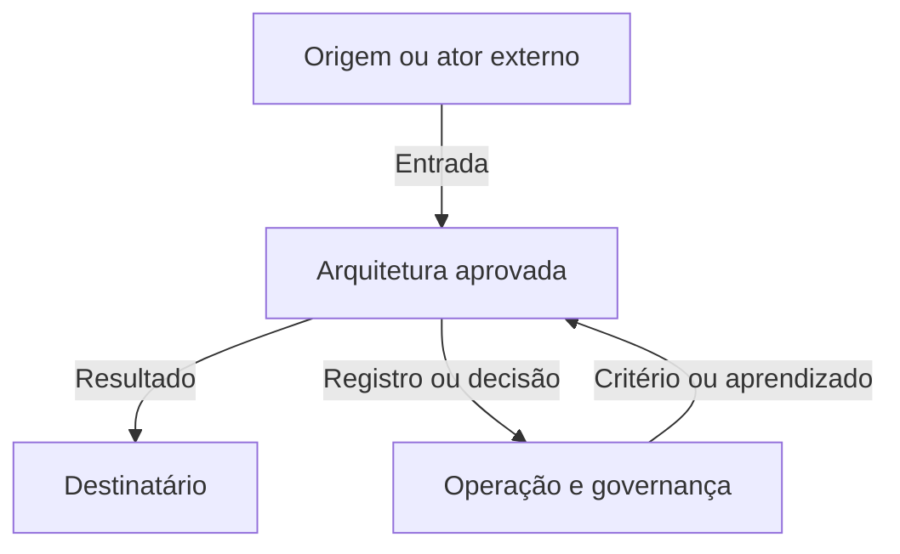

# Relatório ou Dossiê de Arquitetura — Template Preenchível

**Identificação técnica no repositório**

```yaml
id_relatorio: REL-ARQ-AAAA-NNN
id_projeto_arquitetura: ARQ-AAAA-NNN
titulo: "[Nome da arquitetura — Relatório de Arquitetura]"
organizacao:
area_ou_processo:
modalidade: "executivo | completo | dossie"
id_arquitetura_integrada: ARQ-INT-AAAA-NNN
id_validacao: VAL-ARQ-AAAA-NNN
id_linha_de_base: LB-ARQ-NNN
versao_da_linha_de_base:
responsavel_pelo_relatorio:
responsavel_pela_arquitetura:
data_de_criacao: AAAA-MM-DD
data_de_emissao:
estado: em_preparacao
nivel_sensibilidade: "publica | interna | confidencial | sensivel"
versao: 0.1
```

**Sistema Operacional do Estúdio LICHTARA**  
**Módulo:** 3 — Arquitetura Organizacional  
**Tipo:** Template operacional preenchível  
**Função:** Apresentar a arquitetura aprovada de forma compreensível, fiel, rastreável e utilizável  
**Entrada principal:** Linha de base aprovada da arquitetura  
**Saída principal:** Relatório, edição executiva ou dossiê autorizado para comunicação e passagem  
**Uso transversal:** PC-4, PC-5, Módulo 4 e continuidade organizacional

**Documentos relacionados:**

- fundamentos-da-arquitetura.md;
- protocolo-de-arquitetura.md;
- Termo de Abertura da Arquitetura;
- Plano de Arquitetura;
- Catálogo de Requisitos;
- Matriz de Rastreabilidade;
- Arquitetura Integrada;
- Registro de Validação;
- registros de decisão;
- linha de base aprovada;
- Transição para Implantação;
- Retrospectiva da Arquitetura.

---

## 1. Finalidade

O Relatório ou Dossiê de Arquitetura apresenta a configuração aprovada, o raciocínio que a sustenta e as condições que precisam acompanhar sua implantação, operação, manutenção e evolução.

Ele transforma um conjunto técnico distribuído em uma narrativa autorizada capaz de comunicar:

- a realidade que exigiu transformação;
- o problema e a decisão apoiada;
- o escopo e os limites;
- os requisitos e capacidades determinantes;
- as alternativas consideradas;
- a configuração selecionada;
- o funcionamento integrado;
- os impactos humanos e organizacionais;
- os riscos, controles e compensações;
- o resultado da validação;
- a decisão de aprovação;
- a linha de base vigente;
- as condições para implantação;
- as pendências e incertezas remanescentes;
- os documentos que demonstram cada afirmação material.

O documento deve permitir responder:

> Que arquitetura foi aprovada, por que esta configuração foi escolhida, como deverá funcionar, que consequências produz, sob quais condições permanece válida e onde estão as evidências que sustentam sua apresentação?

## 2. Resultado esperado

Ao concluir este template, cada público autorizado deve conseguir:

1. compreender a transformação sem ler todos os registros de trabalho;
2. distinguir fatos, decisões, projeções, premissas e condições;
3. reconhecer a configuração aprovada e sua versão;
4. compreender como as dimensões arquiteturais funcionam juntas;
5. localizar os requisitos e capacidades determinantes;
6. reconhecer alternativas rejeitadas e compensações da escolha;
7. compreender quem executa, decide, verifica e mantém;
8. identificar impactos sobre pessoas, carga, autonomia e poder;
9. localizar riscos, controles, limitações e divergências;
10. verificar o resultado e o alcance da validação;
11. reconhecer o que pertence ao primeiro ciclo e o que foi adiado;
12. compreender o que o Módulo 4 precisará transformar em realidade;
13. localizar critérios de aceite e testes futuros;
14. acessar o dossiê que sustenta a narrativa;
15. identificar a linha de base e os gatilhos de revisão.

## 3. Posição no ciclo

```text
Arquitetura Integrada consolidada
          ↓
Validação e ajustes
          ↓
Aprovação e linha de base — PC-4
          ↓
RELATÓRIO OU DOSSIÊ DE ARQUITETURA
          ↓
Transição para Implantação — PC-5
          ↓
Planejamento e execução — Módulo 4
```

O relatório é produzido depois que existe decisão de aprovação e linha de base identificável. Ele pode ser preparado progressivamente, mas não deve apresentar como aprovada uma configuração que ainda esteja em validação ou decisão.

## 4. Natureza do artefato

O relatório é uma **representação comunicável da linha de base**. O dossiê é o **índice governado dos registros que a sustentam**.

### 4.1 O relatório é

- narrativa autorizada;
- síntese técnica e executiva;
- instrumento de compreensão;
- registro de resultados e condições;
- orientação para passagem;
- porta de entrada para as fontes oficiais.

### 4.2 O relatório não é

- substituto da Arquitetura Integrada;
- substituto da Matriz de Rastreabilidade;
- repositório de todas as evidências brutas;
- nova oportunidade de alterar a arquitetura sem governança;
- peça promocional que omite custos ou riscos;
- cronograma detalhado de implantação;
- manual operacional definitivo;
- garantia de resultados futuros;
- autorização para ampliar o escopo aprovado.

### 4.3 Relação entre artefatos

| Artefato | Pergunta principal | Função |
| --- | --- | --- |
| Arquitetura Integrada | Como a configuração futura deverá funcionar? | Descreve componentes, relações, interfaces e continuidade. |
| Matriz de Rastreabilidade | De onde veio e o que justifica cada elemento? | Demonstra origem, vínculos, cobertura e impacto. |
| Registro de Validação | Como o desenho foi confrontado e com que resultado? | Preserva critérios, métodos, evidências, divergências e condições. |
| Relatório | O que foi aprovado e o que cada público precisa compreender? | Comunica a linha de base sem perder fidelidade. |
| Dossiê | Onde estão os registros que sustentam a entrega? | Organiza e controla o pacote documental. |
| Transição para Implantação | O que o Módulo 4 precisa receber e transformar em plano? | Entrega prioridades, dependências, riscos e critérios de aceite. |

## 5. Modalidades de uso

Selecione uma modalidade principal. Edições derivadas precisam indicar a mesma linha de base.

### 5.1 Relatório executivo

Utilizado para liderança, patrocinadores e decisores que precisam compreender:

- transformação;
- configuração aprovada;
- resultados;
- impactos;
- riscos;
- custos;
- condições;
- próximos movimentos.

Não deve retirar informação material para produzir brevidade.

### 5.2 Relatório completo

Utilizado por responsáveis pela arquitetura, implantação, operação, manutenção e auditoria. Inclui narrativa, visões dimensionais, rastreabilidade resumida, validação, linha de base e passagem.

### 5.3 Dossiê de arquitetura

Utilizado quando é necessário preservar o conjunto documental completo, versões, acessos, decisões, evidências e anexos. Pode possuir relatório principal acompanhado de índice e registros separados.

### 5.4 Edição temática

Pode existir para públicos específicos — técnica, operacional, segurança, dados, IA ou pessoas — desde que:

- declare seu recorte;
- preserve a linha de base;
- não contradiga a edição principal;
- não omita condições materiais ao público;
- aponte para o relatório completo.

## 6. Princípios de comunicação

1. **Fidelidade** — a narrativa corresponde à linha de base.
2. **Rastreabilidade** — afirmações materiais apontam para fontes.
3. **Compreensibilidade** — linguagem corresponde ao público sem empobrecer o conteúdo.
4. **Proporcionalidade** — extensão acompanha complexidade, risco e uso.
5. **Contexto** — decisões são apresentadas com problema, alternativas e limites.
6. **Materialidade** — informação que altera decisão, risco ou implantação não é escondida.
7. **Simetria** — benefícios aparecem junto de custos, perdas e compensações.
8. **Temporalidade** — atual, transição, futuro inicial e evolução não são misturados.
9. **Responsabilidade** — papéis humanos permanecem identificáveis.
10. **Acessibilidade** — formato e linguagem consideram os usuários reais.
11. **Proteção** — sensibilidade e acesso são tratados sem destruir rastreabilidade.
12. **Atualização governada** — mudança editorial e mudança arquitetural são distinguidas.

## 7. Instruções de uso

1. Duplique este arquivo para cada arquitetura real.
2. Não preencha diretamente o template-mestre.
3. Selecione a modalidade da seção 5.
4. Vincule uma linha de base aprovada antes da emissão.
5. Preencha a síntese executiva depois do corpo técnico.
6. Reutilize IDs das fontes oficiais.
7. Não copie evidência extensa quando referência segura for suficiente.
8. Diferencie fato, decisão, projeção, premissa, condição e recomendação.
9. Apresente o estado atual somente no grau necessário para compreender a transformação.
10. Descreva a configuração aprovada; preserve alternativas nos registros correspondentes.
11. Inclua custos, perdas, riscos e impactos junto aos benefícios.
12. Não transforme horizonte evolutivo em compromisso aprovado.
13. Identifique versões de diagramas, dados e anexos.
14. Produza rotas de leitura para públicos diferentes.
15. Restrinja ou segregue conteúdo sensível sem apagar sua existência.
16. Submeta conteúdo produzido por IA à revisão humana.
17. Realize teste de compreensão e reconstrução.
18. Emita o relatório somente depois da revisão da seção 68.

### 7.1 Convenções

| Convenção | Significado |
| --- | --- |
| `[Preencher]` | Informação necessária. |
| `N/A` | Campo avaliado e não aplicável. |
| `Não determinado` | Informação insuficiente. |
| `Pendente` | Tratamento futuro com responsável e limite. |
| `Fonte:` | Referência que sustenta afirmação ou número. |
| `Condição:` | Limite necessário à validade ou ao avanço. |
| `LB-ARQ-NNN` | Linha de base da arquitetura. |
| `REL-ARQ-AAAA-NNN` | Identificador do relatório. |

### 7.2 Marcadores de afirmação

| Marcador | Uso |
| --- | --- |
| **Evidenciado** | Sustentado por fonte identificada. |
| **Decidido** | Autorizado em registro formal. |
| **Projetado** | Resultado futuro esperado, ainda não observado. |
| **Premissa** | Condição assumida e verificável. |
| **Condição** | Limite para validade, aprovação ou avanço. |
| **Recomendação** | Orientação ainda dependente de decisão. |
| **Não determinado** | Conclusão não sustentada pelas informações disponíveis. |

## 8. Proporcionalidade

### 8.1 Relatório focal

Pode utilizar a versão reduzida da seção 66 quando houver:

- escopo delimitado;
- poucos componentes;
- interfaces conhecidas;
- impacto controlado;
- baixa necessidade de anexos;
- linha de base simples.

### 8.2 Relatório funcional

Deve apresentar o funcionamento de ponta a ponta, as interfaces externas, os impactos sobre os papéis, a manutenção e a passagem ao Módulo 4.

### 8.3 Dossiê sistêmico

Deve separar narrativa, visões técnicas e registros quando o volume comprometer leitura, acesso, versionamento ou manutenção. Utilize a estrutura da seção 67.

### 8.4 Teste de suficiência

O relatório é suficiente quando:

- o público compreende o que foi aprovado;
- os elementos materiais estão representados;
- riscos e condições não estão escondidos;
- as fontes podem ser localizadas;
- o Módulo 4 reconhece o que receberá;
- outra pessoa consegue reconstruir a linha de base.

## 9. Identificação do relatório

| Campo | Registro |
| --- | --- |
| ID do relatório | REL-ARQ-AAAA-NNN |
| Título | [Nome] |
| ID do projeto | ARQ-AAAA-NNN |
| Organização | [Nome] |
| Área, processo ou sistema | [Preencher] |
| Modalidade | [Executivo, completo ou dossiê] |
| Responsável pelo relatório | [Nome/papel] |
| Responsável pela arquitetura | [Nome/papel] |
| Custodiante | [Nome/papel] |
| Data de criação | [DD/MM/AAAA] |
| Data de emissão | [DD/MM/AAAA] |
| Versão | [0.1] |
| Linha de base | LB-ARQ-NNN |
| Sensibilidade | [Pública, interna, confidencial ou sensível] |
| Estado | [Selecionar na seção 10] |

### 9.1 Documentos de controle

| Documento | ID | Versão | Estado | Referência |
| --- | --- | --- | --- | --- |
| Arquitetura Integrada | ARQ-INT-AAAA-NNN | [Versão] | [Estado] | [Link] |
| Matriz de Rastreabilidade | MTR-ARQ-AAAA-NNN | [Versão] | [Estado] | [Link] |
| Registro de Validação | VAL-ARQ-AAAA-NNN | [Versão] | [Resultado] | [Link] |
| Registro de aprovação | DEC-AAAA-NNN | [Versão] | [Resultado] | [Link] |
| Linha de base | LB-ARQ-NNN | [Versão] | [Aprovada] | [Link] |
| Transição para Implantação | TRA-IMP-AAAA-NNN | [Versão] | [Estado] | [Link] |

## 10. Estado do relatório

Selecione um único estado vigente.

- [ ] **Em preparação** — modalidade, fontes e públicos estão sendo definidos.
- [ ] **Em redação** — conteúdo está sendo consolidado.
- [ ] **Em revisão técnica** — fidelidade e rastreabilidade estão sendo verificadas.
- [ ] **Em revisão executiva** — compreensão e materialidade estão sendo examinadas.
- [ ] **Aguardando autorização de emissão** — conteúdo concluído e submetido.
- [ ] **Emitido** — versão autorizada para os públicos definidos.
- [ ] **Emitido com restrições** — circulação limitada por condição registrada.
- [ ] **Em atualização** — alteração governada está em preparação.
- [ ] **Substituído** — nova edição constitui a referência vigente.
- [ ] **Retirado** — circulação interrompida por erro ou mudança material.
- [ ] **Arquivado** — preservado como histórico.

**Data da última mudança:** [DD/MM/AAAA]  
**Responsável:** [Nome]  
**Motivo:** [Preencher]

## 11. Públicos e rotas de leitura

### 11.1 Públicos

| Público | Decisão ou uso | O que precisa compreender | Seções prioritárias | Restrições |
| --- | --- | --- | --- | --- |
| Patrocinador/decisor | Direção, recursos e risco | Transformação, escolha, impacto e condições | [IDs] | [Preencher] |
| Liderança responsável | Sustentação organizacional | Papéis, autoridade, custo, risco e manutenção | [IDs] | [Preencher] |
| Responsável pela implantação | Planejamento do Módulo 4 | Componentes, prioridades, dependências e aceite | [IDs] | [Preencher] |
| Pessoas afetadas | Compreensão da mudança | Rotina, papéis, autonomia, suporte e contestação | [IDs] | [Preencher] |
| Responsável técnico | Viabilidade e continuidade | Integrações, dados, segurança e falha | [IDs] | [Preencher] |
| Responsável pela operação | Funcionamento futuro | Fluxos, indicadores, manutenção e exceções | [IDs] | [Preencher] |
| Auditor/revisor | Reconstrução e conformidade | Fontes, versões, decisões e limitações | [IDs] | [Preencher] |

### 11.2 Rotas de leitura

| Rota | Sequência recomendada | Tempo estimado | Resultado esperado |
| --- | --- | --- | --- |
| Executiva | [Seções] | [Minutos] | Compreender decisão, impacto, risco e condições. |
| Implantação | [Seções] | [Minutos] | Preparar transição e planejamento. |
| Operacional | [Seções] | [Minutos] | Compreender funcionamento, papéis e manutenção. |
| Técnica | [Seções] | [Minutos] | Examinar dados, tecnologia, IA, segurança e continuidade. |
| Auditoria | [Seções e anexos] | [Minutos] | Reconstruir linha de base e evidências. |

### 11.3 Público ausente

| Público necessário | Motivo da ausência | Efeito | Edição ou comunicação futura | Responsável |
| --- | --- | --- | --- | --- |
| [Preencher] | [Preencher] | [Preencher] | [Preencher] | [Nome] |

## 12. Governança e fontes oficiais

### 12.1 Regra de fonte

Este relatório comunica informações das fontes oficiais. Ele não altera silenciosamente requisito, componente, vínculo, validação, decisão ou linha de base.

### 12.2 Mapa de fontes

| Conteúdo | Fonte oficial | Representação neste relatório | Responsável pela conferência |
| --- | --- | --- | --- |
| Problema e escopo | Termo de Abertura | Síntese contextual | [Nome] |
| Requisitos | Catálogo de Requisitos | Requisitos determinantes e cobertura | [Nome] |
| Componentes e interfaces | Arquitetura Integrada | Funcionamento resumido | [Nome] |
| Vínculos e cobertura | Matriz de Rastreabilidade | Síntese e referências | [Nome] |
| Alternativas e decisões | Avaliação e registros de decisão | Escolha, compensações e condições | [Nome] |
| Validação | Registro de Validação | Resultado, alcance e limitações | [Nome] |
| Aprovação | Registro de Decisão | Resultado e autoridade | [Nome] |
| Linha de base | Índice da linha de base | Versões oficiais | [Nome] |
| Implantação | Transição para Implantação | Prontidão e condições | [Nome] |

### 12.3 Divergência

| Conteúdo divergente | Fontes | Versão correta | Autoridade | Correção | Efeito no relatório |
| --- | --- | --- | --- | --- | --- |
| [Preencher] | [Referências] | [Preencher] | [Papel] | [Preencher] | [Nenhum, nova edição ou retirada] |

### 12.4 Alteração editorial e material

| Tipo | Exemplo | Governança |
| --- | --- | --- |
| Editorial | Ortografia, organização ou acessibilidade sem mudança de sentido | Nova versão do relatório, sem nova linha de base. |
| Interpretativa | Reformulação que pode alterar compreensão | Revisão técnica e comparação com fontes. |
| Material | Mudança em escopo, requisito, componente, risco, condição ou decisão | Análise de impacto e processo da linha de base. |

## 13. Condições de entrada

- [ ] arquitetura integrada foi consolidada;
- [ ] validação foi concluída no grau necessário;
- [ ] apontamentos materiais receberam tratamento;
- [ ] decisão de aprovação foi registrada;
- [ ] linha de base está identificada;
- [ ] versões dos artefatos são compatíveis;
- [ ] riscos aceitos possuem autoridade;
- [ ] condições e pendências estão explícitas;
- [ ] públicos e modalidade foram definidos;
- [ ] conteúdo sensível possui tratamento;
- [ ] responsável pelo relatório foi designado;
- [ ] fontes estão acessíveis ao revisor.

### 13.1 Condição ausente

| Condição | Efeito | Tratamento | Responsável | Pode emitir? |
| --- | --- | --- | --- | --- |
| [Preencher] | [Preencher] | [Complementar, limitar, suspender ou cancelar] | [Nome] | [Sim, não ou condicionado] |

### 13.2 Emissão excepcional antes da linha de base

Somente uma edição claramente marcada como **preliminar e não aprovada** pode circular antes da linha de base. Ela deve indicar finalidade, restrição de uso, prazo de validade e proibição de orientar implantação.

## 14. Capa, emissão e distribuição

### 14.1 Capa

**Título:** [Preencher]  
**Subtítulo:** [Preencher]  
**Organização:** [Preencher]  
**Linha de base:** [ID/versão]  
**Data de emissão:** [DD/MM/AAAA]  
**Sensibilidade:** [Classificação]  
**Responsável:** [Nome]

### 14.2 Nota de emissão

> Este relatório representa a linha de base **[ID e versão]**, aprovada em **[data]** por **[autoridade]**. Seu uso é autorizado para **[finalidade e públicos]**. Alterações materiais devem seguir o controle de mudanças da arquitetura.

### 14.3 Distribuição

| Destinatário/grupo | Edição | Formato | Data | Restrição | Confirmação |
| --- | --- | --- | --- | --- | --- |
| [Preencher] | [Executiva, completa, temática ou dossiê] | [Markdown, PDF, apresentação ou outro] | [Data] | [Preencher] | [Preencher] |

### 14.4 Exportação

| Campo | Registro |
| --- | --- |
| Formato exportado | [PDF, DOCX, HTML ou outro] |
| Data da exportação | [DD/MM/AAAA] |
| Versão de origem | [Preencher] |
| Condição | [Oficial, cópia controlada ou edição de estudo] |
| Referência à fonte vigente | [Link] |

## 15. Síntese executiva

Preencha ao final. O texto deve ser compreensível sem esconder informação que altere decisão, risco ou implantação.

### 15.1 Quadro executivo

| Questão | Resposta |
| --- | --- |
| Que realidade exigiu mudança? | [Preencher] |
| Que decisão foi tomada? | [Preencher] |
| Que configuração foi aprovada? | [Preencher] |
| Que capacidade organizacional será produzida? | [Preencher] |
| O que muda no funcionamento? | [Preencher] |
| O que permanece preservado? | [Preencher] |
| Quem será afetado? | [Preencher] |
| Quais benefícios são projetados? | [Preencher] |
| Quais custos, perdas e compensações existem? | [Preencher] |
| Quais riscos foram aceitos? | [Preencher] |
| Que condições limitam a aprovação? | [Preencher] |
| O que precisa acontecer antes da implantação? | [Preencher] |
| Como o funcionamento será verificado? | [Preencher] |
| Qual é a linha de base? | [Preencher] |

### 15.2 Narrativa executiva

[Redigir de três a sete parágrafos conforme a complexidade.]

### 15.3 Decisão comunicada

**Resultado da aprovação:** [Preencher]  
**Autoridade:** [Nome/papel]  
**Registro:** DEC-NNN  
**Data:** [DD/MM/AAAA]  
**Condições:** [IDs]  
**Próximo movimento autorizado:** [Preencher]

## 16. Origem e contexto

### 16.1 Origem do projeto

**Evento de origem:** [Preencher]  
**Solicitante:** [Nome/papel]  
**Diagnóstico de origem:** [ID/versão]  
**Transição recebida:** [ID/versão]  
**Data de aceite:** [DD/MM/AAAA]

### 16.2 Contexto determinante

| Fator | Condição observada | Efeito sobre a arquitetura | Fonte |
| --- | --- | --- | --- |
| Estratégia | [Preencher] | [Preencher] | [Referência] |
| Maturidade | [Preencher] | [Preencher] | [Referência] |
| Pessoas e competências | [Preencher] | [Preencher] | [Referência] |
| Recursos | [Preencher] | [Preencher] | [Referência] |
| Tecnologia | [Preencher] | [Preencher] | [Referência] |
| Regulação/contrato | [Preencher] | [Preencher] | [Referência] |
| Identidade organizacional | [Preencher] | [Preencher] | [Referência] |
| Temporalidade | [Preencher] | [Preencher] | [Referência] |

### 16.3 Limite temporal do contexto

**Data de referência:** [DD/MM/AAAA]  
**Eventos posteriores incorporados:** [Preencher]  
**Eventos posteriores não incorporados:** [Preencher]

## 17. Problema, necessidade e decisão apoiada

### 17.1 Problema de arquitetura

> [Formulação aprovada do problema.]

| Elemento | Registro |
| --- | --- |
| ID | PRB-NNN |
| Evidências de origem | [IDs] |
| Efeito organizacional | [Preencher] |
| Pessoas/áreas afetadas | [Preencher] |
| Critério de resolução suficiente | [Preencher] |

### 17.2 Necessidade

**Capacidade necessária:** [Preencher]  
**Resultado organizacional:** [Preencher]  
**Urgência e horizonte:** [Preencher]

### 17.3 Decisão apoiada

> [Que decisão o projeto precisou permitir?]

| Campo | Registro |
| --- | --- |
| Decisor | [Nome/papel] |
| Critérios determinantes | [IDs] |
| Restrições | [IDs] |
| Alternativas | [IDs] |
| Registro da decisão | DEC-NNN |
| Condição de revisão | [Evento/evidência] |

## 18. Escopo, fronteiras e não objetivos

### 18.1 Escopo aprovado

| Objeto | Fronteira | Profundidade | Resultado aprovado |
| --- | --- | --- | --- |
| [Área, processo, capacidade, jornada ou sistema] | [Início e fim] | [Focal, funcional ou sistêmica] | [Preencher] |

### 18.2 Interfaces externas

| Elemento externo | Relação | Objeto transferido | Interface | Responsável interno |
| --- | --- | --- | --- | --- |
| [Área, parceiro, sistema ou norma] | [Preencher] | [Preencher] | INT-NNN | [Papel] |

### 18.3 Não objetivos

| Não objetivo | Motivo | Risco de interpretação | Onde será tratado |
| --- | --- | --- | --- |
| [Preencher] | [Preencher] | [Preencher] | [Documento/módulo] |

### 18.4 Limites profissionais

| Tema | Especialidade necessária | Encaminhamento | Limite da conclusão |
| --- | --- | --- | --- |
| [Preencher] | [Preencher] | [Referência] | [Preencher] |

## 19. Método e governança do projeto

### 19.1 Síntese do percurso

| Etapa | Atividade principal | Saída | Ponto de controle |
| --- | --- | --- | --- |
| Entrada | Aceite da transição | Condições de entrada | PC-1 |
| Requisitos | Consolidação e priorização | Catálogo | PC-2 |
| Alternativas | Geração, comparação e decisão | Configuração selecionada | PC-3 |
| Integração | Componentes, relações e interfaces | Arquitetura Integrada | [Marco] |
| Validação | Confronto com critérios e pessoas | Registro de Validação | PC-4 |
| Passagem | Preparação do pacote | Transição para Implantação | PC-5 |

### 19.2 Participantes

| Papel/grupo | Participação | Decisões ou validações | Limite |
| --- | --- | --- | --- |
| [Preencher] | [Preencher] | [IDs] | [Preencher] |

### 19.3 Métodos aplicados

| Método/ferramenta | Pergunta apoiada | Objeto | Saída | Limitação |
| --- | --- | --- | --- | --- |
| [Preencher] | [Preencher] | [IDs] | [Referência] | [Preencher] |

### 19.4 Participação da IA no projeto

**Síntese:** [Preencher]  
**Funções instrumentais:** [Preencher]  
**Revisão humana:** [Preencher]  
**Limites:** [Preencher]  
**Registro completo:** [Referência]

## 20. Síntese do diagnóstico

Apresente somente achados necessários para compreender o desenho. Preserve análise completa no Módulo 2.

### 20.1 Achados determinantes

| Achado | Evidências | Efeito | Resposta arquitetural | Fonte |
| --- | --- | --- | --- | --- |
| ACH-NNN | [EVDs] | [Preencher] | [REQ/CAP/CMP] | [Referência] |

### 20.2 Capacidades existentes a preservar

| Capacidade | Manifestação atual | Valor | Risco de perda | Proteção no desenho |
| --- | --- | --- | --- | --- |
| CAP-NNN | [Preencher] | [Preencher] | [Preencher] | [CMP/CTL/DEC] |

### 20.3 Riscos e restrições de origem

| Item | Tipo | Efeito no desenho | Tratamento |
| --- | --- | --- | --- |
| [RSC/RES/DEP] | [Risco, restrição ou dependência] | [Preencher] | [Preencher] |

### 20.4 Lacunas diagnósticas aceitas

| Lacuna | Efeito | Decisão | Condição de revisão |
| --- | --- | --- | --- |
| LAC-NNN | [Preencher] | DEC-NNN | [Preencher] |

## 21. Requisitos determinantes

### 21.1 Síntese

| Requisito | Prioridade | Origem | Critério de atendimento | Cobertura | Componentes |
| --- | --- | --- | --- | --- | --- |
| REQ-NNN | [Obrigatória, alta, média ou baixa] | [IDs] | [Preencher] | [Completa, parcial, condicionada ou nenhuma] | [CMPs] |

### 21.2 Requisitos obrigatórios

**Total no escopo:** [N]  
**Atendidos:** [N]  
**Parciais:** [N]  
**Condicionados:** [N]  
**Não atendidos:** [N]  
**Não determinados:** [N]

### 21.3 Requisitos não plenamente atendidos

| Requisito | Situação | Motivo | Risco | Decisão | Efeito sobre implantação |
| --- | --- | --- | --- | --- | --- |
| REQ-NNN | [Parcial, condicionado, não atendido ou não determinado] | [Preencher] | RSC-NNN | DEC-NNN | [Preencher] |

### 21.4 Conflitos materiais

| Requisitos | Tensão | Critério aplicado | Decisão | Compensação |
| --- | --- | --- | --- | --- |
| [IDs] | [Preencher] | [CRT] | DEC-NNN | [Preencher] |

## 22. Arquitetura de capacidades

| Capacidade | Natureza | Resultado | Nível futuro | Componentes | Responsável | Verificação |
| --- | --- | --- | --- | --- | --- | --- |
| CAP-NNN | [Nova, ampliada, preservada ou reduzida] | [Preencher] | [Escala/condição] | [CMPs] | [Papel] | [VAL/TST/IND] |

### 22.1 Relações entre capacidades

| Capacidade | Relação | Capacidade relacionada | Efeito | Dependência |
| --- | --- | --- | --- | --- |
| CAP-NNN | [Habilita, depende de, limita ou substitui] | CAP-NNN | [Preencher] | DEP-NNN |

### 22.2 Capacidade sem manifestação imediata

| Capacidade | Motivo | Condição de entrada | Risco do adiamento | Horizonte |
| --- | --- | --- | --- | --- |
| CAP-NNN | [Preencher] | [Preencher] | [Preencher] | [Preencher] |

## 23. Estado atual de referência

### 23.1 Funcionamento atual

[Descrever somente o necessário para compreender a transformação.]

### 23.2 Elementos atuais e destino

| Elemento atual | Função real | Problema/valor | Destino aprovado | Decisão |
| --- | --- | --- | --- | --- |
| [ID/nome] | [Preencher] | [Preencher] | [Preservar, adaptar, substituir, desativar ou investigar] | DEC-NNN |

### 23.3 Limite da representação

**Data de referência:** [DD/MM/AAAA]  
**Fontes:** [Referências]  
**Aspectos não representados:** [Preencher]

## 24. Transformação e estado futuro

### 24.1 Tese de transformação

> Para que **[organização/área]** desenvolva ou preserve **[capacidades]** e produza **[resultado]**, a arquitetura reorganizará **[componentes e relações]**, mantendo **[elementos preservados]**, reduzindo **[limitações/riscos]** e respeitando **[restrições e identidade]**.

### 24.2 De–para

| Dimensão | Estado atual | Estado futuro aprovado | Motivo | Evidência futura |
| --- | --- | --- | --- | --- |
| Capacidade | [Preencher] | [Preencher] | [Preencher] | [IND/critério] |
| Processo | [Preencher] | [Preencher] | [Preencher] | [IND/critério] |
| Papéis/autoridade | [Preencher] | [Preencher] | [Preencher] | [IND/critério] |
| Informação/conhecimento | [Preencher] | [Preencher] | [Preencher] | [IND/critério] |
| Tecnologia/IA | [Preencher] | [Preencher] | [Preencher] | [IND/critério] |
| Indicadores/controles | [Preencher] | [Preencher] | [Preencher] | [IND/critério] |

### 24.3 Estados temporais

| Estado | Conteúdo | Condição de entrada | Limite |
| --- | --- | --- | --- |
| Transição | [Preencher] | [Preencher] | [Preencher] |
| Futuro inicial | [Preencher] | [Preencher] | [Preencher] |
| Futuro evolutivo | [Preencher] | [Preencher] | [Não constitui aprovação atual] |

## 25. Alternativas e decisão arquitetural

### 25.1 Alternativas consideradas

| Alternativa | Síntese | Atendimento | Benefício | Custo/risco | Resultado |
| --- | --- | --- | --- | --- | --- |
| ALT-NNN | [Preencher] | [Preencher] | [Preencher] | [Preencher] | [Selecionada, rejeitada, combinada ou adiada] |

### 25.2 Critérios da escolha

| Critério | Peso/prioridade | Alternativa selecionada | Observação |
| --- | --- | --- | --- |
| CRT-NNN | [Preencher] | [Atende, parcial, condicionado ou não atende] | [Preencher] |

### 25.3 Configuração selecionada

**Alternativa de origem:** ALT-NNN  
**Combinações:** [IDs]  
**Registro de decisão:** DEC-NNN  
**Decisor:** [Nome/papel]  
**Data:** [DD/MM/AAAA]  
**Justificativa:** [Preencher]

### 25.4 Alternativas rejeitadas que podem retornar

| Alternativa | Motivo da rejeição | Condição de reavaliação | Conhecimento preservado |
| --- | --- | --- | --- |
| ALT-NNN | [Preencher] | [Evento/evidência] | [Preencher] |

## 26. Configuração aprovada

### 26.1 Síntese

[Descrever a lógica estrutural da configuração em prosa contínua.]

### 26.2 Componentes determinantes

| Componente | Tipo | Finalidade | Capacidade | Responsável | Estado |
| --- | --- | --- | --- | --- | --- |
| CMP-NNN | [Processo, papel, regra, documento, tecnologia, IA, indicador, controle ou outro] | [Preencher] | CAP-NNN | [Papel] | [Aprovado ou aprovado com condição] |

### 26.3 Relações determinantes

| Origem | Relação | Destino | Significado | Interface |
| --- | --- | --- | --- | --- |
| [ID] | [Relação canônica] | [ID] | [Preencher] | INT-NNN/N/A |

### 26.4 O que a configuração não resolve

| Limite | Motivo | Efeito | Destino |
| --- | --- | --- | --- |
| [Preencher] | [Preencher] | [Preencher] | [Fora do escopo, evolução, especialista ou outro módulo] |

## 27. Funcionamento integrado

### 27.1 Narrativa de ponta a ponta

Descreva:

1. evento de entrada;
2. reconhecimento e triagem;
3. informação necessária;
4. processos e decisões;
5. transferências críticas;
6. atuação de tecnologia e IA;
7. exceções e escalonamento;
8. saída produzida;
9. verificação e indicadores;
10. manutenção e aprendizagem.

[Preencher]

### 27.2 Fluxos centrais

| Fluxo | Evento inicial | Resultado | Componentes | Interfaces | Responsável pelo conjunto |
| --- | --- | --- | --- | --- | --- |
| FLX-NNN | [Preencher] | [Preencher] | [CMPs] | [INTs] | [Papel] |

### 27.3 Cenários

| Cenário | Funcionamento esperado | Exceção/falha | Tratamento | Evidência de validação |
| --- | --- | --- | --- | --- |
| CEN-NNN | [Preencher] | [Preencher] | [Preencher] | [VAL/TST] |

## 28. Contexto, fronteiras e mapa integrado

### 28.1 Elementos externos

| Elemento externo | Entrada | Saída | Interface | Dependência | Responsável |
| --- | --- | --- | --- | --- | --- |
| [Cliente, área, parceiro, sistema ou norma] | [Preencher] | [Preencher] | INT-NNN | DEP-NNN | [Papel] |

### 28.2 Diagrama opcional



**Versão do diagrama:** [Preencher]  
**Linha de base:** [ID]  
**Fonte:** [Referências]  
**Elementos omitidos:** [Preencher]  
**Legenda:** [Preencher]

## 29. Processos, fluxos e exceções

| Processo/fluxo | Finalidade | Início | Fim | Responsável | Mudança principal | Fonte detalhada |
| --- | --- | --- | --- | --- | --- | --- |
| [ID/nome] | [Preencher] | [Evento] | [Resultado] | [Papel] | [Preencher] | [Referência] |

### 29.1 Exceções críticas

| Exceção | Detecção | Decisão | Autoridade | Continuidade | Registro |
| --- | --- | --- | --- | --- | --- |
| [Preencher] | [Preencher] | [Preencher] | [Papel] | [Preencher] | [Referência] |

### 29.2 Pontos de controle

| Controle | O que verifica | Momento | Responsável | Evidência | Falha do controle |
| --- | --- | --- | --- | --- | --- |
| CTL-NNN | [Preencher] | [Preencher] | [Papel] | [Registro] | [Tratamento] |

## 30. Papéis, responsabilidades, autoridades e decisões

### 30.1 Papéis centrais

| Papel | Finalidade | Responsabilidades | Autoridades | Informação | Substituição |
| --- | --- | --- | --- | --- | --- |
| PAP-NNN | [Preencher] | [Preencher] | [Preencher] | [Preencher] | [Papel/regra] |

### 30.2 Decisões recorrentes

| Decisão | Gatilho | Decisor | Critérios | Registro | Escalonamento |
| --- | --- | --- | --- | --- | --- |
| DEC-TIP-NNN | [Preencher] | [Papel] | [Preencher] | [Local] | [Regra] |

### 30.3 Mudança de autoridade

| Autoridade | Estado atual | Estado futuro | Motivo | Risco | Proteção |
| --- | --- | --- | --- | --- | --- |
| [Preencher] | [Papel] | [Papel] | [Preencher] | [Preencher] | [Preencher] |

### 30.4 Congruência

| Responsabilidade | Papel | Autoridade correspondente | Lacuna | Tratamento |
| --- | --- | --- | --- | --- |
| [Preencher] | [Papel] | [Preencher] | [Sim ou não] | [Preencher] |

## 31. Informação e dados

### 31.1 Objetos informacionais determinantes

| Informação/dado | Finalidade | Origem | Destino | Qualidade | Sensibilidade | Fonte de verdade |
| --- | --- | --- | --- | --- | --- | --- |
| INF-NNN | [Preencher] | [Fonte] | [Papel/CMP] | [Critério] | [Classificação] | [Referência] |

### 31.2 Fluxos de informação

| Origem | Informação | Destino | Interface | Transformação | Confirmação |
| --- | --- | --- | --- | --- | --- |
| [ID] | INF-NNN | [ID] | INT-NNN | [Preencher] | [Preencher] |

### 31.3 Ciclo de vida

| Informação | Criação/coleta | Atualização | Retenção | Descarte | Responsável |
| --- | --- | --- | --- | --- | --- |
| INF-NNN | [Preencher] | [Preencher] | [Regra] | [Regra] | [Papel] |

## 32. Conhecimento e aprendizagem

| Conhecimento | Aplicação | Detentor/curador | Forma de preservação | Atualização | Risco de perda |
| --- | --- | --- | --- | --- | --- |
| CON-NNN | [Preencher] | [Papel] | [Documento, prática, treinamento, mentoria ou sistema] | [Gatilho] | [Preencher] |

### 32.1 Conhecimento humano essencial

| Conhecimento/julgamento | Por que permanece humano | Apoio possível de IA | Proteção |
| --- | --- | --- | --- |
| [Preencher] | [Preencher] | [Função limitada] | [Preencher] |

### 32.2 Retorno do aprendizado

| Evento | Aprendizado produzido | Validação | Destino |
| --- | --- | --- | --- |
| [Exceção, revisão, indicador ou operação] | [Preencher] | [Papel] | [Processo, decisão, M6 ou M8] |

## 33. Comunicação e coordenação

| Evento de comunicação | Finalidade | Emissor | Destinatário | Conteúdo | Canal | Confirmação |
| --- | --- | --- | --- | --- | --- | --- |
| COM-NNN | [Preencher] | [Papel] | [Papel/grupo] | [Preencher] | [Preencher] | [Preencher] |

### 33.1 Comunicação de decisões

| Decisão | Públicos | Contexto mínimo | Responsável | Registro |
| --- | --- | --- | --- | --- |
| DEC-NNN | [Preencher] | [Motivo, efeito, limite e data] | [Papel] | [Referência] |

### 33.2 Comunicação de exceções

| Exceção | Quem aciona | Quem recebe | Urgência | Canal alternativo | Escalonamento |
| --- | --- | --- | --- | --- | --- |
| [Preencher] | [Papel] | [Papel] | [Preencher] | [Preencher] | [Preencher] |

## 34. Documentação e memória operacional

| Documento | Finalidade | Autor | Aprovador | Usuários | Fonte de verdade | Manutenção |
| --- | --- | --- | --- | --- | --- | --- |
| DOC-NNN | [Preencher] | [Papel] | [Papel] | [Papéis] | [Local] | [Papel/frequência] |

### 34.1 Documentos que serão criados ou revisados

| Documento | Ação | Momento | Dependência | Responsável | Critério de aceite |
| --- | --- | --- | --- | --- | --- |
| DOC-NNN | [Criar, adaptar, combinar ou encerrar] | [M4/operação] | [IDs] | [Papel] | [Preencher] |

### 34.2 Carga documental

| Documento | Trabalho recorrente | Valor | Simplificação | Decisão |
| --- | --- | --- | --- | --- |
| DOC-NNN | [Preencher] | [Preencher] | [Preencher] | [Manter, automatizar, combinar ou retirar] |

## 35. Tecnologia e integrações

| Sistema/ferramenta | Função | Usuários | Dados | Integrações | Dependência | Continuidade |
| --- | --- | --- | --- | --- | --- | --- |
| TEC-NNN | [Preencher] | [Papéis] | [INF IDs] | [INT IDs] | [Fornecedor, acesso ou competência] | [Alternativa] |

### 35.1 Integrações críticas

| Interface | Origem | Destino | Objeto/formato | Frequência | Erro | Monitoramento |
| --- | --- | --- | --- | --- | --- | --- |
| INT-NNN | [Sistema] | [Sistema] | [Preencher] | [Preencher] | [Tratamento] | [IND/CTL] |

### 35.2 Adequação sociotécnica

| Tecnologia | Rotina apoiada | Mudança para pessoas | Competência | Carga | Risco |
| --- | --- | --- | --- | --- | --- |
| TEC-NNN | [Preencher] | [Preencher] | [Preencher] | [Preencher] | RSC-NNN |

## 36. Inteligência artificial

### 36.1 Funções aprovadas

| Função de IA | Finalidade | Entrada | Saída | Autonomia | Responsável humano | Verificação |
| --- | --- | --- | --- | --- | --- | --- |
| IA-NNN | [Preencher] | [Preencher] | [Preencher] | [Assistiva, recomendatória, executora limitada ou automatizada] | [Papel] | [Método] |

### 36.2 Limites

| Função | Pode | Não pode | Escalada | Dados restritos | Suspensão |
| --- | --- | --- | --- | --- | --- |
| IA-NNN | [Preencher] | [Preencher] | [Preencher] | [Preencher] | [Condição] |

### 36.3 Continuidade sem IA

| Função | Operação alternativa | Capacidade reduzida | Tempo tolerável | Responsável |
| --- | --- | --- | --- | --- |
| IA-NNN | [Preencher] | [Preencher] | [Preencher] | [Papel] |

### 36.4 Contestação e responsabilização

| Efeito apoiado por IA | Pessoa afetada | Canal de contestação | Revisor humano | Prazo |
| --- | --- | --- | --- | --- |
| [Preencher] | [Preencher] | [Preencher] | [Papel] | [Preencher] |

## 37. Indicadores e decisões

| Indicador | Objeto observado | Pergunta | Decisão/ação | Frequência | Responsável | Gatilho |
| --- | --- | --- | --- | --- | --- | --- |
| IND-NNN | [CAP/REQ/CMP/RSC] | [Preencher] | [Preencher] | [Preencher] | [Papel] | [Limite/evento] |

### 37.1 Produção

| Indicador | Dados | Regra/fórmula | Fonte | Limitação | Registro |
| --- | --- | --- | --- | --- | --- |
| IND-NNN | [INF/DAD] | [Preencher] | [Referência] | [Preencher] | [Local] |

### 37.2 Indicadores projetados

Os valores esperados ainda não observados devem ser marcados como projeção. O Módulo 5 confirmará definições, qualidade dos dados, linhas de base operacionais e efeitos reais.

## 38. Riscos, controles e compensações

### 38.1 Riscos materiais

| Risco | Objeto afetado | Consequência | Controle | Exposição residual | Autoridade |
| --- | --- | --- | --- | --- | --- |
| RSC-NNN | [ID] | [Preencher] | CTL-NNN | [Preencher] | [Papel] |

### 38.2 Controles essenciais

| Controle | Tipo | Risco | Responsável | Evidência | Falha do controle |
| --- | --- | --- | --- | --- | --- |
| CTL-NNN | [Preventivo, detectivo ou corretivo] | RSC-NNN | [Papel] | [Registro] | [Tratamento] |

### 38.3 Compensações

| Benefício obtido | Custo/perda criada | Pessoas afetadas | Reversibilidade | Decisão |
| --- | --- | --- | --- | --- |
| [Preencher] | [Preencher] | [Preencher] | [Alta, média ou baixa] | DEC-NNN |

### 38.4 Riscos aceitos

| Risco | Motivo | Autoridade | Limite | Condição de revisão |
| --- | --- | --- | --- | --- |
| RSC-NNN | [Preencher] | [Papel] | [Tempo, escopo ou volume] | [Evento/evidência] |

## 39. Impactos humanos e organizacionais

| Grupo/papel | Mudança | Benefício | Custo/perda | Carga | Autonomia | Proteção |
| --- | --- | --- | --- | --- | --- | --- |
| [Preencher] | [Preencher] | [Preencher] | [Preencher] | [Preencher] | [Ampliada, preservada ou reduzida] | [Preencher] |

### 39.1 Rotina e competências

| Papel | Rotina futura | Competência necessária | Lacuna | Apoio previsto | Momento |
| --- | --- | --- | --- | --- | --- |
| [Papel] | [Preencher] | [Preencher] | [Preencher] | [Treinamento, ferramenta, mentoria ou outro] | [Preencher] |

### 39.2 Distribuição de poder

| Mudança | Poder ampliado para | Poder reduzido para | Justificativa | Contestação |
| --- | --- | --- | --- | --- |
| [Decisão, acesso, visibilidade ou automação] | [Papel/grupo] | [Papel/grupo] | [Preencher] | [Mecanismo] |

### 39.3 Acessibilidade

| Elemento | Barreira | Adaptação aprovada | Validação | Responsável |
| --- | --- | --- | --- | --- |
| [Processo, ferramenta, comunicação ou documento] | [Preencher] | [Preencher] | [VAL/TST] | [Papel] |

## 40. Recursos, custos e sustentabilidade

### 40.1 Recursos necessários

| Recurso | Tipo | Primeiro ciclo | Recorrente | Responsável | Condição |
| --- | --- | --- | --- | --- | --- |
| [Pessoa, tempo, orçamento, tecnologia, dado ou competência] | [Preencher] | [Quantidade/faixa] | [Quantidade/faixa] | [Papel] | [Preencher] |

### 40.2 Custo total de sustentação

Considere licenças, implantação, integração, migração, treinamento, revisão humana, documentação, manutenção, suporte, segurança, atualização, substituição e encerramento.

| Categoria | Custo inicial | Custo recorrente | Premissa | Fonte |
| --- | --- | --- | --- | --- |
| [Preencher] | [Valor/faixa] | [Valor/faixa] | [PRE] | [Referência] |

### 40.3 Sustentabilidade

| Pergunta | Resultado | Evidência | Condição |
| --- | --- | --- | --- |
| A organização consegue manter o desenho? | [Preencher] | [Preencher] | [Preencher] |
| O custo cresce de modo previsível? | [Preencher] | [Preencher] | [Preencher] |
| Existe trabalho recorrente não reconhecido? | [Preencher] | [Preencher] | [Preencher] |
| A economia projetada desloca custo ou risco? | [Preencher] | [Preencher] | [Preencher] |

## 41. Ética, privacidade e segurança

| Tema | Decisão arquitetural | Proteção | Risco residual | Fonte |
| --- | --- | --- | --- | --- |
| Dignidade | [Preencher] | [Preencher] | [Preencher] | [Referência] |
| Autonomia | [Preencher] | [Preencher] | [Preencher] | [Referência] |
| Privacidade | [Preencher] | [Preencher] | [Preencher] | [Referência] |
| Segurança | [Preencher] | [Preencher] | [Preencher] | [Referência] |
| Autoria | [Preencher] | [Preencher] | [Preencher] | [Referência] |
| Acessibilidade | [Preencher] | [Preencher] | [Preencher] | [Referência] |
| Responsabilidade | [Preencher] | [Preencher] | [Preencher] | [Referência] |

### 41.1 Dados sensíveis

| Dado | Finalidade | Acesso | Transferência | Retenção | Controle |
| --- | --- | --- | --- | --- | --- |
| INF-NNN | [Preencher] | [Papéis] | [Destinos] | [Regra] | CTL-NNN |

### 41.2 Questões especializadas

| Tema | Especialista | Parecer | Condição | Referência |
| --- | --- | --- | --- | --- |
| [Preencher] | [Nome/qualificação] | [Síntese] | [Preencher] | [Documento] |

## 42. Manutenção, continuidade e encerramento

### 42.1 Manutenção

| Componente | Objeto mantido | Frequência | Responsável | Competência | Custo | Evidência |
| --- | --- | --- | --- | --- | --- | --- |
| CMP-NNN | [Preencher] | [Preencher] | [Papel] | [Preencher] | [Preencher] | [Registro] |

### 42.2 Continuidade

| Cenário | Capacidade afetada | Operação alternativa | Tempo tolerável | Recuperação | Teste |
| --- | --- | --- | --- | --- | --- |
| Ausência de pessoa | [CAP] | [Preencher] | [Preencher] | [Preencher] | TST-NNN |
| Falha de ferramenta | [CAP] | [Preencher] | [Preencher] | [Preencher] | TST-NNN |
| Indisponibilidade de IA | [CAP] | [Preencher] | [Preencher] | [Preencher] | TST-NNN |
| Perda de acesso | [CAP] | [Preencher] | [Preencher] | [Preencher] | TST-NNN |
| Mudança de fornecedor | [CAP] | [Preencher] | [Preencher] | [Preencher] | TST-NNN |
| Incidente | [CAP] | [Preencher] | [Preencher] | [Preencher] | TST-NNN |

### 42.3 Encerramento

| Componente | Gatilho | Decisor | Dependentes | Preservação | Substituição |
| --- | --- | --- | --- | --- | --- |
| CMP-NNN | [Preencher] | [Papel] | [IDs] | [Dados/conhecimento] | [ID/N/A] |

## 43. Arquitetura mínima do primeiro ciclo

| Componente essencial | Capacidade | Requisito obrigatório | Dependência | Critério de entrada |
| --- | --- | --- | --- | --- |
| CMP-NNN | CAP-NNN | REQ-NNN | [IDs] | [Preencher] |

### 43.1 Controles inegociáveis

| Controle | Risco | Deve existir antes de | Evidência |
| --- | --- | --- | --- |
| CTL-NNN | RSC-NNN | [Teste, piloto ou operação] | [Preencher] |

### 43.2 Simplificações deliberadas

| Item retirado/adiado | Motivo | Solução provisória | Risco | Gatilho de retorno |
| --- | --- | --- | --- | --- |
| [Preencher] | [Preencher] | [Preencher] | [Preencher] | [Evento/evidência] |

## 44. Evolução futura

| Elemento | Capacidade/requisito | Motivo do adiamento | Condição de entrada | Evidência de prontidão | Responsável |
| --- | --- | --- | --- | --- | --- |
| [ID/nome] | [IDs] | [Preencher] | [Preencher] | [Preencher] | [Papel] |

### 44.1 Horizonte não autorizado

| Possibilidade | Valor potencial | Incerteza | Decisão futura | Proibição atual |
| --- | --- | --- | --- | --- |
| [Preencher] | [Preencher] | [Preencher] | [Gatilho/autoridade] | [O que não pode ser iniciado] |

### 44.2 Gatilhos de revisão

| Gatilho | Fonte | Limiar/evento | Autoridade | Resultado possível |
| --- | --- | --- | --- | --- |
| [Volume, maturidade, custo, risco, aprendizado ou mudança externa] | [IND/registro] | [Preencher] | [Papel] | [Reabrir, manter, evoluir ou encerrar] |

## 45. Interfaces e dependências críticas

### 45.1 Interfaces

| Interface | Origem | Destino | Objeto transferido | Confirmação | Falha | Responsável |
| --- | --- | --- | --- | --- | --- | --- |
| INT-NNN | [ID] | [ID] | [Preencher] | [Preencher] | [Tratamento] | [Papel] |

### 45.2 Dependências

| Dependência | Objeto dependente | Responsável | Condição | Plano se não ocorrer |
| --- | --- | --- | --- | --- |
| DEP-NNN | [ID] | [Papel] | [Preencher] | [Preencher] |

### 45.3 Pontos únicos de falha

| Ponto | Capacidade | Consequência | Proteção | Risco aceito |
| --- | --- | --- | --- | --- |
| [Pessoa, sistema, dado, credencial ou fornecedor] | CAP-NNN | [Preencher] | [Preencher] | [DEC/N/A] |

## 46. Cobertura dos requisitos

### 46.1 Quadro geral

| Prioridade | Total | Atendidos | Parciais | Condicionados | Não atendidos | Não determinados |
| --- | --- | --- | --- | --- | --- | --- |
| Obrigatória | [N] | [N] | [N] | [N] | [N] | [N] |
| Alta | [N] | [N] | [N] | [N] | [N] | [N] |
| Média | [N] | [N] | [N] | [N] | [N] | [N] |
| Baixa | [N] | [N] | [N] | [N] | [N] | [N] |

### 46.2 Cobertura material

| Requisito | Componentes | Cobertura | Condição | Validação | Implantação |
| --- | --- | --- | --- | --- | --- |
| REQ-NNN | [CMPs] | [Preencher] | [COND/N/A] | [VAL/TST] | [ITM/N/A] |

### 46.3 Limite

Presença de vínculo não demonstra atendimento. A cobertura apresentada deve corresponder aos critérios do Catálogo e à versão da Matriz de Rastreabilidade vinculada à linha de base.

## 47. Síntese de rastreabilidade

### 47.1 Cadeias principais

| Origem | Requisito | Capacidade | Componente | Validação | Implantação |
| --- | --- | --- | --- | --- | --- |
| [EVD/ACH/PRB] | REQ-NNN | CAP-NNN | CMP-NNN | [VAL/TST] | [ITM/N/A] |

### 47.2 Objetos sem percurso completo

| Objeto | Lacuna | Efeito | Decisão | Tratamento |
| --- | --- | --- | --- | --- |
| [ID] | [Preencher] | [Preencher] | DEC-NNN | [Preencher] |

### 47.3 Análises de impacto abertas

| Impacto | Mudança | Objetos | Estado | Efeito sobre linha de base |
| --- | --- | --- | --- | --- |
| IMP-ARQ-NNN | [Preencher] | [IDs] | [Aberta/fechada] | [Preencher] |

## 48. Resultado da validação

### 48.1 Identificação

| Campo | Registro |
| --- | --- |
| Registro de Validação | VAL-ARQ-AAAA-NNN |
| Versão validada | [Preencher] |
| Resultado | [Validada, com ajustes, com condições, com divergências ou outro] |
| Data | [DD/MM/AAAA] |
| Responsável | [Nome/papel] |

### 48.2 Escopo e métodos

| Perspectiva/método | Objetos | Resultado | Limitação |
| --- | --- | --- | --- |
| [Pessoas afetadas, decisores, técnica, simulação ou outra] | [IDs] | [Preencher] | [Preencher] |

### 48.3 Evidências determinantes

| Evidência | Verificação | Conclusão | Fonte |
| --- | --- | --- | --- |
| EVV-NNN | VRF-NNN | [Preencher] | [Referência] |

### 48.4 Alcance

> A validação sustenta que **[objetos e versões]**, dentro de **[escopo e condições]**, foram confrontados por **[métodos e perspectivas]** contra **[critérios]**, resultando em **[resultado]**. A conclusão não abrange **[limites]**.

## 49. Divergências, condições e pendências

### 49.1 Divergências

| Divergência | Objeto | Posições | Decisão | Efeito atual |
| --- | --- | --- | --- | --- |
| DIV-NNN | [ID] | [Síntese] | [DEC/N/A] | [Preencher] |

### 49.2 Condições

| Condição | Objeto | Responsável | Prazo | Evidência | Efeito se não cumprida |
| --- | --- | --- | --- | --- | --- |
| COND-NNN | [ID] | [Papel] | [Data] | [Preencher] | [Preencher] |

### 49.3 Pendências

| Pendência | Tipo | Responsável | Limite | Destino |
| --- | --- | --- | --- | --- |
| [ID] | [Arquitetura, implantação, especialista ou evolução] | [Papel] | [Data/evento] | [Documento/módulo] |

### 49.4 Regra de materialidade

Uma condição ou divergência capaz de alterar compreensão, risco ou implantação deve aparecer no corpo do relatório, não somente em anexo.

## 50. Decisões materiais

| Decisão | Objeto | Resultado | Decisor | Data | Condição de revisão |
| --- | --- | --- | --- | --- | --- |
| DEC-NNN | [IDs] | [Preencher] | [Nome/papel] | [Data] | [Evento/evidência] |

### 50.1 Decisões difíceis

| Decisão | Alternativas | Tensão | Compensação | Risco aceito | Justificativa |
| --- | --- | --- | --- | --- | --- |
| DEC-NNN | [ALTs] | [Preencher] | [Preencher] | [RSCs] | [Preencher] |

### 50.2 Decisões futuras

| Questão | Por que permanece aberta | Evidência necessária | Decisor | Limite |
| --- | --- | --- | --- | --- |
| QAB-NNN | [Preencher] | [Preencher] | [Papel] | [Data/evento] |

## 51. Aprovação e linha de base

### 51.1 Aprovação

| Campo | Registro |
| --- | --- |
| Resultado | [Aprovada, aprovada com condições, devolvida, suspensa ou recusada] |
| Aprovador | [Nome/papel] |
| Data | [DD/MM/AAAA] |
| Registro | DEC-NNN |
| Escopo autorizado | [Preencher] |
| Limite temporal/volume | [Preencher] |
| Condições | [IDs] |

### 51.2 Linha de base

| Elemento | Registro |
| --- | --- |
| ID | LB-ARQ-NNN |
| Versão | [Preencher] |
| Data | [DD/MM/AAAA] |
| Arquitetura Integrada | [ID/versão] |
| Catálogo | [ID/versão] |
| Matriz | [ID/versão] |
| Validação | [ID/versão] |
| Decisões | [IDs] |
| Condições | [IDs] |

### 51.3 Integridade

- [ ] versões são compatíveis;
- [ ] documentos permanecem recuperáveis;
- [ ] diagramas indicam linha de base;
- [ ] pendências aceitas estão incluídas;
- [ ] acessos e sensibilidades estão tratados;
- [ ] mudanças posteriores exigem análise de impacto.

## 52. Prontidão para implantação

| Pergunta | Resultado | Evidência | Condição |
| --- | --- | --- | --- |
| Está claro o que será implantado? | [Sim, parcial ou não] | [Referência] | [Preencher] |
| Componentes possuem prioridade? | [Resultado] | [Referência] | [Preencher] |
| Dependências estão visíveis? | [Resultado] | [Referência] | [Preencher] |
| Pessoas e competências foram identificadas? | [Resultado] | [Referência] | [Preencher] |
| Dados, documentos e ferramentas a preparar são conhecidos? | [Resultado] | [Referência] | [Preencher] |
| Critérios de aceite são utilizáveis? | [Resultado] | [Referência] | [Preencher] |
| Operação paralela e retorno foram considerados? | [Resultado] | [Referência] | [Preencher] |
| Riscos de transição possuem tratamento? | [Resultado] | [Referência] | [Preencher] |

### 52.1 Resultado

- [ ] pronta;
- [ ] pronta com condições;
- [ ] requer complementação;
- [ ] requer nova validação;
- [ ] não pronta.

**Referência do PC-5:** [Preencher]

## 53. Componentes, prioridades e ondas

O Módulo 3 pode indicar prioridade e sequência lógica. O Módulo 4 transformará essas informações em projetos, cronograma, Kanban e entregas.

| Componente | Prioridade | Onda sugerida | Dependências | Resultado implantável | Responsável futuro |
| --- | --- | --- | --- | --- | --- |
| CMP-NNN | [Obrigatória, alta, média ou baixa] | [1, 2, 3 ou futura] | [IDs] | [Preencher] | [Papel] |

### 53.1 Critério das ondas

| Onda | Objetivo | Entrada | Saída | Risco | Condição de passagem |
| --- | --- | --- | --- | --- | --- |
| [N] | [Preencher] | [Preencher] | [Preencher] | [Preencher] | [Preencher] |

### 53.2 Elementos indivisíveis

| Conjunto | Componentes | Motivo | Risco de implantação parcial |
| --- | --- | --- | --- |
| [ID] | [CMPs] | [Preencher] | [Preencher] |

## 54. Condições de transição

| Componente | Pré-condições | Pessoas | Dados/documentos | Ferramentas | Comunicação | Treinamento |
| --- | --- | --- | --- | --- | --- | --- |
| CMP-NNN | [Preencher] | [Papéis] | [IDs] | [IDs] | [Preencher] | [Preencher] |

### 54.1 Convivência entre estados

| Elemento | Estado atual permanece até | Estado futuro entra quando | Operação paralela | Regra de conflito |
| --- | --- | --- | --- | --- |
| [ID/nome] | [Evento] | [Critério] | [Duração/N/A] | [Preencher] |

### 54.2 Retorno e interrupção

| Mudança | Sinal de interrupção | Autoridade | Retorno | Limite | Preservação |
| --- | --- | --- | --- | --- | --- |
| [Preencher] | [Preencher] | [Papel] | [Preencher] | [Preencher] | [Dados/registros] |

## 55. Testes e critérios de aceite

### 55.1 Critérios

| Componente/entrega | Critério de aceite | Método | Evidência | Aprovador | Momento |
| --- | --- | --- | --- | --- | --- |
| CMP/ITM-NNN | [Preencher] | [Teste, revisão, demonstração ou outro] | [Preencher] | [Papel] | [Preencher] |

### 55.2 Testes transferidos ao Módulo 4

| Teste | Objeto | Motivo | Pré-condição | Resultado esperado | Responsável |
| --- | --- | --- | --- | --- | --- |
| TST-NNN | [ID] | [Depende de implantação] | [Preencher] | [Preencher] | [Papel] |

### 55.3 Resultado operacional futuro

| Resultado | Indicador | Período de observação | Decisão se insuficiente |
| --- | --- | --- | --- |
| [Preencher] | IND-NNN | [Preencher] | [Preencher] |

## 56. Decisões e questões abertas para implantação

| Item | Tipo | Objeto | Decisor | Evidência necessária | Limite | Efeito |
| --- | --- | --- | --- | --- | --- | --- |
| QAB-NNN | [Decisão, validação, especialista, recurso ou implantação] | [IDs] | [Papel] | [Preencher] | [Data/evento] | [Preencher] |

### 56.1 Regra

Questão aberta não deve ser apresentada como decisão tomada. Se impedir segurança, viabilidade ou compreensão, deve bloquear a passagem ou receber autoridade competente.

## 57. Benefícios, custos, perdas e compensações

### 57.1 Quadro balanceado

| Mudança | Benefício projetado | Evidência/base | Custo | Perda/renúncia | Pessoas afetadas | Condição |
| --- | --- | --- | --- | --- | --- | --- |
| [Preencher] | [Preencher] | [Referência/premissa] | [Preencher] | [Preencher] | [Preencher] | [Preencher] |

### 57.2 Benefícios não garantidos

| Benefício | Natureza | Premissas | Indicador futuro | Limite da afirmação |
| --- | --- | --- | --- | --- |
| [Preencher] | [Projetado, esperado ou experimental] | [PREs] | IND-NNN | [Preencher] |

### 57.3 Distribuição

| Grupo | Benefício recebido | Custo assumido | Proteção | Avaliação de equidade |
| --- | --- | --- | --- | --- |
| [Preencher] | [Preencher] | [Preencher] | [Preencher] | [Preencher] |

## 58. Premissas, limitações e incertezas

### 58.1 Premissas

| Premissa | Base | Objeto afetado | Efeito se falsa | Teste futuro |
| --- | --- | --- | --- | --- |
| PRE-NNN | [Preencher] | [IDs] | [Preencher] | [TST/IND] |

### 58.2 Limitações

| Limitação | Origem | Efeito sobre o relatório | Uso permitido | Revisão |
| --- | --- | --- | --- | --- |
| [Escopo, dado, método, tempo, acesso ou competência] | [Preencher] | [Preencher] | [Preencher] | [Condição] |

### 58.3 Incertezas

| Incerteza | Exposição | Proteção | Evidência futura | Decisão |
| --- | --- | --- | --- | --- |
| [Preencher] | [Preencher] | [Preencher] | [Preencher] | [Gatilho/autoridade] |

## 59. Registro de afirmações e evidências

Utilize esta seção para afirmações executivas, números, projeções e conclusões capazes de influenciar decisão ou expectativa.

| ID | Afirmação | Tipo | Fonte | Versão/período | Limitação | Responsável |
| --- | --- | --- | --- | --- | --- | --- |
| AFI-NNN | [Preencher] | [Evidenciada, decidida, projetada, premissa ou condição] | [Referência] | [Preencher] | [Preencher] | [Nome] |

### 59.1 Afirmação sem fonte suficiente

| Afirmação | Motivo | Risco | Reformulação ou retirada | Autoridade |
| --- | --- | --- | --- | --- |
| [Preencher] | [Preencher] | [Preencher] | [Preencher] | [Papel] |

### 59.2 Linguagem de projeção

Evite apresentar como fato futuro expressões como “garantirá”, “eliminará” ou “produzirá” quando o resultado depende de implantação, adoção, volume, contexto ou operação. Declare premissas, condições e forma de verificação.

## 60. Índice do dossiê

### 60.1 Manifesto de artefatos

| Artefato | ID | Versão | Linha de base | Sensibilidade | Estado | Responsável | Referência |
| --- | --- | --- | --- | --- | --- | --- | --- |
| Termo de Abertura | [ID] | [Versão] | [LB/N/A] | [Classificação] | [Estado] | [Nome] | [Link] |
| Plano de Arquitetura | [ID] | [Versão] | [LB/N/A] | [Classificação] | [Estado] | [Nome] | [Link] |
| Catálogo de Requisitos | [ID] | [Versão] | [LB] | [Classificação] | [Estado] | [Nome] | [Link] |
| Matriz de Rastreabilidade | [ID] | [Versão] | [LB] | [Classificação] | [Estado] | [Nome] | [Link] |
| Arquitetura Integrada | [ID] | [Versão] | [LB] | [Classificação] | [Estado] | [Nome] | [Link] |
| Registro de Validação | [ID] | [Versão] | [LB] | [Classificação] | [Estado] | [Nome] | [Link] |
| Registros de decisão | [IDs] | [Versões] | [LB] | [Classificação] | [Estado] | [Nome] | [Link] |
| Linha de base | [ID] | [Versão] | [LB] | [Classificação] | [Estado] | [Nome] | [Link] |
| Transição para Implantação | [ID] | [Versão] | [LB] | [Classificação] | [Estado] | [Nome] | [Link] |
| Retrospectiva | [ID] | [Versão] | [LB/N/A] | [Classificação] | [Estado] | [Nome] | [Link] |

### 60.2 Integridade do pacote

- [ ] todos os artefatos possuem IDs;
- [ ] versões correspondem à linha de base;
- [ ] referências são acessíveis aos públicos autorizados;
- [ ] conteúdo sensível está segregado;
- [ ] documentos substituídos estão identificados;
- [ ] anexos possuem origem;
- [ ] cópias exportadas registram data e versão;
- [ ] pacote pode ser reconstruído sem memória pessoal.

## 61. Anexos e representações visuais

### 61.1 Índice

| Anexo | Título | Função | Fonte | Versão | Público |
| --- | --- | --- | --- | --- | --- |
| ANX-NNN | [Preencher] | [Mapa, diagrama, tabela, parecer, teste ou outro] | [Referência] | [Versão] | [Preencher] |

### 61.2 Regras para diagramas

Todo diagrama deve indicar:

- título;
- objeto;
- versão;
- linha de base;
- data;
- legenda;
- fronteira;
- elementos omitidos;
- fonte;
- responsável.

### 61.3 Representação simplificada

Uma visão simplificada não se torna fonte de verdade. Se omitir exceção, risco, condição ou interface material, deve declarar a omissão e apontar para a visão completa.

## 62. Sensibilidade, acesso e edições derivadas

### 62.1 Classificação

| Seção/anexo | Sensibilidade | Quem acessa | Quem autoriza | Edição alternativa |
| --- | --- | --- | --- | --- |
| [Preencher] | [Pública, interna, confidencial ou sensível] | [Papéis] | [Papel] | [Síntese, anonimizada ou nenhuma] |

### 62.2 Redação e anonimização

| Conteúdo protegido | Motivo | Síntese permitida | Risco de perda de contexto | Responsável |
| --- | --- | --- | --- | --- |
| [Preencher] | [Preencher] | [Preencher] | [Preencher] | [Nome] |

### 62.3 Edições derivadas

| Edição | Público | Seções incluídas | Omissões | Restrição de uso | Linha de base |
| --- | --- | --- | --- | --- | --- |
| [Executiva, técnica, operacional ou externa] | [Preencher] | [IDs] | [Preencher] | [Preencher] | [ID] |

### 62.4 Regra

Redação para proteção não pode produzir narrativa materialmente enganosa. Quando uma informação não puder ser compartilhada, registre que existe condição restrita e indique a autoridade competente.

## 63. Versionamento e controle de mudanças

### 63.1 Controle de versões

| Versão | Data | Estado | Alteração | Tipo | Responsável | Autorização |
| --- | --- | --- | --- | --- | --- | --- |
| 0.1 | [DD/MM/AAAA] | Em redação | Criação inicial | Editorial | [Nome] | N/A |
| 1.0 | [DD/MM/AAAA] | Emitido | Primeira emissão | Emissão | [Nome] | [Referência] |

### 63.2 Mudanças posteriores

| Mudança | Tipo | Linha de base afetada? | Análise de impacto | Nova validação | Nova emissão |
| --- | --- | --- | --- | --- | --- |
| [Preencher] | [Editorial, interpretativa ou material] | [Sim ou não] | [IMP/N/A] | [VAL/N/A] | [Versão] |

### 63.3 Retirada

| Edição | Motivo | Data | Autoridade | Substituta | Comunicação |
| --- | --- | --- | --- | --- | --- |
| [Versão] | [Erro material, mudança de linha de base ou acesso] | [Data] | [Papel] | [Versão/N/A] | [Preencher] |

### 63.4 Proibição

Nova emissão não apaga o relatório anterior. O histórico deve permitir saber qual narrativa acompanhou cada etapa da implantação e da operação.

## 64. Participação da inteligência artificial na elaboração do relatório

### 64.1 Registro

| Atividade | Sistema/modelo | Entrada | Saída utilizada | Revisão humana | Responsável |
| --- | --- | --- | --- | --- | --- |
| [Organização, síntese, redação, comparação, diagrama, revisão ou acessibilidade] | [Nome/versão] | [Categoria] | [Preencher] | [Método] | [Nome] |

### 64.2 Usos adequados

A IA pode apoiar:

- organização de fontes;
- comparação entre versões;
- criação de rascunhos;
- conversão de linguagem técnica;
- identificação preliminar de inconsistências;
- preparação de tabelas e diagramas;
- revisão de coerência formal;
- geração de rotas de leitura;
- verificação de referências.

### 64.3 Limites

A IA não deve:

- inventar fonte ou evidência;
- transformar projeção em fato;
- suavizar risco para tornar o texto persuasivo;
- apagar divergência;
- decidir materialidade;
- redefinir linha de base;
- atribuir aprovação;
- divulgar conteúdo sensível;
- assumir autoria ou responsabilidade decisória.

### 64.4 Verificação

- [ ] fontes foram conferidas;
- [ ] números correspondem ao período correto;
- [ ] decisões correspondem aos registros;
- [ ] riscos e condições foram preservados;
- [ ] resumos não inverteram sentido;
- [ ] linguagem de projeção está correta;
- [ ] versões estão identificadas;
- [ ] responsável humano aprovou o uso da saída.

## 65. Edição executiva

Utilize esta seção para produzir uma edição curta vinculada ao relatório completo.

### 65.1 Estrutura mínima

1. contexto e problema;
2. decisão e configuração aprovada;
3. mudança de funcionamento;
4. capacidades e componentes centrais;
5. impacto humano e organizacional;
6. benefícios, custos e compensações;
7. riscos e controles;
8. resultado da validação;
9. linha de base e condições;
10. prontidão e próximo movimento.

### 65.2 Quadro de uma página

| Elemento | Síntese | Fonte |
| --- | --- | --- |
| Problema | [Preencher] | [Referência] |
| Decisão | [Preencher] | [DEC] |
| Configuração | [Preencher] | [ARQ-INT] |
| Capacidades | [Preencher] | [CAPs] |
| Mudanças | [Preencher] | [Referência] |
| Impactos | [Preencher] | [Referência] |
| Riscos | [Preencher] | [RSCs] |
| Condições | [Preencher] | [CONDs] |
| Linha de base | [Preencher] | [LB] |
| Próximo movimento | [Preencher] | [TRA-IMP] |

### 65.3 Regra de fidelidade

Brevidade não autoriza retirar risco, condição, divergência, impacto humano, custo ou limite que altere a compreensão da decisão.

## 66. Versão reduzida para arquitetura focal

### 66.1 Identificação e aprovação

| Campo | Registro |
| --- | --- |
| ID e título | [Preencher] |
| Problema | [Preencher] |
| Escopo | [Preencher] |
| Decisão | [DEC] |
| Linha de base | [LB] |
| Resultado da validação | [VAL/resultado] |

### 66.2 Arquitetura

| Capacidade | Componentes | Funcionamento | Responsáveis | Critério |
| --- | --- | --- | --- | --- |
| CAP-NNN | [CMPs] | [Síntese] | [Papéis] | [Preencher] |

### 66.3 Passagem

**Mudanças principais:** [Preencher]  
**Riscos e controles:** [Preencher]  
**Impactos humanos:** [Preencher]  
**Condições:** [Preencher]  
**Prioridades e dependências:** [Preencher]  
**Critérios de aceite:** [Preencher]  
**Próximo movimento:** [Preencher]

### 66.4 Controles mínimos

- [ ] linha de base está identificada;
- [ ] decisão e configuração são compreensíveis;
- [ ] requisitos determinantes possuem cobertura;
- [ ] benefícios e custos aparecem juntos;
- [ ] riscos e condições estão explícitos;
- [ ] fontes são localizáveis;
- [ ] implantação reconhece o que receberá.

## 67. Estrutura ampliada do dossiê sistêmico

```text
dossie-de-arquitetura/
|-- README.md
|-- 01-relatorio-executivo.md
|-- 02-relatorio-completo.md
|-- 03-indice-da-linha-de-base.md
|-- origem/
|   |-- diagnostico-e-transicao/
|   +-- termo-e-plano/
|-- requisitos-e-rastreabilidade/
|   |-- catalogo-de-requisitos.md
|   +-- matriz-de-rastreabilidade/
|-- arquitetura/
|   |-- arquitetura-integrada/
|   |-- mapas-dimensionais/
|   +-- alternativas/
|-- decisoes/
|-- validacao/
|   |-- registro-consolidado.md
|   |-- evidencias/
|   +-- testes-e-pareceres/
|-- linha-de-base/
|-- implantacao/
|   |-- transicao-para-implantacao.md
|   +-- criterios-de-aceite.md
|-- retrospectiva/
+-- anexos-protegidos/
```

### 67.1 Regras

- README funciona como índice e nota de emissão;
- relatório executivo aponta para o completo;
- relatório completo aponta para as fontes;
- linha de base define versões oficiais;
- conteúdo sensível permanece segregado;
- decisões e divergências são localizáveis;
- evidências não são duplicadas sem necessidade;
- anexos possuem origem e versão;
- pacote pode ser exportado e reconstruído;
- arquivos substituídos permanecem identificados.

## 68. Revisão de qualidade do relatório

### 68.1 Fidelidade

- [ ] configuração corresponde à linha de base;
- [ ] decisões correspondem aos registros;
- [ ] números possuem fonte e período;
- [ ] projeções estão sinalizadas;
- [ ] premissas não aparecem como fatos;
- [ ] riscos e condições não foram suavizados.

### 68.2 Compreensibilidade

- [ ] públicos e rotas de leitura estão definidos;
- [ ] termos técnicos necessários estão explicados;
- [ ] diagramas possuem legenda e versão;
- [ ] narrativa possui início, transformação e consequência;
- [ ] responsabilidades humanas são identificáveis;
- [ ] leitores conseguem localizar detalhes.

### 68.3 Rastreabilidade

- [ ] afirmações materiais apontam para fontes;
- [ ] IDs são consistentes;
- [ ] versões são compatíveis;
- [ ] anexos possuem referência;
- [ ] linha de base é recuperável;
- [ ] divergências entre fontes foram tratadas.

### 68.4 Materialidade

- [ ] benefícios aparecem com custos e perdas;
- [ ] impactos humanos estão visíveis;
- [ ] riscos aceitos possuem autoridade;
- [ ] condições possuem responsável e prazo;
- [ ] limitações alteradoras de conclusão aparecem no corpo;
- [ ] horizonte futuro não foi apresentado como compromisso.

### 68.5 Implantabilidade

- [ ] componentes e prioridades são reconhecíveis;
- [ ] dependências estão explícitas;
- [ ] critérios de aceite podem ser usados;
- [ ] testes futuros estão identificados;
- [ ] operação paralela e retorno foram considerados;
- [ ] Módulo 4 compreende o limite entre desenho e plano.

### 68.6 Resultado

- [ ] aprovado para emissão;
- [ ] aprovado com ajustes editoriais;
- [ ] requer correção técnica;
- [ ] requer análise de impacto;
- [ ] requer nova validação;
- [ ] não autorizado para emissão.

**Responsável técnico:** [Nome]  
**Responsável executivo:** [Nome]  
**Data:** [DD/MM/AAAA]  
**Observações:** [Preencher]

## 69. Teste de compreensão por público

### 69.1 Perguntas

O leitor deve conseguir explicar:

1. que problema exigiu arquitetura;
2. que decisão foi tomada;
3. o que muda e o que permanece;
4. como a configuração funciona;
5. que responsabilidades lhe dizem respeito;
6. que benefícios, custos e riscos existem;
7. que condições limitam o avanço;
8. que informação ou ação é esperada dele;
9. onde encontrar detalhes;
10. qual versão está vigente.

### 69.2 Registro

| Público/leitor | Questões compreendidas | Ambiguidades | Informação ausente | Ajuste | Resultado |
| --- | --- | --- | --- | --- | --- |
| [Nome/papel] | [N/10] | [Preencher] | [Preencher] | [Preencher] | [Compreendido, parcial ou não compreendido] |

### 69.3 Falha de compreensão

| Falha | Causa provável | Risco | Correção | Nova verificação |
| --- | --- | --- | --- | --- |
| [Preencher] | [Linguagem, estrutura, ausência, contradição ou excesso] | [Preencher] | [Preencher] | [Data/público] |

## 70. Teste de reconstrução

Uma pessoa autorizada que não participou do projeto deve conseguir responder:

1. qual linha de base o relatório representa;
2. que realidade justificou o projeto;
3. que problema e decisão orientaram o desenho;
4. que requisitos e capacidades foram determinantes;
5. que alternativas foram consideradas;
6. por que a configuração foi selecionada;
7. como os componentes funcionam juntos;
8. quem executa, decide, verifica e mantém;
9. que riscos, custos e compensações permanecem;
10. como a arquitetura foi validada;
11. que divergências e limitações existem;
12. o que pertence ao primeiro ciclo;
13. o que foi adiado;
14. que condições precedem a implantação;
15. que artefatos sustentam cada afirmação material;
16. que evento exigirá revisão.

### 70.1 Registro

| Campo | Registro |
| --- | --- |
| Pessoa revisora | [Nome/papel] |
| Data | [DD/MM/AAAA] |
| Questões respondidas | [N/16] |
| Questões parciais | [IDs] |
| Questões não respondidas | [IDs] |
| Fontes inacessíveis | [Preencher] |
| Ambiguidades | [Preencher] |
| Ajustes realizados | [Preencher] |
| Resultado | [Aprovado, aprovado com ajustes ou reprovado] |

## 71. Autorização de emissão

### 71.1 Revisores

| Papel | Objeto da revisão | Resultado | Condição | Nome | Data |
| --- | --- | --- | --- | --- | --- |
| Responsável pela arquitetura | Fidelidade à linha de base | [Preencher] | [Preencher] | [Nome] | [Data] |
| Responsável pela validação | Fidelidade ao resultado e limites | [Preencher] | [Preencher] | [Nome] | [Data] |
| Responsável pela implantação | Utilidade para passagem | [Preencher] | [Preencher] | [Nome] | [Data] |
| Responsável por dados/segurança | Proteção e acesso | [Preencher] | [Preencher] | [Nome] | [Data] |
| Representante executivo | Compreensão e materialidade | [Preencher] | [Preencher] | [Nome] | [Data] |

### 71.2 Resultado

- [ ] emissão autorizada;
- [ ] autorizada com restrições;
- [ ] requer ajustes editoriais;
- [ ] requer correção técnica;
- [ ] requer nova decisão;
- [ ] não autorizada.

### 71.3 Autorização

| Campo | Registro |
| --- | --- |
| Autoridade | [Nome/papel] |
| Resultado | [Preencher] |
| Data | [DD/MM/AAAA] |
| Versão autorizada | [Versão] |
| Públicos autorizados | [Preencher] |
| Restrições | [Preencher] |
| Registro | [DEC/termo] |

## 72. Critérios de conclusão e encerramento

### 72.1 Critérios de conclusão

- [ ] modalidade e públicos estão definidos;
- [ ] linha de base aprovada está identificada;
- [ ] fontes e versões foram conferidas;
- [ ] síntese executiva corresponde ao corpo técnico;
- [ ] problema, decisão e escopo estão explícitos;
- [ ] configuração aprovada é compreensível;
- [ ] funcionamento integrado foi apresentado;
- [ ] requisitos e capacidades determinantes estão visíveis;
- [ ] alternativas e compensações foram preservadas;
- [ ] impactos humanos e organizacionais estão incluídos;
- [ ] custos, perdas e riscos acompanham benefícios;
- [ ] resultado e alcance da validação estão corretos;
- [ ] condições, divergências e limitações estão explícitas;
- [ ] aprovação e linha de base são recuperáveis;
- [ ] implantação possui prioridades, dependências e critérios;
- [ ] afirmações materiais possuem fontes;
- [ ] dossiê está íntegro;
- [ ] sensibilidades e edições derivadas foram tratadas;
- [ ] uso de IA foi registrado;
- [ ] testes de compreensão e reconstrução foram concluídos;
- [ ] emissão foi autorizada.

### 72.2 Regra de encerramento

O relatório pode ser encerrado quando representa fielmente a linha de base, foi compreendido pelos públicos necessários, possui fontes recuperáveis e está autorizado para emissão e passagem.

O encerramento não congela a realidade. Mudança material, nova linha de base, evidência operacional ou alteração de contexto pode exigir nova edição. O relatório anterior permanece como registro da arquitetura comunicada naquele momento.

### 72.3 Resultado

- [ ] emitido;
- [ ] emitido com restrições;
- [ ] transferido ao Módulo 4;
- [ ] substituído;
- [ ] retirado;
- [ ] arquivado.

---

## Registro final

**ID do relatório:** REL-ARQ-AAAA-NNN  
**Modalidade:** [Executivo, completo ou dossiê]  
**Estado:** [Preencher]  
**Versão:** [Preencher]  
**Linha de base representada:** LB-ARQ-NNN  
**Data de emissão:** [DD/MM/AAAA]  
**Responsável:** [Nome]  
**Públicos autorizados:** [Preencher]  
**Restrições:** [Preencher]  
**Resultado no PC-5:** [Preencher]  
**Próximo artefato:** `08-transicao-para-implantacao.md`  
**Observações:** [Preencher]
