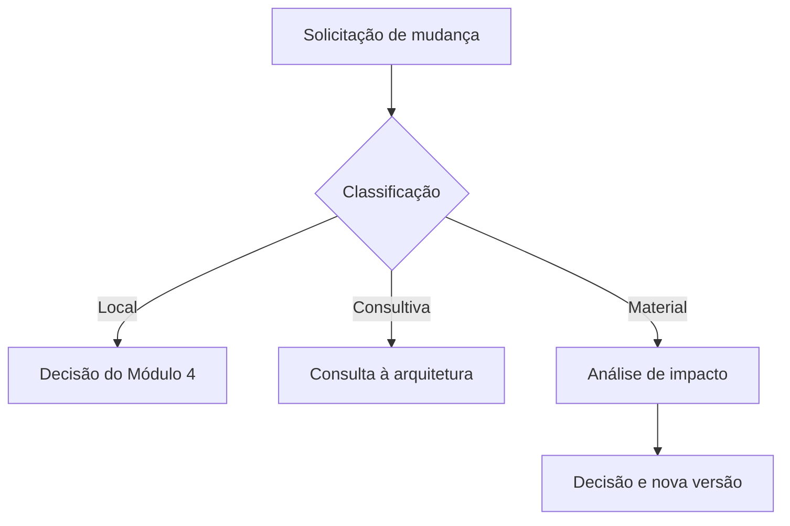

# Transição para Implantação — Template Preenchível

**Identificação técnica no repositório**

```yaml
id_transicao_implantacao: TRA-IMP-AAAA-NNN
id_projeto_arquitetura: ARQ-AAAA-NNN
titulo: "[Nome da arquitetura — Transição para Implantação]"
organizacao:
area_ou_processo:
id_linha_de_base: LB-ARQ-NNN
id_arquitetura_integrada: ARQ-INT-AAAA-NNN
id_relatorio: REL-ARQ-AAAA-NNN
responsavel_pela_arquitetura:
responsavel_pela_implantacao:
responsavel_pela_transicao:
data_de_preparacao: AAAA-MM-DD
data_da_passagem:
estado: em_preparacao
resultado_pc5:
nivel_sensibilidade: "publica | interna | confidencial | sensivel"
versao: 0.1
```

**Sistema Operacional do Estúdio LICHTARA**  
**Módulo de origem:** 3 — Arquitetura Organizacional  
**Módulo de destino:** 4 — Implantação  
**Tipo:** Template operacional preenchível  
**Função:** Transferir uma arquitetura aprovada em condições suficientes para planejamento e implantação responsáveis  
**Entrada principal:** Linha de base aprovada e pacote arquitetural consolidado  
**Saída principal:** Pacote recebido, compreendido e aceito — ou devolvido — pelo Módulo 4  
**Ponto de controle:** PC-5 — Prontidão para implantar

**Documentos relacionados:**

- fundamentos-da-arquitetura.md;
- protocolo-de-arquitetura.md;
- Catálogo de Requisitos;
- Matriz de Rastreabilidade;
- Arquitetura Integrada;
- Registro de Validação;
- Relatório ou Dossiê de Arquitetura;
- registros de decisão;
- linha de base aprovada;
- plano de implantação, quando criado pelo Módulo 4;
- Retrospectiva da Arquitetura.

---

## 1. Finalidade

A Transição para Implantação formaliza a passagem entre uma arquitetura aprovada e o trabalho necessário para transformá-la em realidade.

Ela entrega ao Módulo 4:

- o que deverá ser implantado;
- por que cada elemento existe;
- que versão está autorizada;
- que componentes compõem o primeiro ciclo;
- que prioridades e sequências lógicas foram definidas;
- que dependências e pré-condições precisam ser resolvidas;
- que pessoas, competências e recursos serão necessários;
- que dados, documentos e ferramentas precisam ser preparados;
- que riscos e controles acompanham a mudança;
- que testes permanecem por realizar;
- que critérios permitirão aceite;
- como operar em paralelo, interromper, corrigir ou retornar;
- que decisões permanecem abertas;
- que escolhas o Módulo 4 pode realizar dentro do envelope aprovado;
- que mudanças exigem retorno à arquitetura.

O documento deve permitir responder:

> O Módulo 4 recebeu uma linha de base compreensível, íntegra e suficientemente preparada para converter o desenho em projetos e entregas sem alterar silenciosamente sua finalidade, seus limites ou suas proteções?

## 2. Resultado esperado

Ao concluir este template:

1. o Módulo 3 deve demonstrar a prontidão do pacote;
2. o Módulo 4 deve conseguir inspecionar cada entrada;
3. a linha de base deve ser inequívoca;
4. componentes e prioridades devem ser identificáveis;
5. dependências e condições devem possuir responsáveis;
6. critérios de aceite devem ser utilizáveis;
7. testes futuros devem possuir objetos e autoridades;
8. riscos de transição devem estar visíveis;
9. dados, documentos, tecnologia e IA devem possuir condições de implantação;
10. operação paralela, retorno e desativação devem estar tratados;
11. limites de decisão entre os módulos devem ser explícitos;
12. dúvidas e divergências devem ser registradas;
13. o resultado do PC-5 deve ser formalizado;
14. o aceite do pacote deve possuir autoridade;
15. a implantação deve iniciar apenas dentro das condições autorizadas.

## 3. Posição no ciclo

```text
Arquitetura validada
          ↓
Aprovação e linha de base — PC-4
          ↓
Relatório ou Dossiê de Arquitetura
          ↓
PREPARAÇÃO DA TRANSIÇÃO
          ↓
Inspeção e reunião de passagem
          ↓
Aceite, aceite condicionado ou devolução — PC-5
          ↓
Planejamento da implantação — Módulo 4
          ↓
Projetos, entregas, treinamento e mudança
```

O PC-5 não aprova novamente a arquitetura. Ele verifica se o pacote, os responsáveis e as condições são suficientes para iniciar o planejamento e a implantação.

## 4. Natureza da transição

A transição é um ato bilateral de entrega e recebimento.

### 4.1 Ato do Módulo 3

O Módulo 3:

- identifica a linha de base;
- organiza o pacote;
- comunica finalidade e decisões;
- delimita o que será implantado;
- apresenta prioridades, dependências e riscos;
- transfere testes e critérios;
- informa condições e pendências;
- permanece disponível para esclarecimentos e mudanças materiais.

### 4.2 Ato do Módulo 4

O Módulo 4:

- inspeciona integridade e acesso;
- verifica compreensão;
- confronta implantabilidade;
- identifica lacunas;
- aceita, aceita com condições ou devolve o pacote;
- transforma condições em projetos, cronograma, Kanban, treinamento, comunicação e gestão da mudança;
- retorna à arquitetura quando a execução revelar mudança material.

### 4.3 O que a transição não é

- envio informal de arquivos;
- aprovação automática pela existência de documentos;
- plano de projeto detalhado;
- cronograma de implantação;
- autorização para alterar requisitos;
- transferência integral de responsabilidade ao Módulo 4;
- garantia de que todos os riscos foram eliminados;
- encerramento da rastreabilidade;
- abandono da arquitetura depois da passagem.

## 5. Princípios da passagem

1. **Linha de base explícita** — somente uma configuração autorizada é transferida.
2. **Integridade do pacote** — documentos e versões precisam corresponder.
3. **Compreensão verificável** — recebimento não equivale a entendimento.
4. **Responsabilidade bilateral** — entregar e aceitar são atos distintos.
5. **Condições visíveis** — pendências não são escondidas para concluir o PC-5.
6. **Implantabilidade** — o desenho precisa poder ser convertido em trabalho.
7. **Proporcionalidade** — profundidade acompanha impacto, risco e complexidade.
8. **Reversibilidade** — interrupção, correção e retorno são planejados.
9. **Rastreabilidade contínua** — mudanças da implantação retornam à arquitetura.
10. **Autonomia delimitada** — o Módulo 4 conhece suas escolhas permitidas.
11. **Proteção de pessoas e dados** — velocidade não reduz cuidados essenciais.
12. **Aprendizagem** — a passagem produz conhecimento sobre a qualidade do desenho.

## 6. Limite entre arquitetura e implantação

| Módulo 3 — define | Módulo 4 — transforma em |
| --- | --- |
| Componentes aprovados | Entregas, tarefas e configuração real |
| Prioridades arquiteturais | Sequenciamento operacional e cronograma |
| Dependências e pré-condições | Plano de resolução e responsáveis de execução |
| Condições de transição | Plano de implantação e gestão de mudança |
| Competências necessárias | Treinamento, contratação ou suporte |
| Dados e documentos necessários | Migração, criação, revisão e controle |
| Testes necessários | Roteiros executáveis, ambientes e agendas |
| Critérios de aceite | Procedimentos de verificação e aprovação de entregas |
| Riscos e controles | Ações de mitigação e acompanhamento |
| Reversibilidade | Plano de retorno, contingência e desativação |

### 6.1 Regra

O Módulo 3 pode indicar sequência, prioridade, janela, restrição e condição. O Módulo 4 define o plano detalhado sem ultrapassar o envelope da seção 51.

## 7. Instruções de uso

1. Duplique este arquivo para cada passagem real.
2. Não preencha diretamente o template-mestre.
3. Vincule uma linha de base aprovada.
4. Reutilize IDs dos artefatos-fonte.
5. Não copie conteúdo extenso quando referência segura for suficiente.
6. Verifique o pacote antes da reunião.
7. Envolva o responsável pela implantação antes do encerramento do Módulo 3.
8. Registre um item de implantação por linha.
9. Diferencie prioridade arquitetural de cronograma.
10. Defina critérios de aceite observáveis.
11. Identifique testes que somente podem ocorrer durante implantação.
12. Declare pendências, restrições e riscos aceitos.
13. Delimite escolhas livres, consultivas e materiais.
14. Registre dúvidas e respostas durante a passagem.
15. Não declare aceite sem inspeção e compreensão.
16. Não inicie implantação com impedimento não autorizado.
17. Sincronize a Matriz de Rastreabilidade.
18. Preserve versões e acessos.
19. Registre participação da IA.
20. Conclua o PC-5 com assinatura ou decisão equivalente.

### 7.1 Convenções

| Convenção | Significado |
| --- | --- |
| `[Preencher]` | Informação necessária. |
| `N/A` | Campo avaliado e não aplicável. |
| `Não determinado` | Informação insuficiente. |
| `Pendente` | Tratamento futuro com responsável e limite. |
| `ITM-NNN` | Item de implantação. |
| `TRA-IMP-AAAA-NNN` | Identificador da transição. |
| `LB-ARQ-NNN` | Linha de base transferida. |
| `BLQ-NNN` | Bloqueio de implantação. |
| `ESC-NNN` | Esclarecimento de passagem. |

## 8. Proporcionalidade

### 8.1 Transição focal

Pode utilizar a versão reduzida da seção 68 quando houver poucos componentes, uma equipe pequena, baixo impacto e dependências simples.

### 8.2 Transição funcional

Deve integrar fluxo de ponta a ponta, interfaces externas, papéis, dados, treinamento, comunicação, testes e continuidade.

### 8.3 Transição sistêmica

Deve separar pacote, itens, riscos, testes e decisões quando o volume comprometer manutenção, acesso ou acompanhamento. Utilize a estrutura da seção 69.

### 8.4 Intensificadores

Amplie a transição quando houver:

- dados sensíveis;
- IA com efeito material;
- múltiplos fornecedores;
- migração ou integração complexa;
- mudança de autoridade;
- alto impacto humano;
- baixa reversibilidade;
- obrigação legal ou contratual;
- operação crítica;
- múltiplas ondas de implantação.

## 9. Identificação da transição

| Campo | Registro |
| --- | --- |
| ID da transição | TRA-IMP-AAAA-NNN |
| Título | [Nome] |
| ID do projeto de arquitetura | ARQ-AAAA-NNN |
| Organização | [Nome] |
| Área, processo ou sistema | [Preencher] |
| Linha de base | LB-ARQ-NNN |
| Responsável pela arquitetura | [Nome/papel] |
| Responsável pela implantação | [Nome/papel] |
| Responsável pela transição | [Nome/papel] |
| Custodiante | [Nome/papel] |
| Data de preparação | [DD/MM/AAAA] |
| Data da passagem | [DD/MM/AAAA] |
| Versão | [0.1] |
| Sensibilidade | [Pública, interna, confidencial ou sensível] |
| Estado | [Selecionar na seção 10] |
| Resultado do PC-5 | [Selecionar na seção 59] |

### 9.1 Referências principais

| Documento | ID | Versão | Estado | Referência |
| --- | --- | --- | --- | --- |
| Arquitetura Integrada | ARQ-INT-AAAA-NNN | [Versão] | [Aprovada] | [Link] |
| Matriz de Rastreabilidade | MTR-ARQ-AAAA-NNN | [Versão] | [Consolidada] | [Link] |
| Registro de Validação | VAL-ARQ-AAAA-NNN | [Versão] | [Resultado] | [Link] |
| Relatório de Arquitetura | REL-ARQ-AAAA-NNN | [Versão] | [Emitido] | [Link] |
| Linha de base | LB-ARQ-NNN | [Versão] | [Aprovada] | [Link] |

## 10. Estado da transição

Selecione um único estado vigente.

- [ ] **Em preparação** — pacote e condições estão sendo consolidados.
- [ ] **Em revisão pelo Módulo 3** — prontidão interna está sendo verificada.
- [ ] **Disponível para inspeção** — pacote foi apresentado ao Módulo 4.
- [ ] **Em inspeção pelo Módulo 4** — integridade e implantabilidade estão sendo confrontadas.
- [ ] **Aguardando esclarecimentos** — dúvidas impedem conclusão da inspeção.
- [ ] **Aguardando complementação** — itens necessários estão ausentes ou insuficientes.
- [ ] **Aguardando decisão** — autoridade precisa tratar condição, risco ou mudança.
- [ ] **Aceita** — pacote suficiente e passagem concluída.
- [ ] **Aceita com condições** — passagem concluída dentro de limites registrados.
- [ ] **Devolvida** — pacote retornou ao Módulo 3 para correção.
- [ ] **Suspensa** — impedimento interrompe a passagem.
- [ ] **Recusada** — condições não permitem implantação responsável.
- [ ] **Substituída** — nova transição constitui a referência vigente.
- [ ] **Encerrada** — aceite e registros foram concluídos.

**Data da última mudança:** [DD/MM/AAAA]  
**Responsável:** [Nome]  
**Motivo:** [Preencher]

## 11. Papéis e autoridades

| Papel | Responsabilidade na passagem | Autoridade | Limite |
| --- | --- | --- | --- |
| Responsável pela arquitetura | Explicar desenho, decisões e condições | Esclarecer e recomendar correção | Não alterar linha de base sem governança |
| Responsável pela transição | Organizar pacote, reunião e aceite | Solicitar inspeção e registrar resultado | Não substituir decisão técnica ou organizacional |
| Responsável pela implantação | Inspecionar implantabilidade e receber pacote | Aceitar, condicionar ou devolver dentro da alçada | Não redefinir requisito material unilateralmente |
| Aprovador da arquitetura | Autorizar passagem da linha de base | Confirmar escopo aprovado | Não dispensa impedimento técnico ou ético |
| Patrocinador | Disponibilizar direção e recursos | Resolver prioridades e recursos | Não modifica arquitetura sem decisão |
| Responsável técnico | Verificar tecnologia, dados, segurança e continuidade | Recomendar condição ou bloqueio técnico | Atua dentro de sua competência |
| Responsável pela mudança | Avaliar comunicação, adoção e impactos | Recomendar plano de mudança | Não suaviza impacto material |
| Custodiante | Preservar pacote, acesso e versões | Controlar documentação | Não altera conteúdo técnico |

### 11.1 Matriz de autoridade

| Ação | Propõe | Verifica | Decide | Registra |
| --- | --- | --- | --- | --- |
| Declarar pacote pronto | [Papel] | [Papel] | [Papel] | [Papel] |
| Aceitar condição | [Papel] | [Papel] | [Papel] | [Papel] |
| Aceitar risco de transição | [Papel] | [Papel] | [Papel] | [Papel] |
| Devolver pacote | [Papel] | [Papel] | [Papel] | [Papel] |
| Autorizar início da implantação | [Papel] | [Papel] | [Papel] | [Papel] |
| Reabrir arquitetura | [Papel] | [Papel] | [Papel] | [Papel] |

## 12. Governança e fonte de verdade

### 12.1 Regra

A transição referencia a linha de base. Ela não se torna fonte independente para requisitos, componentes, decisões ou vínculos já governados por outros artefatos.

### 12.2 Fonte por conteúdo

| Conteúdo | Fonte oficial | Representação aqui | Responsável |
| --- | --- | --- | --- |
| Componentes | Arquitetura Integrada | Itens a implantar | [Nome] |
| Requisitos | Catálogo | Critérios e prioridades materiais | [Nome] |
| Vínculos | Matriz | Relação com implantação e aceite | [Nome] |
| Validação | Registro de Validação | Testes concluídos e transferidos | [Nome] |
| Decisões | Registro de Decisão | Decisões abertas e limites | [Nome] |
| Linha de base | Índice da linha de base | Versões transferidas | [Nome] |
| Implantação | Módulo 4 | Plano, cronograma e execução futura | [Nome] |

### 12.3 Divergência

| Divergência | Fontes | Efeito | Autoridade | Tratamento | Implantação permitida? |
| --- | --- | --- | --- | --- | --- |
| [Preencher] | [Referências] | [Preencher] | [Papel] | [Preencher] | [Sim, não ou condicionada] |

## 13. Condições de entrada no PC-5

- [ ] PC-4 foi concluído;
- [ ] linha de base está aprovada;
- [ ] relatório foi emitido ou está autorizado;
- [ ] componentes do primeiro ciclo estão identificados;
- [ ] requisitos obrigatórios possuem tratamento;
- [ ] prioridades e dependências são conhecidas;
- [ ] riscos e controles estão registrados;
- [ ] condições de transição foram definidas;
- [ ] critérios de aceite são observáveis;
- [ ] testes transferidos estão identificados;
- [ ] decisões abertas possuem dono e limite;
- [ ] responsável pela implantação foi designado;
- [ ] acessos e sensibilidades foram tratados;
- [ ] manutenção e continuidade foram consideradas;
- [ ] pacote pode ser inspecionado.

### 13.1 Condição ausente

| Condição | Efeito | Tratamento | Responsável | Prazo | Pode inspecionar? |
| --- | --- | --- | --- | --- | --- |
| [Preencher] | [Preencher] | [Complementar, aceitar condição, devolver ou suspender] | [Nome] | [Data] | [Sim, não ou condicionado] |

## 14. Manifesto do pacote de transição

| Item | ID | Versão | Linha de base | Estado | Sensibilidade | Referência | Conferido? |
| --- | --- | --- | --- | --- | --- | --- | --- |
| Termo de Abertura | [ID] | [Versão] | [LB/N/A] | [Estado] | [Classificação] | [Link] | [Sim ou não] |
| Plano de Arquitetura | [ID] | [Versão] | [LB/N/A] | [Estado] | [Classificação] | [Link] | [Sim ou não] |
| Diagnóstico e transição de origem | [IDs] | [Versões] | [LB/N/A] | [Estado] | [Classificação] | [Link] | [Sim ou não] |
| Catálogo de Requisitos | [ID] | [Versão] | [LB] | [Estado] | [Classificação] | [Link] | [Sim ou não] |
| Matriz de Rastreabilidade | [ID] | [Versão] | [LB] | [Estado] | [Classificação] | [Link] | [Sim ou não] |
| Mapas atuais e futuros | [IDs] | [Versões] | [LB] | [Estado] | [Classificação] | [Link] | [Sim ou não] |
| Avaliação de alternativas | [ID] | [Versão] | [LB] | [Estado] | [Classificação] | [Link] | [Sim ou não] |
| Registros de decisão | [IDs] | [Versões] | [LB] | [Estado] | [Classificação] | [Link] | [Sim ou não] |
| Arquitetura Integrada | [ID] | [Versão] | [LB] | [Estado] | [Classificação] | [Link] | [Sim ou não] |
| Registro de Validação | [ID] | [Versão] | [LB] | [Estado] | [Classificação] | [Link] | [Sim ou não] |
| Relatório de Arquitetura | [ID] | [Versão] | [LB] | [Estado] | [Classificação] | [Link] | [Sim ou não] |
| Linha de base | [ID] | [Versão] | [LB] | [Estado] | [Classificação] | [Link] | [Sim ou não] |
| Riscos e controles | [ID] | [Versão] | [LB] | [Estado] | [Classificação] | [Link] | [Sim ou não] |
| Critérios de aceite | [ID] | [Versão] | [LB] | [Estado] | [Classificação] | [Link] | [Sim ou não] |

### 14.1 Item ausente ou inacessível

| Item | Motivo | Efeito | Alternativa | Responsável | Limite |
| --- | --- | --- | --- | --- | --- |
| [Preencher] | [Preencher] | [Preencher] | [Preencher] | [Nome] | [Data/evento] |

## 15. Síntese executiva da passagem

| Questão | Resposta |
| --- | --- |
| Que arquitetura está sendo transferida? | [Preencher] |
| Que linha de base está autorizada? | [Preencher] |
| Qual transformação deverá ser implantada? | [Preencher] |
| Que capacidades constituem o primeiro ciclo? | [Preencher] |
| Quais componentes são indispensáveis? | [Preencher] |
| Quais dependências precedem o início? | [Preencher] |
| Quais riscos exigem atenção imediata? | [Preencher] |
| Que decisões permanecem abertas? | [Preencher] |
| Que condições limitam o aceite? | [Preencher] |
| Que testes permanecem para o Módulo 4? | [Preencher] |
| Que próximo movimento está sendo solicitado? | [Preencher] |

### 15.1 Declaração de entrega

> O Módulo 3 entrega a linha de base **[ID/versão]** para planejamento e implantação do escopo **[preencher]**, dentro das condições **[IDs]**, com os riscos **[IDs]**, os testes pendentes **[IDs]** e o envelope decisório definido na seção 51.

## 16. Contexto, problema e decisão

### 16.1 Contexto mínimo

**Realidade de origem:** [Preencher]  
**Problema:** PRB-NNN — [Síntese]  
**Capacidade necessária:** [CAPs]  
**Decisão arquitetural:** DEC-NNN  
**Configuração aprovada:** [Nome/ID]  
**Data da aprovação:** [DD/MM/AAAA]

### 16.2 Critérios determinantes

| Critério | Implicação para implantação | Fonte |
| --- | --- | --- |
| CRT-NNN | [Preencher] | [Referência] |

### 16.3 Condição de validade do contexto

| Premissa/contexto | Data de referência | Gatilho de revisão | Responsável |
| --- | --- | --- | --- |
| PRE-NNN | [Data] | [Evento/evidência] | [Papel] |

## 17. Escopo, fronteiras e não objetivos

### 17.1 Escopo transferido

| Objeto | Fronteira | Resultado a implantar | Responsável futuro |
| --- | --- | --- | --- |
| [Área, processo, capacidade ou sistema] | [Início/fim] | [Preencher] | [Papel] |

### 17.2 Interfaces fora do escopo

| Elemento externo | Interface | Dependência | Tratamento | Responsável interno |
| --- | --- | --- | --- | --- |
| [Preencher] | INT-NNN | DEP-NNN | [Preencher] | [Papel] |

### 17.3 Não objetivos

| Não objetivo | Risco de inclusão indevida | Onde será tratado | Autoridade |
| --- | --- | --- | --- |
| [Preencher] | [Preencher] | [Documento/módulo] | [Papel] |

### 17.4 Proibição

O Módulo 4 não deve incluir no escopo, como “ajuste de execução”, elemento explicitamente excluído ou adiado sem análise de impacto e decisão.

## 18. Configuração aprovada e primeiro ciclo

### 18.1 Arquitetura transferida

**Arquitetura Integrada:** [ID/versão]  
**Narrativa do funcionamento:** [Síntese]  
**Estado futuro inicial:** [Preencher]  
**Elementos preservados:** [IDs]  
**Elementos desativados:** [IDs]  
**Evolução não autorizada agora:** [IDs]

### 18.2 Capacidades do primeiro ciclo

| Capacidade | Resultado esperado | Componentes | Indicador/critério | Responsável futuro |
| --- | --- | --- | --- | --- |
| CAP-NNN | [Preencher] | [CMPs] | [IND/critério] | [Papel] |

### 18.3 Elementos adiados

| Elemento | Motivo | Risco do adiamento | Gatilho de entrada | Decisor futuro |
| --- | --- | --- | --- | --- |
| [ID] | [Preencher] | [Preencher] | [Evento/evidência] | [Papel] |

## 19. Registro mestre de itens de implantação

Cada linha representa algo que o Módulo 4 precisará converter em entrega, configuração, mudança ou preparação.

| ID | Componente de origem | Resultado implantável | Tipo | Prioridade | Dependências | Critério de aceite | Responsável futuro |
| --- | --- | --- | --- | --- | --- | --- | --- |
| ITM-NNN | CMP-NNN | [Preencher] | [Processo, papel, documento, dado, tecnologia, IA, indicador, controle, treinamento, comunicação ou outro] | [Obrigatória, alta, média ou baixa] | [IDs] | [Preencher] | [Papel] |

### 19.1 Estados do item

- **Transferido** — incluído no pacote, ainda não planejado.
- **Aceito para planejamento** — Módulo 4 reconhece o item.
- **Condicionado** — depende de pré-condição ou decisão.
- **Bloqueado** — impedimento proíbe avanço.
- **Adiado** — não pertence ao ciclo atual.
- **Retornado à arquitetura** — requer revisão do Módulo 3.

### 19.2 Ficha do item

| Campo | Registro |
| --- | --- |
| ID | ITM-NNN |
| Componente de origem | CMP-NNN |
| Capacidade | CAP-NNN |
| Requisitos | [REQs] |
| Resultado implantável | [Preencher] |
| Escopo | [Preencher] |
| Prioridade | [Preencher] |
| Dependências | [IDs] |
| Pré-condições | [Preencher] |
| Pessoas | [Papéis] |
| Dados/documentos | [IDs] |
| Tecnologia/IA | [IDs] |
| Riscos/controles | [IDs] |
| Testes | [TSTs] |
| Critério de aceite | [Preencher] |
| Responsável futuro | [Papel] |
| Estado | [Preencher] |

## 20. Prioridades e sequência lógica

### 20.1 Prioridade arquitetural

| Item | Prioridade | Motivo | Consequência do adiamento | Autoridade |
| --- | --- | --- | --- | --- |
| ITM-NNN | [Obrigatória, alta, média ou baixa] | [REQ/RSC/DEC] | [Preencher] | [Papel] |

### 20.2 Ondas sugeridas

| Onda | Objetivo | Itens | Entrada | Saída | Condição de passagem |
| --- | --- | --- | --- | --- | --- |
| 1 | [Preencher] | [ITMs] | [Preencher] | [Preencher] | [Preencher] |
| 2 | [Preencher] | [ITMs] | [Preencher] | [Preencher] | [Preencher] |
| Futura | [Preencher] | [ITMs] | [Gatilho] | [Preencher] | [Nova decisão quando aplicável] |

### 20.3 Relações de precedência

| Item | Relação | Item relacionado | Motivo | Pode ocorrer em paralelo? |
| --- | --- | --- | --- | --- |
| ITM-NNN | [Precede, depende de, habilita ou não pode coexistir com] | ITM-NNN | [Preencher] | [Sim ou não] |

### 20.4 Limite

Esta sequência expressa lógica arquitetural. Datas, sprints, marcos de projeto e capacidade de equipe serão definidos no Módulo 4.

## 21. Dependências

| Dependência | Tipo | Item dependente | Responsável | Condição | Data/evento | Plano se não ocorrer |
| --- | --- | --- | --- | --- | --- | --- |
| DEP-NNN | [Pessoa, decisão, dado, contrato, tecnologia, recurso ou competência] | ITM-NNN | [Papel] | [Preencher] | [Preencher] | [Preencher] |

### 21.1 Dependências externas

| Dependência | Parte externa | Grau de influência | Sinal de risco | Proteção | Autoridade para suspender |
| --- | --- | --- | --- | --- | --- |
| DEP-NNN | [Fornecedor, cliente, órgão ou parceiro] | [Alto, médio ou baixo] | [Preencher] | [Preencher] | [Papel] |

### 21.2 Dependências circulares

| Itens | Ciclo | Efeito | Forma de ruptura | Decisão |
| --- | --- | --- | --- | --- |
| [IDs] | [Descrição] | [Preencher] | [Preencher] | DEC-NNN |

## 22. Pré-condições e critérios de prontidão dos itens

| Item | Pré-condição | Evidência necessária | Responsável | Prazo | Estado |
| --- | --- | --- | --- | --- | --- |
| ITM-NNN | [Preencher] | [Preencher] | [Papel] | [Data] | [Atendida, parcial, ausente ou N/A] |

### 22.1 Definição de pronto para planejar

Um item está pronto para planejamento quando:

- finalidade e resultado são compreensíveis;
- componente de origem é localizável;
- escopo e limites estão definidos;
- dependências principais são conhecidas;
- responsável futuro pode ser indicado;
- critério de aceite é observável;
- riscos materiais estão visíveis;
- não existe decisão arquitetural impeditiva.

### 22.2 Item não pronto

| Item | Falta | Efeito | Tratamento | Destino |
| --- | --- | --- | --- | --- |
| ITM-NNN | [Preencher] | [Preencher] | [Complementar, condicionar, bloquear ou retornar] | [M3, decisão, especialista ou backlog] |

## 23. Pessoas, disponibilidade e responsabilidades futuras

| Papel | Participação na implantação | Autoridade | Disponibilidade | Substituição | Confirmação |
| --- | --- | --- | --- | --- | --- |
| [Papel] | [Executar, decidir, validar, comunicar, treinar, manter ou apoiar] | [Preencher] | [Período/capacidade] | [Papel/regra] | [Nome/data] |

### 23.1 Responsabilidade sem pessoa definida

| Responsabilidade | Item | Autoridade necessária | Risco | Tratamento | Impede início? |
| --- | --- | --- | --- | --- | --- |
| [Preencher] | ITM-NNN | [Preencher] | [Preencher] | [Preencher] | [Sim ou não] |

### 23.2 Carga

| Papel | Trabalho de implantação | Trabalho operacional paralelo | Pico | Capacidade disponível | Ajuste |
| --- | --- | --- | --- | --- | --- |
| [Papel] | [Preencher] | [Preencher] | [Preencher] | [Preencher] | [Preencher] |

## 24. Competências e treinamento

| Papel/grupo | Competência necessária | Nível atual | Lacuna | Ação sugerida | Momento | Evidência de prontidão |
| --- | --- | --- | --- | --- | --- | --- |
| [Preencher] | [Preencher] | [Escala] | [Preencher] | [Treinar, apoiar, contratar, parear ou simplificar] | [Antes/durante] | [Preencher] |

### 24.1 Conteúdos mínimos

| Treinamento | Público | Objetivo | Conteúdo arquitetural | Prática/teste | Responsável |
| --- | --- | --- | --- | --- | --- |
| TRE-NNN | [Preencher] | [Preencher] | [Processo, papel, ferramenta, IA, dado ou controle] | [Preencher] | [Papel] |

### 24.2 Limite

Treinamento não corrige arquitetura inadequada, responsabilidade sem autoridade, ferramenta incompatível ou carga insustentável.

## 25. Comunicação da implantação

| Público | Mudança a comunicar | Momento | Emissor | Canal | Confirmação | Risco |
| --- | --- | --- | --- | --- | --- | --- |
| [Preencher] | [Preencher] | [Preencher] | [Papel] | [Preencher] | [Preencher] | [Preencher] |

### 25.1 Decisões a comunicar

| Decisão | Públicos | Contexto mínimo | Responsável | Restrição |
| --- | --- | --- | --- | --- |
| DEC-NNN | [Preencher] | [Motivo, efeito, limite e data] | [Papel] | [Preencher] |

### 25.2 Comunicação de interrupção ou retorno

| Evento | Quem comunica | Destinatários | Canal | Prazo | Conteúdo mínimo |
| --- | --- | --- | --- | --- | --- |
| [Suspensão, falha, retorno ou mudança] | [Papel] | [Preencher] | [Preencher] | [Preencher] | [Motivo, efeito, orientação e próximo marco] |

## 26. Documentos a criar, adaptar ou encerrar

| Documento | Ação | Item | Finalidade | Autor | Aprovador | Fonte de verdade | Critério de aceite |
| --- | --- | --- | --- | --- | --- | --- | --- |
| DOC-NNN | [Criar, adaptar, combinar, migrar ou encerrar] | ITM-NNN | [Preencher] | [Papel] | [Papel] | [Local] | [Preencher] |

### 26.1 Migração documental

| Documento atual | Documento futuro | Conteúdo preservado | Conteúdo descartado | Responsável | Verificação |
| --- | --- | --- | --- | --- | --- |
| [ID] | [ID] | [Preencher] | [Preencher] | [Papel] | [Método] |

### 26.2 Documentação mínima antes do início

| Documento | Motivo | Deve existir antes de | Estado |
| --- | --- | --- | --- |
| [Preencher] | [Preencher] | [Planejamento, teste, piloto ou operação] | [Preencher] |

## 27. Dados e migração

### 27.1 Objetos de migração

| Dado/informação | Origem | Destino | Finalidade | Volume | Sensibilidade | Responsável |
| --- | --- | --- | --- | --- | --- | --- |
| INF-NNN | [Sistema/documento] | [Sistema/documento] | [Preencher] | [Preencher] | [Classificação] | [Papel] |

### 27.2 Regras de migração

| Objeto | Critério de seleção | Transformação | Qualidade | Validação | Retenção do original |
| --- | --- | --- | --- | --- | --- |
| INF-NNN | [Preencher] | [Preencher] | [Critério] | [TST/revisor] | [Regra] |

### 27.3 Reconciliação

| Teste | Origem esperada | Destino observado | Diferença tolerável | Tratamento | Aprovador |
| --- | --- | --- | --- | --- | --- |
| TST-NNN | [Preencher] | [Preencher] | [Preencher] | [Preencher] | [Papel] |

### 27.4 Retorno

**Cópia de segurança:** [Preencher]  
**Janela de retorno:** [Preencher]  
**Autoridade:** [Papel]  
**Tratamento de alterações durante a janela:** [Preencher]

## 28. Ferramentas e configurações

| Tecnologia | Função | Item | Configuração necessária | Acesso | Responsável | Alternativa |
| --- | --- | --- | --- | --- | --- | --- |
| TEC-NNN | [Preencher] | ITM-NNN | [Preencher] | [Papéis] | [Papel] | [Preencher] |

### 28.1 Ambientes

| Ambiente | Finalidade | Dados permitidos | Acesso | Critério de promoção |
| --- | --- | --- | --- | --- |
| [Teste, homologação, piloto ou produção] | [Preencher] | [Preencher] | [Papéis] | [Preencher] |

### 28.2 Credenciais e acessos

| Recurso | Acesso necessário | Solicitante | Aprovador | Prazo | Revogação |
| --- | --- | --- | --- | --- | --- |
| [Preencher] | [Papel/nível] | [Papel] | [Papel] | [Data] | [Evento/regra] |

## 29. Integrações

| Interface | Origem | Destino | Objeto/formato | Pré-condição | Teste | Falha | Responsável |
| --- | --- | --- | --- | --- | --- | --- | --- |
| INT-NNN | [Sistema/componente] | [Sistema/componente] | [Preencher] | [Preencher] | TST-NNN | [Tratamento] | [Papel] |

### 29.1 Dependência técnica externa

| Integração | Fornecedor/parte | Janela | Restrição | Contingência | Autoridade |
| --- | --- | --- | --- | --- | --- |
| INT-NNN | [Preencher] | [Preencher] | [Preencher] | [Preencher] | [Papel] |

## 30. Condições para funções de inteligência artificial

| Função de IA | Item | Modelo/sistema | Dados | Limite | Responsável humano | Verificação |
| --- | --- | --- | --- | --- | --- | --- |
| IA-NNN | ITM-NNN | [Nome/versão] | [Preencher] | [Preencher] | [Papel] | [Método] |

### 30.1 Configuração material

| Elemento | Versão | Quem configura | Quem revisa | Teste | Gatilho de revalidação |
| --- | --- | --- | --- | --- | --- |
| [Prompt, base, ferramenta, regra, agente ou integração] | [Preencher] | [Papel] | [Papel] | TST-NNN | [Mudança/evento] |

### 30.2 Condições antes do uso

- [ ] finalidade está definida;
- [ ] entradas e saídas estão delimitadas;
- [ ] dados são autorizados;
- [ ] limites e proibições foram configurados;
- [ ] revisão humana está atribuída;
- [ ] erros e exceções possuem tratamento;
- [ ] registro e rastreabilidade estão ativos;
- [ ] operação alternativa sem IA existe;
- [ ] pessoas afetadas possuem canal de contestação;
- [ ] critérios de suspensão estão definidos.

### 30.3 Proibição

O Módulo 4 não deve ampliar autonomia, finalidade, dados ou público de uma função de IA como simples configuração local. Alteração material exige análise de impacto e revalidação.

## 31. Indicadores e linha de referência

| Indicador | Objeto | Decisão apoiada | Dado | Linha de referência | Meta/faixa | Responsável |
| --- | --- | --- | --- | --- | --- | --- |
| IND-NNN | [CAP/REQ/CMP/RSC] | [Preencher] | [INF/DAD] | [Valor/período ou a medir] | [Preencher] | [Papel] |

### 31.1 Indicadores que precisam ser ativados

| Indicador | Item | Preparação | Teste | Primeiro período útil | Limitação |
| --- | --- | --- | --- | --- | --- |
| IND-NNN | ITM-NNN | [Dado, fórmula, acesso ou registro] | TST-NNN | [Preencher] | [Preencher] |

### 31.2 Projeção

Metas e benefícios ainda não observados devem permanecer identificados como projeção. O Módulo 5 verificará o funcionamento real e poderá redefinir a linha operacional dentro da governança adequada.

## 32. Riscos e controles arquiteturais

| Risco | Objeto | Consequência | Controle | Exposição residual | Autoridade |
| --- | --- | --- | --- | --- | --- |
| RSC-NNN | [ID] | [Preencher] | CTL-NNN | [Preencher] | [Papel] |

### 32.1 Controles a implantar

| Controle | Item | Tipo | Deve existir antes de | Evidência | Responsável |
| --- | --- | --- | --- | --- | --- |
| CTL-NNN | ITM-NNN | [Preventivo, detectivo ou corretivo] | [Teste, piloto ou operação] | [Preencher] | [Papel] |

### 32.2 Risco aceito

| Risco | Motivo | Autoridade | Limite | Condição de revisão | Comunicação ao M4 |
| --- | --- | --- | --- | --- | --- |
| RSC-NNN | [Preencher] | [Papel] | [Tempo, escopo ou volume] | [Evento] | [Confirmada/pendente] |

## 33. Riscos específicos da transição

| Risco de transição | Causa | Efeito | Sinal | Prevenção | Resposta | Responsável |
| --- | --- | --- | --- | --- | --- | --- |
| RST-NNN | [Preencher] | [Preencher] | [Preencher] | [Preencher] | [Preencher] | [Papel] |

### 33.1 Riscos mínimos a considerar

- interpretação incorreta da arquitetura;
- pacote com versões divergentes;
- disponibilidade insuficiente de pessoas;
- treinamento tardio;
- migração incompleta;
- acesso ou credencial ausente;
- configuração diferente da validada;
- integração indisponível;
- operação paralela sem regra;
- desativação prematura do estado anterior;
- ampliação indevida de IA;
- ausência de critério de aceite;
- mudança material tratada como ajuste local;
- perda de conhecimento na passagem.

## 34. Continuidade durante a implantação

| Cenário | Capacidade afetada | Operação temporária | Tempo tolerável | Recuperação | Responsável | Teste |
| --- | --- | --- | --- | --- | --- | --- |
| Ausência de pessoa | [CAP] | [Preencher] | [Preencher] | [Preencher] | [Papel] | TST-NNN |
| Falha de ferramenta | [CAP] | [Preencher] | [Preencher] | [Preencher] | [Papel] | TST-NNN |
| Indisponibilidade de IA | [CAP] | [Preencher] | [Preencher] | [Preencher] | [Papel] | TST-NNN |
| Perda de acesso | [CAP] | [Preencher] | [Preencher] | [Preencher] | [Papel] | TST-NNN |
| Aumento de volume | [CAP] | [Preencher] | [Preencher] | [Preencher] | [Papel] | TST-NNN |
| Incidente | [CAP] | [Preencher] | [Preencher] | [Preencher] | [Papel] | TST-NNN |

### 34.1 Capacidades que não podem ser interrompidas

| Capacidade | Nível mínimo | Proteção | Autoridade para interrupção | Comunicação |
| --- | --- | --- | --- | --- |
| CAP-NNN | [Preencher] | [Preencher] | [Papel] | [Preencher] |

## 35. Operação paralela

| Elemento | Estado atual | Estado futuro | Início do paralelo | Critério de término | Responsável |
| --- | --- | --- | --- | --- | --- |
| [Processo, documento, sistema ou regra] | [Preencher] | [Preencher] | [Evento] | [Preencher] | [Papel] |

### 35.1 Regra de prevalência

| Situação | Fonte prevalente | Autoridade | Registro | Comunicação |
| --- | --- | --- | --- | --- |
| [Dados divergentes, decisões conflitantes ou estado incerto] | [Atual, futuro ou regra específica] | [Papel] | [Local] | [Preencher] |

### 35.2 Risco de dupla operação

| Risco | Causa | Controle | Limite de duração | Decisão |
| --- | --- | --- | --- | --- |
| [Duplicação, confusão, retrabalho ou inconsistência] | [Preencher] | [Preencher] | [Preencher] | DEC-NNN |

## 36. Interrupção, correção e retorno

### 36.1 Gatilhos

| Gatilho | Objeto | Limiar/evento | Detecção | Autoridade | Ação imediata |
| --- | --- | --- | --- | --- | --- |
| [Falha, risco, qualidade, segurança, carga ou rejeição] | [ID] | [Preencher] | [Preencher] | [Papel] | [Interromper, limitar, corrigir ou retornar] |

### 36.2 Plano de retorno

| Mudança | Estado de retorno | Janela | Dados preservados | Passos críticos | Responsável |
| --- | --- | --- | --- | --- | --- |
| [Preencher] | [Preencher] | [Preencher] | [Preencher] | [Preencher] | [Papel] |

### 36.3 Limite de reversibilidade

| Elemento irreversível ou de retorno limitado | Motivo | Proteção | Decisão | Comunicação |
| --- | --- | --- | --- | --- |
| [Preencher] | [Preencher] | [Preencher] | DEC-NNN | [Preencher] |

## 37. Desativação do estado anterior

| Elemento | Condição de desativação | Verificação | Autoridade | Preservação | Data/janela |
| --- | --- | --- | --- | --- | --- |
| [Processo, sistema, documento, acesso, regra ou papel] | [Preencher] | [TST/critério] | [Papel] | [Dados/conhecimento] | [Preencher] |

### 37.1 Desativação proibida antes de

| Elemento | Pré-condição | Risco da antecipação | Responsável |
| --- | --- | --- | --- |
| [Preencher] | [Aceite, migração, treinamento, teste ou período paralelo] | [Preencher] | [Papel] |

### 37.2 Evidência de encerramento

| Elemento | Registro | Acesso revogado? | Dados tratados? | Dependentes informados? |
| --- | --- | --- | --- | --- |
| [ID] | [Referência] | [Sim ou não] | [Sim ou não] | [Sim ou não] |

## 38. Critérios de aceite arquitetural

Critérios desta seção demonstram correspondência entre implantação e arquitetura. A definição de conclusão das tarefas e projetos pertence ao Módulo 4.

| Item | Critério de aceite | Método | Evidência | Aprovador | Momento | Resultado possível |
| --- | --- | --- | --- | --- | --- | --- |
| ITM-NNN | [Condição observável] | [Teste, revisão, demonstração ou simulação] | [Preencher] | [Papel] | [Preencher] | [Aceito, parcial, rejeitado ou inconclusivo] |

### 38.1 Critério composto

| Critério | Subcritérios | Todos obrigatórios? | Regra de decisão |
| --- | --- | --- | --- |
| [Preencher] | [IDs/descrição] | [Sim ou não] | [Preencher] |

### 38.2 Aceite condicionado

| Item | Condição | Limite | Responsável | Evidência futura | Autoridade |
| --- | --- | --- | --- | --- | --- |
| ITM-NNN | [Preencher] | [Data, volume ou escopo] | [Papel] | [Preencher] | [Papel] |

## 39. Testes transferidos ao Módulo 4

| Teste | Objeto | Pergunta | Pré-condição | Ambiente | Dados | Resultado esperado | Responsável |
| --- | --- | --- | --- | --- | --- | --- | --- |
| TST-NNN | [ID] | [Preencher] | [Preencher] | [Preencher] | [Preencher] | [Preencher] | [Papel] |

### 39.1 Ficha de transferência do teste

| Campo | Registro |
| --- | --- |
| ID | TST-NNN |
| Origem | [Registro de Validação/Arquitetura] |
| Motivo da transferência | [Depende de implantação ou operação] |
| Objeto e versão | [IDs] |
| Critério | [Preencher] |
| Dados necessários | [Preencher] |
| Ambiente | [Preencher] |
| Participantes | [Papéis] |
| Evidência a produzir | [Preencher] |
| Aprovador | [Papel] |
| Resultado em caso de falha | [Preencher] |
| Retorno à arquitetura | [Condição] |

## 40. Validações e confirmações remanescentes

| Objeto | O que já foi validado | O que permanece | Método futuro | Responsável | Limite |
| --- | --- | --- | --- | --- | --- |
| [ID] | [VAL/TST] | [Preencher] | [Preencher] | [Papel] | [Data/evento] |

### 40.1 Proibição

Validação remanescente não pode ocultar não conformidade que já deveria impedir a passagem. A razão para postergar precisa decorrer da impossibilidade legítima de observar antes da implantação.

## 41. Piloto ou experimento de implantação

| Campo | Registro |
| --- | --- |
| ID | EXP-IMP-NNN |
| Hipótese | [Preencher] |
| Escopo | [Pessoas, volume, processo ou período] |
| Itens | [ITMs] |
| Duração/condição | [Preencher] |
| Métricas | [INDs] |
| Riscos | [RSC/RST] |
| Limite de exposição | [Preencher] |
| Critério de continuidade | [Preencher] |
| Critério de interrupção | [Preencher] |
| Retorno | [Preencher] |
| Decisor | [Papel] |

### 41.1 Aprendizagem esperada

| Pergunta | Evidência | Decisão futura |
| --- | --- | --- |
| [Preencher] | [Preencher] | [Escalar, ajustar, manter, retornar ou encerrar] |

## 42. Decisões abertas

| Questão | Objeto | Decisor | Evidência necessária | Limite | Efeito se não decidida |
| --- | --- | --- | --- | --- | --- |
| QAB-NNN | [IDs] | [Papel] | [Preencher] | [Data/evento] | [Preencher] |

### 42.1 Decisão que impede planejamento

| Decisão | Itens bloqueados | Autoridade | Escalonamento | Prazo |
| --- | --- | --- | --- | --- |
| QAB/DEC-NNN | [ITMs] | [Papel] | [Regra] | [Data] |

### 42.2 Decisão delegada ao Módulo 4

| Decisão | Opções permitidas | Critérios | Limites | Registro |
| --- | --- | --- | --- | --- |
| [Preencher] | [Preencher] | [Preencher] | [Envelope da seção 51] | [Local] |

## 43. Condições e pendências

### 43.1 Condições de aceite

| Condição | Objeto | Responsável | Prazo | Evidência | Verificador | Efeito se não cumprida |
| --- | --- | --- | --- | --- | --- | --- |
| COND-NNN | [ID] | [Papel] | [Data] | [Preencher] | [Papel] | [Preencher] |

### 43.2 Pendências

| Pendência | Tipo | Item | Responsável | Limite | Estado |
| --- | --- | --- | --- | --- | --- |
| PEN-NNN | [Arquitetura, implantação, especialista, recurso ou acesso] | [ITM/ID] | [Papel] | [Data/evento] | [Aberta, em tratamento ou fechada] |

### 43.3 Condição que se tornou impedimento

| Condição | Fato novo | Efeito | Decisão | Atualização do PC-5 |
| --- | --- | --- | --- | --- |
| COND-NNN | [Preencher] | [Preencher] | DEC-NNN | [Preencher] |

## 44. Dados, privacidade, segurança e acesso

### 44.1 Condições de proteção

| Objeto | Sensibilidade | Acesso necessário | Controle | Incidente | Responsável |
| --- | --- | --- | --- | --- | --- |
| [Dado, documento, sistema, modelo ou registro] | [Classificação] | [Papéis] | CTL-NNN | [Tratamento] | [Papel] |

### 44.2 Acesso temporário de implantação

| Recurso | Papel | Finalidade | Início | Término | Aprovador | Revogação |
| --- | --- | --- | --- | --- | --- | --- |
| [Preencher] | [Papel] | [Preencher] | [Data] | [Data/evento] | [Papel] | [Responsável/regra] |

### 44.3 Dados de teste

| Teste | Dados | Origem | Proteção | Descarte | Responsável |
| --- | --- | --- | --- | --- | --- |
| TST-NNN | [Sintéticos, anonimizados ou reais autorizados] | [Preencher] | [Preencher] | [Regra] | [Papel] |

## 45. Fornecedores, contratos e portabilidade

| Fornecedor/recurso | Função | Item | Dependência | Contrato/licença | Saída | Responsável |
| --- | --- | --- | --- | --- | --- | --- |
| [Preencher] | [Preencher] | ITM-NNN | [Baixa, média, alta ou crítica] | [Estado/referência] | [Alternativa/portabilidade] | [Papel] |

### 45.1 Condições antes da contratação

- [ ] finalidade e requisitos estão claros;
- [ ] alternativas foram examinadas;
- [ ] custo total foi estimado;
- [ ] dados e acessos foram avaliados;
- [ ] integração é viável;
- [ ] suporte e manutenção são conhecidos;
- [ ] exportação e encerramento são possíveis;
- [ ] autoridade contratual foi identificada.

### 45.2 Mudança de fornecedor

| Evento | Sinal | Efeito | Resposta | Revalidação |
| --- | --- | --- | --- | --- |
| [Preço, termos, API, acesso ou encerramento] | [Preencher] | [Preencher] | [Preencher] | [Condição] |

## 46. Recursos e restrições financeiras

| Recurso/custo | Item | Estimativa | Fonte | Disponível? | Decisor | Condição |
| --- | --- | --- | --- | --- | --- | --- |
| [Pessoa, hora, licença, serviço, equipamento ou suporte] | ITM-NNN | [Valor/faixa] | [Referência] | [Sim, parcial ou não] | [Papel] | [Preencher] |

### 46.1 Custo não confirmado

| Custo | Incerteza | Impacto | Ação | Limite para decisão |
| --- | --- | --- | --- | --- |
| [Preencher] | [Preencher] | [Preencher] | [Orçar, experimentar, reduzir ou adiar] | [Data/evento] |

### 46.2 Restrição financeira material

| Restrição | Itens afetados | Alternativa admissível | Mudança material? | Decisão |
| --- | --- | --- | --- | --- |
| RES-NNN | [ITMs] | [Preencher] | [Sim ou não] | DEC-NNN |

## 47. Manutenção e suporte futuro

| Componente | Mantenedor | Frequência | Competência | Tempo | Custo | Suporte | Substituição |
| --- | --- | --- | --- | --- | --- | --- | --- |
| CMP-NNN | [Papel] | [Preencher] | [Preencher] | [Preencher] | [Preencher] | [Preencher] | [Regra] |

### 47.1 Condição de sustentação

| Componente | O que precisa existir antes do aceite | Evidência | Responsável |
| --- | --- | --- | --- |
| CMP-NNN | [Mantenedor, acesso, documento, competência ou orçamento] | [Preencher] | [Papel] |

### 47.2 Suporte pós-implantação

| Período/condição | Suporte | Responsável | Escopo | Canal | Encerramento |
| --- | --- | --- | --- | --- | --- |
| [Preencher] | [Preencher] | [Papel] | [Preencher] | [Preencher] | [Critério] |

## 48. Transferência de conhecimento

| Conhecimento | Detentor atual | Destinatário | Forma | Momento | Evidência de transferência |
| --- | --- | --- | --- | --- | --- |
| CON-NNN | [Pessoa/papel] | [Pessoa/papel] | [Documento, oficina, pareamento, prática ou mentoria] | [Preencher] | [Preencher] |

### 48.1 Conhecimento não documentável integralmente

| Conhecimento/julgamento | Motivo | Forma de continuidade | Risco | Responsável |
| --- | --- | --- | --- | --- |
| [Preencher] | [Contextual, tácito, ético ou relacional] | [Pareamento, acompanhamento ou supervisão] | [Preencher] | [Papel] |

### 48.2 Teste de compreensão

| Destinatário | Objeto | Demonstração esperada | Resultado | Complementação |
| --- | --- | --- | --- | --- |
| [Pessoa/papel] | [ID] | [Explicar, executar, decidir ou recuperar] | [Conforme, parcial ou não conforme] | [Preencher] |

## 49. Entregáveis esperados do Módulo 4

Esta seção descreve classes de saída, não cria o plano detalhado.

| Entregável | Origem | Finalidade | Conteúdo mínimo | Critério arquitetural |
| --- | --- | --- | --- | --- |
| Plano de implantação | Esta transição | Organizar execução | Escopo, itens, responsáveis, marcos, riscos e comunicação | Corresponde à linha de base |
| Quadro de trabalho | Itens de implantação | Acompanhar fluxo | Backlog, estados, prioridades e bloqueios | Preserva dependências e condições |
| Configurações e ativos | Componentes técnicos | Materializar desenho | Versões, acessos, documentação e testes | Atendem aos critérios transferidos |
| Treinamentos | Competências | Preparar pessoas | Público, conteúdo, prática e verificação | Sustentam os papéis aprovados |
| Registros de testes | Critérios | Demonstrar aceite | Objeto, método, evidência e resultado | Permitem rastreabilidade |
| Registro de mudanças | Análises de impacto | Preservar controle | Solicitação, efeito, decisão e versão | Retorna à arquitetura quando material |

## 50. Responsabilidades entre módulos e organização

| Objeto | Módulo 3 | Módulo 4 | Organização/cliente | Regra de conflito |
| --- | --- | --- | --- | --- |
| Finalidade arquitetural | Preserva e esclarece | Implementa dentro do envelope | Confirma direção | [Preencher] |
| Plano e cronograma | Informa condições | Define e mantém | Disponibiliza recursos | [Preencher] |
| Requisitos | Governa versão aprovada | Verifica no aceite | Decide mudanças dentro da alçada | [Preencher] |
| Mudança material | Analisa impacto | Identifica e solicita | Decide/autoriza | [Preencher] |
| Risco de implantação | Apoia origem arquitetural | Gerencia e comunica | Aceita dentro da alçada | [Preencher] |
| Testes | Transfere critérios | Planeja e executa | Participa/aprova | [Preencher] |
| Comunicação e treinamento | Define necessidades | Planeja e executa | Participa e sustenta | [Preencher] |
| Linha de base | Controla arquitetura | Usa como referência | Autoriza mudança | [Preencher] |

## 51. Envelope de implantação

O envelope define o espaço de decisão do Módulo 4.

### 51.1 Escolhas locais permitidas

Podem ser realizadas sem reabrir a arquitetura quando não alterarem requisito, capacidade, risco, autoridade, dado, interface crítica ou critério de aceite.

| Tipo de escolha | Opções permitidas | Critério | Registro necessário |
| --- | --- | --- | --- |
| Organização de tarefas | [Preencher] | Preserva dependências e prioridade | [Plano/kanban] |
| Datas e sprints | [Preencher] | Respeita condições e janelas | [Cronograma] |
| Formato de treinamento | [Preencher] | Produz competência necessária | [Plano de treinamento] |
| Canal de comunicação | [Preencher] | Atinge público e preserva contexto | [Plano de comunicação] |
| Configuração não material | [Preencher] | Não altera função, dado ou controle | [Registro técnico] |

### 51.2 Escolhas consultivas

| Escolha | Consulta obrigatória | Limite | Resultado possível |
| --- | --- | --- | --- |
| [Preencher] | [Responsável pela arquitetura/técnico] | [Preencher] | [Prosseguir, ajustar ou analisar impacto] |

### 51.3 Mudanças materiais

Exigem análise de impacto quando alterarem:

- problema ou escopo;
- requisito obrigatório;
- capacidade central;
- componente material;
- relação ou interface crítica;
- responsabilidade ou autoridade;
- dado sensível;
- tecnologia determinante;
- finalidade, autonomia ou dado de IA;
- risco aceito ou controle essencial;
- continuidade ou retorno;
- critério de aceite;
- linha de base.

## 52. Solicitações de mudança durante a implantação

| Solicitação | Origem | Motivo | Objetos afetados | Classe | Urgência | Responsável |
| --- | --- | --- | --- | --- | --- | --- |
| SOL-MUD-NNN | [M4, pessoa, fornecedor, teste ou contexto] | [Preencher] | [IDs] | [Local, consultiva ou material] | [Escala] | [Papel] |

### 52.1 Fluxo



### 52.2 Registro da decisão

| Solicitação | Análise | Decisão | Linha de base | Revalidação | Comunicação |
| --- | --- | --- | --- | --- | --- |
| SOL-MUD-NNN | [IMP/N/A] | DEC-NNN | [Mantida, atualizada ou reaberta] | [VAL/N/A] | [Preencher] |

## 53. Retorno e reabertura da arquitetura

### 53.1 Gatilhos

- inviabilidade material;
- requisito novo;
- contradição com a realidade;
- risco não previsto;
- falha de integração;
- carga insustentável;
- impacto humano material;
- impossibilidade de manter controle;
- mudança de fornecedor determinante;
- alteração legal ou contratual;
- falha de premissa;
- resultado de teste incompatível.

### 53.2 Registro

| Gatilho | Evidência | Objetos | Efeito imediato | Recomendação | Autoridade |
| --- | --- | --- | --- | --- | --- |
| [Preencher] | [Referência] | [IDs] | [Continuar limitado, suspender ou retornar] | [Preencher] | [Papel] |

### 53.3 Resultado

- [ ] esclarecimento suficiente, linha de base mantida;
- [ ] ajuste local autorizado;
- [ ] análise de impacto aberta;
- [ ] validação adicional necessária;
- [ ] linha de base reaberta;
- [ ] implantação suspensa;
- [ ] retorno ao diagnóstico.

## 54. Bloqueios e impedimentos

| ID | Bloqueio | Itens afetados | Causa | Dono | Ação | Prazo | Escalonamento |
| --- | --- | --- | --- | --- | --- | --- | --- |
| BLQ-NNN | [Preencher] | [ITMs] | [Preencher] | [Papel] | [Preencher] | [Data] | [Regra] |

### 54.1 Impedimento ao início

| Impedimento | Motivo | Autoridade para liberar | Evidência | Estado |
| --- | --- | --- | --- | --- |
| [Preencher] | [Segurança, requisito, recurso, decisão ou acesso] | [Papel] | [Preencher] | [Aberto/fechado] |

### 54.2 Bloqueio sem dono

Bloqueio sem responsável e autoridade deve ser escalado. Não deve permanecer como nota informativa enquanto itens dependentes avançam.

## 55. Preparação da reunião de passagem

| Elemento | Registro |
| --- | --- |
| Data e horário | [Preencher] |
| Local/plataforma | [Preencher] |
| Facilitador | [Nome] |
| Relator | [Nome] |
| Representante do Módulo 3 | [Nome] |
| Representante do Módulo 4 | [Nome] |
| Decisores necessários | [Nomes/papéis] |
| Materiais enviados previamente | [Referências] |
| Prazo de leitura | [Preencher] |
| Restrições de acesso | [Preencher] |

### 55.1 Participantes mínimos

- responsável pela arquitetura;
- responsável pela implantação;
- responsável pela transição;
- responsável operacional futuro;
- responsáveis técnicos pertinentes;
- decisor para condições ou riscos abertos;
- custodiante dos registros.

### 55.2 Agenda

1. contexto;
2. transformação necessária;
3. arquitetura e linha de base;
4. componentes do primeiro ciclo;
5. prioridades e sequência;
6. dependências e pré-condições;
7. pessoas, recursos e competências;
8. riscos e condições;
9. testes e critérios de aceite;
10. decisões abertas;
11. envelope de implantação;
12. dúvidas e esclarecimentos;
13. inspeção e resultado do PC-5;
14. próximos movimentos.

## 56. Registro da reunião de passagem

### 56.1 Identificação

| Campo | Registro |
| --- | --- |
| ID da reunião | REU-TRA-NNN |
| Data | [DD/MM/AAAA] |
| Participantes | [Nomes/papéis] |
| Linha de base apresentada | [ID/versão] |
| Facilitador | [Nome] |
| Relator | [Nome] |
| Registro original | [Referência] |

### 56.2 Síntese factual

[Registrar o que foi apresentado, compreendido, questionado e decidido.]

### 56.3 Decisões e compromissos

| Item | Decisão/compromisso | Responsável | Prazo | Registro |
| --- | --- | --- | --- | --- |
| [ID] | [Preencher] | [Papel] | [Data] | [DEC/PEN/COND] |

### 56.4 Divergências

| Tema | Posição do M3 | Posição do M4 | Efeito | Tratamento |
| --- | --- | --- | --- | --- |
| [Preencher] | [Preencher] | [Preencher] | [Preencher] | [Preencher] |

## 57. Esclarecimentos e perguntas

| ID | Pergunta | Autor | Objeto | Resposta | Fonte | Responsável | Estado |
| --- | --- | --- | --- | --- | --- | --- | --- |
| ESC-NNN | [Preencher] | [Nome/papel] | [ID] | [Preencher] | [Referência] | [Nome] | [Aberto/fechado] |

### 57.1 Esclarecimento que altera compreensão

| Esclarecimento | Conteúdo anterior | Conteúdo correto | Artefatos afetados | Nova emissão? |
| --- | --- | --- | --- | --- |
| ESC-NNN | [Preencher] | [Preencher] | [Referências] | [Sim ou não] |

### 57.2 Pergunta não respondida

| Pergunta | Impacto | Responsável | Prazo | Implantação permitida? |
| --- | --- | --- | --- | --- |
| ESC-NNN | [Preencher] | [Nome] | [Data] | [Sim, não ou condicionada] |

## 58. Inspeção do pacote pelo Módulo 4

### 58.1 Integridade

- [ ] linha de base está identificada;
- [ ] versões são compatíveis;
- [ ] arquivos são acessíveis;
- [ ] documentos sensíveis possuem acesso adequado;
- [ ] itens de implantação apontam para componentes;
- [ ] requisitos e critérios são localizáveis;
- [ ] decisões e riscos estão visíveis;
- [ ] testes e condições foram recebidos.

### 58.2 Compreensão

- [ ] transformação é compreendida;
- [ ] escopo e não objetivos são compreendidos;
- [ ] funcionamento do primeiro ciclo é compreendido;
- [ ] prioridades e dependências são compreendidas;
- [ ] envelope decisório é compreendido;
- [ ] retorno à arquitetura é compreendido;
- [ ] responsabilidades futuras são compreendidas.

### 58.3 Implantabilidade

- [ ] itens podem ser convertidos em entregas;
- [ ] responsáveis podem ser atribuídos;
- [ ] recursos podem ser planejados;
- [ ] dados e documentos podem ser preparados;
- [ ] testes podem ser executados;
- [ ] critérios podem ser verificados;
- [ ] riscos podem ser gerenciados;
- [ ] não existe impedimento desconhecido.

### 58.4 Registro de lacunas

| Lacuna | Categoria | Efeito | Tratamento | Responsável | Prazo |
| --- | --- | --- | --- | --- | --- |
| [Preencher] | [Integridade, compreensão, implantabilidade, acesso ou autoridade] | [Preencher] | [Preencher] | [Nome] | [Data] |

## 59. Resultado do PC-5

Selecione um único resultado.

- [ ] **Aceita** — pacote íntegro, compreendido e suficiente para iniciar planejamento.
- [ ] **Aceita com condições** — planejamento pode iniciar dentro de limites registrados.
- [ ] **Aceita parcialmente** — somente itens identificados podem avançar.
- [ ] **Devolvida para complementação** — lacunas corrigíveis impedem conclusão.
- [ ] **Devolvida à arquitetura** — mudança material ou insuficiência de desenho exige revisão.
- [ ] **Aguardando decisão** — autoridade precisa resolver condição ou risco.
- [ ] **Aguardando especialista** — questão técnica impede conclusão responsável.
- [ ] **Suspensa** — impedimento interrompe a passagem.
- [ ] **Recusada** — pacote não permite implantação responsável.

### 59.1 Síntese

**Resultado:** [Selecionar]  
**Escopo aceito:** [Itens/ondas]  
**Escopo não aceito:** [Itens]  
**Condições:** [IDs]  
**Bloqueios:** [IDs]  
**Riscos aceitos:** [IDs]  
**Decisões abertas:** [IDs]  
**Próximo marco:** [Preencher]

## 60. Aceite condicionado

| Condição | Itens autorizados | Itens bloqueados | Responsável | Prazo | Verificador | Consequência |
| --- | --- | --- | --- | --- | --- | --- |
| COND-NNN | [ITMs] | [ITMs] | [Papel] | [Data] | [Papel] | [Preencher] |

### 60.1 Limite do aceite

| Dimensão | Limite |
| --- | --- |
| Escopo | [Preencher] |
| Tempo | [Preencher] |
| Volume | [Preencher] |
| Público | [Preencher] |
| Dados | [Preencher] |
| Tecnologia/IA | [Preencher] |
| Investimento | [Preencher] |

### 60.2 Conversão da condição

| Condição | Evidência recebida | Resultado | Nova decisão | Data |
| --- | --- | --- | --- | --- |
| COND-NNN | [Referência] | [Cumprida, parcial ou não cumprida] | DEC-NNN/N/A | [Data] |

## 61. Devolução, suspensão ou recusa

### 61.1 Motivo

| Item | Registro |
| --- | --- |
| Resultado | [Devolvida, suspensa ou recusada] |
| Motivo principal | [Preencher] |
| Evidências | [Referências] |
| Itens afetados | [IDs] |
| Responsável pelo tratamento | [Papel] |
| Prazo/condição de reapresentação | [Preencher] |

### 61.2 Correções necessárias

| Correção | Artefato | Responsável | Critério | Reinspeção |
| --- | --- | --- | --- | --- |
| [Preencher] | [Referência] | [Nome] | [Preencher] | [Método/data] |

### 61.3 Preservação

A devolução não autoriza apagar a versão entregue. O histórico precisa demonstrar o que foi apresentado, por que não foi aceito e o que mudou antes da reapresentação.

## 62. Checklist consolidado do PC-5

### 62.1 Pacote

- [ ] manifesto completo;
- [ ] linha de base íntegra;
- [ ] versões compatíveis;
- [ ] acessos funcionais;
- [ ] restrições de sensibilidade comunicadas.

### 62.2 Conteúdo

- [ ] componentes e itens definidos;
- [ ] prioridades e sequência lógica definidas;
- [ ] dependências e pré-condições definidas;
- [ ] riscos e controles definidos;
- [ ] critérios de aceite definidos;
- [ ] testes transferidos;
- [ ] condições e pendências visíveis.

### 62.3 Pessoas e sustentação

- [ ] responsável pela implantação definido;
- [ ] papéis futuros reconhecíveis;
- [ ] competências e treinamento identificados;
- [ ] disponibilidade e carga consideradas;
- [ ] manutenção e suporte atribuídos;
- [ ] transferência de conhecimento preparada.

### 62.4 Proteção e continuidade

- [ ] dados e acessos tratados;
- [ ] IA possui condições de implantação;
- [ ] operação paralela foi avaliada;
- [ ] retorno e interrupção são possíveis;
- [ ] desativação do estado anterior possui condição;
- [ ] envelope de implantação foi compreendido.

### 62.5 Resultado

- [ ] PC-5 concluído;
- [ ] concluído com condições;
- [ ] concluído parcialmente;
- [ ] não concluído.

## 63. Autorização para iniciar o Módulo 4

### 63.1 Declaração

> Fica autorizada a abertura do Módulo 4 para planejar e implantar **[escopo/itens]**, com base em **[LB-ARQ-NNN]**, dentro das condições **[IDs]**, dos limites **[preencher]** e do envelope decisório desta transição.

### 63.2 Autoridades

| Ato | Nome/papel | Resultado | Data | Registro |
| --- | --- | --- | --- | --- |
| Entrega do Módulo 3 | [Nome/papel] | [Confirmada] | [Data] | [Referência] |
| Recebimento do Módulo 4 | [Nome/papel] | [Confirmado/condicionado] | [Data] | [Referência] |
| Autorização organizacional | [Nome/papel] | [Autorizada/limitada] | [Data] | DEC-NNN |
| Custódia do pacote | [Nome/papel] | [Assumida] | [Data] | [Referência] |

### 63.3 Primeiro movimento

**Ação:** [Abrir plano, organizar backlog, resolver pré-condição ou outra]  
**Responsável:** [Nome/papel]  
**Prazo ou marco:** [Preencher]  
**Entrada:** [IDs]

## 64. Sincronização da rastreabilidade e dos registros

### 64.1 Vínculos mínimos

| Origem | Relação | Destino | Estado | Vínculo |
| --- | --- | --- | --- | --- |
| ITM-NNN | `implementa` | CMP-NNN | [Proposto ou confirmado] | VNC-NNN |
| TST-NNN | `verifica` | ITM/CMP/REQ | [Proposto] | VNC-NNN |
| IND-NNN | `monitora` | CAP/REQ/RSC | [Proposto] | VNC-NNN |
| SOL-MUD-NNN | `gera` | IMP-ARQ-NNN | [Quando material] | VNC-NNN |

### 64.2 Atualizações

| Registro | Ação | Responsável | Data | Referência |
| --- | --- | --- | --- | --- |
| Matriz de Rastreabilidade | [Criar vínculos de implantação] | [Nome] | [Data] | [Link] |
| Índice de arquiteturas | [Atualizar estado e PC-5] | [Nome] | [Data] | [Link] |
| Linha de base | [Registrar transição vinculada] | [Nome] | [Data] | [Link] |
| Registros do Módulo 4 | [Criar referência de origem] | [Nome] | [Data] | [Link] |

### 64.3 Identificadores preservados

Itens de implantação podem receber IDs próprios, mas devem manter vínculo com componentes, requisitos, decisões e linha de base de origem.

## 65. Sensibilidade, acesso e retenção

| Conteúdo | Classificação | Módulo 3 | Módulo 4 | Outros públicos | Retenção |
| --- | --- | --- | --- | --- | --- |
| Linha de base | [Classificação] | [Acesso] | [Acesso] | [Acesso] | [Regra] |
| Dados de migração | [Classificação] | [Acesso] | [Acesso] | [Acesso] | [Regra] |
| Credenciais | [Classificação] | [Acesso] | [Acesso] | [Acesso] | [Regra] |
| Riscos e incidentes | [Classificação] | [Acesso] | [Acesso] | [Acesso] | [Regra] |
| Decisões | [Classificação] | [Acesso] | [Acesso] | [Acesso] | [Regra] |

### 65.1 Separação de conteúdo

| Conteúdo protegido | Referência | Síntese permitida | Autoridade |
| --- | --- | --- | --- |
| [Preencher] | [Local] | [Preencher] | [Papel] |

### 65.2 Incidente de acesso

| Incidente | Contenção | Comunicação | Recuperação | Responsável |
| --- | --- | --- | --- | --- |
| [Preencher] | [Preencher] | [Preencher] | [Preencher] | [Papel] |

## 66. Participação da inteligência artificial na transição

### 66.1 Registro

| Atividade | Sistema/modelo | Entrada | Saída | Revisão humana | Responsável |
| --- | --- | --- | --- | --- | --- |
| [Organização, comparação, checklist, síntese, risco, roteiro ou revisão] | [Nome/versão] | [Categoria] | [Preencher] | [Método] | [Nome] |

### 66.2 Usos adequados

A IA pode apoiar:

- comparação de versões;
- verificação formal do manifesto;
- identificação preliminar de lacunas;
- organização de itens e dependências;
- preparação de roteiro de passagem;
- geração de perguntas de inspeção;
- síntese de decisões e condições;
- checagem de vínculos.

### 66.3 Limites

A IA não deve:

- declarar prontidão;
- aceitar pacote;
- aceitar risco;
- definir autoridade;
- alterar linha de base;
- decidir materialidade;
- ocultar pendência;
- autorizar implantação;
- substituir compreensão do responsável pelo Módulo 4.

### 66.4 Proteções

- [ ] fontes e versões foram verificadas;
- [ ] dados sensíveis foram minimizados;
- [ ] lacunas sugeridas foram confirmadas;
- [ ] decisões permanecem humanas;
- [ ] saídas não alteraram o sentido da arquitetura;
- [ ] responsável humano aprovou o uso.

## 67. Versionamento da transição

### 67.1 Controle de versões

| Versão | Data | Estado | Alteração | Motivo | Responsável | Autorização |
| --- | --- | --- | --- | --- | --- | --- |
| 0.1 | [DD/MM/AAAA] | Em preparação | Criação inicial | Preparar PC-5 | [Nome] | N/A |
| 1.0 | [DD/MM/AAAA] | Aceita | Passagem concluída | Aceite do Módulo 4 | [Nome] | [Referência] |

### 67.2 Reapresentação

| Versão anterior | Motivo da devolução | Alterações | Reinspeção | Resultado |
| --- | --- | --- | --- | --- |
| [Versão] | [Preencher] | [Referências] | [Data/método] | [Preencher] |

### 67.3 Linha de base alterada durante a passagem

| Linha anterior | Nova linha | Motivo | Itens afetados | Nova inspeção |
| --- | --- | --- | --- | --- |
| [LB] | [LB] | [DEC/IMP] | [ITMs] | [Obrigatória/escopo] |

### 67.4 Proibição

Nova versão não apaga a entrega anterior. O histórico deve demonstrar o que foi recebido, devolvido, corrigido e aceito.

## 68. Versão reduzida para transição focal

### 68.1 Identificação

| Campo | Registro |
| --- | --- |
| ID | TRA-IMP-AAAA-NNN |
| Linha de base | LB-ARQ-NNN |
| Responsável M3 | [Nome] |
| Responsável M4 | [Nome] |
| Data | [Data] |

### 68.2 Itens e passagem

| Item | Resultado | Prioridade | Dependência | Risco | Critério | Responsável |
| --- | --- | --- | --- | --- | --- | --- |
| ITM-NNN | [Preencher] | [Preencher] | [IDs] | [IDs] | [Preencher] | [Papel] |

### 68.3 Condições

**Pessoas/competências:** [Preencher]  
**Dados/documentos:** [Preencher]  
**Ferramentas/IA:** [Preencher]  
**Testes:** [Preencher]  
**Retorno:** [Preencher]  
**Pendências:** [Preencher]  
**Envelope:** [Preencher]

### 68.4 Aceite

- [ ] pacote recebido;
- [ ] linha de base compreendida;
- [ ] itens podem ser planejados;
- [ ] critérios são utilizáveis;
- [ ] riscos e condições estão visíveis;
- [ ] aceite registrado.

**Resultado:** [Preencher]

## 69. Estrutura ampliada para transição sistêmica

```text
transicao-para-implantacao/
|-- README.md
|-- 01-sintese-e-linha-de-base.md
|-- 02-manifesto-do-pacote.md
|-- 03-itens-de-implantacao.md
|-- 04-prioridades-e-dependencias.md
|-- condicoes/
|   |-- pessoas-e-competencias.md
|   |-- comunicacao-e-treinamento.md
|   |-- dados-e-documentos.md
|   |-- tecnologia-integracoes-e-ia.md
|   +-- manutencao-e-suporte.md
|-- riscos-e-continuidade/
|   |-- riscos-de-transicao.md
|   |-- operacao-paralela.md
|   |-- retorno.md
|   +-- desativacao.md
|-- testes-e-aceite/
|   |-- criterios-de-aceite.md
|   |-- testes-transferidos.md
|   +-- validacoes-remanescentes.md
|-- governanca/
|   |-- envelope-de-implantacao.md
|   |-- decisoes-e-pendencias.md
|   +-- mudancas-e-retorno-a-arquitetura.md
|-- passagem/
|   |-- roteiro-e-ata.md
|   |-- inspecao-do-pacote.md
|   +-- aceite-PC-5.md
+-- anexos-protegidos/
```

### 69.1 Regras

- README funciona como índice e síntese;
- todos os arquivos indicam linha de base;
- itens possuem IDs estáveis;
- dependências e condições apontam responsáveis;
- testes apontam objetos e critérios;
- decisões abertas não ficam dispersas em atas;
- conteúdo sensível permanece segregado;
- aceite indica exatamente o escopo recebido;
- mudanças posteriores preservam histórico;
- pacote pode ser exportado e reconstruído.

## 70. Indicadores de qualidade da transição

### 70.1 Integridade do pacote

$$
\text{Integridade} = \frac{\text{itens obrigatórios disponíveis e válidos}}{\text{itens obrigatórios aplicáveis}} \times 100
$$

### 70.2 Prontidão dos itens

$$
\text{Prontidão} = \frac{\text{itens prontos para planejamento}}{\text{itens do primeiro ciclo}} \times 100
$$

### 70.3 Fechamento de dúvidas impeditivas

$$
\text{Fechamento} = \frac{\text{dúvidas impeditivas resolvidas}}{\text{dúvidas impeditivas identificadas}} \times 100
$$

### 70.4 Registro

| Indicador | Resultado | Fonte | Limitação | Uso |
| --- | --- | --- | --- | --- |
| Integridade do pacote | [%] | [Manifesto] | [Preencher] | [PC-5] |
| Prontidão dos itens | [%] | [Registro mestre] | [Preencher] | [Planejamento] |
| Fechamento de dúvidas | [%] | [Esclarecimentos] | [Preencher] | [Aceite] |
| Condições abertas | [N] | [Registro] | [Preencher] | [Governança] |
| Bloqueios abertos | [N] | [Registro] | [Preencher] | [Impedimento] |

### 70.5 Limite

Alta cobertura quantitativa não supera um único impedimento material. O PC-5 depende de conteúdo, autoridade e compreensão, não apenas de percentuais.

## 71. Teste de reconstrução da passagem

Uma pessoa autorizada que não participou da transição deve conseguir responder:

1. que arquitetura e linha de base foram transferidas;
2. que itens compõem o primeiro ciclo;
3. por que cada item existe;
4. que prioridades e relações de precedência existem;
5. que dependências e pré-condições precisam ser resolvidas;
6. que pessoas, competências e recursos são necessários;
7. que dados, documentos, tecnologia e IA precisam ser preparados;
8. que riscos e controles acompanham a transição;
9. que testes e critérios foram transferidos;
10. como ocorrerão operação paralela, retorno e desativação;
11. que decisões e condições permanecem abertas;
12. que escolhas pertencem ao Módulo 4;
13. que mudanças exigem retorno à arquitetura;
14. que pacote foi inspecionado;
15. qual foi o resultado do PC-5;
16. quem autorizou o início do Módulo 4.

### 71.1 Registro

| Campo | Registro |
| --- | --- |
| Pessoa revisora | [Nome/papel] |
| Data | [DD/MM/AAAA] |
| Questões respondidas | [N/16] |
| Questões parciais | [IDs] |
| Questões não respondidas | [IDs] |
| Fontes inacessíveis | [Preencher] |
| Ambiguidades | [Preencher] |
| Ajustes | [Preencher] |
| Resultado | [Aprovado, aprovado com ajustes ou reprovado] |

## 72. Critérios de conclusão e encerramento

### 72.1 Critérios de conclusão

- [ ] linha de base está aprovada e identificada;
- [ ] manifesto do pacote está completo;
- [ ] documentos e acessos foram conferidos;
- [ ] escopo e não objetivos foram comunicados;
- [ ] itens de implantação possuem origem e IDs;
- [ ] prioridades e sequência lógica estão definidas;
- [ ] dependências e pré-condições possuem responsáveis;
- [ ] pessoas, competências e recursos estão reconhecidos;
- [ ] dados, documentos, tecnologia e IA possuem condições;
- [ ] riscos arquiteturais e de transição estão visíveis;
- [ ] continuidade, operação paralela e retorno foram tratados;
- [ ] desativação do estado anterior possui condição;
- [ ] critérios de aceite são utilizáveis;
- [ ] testes e validações remanescentes foram transferidos;
- [ ] decisões, condições e bloqueios estão registrados;
- [ ] envelope de implantação foi compreendido;
- [ ] fluxo de mudança e retorno está ativo;
- [ ] reunião e esclarecimentos foram registrados;
- [ ] inspeção do Módulo 4 foi concluída;
- [ ] resultado do PC-5 possui autoridade;
- [ ] rastreabilidade e índices foram sincronizados;
- [ ] teste de reconstrução foi concluído.

### 72.2 Regra de encerramento

A transição pode ser encerrada quando o Módulo 4 recebeu, inspecionou e compreendeu o pacote; o PC-5 possui resultado formal; o escopo autorizado está explícito; e condições, bloqueios e responsabilidades permanecem governados.

O encerramento da passagem não encerra a responsabilidade arquitetural. A implantação pode revelar informação capaz de exigir esclarecimento, análise de impacto, revalidação ou nova linha de base.

### 72.3 Resultado

- [ ] passagem concluída;
- [ ] concluída com condições;
- [ ] concluída parcialmente;
- [ ] devolvida;
- [ ] suspensa;
- [ ] recusada;
- [ ] substituída;
- [ ] encerrada.

---

## Registro final

**ID da transição:** TRA-IMP-AAAA-NNN  
**Estado:** [Preencher]  
**Versão:** [Preencher]  
**Linha de base transferida:** LB-ARQ-NNN  
**Resultado do PC-5:** [Preencher]  
**Escopo aceito:** [Preencher]  
**Condições:** [IDs ou nenhuma]  
**Bloqueios:** [IDs ou nenhum]  
**Responsável pelo Módulo 3:** [Nome]  
**Responsável pelo Módulo 4:** [Nome]  
**Data da passagem:** [DD/MM/AAAA]  
**Primeiro movimento autorizado:** [Preencher]  
**Próximo artefato:** `09-retrospectiva-da-arquitetura.md`  
**Observações:** [Preencher]
