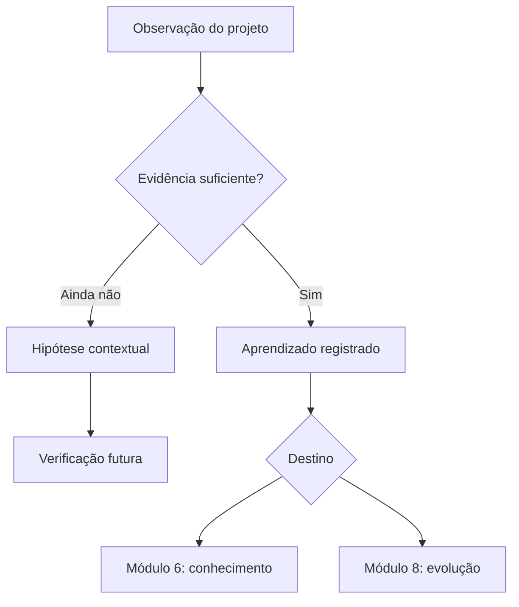

# Retrospectiva da Arquitetura — Template Preenchível

**Identificação técnica no repositório**

```yaml
id_retrospectiva: RET-ARQ-AAAA-NNN
id_projeto_arquitetura: ARQ-AAAA-NNN
titulo: "[Nome da arquitetura — Retrospectiva]"
organizacao:
area_ou_processo:
id_linha_de_base: LB-ARQ-NNN
id_relatorio: REL-ARQ-AAAA-NNN
id_transicao_implantacao: TRA-IMP-AAAA-NNN
resultado_pc5:
responsavel_pela_arquitetura:
facilitador_da_retrospectiva:
custodiante_do_registro:
data_da_sessao:
periodo_analisado:
estado: em_preparacao
nivel_sensibilidade: "publica | interna | confidencial | sensivel"
versao: 0.1
```

**Sistema Operacional do Estúdio LICHTARA**  
**Módulo:** 3 — Arquitetura Organizacional  
**Tipo:** Template operacional preenchível  
**Função:** Converter a experiência do projeto de arquitetura em aprendizagem metodológica verificável, conhecimento reutilizável e propostas governadas de melhoria  
**Momento principal:** Depois da passagem ao Módulo 4 e da decisão do PC-5  
**Entrada principal:** Registros do projeto, linha de base, validações, transição e percepções dos participantes  
**Saída principal:** Aprendizados contextualizados, padrões candidatos, propostas de melhoria, ações e encaminhamentos  
**Marco de encerramento:** Aprendizagem registrada, destinada e governada

**Documentos relacionados:**

- `README.md` do Módulo 3;
- `fundamentos-da-arquitetura.md`;
- `protocolo-de-arquitetura.md`;
- Termo de Abertura da Arquitetura;
- Plano de Arquitetura;
- Catálogo de Requisitos;
- Matriz de Rastreabilidade;
- Arquitetura Integrada;
- Registro de Validação;
- Relatório de Arquitetura;
- Transição para Implantação;
- registros de decisão;
- linha de base aprovada;
- registros dos Módulos 4, 5, 6 e 8, quando posteriormente vinculados.

---

## 1. Finalidade

A Retrospectiva da Arquitetura registra o que o Estúdio LICHTARA aprendeu ao transformar um diagnóstico em uma arquitetura organizacional aprovada e transferida para implantação.

Ela deve permitir compreender:

- que partes do processo produziram clareza;
- que partes criaram ruído, espera ou retrabalho;
- que informação de entrada foi suficiente ou insuficiente;
- que requisitos orientaram decisões reais;
- que alternativas ampliaram a compreensão;
- que critérios foram decisivos;
- que validações alteraram o desenho;
- que decisões exigiram maior julgamento;
- que complexidade foi necessária ou evitável;
- que participação humana melhorou a arquitetura;
- que uso de inteligência artificial produziu valor ou exigiu correção;
- que documentos sustentaram continuidade;
- que padrões podem ser reutilizados;
- que antipadrões devem ser prevenidos;
- que mudanças podem melhorar o Módulo 3;
- que aprendizados precisam seguir para os Módulos 6 e 8.

A pergunta central é:

> O que este projeto nos ensinou, com evidências e contexto, que pode tornar o próximo processo de arquitetura mais claro, responsável, proporcional e eficaz?

## 2. Resultado esperado

Ao concluir este template:

1. o ciclo arquitetural deve estar reconstruído de forma factual;
2. fatos, percepções, interpretações e hipóteses devem estar diferenciados;
3. participantes relevantes devem ter sido ouvidos;
4. sucessos e dificuldades devem possuir contexto;
5. causas prováveis devem estar separadas de sintomas;
6. retrabalho e esperas devem ser analisados sem culpabilização;
7. decisões e compensações difíceis devem estar preservadas;
8. a contribuição da IA deve ser avaliada com exemplos;
9. aprendizados devem possuir evidência, limite de validade e destino;
10. padrões reutilizáveis devem permanecer como candidatos até validação suficiente;
11. propostas de mudança devem passar por governança;
12. ações devem possuir responsável e critério de conclusão;
13. hipóteses operacionais devem ser encaminhadas sem serem tratadas como resultado;
14. registros sensíveis devem receber proteção adequada;
15. o encerramento do Módulo 3 deve ser demonstrável.

## 3. Posição no ciclo

```text
Arquitetura aprovada — PC-4
          ↓
Relatório e linha de base
          ↓
Transição aceita pelo Módulo 4 — PC-5
          ↓
RETROSPECTIVA DA ARQUITETURA
          ↓
Aprendizados e ações do projeto
          ↓
Conhecimento reutilizável — Módulo 6
          ↓
Propostas de evolução do sistema — Módulo 8
```

A retrospectiva sucede a entrega porque precisa examinar o processo completo, inclusive a qualidade da passagem ao Módulo 4.

Ela não precisa aguardar a conclusão da implantação. Evidências posteriores sobre adoção, funcionamento e resultado serão produzidas nos Módulos 4 e 5 e poderão ampliar, confirmar ou contrariar as hipóteses registradas aqui.

## 4. Natureza da retrospectiva

A retrospectiva é simultaneamente:

- **histórica**, porque reconstrói o que ocorreu;
- **analítica**, porque investiga relações entre condições, escolhas e efeitos;
- **reflexiva**, porque examina o próprio modo de trabalhar;
- **metodológica**, porque identifica melhorias no processo de arquitetura;
- **epistêmica**, porque diferencia o que se sabe, o que se interpreta e o que ainda precisa ser testado;
- **organizacional**, porque preserva conhecimento para além das pessoas que participaram;
- **decisória**, porque encaminha propostas sem aprová-las automaticamente.

### 4.1 O que ela não é

- reunião de celebração sem análise;
- busca por culpados;
- avaliação individual de desempenho;
- espaço para reescrever fatos sem evidência;
- aprovação retroativa de decisões;
- substituição do Registro de Validação;
- substituição do aceite do PC-5;
- confirmação de que a arquitetura funciona em operação;
- autorização automática para mudar templates ou protocolos;
- generalização de uma experiência isolada;
- arquivo de opiniões sem destino.

## 5. Fronteiras com os módulos seguintes

| Objeto | Este template registra | Outro módulo deverá verificar |
| --- | --- | --- |
| Processo de arquitetura | Clareza, fluxo, participação, decisões, retrabalho e aprendizagem | Módulo 8 avalia mudanças no sistema |
| Implantabilidade percebida | Qualidade do pacote e resposta do Módulo 4 no PC-5 | Módulo 4 verifica execução real |
| Funcionamento esperado | Hipóteses, critérios e riscos transferidos | Módulo 5 mede a operação |
| Conhecimento reutilizável | Aprendizado contextualizado e padrão candidato | Módulo 6 consolida e relaciona evidências |
| Método LICHTARA | Proposta de melhoria | Módulo 8 decide incorporação e versão |
| Ecossistema de IA | Evidência sobre funções usadas no projeto | Módulo 7 governa papéis e responsabilidades de IA |

### 5.1 Regra de não antecipação

Não registrar como resultado comprovado:

- adoção ainda não observada;
- ganho de tempo ainda não medido;
- melhoria financeira ainda não produzida;
- redução de erro ainda não verificada;
- satisfação futura;
- sustentabilidade operacional futura;
- desempenho futuro de pessoas, processos, ferramentas ou IA.

Esses elementos podem ser registrados como hipóteses vinculadas a indicadores e responsáveis por verificação futura.

## 6. Princípios da retrospectiva

1. **Evidência antes da conclusão** — a memória deve ser confrontada com registros.
2. **Contexto antes da generalização** — uma lição precisa declarar onde foi observada.
3. **Processo antes da culpa** — investigar condições, relações e decisões.
4. **Pluralidade antes do consenso aparente** — divergências relevantes permanecem visíveis.
5. **Aprendizagem antes da defesa** — o objetivo é ampliar capacidade de ação.
6. **Proporcionalidade** — a profundidade acompanha escopo, risco e novidade.
7. **Separação epistêmica** — fato, percepção, interpretação, hipótese e decisão não se confundem.
8. **Responsabilidade humana** — a IA pode organizar; pessoas julgam e decidem.
9. **Governança da mudança** — aprendizado não altera o sistema por si só.
10. **Utilidade** — toda recomendação precisa indicar decisão, ação ou destino.
11. **Proteção** — franqueza não autoriza exposição indevida.
12. **Continuidade** — o registro deve ser compreensível sem depender da memória da equipe.

## 7. Instruções de uso

1. Confirme o resultado do PC-5 e a versão da linha de base.
2. Defina facilitador, participantes, escopo e sensibilidade.
3. Reúna os registros objetivos antes da sessão.
4. Envie perguntas preparatórias proporcionais ao projeto.
5. Permita contribuições individuais antes da discussão coletiva.
6. Reconstrua a linha do tempo com fatos verificáveis.
7. Examine cada etapa do processo, sem limitar a conversa aos eventos recentes.
8. Registre divergências sem forçar consenso.
9. Classifique afirmações por natureza epistêmica.
10. Vincule aprendizados a evidências e contexto.
11. Analise causas apenas até o nível sustentado pelas evidências.
12. Identifique padrões e antipadrões como candidatos.
13. Separe correções locais, melhorias do módulo e propostas sistêmicas.
14. Atribua destino, responsável e prazo a cada ação aceita.
15. Registre propostas não aceitas e seus motivos.
16. Faça revisão factual pelos participantes.
17. Proteja anexos sensíveis.
18. Atualize índice, vínculos e registros de aprendizagem.
19. Encerre o ciclo sem apagar questões futuras.

## 8. Proporcionalidade

| Escopo | Forma mínima | Participantes mínimos | Profundidade esperada |
| --- | --- | --- | --- |
| Focal | Registro reduzido e sessão de 30–60 minutos | Arquitetura, implantação e pessoa-chave | Eventos, decisões, retrabalho, três aprendizados e ações |
| Funcional | Template completo e sessão estruturada | Arquitetura, implantação, cliente, usuários e especialistas pertinentes | Análise por etapas, dimensões e causas |
| Sistêmica | Dossiê, contribuições individuais e uma ou mais sessões | Governança, áreas afetadas, especialistas e responsáveis futuros | Múltiplas perspectivas, padrões, riscos sistêmicos e propostas governadas |

### 8.1 Fatores de aprofundamento

- novidade do problema;
- número de áreas afetadas;
- duração do projeto;
- quantidade de requisitos e decisões;
- sensibilidade dos dados;
- intensidade de uso de IA;
- conflito entre participantes;
- retrabalho material;
- devolução no PC-4 ou PC-5;
- ocorrência de incidente ou quase falha;
- potencial de reutilização do aprendizado.

## 9. Identificação da retrospectiva

| Campo | Registro |
| --- | --- |
| ID | RET-ARQ-AAAA-NNN |
| Projeto de arquitetura | ARQ-AAAA-NNN |
| Título | [Nome] |
| Organização | [Nome] |
| Área/processo | [Nome] |
| Escopo | [Focal, funcional ou sistêmico] |
| Linha de base | LB-ARQ-NNN |
| Relatório | REL-ARQ-AAAA-NNN |
| Transição | TRA-IMP-AAAA-NNN |
| Resultado do PC-5 | [Preencher] |
| Período analisado | [Datas] |
| Data da sessão | [DD/MM/AAAA] |
| Facilitador | [Nome/papel] |
| Custodiante | [Nome/papel] |
| Sensibilidade | [Classificação] |
| Versão | [Número] |

### 9.1 Vínculos principais

| Artefato | ID | Versão | Estado | Referência |
| --- | --- | --- | --- | --- |
| Termo de Abertura | [ID] | [Versão] | [Estado] | [Link] |
| Plano de Arquitetura | [ID] | [Versão] | [Estado] | [Link] |
| Catálogo de Requisitos | [ID] | [Versão] | [Estado] | [Link] |
| Matriz de Rastreabilidade | [ID] | [Versão] | [Estado] | [Link] |
| Arquitetura Integrada | [ID] | [Versão] | [Estado] | [Link] |
| Registro de Validação | [ID] | [Versão] | [Estado] | [Link] |
| Relatório | [ID] | [Versão] | [Estado] | [Link] |
| Transição | [ID] | [Versão] | [Estado] | [Link] |

## 10. Estado da retrospectiva

Selecione um estado por vez.

- [ ] em preparação;
- [ ] coleta aberta;
- [ ] sessão agendada;
- [ ] sessão realizada;
- [ ] em síntese;
- [ ] em revisão factual;
- [ ] ações em decisão;
- [ ] concluída;
- [ ] concluída com pendências;
- [ ] suspensa;
- [ ] cancelada;
- [ ] substituída;
- [ ] arquivada.

### 10.1 Histórico de estados

| Estado | Data | Motivo | Responsável | Próxima condição |
| --- | --- | --- | --- | --- |
| [Estado] | [Data] | [Preencher] | [Nome] | [Preencher] |

### 10.2 Encerramento antecipado

Se o projeto foi suspenso, recusado ou encerrado antes da linha de base, a retrospectiva ainda pode registrar:

- condição de interrupção;
- decisões tomadas;
- trabalho preservável;
- riscos evitados;
- custos e retrabalho;
- aprendizado metodológico;
- possibilidade ou impedimento de retomada.

## 11. Papéis e responsabilidades

| Papel | Responsabilidade | Autoridade | Limite |
| --- | --- | --- | --- |
| Responsável pela arquitetura | Responder pelo ciclo analisado e esclarecer decisões | Confirmar fatos e propor ações | Não controla sozinho as conclusões |
| Facilitador | Preparar e conduzir o processo | Organizar participação, tempo e método | Não decide o conteúdo pelo grupo |
| Custodiante | Preservar versões, acessos e vínculos | Controlar o registro | Não altera conclusões técnicas |
| Participante | Oferecer evidência, percepção e interpretação | Revisar sua contribuição | Não representa públicos não consultados |
| Responsável pela implantação | Avaliar qualidade da passagem e implantabilidade percebida | Aceitar ou contestar registros sobre o PC-5 | Não confirma resultado operacional futuro |
| Cliente/aprovador | Avaliar clareza, decisão e utilidade | Priorizar ações dentro de sua alçada | Não apaga divergência técnica |
| Curador metodológico | Analisar propostas ao Módulo 3 | Recomendar aceitação, teste ou rejeição | Segue governança de versão |
| Responsável pelo Módulo 6 | Receber conhecimento reutilizável | Consolidar relações e evidências | Não universaliza caso isolado |
| Responsável pelo Módulo 8 | Avaliar proposta sistêmica | Decidir evolução conforme governança | Não altera histórico do projeto |

## 12. Autoridade, facilitação e conflito de interesse

### 12.1 Matriz de autoridade

| Ato | Prepara | Consulta | Decide | Registra |
| --- | --- | --- | --- | --- |
| Escopo da retrospectiva | Facilitador | Responsável pela arquitetura | Patrocinador/responsável | Custodiante |
| Classificação de sensibilidade | Custodiante | Participantes afetados | Autoridade de dados | Custodiante |
| Confirmação factual | Autor do registro | Participantes/fontes | Responsável competente | Custodiante |
| Formulação de aprendizado | Facilitador | Participantes | Responsável pela síntese | Custodiante |
| Mudança local | Dono da ação | Afetados | Autoridade local | Custodiante |
| Mudança no Módulo 3 | Curador metodológico | Usuários do método | Governança do módulo | Registro de decisão |
| Mudança sistêmica | Responsável pelo Módulo 8 | Módulos afetados | Governança do sistema | Registro de decisão |

### 12.2 Conflito de interesse

| Situação | Risco | Proteção | Responsável |
| --- | --- | --- | --- |
| Facilitador avaliando o próprio trabalho | Defesa ou seleção de evidência | Cofacilitação ou revisão independente | [Nome] |
| Relação hierárquica intensa | Silenciamento | Coleta individual/confidencial | [Nome] |
| Interesse comercial | Minimização de falhas | Separação entre relato e decisão | [Nome] |
| Autoria de ferramenta ou método | Viés de confirmação | Critérios e evidências explícitos | [Nome] |

## 13. Condições de entrada

- [ ] estado do projeto está definido;
- [ ] linha de base ou versão final disponível está identificada;
- [ ] resultado do PC-5 foi registrado, quando aplicável;
- [ ] eventos principais podem ser reconstruídos;
- [ ] participantes essenciais foram identificados;
- [ ] registros necessários estão acessíveis;
- [ ] restrições de confidencialidade são conhecidas;
- [ ] facilitador está definido;
- [ ] escopo da retrospectiva foi comunicado;
- [ ] existe tempo protegido para participação;
- [ ] contribuições divergentes podem ser registradas;
- [ ] destino das ações possui autoridade reconhecível.

### 13.1 Exceções de entrada

| Condição ausente | Efeito | Tratamento | Prosseguir? | Responsável |
| --- | --- | --- | --- | --- |
| [Preencher] | [Preencher] | [Preencher] | [Sim, não ou limitado] | [Papel] |

## 14. Momento e janelas de realização

| Marco | Janela recomendada | Razão | Data real |
| --- | --- | --- | --- |
| Coleta inicial | Antes ou imediatamente após o PC-5 | Preservar memória individual | [Data] |
| Sessão principal | Até [prazo definido] após o PC-5 | Incluir a qualidade da passagem | [Data] |
| Revisão factual | Logo após a síntese | Corrigir inexatidões | [Data] |
| Decisão sobre ações | Dentro do ciclo de governança | Evitar recomendações órfãs | [Data] |
| Retorno posterior | Após marcos de implantação/operação | Conectar hipótese a evidência futura | [Data] |

### 14.1 Atraso

| Motivo | Efeito sobre memória/evidência | Mitigação | Nova data |
| --- | --- | --- | --- |
| [Preencher] | [Preencher] | [Preencher] | [Data] |

## 15. Pacote de evidências

| Evidência | ID/fonte | Período | Integridade | Acesso | Uso na retrospectiva |
| --- | --- | --- | --- | --- | --- |
| Termo e plano | [Referência] | [Datas] | [Confirmada/limitada] | [Acesso] | Promessa e estratégia inicial |
| Requisitos | [Referência] | [Datas] | [Preencher] | [Acesso] | Qualidade e mudanças |
| Linha do tempo | [Referência] | [Datas] | [Preencher] | [Acesso] | Fluxo e esperas |
| Decisões | [Referência] | [Datas] | [Preencher] | [Acesso] | Escolhas e compensações |
| Validações | [Referência] | [Datas] | [Preencher] | [Acesso] | Alterações e divergências |
| Rastreabilidade | [Referência] | [Datas] | [Preencher] | [Acesso] | Cobertura e lacunas |
| Relatório | [Referência] | [Data] | [Preencher] | [Acesso] | Comunicação da arquitetura |
| Transição/PC-5 | [Referência] | [Data] | [Preencher] | [Acesso] | Qualidade da passagem |
| Registros de trabalho | [Referência] | [Datas] | [Preencher] | [Acesso] | Retrabalho, espera e coordenação |
| Contribuições individuais | [Referência protegida] | [Data] | [Preencher] | [Restrito] | Percepções e experiências |

### 15.1 Limitações das evidências

| Limitação | Objetos afetados | Risco de conclusão indevida | Tratamento |
| --- | --- | --- | --- |
| [Registro ausente, memória tardia, dado incompleto ou acesso limitado] | [IDs] | [Preencher] | [Preencher] |

### 15.2 Classificação epistêmica das afirmações

| Marcador | Natureza | Significado | Tratamento obrigatório |
| --- | --- | --- | --- |
| `FAT` | Fato confirmado | Evento, conteúdo ou resultado sustentado por fonte verificável | Indicar evidência, data e versão |
| `PER` | Percepção | Experiência ou avaliação de uma pessoa ou público | Preservar autoria ou público e não generalizar |
| `INT` | Interpretação | Explicação construída a partir de fatos e percepções | Indicar raciocínio, evidências e alternativas |
| `HIP` | Hipótese | Explicação ou expectativa ainda não suficientemente verificada | Definir teste, indicador ou evidência futura |
| `REC` | Recomendação | Proposta de ação derivada da análise | Submeter a autoridade e governança |
| `DEC` | Decisão | Escolha tomada por autoridade competente | Registrar responsável, data, escopo e efeito |

| ID | Afirmação | Marcador | Fonte/evidência | Confiança | Contraponto | Tratamento |
| --- | --- | --- | --- | --- | --- | --- |
| AFR-NNN | [Preencher] | [FAT, PER, INT, HIP, REC ou DEC] | [Referência] | [Alta, média, baixa ou N/A] | [Referência/nenhum] | [Confirmar, preservar, testar, decidir ou revisar] |

Uma percepção não possui menor dignidade que um fato; possui natureza diferente. A classificação protege ambas ao impedir que experiência subjetiva seja descartada ou convertida indevidamente em afirmação universal.

## 16. Preparação individual

Cada participante pode responder antes da sessão:

1. Qual momento mais ampliou sua compreensão?
2. Qual decisão exigiu maior julgamento?
3. Onde houve espera, ambiguidade ou retrabalho?
4. Que requisito mais orientou o desenho?
5. Que informação deveria ter chegado antes?
6. Que validação mudou materialmente a arquitetura?
7. Que documento foi realmente utilizado?
8. Que documento pareceu excessivo ou insuficiente?
9. Onde a participação de pessoas melhorou o resultado?
10. Onde a participação foi tardia ou ausente?
11. Que uso de IA ajudou?
12. Que saída de IA exigiu correção relevante?
13. Que risco quase passou despercebido?
14. O que deveria ser repetido no próximo projeto?
15. O que deveria ser alterado?
16. Que percepção ainda é apenas hipótese?

### 16.1 Registro de contribuições

| Contribuição | Participante/público | Forma | Sensibilidade | Incorporada em |
| --- | --- | --- | --- | --- |
| [ID] | [Nome, papel ou grupo] | [Formulário, entrevista ou nota] | [Classificação] | [Seção/aprendizado] |

## 17. Catálogo de perguntas da sessão

| Dimensão | Pergunta central | Evidência útil |
| --- | --- | --- |
| Entrada | Recebemos compreensão suficiente do diagnóstico? | Transição do M2, lacunas e devoluções |
| Foco | Problema, decisão e escopo permaneceram claros? | Termo, mudanças e decisões |
| Requisitos | Os requisitos orientaram escolhas reais? | Catálogo, prioridades e conflitos |
| Alternativas | Consideramos opções materialmente distintas? | Registros de alternativas |
| Integração | As dimensões foram conectadas antes da aprovação? | Arquitetura integrada e interfaces |
| Validação | O desenho foi confrontado com realidade suficiente? | Casos, participantes e ajustes |
| Decisão | As compensações foram explícitas? | Registros de decisão |
| Documentação | Os artefatos apoiaram trabalho e continuidade? | Uso real, duplicações e lacunas |
| IA | O apoio ampliou capacidade sem deslocar responsabilidade? | Prompts, versões, correções e aprovações |
| Passagem | O Módulo 4 recebeu condições suficientes? | Inspeção e PC-5 |
| Método | Que parte do protocolo merece manter, testar ou mudar? | Eventos, métricas e aprendizados |

## 18. Desenho da sessão

### 18.1 Roteiro

| Etapa | Objetivo | Método | Tempo | Saída |
| --- | --- | --- | --- | --- |
| Abertura | Confirmar propósito e proteção | Leitura das regras | [Min] | Acordo de trabalho |
| Linha do tempo | Reconstruir fatos | Marcos e evidências | [Min] | Cronologia |
| Perspectivas | Tornar experiências visíveis | Rodada individual | [Min] | Registros divergentes |
| Análise | Investigar sucessos, dificuldades e causas | Agrupamento e perguntas | [Min] | Temas e causas prováveis |
| Aprendizagem | Formular lições contextualizadas | Síntese coletiva | [Min] | APD-NNN |
| Destino | Separar ação, padrão e proposta | Classificação | [Min] | Encaminhamentos |
| Fechamento | Confirmar próximos movimentos | Leitura de compromissos | [Min] | Responsáveis e prazos |

### 18.2 Participantes

| Participante/público | Razão da participação | Parte da sessão | Necessidade de proteção | Confirmação |
| --- | --- | --- | --- | --- |
| [Nome/papel] | [Preencher] | [Completa ou específica] | [Preencher] | [Sim/não] |

### 18.3 Ausências relevantes

| Público ausente | Perspectiva não representada | Motivo | Compensação |
| --- | --- | --- | --- |
| [Preencher] | [Preencher] | [Preencher] | [Entrevista, registro ou limitação] |

## 19. Segurança psicológica e qualidade da participação

### 19.1 Acordos

- questionar processos e decisões sem ataque pessoal;
- descrever eventos antes de interpretar intenções;
- permitir discordância registrada;
- não usar a sessão como avaliação de desempenho;
- respeitar confidencialidade e limites de exposição;
- distinguir franqueza de autorização para compartilhar;
- reconhecer assimetrias de poder;
- permitir pausa, contribuição escrita ou retirada de conteúdo pessoal;
- atribuir ações apenas com autoridade e concordância;
- não exigir que uma pessoa represente um grupo inteiro.

### 19.2 Verificação

| Condição | Resultado | Evidência/observação | Tratamento |
| --- | --- | --- | --- |
| Participantes puderam divergir | [Sim, parcial ou não] | [Preencher] | [Preencher] |
| Hierarquia não silenciou contribuições | [Sim, parcial ou não] | [Preencher] | [Preencher] |
| Contribuições sensíveis foram protegidas | [Sim, parcial ou não] | [Preencher] | [Preencher] |
| A facilitação distribuiu espaço | [Sim, parcial ou não] | [Preencher] | [Preencher] |
| Decisões não foram impostas na síntese | [Sim, parcial ou não] | [Preencher] | [Preencher] |

## 20. Síntese do projeto analisado

| Pergunta | Resposta |
| --- | --- |
| Que transformação foi desenhada? | [Preencher] |
| Que decisão a arquitetura apoiou? | [Preencher] |
| Que capacidade central precisava existir? | [Preencher] |
| Qual foi o escopo? | [Preencher] |
| Qual foi o primeiro ciclo aprovado? | [Preencher] |
| Que restrições foram determinantes? | [Preencher] |
| Que alternativa foi escolhida? | [Preencher] |
| Que compensações foram aceitas? | [Preencher] |
| Que riscos permaneceram? | [Preencher] |
| Qual foi o resultado do PC-5? | [Preencher] |

## 21. Linha do tempo do projeto

| Marco | Data planejada | Data real | Evento/decisão | Evidência | Efeito |
| --- | --- | --- | --- | --- | --- |
| Aceite da transição diagnóstica | [Data] | [Data] | [Preencher] | [Referência] | [Preencher] |
| Abertura | [Data] | [Data] | [Preencher] | [Referência] | [Preencher] |
| Requisitos consolidados | [Data] | [Data] | [Preencher] | [Referência] | [Preencher] |
| Alternativas comparadas | [Data] | [Data] | [Preencher] | [Referência] | [Preencher] |
| Integração | [Data] | [Data] | [Preencher] | [Referência] | [Preencher] |
| Validação | [Data] | [Data] | [Preencher] | [Referência] | [Preencher] |
| Aprovação/PC-4 | [Data] | [Data] | [Preencher] | [Referência] | [Preencher] |
| Transição/PC-5 | [Data] | [Data] | [Preencher] | [Referência] | [Preencher] |

### 21.1 Eventos determinantes

| Evento | Antes | Depois | Por que foi determinante | Objetos afetados |
| --- | --- | --- | --- | --- |
| EVT-NNN | [Estado] | [Estado] | [Preencher] | [IDs] |

## 22. Promessa inicial e entrega realizada

| Dimensão | Previsto | Realizado | Diferença | Motivo | Consequência |
| --- | --- | --- | --- | --- | --- |
| Problema/decisão | [Preencher] | [Preencher] | [Preencher] | [Preencher] | [Preencher] |
| Escopo | [Preencher] | [Preencher] | [Preencher] | [Preencher] | [Preencher] |
| Entregáveis | [Preencher] | [Preencher] | [Preencher] | [Preencher] | [Preencher] |
| Participação | [Preencher] | [Preencher] | [Preencher] | [Preencher] | [Preencher] |
| Prazo | [Preencher] | [Preencher] | [Preencher] | [Preencher] | [Preencher] |
| Recursos | [Preencher] | [Preencher] | [Preencher] | [Preencher] | [Preencher] |
| Profundidade | [Preencher] | [Preencher] | [Preencher] | [Preencher] | [Preencher] |

### 22.1 Diferença legítima ou desvio

| Diferença | Classe | Justificativa | Autorização | Aprendizado |
| --- | --- | --- | --- | --- |
| [Preencher] | [Adaptação legítima, descoberta, desvio ou falha] | [Preencher] | [DEC/N/A] | [APD] |

## 23. Qualidade da transição recebida do Módulo 2

| Aspecto | Avaliação | Evidência | Efeito no desenho | Retorno ao M2 |
| --- | --- | --- | --- | --- |
| Clareza do problema | [Escala] | [Referência] | [Preencher] | [FEED/N/A] |
| Qualidade das evidências | [Escala] | [Referência] | [Preencher] | [FEED/N/A] |
| Capacidades a preservar | [Escala] | [Referência] | [Preencher] | [FEED/N/A] |
| Riscos e restrições | [Escala] | [Referência] | [Preencher] | [FEED/N/A] |
| Requisitos iniciais | [Escala] | [Referência] | [Preencher] | [FEED/N/A] |
| Lacunas e incertezas | [Escala] | [Referência] | [Preencher] | [FEED/N/A] |
| Compreensão das pessoas | [Escala] | [Referência] | [Preencher] | [FEED/N/A] |

### 23.1 Descobertas devolvidas ao diagnóstico

| Descoberta | Momento | Por que não estava disponível | Efeito | Tratamento |
| --- | --- | --- | --- | --- |
| [Preencher] | [Etapa] | [Preencher] | [Preencher] | [Atualização, retorno ou aceitação] |

## 24. Problema, decisão, escopo e não objetivos

| Objeto | Clareza inicial | Estabilidade | Mudança material | Evidência | Aprendizado |
| --- | --- | --- | --- | --- | --- |
| Problema | [Escala] | [Escala] | [Sim/não] | [Referência] | [Preencher] |
| Decisão apoiada | [Escala] | [Escala] | [Sim/não] | [Referência] | [Preencher] |
| Escopo | [Escala] | [Escala] | [Sim/não] | [Referência] | [Preencher] |
| Não objetivos | [Escala] | [Escala] | [Sim/não] | [Referência] | [Preencher] |
| Critérios de conclusão | [Escala] | [Escala] | [Sim/não] | [Referência] | [Preencher] |

### 24.1 Expansões e reduções

| Mudança | Origem | Necessidade | Decisão | Efeito em prazo/carga/qualidade |
| --- | --- | --- | --- | --- |
| [Preencher] | [Pessoa, evidência ou contexto] | [Preencher] | [DEC] | [Preencher] |

## 25. Requisitos

| Pergunta | Avaliação | Evidência | Consequência | Aprendizado |
| --- | --- | --- | --- | --- |
| Foram formulados como condições verificáveis? | [Preencher] | [Referência] | [Preencher] | [APD] |
| Possuíam origem identificável? | [Preencher] | [Referência] | [Preencher] | [APD] |
| Prioridades orientaram decisões? | [Preencher] | [Referência] | [Preencher] | [APD] |
| Conflitos foram tratados? | [Preencher] | [Referência] | [Preencher] | [APD] |
| Requisitos obrigatórios foram distinguidos? | [Preencher] | [Referência] | [Preencher] | [APD] |
| Surgiram requisitos tardios? | [Preencher] | [Referência] | [Preencher] | [APD] |
| Critérios de atendimento foram utilizáveis? | [Preencher] | [Referência] | [Preencher] | [APD] |

### 25.1 Requisitos difíceis

| Requisito | Dificuldade | Causa provável | Como foi resolvida | Reutilização possível |
| --- | --- | --- | --- | --- |
| REQ-NNN | [Formulação, conflito, evidência, prioridade ou teste] | [Preencher] | [Preencher] | [Preencher] |

### 25.2 Requisitos surgidos durante o desenho

| Requisito | Origem | Momento | Era previsível? | Tratamento | Retorno |
| --- | --- | --- | --- | --- | --- |
| REQ-NNN | [Evidência] | [Etapa] | [Sim, não ou parcialmente] | [Preencher] | [M2/M3/M8] |

## 26. Capacidades e estado de referência

| Aspecto | O que ajudou | O que faltou | Efeito | Aprendizado |
| --- | --- | --- | --- | --- |
| Capacidades existentes | [Preencher] | [Preencher] | [Preencher] | [APD] |
| Capacidades futuras | [Preencher] | [Preencher] | [Preencher] | [APD] |
| Fronteira atual/futuro | [Preencher] | [Preencher] | [Preencher] | [APD] |
| Práticas informais úteis | [Preencher] | [Preencher] | [Preencher] | [APD] |
| Restrições de maturidade | [Preencher] | [Preencher] | [Preencher] | [APD] |

### 26.1 Capacidade mal definida ou redescoberta

| Capacidade | Formulação inicial | Formulação final | Evidência da mudança | Efeito no desenho |
| --- | --- | --- | --- | --- |
| CAP-NNN | [Preencher] | [Preencher] | [Referência] | [Preencher] |

## 27. Alternativas consideradas

| Alternativa | Distinção material | Profundidade da análise | Motivo de inclusão/exclusão | Aprendizado |
| --- | --- | --- | --- | --- |
| ALT-NNN | [Preencher] | [Suficiente, parcial ou superficial] | [Preencher] | [APD] |

### 27.1 Qualidade da geração

- [ ] alternativas foram geradas antes da preferência final;
- [ ] incluíram configurações realmente diferentes;
- [ ] respeitaram requisitos obrigatórios;
- [ ] uma opção mínima foi considerada;
- [ ] manter parte do estado atual foi considerado;
- [ ] impactos humanos e de manutenção foram examinados;
- [ ] ferramentas e IA não predeterminaram a escolha;
- [ ] descarte possui justificativa.

### 27.2 Alternativa omitida

| Alternativa percebida depois | Por que não apareceu | Poderia mudar a decisão? | Tratamento |
| --- | --- | --- | --- |
| [Preencher] | [Preencher] | [Sim, não ou incerto] | [Registrar, analisar ou reabrir] |

## 28. Critérios de desenho e comparação

| Critério | Utilidade real | Evidência de uso | Problema identificado | Ajuste proposto |
| --- | --- | --- | --- | --- |
| [Critério] | [Alta, média, baixa ou não usado] | [Decisão/comparação] | [Preencher] | [PME/N/A] |

### 28.1 Critérios decisivos

| Critério | Decisão influenciada | Por que foi decisivo | Compensação associada |
| --- | --- | --- | --- |
| [Preencher] | DEC-NNN | [Preencher] | [Preencher] |

### 28.2 Critérios ausentes ou redundantes

| Situação | Efeito | Evidência | Proposta |
| --- | --- | --- | --- |
| [Ausente, ambíguo, duplicado ou excessivo] | [Preencher] | [Referência] | [Preencher] |

## 29. Arquitetura integrada

| Dimensão | Qualidade do desenho | Integração | Lacuna descoberta | Aprendizado |
| --- | --- | --- | --- | --- |
| Processos e fluxos | [Escala] | [Escala] | [Preencher] | [APD] |
| Papéis e decisões | [Escala] | [Escala] | [Preencher] | [APD] |
| Informação e conhecimento | [Escala] | [Escala] | [Preencher] | [APD] |
| Comunicação e documentação | [Escala] | [Escala] | [Preencher] | [APD] |
| Tecnologia e integrações | [Escala] | [Escala] | [Preencher] | [APD] |
| IA e supervisão humana | [Escala] | [Escala] | [Preencher] | [APD] |
| Indicadores e controles | [Escala] | [Escala] | [Preencher] | [APD] |
| Manutenção e evolução | [Escala] | [Escala] | [Preencher] | [APD] |

### 29.1 Componentes que criaram complexidade

| Componente | Complexidade criada | Valor produzido | Relação valor/carga | Decisão futura |
| --- | --- | --- | --- | --- |
| CMP-NNN | [Preencher] | [Preencher] | [Adequada, incerta ou inadequada] | [Manter, simplificar, testar ou retirar] |

## 30. Relações e interfaces

| Interface/relação | Quando foi percebida | Qualidade do tratamento | Fragilidade | Aprendizado |
| --- | --- | --- | --- | --- |
| INT-NNN | [Etapa] | [Preencher] | [Preencher] | [APD] |

### 30.1 Interfaces tardias

| Interface | Efeito da descoberta tardia | Alteração gerada | Como antecipar |
| --- | --- | --- | --- |
| INT-NNN | [Preencher] | [IDs/decisão] | [Preencher] |

### 30.2 Integrações decisivas

| Relação entre dimensões | Efeito no desenho | Evidência | Reutilização possível |
| --- | --- | --- | --- |
| [Ex.: papel–decisão, processo–informação] | [Preencher] | [Referência] | [Preencher] |

## 31. Rastreabilidade

| Aspecto | Resultado | Evidência | Esforço | Aprendizado |
| --- | --- | --- | --- | --- |
| Requisito → componente | [Preencher] | [Matriz] | [Preencher] | [APD] |
| Componente → decisão | [Preencher] | [Matriz] | [Preencher] | [APD] |
| Risco → controle | [Preencher] | [Matriz] | [Preencher] | [APD] |
| Teste → objeto | [Preencher] | [Matriz] | [Preencher] | [APD] |
| Diagnóstico → requisito | [Preencher] | [Matriz] | [Preencher] | [APD] |
| Item de implantação → arquitetura | [Preencher] | [Matriz] | [Preencher] | [APD] |

### 31.1 Valor e carga

| Vínculo | Decisão que apoiou | Continuidade que protegeu | Carga de manutenção | Ajuste |
| --- | --- | --- | --- | --- |
| [Tipo] | [Preencher] | [Preencher] | [Baixa, média ou alta] | [Preencher] |

## 32. Validação

| Validação | Pergunta testada | Resultado | Alteração produzida | Valor retrospectivo |
| --- | --- | --- | --- | --- |
| VAL-NNN | [Preencher] | [Preencher] | [IDs/nenhuma] | [Decisiva, confirmatória ou limitada] |

### 32.1 Validações decisivas

| Validação | O que se acreditava antes | Evidência encontrada | Decisão alterada |
| --- | --- | --- | --- |
| VAL-NNN | [Preencher] | [Preencher] | DEC-NNN |

### 32.2 Validação insuficiente ou tardia

| Objeto | Limitação | Motivo | Risco transferido | Aprendizado |
| --- | --- | --- | --- | --- |
| [ID] | [Preencher] | [Preencher] | RSC-NNN | [APD] |

### 32.3 Participação real

| Público necessário | Participou quando? | Influência real | Lacuna | Correção futura |
| --- | --- | --- | --- | --- |
| [Papel/grupo] | [Etapa] | [Alta, média, baixa ou nenhuma] | [Preencher] | [Preencher] |

## 33. Decisões e compensações

| Decisão | Dificuldade | Evidências disponíveis | Compensação aceita | Qualidade do registro | Aprendizado |
| --- | --- | --- | --- | --- | --- |
| DEC-NNN | [Preencher] | [Referências] | [Preencher] | [Escala] | [APD] |

### 33.1 Decisões reabertas

| Decisão | Motivo da reabertura | Informação nova | Efeito | Prevenível? |
| --- | --- | --- | --- | --- |
| DEC-NNN | [Preencher] | [Referência] | [Preencher] | [Sim, não ou parcialmente] |

### 33.2 Decisões adiadas

| Decisão | Por que foi adiada | Consequência | Destino | Responsável |
| --- | --- | --- | --- | --- |
| [Preencher] | [Preencher] | [Preencher] | [M4, reabertura ou data] | [Papel] |

## 34. Riscos, controles e quase falhas

| Risco | Quando identificado | Qualidade do tratamento | Controle | Aprendizado |
| --- | --- | --- | --- | --- |
| RSC-NNN | [Etapa] | [Preencher] | CTL-NNN | [APD] |

### 34.1 Risco tardio

| Risco | Sinal anterior | Por que não foi percebido | Efeito | Proteção futura |
| --- | --- | --- | --- | --- |
| RSC-NNN | [Preencher] | [Preencher] | [Preencher] | [Preencher] |

### 34.2 Controle excessivo ou insuficiente

| Controle | Classificação | Efeito | Evidência | Ajuste |
| --- | --- | --- | --- | --- |
| CTL-NNN | [Excessivo, adequado, insuficiente ou não testado] | [Preencher] | [Referência] | [Preencher] |

## 35. Pessoas, impactos e ética

| Aspecto | Como foi considerado | Evidência | Lacuna | Aprendizado |
| --- | --- | --- | --- | --- |
| Carga de trabalho | [Preencher] | [Referência] | [Preencher] | [APD] |
| Autonomia | [Preencher] | [Referência] | [Preencher] | [APD] |
| Autoridade | [Preencher] | [Referência] | [Preencher] | [APD] |
| Inclusão e acessibilidade | [Preencher] | [Referência] | [Preencher] | [APD] |
| Conhecimento tácito | [Preencher] | [Referência] | [Preencher] | [APD] |
| Mudança de papel | [Preencher] | [Referência] | [Preencher] | [APD] |
| Proteção contra dano | [Preencher] | [Referência] | [Preencher] | [APD] |

### 35.1 Voz das pessoas afetadas

| Público | Momento de participação | O que alterou | O que permaneceu sem resposta |
| --- | --- | --- | --- |
| [Grupo/papel] | [Etapa] | [IDs/decisão] | [Preencher] |

## 36. Dados, privacidade, segurança e acesso

| Dimensão | Decisão adequada | Dificuldade | Evidência | Aprendizado |
| --- | --- | --- | --- | --- |
| Minimização de dados | [Preencher] | [Preencher] | [Referência] | [APD] |
| Classificação | [Preencher] | [Preencher] | [Referência] | [APD] |
| Acesso | [Preencher] | [Preencher] | [Referência] | [APD] |
| Retenção e descarte | [Preencher] | [Preencher] | [Referência] | [APD] |
| Segurança | [Preencher] | [Preencher] | [Referência] | [APD] |
| Uso em IA | [Preencher] | [Preencher] | [Referência] | [APD] |
| Segregação de anexos | [Preencher] | [Preencher] | [Referência] | [APD] |

### 36.1 Incidente ou restrição

| Evento | Conteúdo afetado | Tratamento | Efeito metodológico | Registro protegido |
| --- | --- | --- | --- | --- |
| [Preencher] | [Classificação] | [Preencher] | [Preencher] | [Referência] |

## 37. Participação da inteligência artificial no projeto de arquitetura

### 37.1 Registro por função

| Função de IA | Tarefa | Entrada | Saída usada | Revisão humana | Valor produzido | Correção necessária |
| --- | --- | --- | --- | --- | --- | --- |
| [Pesquisadora, analista, redatora, documental ou revisora] | [Preencher] | [Fonte/dado] | [Artefato] | [Nome/papel] | [Preencher] | [Preencher] |

### 37.2 Contribuições úteis

| Contribuição | Por que ajudou | Evidência | Condição para reutilizar |
| --- | --- | --- | --- |
| [Preencher] | [Preencher] | [Versão/comparação] | [Preencher] |

### 37.3 Correções materiais

| Saída | Problema | Como foi detectado | Correção | Risco evitado | Aprendizado |
| --- | --- | --- | --- | --- | --- |
| [Referência] | [Erro, omissão, invenção, viés, perda de contexto ou excesso] | [Preencher] | [Preencher] | [Preencher] | [APD] |

### 37.4 Deslocamento indevido de responsabilidade

| Situação | Responsabilidade humana ameaçada | Proteção aplicada | Resultado |
| --- | --- | --- | --- |
| [Preencher] | [Interpretação, decisão, validação, aceite ou autoridade] | [Preencher] | [Preencher] |

## 38. Ferramentas e técnicas

| Ferramenta/técnica | Finalidade | Utilidade | Carga | Ruído criado | Decisão futura |
| --- | --- | --- | --- | --- | --- |
| [Preencher] | [Preencher] | [Alta, média, baixa] | [Alta, média, baixa] | [Preencher] | [Manter, adaptar, testar ou retirar] |

### 38.1 Ferramenta utilizada fora de contexto

| Ferramenta | Inadequação | Efeito | Sinal para evitar repetição |
| --- | --- | --- | --- |
| [Preencher] | [Preencher] | [Preencher] | [Preencher] |

### 38.2 Ferramenta ausente

| Necessidade | Ferramenta possível | Momento | Benefício esperado | Teste proposto |
| --- | --- | --- | --- | --- |
| [Preencher] | [Preencher] | [Etapa] | [Preencher] | EXP-NNN |

## 39. Documentos e registros

| Documento | Foi consultado? | Decisão/trabalho apoiado | Duplicação/lacuna | Manutenção | Recomendação |
| --- | --- | --- | --- | --- | --- |
| [Artefato] | [Sim, não ou parcialmente] | [Preencher] | [Preencher] | [Carga] | [Manter, fundir, simplificar, ampliar ou retirar] |

### 39.1 Documento decisivo

| Documento | Momento | Informação recuperada | Efeito |
| --- | --- | --- | --- |
| [Referência] | [Etapa] | [Preencher] | [Decisão, validação ou continuidade] |

### 39.2 Documento sem uso demonstrado

| Documento | Razão possível | Ainda possui obrigação? | Tratamento |
| --- | --- | --- | --- |
| [Referência] | [Excesso, duplicação, momento ou acesso] | [Sim, não ou incerto] | [Preencher] |

## 40. Participação e colaboração

| Público/papel | Momento previsto | Momento real | Contribuição | Lacuna | Aprendizado |
| --- | --- | --- | --- | --- | --- |
| [Preencher] | [Etapa] | [Etapa] | [Preencher] | [Preencher] | [APD] |

### 40.1 Participação tardia

| Papel | O que teria mudado se participasse antes | Evidência | Correção futura |
| --- | --- | --- | --- |
| [Preencher] | [Preencher] | [Referência] | [Preencher] |

### 40.2 Colaboração entre especialidades

| Relação | O que funcionou | Tensão ou tradução necessária | Prática reutilizável |
| --- | --- | --- | --- |
| [Arquitetura–diagnóstico, arquitetura–técnica, humano–IA etc.] | [Preencher] | [Preencher] | [Preencher] |

## 41. Comunicação e coordenação do projeto

| Evento/canal | Finalidade | Qualidade | Falha ou excesso | Efeito | Ajuste |
| --- | --- | --- | --- | --- | --- |
| [Preencher] | [Preencher] | [Escala] | [Preencher] | [Preencher] | [Preencher] |

### 41.1 Decisões comunicadas

| Decisão | Públicos alcançados | Contexto suficiente? | Confirmação | Lacuna |
| --- | --- | --- | --- | --- |
| DEC-NNN | [Preencher] | [Sim, parcial ou não] | [Referência] | [Preencher] |

### 41.2 Perda de contexto

| Situação | Informação perdida | Consequência | Proteção futura |
| --- | --- | --- | --- |
| [Preencher] | [Preencher] | [Preencher] | [Preencher] |

## 42. Carga de trabalho e ritmo

| Etapa | Carga esperada | Carga percebida/medida | Concentração | Efeito | Aprendizado |
| --- | --- | --- | --- | --- | --- |
| [Etapa] | [Preencher] | [Preencher] | [Papéis/período] | [Preencher] | [APD] |

### 42.1 Sobrecarga

| Sinal | Causa provável | Qualidade afetada | Resposta adotada | Prevenção |
| --- | --- | --- | --- | --- |
| [Preencher] | [Preencher] | [Preencher] | [Preencher] | [Preencher] |

### 42.2 Ritmo sustentável

| Prática | Condição | Benefício | Limite de aplicação |
| --- | --- | --- | --- |
| [Preencher] | [Preencher] | [Preencher] | [Preencher] |

## 43. Gestão do trabalho e mudanças de escopo

| Mudança | Origem | Momento | Decisão | Impacto | Qualidade do controle |
| --- | --- | --- | --- | --- | --- |
| [ID] | [Preencher] | [Etapa] | DEC-NNN | [Prazo, carga, risco, qualidade] | [Preencher] |

### 43.1 Trabalho invisível

| Trabalho não previsto | Por que surgiu | Quem absorveu | Efeito | Como tornar visível |
| --- | --- | --- | --- | --- |
| [Preencher] | [Preencher] | [Papel] | [Preencher] | [Preencher] |

### 43.2 Priorização

| Escolha | O que avançou | O que foi adiado | Critério | Resultado |
| --- | --- | --- | --- | --- |
| [Preencher] | [IDs] | [IDs] | [Preencher] | [Preencher] |

## 44. Retrabalho

Retrabalho é atividade refeita porque uma saída anterior se mostrou inadequada, incompleta, incompatível ou prematura. Iteração planejada e aprofundamento legítimo não devem ser classificados automaticamente como retrabalho.

| Retrabalho | Objeto | Momento | Causa provável | Esforço | Efeito | Prevenível? |
| --- | --- | --- | --- | --- | --- | --- |
| RTR-NNN | [ID/artefato] | [Etapa] | [Preencher] | [Tempo/faixa] | [Preencher] | [Sim, não ou parcialmente] |

### 44.1 Classificação

| Classe | Descrição | Exemplo no projeto |
| --- | --- | --- |
| Entrada insuficiente | Informação necessária não estava disponível | [Preencher] |
| Mudança legítima | Contexto ou requisito mudou | [Preencher] |
| Validação tardia | Pessoa ou teste entrou depois | [Preencher] |
| Decisão ambígua | Critério ou autoridade não estava claro | [Preencher] |
| Integração ausente | Interface foi percebida tarde | [Preencher] |
| Erro humano | Registro, interpretação ou execução inadequada | [Preencher] |
| Saída de IA inadequada | Conteúdo exigiu reconstrução material | [Preencher] |
| Documentação excessiva | Trabalho sem utilidade proporcional | [Preencher] |

## 45. Esperas, bloqueios e gargalos

| Evento | Início | Fim | Dependência | Causa | Efeito | Tratamento futuro |
| --- | --- | --- | --- | --- | --- | --- |
| [ID] | [Data] | [Data] | [Pessoa, decisão, dado, ferramenta] | [Preencher] | [Preencher] | [Preencher] |

### 45.1 Gargalo metodológico

| Etapa | Capacidade limitada | Evidência | Causa sistêmica possível | Proposta |
| --- | --- | --- | --- | --- |
| [Etapa] | [Preencher] | [Referência] | [Preencher] | PME-NNN |

## 46. Complexidade e proporcionalidade

| Elemento | Complexidade necessária | Complexidade criada | Capacidade da organização | Resultado | Ajuste |
| --- | --- | --- | --- | --- | --- |
| [Processo, papel, documento, tecnologia, IA ou controle] | [Preencher] | [Preencher] | [Preencher] | [Proporcional, limítrofe ou excessivo] | [Preencher] |

### 46.1 Simplificações que preservariam valor

| Objeto | Simplificação | Valor preservado | Risco criado | Teste necessário |
| --- | --- | --- | --- | --- |
| [ID] | [Preencher] | [Preencher] | [Preencher] | EXP-NNN/N/A |

### 46.2 Simplificação indevida evitada

| Situação | Proteção preservada | Evidência | Aprendizado |
| --- | --- | --- | --- |
| [Preencher] | [Preencher] | [Referência] | [APD] |

## 47. Qualidade do relatório e da comunicação final

| Critério | Avaliação | Evidência | Público | Ajuste |
| --- | --- | --- | --- | --- |
| Compreensão | [Escala] | [Retorno] | [Público] | [Preencher] |
| Rastreabilidade | [Escala] | [Referência] | [Público] | [Preencher] |
| Clareza da decisão | [Escala] | [Retorno] | [Público] | [Preencher] |
| Visibilidade de riscos | [Escala] | [Retorno] | [Público] | [Preencher] |
| Utilidade para implantação | [Escala] | [Retorno] | [Público] | [Preencher] |
| Proporção entre síntese e detalhe | [Escala] | [Retorno] | [Público] | [Preencher] |

### 47.1 Pergunta de reconstrução

Uma pessoa autorizada que não participou conseguiu compreender o problema, a escolha, os componentes, os riscos, os limites e a passagem para implantação?

**Resultado:** [Sim, parcialmente ou não]  
**Evidência:** [Referência]  
**Lacunas:** [Preencher]

## 48. Aprovação e PC-4

| Aspecto | Resultado | Evidência | Aprendizado |
| --- | --- | --- | --- |
| Autoridade estava clara | [Preencher] | [Referência] | [APD] |
| Linha de base estava íntegra | [Preencher] | [Referência] | [APD] |
| Condições estavam visíveis | [Preencher] | [Referência] | [APD] |
| Divergências foram preservadas | [Preencher] | [Referência] | [APD] |
| Decisão foi compreendida | [Preencher] | [Referência] | [APD] |
| Aprovação ocorreu no momento adequado | [Preencher] | [Referência] | [APD] |

### 48.1 Devoluções ou condições

| Resultado | Motivo | Correção | Valor da devolução | Prevenção futura |
| --- | --- | --- | --- | --- |
| [Preencher] | [Preencher] | [Preencher] | [Preencher] | [Preencher] |

## 49. Transição para implantação e PC-5

| Aspecto | Avaliação do M3 | Avaliação do M4 | Evidência | Aprendizado |
| --- | --- | --- | --- | --- |
| Integridade do pacote | [Escala] | [Escala] | [Referência] | [APD] |
| Clareza dos itens | [Escala] | [Escala] | [Referência] | [APD] |
| Prioridades e sequência | [Escala] | [Escala] | [Referência] | [APD] |
| Dependências | [Escala] | [Escala] | [Referência] | [APD] |
| Riscos e controles | [Escala] | [Escala] | [Referência] | [APD] |
| Testes e critérios de aceite | [Escala] | [Escala] | [Referência] | [APD] |
| Envelope de implantação | [Escala] | [Escala] | [Referência] | [APD] |
| Condições de retorno | [Escala] | [Escala] | [Referência] | [APD] |

### 49.1 Lacunas apontadas pelo Módulo 4

| Lacuna | Classe | Efeito | Correção | Origem metodológica | Aprendizado |
| --- | --- | --- | --- | --- | --- |
| [Preencher] | [Integridade, compreensão, implantabilidade, acesso ou autoridade] | [Preencher] | [Preencher] | [Etapa/artefato] | [APD] |

### 49.2 Resultado do PC-5

**Resultado:** [Preencher]  
**Condições:** [IDs ou nenhuma]  
**Devoluções:** [IDs ou nenhuma]  
**Escopo aceito:** [Preencher]  
**Efeito sobre a retrospectiva:** [Preencher]

## 50. Premissas e hipóteses do projeto

| Premissa/hipótese | Origem | Como foi tratada | Evidência atual | Estado | Verificação futura |
| --- | --- | --- | --- | --- | --- |
| HIP-NNN | [Preencher] | [Assumida, testada, limitada] | [Referência] | [Confirmada, contrariada, aberta ou não testada] | [Módulo/marco] |

### 50.1 Premissa frágil

| Premissa | Sinal de fragilidade | Efeito no desenho | Decisão | Aprendizado |
| --- | --- | --- | --- | --- |
| PRE-NNN | [Preencher] | [Preencher] | DEC-NNN | [APD] |

### 50.2 Hipóteses operacionais transferidas

| Hipótese | Indicador | Linha de referência | Marco de verificação | Responsável | Destino |
| --- | --- | --- | --- | --- | --- |
| HIP-NNN | IND-NNN | [Referência/N/A] | [Evento/data] | [Papel] | [M4/M5/M6] |

## 51. Surpresas e informação nova

| Surpresa | Momento | Expectativa anterior | Evidência | Efeito | Aprendizado |
| --- | --- | --- | --- | --- | --- |
| [Preencher] | [Etapa] | [Preencher] | [Referência] | [Preencher] | [APD] |

### 51.1 Surpresa positiva

| Evento | Condição que tornou possível | Pode ser reproduzida? | Limite |
| --- | --- | --- | --- |
| [Preencher] | [Preencher] | [Sim, não ou incerto] | [Preencher] |

### 51.2 Surpresa negativa

| Evento | Sinal ignorado/ausente | Proteção futura | Destino |
| --- | --- | --- | --- |
| [Preencher] | [Preencher] | [Preencher] | [Ação, padrão ou proposta] |

## 52. Desvios, incidentes e quase falhas

| Evento | Classe | Impacto real/potencial | Detecção | Resposta | Aprendizado |
| --- | --- | --- | --- | --- | --- |
| EVT-NNN | [Desvio, incidente ou quase falha] | [Preencher] | [Como/quando] | [Preencher] | [APD] |

### 52.1 Preservação de registros formais

A retrospectiva pode referenciar incidentes e decisões, mas não substitui os registros técnicos, jurídicos, de segurança, privacidade ou governança exigidos. Conteúdo sensível deve permanecer em anexo protegido com acesso mínimo.

## 53. O que funcionou e deve ser preservado

| Prática/condição | Resultado observado | Evidência | Contexto | Como preservar |
| --- | --- | --- | --- | --- |
| [Preencher] | [Preencher] | [Referência] | [Projeto/escopo] | [Ação, padrão candidato ou documento] |

### 53.1 Sucesso por etapa

| Etapa | Sucesso | Condição habilitadora | Repetibilidade |
| --- | --- | --- | --- |
| [Etapa] | [Preencher] | [Preencher] | [Alta, incerta ou contextual] |

### 53.2 Proteção contra viés retrospectivo

O resultado conhecido não deve fazer uma decisão passada parecer óbvia. Avalie a decisão com base nas informações e restrições disponíveis no momento em que ela foi tomada.

| Decisão/prática | Informação disponível à época | Resultado posterior conhecido | Julgamento justo |
| --- | --- | --- | --- |
| [ID] | [Referências] | [Preencher] | [Preencher] |

## 54. O que não funcionou ou pode melhorar

| Situação | Resultado observado | Evidência | Impacto | Correção imediata | Mudança futura |
| --- | --- | --- | --- | --- | --- |
| [Preencher] | [Preencher] | [Referência] | [Preencher] | [ACO/N/A] | [PME/EXP/N/A] |

### 54.1 Sintoma e problema

| Sintoma | Problema possível | Evidência de relação | Incerteza |
| --- | --- | --- | --- |
| [Preencher] | [Preencher] | [Referência] | [Preencher] |

### 54.2 Algo que deveria parar

| Prática | Carga/dano | Valor ainda existente | Decisão proposta |
| --- | --- | --- | --- |
| [Preencher] | [Preencher] | [Preencher] | [Interromper, limitar, redesenhar ou testar] |

## 55. Análise de causas

### 55.1 Registro causal

| Evento | Causa imediata | Condição contribuinte | Condição sistêmica possível | Evidência | Confiança |
| --- | --- | --- | --- | --- | --- |
| [ID] | [Preencher] | [Preencher] | [Preencher] | [Referência] | [Alta, média ou baixa] |

### 55.2 Perguntas de aprofundamento

- Que condição tornou esse evento possível?
- Que decisão ou ausência de decisão contribuiu?
- Que informação estava indisponível, inacessível ou desconsiderada?
- Que interface falhou?
- Que incentivo, carga ou restrição influenciou?
- Que controle existia e por que não foi suficiente?
- O evento dependeu de uma pessoa ou revela condição repetível?
- Que parte permanece desconhecida?

### 55.3 Limites da causalidade

Não registrar causa-raiz como certeza quando houver apenas associação temporal, percepção individual ou explicação plausível sem evidência suficiente. Nesses casos, classificar como hipótese causal.

## 56. Registro mestre de aprendizados

| ID | Aprendizado | Evidência | Contexto | Confiança | Limite de validade | Destino | Responsável |
| --- | --- | --- | --- | --- | --- | --- | --- |
| APD-NNN | [Formulação clara e acionável] | [EVD/registro] | [Escopo/condição] | [Alta, média ou baixa] | [Preencher] | [Projeto, M2, M3, M4, M6, M7 ou M8] | [Papel] |

### 56.1 Estrutura mínima do aprendizado

| Campo | Registro |
| --- | --- |
| Situação observada | [Preencher] |
| Evidência | [Referência] |
| Interpretação | [Preencher] |
| Aprendizado | [Preencher] |
| Contexto em que se aplica | [Preencher] |
| Contexto em que pode não se aplicar | [Preencher] |
| Consequência prática | [Preencher] |
| Verificação adicional | [Preencher] |

### 56.2 Qualidade do aprendizado

- [ ] descreve algo aprendido, não apenas um evento;
- [ ] possui evidência ou declara sua limitação;
- [ ] preserva o contexto;
- [ ] evita atribuição indevida de intenção;
- [ ] diferencia conclusão de hipótese;
- [ ] indica uso possível;
- [ ] possui destino;
- [ ] pode ser compreendido por quem não participou.

## 57. Padrões candidatos

Padrão candidato é uma solução ou prática que produziu valor em contexto identificável e merece observação adicional. Um único projeto não transforma um padrão candidato em regra do sistema.

| ID | Padrão candidato | Problema tratado | Contexto | Evidências | Limites | Próxima validação |
| --- | --- | --- | --- | --- | --- | --- |
| PAD-NNN | [Preencher] | [Preencher] | [Preencher] | [Referências] | [Preencher] | [Projeto/experimento] |

### 57.1 Nível de maturidade

| Nível | Condição | Estado |
| --- | --- | --- |
| 0 — ideia | Formulação sem evidência suficiente | [Selecionar] |
| 1 — observado | Produziu valor em um caso documentado | [Selecionar] |
| 2 — repetido | Foi observado em mais de um caso comparável | [Selecionar] |
| 3 — validado | Possui evidências em contextos distintos e limites conhecidos | [Selecionar] |
| 4 — aprovado | Foi incorporado formalmente ao sistema | [Selecionar] |

### 57.2 Proibição de universalização

Registrar explicitamente:

**O que ainda não sabemos:** [Preencher]  
**Que contexto adicional precisa ser observado:** [Preencher]  
**Que evidência poderia contrariar o padrão:** [Preencher]

## 58. Antipadrões candidatos

| ID | Antipadrão | Sinal inicial | Efeito | Contexto | Proteção possível | Evidência |
| --- | --- | --- | --- | --- | --- | --- |
| ANT-NNN | [Preencher] | [Preencher] | [Preencher] | [Preencher] | [Preencher] | [Referência] |

### 58.1 Natureza do antipadrão

- [ ] entrada insuficiente aceita sem condição;
- [ ] solução orientada por ferramenta;
- [ ] requisito sem origem;
- [ ] alternativa apenas nominal;
- [ ] validação com participação simbólica;
- [ ] decisão sem autoridade;
- [ ] rastreabilidade ornamental;
- [ ] documentação sem função;
- [ ] IA tratada como decisora;
- [ ] complexidade acima da capacidade;
- [ ] passagem informal;
- [ ] aprendizado sem destino;
- [ ] outro: [Preencher].

## 59. Ativos reutilizáveis

| Ativo | Tipo | Origem | Condição de reutilização | Adaptação necessária | Destino |
| --- | --- | --- | --- | --- | --- |
| ATV-NNN | [Pergunta, critério, mapa, checklist, prompt, exemplo ou teste] | [Referência] | [Preencher] | [Preencher] | [M3/M6/M7] |

### 59.1 Proteções

- [ ] autoria e licença verificadas;
- [ ] dados de cliente removidos ou protegidos;
- [ ] contexto de origem preservado;
- [ ] limitações declaradas;
- [ ] conteúdo validado antes de reutilização;
- [ ] versão e custodiante definidos.

## 60. Propostas de melhoria ao Módulo 3

| ID | Situação | Evidência | Mudança proposta | Artefatos afetados | Benefício | Risco | Estado |
| --- | --- | --- | --- | --- | --- | --- | --- |
| PME-NNN | [Preencher] | [Referências] | [Preencher] | [Arquivos/seções] | [Preencher] | [Preencher] | [Proposta] |

### 60.1 Tipos de melhoria

| Tipo | Exemplo | Governança mínima |
| --- | --- | --- |
| Correção | Contradição, erro ou referência inválida | Revisão e registro de versão |
| Clarificação | Texto ambíguo ou instrução insuficiente | Revisão por usuários do método |
| Simplificação | Campo ou etapa sem valor proporcional | Análise de efeitos e teste |
| Ampliação | Condição relevante ausente | Avaliação de carga e integração |
| Nova ferramenta | Necessidade recorrente sem suporte | Experimento antes de padronização |
| Mudança material | Alteração de princípio, papel ou fluxo | Decisão formal e análise transversal |

### 60.2 Artefatos afetados

| Proposta | README | Fundamentos | Protocolo | Matriz | Templates | Ferramentas | Módulos relacionados |
| --- | --- | --- | --- | --- | --- | --- | --- |
| PME-NNN | [Efeito] | [Efeito] | [Efeito] | [Efeito] | [Efeito] | [Efeito] | [Efeito] |

## 61. Retornos aos demais módulos

| ID | Destino | Conteúdo | Evidência | Ação esperada | Responsável | Estado |
| --- | --- | --- | --- | --- | --- | --- |
| FEED-NNN | Módulo 1 | [Princípio, ética ou decisão] | [Referência] | [Avaliar/registrar] | [Papel] | [Estado] |
| FEED-NNN | Módulo 2 | [Entrada diagnóstica] | [Referência] | [Aprimorar/observar] | [Papel] | [Estado] |
| FEED-NNN | Módulo 4 | [Condição de implantação] | [Referência] | [Incorporar no plano] | [Papel] | [Estado] |
| FEED-NNN | Módulo 5 | [Hipótese operacional] | [Referência] | [Medir/observar] | [Papel] | [Estado] |
| FEED-NNN | Módulo 7 | [Papel ou proteção de IA] | [Referência] | [Avaliar governança] | [Papel] | [Estado] |

### 61.1 Confirmação de recebimento

| Retorno | Recebedor | Data | Compreensão | Próximo movimento | Referência |
| --- | --- | --- | --- | --- | --- |
| FEED-NNN | [Nome/papel] | [Data] | [Confirmada/limitada] | [Preencher] | [Link] |

## 62. Encaminhamento ao conhecimento e à evolução

### 62.1 Fluxo de aprendizagem



### 62.2 Transferência ao Módulo 6

| Aprendizado/ativo | Contexto | Evidências | Relações conhecidas | Curador | Uso possível |
| --- | --- | --- | --- | --- | --- |
| [APD/PAD/ATV] | [Preencher] | [Referências] | [Outros projetos/temas] | [Papel] | [Preencher] |

### 62.3 Proposta ao Módulo 8

| Proposta | Problema sistêmico | Evidências | Módulos afetados | Urgência | Decisão necessária |
| --- | --- | --- | --- | --- | --- |
| PME-NNN | [Preencher] | [Referências] | [IDs] | [Escala] | [Testar, aprovar, rejeitar ou adiar] |

### 62.4 Regra

O Módulo 6 preserva, relaciona e torna recuperável o conhecimento. O Módulo 8 decide se evidências justificam alterar o Sistema Operacional. Nenhum deles deve apagar o contexto do projeto que originou o aprendizado.

## 63. Registro mestre de ações

| ID | Ação | Origem | Tipo | Responsável | Prazo | Critério de conclusão | Evidência | Estado |
| --- | --- | --- | --- | --- | --- | --- | --- | --- |
| ACO-NNN | [Preencher] | [APD/PME/FEED] | [Correção, prevenção, teste, comunicação ou governança] | [Nome/papel] | [Data] | [Preencher] | [Referência] | [Estado] |

### 63.1 Estados

- [ ] proposta;
- [ ] aceita;
- [ ] planejada;
- [ ] em andamento;
- [ ] bloqueada;
- [ ] concluída;
- [ ] verificada;
- [ ] cancelada;
- [ ] substituída.

### 63.2 Ação sem autoridade

| Ação | Autoridade necessária | Solicitação | Condição de início | Estado |
| --- | --- | --- | --- | --- |
| ACO-NNN | [Papel] | [Referência] | [Preencher] | [Aguardando] |

## 64. Experimentos de melhoria

| ID | Hipótese de melhoria | Mudança testada | Contexto | Métrica/evidência | Limite | Responsável |
| --- | --- | --- | --- | --- | --- | --- |
| EXP-NNN | [Se..., então...] | [Preencher] | [Projeto/etapa] | [Preencher] | [Tempo, escopo, exposição] | [Papel] |

### 64.1 Critérios

| Campo | Registro |
| --- | --- |
| Estado atual | [Preencher] |
| Resultado esperado | [Preencher] |
| Risco do teste | [Preencher] |
| Proteções | [Preencher] |
| Critério de interrupção | [Preencher] |
| Critério de adoção | [Preencher] |
| Critério de rejeição | [Preencher] |
| Data de revisão | [Preencher] |

### 64.2 Resultado futuro

| Experimento | Resultado | Evidência | Limitação | Decisão | Nova versão |
| --- | --- | --- | --- | --- | --- |
| EXP-NNN | [Confirmou, contrariou, inconclusivo] | [Referência] | [Preencher] | DEC-NNN | [Versão/N/A] |

## 65. Triagem e decisão sobre propostas

| Proposta/ação | Valor | Urgência | Evidência | Esforço | Risco | Dependência | Decisão |
| --- | --- | --- | --- | --- | --- | --- | --- |
| [PME/ACO] | [Escala] | [Escala] | [Escala] | [Escala] | [Escala] | [ID] | [Preencher] |

### 65.1 Resultados possíveis

- [ ] aceita para correção imediata;
- [ ] aceita para planejamento;
- [ ] aceita como experimento;
- [ ] encaminhada a outro módulo;
- [ ] aguardando evidência;
- [ ] adiada;
- [ ] rejeitada com motivo;
- [ ] substituída por outra proposta;
- [ ] fora de escopo.

### 65.2 Registro da decisão

| Item | Decisão | Motivo | Autoridade | Data | Registro |
| --- | --- | --- | --- | --- | --- |
| [ID] | [Resultado] | [Preencher] | [Nome/papel] | [Data] | DEC-NNN |

### 65.3 Proibição

A conclusão da retrospectiva não altera automaticamente protocolo, fundamento, template, linha de base ou responsabilidade. A mudança somente entra em vigor depois de decisão competente, atualização controlada, comunicação e versionamento.

## 66. Indicadores da retrospectiva e do processo

### 66.1 Cobertura de evidências dos aprendizados

$$
\text{Cobertura de evidências} = \frac{\text{aprendizados com evidência suficiente}}{\text{aprendizados registrados}} \times 100
$$

### 66.2 Destinação dos aprendizados

$$
\text{Destinação} = \frac{\text{aprendizados com destino e responsável}}{\text{aprendizados registrados}} \times 100
$$

### 66.3 Conversão em ação ou experimento

$$
\text{Conversão} = \frac{\text{aprendizados acionáveis aceitos como ação ou experimento}}{\text{aprendizados classificados como acionáveis}} \times 100
$$

### 66.4 Retrabalho relativo, quando houver dados confiáveis

$$
\text{Retrabalho relativo} = \frac{\text{esforço de retrabalho}}{\text{esforço total registrado no projeto}} \times 100
$$

### 66.5 Registro

| Indicador | Resultado | Fonte | Limitação | Uso |
| --- | --- | --- | --- | --- |
| Cobertura de evidências | [%] | [Registro mestre] | [Preencher] | Qualidade epistêmica |
| Destinação | [%] | [Registro mestre] | [Preencher] | Continuidade |
| Conversão | [%] | [Ações/experimentos] | [Preencher] | Governança |
| Retrabalho relativo | [%/N/A] | [Registros de esforço] | [Preencher] | Melhoria do fluxo |
| Tempo de ciclo | [Dias] | [Marcos] | [Preencher] | Leitura contextual |
| Decisões reabertas | [N] | [Decisões] | [Preencher] | Diagnóstico metodológico |
| Lacunas no PC-5 | [N] | [Transição] | [Preencher] | Qualidade da passagem |

### 66.6 Limites

- porcentagem alta não demonstra profundidade do aprendizado;
- quantidade de ações não demonstra qualidade;
- pouco retrabalho pode indicar excelência ou ausência de validação;
- tempo curto pode indicar fluidez ou superficialidade;
- divergência não é falha quando torna riscos e escolhas visíveis;
- dados de esforço não devem ser inventados retroativamente.

## 67. Participação da inteligência artificial na retrospectiva

### 67.1 Usos permitidos

| Uso | Entrada permitida | Saída | Revisão humana |
| --- | --- | --- | --- |
| Organizar linha do tempo | Registros autorizados | Cronologia candidata | Confirmar fatos e omissões |
| Agrupar contribuições | Conteúdo minimizado | Temas candidatos | Preservar divergências |
| Identificar recorrências | Registros do projeto | Padrões candidatos | Verificar contexto e frequência |
| Comparar versões | Artefatos autorizados | Diferenças | Interpretar materialidade |
| Revisar rastreabilidade | IDs e vínculos | Lacunas candidatas | Confirmar relações |
| Apoiar redação | Síntese aprovada | Rascunho | Aprovar sentido e sensibilidade |
| Sugerir perguntas | Contexto minimizado | Perguntas | Selecionar pertinência |

### 67.2 Funções não delegáveis

A IA não deve:

- determinar quem tem razão;
- inferir intenção ou estado emocional como fato;
- decidir causa-raiz;
- declarar consenso;
- aceitar aprendizado como regra;
- priorizar mudança sem autoridade;
- avaliar desempenho individual;
- expor contribuição confidencial;
- alterar registros históricos;
- decidir encerramento;
- substituir a escuta dos participantes.

### 67.3 Registro de uso

| Uso | Sistema/função | Dados fornecidos | Proteção | Correção humana | Saída aprovada por |
| --- | --- | --- | --- | --- | --- |
| [Preencher] | [Preencher] | [Categorias] | [Minimização/acesso] | [Preencher] | [Nome/papel] |

### 67.4 Verificação

- [ ] fontes e versões foram confirmadas;
- [ ] agrupamentos não apagaram divergências;
- [ ] dados sensíveis foram minimizados;
- [ ] inferências foram rotuladas;
- [ ] causas não foram inventadas;
- [ ] decisões permaneceram humanas;
- [ ] saídas foram revisadas antes do registro oficial.

## 68. Sensibilidade, acesso, retenção e anonimização

| Conteúdo | Classificação | Acesso | Forma de registro | Retenção | Descarte |
| --- | --- | --- | --- | --- | --- |
| Síntese geral | [Classificação] | [Públicos] | [Documento principal] | [Regra] | [Regra] |
| Contribuições individuais | [Classificação] | [Restrito] | [Anexo protegido] | [Regra] | [Regra] |
| Dados de cliente | [Classificação] | [Restrito] | [Referência/minimização] | [Regra] | [Regra] |
| Incidentes | [Classificação] | [Autoridades] | [Registro específico] | [Regra] | [Regra] |
| Prompts e saídas de IA | [Classificação] | [Públicos] | [Anexo/referência] | [Regra] | [Regra] |

### 68.1 Anonimização

| Conteúdo | Necessidade | Método | Risco residual | Aprovador |
| --- | --- | --- | --- | --- |
| [Preencher] | [Preencher] | [Generalização, pseudônimo, supressão] | [Preencher] | [Papel] |

### 68.2 Limite

Anonimização não deve ser prometida quando o contexto, o papel ou o pequeno número de participantes permitir reidentificação. Nesses casos, reduzir a circulação e separar o detalhe sensível da síntese metodológica.

## 69. Versionamento e revisão factual

### 69.1 Controle de versões

| Versão | Data | Estado | Alteração | Responsável | Revisores | Autorização |
| --- | --- | --- | --- | --- | --- | --- |
| 0.1 | [Data] | Em preparação | Criação inicial | [Nome] | [Nomes] | N/A |
| 0.9 | [Data] | Revisão factual | Síntese da sessão | [Nome] | [Nomes] | [Referência] |
| 1.0 | [Data] | Concluída | Aprendizados e destinos confirmados | [Nome] | [Nomes] | [Referência] |

### 69.2 Revisão factual

| Revisão | Parte revisada | Correção solicitada | Natureza | Tratamento |
| --- | --- | --- | --- | --- |
| [Nome/papel] | [Seção] | [Preencher] | [Fato, interpretação, sensibilidade ou discordância] | [Aceita, registrada como divergência ou recusada] |

### 69.3 Divergência preservada

| Tema | Formulação A | Formulação B | Evidências | Efeito | Destino |
| --- | --- | --- | --- | --- | --- |
| [Preencher] | [Preencher] | [Preencher] | [Referências] | [Preencher] | [Preencher] |

### 69.4 Proibição

Nova versão não apaga a sessão, as contribuições ou a síntese anterior. Mudança factual, retirada por sensibilidade, nova evidência e alteração de decisão devem permanecer rastreáveis.

## 70. Versões proporcionais por escopo

### 70.1 Retrospectiva focal reduzida

| Campo | Registro |
| --- | --- |
| Projeto/linha de base | [IDs] |
| Resultado do PC-5 | [Preencher] |
| Participantes | [Nomes/papéis] |
| Evento mais útil | [Preencher] |
| Maior dificuldade | [Preencher] |
| Decisão mais difícil | [Preencher] |
| Retrabalho principal | [Preencher] |
| Contribuição humana decisiva | [Preencher] |
| Contribuição/correção de IA | [Preencher] |
| Qualidade da passagem | [Preencher] |

| Aprendizado | Evidência | Limite | Destino | Ação |
| --- | --- | --- | --- | --- |
| APD-NNN | [Referência] | [Preencher] | [Módulo/projeto] | ACO/EXP/N/A |

**Resultado:** [Concluída, condicionada ou pendente]  
**Responsável:** [Nome]  
**Data:** [Data]

### 70.2 Retrospectiva funcional

Utilizar as seções aplicáveis deste template, com ênfase em requisitos, alternativas, integração, validação, participação, retrabalho, transição e melhoria do método.

### 70.3 Estrutura ampliada para arquitetura sistêmica

```text
retrospectiva-da-arquitetura/
|-- README.md
|-- 01-identificacao-e-escopo.md
|-- 02-linha-do-tempo-e-evidencias.md
|-- 03-contribuicoes-dos-participantes.md
|-- 04-analise-por-etapas.md
|-- 05-analise-por-dimensoes.md
|-- 06-decisoes-riscos-e-validacoes.md
|-- 07-IA-ferramentas-e-documentacao.md
|-- 08-retrabalho-gargalos-e-complexidade.md
|-- 09-aprendizados-padroes-e-antipadroes.md
|-- 10-acoes-experimentos-e-propostas.md
|-- encaminhamentos/
|   |-- modulo-02.md
|   |-- modulo-04.md
|   |-- modulo-06.md
|   |-- modulo-07.md
|   +-- modulo-08.md
|-- governanca/
|   |-- revisao-factual.md
|   |-- decisoes-sobre-propostas.md
|   +-- encerramento.md
+-- anexos-protegidos/
```

### 70.4 Regras da estrutura ampliada

- README funciona como índice e síntese;
- evidências permanecem vinculadas;
- contribuições sensíveis ficam segregadas;
- divergências não são fundidas artificialmente;
- aprendizados preservam contexto e confiança;
- propostas não se confundem com mudanças aprovadas;
- ações possuem responsável e critério;
- retornos futuros podem ser incorporados por vínculo e nova versão.

## 71. Teste de reconstrução e revisão independente

Uma pessoa autorizada que não participou do projeto deve conseguir responder:

1. que projeto e linha de base foram analisados;
2. qual foi o resultado do PC-5;
3. que período e etapas a retrospectiva cobriu;
4. que evidências sustentaram a análise;
5. quem participou e que perspectivas ficaram ausentes;
6. que eventos determinaram o curso do projeto;
7. que partes do diagnóstico e dos requisitos ajudaram ou dificultaram;
8. que alternativas e critérios orientaram a escolha;
9. que validações e decisões alteraram o desenho;
10. que riscos, impactos e interfaces foram determinantes;
11. como pessoas e IA contribuíram;
12. onde houve retrabalho, espera ou complexidade excessiva;
13. o que funcionou e em que contexto;
14. o que precisa melhorar e por quê;
15. que aprendizados possuem evidência;
16. que padrões ainda são apenas candidatos;
17. que ações e experimentos foram aceitos;
18. que propostas aguardam governança;
19. que conteúdos seguiram para os Módulos 6 e 8;
20. que hipóteses dependem de evidência futura.

### 71.1 Registro

| Campo | Registro |
| --- | --- |
| Pessoa revisora | [Nome/papel] |
| Data | [DD/MM/AAAA] |
| Questões respondidas | [N/20] |
| Questões parciais | [IDs] |
| Questões não respondidas | [IDs] |
| Evidências inacessíveis | [Preencher] |
| Ambiguidades | [Preencher] |
| Generalizações indevidas | [Preencher] |
| Ajustes solicitados | [Preencher] |
| Resultado | [Aprovado, aprovado com ajustes ou reprovado] |

## 72. Critérios de conclusão e encerramento

### 72.1 Critérios de conclusão

- [ ] projeto, linha de base e resultado do PC-5 estão identificados;
- [ ] escopo e período da retrospectiva estão definidos;
- [ ] evidências principais foram reunidas;
- [ ] limitações de evidência estão explícitas;
- [ ] participantes relevantes foram ouvidos;
- [ ] ausências e assimetrias foram registradas;
- [ ] linha do tempo foi reconstruída;
- [ ] promessa e entrega foram comparadas;
- [ ] transição do Módulo 2 foi avaliada;
- [ ] problema, requisitos, alternativas e critérios foram examinados;
- [ ] integração, rastreabilidade e validação foram examinadas;
- [ ] decisões, compensações e riscos foram preservados;
- [ ] impactos humanos, dados e ética foram considerados;
- [ ] participação da IA foi registrada e avaliada;
- [ ] ferramentas e documentos foram avaliados por utilidade;
- [ ] participação, comunicação e carga foram examinadas;
- [ ] retrabalho, esperas e complexidade foram analisados;
- [ ] qualidade do relatório, PC-4 e PC-5 foi avaliada;
- [ ] fatos, interpretações e hipóteses estão diferenciados;
- [ ] causas possuem evidência e grau de confiança;
- [ ] aprendizados preservam contexto e limite;
- [ ] padrões e antipadrões permanecem como candidatos quando necessário;
- [ ] ativos reutilizáveis possuem proteção;
- [ ] propostas de melhoria possuem destino;
- [ ] ações aceitas possuem responsável e critério;
- [ ] propostas rejeitadas ou adiadas possuem motivo;
- [ ] transferências aos Módulos 6 e 8 foram registradas;
- [ ] revisão factual foi realizada;
- [ ] conteúdo sensível está protegido;
- [ ] índice e vínculos foram atualizados;
- [ ] teste de reconstrução foi concluído.

### 72.2 Regra de encerramento

A retrospectiva pode ser encerrada quando os eventos relevantes foram reconstruídos; as perspectivas e limitações estão visíveis; os aprendizados possuem contexto, evidência e destino; e ações ou propostas permanecem sob autoridade identificada.

Encerrar a retrospectiva não significa encerrar a aprendizagem. Evidências da implantação e da operação podem confirmar, limitar ou contrariar as hipóteses aqui registradas. Esses retornos devem ser vinculados sem reescrever o que era conhecido no momento da passagem.

### 72.3 Resultado

- [ ] concluída;
- [ ] concluída com ações abertas;
- [ ] concluída com hipóteses futuras;
- [ ] concluída parcialmente;
- [ ] suspensa;
- [ ] cancelada;
- [ ] substituída;
- [ ] arquivada.

### 72.4 Declaração de encerramento

> O ciclo de arquitetura **[ARQ-AAAA-NNN]** foi retrospectivamente examinado com base nas evidências **[referências]**, na participação de **[públicos]** e nas limitações **[referências]**. Os aprendizados **[IDs]**, ações **[IDs]**, experimentos **[IDs]** e propostas **[IDs]** foram destinados aos responsáveis indicados. O registro preserva o que era conhecido neste momento e permanece aberto a vínculos com evidências futuras.

---

## Registro final

**ID da retrospectiva:** RET-ARQ-AAAA-NNN  
**Projeto:** ARQ-AAAA-NNN  
**Linha de base:** LB-ARQ-NNN  
**Resultado do PC-5:** [Preencher]  
**Estado:** [Preencher]  
**Versão:** [Preencher]  
**Data da sessão:** [DD/MM/AAAA]  
**Participantes:** [Nomes/papéis]  
**Aprendizados registrados:** [IDs]  
**Padrões candidatos:** [IDs ou nenhum]  
**Antipadrões candidatos:** [IDs ou nenhum]  
**Ações aceitas:** [IDs ou nenhuma]  
**Experimentos:** [IDs ou nenhum]  
**Propostas ao Módulo 3:** [IDs ou nenhuma]  
**Encaminhamentos ao Módulo 6:** [IDs ou nenhum]  
**Encaminhamentos ao Módulo 8:** [IDs ou nenhum]  
**Hipóteses para verificação futura:** [IDs ou nenhuma]  
**Responsável pelo encerramento:** [Nome/papel]  
**Data de encerramento:** [DD/MM/AAAA]  
**Próximo movimento do Módulo 3:** construir `ferramentas/README.md`  
**Observações:** [Preencher]
